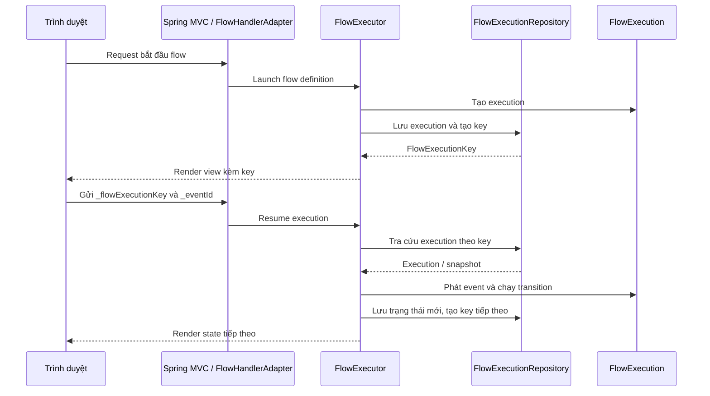

# FlowExecutionRepository và việc lưu, khôi phục trạng thái

Trong Spring Web Flow, một hành trình như đặt phòng, đăng ký tài khoản hoặc thanh toán thường đi qua nhiều màn hình. Người dùng có thể nhập dữ liệu ở một bước, quay lại bước trước, mở một tab khác hoặc tiếp tục sau một lần chuyển trang. Để xử lý những tình huống đó, ứng dụng cần giữ được trạng thái của lần chạy flow giữa các HTTP request.

`FlowExecutionRepository` đảm nhiệm việc quản lý và truy xuất các lần chạy flow. Repository giúp Spring Web Flow tìm lại một `FlowExecution` từ khóa thực thi mà trình duyệt gửi lên, lưu trạng thái mới sau khi xử lý event và quản lý các snapshot có thể khôi phục. Hiểu đúng vai trò của repository giúp ta thiết kế scope phù hợp, xử lý phiên hết hạn và tránh nhầm trạng thái điều hướng với dữ liệu nghiệp vụ cần lưu bền vững.

## 1. Phân biệt flow definition, flow execution và repository

Ba khái niệm này có vai trò khác nhau:

| Thành phần | Vai trò | Ví dụ trong quy trình thanh toán |
|---|---|---|
| `FlowDefinition` | Mô tả cấu trúc có thể tái sử dụng: state, event, transition, subflow và end state | Định nghĩa các bước chọn địa chỉ, xem lại đơn và xác nhận |
| `FlowExecution` | Một lần chạy cụ thể của flow definition, có trạng thái và dữ liệu riêng | Lần thanh toán của một người dùng với một giỏ hàng cụ thể |
| `FlowExecutionRepository` | Lưu, tìm và quản lý các lần chạy flow theo execution key | Tìm lại lần thanh toán khi người dùng gửi event `continue` |

Một flow definition có thể được nhiều người dùng chạy đồng thời. Mỗi lần chạy có một `FlowExecution` riêng, vì vậy trạng thái ở bước chọn địa chỉ của người này không được trộn với trạng thái của người khác.

Một execution có thể chứa một hoặc nhiều flow session khi flow gọi subflow. Ví dụ, flow thanh toán chính gọi subflow chọn địa chỉ giao hàng. Khi subflow hoạt động, execution cần giữ được ngữ cảnh của flow cha để có thể quay lại đúng bước sau khi subflow kết thúc.

Repository không quyết định người dùng được phép mua sản phẩm nào, không thay thế service nghiệp vụ và cũng không tự định nghĩa transition. Nó cung cấp cơ chế để `FlowExecutor` tìm lại và tiếp tục đúng execution theo yêu cầu HTTP.

## 2. Vòng đời lưu và khôi phục execution

Khi người dùng bắt đầu một flow, Spring Web Flow tạo execution mới từ flow definition. Khi execution tạm dừng tại một view state để hiển thị trang, framework tạo hoặc cập nhật thông tin lưu trữ và cung cấp một `FlowExecutionKey`. Trình duyệt gửi khóa này trong request tiếp theo cùng event mà người dùng kích hoạt.

Các request tiếp tục flow thường mang hai tham số quan trọng:

- `_flowExecutionKey`: xác định execution hoặc snapshot cần tiếp tục.
- `_eventId`: tên event mà người dùng phát ra, chẳng hạn `continue`, `back` hoặc `confirm`.

Luồng xử lý tổng quát:



Có thể nhìn vòng đời theo sáu bước:

1. **Launch:** `FlowExecutor` nhận flow id và tạo một execution mới.
2. **Lưu lần đầu:** repository ghi nhận execution và tạo khóa để request tiếp theo tham chiếu đến nó.
3. **Resume:** request tiếp theo gửi khóa cùng event; repository phân tích khóa và tìm execution tương ứng.
4. **Xử lý event:** `FlowExecutor` phát event vào execution. Flow engine kiểm tra transition, chạy action cần thiết và chuyển state nếu điều kiện phù hợp.
5. **Lưu snapshot mới:** khi execution tạm dừng để chờ tương tác tiếp theo, repository cập nhật trạng thái và cung cấp khóa tương ứng.
6. **Kết thúc:** khi flow đi đến end state, execution được kết thúc và được dọn dẹp theo chính sách của repository.

Tên phương thức và chi tiết lưu trữ phụ thuộc implementation, nhưng trách nhiệm cốt lõi của repository vẫn là quản lý execution, tạo hoặc phân tích key, truy xuất execution và loại bỏ execution khi cần.

## 3. FlowExecutionKey và snapshot

`FlowExecutionKey` là định danh mà request dùng để tham chiếu đến một lần chạy flow hoặc một phiên bản trạng thái có thể khôi phục của lần chạy đó. Ứng dụng nên xem key như một giá trị opaque: truyền lại nguyên vẹn cho framework, không tự phân tích cấu trúc bên trong và không dựa vào định dạng chuỗi cụ thể. Cách mã hóa key có thể phụ thuộc implementation và phiên bản.

Snapshot là ảnh chụp trạng thái execution tại một thời điểm. Khi người dùng chuyển từ bước nhập địa chỉ sang bước xem lại đơn, framework có thể lưu snapshot mới. Nếu trình duyệt quay lại và gửi key của snapshot cũ, repository có thể khôi phục trạng thái tương ứng, miễn là snapshot đó vẫn còn được giữ.

Khả năng này hữu ích cho nút Back của trình duyệt và việc xử lý nhiều lần hiển thị của một flow. Tuy nhiên, snapshot có giới hạn:

- Snapshot cũ có thể bị loại bỏ khi vượt quá số lượng snapshot được cấu hình.
- Một key có thể không còn hợp lệ sau khi execution kết thúc, session hết hạn hoặc dữ liệu lưu trữ bị xóa.
- Khôi phục snapshot chỉ khôi phục trạng thái điều hướng và dữ liệu nằm trong execution. Nó không tự hoàn tác một giao dịch đã commit ở database.
- Hai request đồng thời sử dụng key cũ có thể tạo ra tình huống cạnh tranh. Ứng dụng cần cân nhắc đồng bộ hóa, tính idempotent của event và cách repository xử lý request đồng thời.

Vì vậy, không nên xem snapshot như cơ chế versioning toàn diện cho dữ liệu nghiệp vụ. Snapshot phục vụ việc tiếp tục một hành trình tương tác web.

## 4. Dữ liệu nào được giữ trong execution?

Repository lưu trạng thái của execution, trong đó có state hiện tại, ngữ cảnh các flow session và dữ liệu trong những scope thuộc vòng đời của flow. Cần chọn scope dựa trên thời gian dữ liệu phải tồn tại:

| Scope | Vòng đời | Cách dùng thường gặp |
|---|---|---|
| `requestScope` | Trong một request | Giá trị tạm chỉ dùng khi xử lý request hiện tại |
| `flashScope` | Dùng để chuyển dữ liệu qua giai đoạn xử lý event và hiển thị kế tiếp | Thông báo sau khi lưu thành công |
| `viewScope` | Trong thời gian ở một view state | Dữ liệu form của màn hình hiện tại |
| `flowScope` | Trong toàn bộ flow session | Bản nháp đơn hàng trong flow thanh toán |
| `conversationScope` | Trong conversation, có thể bao trùm flow cha và subflow | Ngữ cảnh cần chia sẻ giữa flow cha và subflow |

`requestScope` chỉ phù hợp với dữ liệu ngắn hạn của request. Các scope gắn với view hoặc flow có thể cần được giữ lại để execution tiếp tục ở request sau. Khi một subflow kết thúc, dữ liệu trong scope của subflow có vòng đời riêng; dữ liệu được đặt trong conversation scope có thể được chia sẻ trong phạm vi conversation.

Ví dụ, flow thanh toán có thể giữ mã giỏ hàng và lựa chọn địa chỉ trong `flowScope`:

```xml
<view-state id="shipping" model="checkoutForm">
    <transition on="continue" to="review" />
</view-state>

<view-state id="review">
    <transition on="confirm" to="complete" />
</view-state>
```

Trong ví dụ này, `checkoutForm` là model phục vụ binding của view. Những giá trị cần đi qua nhiều state nên được đặt trong scope có vòng đời phù hợp, thay vì giả định rằng biến cục bộ của một request sẽ tự tồn tại ở request tiếp theo.

Không nên đưa toàn bộ object graph của ứng dụng vào flow scope. Ưu tiên lưu các giá trị nhỏ cần cho điều hướng, chẳng hạn `cartId`, `selectedAddressId` hoặc một bản nháp gọn. Khi cần dữ liệu mới nhất, gọi service để đọc từ database theo ID. Tránh giữ các đối tượng phụ thuộc vòng đời request hoặc tài nguyên đang mở như `HttpServletRequest`, response, stream, thread, connection hay transaction.

Khả năng serialize phụ thuộc repository và môi trường triển khai. Với cấu hình lưu execution trong HTTP session, ứng dụng đơn máy có thể đang giữ object trong bộ nhớ session. Nhưng nếu session được passivate, replicate giữa các node hoặc repository dùng cơ chế serialize snapshot, các object được giữ lại cần đáp ứng yêu cầu serialization của cơ chế đó. Hãy kiểm tra điều kiện triển khai thực tế thay vì mặc định rằng mọi object Java đều có thể khôi phục an toàn.

## 5. Cấu hình repository

Với cấu hình XML của Spring Web Flow, repository được khai báo bên trong flow executor. Ví dụ sau cấu hình giới hạn số snapshot được giữ cho mỗi execution:

```xml
<webflow:flow-executor id="flowExecutor"
                       flow-registry="flowRegistry">
    <webflow:flow-execution-repository
            max-execution-snapshots="10" />
</webflow:flow-executor>
```

Giá trị `10` chỉ là ví dụ để minh họa cấu hình. Khi chọn giới hạn snapshot, hãy cân nhắc số bước người dùng có thể quay lại, số execution đồng thời và bộ nhớ cần dùng. Giữ quá ít snapshot làm nút Back không thể khôi phục một số bước cũ; giữ quá nhiều có thể làm tăng lượng dữ liệu trong session hoặc kho lưu trữ.

Trong cấu hình mặc định thường dùng, execution và snapshot được quản lý gắn với HTTP session. Điều đó thuận tiện cho ứng dụng MVC truyền thống, nhưng trạng thái có thể mất khi session hết hạn hoặc bị xóa. Nếu ứng dụng cần failover giữa nhiều node, cần cấu hình cơ chế session replication hoặc một repository phù hợp với kiến trúc triển khai, đồng thời kiểm tra khả năng serialize và tính tương thích giữa các phiên bản ứng dụng.

Một repository tùy biến có thể phù hợp khi ứng dụng cần kho lưu trữ phân tán hoặc chính sách quản lý execution riêng. Khi đó, implementation phải xử lý đầy đủ việc tạo key, truy xuất đúng execution/snapshot, cập nhật trạng thái, dọn dẹp execution hết hạn và các tình huống truy cập đồng thời. Không nên tự viết repository chỉ để lưu thêm một vài trường dữ liệu nghiệp vụ; các dữ liệu đó thường thuộc trách nhiệm của service và database.

## 6. Ví dụ: khôi phục flow thanh toán

Giả sử người dùng bắt đầu flow `checkout`, chọn địa chỉ giao hàng rồi chuyển đến màn hình xem lại đơn. Flow giữ `cartId` và `selectedAddressId` trong dữ liệu thuộc flow scope. Khi màn hình xem lại được render, trình duyệt nhận execution key hiện tại.

| Thời điểm | Request hoặc thao tác | Trạng thái cần được giữ |
|---|---|---|
| T0 | Bắt đầu flow `checkout` | Execution mới ở state chọn địa chỉ |
| T1 | Chọn địa chỉ và gửi event `continue` | `cartId`, `selectedAddressId`; state chuyển sang xem lại |
| T2 | Tải lại màn hình xem lại bằng key hiện tại | Repository tìm lại execution đang ở state xem lại |
| T3 | Quay lại snapshot trước đó, nếu snapshot còn tồn tại | Execution được khôi phục về state chọn địa chỉ |
| T4 | Gửi event `confirm` | Service xác nhận đơn; flow đi đến end state |

Khi xử lý event `confirm`, service nên kiểm tra lại giỏ hàng, giá, tồn kho và quyền của người dùng từ nguồn dữ liệu nghiệp vụ. Các giá trị được khôi phục từ snapshot có thể đã cũ. Không nên coi `selectedAddressId` hay giá trị hiển thị ở màn hình trước là bằng chứng rằng giao dịch hiện tại vẫn hợp lệ.

Nếu người dùng nhấn xác nhận hai lần, hoặc trình duyệt gửi lại request sau lỗi mạng, service cần có cơ chế chống xử lý trùng phù hợp, ví dụ khóa nghiệp vụ hoặc idempotency key. Repository quản lý vòng đời execution; nó không bảo đảm rằng thao tác thanh toán hay tạo đơn chỉ chạy một lần.

## 7. Những tình huống khôi phục thường gặp

### Session hết hạn hoặc execution không còn tồn tại

Người dùng để trang quá lâu rồi gửi event. Session có thể đã hết hạn, execution bị dọn dẹp hoặc key không còn được repository nhận diện. Ứng dụng nên đưa người dùng đến thông báo phiên làm việc đã hết hạn và hướng dẫn bắt đầu lại flow. Không nên tự dựng lại execution chỉ từ các trường form do trình duyệt gửi lên, vì các trường đó không chứng minh được trạng thái trước đây.

### Snapshot cũ đã bị loại bỏ

Người dùng quay lại quá nhiều bước, nhưng snapshot tương ứng không còn trong giới hạn lưu trữ. Khi đó không thể giả định repository sẽ khôi phục được trạng thái cũ. Hãy chọn giới hạn snapshot phù hợp và thiết kế trải nghiệm cho trường hợp key cũ không còn hợp lệ.

### Deploy hoặc chuyển node

Nếu execution nằm trong HTTP session cục bộ của một node, request tiếp theo đến node khác có thể không tìm thấy execution. Sticky session giúp giữ request ở cùng node nhưng không tự cung cấp failover. Với môi trường nhiều node, cần xem xét session replication hoặc kho lưu trữ dùng chung; đồng thời xác minh các object trong execution có thể serialize và được đọc bởi phiên bản code đang chạy.

### Dữ liệu trong snapshot đã lỗi thời

Snapshot có thể chứa lựa chọn hoặc bản nháp được tạo trước đó. Trước hành động quan trọng, hãy tải lại dữ liệu nghiệp vụ và kiểm tra các điều kiện hiện hành. Ví dụ, giá sản phẩm hoặc tồn kho có thể đã thay đổi kể từ lúc người dùng mở màn hình review.

### Request đồng thời hoặc gửi lại event

Nhiều tab có thể chạy những execution khác nhau; cùng một tab cũng có thể phát sinh request lặp do người dùng nhấn nhiều lần hoặc mạng gửi lại. Không chia sẻ mutable object giữa các execution nếu không có cơ chế đồng bộ rõ ràng. Với thao tác làm thay đổi dữ liệu nghiệp vụ, hãy thiết kế service theo hướng idempotent và xử lý transaction ở tầng nghiệp vụ.

## 8. Kiểm thử việc lưu và khôi phục

Kiểm thử chỉ transition đúng state là chưa đủ. Cần kiểm tra cả vòng đời của execution và dữ liệu qua nhiều request. Một bộ kiểm thử tích hợp nên bao gồm:

1. **Bắt đầu flow:** launch flow và xác minh có thể tiếp tục execution bằng key được cấp.
2. **Đi qua nhiều state:** gửi event ở state đầu, tiếp tục request mới và xác minh state cùng dữ liệu cần thiết vẫn còn.
3. **Khôi phục snapshot:** dùng key của một snapshot trước đó khi snapshot còn hiệu lực và xác minh state được phục hồi đúng.
4. **Key không hợp lệ:** gửi key sai, key hết hạn hoặc key thuộc execution đã kết thúc; xác minh ứng dụng xử lý lỗi có kiểm soát.
5. **Giới hạn snapshot:** kiểm tra hành vi khi số snapshot vượt giới hạn cấu hình.
6. **Nhiều execution:** mở hai flow độc lập và xác minh dữ liệu của chúng không bị trộn.
7. **Serialization và failover:** nếu môi trường triển khai yêu cầu, kiểm tra passivation, replication hoặc đọc execution từ node khác.
8. **Event lặp:** gửi lại event xác nhận và xác minh nghiệp vụ không tạo đơn hoặc thu tiền hai lần.

Trong kiểm thử, nên quan sát cả state hiện tại, dữ liệu scope cần giữ và kết quả ở tầng service. Log hoặc `FlowExecutionListener` có thể hỗ trợ theo dõi các mốc bắt đầu, chuyển state, kết thúc và lỗi của execution. Chỉ ghi những định danh cần thiết; tránh ghi toàn bộ dữ liệu form, thông tin cá nhân hoặc nội dung nhạy cảm vào log.

## 9. Nguyên tắc thiết kế

- Chọn scope theo vòng đời thực tế của dữ liệu. Dữ liệu chỉ dùng trong một request nên ở request scope; dữ liệu cần đi qua nhiều state nên ở flow scope hoặc conversation scope tùy phạm vi chia sẻ.
- Giữ execution gọn. Lưu ID và bản nháp tối thiểu, sau đó truy vấn dữ liệu nghiệp vụ qua service.
- Xem execution key là khóa tham chiếu do framework quản lý. Không tự thay đổi định dạng hoặc dùng key làm cơ chế phân quyền.
- Chọn giới hạn snapshot dựa trên hành trình người dùng và ngân sách bộ nhớ.
- Xử lý session hết hạn, key không hợp lệ và snapshot đã bị dọn dẹp bằng trải nghiệm có thể hiểu được.
- Giữ transaction và quy tắc nghiệp vụ ở service/database. Khôi phục flow không đồng nghĩa hoàn tác side effect đã commit.
- Với triển khai nhiều node, xác định rõ nơi lưu execution, cách đồng bộ session và yêu cầu serialization.
- Kiểm thử nhiều request, nhiều tab, event lặp và khôi phục snapshot, thay vì chỉ kiểm thử một lần submit form.

`FlowExecutionRepository` là lớp hạ tầng giúp Spring Web Flow tiếp tục một hành trình nhiều bước qua ranh giới HTTP request. Khi phân biệt rõ execution state với dữ liệu nghiệp vụ, quản lý scope theo vòng đời và chuẩn bị cho các trường hợp session hoặc snapshot không còn tồn tại, ứng dụng sẽ có luồng điều hướng ổn định và dễ kiểm thử hơn.
