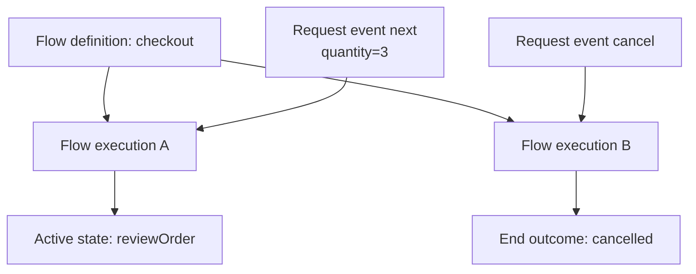
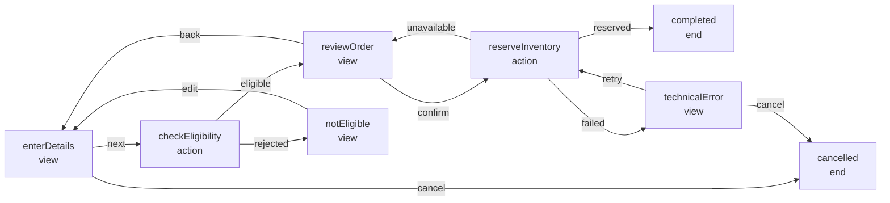
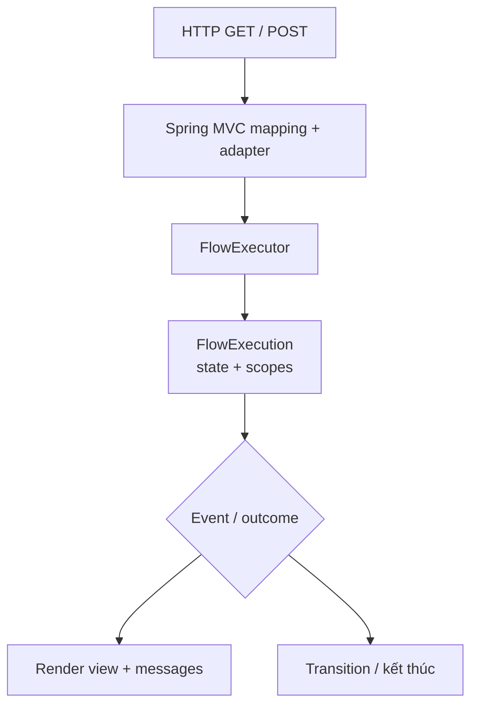

# Phạm vi kiểm thử định nghĩa và hành vi điều hướng

**Spring Web Flow** tổ chức các hành trình web nhiều bước bằng các **state, event, transition và subflow**. Người dùng có thể nhập thông tin trên một màn hình, hệ thống xử lý một số bước không cần màn hình, rồi chuyển sang xác nhận hoặc phục hồi khi có lỗi. Khác với ứng dụng điều hướng rải rác trong nhiều Spring MVC controller, phần lớn đường đi của một hành trình được thể hiện ngay trong định nghĩa flow.

Vì thế, việc kiểm thử cần trả lời **hai câu hỏi độc lập nhưng bổ sung cho nhau**:

1. **Định nghĩa flow có hợp lệ và đầy đủ không?** Ví dụ XML tải được, các state được khai báo đúng, transition trỏ đến state tồn tại, event nghiệp vụ và subflow có hợp đồng rõ ràng.
2. **Khi flow thực sự chạy, nó có đi đúng hướng không?** Ví dụ submit biểu mẫu hợp lệ thì sang bước xác nhận, submit sai thì ở lại form, action báo hết hàng thì quay lại, người dùng bấm hủy thì kết thúc.

Chương **Kiểm thử flow** tập trung vào **phạm vi kiểm thử định nghĩa và hành vi điều hướng**, đồng thời liên hệ trực tiếp với form binding, validation, scope, session, tích hợp Spring MVC và phục hồi execution khi gặp lỗi.

## 1. Hai lớp kiểm thử và những điều chúng chứng minh

| Tiêu chí | Kiểm thử định nghĩa flow | Kiểm thử hành vi điều hướng |
| --- | --- | --- |
| Đối tượng | `FlowDefinition`: cấu trúc state, transition, action, input, outcome | `FlowExecution`: một lần chạy cụ thể của flow |
| Đầu vào | Flow XML/cấu hình, flow registry, bean và resource | Flow input, event, request parameter, dữ liệu scope, kết quả service |
| Câu hỏi | Luồng có thể build, tham chiếu đúng và mô tả các nhánh cần thiết không? | Với một tình huống cụ thể, flow tới state nào và có tác dụng phụ gì? |
| Kết quả | Có thể khởi tạo định nghĩa, không có state đích sai, hợp đồng rõ ràng | Active state, end outcome, dữ liệu model, thông báo lỗi và số lần gọi action |
| Giới hạn | Cấu trúc đúng không chứng minh runtime chọn đúng nhánh | Vài kịch bản đi đúng không chứng minh tất cả transition đều được bao phủ |

Ví dụ, một file XML có thể khai báo:

```xml
<action-state id="reserveInventory">
    <evaluate expression="inventoryAction.reserve(flowScope.order)" />
    <transition on="reserved" to="completed" />
    <transition on="failed" to="technicalError" />
</action-state>
```

Định nghĩa này có thể tải thành công. Nhưng nếu action thực sự phát event `unavailable` khi hết hàng, flow lại **không có transition tương ứng**. Kiểm thử định nghĩa dựa vào danh sách event kỳ vọng có thể phát hiện thiếu sót khi rà soát; kiểm thử thực thi sẽ chứng minh điều gì xảy ra khi action trả `unavailable`.

### Phân biệt các mức kiểm thử

| Mức | Trọng tâm | Ví dụ |
| --- | --- | --- |
| Unit test | Logic độc lập của converter, validator và action | `InventoryAction` trả event `unavailable` |
| Definition test | Nạp cấu trúc và rà soát hợp đồng điều hướng | Mọi nhánh event quan trọng có state đích |
| Flow-execution test | Cho engine Web Flow thực sự start/resume với event | `unavailable` chuyển đến `reviewOrder` |
| MVC integration test | HTTP request, handler, form, session, flow execution key và view | POST sai dữ liệu render lại trang nhập với thông báo |
| End-to-end test | Hành trình thực qua trình duyệt và các tích hợp cần thiết | Nhập → xác nhận → thử lại → hoàn tất |

**Đừng dùng unit test cho action để thay thế flow test.** Unit test có thể chứng minh action trả chuỗi event đúng, nhưng chỉ khi chạy qua engine và định nghĩa XML ta mới biết transition đích có đúng hay không.

## 2. Flow definition, flow execution và external context

Để thiết kế test chính xác, cần phân biệt:

- **Flow definition:** bản mô tả có thể tái sử dụng gồm các state, biến, event và transition. Nhiều người dùng có thể thực thi cùng một definition.
- **Flow execution:** một lần thực hiện definition, có state hiện tại, các scope và trạng thái đã được giữ lại theo cấu hình.
- **External context:** thông tin phía ngoài engine, gồm input ban đầu, event request, parameter và ngữ cảnh ứng dụng web.



Hai execution chạy cùng definition có thể tới kết quả khác nhau. Vì vậy, mỗi test cần xác định rõ **trạng thái xuất phát**, **event gửi vào**, **dữ liệu liên quan** và **state/outcome kỳ vọng**. Không nên dùng chung execution giữa những test độc lập, vì dữ liệu scope hoặc trạng thái trước đó có thể khiến kết quả phụ thuộc thứ tự chạy.

## 3. Flow đặt hàng mẫu làm đối tượng kiểm thử

Giả sử quy trình bán hàng đi qua:

1. `enterDetails`: người dùng nhập số lượng.
2. `checkEligibility`: action tự động kiểm tra điều kiện mua.
3. `reviewOrder`: người dùng xem và xác nhận.
4. `reserveInventory`: action tự động giữ hàng.
5. `completed`: kết thúc thành công; các nhánh lỗi dẫn tới `notEligible`, `technicalError` hoặc quay về màn hình xác nhận.



Định nghĩa XML rút gọn:

```xml
<?xml version="1.0" encoding="UTF-8"?>
<flow xmlns="http://www.springframework.org/schema/webflow"
      xmlns:xsi="http://www.w3.org/2001/XMLSchema-instance"
      xsi:schemaLocation="http://www.springframework.org/schema/webflow
        http://www.springframework.org/schema/webflow/spring-webflow.xsd">

    <var name="checkoutForm" class="com.example.checkout.CheckoutForm" />

    <view-state id="enterDetails" view="checkout/details"
                model="checkoutForm">
        <binder>
            <binding property="quantity" required="true" />
        </binder>
        <transition on="next" to="checkEligibility" />
        <transition on="cancel" to="cancelled"
                    bind="false" validate="false" />
    </view-state>

    <action-state id="checkEligibility">
        <evaluate expression="eligibilityAction.check(flowScope.checkoutForm)" />
        <transition on="eligible" to="reviewOrder" />
        <transition on="rejected" to="notEligible" />
    </action-state>

    <view-state id="notEligible" view="checkout/not-eligible">
        <transition on="edit" to="enterDetails" />
    </view-state>

    <view-state id="reviewOrder" view="checkout/review">
        <transition on="back" to="enterDetails" />
        <transition on="confirm" to="reserveInventory" />
    </view-state>

    <action-state id="reserveInventory">
        <evaluate expression="inventoryAction.reserve(flowScope.checkoutForm)" />
        <transition on="reserved" to="completed" />
        <transition on="unavailable" to="reviewOrder" />
        <transition on="failed" to="technicalError" />
    </action-state>

    <view-state id="technicalError" view="checkout/error">
        <transition on="retry" to="reserveInventory" />
        <transition on="cancel" to="cancelled" />
    </view-state>

    <end-state id="completed" view="checkout/completed" />
    <end-state id="cancelled" />
</flow>
```

Giả sử `CheckoutForm` có property `Integer quantity`, validator kiểm tra số lượng dương, và `eligibilityAction`/`inventoryAction` là Spring beans do ứng dụng cung cấp. XML chỉ diễn tả điều hướng; các lớp domain, service, view và xử lý transaction phải được triển khai riêng.

Một action có thể trả về event:

```java
public Event check(CheckoutForm form) {
    boolean allowed = eligibilityService.canBuy(form.getQuantity());
    return new Event(this, allowed ? "eligible" : "rejected");
}
```

Điều quan trọng khi viết test là **tên event do action trả phải khớp transition** trong XML. Một ngoại lệ Java chưa được xử lý không mặc nhiên biến thành event `failed`.

## 4. Kiểm thử định nghĩa flow: cú pháp, cấu trúc và hợp đồng

### 4.1. Nạp và build definition

Trước hết, test phải xác minh tài nguyên flow được đọc và build thành công qua đúng bộ cấu hình mà ứng dụng sử dụng. Những điểm đáng kiểm tra gồm:

1. Resource XML được đăng ký với flow ID đúng trong flow registry.
2. Schema, namespace và các thành phần XML được phiên bản Web Flow chấp nhận.
3. State bắt đầu và các state đích có tên xác định, không trùng và không thiếu.
4. Các transition tham chiếu tới state hợp lệ; end-state có outcome rõ ràng.
5. Biểu thức, input, bean action và subflow reference được cấu hình phù hợp với ngữ cảnh test.
6. Form model, các property được binding và scope được khai báo có chủ đích.

**Build definition thành công chưa chứng minh mọi expression chạy được.** Một số lời gọi bean hoặc phép đánh giá điều kiện chỉ xuất hiện khi execution đi qua state cụ thể, nên cần flow-execution test để phát hiện sai chữ ký method, sai kiểu dữ liệu hoặc exception.

### 4.2. Xem flow như một đồ thị

Đặt **state là đỉnh**, **transition là cạnh** và **event/guard là nhãn**. Khi review, có thể hỏi:

- Từ điểm bắt đầu, state nào **không thể đi tới**?
- Có action-state nào phát event dự kiến nhưng **không có transition**?
- Có state nào đi vào được nhưng không có lối ra hợp lý (ngoài chủ đích kết thúc)?
- Hai action-state có tạo **vòng lặp tự động** mà không có điểm dừng?
- Những nhánh `completed`, `cancelled` và lỗi kỹ thuật có thể được chạm tới không?
- Các nhánh `back`, `edit`, `retry` có trả lại đúng bước không?

Việc phân tích đồ thị giúp tìm nhánh bị bỏ quên. Tuy nhiên, một công cụ duyệt XML không thể tự biết **tất cả event một service Java có thể trả về**; cần thiết lập hợp đồng event và dùng test hành vi để kiểm chứng.

### 4.3. Hợp đồng input, subflow và binding

| Phần khai báo | Điều cần xác minh |
| --- | --- |
| `<input>` | Tên, kiểu, tính bắt buộc, hành vi khi thiếu/sai dữ liệu |
| `<binder>` | Chỉ cho phép những property mà người dùng được sửa |
| `flowScope` | Biến được khởi tạo trước khi state sau tham chiếu |
| `viewScope` / `flashScope` | Dữ liệu và thông báo có vòng đời phù hợp |
| `<subflow-state>` | Đúng flow con, input mapping và outcome mapping |
| `<end-state>` | Kết thúc đúng nghĩa và cung cấp output cần thiết cho bên gọi |

Trong ví dụ, binder chỉ cho phép `quantity`. Nếu `CheckoutForm` hoặc entity có field nội bộ như `approved`, `price`, `paid`, test HTTP nên xác nhận client không thể sửa chúng bằng cách tự gửi thêm tham số. Bảo vệ binding bổ sung cho kiểm tra phân quyền ở service, không thay thế nó.

## 5. Mỗi test điều hướng nên mô tả Given–When–Then

Một kịch bản đủ để người khác tái lập gồm:

- **Given:** flow đang ở state nào, scope chứa gì và service giả lập sẽ trả event nào.
- **When:** người dùng gửi event gì và những parameter nào.
- **Then:** flow dừng ở state nào hoặc kết thúc bằng outcome nào.
- **And:** dữ liệu scope, thông báo và số lần gọi service phải đúng; các tác vụ không liên quan chưa được thực thi.

Ví dụ:

```text
Given: execution ở enterDetails
       checkoutForm.quantity chưa có giá trị
       eligibilityAction sẽ trả Event("eligible")
When:  gửi Event("next") kèm quantity="3"
Then:  active state = reviewOrder
       checkoutForm.quantity = Integer(3)
And:   inventoryAction chưa được gọi
```

Nếu test chỉ kiểm tra `reviewOrder` được render, lỗi gọi `inventoryAction` quá sớm hoặc lưu số lượng sai có thể lọt qua. Kiểm thử điều hướng tốt nên xác nhận cả **đích đến** và **tác dụng phụ trên đường đi**.

### Ma trận kịch bản quan trọng

| State xuất phát | Event / điều kiện | State hoặc outcome kỳ vọng |
| --- | --- | --- |
| Bắt đầu flow | Start không có event | `enterDetails` |
| `enterDetails` | `next`; dữ liệu hợp lệ; `eligible` | `reviewOrder` |
| `enterDetails` | `next`; `rejected` | `notEligible` |
| `enterDetails` | `next`; `quantity=-2` | Ở lại `enterDetails`, có validation error |
| `enterDetails` | `next`; `quantity=abc` | Ở lại `enterDetails`, có binding error |
| `enterDetails` | `cancel` với form sai | `cancelled`, không gọi service |
| `notEligible` | `edit` | `enterDetails` |
| `reviewOrder` | `back` | `enterDetails`, dữ liệu còn theo thiết kế |
| `reviewOrder` | `confirm`; `reserved` | `completed` |
| `reviewOrder` | `confirm`; `unavailable` | `reviewOrder` và thông báo lỗi nghiệp vụ |
| `reviewOrder` | `confirm`; `failed` | `technicalError` |
| `technicalError` | `retry`; lần sau `reserved` | `completed`, không ghi trùng |
| `technicalError` | `cancel` | `cancelled` |

Không nhất thiết tạo tất cả hoán vị dữ liệu. Ưu tiên các event có ý nghĩa nghiệp vụ, dữ liệu biên, lỗi chuyển kiểu, nhánh hiếm, thao tác quay lại/hủy và giao dịch có tác dụng phụ.

## 6. Kiểm thử FlowExecution bằng Spring Web Flow Test support

Trong Spring Web Flow 2.x, thư viện test support có các lớp như `AbstractXmlFlowExecutionTests`, `AbstractFlowExecutionTests` và `MockExternalContext`. Chúng hỗ trợ nạp định nghĩa XML, khởi động flow execution, gửi event và kiểm tra active state. **API chính xác và cách chạy với JUnit phụ thuộc phiên bản**, nên các ví dụ dưới đây trình bày mẫu thao tác và cần đối chiếu thư viện đang được dự án sử dụng.

```java
// Ví dụ dạng phác thảo với API Spring Web Flow 2.x.
public class CheckoutFlowTests extends AbstractXmlFlowExecutionTests {

    @Override
    protected FlowDefinitionResource getResource(
            FlowDefinitionResourceFactory resourceFactory) {
        return resourceFactory.createFileResource(
            "src/main/webapp/WEB-INF/flows/checkout/checkout.xml");
    }

    public void testStartFlow() {
        startFlow();
        assertCurrentStateEquals("enterDetails");
    }

    public void testCancelFlow() {
        startFlow();

        MockExternalContext context = new MockExternalContext();
        context.setEventId("cancel");
        resumeFlow(context);

        assertFlowExecutionEnded();
        // Ngoài ra, kiểm tra end outcome = "cancelled"
        // theo API assertion của phiên bản đang dùng.
    }
}
```

Đoạn minh họa cố ý lược bỏ import, cách cấu hình bean và khởi tạo model/validator để tập trung vào ba thao tác cơ bản:

1. **Load:** lấy resource định nghĩa bằng `getResource`.
2. **Start:** gọi `startFlow()` và khẳng định state ban đầu.
3. **Resume:** tạo external context có event, gọi `resumeFlow(context)` và khẳng định kết quả.

Đối với action-state, test phải cung cấp các Spring bean hoặc mock/fake tương ứng vào flow builder context. Không nên chạy test với service kho hoặc hệ thống thanh toán thật chỉ để kích hoạt transition; điều đó khiến test chậm và thiếu ổn định.

### Test với action trả event

Giả sử `checkEligibility` trả `eligible`. Khi người dùng gửi `next`, engine có thể chuyển trong cùng một lượt xử lý:

```text
enterDetails --next--> checkEligibility --eligible--> reviewOrder
```

Do `checkEligibility` là action-state tự động, assertion **sau khi `resumeFlow` hoàn tất** thường cần kiểm tra active state là `reviewOrder`, không phải `checkEligibility`. Nếu action trả `rejected`, active state phải là `notEligible`.

Để kiểm tra chuyển nhánh, cung cấp fake action trả event cố định. Cùng một XML có thể được chạy qua ba kịch bản: thành công, từ chối và lỗi. Unit test riêng của action sẽ kiểm tra sự tương ứng giữa phản hồi service và tên event, còn flow-execution test kiểm tra **XML xử lý event đó thế nào**.

### Một lớp test chỉ bao phủ điều gì?

Unit test gọi trực tiếp `eligibilityAction.check(...)` chỉ chứng minh logic action. Flow test gọi `startFlow` và `resumeFlow` với definition thực mới bao phủ đường chuyển trạng thái. Integration test qua Spring MVC mới bao phủ route HTTP, view rendering, binding theo request thật và session/repository.

Nếu một test runner JUnit 5 không tự phát hiện các test theo phong cách JUnit 3 của bộ test support cũ, hãy dùng cấu hình runner/adapter hoặc lớp test tương thích phiên bản. Không nên giả định tên phương thức `test...` sẽ luôn được chạy bởi mọi JUnit engine.

## 7. Kiểm thử binding, conversion và validation trước transition

Flow nhiều bước thường có `view-state` gắn model. Event `next` đưa dữ liệu từ HTTP vào model, chuyển kiểu rồi validation theo cấu hình của Web Flow. Test cần chứng minh:

| Input và event | Kết quả kỹ thuật | Kết quả điều hướng |
| --- | --- | --- |
| `quantity="3"`, `next` | Bind được thành `Integer(3)` | Đi tiếp nếu validator và action đồng ý |
| `quantity="abc"`, `next` | Lỗi conversion/binding | Ở lại `enterDetails`, thông báo rõ |
| `quantity="-2"`, `next` | Chuyển kiểu thành công nhưng validation không đạt | Ở lại `enterDetails` |
| Không có quantity bắt buộc, `next` | Lỗi thiếu trường theo binder/validator | Ở lại form |
| `quantity="abc"`, `cancel` | Binding/validation được bỏ qua theo cấu hình | Flow vẫn hủy được |

**Conversion khác validation:** chuỗi `abc` không chuyển thành số nguyên, còn `-2` có thể chuyển thành số nguyên nhưng vi phạm ràng buộc. Cả hai đều phải ngăn transition `next` đến action nghiệp vụ. Test cũng nên kiểm tra action chưa bị gọi khi form không hợp lệ.

Trong XML ví dụ, transition `cancel` có:

```xml
<transition on="cancel" to="cancelled"
            bind="false" validate="false" />
```

Điều đó cho phép hủy hành trình dù biểu mẫu hiện tại chưa hợp lệ. Với transition `next`, nếu dự án dùng Spring `Validator` hoặc Bean Validation, test tích hợp cần chứng minh **validator thực sự được Web Flow gọi**, không chỉ là class validator đã tồn tại.

Khi test sai định dạng, kiểm tra `MessageContext` và thông báo được render tại form. Đặc biệt với lỗi convert, giao diện nên cho người dùng sửa giá trị bị từ chối thay vì âm thầm gán `0` hoặc để thông điệp lỗi cũ kéo dài qua những lần submit hợp lệ.

## 8. Kiểm thử state, scope và dữ liệu qua nhiều request

Một flow giữ dữ liệu qua các bước, vì vậy kiểm thử điều hướng cần theo dõi cả model:

```text
start → enterDetails
next(quantity=3) → reviewOrder
back → enterDetails
next(quantity=5) → reviewOrder
confirm → reserveInventory → completed
```

Sau lần sửa, service giữ hàng phải nhận `5`, không phải `3`. Nếu phí giao hàng đã được tính từ dữ liệu cũ, phần phụ thuộc phải được đánh giá lại theo quy tắc nghiệp vụ trước khi hoàn tất.

| Scope | Ý nghĩa trong kiểm thử |
| --- | --- |
| `requestScope` | Dữ liệu tạm không được giả định tồn tại qua request sau |
| `viewScope` | Dữ liệu của view có vòng đời đúng khi vào, thoát và quay lại state |
| `flowScope` | Model và dữ liệu liên bước còn, được cập nhật sau khi sửa |
| `flashScope` | Thông báo ngắn hạn hiển thị đúng lần cần thiết |
| `conversationScope` | Dữ liệu dùng chung với flow con phù hợp và không rò giữa hành trình độc lập |

Ngoài trạng thái active, hãy kiểm tra **số lần service được gọi**, dữ liệu cập nhật, thông báo và hành vi khi người dùng lặp lại event. Điều này đặc biệt quan trọng với action-state lưu đơn, giữ hàng hoặc thanh toán.

## 9. Subflow: kiểm thử hợp đồng vào, ra và outcome

Giả sử luồng đặt hàng gọi một flow con để xác minh địa chỉ:

```xml
<subflow-state id="verifyAddress" subflow="addressVerification">
    <input name="address" value="flowScope.checkoutForm.address" />
    <transition on="verified" to="reviewOrder" />
    <transition on="rejected" to="enterDetails" />
</subflow-state>
```

Với một `subflow-state`, cần kiểm tra:

1. **Điểm gọi:** khi nào flow cha vào `verifyAddress` và có tìm được flow con `addressVerification` không.
2. **Input mapping:** flow con nhận đúng địa chỉ, kiểu dữ liệu và những input bắt buộc.
3. **Outcome mapping:** flow con kết thúc bằng `verified` thì flow cha vào `reviewOrder`; kết thúc bằng `rejected` thì quay lại `enterDetails`.
4. **Output mapping:** nếu flow con trả dữ liệu ra qua `output`, flow cha có đọc được đúng dữ liệu mong đợi không.
5. **Scope:** dữ liệu cần chia sẻ vẫn còn, dữ liệu riêng flow con không bị dùng nhầm ở flow cha.

Chỉ kiểm tra XML của flow cha có nhắc tới `addressVerification` là chưa đủ. Bài test thực thi cần đưa flow con tới end-state cụ thể rồi xác nhận state tiếp theo của flow cha. Nếu flow con có nhiều view-state, cũng cần kiểm tra hành vi tạm dừng/tiếp tục qua request.

## 10. Lỗi, retry, session và phục hồi execution

Các nhánh khó thường xuất hiện khi hệ thống đã thực hiện một phần nghiệp vụ:

- Action giữ hàng trả `unavailable`: quay về `reviewOrder` với thông báo hết hàng.
- Action giữ hàng trả `failed`: đi tới `technicalError` để thử lại hoặc hủy.
- Action ném exception không xử lý: được cơ chế exception handling của flow/ứng dụng tiếp nhận; **không tự biến thành event `failed`**.
- Người dùng thử lại sau lỗi: service phải xử lý việc gửi lặp bằng **idempotency key** hoặc chiến lược phù hợp, tránh đặt hàng/giữ hàng hai lần.

| Kịch bản | Điều cần kiểm chứng |
| --- | --- |
| Service trả event nghiệp vụ | Đúng transition và view thông báo |
| Service ném ngoại lệ | Đường xử lý exception, không đánh dấu thành công sai |
| Retry lần thứ hai | Số lần gọi và side effect đúng; không tạo hai giao dịch |
| Refresh trang sau POST | Không tự động lặp lại thao tác gây side effect ngoài ý muốn |
| Execution key cũ | Ứng dụng phản hồi phù hợp thay vì chỉnh sửa execution khác |
| Session hết hạn | Hành vi phục hồi/thông báo cho người dùng rõ ràng |
| Hai request cạnh tranh | Trạng thái và giao dịch nhất quán với repository/locking đang cấu hình |

`FlowExecutionRepository` quyết định cách execution được lưu, phục hồi và khóa tùy cấu hình. Test không được mặc định mọi repository đều giữ cùng một key qua tất cả request hoặc cho phép quay lại mọi snapshot đã đi qua.

Một bài integration test hữu ích là khởi động flow, lấy execution key, submit để sang `reviewOrder`, gửi request tiếp theo bằng key hợp lệ rồi xác nhận model còn dữ liệu. Sau đó cố tình dùng key đã hết hạn hoặc bị từ chối để kiểm chứng chính sách lỗi của ứng dụng.

**Action-state thường thực thi đồng bộ** khi flow đi qua state; nếu nghiệp vụ là job bất đồng bộ thực sự, kiểm thử riêng đường gửi job, lưu mã theo dõi và nhận kết quả ở request sau. Không suy diễn rằng action-state tự biến mọi thao tác dài thành job nền.

## 11. Kiểm thử Spring MVC và HTTP integration

Các lớp hạ tầng Web Flow thường tích hợp với Spring MVC qua `FlowHandlerMapping`, `FlowHandlerAdapter`, `FlowExecutor` và flow registry. Flow-execution test kiểm tra engine; test HTTP xác nhận request đi đúng vào engine:



Các trường hợp cần kiểm thử ở mức HTTP:

1. URL bắt đầu flow được ánh xạ tới đúng flow ID.
2. Form gửi đúng event theo quy ước Web Flow, chẳng hạn `_eventId_next`.
3. Tham số form được bind đúng property và chỉ những property cho phép mới được cập nhật.
4. Lỗi binding/validation render lại form với thông báo dễ hiểu và giá trị người dùng vừa nhập.
5. Hành trình tiếp tục sau một request có đúng execution key và dữ liệu session.
6. Kết thúc flow hiển thị view/outcome thích hợp và không vô tình tạo lại đơn.

Nếu sử dụng `MockMvc`, cần nạp cấu hình Web Flow thích hợp vào Spring TestContext. Một HTTP test chỉ mock controller thông thường mà không chạy `FlowExecutor` sẽ không chứng minh điều hướng Web Flow đang đúng.

## 12. Độ bao phủ của flow không đồng nghĩa line coverage

Line coverage trên các class Java không cho thấy mọi nhánh XML đã được thử. Có thể đo các chiều bao phủ:

| Loại bao phủ | Câu hỏi |
| --- | --- |
| State coverage | Mỗi state quan trọng đã từng được vào chưa? |
| Transition coverage | Mỗi event/guard quan trọng đã kích hoạt transition tương ứng chưa? |
| Outcome coverage | Mỗi đường kết thúc và outcome của subflow đã được kiểm tra chưa? |
| Invalid-input coverage | Những lỗi chuyển kiểu và validation quan trọng đã được đưa vào test chưa? |
| Recovery coverage | Có test lỗi kỹ thuật, retry, cancel và execution key lỗi chưa? |
| Scope coverage | Dữ liệu quan trọng còn đúng sau back, edit và nhiều request chưa? |

Không nhất thiết thử mọi tổ hợp event vì số lượng có thể tăng rất nhanh. Ưu tiên đường nghiệp vụ rủi ro cao, điều kiện biên và các transition phục hồi. Dùng test tham số cho danh sách kết quả của action; dùng execution riêng cho mỗi trường hợp để giữ test độc lập.

### Các sai lầm thường gặp

| Sai lầm | Hậu quả | Cách cải thiện |
| --- | --- | --- |
| Chỉ test XML có thể parse | Bỏ sót hành vi event và action | Chạy flow-execution test trên nhánh thực |
| Chỉ test action Java | Không biết transition trong flow có khớp event | Test qua engine với action fake |
| Mock luôn flow engine | Test không còn xác nhận semantics state/transition | Dùng engine thật, mock dependency nghiệp vụ |
| Chỉ assert tên view | Scope sai và side effect thừa có thể lọt qua | Assert state, model, message và số lần gọi service |
| Không test cancel khi form sai | Người dùng bị kẹt ở form | Kiểm tra `bind="false" validate="false"` |
| Không test lỗi Java thực | Nhầm ngoại lệ với event `failed` | Kiểm tra exception handling riêng |
| Test dùng chung execution | Kết quả phụ thuộc thứ tự, rò dữ liệu | Khởi động execution mới cho mỗi case |
| Dùng service thực trong test logic flow | Test chậm và không ổn định | Fake dữ liệu/response của service |
| Bỏ qua refresh/retry/session | Dễ gây giao dịch trùng ở production | Test nhiều request và idempotency |
| Chỉ tin validation của form | Service vẫn có thể bị gọi trực tiếp | Kiểm tra bất biến và quyền ở tầng service |

## 13. Bài thực hành: lập bộ test cho flow đặt hàng

Với flow ở mục 3, hãy lập các kịch bản sau:

1. **Definition:** nạp XML; rà soát state bắt đầu, các event và transition quan trọng.
2. **Start:** khởi động execution, assert state `enterDetails`.
3. **Happy path:** submit số lượng hợp lệ, fake `eligible`, assert `reviewOrder`; xác nhận inventory chưa được gọi.
4. **Rejected:** fake `rejected`, assert `notEligible`; nhấn `edit` quay về form.
5. **Binding/validation:** thử `quantity=abc` và `quantity=-2`; xác nhận form giữ nguyên state và service không chạy.
6. **Cancel:** submit `cancel` với form chưa hợp lệ; assert end outcome `cancelled`.
7. **Back/edit:** từ `reviewOrder` quay lại, sửa số lượng rồi xác nhận model nhận giá trị mới.
8. **Reserve:** fake các event `reserved`, `unavailable`, `failed`; kiểm tra lần lượt `completed`, `reviewOrder`, `technicalError`.
9. **Retry:** từ `technicalError` gửi `retry`; bảo đảm tác vụ nghiệp vụ không gây dữ liệu trùng.
10. **HTTP/session:** khởi động flow qua Spring MVC, dùng execution key qua hai request, kiểm tra binding, messages và khôi phục đúng.

Mỗi kịch bản nên có **Given–When–Then** cùng assertion về event, state, dữ liệu scope, thông báo và số lần gọi dependency. Khi test thất bại, việc phân loại thành lỗi **định nghĩa XML**, **action Java**, **binding/validation**, **scope** hoặc **tích hợp MVC/session** sẽ giúp tìm nguyên nhân nhanh và sửa đúng vị trí.

Kiểm thử flow hiệu quả nghĩa là kiểm tra cả **bản thiết kế điều hướng** lẫn **hành vi một execution qua nhiều request**. Định nghĩa hợp lệ giúp engine xây dựng hành trình; kiểm thử các state, event và transition chứng minh hành trình xử lý đúng dữ liệu hợp lệ, đầu vào sai và lỗi có thể phục hồi. Các bài test về scope, subflow, session và tích hợp MVC bổ sung sự tin cậy để thay đổi ứng dụng mà vẫn giữ đúng đường đi của người dùng.
