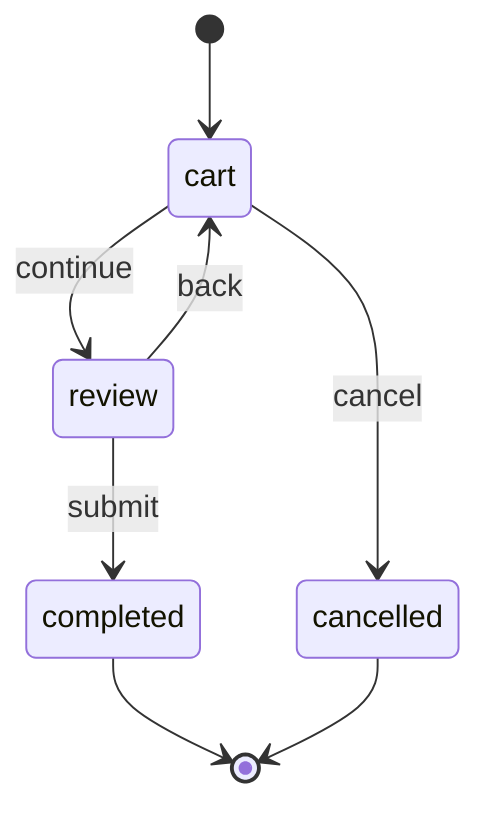
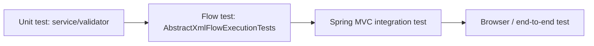

# AbstractXmlFlowExecutionTests và hợp đồng lớp kiểm thử

## 1. Vì sao cần kiểm thử trực tiếp một flow XML?

Trong **Spring Web Flow**, luồng đăng ký, đặt hàng hoặc phê duyệt hồ sơ gồm nhiều **state**, **event**, **transition** và có thể gọi **subflow**. Một controller của Spring MVC chỉ xử lý điểm truy cập HTTP; đường đi bên trong hành trình được định nghĩa tại flow. Vì thế, kiểm thử từng service nghiệp vụ hoặc từng controller riêng lẻ chưa đủ để xác nhận toàn bộ nhánh điều hướng.

`AbstractXmlFlowExecutionTests` là lớp cơ sở trong package `org.springframework.webflow.test.execution`, dành cho việc **nạp định nghĩa flow từ XML và điều khiển một flow execution trong bài kiểm thử**. Lớp này giúp mô phỏng người dùng khởi chạy flow, gửi event, đi qua các view-state và kết thúc flow mà không cần khởi động trình duyệt hoặc triển khai ứng dụng lên servlet container.

Hợp đồng của một lớp kế thừa gồm ba trách nhiệm:

1. **Chỉ định đúng tài nguyên flow XML** cần kiểm tra bằng `getResource(FlowDefinitionResourceFactory)`.
2. **Chuẩn bị các phụ thuộc mà flow cần**: service, parent flow, subflow hoặc thiết lập mock context khi cần.
3. **Tạo các trường hợp kiểm thử mô tả đường đi**: khởi chạy bằng `startFlow(...)`, gửi event qua `resumeFlow(...)` và khẳng định state, scope hoặc outcome.

Đây là trọng tâm của chương **Kiểm thử flow**: xác nhận cơ chế điều hướng và trạng thái của Spring Web Flow để các lỗi trong form binding, validation, quản lý scope/phiên hoặc phục hồi execution được phát hiện tại đúng tầng.

## 2. Hiểu đúng lớp kiểm thử và API thừa kế

`AbstractXmlFlowExecutionTests` thuộc một cây kế thừa có từ các phiên bản Spring Web Flow trước:

```text
junit.framework.TestCase
  └── AbstractFlowExecutionTests
      └── AbstractExternalizedFlowExecutionTests
          └── AbstractXmlFlowExecutionTests
              └── CheckoutFlowExecutionTests (lớp bạn viết)
```

Điều này có ba hệ quả thiết thực:

- **Đây là cơ chế kiểm thử theo JUnit 3**: phương thức kiểm thử kiểu điển hình là `public void testStartFlow()`, và class kế thừa các assertion như `assertEquals(...)`. Chỉ thêm annotation `@Test` của JUnit Jupiter không tự thay đổi hợp đồng lớp cơ sở.
- `AbstractXmlFlowExecutionTests` biết cách xây dựng flow từ XML, nhưng **bạn vẫn phải triển khai `getResource(...)`** để chỉ ra tệp cụ thể.
- Các phương thức như `startFlow`, `resumeFlow`, `getFlowScope`, `assertCurrentStateEquals` và `assertFlowExecutionOutcomeEquals` đến từ lớp cha. Bạn gọi chúng trực tiếp trong subclass; không tự viết lại một flow engine trong test.

Nếu dự án đang chạy kiểm thử bằng **JUnit Platform/JUnit 5**, hãy cấu hình engine có khả năng thực thi các bài test JUnit 3/4 (thường là JUnit Vintage), hoặc dùng chiến lược kiểm thử flow khác tương thích runner đang dùng. Cần kiểm tra dòng Spring Web Flow, JUnit và dependency build thực tế; ví dụ dưới đây dùng phương thức `test...` của JUnit 3 theo API chính thức.

| Phương thức/hook | Vai trò trong test | Bắt buộc? |
| --- | --- | --- |
| `getResource(FlowDefinitionResourceFactory)` | Trả về tài nguyên XML của flow được kiểm tra | **Có** |
| `configureFlowBuilderContext(MockFlowBuilderContext)` | Đăng ký stub/mock bean hoặc tùy chỉnh builder context | Chỉ khi flow phụ thuộc thành phần ngoài |
| `getModelResources(FlowDefinitionResourceFactory)` | Bổ sung tài nguyên flow model cha khi dùng inheritance | Chỉ khi flow có inheritance |
| `startFlow(ExternalContext)` | Khởi chạy flow với external context giả lập | Dùng trong test đường đi đầy đủ |
| `startFlow(MutableAttributeMap, ExternalContext)` | Khởi chạy flow và truyền input | Khi flow nhận input |
| `setCurrentState(String)` | Đặt execution vào state cụ thể để kiểm tra nhánh riêng | Tùy chọn |
| `resumeFlow(ExternalContext)` | Tiếp tục execution và xử lý event/parameters | Khi kiểm tra transition |
| `assertCurrentStateEquals(String)` | Xác nhận state hiện tại | Rất nên dùng |
| `assertFlowExecutionActive()` | Xác nhận execution chưa kết thúc | Khi kỳ vọng còn ở view-state |
| `assertFlowExecutionEnded()` | Xác nhận execution đã kết thúc | Khi đến end-state |
| `assertFlowExecutionOutcomeEquals(String)` | Kiểm tra outcome của flow đã kết thúc | Khi đến end-state |
| `getFlowScope()` / `getRequiredFlowAttribute(...)` | Kiểm tra dữ liệu tồn tại trong phạm vi flow | Khi flow thao tác trên model hoặc biến |

Các tên lớp và phương thức trên thuộc API Spring Web Flow; ví dụ Java sử dụng `MockExternalContext` từ package `org.springframework.webflow.test`. Ở các phiên bản mới, API lõi của lớp test vẫn thể hiện cây kế thừa `TestCase`, nên cần lưu ý việc runner thực sự nhận diện test.

## 3. Thiết kế flow và cấu trúc tài nguyên dành cho kiểm thử

Để học hợp đồng kiểm thử, bắt đầu với một flow nhỏ không phụ thuộc database hay dịch vụ bên ngoài. Giả sử hành trình `checkout` có ba lựa chọn:

- Từ `cart` nhấn `continue` sẽ sang `review`.
- Từ `review` nhấn `back` để quay về `cart`; nhấn `submit` để hoàn tất.
- Từ `cart` nhấn `cancel` để hủy.

Sơ đồ state:



Đặt tài nguyên test như sau để `createClassPathResource(..., getClass())` tìm được XML cùng package với lớp kiểm thử:

```text
src/test/
├── java/com/example/checkout/
│   └── CheckoutFlowExecutionTests.java
└── resources/com/example/checkout/
    └── checkout-flow.xml
```

**`src/test/resources/com/example/checkout/checkout-flow.xml`**:

```xml
<?xml version="1.0" encoding="UTF-8"?>
<flow xmlns="http://www.springframework.org/schema/webflow"
      xmlns:xsi="http://www.w3.org/2001/XMLSchema-instance"
      xsi:schemaLocation="
        http://www.springframework.org/schema/webflow
        http://www.springframework.org/schema/webflow/spring-webflow-2.0.xsd">

    <view-state id="cart" view="checkout/cart">
        <transition on="continue" to="review"/>
        <transition on="cancel" to="cancelled"/>
    </view-state>

    <view-state id="review" view="checkout/review">
        <transition on="back" to="cart"/>
        <transition on="submit" to="completed"/>
    </view-state>

    <end-state id="cancelled"/>
    <end-state id="completed"/>
</flow>
```

Vì cả hai end-state không khai báo view, bài thử tập trung vào outcome thay vì JSP. Bộ test của Web Flow sử dụng cơ chế mock view nên có thể đi qua các view-state mà không cần có tệp `checkout/cart.jsp` hoặc khởi động một `DispatcherServlet`.

Tên ID của state và event phải khớp tuyệt đối giữa flow XML và test. Nếu sửa `on="submit"` thành `on="confirm"`, hợp đồng kiểm thử cũng phải được cập nhật theo hành vi mong muốn.

## 4. Lớp kiểm thử hoàn chỉnh

Ví dụ dưới đây tương ứng với flow ở mục 3, sử dụng **JUnit 3 style** của `AbstractXmlFlowExecutionTests`. Mỗi phương thức `test...` là một kịch bản độc lập; runner JUnit 3 thông thường tạo instance test mới cho từng phương thức.

**`src/test/java/com/example/checkout/CheckoutFlowExecutionTests.java`**:

```java
package com.example.checkout;

import org.springframework.webflow.config.FlowDefinitionResource;
import org.springframework.webflow.config.FlowDefinitionResourceFactory;
import org.springframework.webflow.test.MockExternalContext;
import org.springframework.webflow.test.execution.AbstractXmlFlowExecutionTests;

public class CheckoutFlowExecutionTests
        extends AbstractXmlFlowExecutionTests {

    // Hợp đồng bắt buộc: cung cấp XML định nghĩa flow đang kiểm tra.
    @Override
    protected FlowDefinitionResource getResource(
            FlowDefinitionResourceFactory resourceFactory) {
        return resourceFactory.createClassPathResource(
                "checkout-flow.xml", getClass());
    }

    public void testFlowStartsAtCart() {
        startFlow(new MockExternalContext());

        assertFlowExecutionActive();
        assertCurrentStateEquals("cart");
    }

    public void testContinueMovesToReview() {
        startFlow(new MockExternalContext());

        MockExternalContext request = new MockExternalContext();
        request.setEventId("continue");
        resumeFlow(request);

        assertFlowExecutionActive();
        assertCurrentStateEquals("review");
    }

    public void testBackReturnsToCart() {
        startFlow(new MockExternalContext());

        MockExternalContext next = new MockExternalContext();
        next.setEventId("continue");
        resumeFlow(next);
        assertCurrentStateEquals("review");

        MockExternalContext back = new MockExternalContext();
        back.setEventId("back");
        resumeFlow(back);
        assertCurrentStateEquals("cart");
        assertFlowExecutionActive();
    }

    public void testSubmitEndsSuccessfully() {
        startFlow(new MockExternalContext());

        MockExternalContext next = new MockExternalContext();
        next.setEventId("continue");
        resumeFlow(next);

        MockExternalContext submit = new MockExternalContext();
        submit.setEventId("submit");
        resumeFlow(submit);

        assertFlowExecutionEnded();
        assertFlowExecutionOutcomeEquals("completed");
    }

    public void testCancelEndsWithCancelled() {
        startFlow(new MockExternalContext());

        MockExternalContext cancel = new MockExternalContext();
        cancel.setEventId("cancel");
        resumeFlow(cancel);

        assertFlowExecutionEnded();
        assertFlowExecutionOutcomeEquals("cancelled");
    }

    public void testReviewSubmitInIsolation() {
        // Chỉ kiểm tra nhánh review → completed.
        // Không đi qua toàn bộ đường dẫn từ cart.
        setCurrentState("review");

        MockExternalContext submit = new MockExternalContext();
        submit.setEventId("submit");
        resumeFlow(submit);

        assertFlowExecutionEnded();
        assertFlowExecutionOutcomeEquals("completed");
    }
}
```

Các test xác nhận **hành vi quan sát được** của flow:

| Kịch bản | Event gửi vào | Điều kiện xác nhận |
| --- | --- | --- |
| Khởi chạy | Không có event | Execution đang active, state là `cart` |
| Đi tiếp | `continue` tại `cart` | State `review` |
| Quay lại | `continue` rồi `back` | Trở về `cart`, execution còn active |
| Hoàn tất | `continue` rồi `submit` | Execution kết thúc với outcome `completed` |
| Hủy | `cancel` tại `cart` | Execution kết thúc với outcome `cancelled` |
| Kiểm tra nhánh riêng | Bắt đầu trực tiếp tại `review` rồi `submit` | Outcome `completed` |

**Vì sao dùng `MockExternalContext.setEventId(...)`?** Method này gắn tên event vào context của request giả lập. Khi gọi `resumeFlow(context)`, engine đọc event và tìm transition tương ứng ở state hiện tại. Cơ chế này phụ thuộc vào mock view factory mà infrastructure test của Web Flow sử dụng để giải mã event. Chỉ gán event lên context không đồng nghĩa transition đã chạy; phải gọi `resumeFlow`.

**Vì sao vẫn cần cả `startFlow` và `setCurrentState`?** `startFlow` kiểm tra đường đi thực tế từ điểm khởi tạo, bao gồm các action `on-start`. `setCurrentState` giúp đi thẳng đến state cần test, nhưng có thể bỏ qua công việc khởi tạo hoặc action của state trước đó; không nên dùng duy nhất kiểu test này để kết luận toàn bộ hành trình hoạt động.

## 5. Hợp đồng nạp XML: getResource(...)

Trong test dùng classpath, lệnh:

```java
return resourceFactory.createClassPathResource(
        "checkout-flow.xml", getClass());
```

tìm tài nguyên tương đối với package của class test. Ví dụ ở mục 3, `getClass()` nằm trong package `com.example.checkout`, vì vậy file được nạp từ `com/example/checkout/checkout-flow.xml` trên test classpath.

Có thể dùng tài nguyên theo đường dẫn file trong dự án:

```java
@Override
protected FlowDefinitionResource getResource(
        FlowDefinitionResourceFactory factory) {
    return factory.createFileResource(
            "src/main/webapp/WEB-INF/flows/checkout/checkout-flow.xml");
}
```

Đây là cách được tài liệu tham khảo Spring Web Flow sử dụng cho flow XML triển khai trong webapp. Tuy nhiên, đường dẫn `src/main/webapp/...` thường phụ thuộc thư mục làm việc của tiến trình test; khi chạy từ IDE, build runner khác hoặc CI, cần kiểm tra vị trí thực tế. Đối với bài tập hoặc flow XML được đóng gói vào test resources, sử dụng classpath thường ổn định hơn.

**Một lỗi phổ biến:** đặt file ở `src/test/resources/flows/checkout.xml` nhưng gọi `createClassPathResource("checkout-flow.xml", getClass())`. Hai đường dẫn không trùng nhau. Khi test lỗi “resource not found”, hãy kiểm tra path trên **runtime test classpath**, không suy từ URL HTTP của flow.

## 6. Đăng ký bean giả và xác minh hành vi nghiệp vụ

Flow thực tế thường gọi service ở `on-start`, `evaluate` hoặc action-state. Nếu không cung cấp bean đúng tên, XML có thể nạp được nhưng execution thất bại khi gặp expression.

Ví dụ một flow tính phí giao hàng khi khởi chạy:

```xml
<!-- Bổ sung bên trong phần tử <flow> của flow phù hợp. -->
<on-start>
    <evaluate expression="quoteService.currentQuote()"
              result="flowScope.quote"/>
</on-start>
```

Trong subclass test, dùng hook `configureFlowBuilderContext(...)` để thay dependency bên ngoài bằng stub có kết quả cố định:

```java
import org.springframework.webflow.test.MockFlowBuilderContext;

@Override
protected void configureFlowBuilderContext(
        MockFlowBuilderContext builderContext) {
    builderContext.registerBean("quoteService", new StubQuoteService());
}

public static final class StubQuoteService {
    public String currentQuote() {
        return "50.00";
    }
}
```

Sau đó một test có thể xác nhận:

```java
public void testQuoteInitializedOnStart() {
    startFlow(new MockExternalContext());
    assertEquals("50.00", getRequiredFlowAttribute("quote"));
}
```

**Các snippet của mục 6 là phần mở rộng**: chúng chỉ có ý nghĩa khi XML flow có khai báo `<on-start>` và class test được bổ sung đúng `configureFlowBuilderContext` cùng `StubQuoteService`. Flow XML tối giản ở mục 3 không gọi `quoteService` nên không cần stub.

Nguyên tắc xây dựng test double:

- Đăng ký tên bean **đúng bằng tên expression trong XML**, ví dụ `quoteService`.
- Stub trả giá trị ổn định để state/transition dễ dự đoán; mock có thể ghi nhận số lần gọi và tham số.
- Kiểm tra **đầu ra của hành trình** bên cạnh tương tác với mock, ví dụ `flowScope.quote` và state tiếp theo.
- Không kết nối database hoặc API thật nếu chỉ muốn kiểm tra sơ đồ điều hướng. Các test tích hợp với hệ thống thật cần phạm vi kiểm thử riêng.

## 7. Truyền input, mô phỏng request và kiểm tra scope

Với flow yêu cầu input, dùng overload `startFlow(input, externalContext)`:

```java
import org.springframework.binding.collection.LocalAttributeMap;
import org.springframework.binding.collection.MutableAttributeMap;
import org.springframework.webflow.test.MockExternalContext;

public void testStartWithCustomerId() {
    MutableAttributeMap<Object> input = new LocalAttributeMap<>();
    input.put("customerId", "C-100");

    MockExternalContext context = new MockExternalContext();
    context.setCurrentUser("tester");

    startFlow(input, context);
    assertCurrentStateEquals("cart");
}
```

Điều này chỉ minh họa cách truyền input. Để kiểm tra `customerId` xuất hiện trong flow scope, XML còn phải có khai báo input và ánh xạ tương ứng, ví dụ:

```xml
<!-- Đặt trực tiếp bên trong phần tử <flow>. -->
<input name="customerId" required="false"/>
<on-start>
    <set name="flowScope.customerId" value="customerId"/>
</on-start>
```

Khi đã nối input vào flow scope, có thể kiểm tra:

```java
assertEquals("C-100", getRequiredFlowAttribute("customerId"));
```

Đừng nhầm **input map** khi bắt đầu flow với **request parameter** của form. Để mô phỏng một postback có dữ liệu, hãy tạo `MockExternalContext` rồi thêm parameter bằng `putRequestParameter(...)` trước khi `resumeFlow(...)`:

```java
MockExternalContext context = new MockExternalContext();
context.putRequestParameter("email", "user@example.com");
context.setEventId("continue");
resumeFlow(context);
```

Lưu ý: Chỉ khi view-state có `model`/binding thích hợp thì parameter `email` mới được gắn vào model; ví dụ flow tối giản ở mục 3 không định nghĩa model. Muốn test form binding và validation, hãy chuẩn bị model, conversion service/validator cùng một view-state có `model="..."`, sau đó kiểm tra state được giữ lại khi có lỗi và được chuyển tiếp khi dữ liệu hợp lệ.

| Dữ liệu được kiểm tra | Cách truy cập trong test | Điều cần chú ý |
| --- | --- | --- |
| Flow scope | `getFlowScope()`, `getRequiredFlowAttribute("name")` | Tồn tại trong suốt execution của flow |
| View scope | `getViewScope()`, `getRequiredViewAttribute("name")` | Gắn với view-state tương ứng |
| Conversation scope | `getConversationScope()`, `getRequiredConversationAttribute("name")` | Có thể dùng chung trong conversation và subflow |
| Người dùng giả lập | `MockExternalContext.setCurrentUser(...)` | Thể hiện principal cho flow khi cần |
| Request parameter | `MockExternalContext.putRequestParameter(...)` | Cần binding để ảnh hưởng model |
| Ajax flag | `MockExternalContext.setAjaxRequest(true)` | Dùng để kiểm tra flow với external context được đánh dấu Ajax |

Các scope nói trên khác với field của subclass test. Đưa dữ liệu của người dùng vào `flowScope` hoặc `viewScope` để kiểm tra vòng đời thực tế; không mô phỏng trạng thái nhiều request bằng một field dùng chung khi flow đã có scope tương ứng.

## 8. Kiểm tra parent flow và subflow

### 8.1. Flow XML sử dụng inheritance

Nếu XML của flow kiểm tra kế thừa một flow model cha, override `getModelResources(...)` để cung cấp tài nguyên tham chiếu:

```java
@Override
protected FlowDefinitionResource[] getModelResources(
        FlowDefinitionResourceFactory factory) {
    return new FlowDefinitionResource[] {
        factory.createClassPathResource(
                "common-flow.xml", getClass())
    };
}
```

File `common-flow.xml` phải có mặt trên classpath tương ứng và chứa những model definitions cần thiết. Hook này **không phải** cách tự động nạp mọi subflow trong ứng dụng; nó phục vụ việc dựng XML flow từ các tài nguyên model có quan hệ kế thừa.

### 8.2. Test flow cha gọi subflow

Khi flow cha có `<subflow-state subflow="payment">`, có thể đăng ký flow giả vào registry thông qua `getFlowDefinitionRegistry()`, rồi phát event kích hoạt subflow. Cách này phù hợp khi chỉ cần xác minh:

1. Flow cha chọn đúng subflow.
2. Dữ liệu được ánh xạ từ flow cha sang subflow.
3. Outcome của subflow được nhận và kích hoạt transition quay về flow cha.

Một flow thực tế có nhiều nhánh thanh toán nên test ít nhất outcome **thành công**, **hủy** và **lỗi** tùy hợp đồng. Test dành riêng cho `payment` kiểm tra logic nội bộ của subflow; test flow cha tập trung vào việc điều phối giữa các flow.

Nếu chỉ gọi `setCurrentState("review")` và bỏ qua bước thực sự kích hoạt subflow, bạn chưa chứng minh input mapping, output mapping hoặc exception path của lời gọi subflow.

## 9. Tổ chức hợp đồng kiểm thử theo hành vi

Một bộ kiểm thử có ích không chỉ xác nhận state khởi đầu. Nó phải thể hiện **mọi sự kiện và nhánh nghiệp vụ quan trọng**:

| Nhóm kiểm thử | Kịch bản mẫu | Assertion cần có |
| --- | --- | --- |
| Start | Khởi chạy flow không có input | State đầu tiên và execution active |
| Input | Khởi chạy với `customerId` | Dữ liệu được chuyển đến scope hoặc service phù hợp |
| Transition thuận | `continue` | Sang state kế tiếp |
| Transition lùi | `back` | Trở về state trước; dữ liệu cần thiết được bảo toàn |
| Kết thúc thành công | `submit` | Execution ended, outcome đúng |
| Kết thúc do hủy | `cancel` | Execution ended, outcome hủy |
| Binding | Gửi field hợp lệ/không hợp lệ | Model có giá trị đúng hoặc có lỗi binding |
| Validation | Form thiếu field bắt buộc | Giữ đúng state, hiển thị lỗi và không gọi action thành công |
| Action/service | Event gọi service | Stub được gọi đúng và kết quả được lưu trong scope |
| Subflow | Thành công/thất bại/hủy | Parent xử lý đúng outcome |
| Exception/recovery | Service phát sinh lỗi | Flow đi theo exception handler hoặc ứng dụng trả lỗi theo thiết kế |

Nên đặt tên test theo **sự kiện và kỳ vọng**, ví dụ `testInvalidEmailStaysAtContact`, thay vì một phương thức dài thực hiện toàn bộ hành trình nhưng chỉ có assertion ở cuối. Test đi trọn hành trình vẫn cần có vì nó phát hiện lỗi khởi tạo, binding và chuyển scope mà việc “nhảy thẳng” bằng `setCurrentState` có thể bỏ sót.

Với validation, chỉ assert `assertCurrentStateEquals("contact")` chưa đủ nếu nhiều nguyên nhân khác cũng giữ state. Hãy xác minh thêm lỗi đã được ghi đúng và service nghiệp vụ chưa thực thi, tùy cách model và message context được cấu hình.

## 10. Ranh giới của AbstractXmlFlowExecutionTests

Lớp này kiểm tra **flow execution** ở tầng engine, cùng các phụ thuộc được giả lập hoặc cấu hình cho flow builder. Nó không tự đảm bảo:

- URL flow đã được ánh xạ đúng trong `DispatcherServlet` bằng `FlowHandlerMapping`.
- `FlowHandlerAdapter`, Servlet session và persistence repository trong môi trường deploy hoạt động giống production.
- JSP/Thymeleaf render HTML, CSRF token được gửi hay JavaScript Ajax cập nhật fragment đúng.
- Cookie phiên, redirect, back/refresh của trình duyệt hoặc execution key hết hạn được xử lý trong toàn bộ hạ tầng HTTP.

Do đó nên phân chia:



**Flow test** phát hiện cấu hình XML, state/event/transition và logic điều phối sai. **MVC integration test** giúp xác nhận handler mapping/adapter, security filter và cách request HTTP được chuyển thành external context. **Browser/E2E test** kiểm tra trang, cookie, URL execution, redirect và hành vi Ajax thực tế.

Một test trong `AbstractXmlFlowExecutionTests` có thể chạy hoàn toàn với mock service. Nếu mục tiêu là kiểm tra database transaction hoặc trạng thái phiên thật, cần thêm bài test với hạ tầng phù hợp. Không nên coi passing của tầng engine là bằng chứng hệ thống đã được kiểm thử từ giao diện đến lưu trữ.

## 11. Những lỗi thường gặp và cách kiểm tra

| Triệu chứng | Nguyên nhân thường gặp | Kiểm tra |
| --- | --- | --- |
| `getResource(...)` không tìm thấy file | XML không nằm trong package tương ứng hoặc dùng sai relative path | Kiểm tra `src/test/resources` và test classpath |
| Test không được runner phát hiện | Runner chỉ chạy Jupiter nhưng class kế thừa `TestCase` | Kích hoạt runner/engine tương thích JUnit 3, kiểm tra tên `test...` |
| Mở flow đã lỗi khi xử lý expression | Bean service trong XML chưa được đăng ký | Override `configureFlowBuilderContext(...)` và đăng ký đúng tên |
| `setEventId("continue")` nhưng state không đổi | Event không khớp `on`, chưa `resumeFlow` hoặc bị validation chặn | Kiểm tra XML, binding và event hiện tại |
| `assertFlowExecutionOutcomeEquals(...)` thất bại | Outcome khác ID end-state hoặc flow chưa kết thúc | Xem `assertFlowExecutionEnded()` và transition đích |
| Test từ `setCurrentState(...)` pass nhưng đường đi thật lỗi | Bỏ qua `on-start`, input hoặc action của state trước | Bổ sung test `startFlow(...)` và đi trọn hành trình |
| Thêm request parameter nhưng model không đổi | View-state chưa khai báo `model`/binding hoặc field name không khớp | Kiểm tra flow model, tên thuộc tính và converter |
| Test subflow báo không tìm thấy flow | Registry trong test chưa có definition cần gọi | Đăng ký mock subflow hoặc dựng registry tương ứng |
| Validation hoạt động khác production | Validator/conversion services trong mock builder khác runtime | Cấu hình các dịch vụ cần thiết ở test builder và bổ sung integration test |
| Test bị ảnh hưởng trạng thái của test trước | Chia sẻ mutable stub/static data hoặc execution không được tạo mới | Giữ test độc lập, tạo stub và context theo từng kịch bản |

Khi điều tra lỗi, đi theo thứ tự **test discovery → resource XML → builder dependencies → startFlow → event/resumeFlow → assertions**. Thứ tự này giúp phân biệt lỗi của cấu hình test, định nghĩa flow và hành vi nghiệp vụ.

## 12. Bài tập tự thực hành

Hãy bổ sung một nhánh `applyCoupon` cho `checkout`:

1. Từ `cart`, event `applyCoupon` gọi `couponService.validate(code)`. Nếu hợp lệ, lưu mức giảm giá vào `flowScope` và giữ người dùng ở `cart`; nếu không hợp lệ, hiển thị lỗi mà không kết thúc flow.
2. Dùng `configureFlowBuilderContext(...)` đăng ký một stub `couponService` có kết quả có thể dự đoán.
3. Viết `testValidCouponKeepsCartAndSetsDiscount` và `testInvalidCouponKeepsCartAndReportsError`, đặt request parameter `code` qua `MockExternalContext`.
4. Giữ lại các test `continue`, `back`, `submit` và `cancel` để phát hiện sai sót khi thêm nhánh mới.
5. Viết ít nhất một test đi từ `cart` đến `completed` sau khi áp mã hợp lệ; xác minh service không được gọi lại ngoài số lần mong đợi.

**Tiêu chí hoàn thành:** mỗi nhánh của flow có một sự kiện kích hoạt và một kỳ vọng rõ ràng về state, scope, outcome và tương tác với service. Những test bắt đầu trực tiếp tại một state được bổ sung bởi test chạy thực từ điểm khởi đầu.

## 13. Điều cần ghi nhớ

- `AbstractXmlFlowExecutionTests` là lớp kiểm thử XML flow theo hợp đồng kế thừa `junit.framework.TestCase`.
- `getResource(FlowDefinitionResourceFactory)` là hook bắt buộc để chỉ ra **đúng tài nguyên XML** được kiểm tra.
- `configureFlowBuilderContext(...)` dùng để khai báo stub/mock service; `getModelResources(...)` dùng khi flow cần model resources từ flow cha.
- `startFlow(...)` và `resumeFlow(...)` mô phỏng một lần chạy và các event của flow; `MockExternalContext.setEventId(...)` đưa tên event vào request giả lập.
- `assertCurrentStateEquals(...)`, `assertFlowExecutionActive()`, `assertFlowExecutionEnded()` và `assertFlowExecutionOutcomeEquals(...)` xác nhận hành vi thực tế.
- `setCurrentState(...)` tiện cho kiểm thử nhánh riêng, nhưng đường đi đầy đủ vẫn phải được kiểm tra qua khởi chạy thật.
- Các vấn đề servlet, MVC mapping/adapter, rendering, security, session và Ajax cần thêm kiểm thử tích hợp ở tầng phù hợp.

### Tài liệu tham khảo chính thức

- [Spring Web Flow Reference Guide – Testing Flows](https://docs.spring.io/spring-webflow/docs/3.0.2/reference/#testing-flows): khai báo subclass, flow resource, mock bean, startup, event, subflow.
- [Javadoc AbstractXmlFlowExecutionTests](https://docs.spring.io/spring-webflow/docs/current/api/org/springframework/webflow/test/execution/AbstractXmlFlowExecutionTests.html): các constructor, hook và lớp cha của test XML.
- [Javadoc AbstractFlowExecutionTests](https://docs.spring.io/spring-webflow/docs/current/api/org/springframework/webflow/test/execution/AbstractFlowExecutionTests.html): start/resume, assertions, scope và lifecycle.
- [Javadoc AbstractExternalizedFlowExecutionTests](https://docs.spring.io/spring-webflow/docs/current/api/org/springframework/webflow/test/execution/AbstractExternalizedFlowExecutionTests.html): hook đăng ký bean, resource/model/subflow registry.
- [Javadoc MockExternalContext](https://docs.spring.io/spring-webflow/docs/current/api/org/springframework/webflow/test/MockExternalContext.html): event, request parameter, user, session và Ajax flag.
