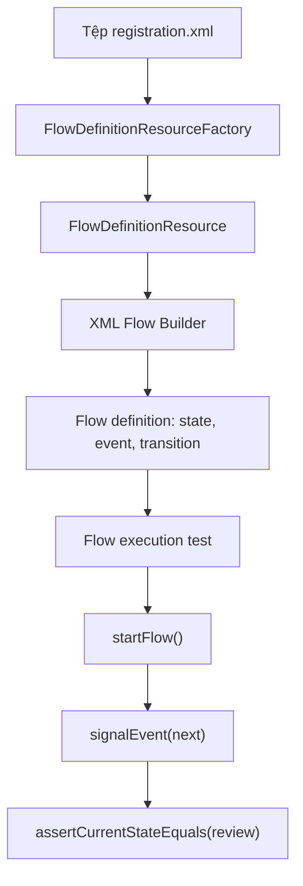
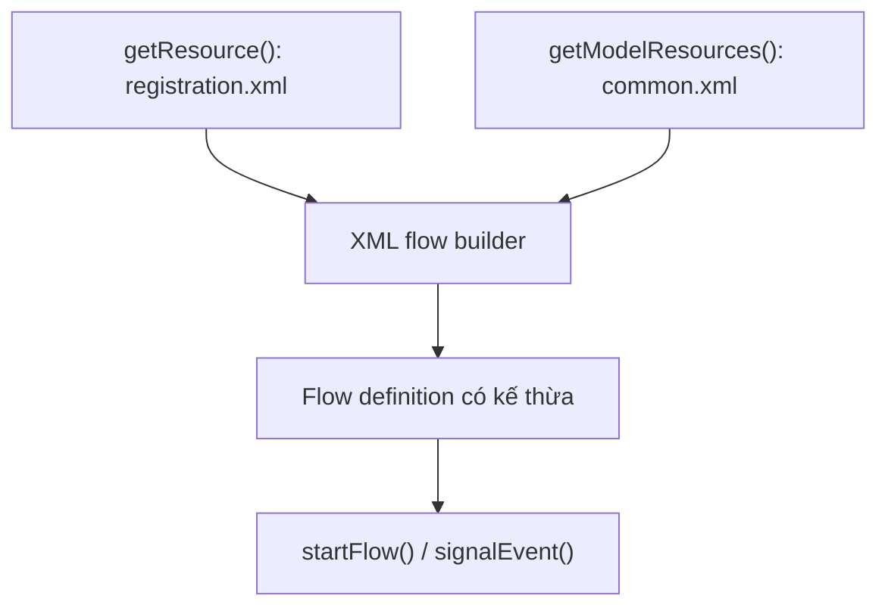

# Khai báo tài nguyên XML cần kiểm tra trong Spring Web Flow

Khi kiểm thử một hành trình web nhiều bước bằng **Spring Web Flow (SWF)**, câu hỏi đầu tiên không phải “gửi event `next` như thế nào?” mà là **“bộ kiểm thử đang nạp chính xác flow XML nào?”**. Một phép thử có thể trông rất hợp lý nhưng lại kiểm tra bản XML cũ, bản sao trong `src/test/resources` hoặc một flow khác có cùng tên. Khi đó test PASS chưa chắc định nghĩa đang triển khai hoạt động đúng.

Bài học thuộc chương **Kiểm thử flow** của module **SPRING_WEB_FLOW**, nơi hành trình web được mô hình hóa bằng **state, event, transition và subflow**, kết hợp **form binding, validation, scope/phiên, Spring MVC** và khả năng phục hồi khi lỗi. Trọng tâm của bài là cách **khai báo tài nguyên định nghĩa flow XML** cho test harness, phân biệt filesystem với classpath, khai báo flow cha khi có kế thừa, chuẩn bị các bean/subflow phụ thuộc và xác nhận test thực sự chạy trên tài nguyên mong muốn.

> **Phạm vi:** Ví dụ API tập trung vào họ `AbstractXmlFlowExecutionTests` trong Spring Web Flow 2.x. Đây là một test harness truyền thống xây trên JUnit 3; tên lớp và API cần đối chiếu với phiên bản Spring Web Flow cụ thể của dự án. Bài này không mặc định mọi ứng dụng Spring Boot đều tự cấu hình test harness SWF.

## 1. Tài nguyên XML trong kiểm thử flow là gì?

Một flow definition là mô tả hành trình: những state có thể đi đến, event kích hoạt transition, action phải chạy, dữ liệu nào được tạo và khi nào flow kết thúc. Trong dự án dùng XML, định nghĩa này nằm trong một tệp, chẳng hạn:

```text
src/main/webapp/WEB-INF/flows/registration/registration.xml
```

Tệp XML đó **không phải** URL người dùng nhập trên trình duyệt. Nó là **nguồn đầu vào để flow builder dựng thành flow definition**. Registry trong ứng dụng có thể đăng ký flow với ID `registration`, còn test harness có thể nạp trực tiếp tài nguyên bằng đường dẫn của file.

Trong quá trình kiểm thử cần phân biệt:

| Đối tượng | Ví dụ | Ý nghĩa |
|---|---|---|
| **Tài nguyên XML** | `.../registration.xml` | File chứa cấu hình các state và transition |
| **`FlowDefinitionResource`** | Kết quả từ `FlowDefinitionResourceFactory` | Mô tả tài nguyên dùng để dựng flow definition trong test |
| **Flow ID** | `registration` | Định danh logic của flow |
| **Execution** | Một lần chạy bắt đầu từ `contact` | Có state/scope thay đổi theo event |
| **Execution key** | Chuỗi opaque do SWF cấp | Dùng để tiếp tục execution ở tầng web |
| **Resource của flow cha** | `.../common.xml` | Mô hình phụ trợ khi định nghĩa đang kiểm tra kế thừa flow khác |

Trong **flow execution test**, ta thường bắt đầu từ một `FlowDefinitionResource` để dựng flow rồi mô phỏng `startFlow()` và `signalEvent(...)`. Kiểm thử qua HTTP thì đi từ URL/Spring MVC và kiểm tra thêm `FlowHandlerMapping`, session, execution key và view rendering. Hai kiểu kiểm thử bổ sung cho nhau, không thay thế nhau.



Nếu mũi tên từ file XML tới `FlowDefinitionResource` trỏ sai, mọi assertion ở phía sau đều có thể không kiểm tra đúng tài nguyên mà bạn muốn.

## 2. Dự án ví dụ và flow XML cần kiểm tra

Giả sử hệ thống có flow đăng ký, dùng hai màn hình `contact` và `review`. Cấu trúc file:

```text
registration-app/
├── src/
│   ├── main/
│   │   ├── java/com/example/registration/
│   │   │   └── RegistrationDraft.java
│   │   └── webapp/WEB-INF/flows/registration/
│   │       └── registration.xml
│   └── test/
│       └── java/com/example/registration/
│           └── RegistrationFlowXmlTests.java
└── pom.xml hoặc build.gradle
```

Ví dụ nội dung `registration.xml`:

```xml
<?xml version="1.0" encoding="UTF-8"?>
<flow xmlns="http://www.springframework.org/schema/webflow"
      xmlns:xsi="http://www.w3.org/2001/XMLSchema-instance"
      xsi:schemaLocation="
          http://www.springframework.org/schema/webflow
          http://www.springframework.org/schema/webflow/spring-webflow.xsd">

    <var name="draft"
         class="com.example.registration.RegistrationDraft"/>

    <view-state id="contact"
                view="registration/contact"
                model="draft">
        <transition on="next" to="review"/>
        <transition on="cancel" to="cancelled"
                    bind="false" validate="false"/>
    </view-state>

    <view-state id="review"
                view="registration/review"
                model="draft">
        <transition on="back" to="contact"
                    bind="false" validate="false"/>
        <transition on="confirm" to="completed"
                    bind="false" validate="false"/>
    </view-state>

    <end-state id="completed"/>
    <end-state id="cancelled"/>
</flow>
```

Đối tượng `RegistrationDraft` phải tồn tại và tạo được theo cách khai báo bằng `<var>`. Có thể dùng một JavaBean tối giản với constructor không tham số, các trường `fullName`, `email` và getter/setter. Nếu dùng execution repository có serialization, hãy thiết kế dữ liệu flow scope phù hợp với cơ chế lưu snapshot/session.

Đây là **flow đơn giản để quan sát cách nạp XML**, chưa phải biểu mẫu có validation và persist đầy đủ. Sau khi xác nhận tài nguyên được nạp đúng, ta có thể bổ sung các trường hợp binding, validation, action, subflow và xử lý lỗi.

## 3. Khai báo resource bằng AbstractXmlFlowExecutionTests

Trong Spring Web Flow 2.x, lớp `org.springframework.webflow.test.execution.AbstractXmlFlowExecutionTests` cho phép kiểm thử một flow definition viết bằng XML. Điểm mở rộng quan trọng nhất là:

```java
protected FlowDefinitionResource getResource(
        FlowDefinitionResourceFactory resourceFactory)
```

Bạn **override** phương thức này để chỉ rõ file XML cần dựng thành flow. Một phiên bản test dùng filesystem:

```java
package com.example.registration;

import org.springframework.webflow.config.FlowDefinitionResource;
import org.springframework.webflow.config.FlowDefinitionResourceFactory;
import org.springframework.webflow.test.execution.AbstractXmlFlowExecutionTests;

public class RegistrationFlowXmlTests
        extends AbstractXmlFlowExecutionTests {

    @Override
    protected FlowDefinitionResource getResource(
            FlowDefinitionResourceFactory resourceFactory) {

        return resourceFactory.createFileResource(
            "src/main/webapp/WEB-INF/flows/registration/registration.xml"
        );
    }

    public void testFlowStartsAtContact() {
        startFlow();
        assertCurrentStateEquals("contact");
        assertNotNull(getFlowScope().get("draft"));
    }

    public void testNextOpensReview() {
        startFlow();

        signalEvent("next");

        assertCurrentStateEquals("review");
    }
}
```

Hãy đọc đoạn code theo thứ tự:

1. `AbstractXmlFlowExecutionTests` là harness có khả năng dựng flow từ XML.
2. `getResource(...)` chọn **tài nguyên XML chính** của test.
3. `FlowDefinitionResourceFactory` tạo đối tượng mô tả tài nguyên thay vì tự truyền chuỗi path vào `startFlow()`.
4. `startFlow()` bắt đầu một lần thực thi flow vừa được dựng.
5. `assertCurrentStateEquals("contact")` và `assertCurrentStateEquals("review")` xác nhận state theo cấu hình đã đọc.

Lớp này dựa trên **JUnit 3-style `TestCase`**, vì vậy ví dụ dùng các phương thức công khai `testFlowStartsAtContact()` và `testNextOpensReview()`. Không nên tự thêm `@Test` của JUnit Jupiter rồi kỳ vọng runner JUnit 5 mặc định sẽ nhận ra mọi phương thức của lớp cơ sở. Khi dùng nền kiểm thử khác, cần adapter/engine hoặc cách tích hợp tương thích.

### Vì sao nên override getResource thay vì tự đọc file trong test?

SWF test harness cần làm nhiều việc hơn `Files.readString(...)`: nạp XML, áp dụng cấu hình parser/builder, giải quyết các tài nguyên liên quan và dựng đối tượng flow definition có thể chạy. `getResource(...)` đặt đường dẫn đúng vào **vòng đời dựng flow** của harness, giúp `startFlow()` và các helper hoạt động với định nghĩa đó.

Việc đọc file bằng Java IO rồi tự kiểm tra `contains("<view-state")` chỉ xác minh văn bản tồn tại, không chứng minh flow definition dựng và thực thi được.

## 4. createFileResource: đường dẫn trên filesystem

Cách khai báo này thường xuất hiện trong tài liệu tham khảo SWF:

```java
@Override
protected FlowDefinitionResource getResource(
        FlowDefinitionResourceFactory factory) {

    return factory.createFileResource(
        "src/main/webapp/WEB-INF/flows/registration/registration.xml"
    );
}
```

`createFileResource(...)` dùng một đường dẫn kiểu filesystem, thích hợp khi test chạy **trong thư mục gốc của module dự án** và file có thể truy cập trực tiếp tại đường dẫn đó.

### Ưu điểm

- Kiểm tra **chính XML mà ứng dụng đang đóng gói** nếu đường dẫn trỏ tới file nguồn thật.
- Không cần tạo một bản sao XML riêng trong `src/test/resources` chỉ để test.
- Rất rõ ràng về tên file khi đọc test hoặc kiểm tra lỗi thiếu tài nguyên.

### Điểm cần lưu ý

- Đường dẫn tương đối được giải quyết dựa trên **working directory của tiến trình test**, không mặc định là nơi đặt class Java.
- Trong dự án nhiều module, IDE và CI có thể khởi động test ở các working directory khác nhau.
- File có thể tồn tại trong source tree nhưng **không được đóng gói** vào artifact hoặc không nằm ở vị trí tương đương khi ứng dụng thực chạy.
- Đường dẫn kiểu Windows có dấu `\` hoặc khoảng trắng cần xử lý cẩn thận; nên dùng đường dẫn dạng `/` dễ đọc khi framework và môi trường hỗ trợ.

Không nên “chữa” mọi lỗi file not found bằng đường dẫn tuyệt đối từ máy cá nhân, vì build trên máy khác sẽ vỡ. Ưu tiên một cấu trúc project và thư mục chạy test được xác định rõ, hoặc dùng classpath nếu tài nguyên được đóng gói phù hợp.

### Phân biệt file path với URL của flow

Nếu người dùng truy cập:

```text
http://localhost:8080/registration
```

không có nghĩa test phải đọc `registration.xml` bằng HTTP. URL này do `FlowHandlerMapping` và flow registry trong ứng dụng quyết định. Còn `getResource(...)` trỏ tới **định nghĩa XML trên filesystem/classpath**.

Hai mối liên hệ cần được test riêng:

| Câu hỏi | Kiểm thử nên dùng |
|---|---|
| File XML dựng thành flow đúng không? | `AbstractXmlFlowExecutionTests` + `getResource` |
| `GET /registration` có nhận diện đúng flow không? | Integration test qua Spring MVC/HTTP |
| `POST next` có dùng đúng execution key/session không? | HTTP integration test |
| `next` chuyển từ `contact` sang `review` đúng không? | Flow execution test |

Một flow XML có thể hoàn toàn hợp lệ nhưng `/registration` vẫn 404 nếu ứng dụng không đăng ký `FlowHandlerMapping` hoặc URL mapping sai.

## 5. createClassPathResource: tài nguyên đóng gói trên classpath

Lựa chọn còn lại thường phù hợp khi XML được đưa vào classpath của test:

```text
src/test/
├── java/com/example/registration/
│   └── RegistrationFlowXmlTests.java
└── resources/com/example/registration/
    └── registration.xml
```

Khi đó có thể khai báo:

```java
@Override
protected FlowDefinitionResource getResource(
        FlowDefinitionResourceFactory resourceFactory) {

    return resourceFactory.createClassPathResource(
        "registration.xml",
        getClass()
    );
}
```

Theo cách này, tên tài nguyên được giải quyết **tương đối với package của class** truyền vào. Nếu class test nằm trong package `com.example.registration`, file `registration.xml` cần nằm ở vị trí tài nguyên tương ứng trên classpath.

Khi muốn chỉ rõ đường dẫn tính từ classpath root, có thể dùng path bắt đầu bằng `/` cùng class anchor, theo quy tắc của `ClassPathResource` mà factory dùng:

```java
return resourceFactory.createClassPathResource(
    "/flows/registration/registration.xml",
    getClass()
);
```

Đoạn này giả định `flows/registration/registration.xml` được đóng gói trong `src/test/resources` hoặc `src/main/resources` và có mặt trên test runtime classpath.

### Ưu điểm của classpath resource

- Không phụ thuộc trực tiếp vào working directory của test runner.
- Tương thích với nhiều môi trường CI khi build tool đưa tài nguyên vào test classpath đúng cách.
- Phù hợp với các XML fixture nhỏ, flow chuyên dụng cho test và những định nghĩa nằm dưới `src/main/resources`.

### Rủi ro của bản sao trong test resources

Giả sử XML production nằm dưới `src/main/webapp/WEB-INF/flows/registration/registration.xml`, nhưng bạn **copy** nó sang `src/test/resources/com/example/registration/registration.xml`. Khi developer sửa XML production mà quên copy bản test, flow test vẫn PASS trên **phiên bản lỗi thời**.

Nên lựa chọn rõ:

1. **Kiểm thử định nghĩa production:** trỏ trực tiếp đến file đang triển khai hoặc cấu hình build để cung cấp cùng một tài nguyên trên test classpath.
2. **Kiểm thử một fixture độc lập:** đặt XML riêng trong `src/test/resources`, nhưng đặt tên test và mô tả rõ đây không phải bằng chứng về flow production.
3. **Kiểm thử XML do build sinh ra:** chỉ test artifact khi chính artifact đó được đưa vào runtime; không suy đoán vị trí sau đóng gói từ source path.

## 6. So sánh hai cách khai báo tài nguyên

| Tiêu chí | `createFileResource(path)` | `createClassPathResource(path, clazz)` |
|---|---|---|
| Tài nguyên ở đâu? | File truy cập từ filesystem | Tài nguyên truy cập trên classpath |
| Điểm neo đường dẫn tương đối | Working directory của tiến trình | Class/package anchor hoặc classpath root |
| Phù hợp với | XML dưới `src/main/webapp/WEB-INF`, source tree | XML dưới `src/main/resources` hoặc `src/test/resources` |
| Ảnh hưởng từ CI working directory | Có thể cao | Thường thấp hơn |
| Nguy cơ kiểm tra bản sao cũ | Thấp nếu trỏ đúng file production | Có nếu copy XML riêng và không đồng bộ |
| Có cần HTTP server? | Không | Không |
| Có tự tạo `FlowHandlerMapping` không? | Không | Không |

Cả hai cách đều **trả về `FlowDefinitionResource`**, không trực tiếp chạy flow và cũng không bảo đảm resource hợp lệ cho đến khi builder cố dựng định nghĩa. Sau khi chọn resource, hãy viết ít nhất một test gọi `startFlow()` và assert state để thực sự thử quá trình nạp.

### Đừng trộn đường dẫn XML với flow ID

Ví dụ:

```java
factory.createFileResource(
    "src/main/webapp/WEB-INF/flows/registration/registration.xml"
);
```

**không đồng nghĩa** flow được đăng ký bằng ID `registration` ở web runtime. Tài nguyên có thể được factory suy ID từ đường dẫn theo quy tắc riêng; production `FlowDefinitionRegistry` lại có thể dùng ID tường minh.

Nếu mục tiêu là kiểm thử URL `/registration` và registry ID, phải có integration test nạp cấu hình registry/MVC của ứng dụng. Nếu mục tiêu là kiểm tra logic của XML, test tài nguyên trực tiếp là phù hợp.

## 7. getModelResources: bổ sung định nghĩa cha khi flow kế thừa

Một dự án lớn có thể khai báo flow **kế thừa** các trạng thái hoặc cấu hình chung từ một flow cha. Khi kiểm thử một flow XML độc lập, builder vẫn cần nhìn thấy **tài nguyên flow model cha** nếu định nghĩa con phụ thuộc vào nó.

SWF cung cấp điểm mở rộng:

```java
protected FlowDefinitionResource[] getModelResources(
        FlowDefinitionResourceFactory resourceFactory)
```

Ví dụ:

```java
@Override
protected FlowDefinitionResource[] getModelResources(
        FlowDefinitionResourceFactory factory) {

    return new FlowDefinitionResource[] {
        factory.createFileResource(
            "src/main/webapp/WEB-INF/flows/common/common.xml"
        )
    };
}
```

Khi có cả flow đang kiểm tra và flow cha:



Phân biệt vai trò:

- `getResource(...)`: chọn **một flow XML chính** đang được test.
- `getModelResources(...)`: bổ sung **tài nguyên flow model** cần cho quá trình kế thừa trong lúc build.
- `configureFlowBuilderContext(...)`: cấu hình ngữ cảnh builder, mock bean và subflow test.

`getModelResources` **không phải** nơi liệt kê tất cả XML mà ứng dụng dùng, và cũng **không tự đồng nghĩa** với đăng ký subflow. Nếu ứng dụng chỉ gọi một flow con bằng `<subflow-state>`, hãy xử lý phụ thuộc subflow qua flow registry/builder context test phù hợp, không thêm flow con vào mảng model resources chỉ vì nó có tên `*.xml`.

### Khi nào không cần override getModelResources?

Nếu flow đang test **không kế thừa** flow model nào, cứ để hành vi mặc định. Đừng thêm mảng rỗng hoặc đường dẫn tài nguyên cha tưởng tượng chỉ vì dự án có nhiều file XML. Mỗi tài nguyên bổ sung nên có lý do và được xác minh đúng theo cấu trúc flow.

## 8. Đăng ký service phụ thuộc khi dựng flow XML

Một flow có thể tham chiếu bean nghiệp vụ:

```xml
<on-start>
    <evaluate expression="registrationService.newDraft()"
              result="flowScope.draft"/>
</on-start>
```

Nếu test nạp XML này nhưng **không cung cấp** `registrationService`, flow có thể dựng hoặc bắt đầu thất bại khi expression cần bean. Đây là vấn đề **dependency của flow**, không phải lỗi đường dẫn XML.

Với `AbstractXmlFlowExecutionTests`, có thể đăng ký stub thông qua `MockFlowBuilderContext`:

```java
import org.springframework.webflow.test.MockFlowBuilderContext;

@Override
protected void configureFlowBuilderContext(
        MockFlowBuilderContext builderContext) {

    builderContext.registerBean(
        "registrationService",
        new StubRegistrationService()
    );
}
```

`StubRegistrationService` là lớp test double do dự án định nghĩa, có các phương thức với chữ ký phù hợp expression trong flow. Để ví dụ chạy đầy đủ, stub `newDraft()` phải trả về một `RegistrationDraft` hợp lệ.

Một lớp test tổng hợp cho flow gọi service:

```java
package com.example.registration;

import org.springframework.webflow.config.FlowDefinitionResource;
import org.springframework.webflow.config.FlowDefinitionResourceFactory;
import org.springframework.webflow.test.MockFlowBuilderContext;
import org.springframework.webflow.test.execution.AbstractXmlFlowExecutionTests;

public class RegistrationServiceFlowTests
        extends AbstractXmlFlowExecutionTests {

    @Override
    protected FlowDefinitionResource getResource(
            FlowDefinitionResourceFactory factory) {

        return factory.createFileResource(
            "src/main/webapp/WEB-INF/flows/registration/registration.xml"
        );
    }

    @Override
    protected void configureFlowBuilderContext(
            MockFlowBuilderContext context) {

        context.registerBean(
            "registrationService",
            new StubRegistrationService()
        );
    }

    public void testStartWithDraftFromService() {
        startFlow();

        assertCurrentStateEquals("contact");
        assertNotNull(getFlowScope().get("draft"));
    }
}
```

**Lưu ý:** đoạn tổng hợp giả định `registration.xml` đã được điều chỉnh để khởi tạo draft bằng `registrationService.newDraft()` thay cho `<var name="draft" .../>` trong ví dụ tối giản ở phần 2. Không dùng cả hai cách khởi tạo cho cùng biến nếu không có mục đích rõ ràng, vì dễ ghi đè draft.

### Chọn test double phù hợp

- Stub có thể trả object cố định/được tạo mới để test luồng đơn giản.
- Mock có thể xác nhận số lần gọi và tham số khi action diễn ra.
- Service thật có thể dùng cho integration test phức tạp hơn, nhưng cần kiểm soát database/transaction và các side effect.

Không cần dùng dependency của production ở mọi flow test. Mục tiêu của bài kiểm thử tài nguyên XML là chứng minh **flow definition được dựng và thực thi đúng theo hợp đồng**; logic của database và hệ thống ngoài có thể kiểm tra riêng.

## 9. Phụ thuộc subflow không phải tài nguyên kế thừa

Xét XML:

```xml
<subflow-state id="verifyContact"
               subflow="contact-verification">
    <transition on="verified" to="review"/>
</subflow-state>
```

Trong ví dụ này:

- `verifyContact` là **state ID** thuộc flow cha.
- `contact-verification` là **flow ID** mà SWF cần tra cứu khi bắt đầu subflow.
- Tên tệp XML của flow con có thể khác ID trên, tùy registry.

Nếu test harness chỉ nạp `registration.xml` mà flow gọi subflow chưa được đăng ký trong ngữ cảnh test, việc chuyển vào `verifyContact` có thể thất bại dù `startFlow()` ở `contact` vẫn PASS.

Cần chủ động **đăng ký subflow test** thông qua `MockFlowBuilderContext`/`FlowDefinitionRegistry` theo API của phiên bản, hoặc nạp flow definition con vào test registry. SWF có cơ chế `registerSubflow(Flow)` trong `MockFlowBuilderContext` để gắn một flow/stub đã được dựng; khi cần, bạn có thể tạo stub trả về đúng outcome mà flow cha chờ.

Đừng nhầm ba mục đích:

| Mục đích | Điểm mở rộng/cơ chế |
|---|---|
| Chọn flow XML **chính** để kiểm tra | `getResource(...)` |
| Nạp flow model **cha** phục vụ kế thừa | `getModelResources(...)` |
| Cung cấp flow **con** sẽ được gọi lúc chạy | `MockFlowBuilderContext.registerSubflow(...)` hoặc registry trong test |

Nếu subflow cần kiểm thử độc lập, nên có **test class riêng** với `getResource(...)` trỏ đến XML của chính subflow; test flow cha chỉ cần kiểm tra hợp đồng input, output và transition bằng subflow giả hoặc subflow thật tùy mục tiêu.

## 10. Đặt đường dẫn theo cấu trúc project để không bị lỗi trên CI

Một đường dẫn có thể chạy thành công trên IDE của người viết nhưng thất bại trên runner khác. Nguyên nhân có thể là khác working directory, tài nguyên không được đưa vào test classpath hoặc artifact không chứa file XML.

### Cấu trúc nhiều module

Ví dụ:

```text
workspace/
├── application-web/
│   ├── src/main/webapp/WEB-INF/flows/registration/registration.xml
│   └── src/test/java/.../RegistrationFlowXmlTests.java
└── application-core/
    └── src/main/java/...
```

Nếu test runner được khởi động với working directory là `workspace/application-web`, path filesystem:

```text
src/main/webapp/WEB-INF/flows/registration/registration.xml
```

có thể đúng. Nhưng khi chạy từ `workspace`, đường dẫn đó lại thiếu tiền tố `application-web/`. Điều này cần được xác minh trong cấu hình build, không nên chữa bằng cách gắn một ổ đĩa riêng của máy người viết.

### Tài nguyên từ test classpath

Nếu XML nằm dưới `src/test/resources/flows/registration.xml`, build tool thông thường đưa nó lên test runtime classpath ở vị trí `flows/registration.xml`. Khi khai báo bằng classpath resource phải tính theo **đường dẫn sau khi đóng gói**, không bao gồm tiền tố `src/test/resources`.

Ví dụ **sai** nếu dùng classpath factory:

```java
return factory.createClassPathResource(
    "src/test/resources/flows/registration.xml", getClass()
);
```

Ví dụ hợp lý nếu resource đặt ở classpath root:

```java
return factory.createClassPathResource(
    "/flows/registration.xml", getClass()
);
```

Tuy nhiên, nếu test phải kiểm tra XML production dưới `src/main/webapp`, hãy chắc chắn nó thực sự hiện diện ở classpath tương ứng trước khi chọn phương án classpath.

### Có nên đặt XML bên trong JAR?

Có thể, nếu ứng dụng/runner thực sự dùng classpath resource. `ClassPathResource` đọc được tài nguyên trên classpath kể cả khi nó nằm trong artifact phù hợp; nhưng **filesystem path tới bên trong JAR** không phải đường dẫn file thông thường. Cần chọn factory theo cách tài nguyên được đóng gói và truy cập.

## 11. Xác minh test thật sự đang kiểm tra đúng XML

Một test chỉ assert “không có exception khi khởi động” có thể bỏ sót việc nạp nhầm flow. Để bảo vệ tốt hơn:

1. **Đặt tên test theo flow:** `RegistrationFlowXmlTests`, thay vì `FlowTest` chung chung.
2. **Khai báo duy nhất một tài nguyên chính:** trong `getResource(...)`.
3. **Kiểm tra state đặc trưng:** `contact` và transition `next` sang `review`.
4. **Kiểm tra data contract:** biến `draft` tồn tại đúng scope, nếu flow khai báo.
5. **Kiểm tra action/subflow quan trọng:** khi event được phát, flow gọi dependency đúng.
6. **Duy trì tính nhất quán với production:** tránh bản copy test XML không được cập nhật.
7. **Gắn regression test cho lỗi path/ID từng xảy ra:** nếu đổi vị trí XML, test phải báo lỗi rõ ràng.

Ví dụ:

```java
public void testDefinitionAndMainTransition() {
    startFlow();

    assertCurrentStateEquals("contact");
    assertNotNull(getFlowScope().get("draft"));

    signalEvent("next");
    assertCurrentStateEquals("review");
}
```

Test này **không chứng minh** form HTML gửi đúng `_eventId_next`, binding đúng field hay HTTP session được giữ. Nó chứng minh test harness đã dựng một định nghĩa đủ để bắt đầu và xử lý transition chính. Muốn bảo đảm URL và biểu mẫu thực tế, hãy bổ sung HTTP integration test qua Spring MVC.

### Phân biệt nạp XML với kiểm tra hành vi

| Kiểm tra | Kết quả chứng minh |
|---|---|
| Đường dẫn tài nguyên tồn tại | Test runner tìm được file hoặc classpath resource |
| Flow builder dựng được definition | XML phù hợp cơ chế dựng flow trong ngữ cảnh test |
| `startFlow()` đến `contact` | Flow khởi đầu được theo điều kiện test |
| `signalEvent("next")` đến `review` | Transition/event đang kiểm tra hoạt động |
| `GET /registration` qua MVC | URL và flow registry được tích hợp đúng |
| `POST` với session/execution key | Đường đi web có khả năng tiếp tục flow |

Không nên dùng kết quả kiểm tra file tồn tại làm kết luận “flow vận hành đúng”.

## 12. Xử lý các lỗi tài nguyên XML thường gặp

### 12.1. Resource not found

**Triệu chứng:** test fail khi build flow, log nêu file hoặc classpath resource không tồn tại.

**Kiểm tra:**

- Đường dẫn đã trỏ tới **đúng file** chưa?
- File nằm trên filesystem hay được đưa vào classpath?
- Working directory của runner là thư mục nào?
- File có được đóng gói vào `testRuntimeClasspath` hoặc artifact tương đương không?
- Có dùng sai chữ hoa/thường khi CI chạy trên hệ thống case-sensitive không?

**Cách khắc phục:** dùng đúng factory, đường dẫn và cấu hình build; không sao chép ngẫu nhiên nhiều bản XML.

### 12.2. XML parse/build error

**Triệu chứng:** đã đọc được XML nhưng flow builder báo lỗi namespace, schema, thuộc tính hoặc expression.

**Kiểm tra:** nội dung XML, namespace `http://www.springframework.org/schema/webflow`, schema location, phiên bản SWF, cú pháp các state/transition và bean phụ thuộc. Đây là lỗi **định nghĩa hoặc ngữ cảnh dựng flow**, không nhất thiết là resource path.

### 12.3. Không tìm được bean khi flow chạy

**Triệu chứng:** test tới `<evaluate expression="registrationService...">` rồi fail vì bean không tồn tại.

**Cách khắc phục:** override `configureFlowBuilderContext(...)` và `registerBean(...)` đúng tên. Nếu flow thực sử dụng một factory/service có dependency sâu, ưu tiên stub ở đúng tầng hơn là bật cả hệ thống production trong một flow test.

### 12.4. Parent flow model không được tìm thấy

**Triệu chứng:** flow con kế thừa state/config từ flow cha nhưng quá trình build không thể giải quyết parent.

**Cách khắc phục:** xác nhận quy tắc kế thừa và override `getModelResources(...)` với **tài nguyên model cha thực tế**. Không dùng giải pháp này để chữa lỗi subflow lookup không liên quan tới kế thừa.

### 12.5. Subflow ID không được đăng ký

**Triệu chứng:** flow chính chạy nhưng fail khi transition tới `subflow-state`.

**Cách khắc phục:** xác nhận thuộc tính `subflow` và registry test có flow ID tương ứng; tạo stub subflow qua builder context hoặc nạp definition của subflow phù hợp.

### 12.6. Test PASS trên bản XML cũ

**Triệu chứng:** sửa `registration.xml` production nhưng các flow tests vẫn PASS theo state/transition cũ.

**Cách khắc phục:** xem `getResource(...)` đang trỏ đến bản sao nào. Nên ưu tiên nạp **một nguồn sự thật** khi muốn xác minh definition sản xuất; nếu test fixture riêng là chủ ý, ghi rõ tính chất fixture.

### 12.7. Test dùng API/runners khác phiên bản

**Triệu chứng:** compile fail ở `getResource`, thiếu `MockFlowBuilderContext`, test không được phát hiện bởi runner hoặc không tương thích Java/Jakarta/Servlet.

**Cách khắc phục:** xác định phiên bản SWF đang dùng, mở Javadoc đúng phiên bản và chạy test với engine tương thích với test base (JUnit 3-style). Không suy luận rằng ví dụ dùng `@Test` của JUnit 5 sẽ tự hoạt động với test base cũ.

## 13. Bài tập thực hành: kiểm tra hai flow XML

Giả sử dự án có hai flow:

```text
src/main/webapp/WEB-INF/flows/
├── booking/booking.xml
└── booking-confirmation/booking-confirmation.xml
```

**Bài A — Kiểm thử XML chính**

1. Tạo test `BookingFlowXmlTests` kế thừa `AbstractXmlFlowExecutionTests`.
2. Override `getResource(FlowDefinitionResourceFactory)` và chọn đúng `booking/booking.xml` bằng `createFileResource(...)`.
3. Khởi động flow, assert state đầu tiên và biến trong flow scope.
4. Phát một event hợp lệ, assert transition tới state tiếp theo.
5. Đổi tạm resource path thành một đường dẫn không tồn tại, quan sát cách test thất bại; sau đó trả về đường dẫn chính xác.

**Bài B — Thử dùng classpath**

1. Tạo một XML fixture riêng trong `src/test/resources/com/example/booking/booking-fixture.xml`.
2. Dùng `createClassPathResource("booking-fixture.xml", getClass())` từ class test cùng package.
3. Giải thích vì sao test này chỉ chứng minh fixture hợp lệ nếu XML production là file khác.
4. So sánh tác động của working directory lên cách A và B.

**Bài C — Kiểm tra dependency**

1. Thêm một action trong XML gọi `bookingService.prepare()` lúc flow bắt đầu.
2. Override `configureFlowBuilderContext(...)`, đăng ký `StubBookingService` với đúng tên `bookingService`.
3. Assert action gọi stub đúng kỳ vọng.
4. Nếu flow kế thừa `common.xml`, thêm `getModelResources(...)` để trả tài nguyên cha.
5. Nếu flow gọi subflow `booking-confirmation`, khai báo subflow riêng trong test context; **không** thay việc đăng ký subflow bằng cách thêm XML này vào mảng parent model resources.

### Tự kiểm tra hiểu biết

**1. Phương thức quan trọng nhất cần override để chỉ rõ XML trong `AbstractXmlFlowExecutionTests` là gì?** `getResource(FlowDefinitionResourceFactory)`, trả về một `FlowDefinitionResource`.

**2. Khi nào nên dùng `createClassPathResource`?** Khi XML có thể truy cập trên test classpath với đường dẫn/class anchor xác định được.

**3. Vì sao `createFileResource("src/...")` chạy trên IDE nhưng fail trên CI?** Đường dẫn tương đối phụ thuộc working directory hoặc bố cục project/artifact của runner.

**4. `getModelResources(...)` dùng để nạp mọi subflow phải không?** Không. Nó phục vụ các flow model liên quan, thường là **flow cha khi kế thừa**; subflow cần đăng ký vào context/registry thích hợp.

**5. Flow XML nạp thành công có chứng minh `GET /booking` chạy qua Spring MVC không?** Không. Cần kiểm thử riêng URL, handler mapping, executor, view và session qua HTTP.

**6. Vì sao cần kiểm tra state đặc trưng sau `startFlow()`?** Để giảm nguy cơ test nạp sai tài nguyên nhưng vẫn kết luận thành công chỉ vì file tồn tại.

## 14. Checklist khi khai báo resource cho flow test

- [ ] Đã xác định **flow XML chính xác** mà bài test muốn kiểm tra.
- [ ] `getResource(...)` trả một `FlowDefinitionResource` hợp lệ.
- [ ] Chọn `createFileResource` hoặc `createClassPathResource` đúng theo nơi tài nguyên được lưu.
- [ ] Với file path, đã kiểm tra working directory của IDE và CI.
- [ ] Với classpath resource, đã kiểm tra đường dẫn sau khi build/đóng gói và package anchor.
- [ ] Không vô tình test bản copy XML cũ thay cho definition production.
- [ ] Nếu flow kế thừa, đã khai báo đúng parent model resources bằng `getModelResources(...)`.
- [ ] Nếu flow gọi bean ngoài, đã đăng ký stub/mock đúng tên trong builder context.
- [ ] Nếu flow gọi subflow, test registry/builder context có subflow cần thiết.
- [ ] Test thực sự gọi `startFlow()`, kiểm tra state và ít nhất một transition quan trọng.
- [ ] Test runner tương thích API SWF và kiểu JUnit mà test base sử dụng.
- [ ] Phần URL/form/session được kiểm chứng bằng test HTTP riêng khi thuộc phạm vi ứng dụng.

**Kết luận:** Trong Spring Web Flow, `getResource(FlowDefinitionResourceFactory)` xác định **định nghĩa XML nào được đưa vào bộ máy kiểm thử**. Chọn đúng filesystem hoặc classpath resource là nền tảng; `getModelResources` xử lý tài nguyên kế thừa, còn `configureFlowBuilderContext` cung cấp dependency để flow chạy trong test. Khi phân biệt đúng các cơ chế đó, bạn có thể tin tưởng hơn rằng test `startFlow()` và `signalEvent(...)` đang kiểm tra *đúng hành trình*, không phải một tài nguyên khác vô tình cùng tồn tại trong project.

### Tài liệu tham khảo

- [Spring Web Flow Reference Guide — Testing flows (2.5.x)](https://docs.spring.io/spring-webflow/docs/2.5.x/reference/html/testing.html)
- [Spring Web Flow API — AbstractXmlFlowExecutionTests](https://docs.spring.io/spring-webflow/docs/2.5.x/api/org/springframework/webflow/test/execution/AbstractXmlFlowExecutionTests.html)
- [Spring Web Flow API — FlowDefinitionResourceFactory](https://docs.spring.io/spring-webflow/docs/2.4.5.RELEASE/api/org/springframework/webflow/config/FlowDefinitionResourceFactory.html)

