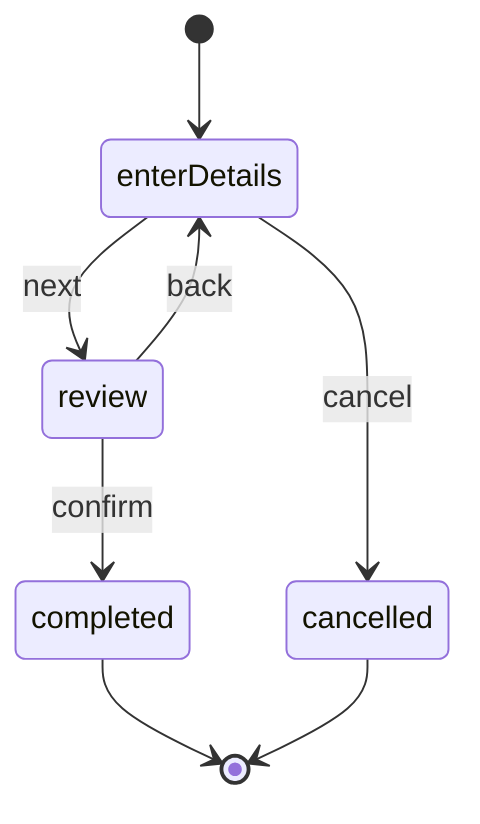

# Tiếp tục flow bằng một sự kiện

## 1. Mô phỏng một lượt tiếp tục flow

Spring Web Flow (SWF) quản lý một hành trình nhiều bước bằng `FlowExecution`. Khi flow được khởi chạy, engine vào state ban đầu và thường dừng ở một `view-state` để chờ người dùng. Khi người dùng gửi form, request tiếp theo mang theo execution key và một **event ID** như `next`, `back` hoặc `confirm`. Web Flow khôi phục execution, phát event cho state đang hoạt động rồi tìm transition phù hợp.

Một kiểm thử tiếp tục flow cần mô phỏng đúng chuỗi:

1. Khởi chạy flow.
2. Xác nhận state ban đầu.
3. Đặt event ID.
4. Tiếp tục execution hiện tại.
5. Xác nhận state mới hoặc outcome cuối.
6. Lặp lại với event tiếp theo nếu flow còn hoạt động.

Spring Web Flow Test cung cấp `AbstractXmlFlowExecutionTests`, `MockExternalContext` và các helper như `startFlow(...)`, `resumeFlow(...)`, `assertCurrentStateEquals(...)`. Nhờ đó, ta có thể kiểm tra state machine mà không cần mở trình duyệt thật.

Trong module `SPRING_WEB_FLOW`, cách kiểm thử này giúp xác nhận event và transition hoạt động đúng trong hành trình nhiều bước có form binding, validation, subflow và phục hồi execution.

## 2. Event ID là hợp đồng giữa view và flow

Một event là tín hiệu gửi đến state hiện tại. Trong view-state, event thường được phát khi người dùng nhấn nút hoặc gửi form. Event ID phải khớp với thuộc tính `on` của transition trong flow definition.

Ví dụ:

```xml
<view-state id="enterDetails">
    <transition on="next" to="review" />
    <transition on="cancel" to="cancelled" />
</view-state>
```

Hai event hợp lệ trong state này là `next` và `cancel`. Khi người dùng nhấn Next, view gửi event ID `next`. Engine tìm transition có `on="next"` rồi chuyển sang state `review`.

Trong Spring MVC integration, tên request parameter chứa event ID mặc định là `_eventId`. Một form HTML có thể gửi:

```html
<form method="post">
    <button type="submit" name="_eventId" value="next">Tiếp tục</button>
    <button type="submit" name="_eventId" value="cancel">Hủy</button>
</form>
```

Tên parameter này có thể được thay đổi bằng `eventIdParameterName` của `MvcViewFactoryCreator`. Trong test, `MockExternalContext.setEventId("next")` đặt event trực tiếp, vì vậy test tập trung vào hợp đồng giữa event và transition mà không cần kiểm tra trình duyệt serialize nút bấm ra sao.

**Event ID phân biệt chữ hoa/chữ thường.** Nếu transition khai báo `on="next"`, test cần phát đúng `next`, không phải `Next` hoặc `continue`.

## 3. Flow mẫu để thực hành

Ta dùng flow đặt hàng tối giản với ba bước: nhập thông tin, xem lại và kết thúc.

```xml
<?xml version="1.0" encoding="UTF-8"?>
<flow xmlns="http://www.springframework.org/schema/webflow"
      xmlns:xsi="http://www.w3.org/2001/XMLSchema-instance"
      xsi:schemaLocation="
          http://www.springframework.org/schema/webflow
          http://www.springframework.org/schema/webflow/spring-webflow.xsd"
      start-state="enterDetails">

    <view-state id="enterDetails">
        <transition on="next" to="review" />
        <transition on="cancel" to="cancelled" />
    </view-state>

    <view-state id="review">
        <transition on="back" to="enterDetails" />
        <transition on="confirm" to="completed" />
    </view-state>

    <end-state id="completed" />
    <end-state id="cancelled" />
</flow>
```

Flow có hai end-state để test phân biệt kết quả hoàn tất và hủy. Một execution có thể đi qua:



Các view template tương ứng phải được cấu hình nếu chạy qua MVC thật. Với kiểm thử execution, điều quan trọng là flow definition được nạp và transition có event ID đúng.

## 4. Thêm Spring Web Flow Test vào test classpath

Với Maven, thêm module test cùng phiên bản với Spring Web Flow đang sử dụng:

```xml
<dependency>
    <groupId>org.springframework.webflow</groupId>
    <artifactId>spring-webflow-test</artifactId>
    <version>${spring-webflow.version}</version>
    <scope>test</scope>
</dependency>
```

Nếu dự án chưa quản lý JUnit qua dependency khác, thêm JUnit theo phiên bản phù hợp với cấu hình build. Các lớp test base của Web Flow 2.x được thiết kế theo phong cách JUnit 3; ví dụ bên dưới dùng phương thức `test...` để tương thích với cách chạy đó.

Không trộn phiên bản `spring-webflow` và `spring-webflow-test`. Hai artifact cần cùng dòng phiên bản để tránh `NoSuchMethodError`, `ClassNotFoundException` hoặc khác biệt contract của test helper.

## 5. Tạo test class bằng AbstractXmlFlowExecutionTests

`AbstractXmlFlowExecutionTests` giúp nạp flow definition từ XML. Test class cung cấp đường dẫn file thông qua `getResource(...)`, sau đó dùng helper để khởi chạy và tiếp tục execution.

Ví dụ:

```java
import org.springframework.webflow.test.MockExternalContext;
import org.springframework.webflow.test.execution.AbstractXmlFlowExecutionTests;
import org.springframework.webflow.test.execution.FlowDefinitionResource;
import org.springframework.webflow.test.execution.FlowDefinitionResourceFactory;

public class CheckoutFlowExecutionTests
        extends AbstractXmlFlowExecutionTests {

    @Override
    protected FlowDefinitionResource getResource(
            FlowDefinitionResourceFactory resourceFactory) {
        return resourceFactory.createFileResource(
            "src/main/webapp/WEB-INF/flows/checkout/checkout.xml"
        );
    }
}
```

Đường dẫn trên là ví dụ cho ứng dụng WAR có flow XML trong `src/main/webapp`. Nếu dự án lưu flow trong classpath, dùng resource factory phù hợp, chẳng hạn classpath resource. Test cần trỏ đúng file flow definition đang được kiểm tra.

Khi flow cần bean, converter hoặc service, có thể cấu hình flow builder context trong test fixture bằng hook `configureFlowBuilderContext(...)` của lớp base hoặc dùng registry phù hợp với dự án. Không nên vô tình thay service thật bằng mock nếu mục tiêu là kiểm thử integration với service thật.

## 6. Khởi chạy flow và xác nhận state ban đầu

Trước khi gửi event, test phải khởi chạy execution. `startFlow(context)` bắt đầu flow với `MockExternalContext` được cung cấp.

```java
public void testStartAtEnterDetails() {
    MockExternalContext context = new MockExternalContext();

    startFlow(context);

    assertCurrentStateEquals("enterDetails", context);
}
```

Test này xác nhận flow definition được nạp, start state được chọn đúng và execution dừng ở state mong đợi. Nếu flow khởi chạy sai state hoặc lỗi trong action `on-start`, test sẽ thất bại trước khi phát event. Điều này giúp tách lỗi khởi tạo khỏi lỗi transition.

## 7. Gửi một event và tiếp tục execution

Đây là chuỗi quan trọng nhất:

```java
public void testNextEventMovesToReview() {
    MockExternalContext context = new MockExternalContext();

    startFlow(context);
    assertCurrentStateEquals("enterDetails", context);

    context.setEventId("next");
    resumeFlow(context);

    assertCurrentStateEquals("review", context);
}
```

Ý nghĩa từng bước:

1. `new MockExternalContext()` tạo external context giả cho lượt tương tác.
2. `startFlow(context)` khởi chạy root flow và execution dừng tại `enterDetails`.
3. `setEventId("next")` mô phỏng người dùng gửi event `next`.
4. `resumeFlow(context)` tiếp tục execution đã khởi chạy và xử lý event.
5. `assertCurrentStateEquals("review", context)` xác nhận transition đã đưa flow tới state đích.

`resumeFlow(...)` không phải khởi chạy một flow mới. Nó tiếp tục execution mà test fixture đã tạo. Nếu gọi `startFlow(...)` lần nữa, test sẽ tạo hành trình mới và không còn kiểm tra transition của execution trước.

## 8. Tiếp tục nhiều lần qua nhiều event

Một hành trình có thể cần nhiều request. Hãy gửi event theo đúng thứ tự và kiểm tra state sau mỗi lần resume:

```java
public void testCompleteBookingJourney() {
    MockExternalContext context = new MockExternalContext();

    startFlow(context);
    assertCurrentStateEquals("enterDetails", context);

    context.setEventId("next");
    resumeFlow(context);
    assertCurrentStateEquals("review", context);

    context.setEventId("back");
    resumeFlow(context);
    assertCurrentStateEquals("enterDetails", context);

    context.setEventId("next");
    resumeFlow(context);
    assertCurrentStateEquals("review", context);

    context.setEventId("confirm");
    resumeFlow(context);
    assertFlowExecutionEnded("completed", context);
}
```

Test này kiểm tra cả hai chiều điều hướng:

- `next` đưa flow từ `enterDetails` sang `review`.
- `back` đưa flow trở lại `enterDetails`.
- Người dùng có thể gửi `next` lần nữa sau khi chỉnh sửa.
- `confirm` kết thúc root execution với outcome `completed`.

Đừng chỉ assert state cuối. Nếu flow có nhiều transition, assert sau mỗi event giúp xác định chính xác event nào dẫn tới sai state.

## 9. Kiểm tra outcome khi flow kết thúc

Khi event dẫn tới end-state, dùng `assertFlowExecutionEnded(...)` để xác nhận execution đã kết thúc với outcome mong đợi.

```java
public void testCancelEndsFlowWithCancelledOutcome() {
    MockExternalContext context = new MockExternalContext();

    startFlow(context);
    context.setEventId("cancel");
    resumeFlow(context);

    assertFlowExecutionEnded("cancelled", context);
}
```

Outcome là ID của end-state. Trong ví dụ, `cancelled` và `completed` đều kết thúc flow nhưng mang ý nghĩa khác nhau. Kiểm thử outcome giúp tránh trường hợp flow đi nhầm nhánh nhưng vẫn kết thúc mà test chỉ kiểm tra execution đã ended.

Nếu cần kiểm tra dữ liệu flow trả ra, hãy dùng assertion/API phù hợp của test fixture hoặc kiểm tra output mapping qua execution context. Đừng suy ra dữ liệu output chỉ từ tên outcome.

## 10. Truyền request parameter cùng với event

Event ID chỉ cho biết người dùng chọn hành động nào. Form thường gửi thêm dữ liệu như mã đơn hàng, ngày nhận phòng hoặc lựa chọn giao hàng.

`MockExternalContext` cho phép thêm request parameter để mô phỏng dữ liệu gửi trong request:

```java
public void testNextEventWithOrderId() {
    MockExternalContext context = new MockExternalContext();

    startFlow(context);

    context.putRequestParameter("orderId", "ORD-2048");
    context.setEventId("next");
    resumeFlow(context);

    assertCurrentStateEquals("review", context);
}
```

Flow có thể đọc tham số qua biến `requestParameters` hoặc bind vào model của view-state. Ví dụ:

```xml
<transition on="next" to="review">
    <set name="flowScope.orderId"
         value="requestParameters.orderId" />
</transition>
```

Nếu `orderId` là kiểu domain, kiểm thử thêm conversion và validation để xác nhận dữ liệu đầu vào được xử lý đúng. Chỉ assert state `review` chưa đủ chứng minh giá trị đã được bind chính xác.

Khi kiểm thử form binding, dùng đúng tên parameter mà view thực tế gửi. Với Spring MVC view, tên field có thể chịu ảnh hưởng của model binding và cấu hình binder; đừng tự đặt tên request parameter khác với markup đang triển khai.

## 11. Mỗi lần resume là một lượt xử lý mới

Trong ứng dụng thật, các bước thường diễn ra qua nhiều HTTP request:

- Request đầu tiên launch flow.
- Request sau mang execution key và event ID.
- Repository tìm conversation/snapshot tương ứng.
- Engine khôi phục execution, phát event và xử lý transition.
- Response trả view mới cùng continuation key cho lần tiếp theo.

Test helper `startFlow(...)` và `resumeFlow(...)` trừu tượng hóa phần quản lý execution key để test tập trung vào hành vi flow.

Khi tự viết test ở tầng `FlowExecutor` hoặc repository, cần bảo đảm request tiếp theo dùng đúng execution key được phát ra. Nếu tạo `MockExternalContext` mới cho mỗi request, phải giữ session map/conversation context cần thiết để repository tìm lại execution. Một context mới hoàn toàn với session map khác có thể mô phỏng một người dùng/session khác và làm resume thất bại vì không tìm thấy conversation.

Không dùng lại execution key đã kết thúc để giả lập request tiếp theo hợp lệ. Sau root end-state, execution đã hoàn tất; request dùng key cũ thuộc trường hợp stale/expired execution.

## 12. Kiểm thử event không khớp transition

Nếu event ID không khớp transition nào của state hiện tại, flow không thể tự đoán hành động mà người dùng muốn thực hiện. Tùy cấu hình và exception handler, engine có thể phát sinh `NoMatchingTransitionException` hoặc đi vào nhánh xử lý lỗi đã cấu hình.

Ví dụ, state `review` chỉ khai báo `back` và `confirm`. Nếu test gửi `delete`, không nên kỳ vọng flow tự chuyển về `enterDetails`.

Một test âm nên xác nhận chính sách của ứng dụng:

```java
import org.springframework.webflow.engine.NoMatchingTransitionException;

public void testUnknownEventIsRejected() {
    MockExternalContext context = new MockExternalContext();

    startFlow(context);
    context.setEventId("next");
    resumeFlow(context);
    assertCurrentStateEquals("review", context);

    context.setEventId("delete");
    try {
        resumeFlow(context);
        fail("Expected an unmatched event to be rejected");
    } catch (NoMatchingTransitionException expected) {
        // Flow không có transition cho event delete ở state review.
    }
}
```

Đoạn test trên giả định ứng dụng để exception không có transition đi ra ngoài. Nếu flow có exception handler hoặc transition xử lý event không hợp lệ, hãy assert state/outcome theo chính sách đó thay vì bắt exception trực tiếp.

## 13. Kiểm thử validation khi event được gửi

Một form có thể gửi event `next` nhưng dữ liệu không hợp lệ. Khi validation thất bại, flow thường ở lại view-state để người dùng sửa dữ liệu. Test cần xác nhận cả state và lỗi, không chỉ xác nhận event đã được phát.

Ví dụ view-state:

```xml
<view-state id="enterDetails" model="booking">
    <transition on="next" to="review" />
</view-state>
```

Nếu binder/validator phát hiện lỗi, transition tới `review` không được hoàn tất theo đường thành công. Test nên xác nhận:

- State hiện tại vẫn là `enterDetails`.
- `MessageContext` có lỗi tương ứng với field.
- Model không chứa giá trị sai đã được chuyển kiểu một cách âm thầm.
- Event `next` tiếp theo với dữ liệu hợp lệ có thể tiếp tục tới `review`.

Đối với validator custom, kiểm thử riêng validator và thêm flow execution test để xác nhận validator thực sự được gọi trong lifecycle của view-state. Đừng chỉ mock validator và assert nó được gọi nếu chưa kiểm tra state cuối.

## 14. Kiểm thử subflow: event của con và outcome trả về cha

Subflow có flow session riêng bên trong execution của flow cha. Khi subflow kết thúc ở end-state, outcome của nó được gửi về `subflow-state` để flow cha chọn transition tương ứng.

Ví dụ flow cha:

```xml
<subflow-state id="takePayment" subflow="payment">
    <transition on="paid" to="receipt" />
    <transition on="declined" to="review" />
</subflow-state>

<view-state id="receipt">
    <transition on="finish" to="completed" />
</view-state>

<end-state id="completed" />
```

Flow con `payment`:

```xml
<flow start-state="authorize">
    <view-state id="authorize">
        <transition on="success" to="paid" />
        <transition on="failure" to="declined" />
    </view-state>

    <end-state id="paid" />
    <end-state id="declined" />
</flow>
```

Test có thể thực hiện lần lượt:

1. Launch root flow và gửi event dẫn tới `takePayment`.
2. Xác nhận active state thuộc subflow `authorize`.
3. Gửi event `success` cho subflow.
4. Xác nhận subflow kết thúc với outcome `paid`.
5. Xác nhận flow cha tiếp tục tại `receipt`.
6. Gửi event `finish` và xác nhận root execution kết thúc với `completed`.

Không nhầm event `success` của flow con với event `paid` mà flow cha nhận. Flow cha nhận outcome từ end-state của subflow, sau đó mới chọn transition `on="paid"`.

## 15. Các lỗi thường gặp khi viết test

| Hiện tượng | Nguyên nhân thường gặp | Cách xử lý |
|---|---|---|
| `resumeFlow(...)` không tiếp tục được | Chưa gọi `startFlow(...)` hoặc execution không còn active | Khởi chạy flow trước và kiểm tra key/session |
| State không đổi sau event | Event ID không khớp `transition on` | So sánh chính xác tên event và state hiện tại |
| Test luôn đi qua flow mới | Gọi `startFlow(...)` thay vì `resumeFlow(...)` | Tiếp tục execution hiện tại |
| Không tìm thấy execution | Test request mới không giữ session/conversation cần thiết | Giữ cùng session map hoặc dùng test helper đúng lifecycle |
| Không tìm thấy flow definition | Sai đường dẫn trong `getResource(...)` | Kiểm tra resource path và registry |
| Event không hợp lệ làm test vỡ | Không có transition hoặc exception handler cho event | Assert exception hoặc cấu hình nhánh lỗi rõ ràng |
| Test kết thúc nhưng không biết outcome | Chỉ assert execution ended | Dùng `assertFlowExecutionEnded(outcome, context)` |
| Validation test vẫn sang state kế tiếp | Validator chưa được gắn vào view-state hoặc test gửi dữ liệu hợp lệ | Kiểm tra binder, validator và request parameters |
| Subflow không trả đúng nhánh | Nhầm event bên con với outcome end-state | Assert state con, outcome và state cha theo thứ tự |
| Test chạy khác môi trường | Dependency test khác version runtime | Đồng bộ `spring-webflow-test` với `spring-webflow` |

## 16. Bộ test tối thiểu cho một flow nhiều bước

Với flow đặt hàng ở phần 3, một bộ test có thể bao gồm:

| Test case | Event | Kết quả mong đợi |
|---|---|---|
| Launch | Không có event | `enterDetails` |
| Tiếp tục | `next` | `review` |
| Quay lại | `back` | `enterDetails` |
| Xác nhận | `confirm` | Outcome `completed` |
| Hủy | `cancel` | Outcome `cancelled` |
| Event không khớp | `delete` | Exception hoặc nhánh lỗi theo cấu hình |
| Request parameter | `next` + `orderId` | State và dữ liệu đầu vào đúng |
| Validation thất bại | `next` + dữ liệu sai | Ở lại view-state và có message lỗi |
| Subflow thành công | `success` trong payment | Parent nhận outcome `paid` |
| Subflow từ chối | `failure` trong payment | Parent nhận outcome `declined` |

Một test suite tốt xác nhận cả đường thành công, quay lại, hủy, validation và lỗi. Nó cũng kiểm tra side effect nghiệp vụ không bị gọi lặp khi cùng một hành động được gửi nhiều lần.

## 17. Kiểm thử event lặp và side effect

Một người dùng có thể nhấn nút hai lần hoặc trình duyệt gửi lại request. Flow test nên mô phỏng tình huống event lặp để xác định state machine phản ứng ra sao.

Ví dụ: sau khi `next` đưa flow tới `review`, gửi `next` lần nữa. Nếu `review` không có transition `next`, engine sẽ từ chối event theo cấu hình hiện tại. Đây là hành vi điều khiển flow, không phải cơ chế idempotency cho service.

Với thao tác có side effect như tạo đơn hàng, giữ chỗ hoặc thanh toán:

- Dùng idempotency key hoặc unique business reference ở service.
- Kiểm tra trạng thái nghiệp vụ trước khi ghi lại.
- Test số lần service được gọi khi event được gửi lặp.
- Không giả định repository lock hoặc transition guard thay thế transaction database.
- Không dùng test flow đơn thuần để chứng minh xử lý đồng thời an toàn; cần test service/repository ở mức phù hợp.

## 18. Ghi nhớ

Để tiếp tục flow bằng một sự kiện trong kiểm thử, hãy khởi chạy execution bằng `startFlow(...)`, đặt event ID trên `MockExternalContext` bằng `setEventId(...)`, rồi gọi `resumeFlow(...)`. Dùng `assertCurrentStateEquals(...)` để kiểm tra state sau từng event và `assertFlowExecutionEnded(...)` để xác nhận outcome khi root flow kết thúc.

Mỗi event phải khớp transition của state đang hoạt động. Request parameter có thể được gửi cùng event; validation có thể giữ flow ở view-state; subflow phát event riêng và trả outcome qua end-state cho flow cha. Hãy kiểm tra từng bước trong hành trình để phát hiện chính xác event nào làm flow đi sai nhánh.

### Tài liệu tham khảo

- [Spring Web Flow 2.5.1 — Testing](https://docs.spring.io/spring-webflow/docs/2.5.1.RELEASE/reference/html/testing.html) — test support, flow execution tests và mô phỏng event.
- [Spring Web Flow 2.5.1 — AbstractXmlFlowExecutionTests API](https://docs.spring.io/spring-webflow/docs/2.5.1.RELEASE/api/org/springframework/webflow/test/execution/AbstractXmlFlowExecutionTests.html) — nạp flow definition XML cho test.
- [Spring Web Flow 2.5.1 — AbstractFlowExecutionTests API](https://docs.spring.io/spring-webflow/docs/2.5.1.RELEASE/api/org/springframework/webflow/test/execution/AbstractFlowExecutionTests.html) — helper launch/resume và assertion state/outcome.
- [Spring Web Flow 2.5.1 — MockExternalContext API](https://docs.spring.io/spring-webflow/docs/2.5.1.RELEASE/api/org/springframework/webflow/test/MockExternalContext.html) — đặt event ID, request parameter và session context trong test.
- [Spring Web Flow 2.5.1 — FlowExecution API](https://docs.spring.io/spring-webflow/docs/2.5.1.RELEASE/api/org/springframework/webflow/execution/FlowExecution.html) — vòng đời execution và trạng thái active/ended.
