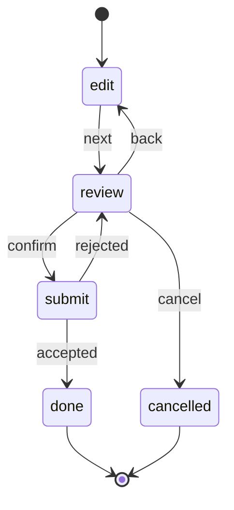

# Thiết lập state hiện tại để kiểm tra một nhánh cụ thể

Một flow đặt hàng có thể gồm nhập thông tin, kiểm tra tồn kho, xem lại, xác nhận và phục hồi khi dịch vụ gặp lỗi. Nếu mọi bài kiểm thử nhánh xác nhận đều phải đi từ màn hình đầu tiên, thay đổi ở bước nhập thông tin có thể làm nhiều test phía sau cùng thất bại, dù transition cần kiểm tra vẫn đúng.

Trong chương **Kiểm thử flow** của module **SPRING_WEB_FLOW**, kỹ thuật đặt state hiện tại giúp khoanh vùng một hành vi: với execution đang ở một state, có dữ liệu và phụ thuộc xác định, một event sẽ dẫn tới kết quả nào? Cách kiểm thử này phù hợp với mục tiêu mô hình hóa hành trình bằng state, event và transition, đồng thời cần được kết hợp với kiểm thử khởi tạo, binding, validation và tích hợp Spring MVC ở những ranh giới tương ứng.

## 1. Hợp đồng của một bài kiểm thử nhánh

Một test nhánh nên thể hiện rõ bốn yếu tố:

| Yếu tố | Ví dụ ở bước xác nhận đơn |
| --- | --- |
| State xuất phát | `review` |
| Tiền điều kiện | Có `order` và `total` trong `flowScope` |
| Kích thích | Event `confirm` |
| Kết quả quan sát | Flow kết thúc với outcome `done`; dịch vụ được gọi đúng một lần |

Có thể diễn đạt mục tiêu như một hợp đồng:

```text
Given: review + bản nháp hợp lệ + tổng tiền đã tính
When:  confirm và dịch vụ trả accepted
Then:  kết thúc với done, xuất tổng tiền và gọi dịch vụ một lần
```

Đặt state chỉ cung cấp một phần của `Given`. Bản nháp, tổng tiền, người dùng hoặc dữ liệu khác mà nhánh cần phải do fixture chuẩn bị rõ ràng.

Một test chỉ gọi `setCurrentState("review")` rồi xác nhận state vẫn là `review` chủ yếu kiểm tra chính thao tác setup. Hành vi ứng dụng bắt đầu được kiểm chứng khi test phát event và quan sát kết quả xử lý.

## 2. API kiểm thử và giới hạn của thao tác đặt state

Với flow định nghĩa bằng XML, Spring Web Flow cung cấp `AbstractXmlFlowExecutionTests`. Lớp test chỉ định tài nguyên XML bằng `getResource(...)` và đăng ký stub hoặc mock qua `configureFlowBuilderContext(...)`. Đây là cơ sở để chạy định nghĩa flow với các phụ thuộc được kiểm soát mà không cần dựng một servlet container cho từng nhánh. Xem [API của AbstractXmlFlowExecutionTests](https://docs.spring.io/spring-webflow/docs/current/api/org/springframework/webflow/test/execution/AbstractXmlFlowExecutionTests.html).

Các phương thức thường xuất hiện trong test nhánh:

| Phương thức | Vai trò |
| --- | --- |
| `setCurrentState("review")` | Đặt execution tại state cần làm điểm xuất phát |
| `getFlowScope().put(...)` | Cung cấp dữ liệu của flow session đang hoạt động |
| `getViewScope().put(...)` | Cung cấp dữ liệu riêng của view hiện tại khi phù hợp |
| `getConversationScope().put(...)` | Cung cấp dữ liệu dùng chung trong conversation |
| `resumeFlow(context)` | Cho flow tiếp tục xử lý request/event giả lập |
| `assertCurrentStateEquals(...)` | Kiểm tra state khi execution còn hoạt động |
| `assertFlowExecutionEnded()` | Kiểm tra execution đã kết thúc |
| `assertFlowExecutionOutcomeEquals(...)` | Kiểm tra outcome khi execution kết thúc |

Các helper trên thuộc hệ thống [AbstractFlowExecutionTests](https://docs.spring.io/spring-webflow/docs/current/api/org/springframework/webflow/test/execution/AbstractFlowExecutionTests.html).

### Đặt state không phải đi tới state theo đường thông thường

`setCurrentState(...)` có thể tạo và kích hoạt execution nếu chưa có execution được khởi tạo. Cơ chế bên dưới đặt trực tiếp state của session, bỏ qua thao tác khởi động flow thông thường. Nó không thực hiện chuỗi transition để đến state đó, cũng không tự chạy entry action của state được chọn. Có thể đối chiếu phần triển khai tại [FlowExecutionImpl.setCurrentState](https://github.com/spring-projects/spring-webflow/blob/main/spring-webflow/src/main/java/org/springframework/webflow/engine/impl/FlowExecutionImpl.java).

Hệ quả đối với fixture:

- Không trông đợi `<on-start>` đã tạo model.
- Không trông đợi `<on-entry>` của state xuất phát đã nạp dữ liệu.
- Không trông đợi các action ở bước trước đã ghi giá trị vào scope.
- Không coi input mapping hoặc lịch sử điều hướng trước đó là đã được kiểm chứng.

Sau khi test phát event bằng `resumeFlow(...)`, các action và transition mà execution thực sự đi qua vẫn được thực thi. Nếu transition dẫn vào một state mới theo đường bình thường, entry action của state đích thuộc hành vi đang được chạy.

## 3. Flow mẫu: kiểm tra riêng các nhánh ở màn hình xem lại

Trong ví dụ này, người dùng có thể xác nhận, quay lại sửa hoặc hủy tại `review`. Xác nhận đi qua action-state `submit`; dịch vụ trả về `accepted` hoặc `rejected`.



Định nghĩa XML minh họa:

```xml
<?xml version="1.0" encoding="UTF-8"?>
<flow xmlns="http://www.springframework.org/schema/webflow"
      xmlns:xsi="http://www.w3.org/2001/XMLSchema-instance"
      xsi:schemaLocation="http://www.springframework.org/schema/webflow
          https://www.springframework.org/schema/webflow/spring-webflow.xsd">

    <on-start>
        <evaluate expression="orderService.newDraft()"
                  result="flowScope.order" />
    </on-start>

    <view-state id="edit" view="orderForm">
        <transition on="next" to="review" />
    </view-state>

    <view-state id="review" view="orderReview">
        <on-entry>
            <evaluate expression="orderService.quote(flowScope.order)"
                      result="flowScope.total" />
        </on-entry>
        <transition on="confirm" to="submit" />
        <transition on="back" to="edit" />
        <transition on="cancel" to="cancelled" />
    </view-state>

    <action-state id="submit">
        <evaluate expression="orderService.submit(flowScope.order, flowScope.total)" />
        <transition on="accepted" to="done" />
        <transition on="rejected" to="review" />
    </action-state>

    <end-state id="done">
        <output name="total" value="flowScope.total" />
    </end-state>

    <end-state id="cancelled" />
</flow>
```

Chuỗi mà `orderService.submit(...)` trả về trở thành event cho các transition của `submit`. Đây là quy tắc ánh xạ kết quả action được mô tả trong [Spring Web Flow Reference Guide, Action Outcome Event Mappings](https://docs.spring.io/spring-webflow/docs/current/reference/index.html#action-state-outcome-event-mappings).

Ví dụ chủ động tập trung vào điều phối, nên chưa khai báo model form, binder, validator hoặc đường xử lý exception. Trong ứng dụng thật, các thành phần đó phải được bổ sung theo hợp đồng màn hình và kiểm thử riêng. Kết quả `rejected` ở đây là một kết quả nghiệp vụ thông thường, không phải mô phỏng một exception đã được xử lý.

Tệp XML cần là định nghĩa flow thật mà test muốn bảo vệ. Khi áp dụng vào dự án, hãy trỏ test vào XML sản phẩm thay vì sao chép XML sang một tệp test riêng rồi chỉ kiểm tra bản sao.

## 4. Bộ test với fixture và stub dịch vụ rõ ràng

Đoạn Java sau dùng quy ước `public void test...()` của lớp cơ sở kế thừa `junit.framework.TestCase`. Dự án cần có JUnit tương thích; nếu chạy trên JUnit Platform thì phải có cơ chế chạy các test kiểu cũ, chẳng hạn Vintage engine với cấu hình phù hợp. Không thêm annotation JUnit Jupiter vào lớp này rồi mặc định cho rằng vòng đời và cơ chế phát hiện test đã tương thích. Quan hệ kế thừa được thể hiện trong [API AbstractXmlFlowExecutionTests](https://docs.spring.io/spring-webflow/docs/current/api/org/springframework/webflow/test/execution/AbstractXmlFlowExecutionTests.html).

Đường dẫn `src/main/webapp/WEB-INF/flows/order/order-flow.xml` bên dưới là vị trí minh họa trong ứng dụng cần kiểm thử, không phải yêu cầu tạo thêm tệp khi đọc bài này.

```java
package com.example.order;

import java.math.BigDecimal;

import org.springframework.webflow.engine.builder.support.FlowDefinitionResource;
import org.springframework.webflow.engine.builder.support.FlowDefinitionResourceFactory;
import org.springframework.webflow.test.MockExternalContext;
import org.springframework.webflow.test.MockFlowBuilderContext;
import org.springframework.webflow.test.execution.AbstractXmlFlowExecutionTests;

public class OrderFlowExecutionTests extends AbstractXmlFlowExecutionTests {

    private final StubOrderService orderService = new StubOrderService();

    @Override
    protected FlowDefinitionResource getResource(
            FlowDefinitionResourceFactory factory) {
        return factory.createFileResource(
                "src/main/webapp/WEB-INF/flows/order/order-flow.xml");
    }

    @Override
    protected void configureFlowBuilderContext(MockFlowBuilderContext context) {
        context.registerBean("orderService", orderService);
    }

    private OrderDraft givenReviewReady() {
        setCurrentState("review");

        OrderDraft order = new OrderDraft("ORDER-TEST-01");
        getFlowScope().put("order", order);
        getFlowScope().put("total", new BigDecimal("120000"));
        return order;
    }

    private MockExternalContext event(String eventId) {
        MockExternalContext context = new MockExternalContext();
        context.setEventId(eventId);
        return context;
    }

    public void testReviewConfirmAcceptedEndsFlow() {
        OrderDraft order = givenReviewReady();
        orderService.submitOutcome = "accepted";

        resumeFlow(event("confirm"));

        assertFlowExecutionEnded();
        assertFlowExecutionOutcomeEquals("done");
        assertEquals(new BigDecimal("120000"),
                getFlowExecutionOutcome().getOutput().get("total"));
        assertEquals(1, orderService.submitCalls);
        assertSame(order, orderService.submittedOrder);
        assertEquals(new BigDecimal("120000"), orderService.submittedTotal);
    }

    public void testReviewConfirmRejectedReturnsToReview() {
        OrderDraft order = givenReviewReady();
        orderService.submitOutcome = "rejected";
        orderService.quotedTotal = new BigDecimal("125000");

        resumeFlow(event("confirm"));

        assertFlowExecutionActive();
        assertCurrentStateEquals("review");
        assertSame(order, getFlowScope().get("order"));
        assertEquals(1, orderService.submitCalls);
        assertEquals(1, orderService.quoteCalls);
        assertEquals(new BigDecimal("120000"), orderService.submittedTotal);
        assertEquals(new BigDecimal("125000"), getFlowScope().get("total"));
    }

    public void testReviewBackPreservesDraftWithoutSubmitting() {
        OrderDraft order = givenReviewReady();

        resumeFlow(event("back"));

        assertCurrentStateEquals("edit");
        assertSame(order, getFlowScope().get("order"));
        assertEquals(0, orderService.submitCalls);
    }

    public void testReviewCancelEndsWithoutSubmitting() {
        givenReviewReady();

        resumeFlow(event("cancel"));

        assertFlowExecutionEnded();
        assertFlowExecutionOutcomeEquals("cancelled");
        assertEquals(0, orderService.submitCalls);
    }

    public void testNormalEntryCreatesDraftAndCalculatesTotal() {
        startFlow(new MockExternalContext());

        assertCurrentStateEquals("edit");
        assertEquals(1, orderService.newDraftCalls);
        assertNotNull(getFlowScope().get("order"));

        resumeFlow(event("next"));

        assertCurrentStateEquals("review");
        assertEquals(1, orderService.quoteCalls);
        assertEquals(new BigDecimal("120000"), getFlowScope().get("total"));
    }

    public static class OrderDraft {
        private final String reference;

        public OrderDraft(String reference) {
            this.reference = reference;
        }

        public String getReference() {
            return reference;
        }
    }

    public static class StubOrderService {
        private String submitOutcome = "accepted";
        private BigDecimal quotedTotal = new BigDecimal("120000");
        private int newDraftCalls;
        private int quoteCalls;
        private int submitCalls;
        private OrderDraft submittedOrder;
        private BigDecimal submittedTotal;

        public OrderDraft newDraft() {
            newDraftCalls++;
            return new OrderDraft("ORDER-NEW");
        }

        public BigDecimal quote(OrderDraft order) {
            if (order == null) {
                throw new IllegalArgumentException("order is required");
            }
            quoteCalls++;
            return quotedTotal;
        }

        public String submit(OrderDraft order, BigDecimal total) {
            if (order == null || total == null) {
                throw new IllegalArgumentException("order and total are required");
            }
            submitCalls++;
            submittedOrder = order;
            submittedTotal = total;
            return submitOutcome;
        }
    }
}
```

`OrderDraft` và `StubOrderService` là kiểu minh họa do ứng dụng định nghĩa. Model thật có thể có thêm thuộc tính, ràng buộc validation và yêu cầu serialization theo cấu hình lưu trạng thái flow. Stub chỉ mô phỏng hợp đồng mà định nghĩa flow gọi; nó không kiểm chứng việc lưu đơn ở database.

`MockExternalContext.setEventId(...)` cung cấp event cho môi trường test; không cần gắn tiền tố `_eventId_` vào tên event truyền cho helper. API này khác với quy ước đặt tên nút hoặc tham số trên một trang HTML thực tế. Xem [API MockExternalContext](https://docs.spring.io/spring-webflow/docs/current/api/org/springframework/webflow/test/MockExternalContext.html).

## 5. Đọc kết quả test theo đúng ranh giới

### Nhánh chấp nhận

Ở `testReviewConfirmAcceptedEndsFlow`, điều kiện “đã có tổng tiền” được setup trực tiếp vì test bắt đầu tại `review`. Test kiểm tra đồng thời:

- Outcome kết thúc đúng là `done`.
- Output chứa tổng tiền được chuyển ra khỏi flow.
- Dịch vụ nhận đúng bản nháp và số tiền.
- Dịch vụ chỉ được gọi một lần trong request được test.

Một lần gọi trong test không chứng minh toàn hệ thống chống được gửi trùng khi người dùng refresh hoặc request bị retry. Điều đó cần cơ chế idempotency và kiểm thử ở ranh giới dịch vụ tương ứng.

Sau end-state, flow session đã kết thúc. Dữ liệu cần kiểm tra nên được lấy từ output hoặc đối tượng ghi nhận lời gọi, thay vì cố đọc `getFlowScope()` của một session không còn hoạt động. Các helper kết thúc và truy cập outcome được cung cấp trong [mã nguồn AbstractFlowExecutionTests](https://github.com/spring-projects/spring-webflow/blob/main/spring-webflow/src/main/java/org/springframework/webflow/test/execution/AbstractFlowExecutionTests.java).

### Nhánh từ chối và tái nhập state

Ở `testReviewConfirmRejectedReturnsToReview`, dịch vụ nhận tổng tiền cũ `120000`. Sau kết quả `rejected`, flow đi từ `submit` vào `review` theo transition bình thường, nên `<on-entry>` tính lại tổng tiền thành `125000`.

Hai assert về tổng tiền có mục đích khác nhau:

```text
submittedTotal == 120000  → dữ liệu gửi đi ở lần xác nhận này
flowScope.total == 125000 → dữ liệu màn hình xem lại sau khi tái nhập state
```

Nếu chỉ kiểm tra state cuối cùng là `review`, test có thể bỏ sót lỗi không tính lại giá hoặc vô tình làm mất bản nháp. Các assert về dữ liệu làm rõ hành vi phục hồi của nhánh.

### Nhánh quay lại và hủy

Với `back`, điều quan trọng là giữ bản nháp và không gửi đơn. Với `cancel`, điều quan trọng là kết thúc đúng outcome và không gây tác dụng phụ gửi đơn.

Các assert phủ định như `submitCalls == 0` có giá trị khi chúng bảo vệ một ranh giới nghiệp vụ cụ thể. Không cần xác minh mọi lời gọi nội bộ của mọi helper chỉ vì stub có thể ghi nhận chúng.

## 6. Fixture phải tương ứng với một trạng thái có thể xảy ra

Một fixture tốt mô tả điều kiện hợp lệ của state xuất phát. Với `review`, ví dụ đã chọn hợp đồng “bản nháp và tổng tiền đã tồn tại”. Do đó helper `givenReviewReady()` cung cấp cả hai.

Nếu quên `total`, action `submit` sẽ nhận thiếu dữ liệu. Với flow mẫu, đó là lỗi setup khi test muốn mô phỏng một màn hình xem lại hợp lệ. Không nên thêm một nhánh mặc định “tự tính lại tổng tiền nếu null” vào sản phẩm chỉ để làm test nhánh chạy qua.

Tuy nhiên, nếu yêu cầu sản phẩm thật cho phép dữ liệu hết hiệu lực hoặc thiếu một cách hợp lệ, hãy viết test riêng cho hợp đồng đó. Ví dụ:

```text
Given: review còn tồn tại nhưng báo giá đã hết hạn
When:  confirm
Then:  không gửi đơn; tính lại báo giá hoặc đưa về bước xem lại
```

Khi ấy fixture “báo giá hết hạn” là chủ đích kiểm thử, và XML/action phải có hành vi tương ứng. Đừng nhập nhằng một fixture thiếu dữ liệu do sơ suất với một tình huống phục hồi đã được thiết kế.

### Đặt dữ liệu vào đúng scope

| Dữ liệu | Vị trí fixture phù hợp trong ví dụ |
| --- | --- |
| Bản nháp qua nhiều state | `getFlowScope().put("order", ...)` |
| Tổng tiền dùng khi xác nhận | `getFlowScope().put("total", ...)` |
| Trạng thái chỉ dùng trong view hiện tại | `getViewScope().put(...)` nếu state thực sự dùng view scope |
| Giá trị chia sẻ giữa flow cha và subflow | Conversation scope hoặc input/output theo hợp đồng |
| Tham số của request mới | Request parameter map của external context |
| Kết quả phản hồi của dịch vụ | Cấu hình stub/mock, không gán trước kết quả vào state đích |

Gán vào flow scope không thay thế được binding. Nếu mục tiêu là kiểm tra chuyển chuỗi `"3"` từ request thành số lượng trong model, hãy tạo request phù hợp và dùng cấu hình view/binding tương ứng; không gán sẵn số `3` rồi kết luận binding đã đúng.

Các biến tạm của request phải được chuẩn bị cho lần resume cần kiểm tra. Đừng coi request scope là nơi giữ dữ liệu lâu dài giữa các bước.

## 7. State nào phù hợp làm điểm xuất phát?

Một `view-state` thường là điểm xuất phát tự nhiên vì execution đang chờ tương tác từ bên ngoài. Đặt state tại đây rồi gửi event mô phỏng tình huống người dùng bấm nút.

Với `action-state`, `decision-state` hoặc `subflow-state`, việc đặt con trỏ trực tiếp không đồng nghĩa action đã được chạy, điều kiện đã được đánh giá hay subflow đã được khởi động. Để bảo vệ hành vi điều phối, nên bắt đầu từ state chờ tương tác ngay trước chúng rồi để transition thực sự đi vào các state đó.

Trong ví dụ, test bắt đầu tại `review`, gửi `confirm` rồi để engine tự đi qua `submit`. Nếu test đặt thẳng `submit` và giả định `orderService.submit(...)` đã được gọi, test đang dùng sai giả định về vòng đời.

Tương tự, `setCurrentState("addressForm")` không tự dựng một cây execution cha/con chỉ vì tên đó thuộc subflow địa chỉ. Kiểm thử subflow độc lập và kiểm thử flow cha gọi subflow là hai hợp đồng khác nhau. Với hợp đồng cha/con, hãy đi vào `subflow-state` theo đường thực thi hoặc đăng ký subflow giả theo cơ chế hỗ trợ của framework.

Không dùng `setCurrentState(...)` như một API điều hướng trong controller sản phẩm. Đây là công cụ phục vụ thiết lập execution cho kiểm thử; đường điều hướng người dùng vẫn phải được mô hình hóa bằng event, transition và hợp đồng dữ liệu.

## 8. Kết hợp test nhánh với test đi từ đầu

Test cuối cùng trong lớp mẫu gọi `startFlow(...)`, rồi phát `next`. Nó bảo vệ phần mà các test nhánh đã chủ động bỏ qua: tạo bản nháp và tính tổng tiền khi vào `review` theo đường thông thường.

Hai nhóm test có trách nhiệm bổ sung cho nhau:

| Cách kiểm thử | Câu hỏi được trả lời |
| --- | --- |
| Đặt trực tiếp `review`, phát `confirm` | Nhánh xác nhận xử lý đúng với tiền điều kiện đã biết không? |
| `startFlow`, đi từ `edit` đến `review` | Tiền điều kiện của màn hình xem lại có được tạo đúng không? |
| Test binding và validation | Dữ liệu request được chuyển đổi, kiểm tra và phản hồi lỗi đúng không? |
| Test tích hợp Spring MVC và view | Event từ HTTP, flow URL và hiển thị có nối đúng không? |
| Test phục hồi execution hoặc phiên | Sau mất phiên, snapshot cũ hoặc lỗi truy cập execution, ứng dụng phản hồi đúng không? |

Không cần biến mọi test nhánh thành một hành trình đầy đủ. Ngược lại, chỉ có test đặt state trực tiếp sẽ tạo khoảng trống: tất cả nhánh có thể xanh dù người dùng thật không đi tới được state đó vì khởi tạo đã hỏng.

Khi có logic phân quyền hoặc bất biến nghiệp vụ quan trọng, hãy kiểm tra nó tại nơi ứng dụng thực thi thật. Một fixture tự gán dữ liệu “đã được cấp quyền” không chứng minh cơ chế xác thực, phân quyền hoặc chống sửa tham số hoạt động.

## 9. Những lỗi khiến test cho kết luận sai

### Phát event trên một context nhưng resume bằng context khác

```java
MockExternalContext context = new MockExternalContext();
context.setEventId("confirm");

// Sai: context chứa event không được đưa cho engine.
resumeFlow(new MockExternalContext());
```

Cần truyền chính `context` đã cấu hình vào `resumeFlow(context)`. Khi không có event cần thiết, state có thể vẫn đứng yên hoặc thực hiện một lần render; đó không phải bằng chứng rằng nhánh xác nhận đã được chạy.

### Ép state đích thay cho kích hoạt transition

```java
setCurrentState("review");
getFlowScope().put("order", order);
setCurrentState("done");
```

Đoạn này không kiểm chứng `confirm`, không gọi action gửi đơn theo đường chuyển state và không chứng minh flow đã kết thúc theo hợp đồng. Hãy phát event và assert outcome sau khi engine xử lý.

### Coi dữ liệu setup là kết quả

Nếu test tự gán `flowScope.total = 120000`, rồi chỉ kiểm tra nó vẫn bằng `120000` mà không phát event, test chưa bảo vệ phép tính tổng tiền. Muốn kiểm tra tính giá khi vào `review`, đi vào state qua transition bình thường như test khởi tạo trong ví dụ.

### Stub quá dễ dãi

Một stub nhận `null` rồi luôn trả `accepted` có thể khiến fixture thiếu dữ liệu vẫn qua test. Stub mẫu từ chối thiếu `order` hoặc `total` để phát hiện sai sót đó sớm. Đây chỉ là kiểm tra hợp đồng của test double; validation nghiệp vụ thật vẫn phải được kiểm thử riêng.

### Dùng lại trạng thái biến đổi giữa nhiều test

Không dùng stub hoặc draft `static` có counter và dữ liệu thay đổi dùng chung cho cả bộ test. Với mô hình `TestCase` chuẩn, mỗi test có instance riêng; nếu tùy biến runner hoặc vòng đời, cần bảo đảm reset dữ liệu và phụ thuộc tương ứng. Mỗi nhánh phải chạy được độc lập với thứ tự thực thi.

## 10. Bài tập áp dụng

Với flow mẫu, hãy thiết kế thêm một event `editQuantity` tại `review` để quay lại `edit` mà chưa gửi đơn. Bài kiểm thử cần:

1. Đặt state `review` và cung cấp đúng dữ liệu đầu vào.
2. Gửi event `editQuantity` qua một `MockExternalContext`.
3. Kiểm tra state `edit` và bản nháp còn nguyên.
4. Kiểm tra dịch vụ gửi đơn chưa được gọi.
5. Chạy test riêng đi từ đầu để bảo đảm `review` vẫn có thể được truy cập theo hành trình thật.

Sau đó, cân nhắc thêm nhánh lỗi dịch vụ: xác định rõ dịch vụ ném exception nào, flow xử lý bằng cơ chế nào và dữ liệu nào phải còn khi phục hồi. Không chỉ đổi stub thành ném exception rồi kỳ vọng tự quay lại `review` nếu XML chưa có hợp đồng xử lý lỗi tương ứng.

Kỹ thuật đặt state có giá trị khi fixture thể hiện đúng tiền điều kiện và event thực sự kích hoạt hành vi cần kiểm tra. State xuất phát giúp thu hẹp phạm vi; các assert về state, output, dữ liệu và tác dụng phụ mới xác định nhánh có đúng hay không.