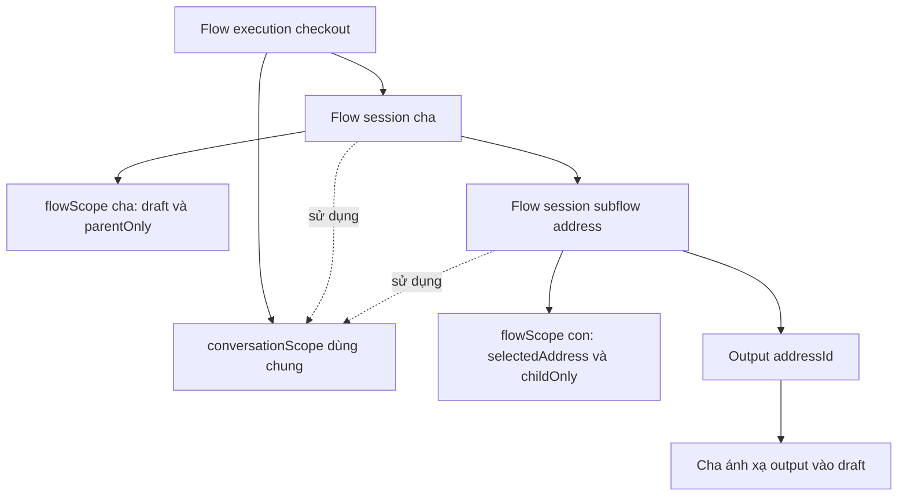

# Kiểm tra dữ liệu trong flowScope và conversationScope

Một flow chuyển đúng từ trang nhập liệu sang trang xác nhận vẫn có thể sai: bản nháp bị tạo lại, subflow ghi đè dữ liệu cha hoặc hai hành trình dùng chung một collection có thể thay đổi. Vì vậy, kiểm thử Spring Web Flow cần kiểm tra cả state hiện tại lẫn dữ liệu mà mỗi bước để lại.

Bài thuộc chương **Kiểm thử flow** của module **SPRING_WEB_FLOW**, tập trung vào cách kiểm chứng dữ liệu trong `flowScope` và `conversationScope` khi khởi động, xử lý event, gọi subflow và kết thúc hành trình. Qua đó, logic điều hướng và hợp đồng dữ liệu được kiểm tra ngay trong flow, thay vì chỉ suy ra từ controller hoặc HTML.

Ví dụ dùng **Spring Web Flow 3.0.1** làm mốc API. Các đoạn Java dựa trên `AbstractFlowExecutionTests`, vốn kế thừa `junit.framework.TestCase`: phương thức kiểm thử có dạng `public void test...()`. Nếu dự án chạy trên JUnit Platform, cần engine hỗ trợ kiểu JUnit này, chẳng hạn Vintage; không mặc nhiên coi chúng là test Jupiter chỉ bằng cách thêm `@Test` của JUnit 5. [API AbstractFlowExecutionTests](https://docs.spring.io/spring-webflow/docs/3.0.1/api/org/springframework/webflow/test/execution/AbstractFlowExecutionTests.html)

## 1. Xác định đúng phạm vi dữ liệu trước khi viết assertion

`flowScope` gắn với **một flow session đang hoạt động**. Flow cha có một flow session; mỗi lần gọi subflow tạo một flow session con với flow scope riêng. Khi subflow hoạt động, `getFlowScope()` trong bộ hỗ trợ test đọc scope của subflow đang active, không phải luôn đọc scope của flow gốc.

`conversationScope` thuộc **toàn bộ một flow execution**, được dùng chung giữa flow gốc và các flow session con. Hợp đồng này được mô tả trực tiếp bởi `FlowExecutionContext`. [API FlowExecutionContext](https://docs.spring.io/spring-webflow/docs/3.0.1/api/org/springframework/webflow/execution/FlowExecutionContext.html)

| Câu hỏi | `flowScope` | `conversationScope` |
| --- | --- | --- |
| Ai sở hữu dữ liệu? | Một flow session | Cả flow execution |
| Qua hai view-state của cùng flow có còn dữ liệu không? | Có, trừ khi ứng dụng chủ động thay đổi hoặc xóa | Có, trừ khi ứng dụng chủ động thay đổi hoặc xóa |
| Flow cha và subflow có cùng map không? | Không | Dùng chung conversation map của execution |
| Khi subflow kết thúc thì điều gì xảy ra? | Flow scope con không còn là scope active; cha tiếp tục với scope của cha | Conversation vẫn tiếp tục cùng flow gốc |
| Khi tạo một root execution độc lập khác? | Có scope mới | Có conversation scope mới |

Đừng đồng nhất conversation scope với toàn bộ HTTP session. Một phiên HTTP có thể chứa nhiều hành trình độc lập. Dữ liệu dùng chung trong một cây flow không vì thế trở thành dữ liệu dùng chung cho mọi flow của người dùng.



Theo vòng đời được tài liệu Web Flow mô tả, flow scope bắt đầu và kết thúc cùng flow tương ứng; conversation scope bắt đầu cùng top-level flow và kết thúc cùng top-level flow đó. Dữ liệu lưu giữa các request cũng cần phù hợp với cơ chế serialization/session replication được sử dụng. [Tài liệu về variable scopes](https://docs.spring.io/spring-webflow/docs/3.0.x/reference/#variable-scopes)

## 2. Thiết kế assertion theo hợp đồng dữ liệu

Với mỗi event, xác định trước năm điều:

1. Flow nào sẽ active sau event?
2. State nào sẽ được chọn?
3. Khóa nào phải có mặt, thuộc scope nào và mang giá trị gì?
4. Khóa nào phải giữ nguyên hoặc không được xuất hiện ở scope khác?
5. Nếu một flow kết thúc, dữ liệu nào phải được trả qua output?

Ví dụ, khi mở subflow chọn địa chỉ, yêu cầu không chỉ là đến state `editAddress`. Cần biết bản nháp của cha còn nguyên, con nhận đúng mã đơn hàng và dữ liệu tạm của con không tự xuất hiện trong map của cha.

Một assertion yếu:

```java
assertNotNull(getFlowScope().get("draft"));
```

Nó không chỉ ra bản nháp có thuộc đúng flow, có đúng kiểu hoặc có còn giữ số lượng đã chọn hay không. Một kiểm tra rõ hơn ở thời điểm flow cha đang active:

```java
assertActiveFlowEquals("checkout");
assertCurrentStateEquals("review");
assertTrue(getFlowScope().contains("draft"));
assertTrue(getFlowScope().get("draft") instanceof java.util.Map);
```

Sau đó kiểm tra từng trường có ý nghĩa nghiệp vụ. Không cần so sánh toàn bộ map nếu map còn chứa các giá trị không liên quan đến hành vi đang kiểm tra.

`assertNull(scope.get("key"))` cũng không luôn diễn đạt được yêu cầu “khóa không tồn tại”: một map có thể chứa khóa với giá trị `null`. Khi hợp đồng yêu cầu không có khóa, dùng `assertFalse(scope.contains("key"))`.

## 3. Fixture minh họa: checkout gọi subflow chọn địa chỉ

Các tên file dưới đây là cấu trúc gợi ý cho một dự án thực hành, không phải các file phải có sẵn trong module bài học:

```text
src/test/resources/flows/
    checkout-flow.xml
    address-flow.xml
src/test/java/example/webflow/
    CheckoutScopeTests.java
```

Fixture dùng các map, collection và chuỗi để tập trung vào scope. Ứng dụng thật có thể thay chúng bằng DTO hoặc JavaBean phù hợp.

### Flow cha: checkout-flow.xml

```xml
<?xml version="1.0" encoding="UTF-8"?>
<flow xmlns="http://www.springframework.org/schema/webflow"
      xmlns:xsi="http://www.w3.org/2001/XMLSchema-instance"
      xsi:schemaLocation="http://www.springframework.org/schema/webflow
        https://www.springframework.org/schema/webflow/spring-webflow.xsd">

    <input name="orderId" value="flowScope.orderId" required="true"/>

    <on-start>
        <set name="flowScope.draft" value="new java.util.LinkedHashMap()"/>
        <set name="flowScope.draft['quantity']" value="1"/>
        <set name="flowScope.status" value="'parent'"/>
        <set name="flowScope.parentOnly" value="'keep-parent-data'"/>
        <set name="conversationScope.workflowId"
             value="flowScope.orderId + '-conversation'"/>
        <set name="conversationScope.status" value="'shared'"/>
        <set name="conversationScope.audit" value="new java.util.ArrayList()"/>
    </on-start>

    <view-state id="edit">
        <transition on="next" to="review"/>
        <transition on="address" to="chooseAddress"/>
        <transition on="cancel" to="cancelled"/>
    </view-state>

    <view-state id="review">
        <transition on="back" to="edit"/>
        <transition on="address" to="chooseAddress"/>
        <transition on="confirm" to="completed"/>
    </view-state>

    <subflow-state id="chooseAddress" subflow="address">
        <input name="orderId" value="flowScope.orderId"/>
        <transition on="saved" to="review">
            <set name="flowScope.draft['addressId']"
                 value="currentEvent.attributes.addressId"/>
        </transition>
        <transition on="cancelled" to="edit"/>
    </subflow-state>

    <end-state id="completed">
        <output name="orderId" value="flowScope.orderId"/>
        <output name="quantity" value="flowScope.draft['quantity']"/>
        <output name="workflowId" value="conversationScope.workflowId"/>
    </end-state>

    <end-state id="cancelled"/>
</flow>
```

Các hành động khởi tạo chỉ nằm trong `on-start`, nên việc quay lại state `edit` bằng event `back` không có chủ đích tạo lại bản nháp. Fixture chưa thực hiện thanh toán, lưu đơn hoặc kiểm tra địa chỉ bắt buộc; đây là mô hình để kiểm tra phạm vi dữ liệu.

### Flow con: address-flow.xml

```xml
<?xml version="1.0" encoding="UTF-8"?>
<flow xmlns="http://www.springframework.org/schema/webflow"
      xmlns:xsi="http://www.w3.org/2001/XMLSchema-instance"
      xsi:schemaLocation="http://www.springframework.org/schema/webflow
        https://www.springframework.org/schema/webflow/spring-webflow.xsd">

    <input name="orderId" value="flowScope.orderId" required="true"/>

    <on-start>
        <set name="flowScope.status" value="'child'"/>
        <set name="flowScope.childOnly" value="'temporary-address-data'"/>
        <set name="flowScope.selectedAddress" value="'ADDR-01'"/>
        <evaluate expression="conversationScope.audit.add('address-opened')"/>
    </on-start>

    <view-state id="editAddress">
        <transition on="save" to="saved">
            <evaluate expression="conversationScope.audit.add('address-saved')"/>
        </transition>
        <transition on="cancel" to="cancelled"/>
    </view-state>

    <end-state id="saved">
        <output name="addressId" value="flowScope.selectedAddress"/>
    </end-state>

    <end-state id="cancelled"/>
</flow>
```

Ba khóa `flowScope.status` của cha, `flowScope.status` của con và `conversationScope.status` có cùng tên ngắn nhưng được dùng để chỉ ba giá trị khác nhau. Chúng giúp test phát hiện đọc nhầm scope.

Subflow trả output khi kết thúc; flow cha đọc output đó trong event kết quả. Trong fixture, `addressId` không tự xuất hiện trong bản nháp chỉ vì subflow có một biến tên gần giống: transition `saved` phải thực hiện phép gán tường minh.

## 4. Chuẩn bị bộ kiểm thử chạy cả hai flow

Dùng `AbstractFlowExecutionTests` để kiểm soát trực tiếp định nghĩa flow được trả về. Bộ registry nạp cả XML cha lẫn XML con, nhờ đó ví dụ kiểm tra vòng đời subflow thật trong engine thay vì thay subflow bằng một outcome giả.

Phần khung của `CheckoutScopeTests.java`:

```java
package example.webflow;

import java.util.List;
import java.util.Map;

import org.springframework.context.support.StaticApplicationContext;
import org.springframework.webflow.config.FlowDefinitionRegistryBuilder;
import org.springframework.webflow.core.collection.LocalAttributeMap;
import org.springframework.webflow.core.collection.MutableAttributeMap;
import org.springframework.webflow.definition.FlowDefinition;
import org.springframework.webflow.definition.registry.FlowDefinitionRegistry;
import org.springframework.webflow.execution.FlowExecution;
import org.springframework.webflow.test.MockExternalContext;
import org.springframework.webflow.test.TestFlowBuilderServicesFactory;
import org.springframework.webflow.test.execution.AbstractFlowExecutionTests;

public class CheckoutScopeTests extends AbstractFlowExecutionTests {

    private StaticApplicationContext applicationContext;
    private FlowDefinitionRegistry registry;

    @Override
    protected void setUp() throws Exception {
        super.setUp();
        applicationContext = new StaticApplicationContext();
        applicationContext.refresh();
        registry = new FlowDefinitionRegistryBuilder(
                applicationContext,
                TestFlowBuilderServicesFactory.getServices())
                .addFlowLocation("classpath:flows/checkout-flow.xml", "checkout")
                .addFlowLocation("classpath:flows/address-flow.xml", "address")
                .build();
    }

    @Override
    protected void tearDown() throws Exception {
        try {
            if (applicationContext != null) {
                applicationContext.close();
            }
        } finally {
            super.tearDown();
        }
    }

    @Override
    protected FlowDefinition getFlowDefinition() {
        return registry.getFlowDefinition("checkout");
    }

    private void startCheckout(String orderId) {
        LocalAttributeMap<Object> input = new LocalAttributeMap<>();
        input.put("orderId", orderId);
        startFlow(input, new MockExternalContext());
    }

    private void signal(String eventId) {
        MockExternalContext context = new MockExternalContext();
        context.setEventId(eventId);
        resumeFlow(context);
    }

    @SuppressWarnings("unchecked")
    private Map<String, Object> draft() {
        Object value = getFlowScope().get("draft");
        assertTrue("draft phải là Map trong scope của flow cha",
                value instanceof Map);
        return (Map<String, Object>) value;
    }

    @SuppressWarnings("unchecked")
    private List<String> audit() {
        Object value = getConversationScope().get("audit");
        assertTrue("audit phải là List trong conversationScope",
                value instanceof List);
        return (List<String>) value;
    }

    // Thêm các phương thức test ở những mục tiếp theo vào lớp này.
}
```

`FlowDefinitionRegistryBuilder` cho phép đăng ký đường dẫn XML cùng id tường minh và nhận `FlowBuilderServices` phục vụ việc dựng flow. [API FlowDefinitionRegistryBuilder](https://docs.spring.io/spring-webflow/docs/3.0.1/api/org/springframework/webflow/config/FlowDefinitionRegistryBuilder.html)

`TestFlowBuilderServicesFactory` chuẩn bị bộ services cho môi trường kiểm thử, bao gồm mock view factory. [Mã nguồn TestFlowBuilderServicesFactory 3.0.1](https://raw.githubusercontent.com/spring-projects/spring-webflow/v3.0.1/spring-webflow/src/main/java/org/springframework/webflow/test/TestFlowBuilderServicesFactory.java)

Điểm cần nhớ về giới hạn: mock view trong mốc phiên bản này đọc event nhưng không thực hiện vòng form binding/validation của MVC như một trang thật. Vì vậy, việc gán map trong những test bên dưới có mục đích thiết lập dữ liệu trước event; nó không chứng minh request parameter đã được bind đúng. [Mã nguồn mock view 3.0.1](https://raw.githubusercontent.com/spring-projects/spring-webflow/v3.0.1/spring-webflow/src/main/java/org/springframework/webflow/test/MockViewFactoryCreator.java)

Để thực hành cần dependency Web Flow tương ứng, các dependency Spring tương thích và JUnit hỗ trợ `TestCase`. Hai XML đặt trong test resources nên có thể đọc bằng classpath. Không cần JSP cho fixture dùng mock view này.

## 5. Kiểm tra dữ liệu khi khởi động và qua nhiều bước

### 5.1. Input và khởi tạo phải được kiểm tra qua startFlow

Thêm phương thức sau vào lớp test:

```java
public void testStartInitializesBothScopes() {
    startCheckout("ORDER-01");

    assertActiveFlowEquals("checkout");
    assertCurrentStateEquals("edit");
    assertEquals("ORDER-01", getFlowScope().get("orderId"));
    assertEquals(Integer.valueOf(1), draft().get("quantity"));
    assertEquals("parent", getFlowScope().get("status"));
    assertEquals("keep-parent-data", getFlowScope().get("parentOnly"));
    assertEquals("ORDER-01-conversation",
            getConversationScope().get("workflowId"));
    assertEquals("shared", getConversationScope().get("status"));
    assertTrue(audit().isEmpty());
    assertFalse(getFlowScope().contains("audit"));
    assertFalse(getConversationScope().contains("draft"));
}
```

Test đi từ input của flow để kiểm tra mapping và `on-start`. Nếu tự đặt `draft` và `workflowId` vào scope trước khi assertion, test sẽ không phát hiện flow quên khởi tạo chúng.

Giá trị `Integer.valueOf(1)` còn làm rõ kiểu mong đợi. Chuỗi `"1"` và số `1` có thể được giao diện hiển thị giống nhau, nhưng chúng có ý nghĩa khác với một phép tính hoặc lời gọi service.

### 5.2. Chuyển bước và quay lại không làm mất bản nháp

```java
public void testDraftSurvivesNextAndBack() {
    startCheckout("ORDER-01");
    draft().put("quantity", 3);

    signal("next");

    assertActiveFlowEquals("checkout");
    assertCurrentStateEquals("review");
    assertEquals(Integer.valueOf(3), draft().get("quantity"));
    assertEquals("ORDER-01-conversation",
            getConversationScope().get("workflowId"));

    signal("back");

    assertCurrentStateEquals("edit");
    assertEquals(Integer.valueOf(3), draft().get("quantity"));
    assertEquals("keep-parent-data", getFlowScope().get("parentOnly"));
    assertTrue(audit().isEmpty());
}
```

Ở đây giá trị 3 là dữ liệu đã có trong model trước khi xử lý event. Test sẽ bắt được lỗi đặt lại `draft` trong `on-entry` của state `edit`, bởi sau `back`, số lượng có thể trở về 1.

Event `back` này là transition nghiệp vụ của flow. Nó không mô phỏng nút Back của trình duyệt hay việc nạp lại một execution snapshot cũ.

## 6. Kiểm tra ranh giới giữa cha, subflow và conversation

### 6.1. Con có flow scope riêng nhưng dùng chung conversation

```java
public void testSubflowHasOwnScopeAndMapsOutputBack() {
    startCheckout("ORDER-01");
    draft().put("quantity", 3);
    MutableAttributeMap<Object> parentScope = getFlowScope();
    MutableAttributeMap<Object> conversation = getConversationScope();

    signal("address");

    assertActiveFlowEquals("address");
    assertCurrentStateEquals("editAddress");
    assertNotSame(parentScope, getFlowScope());
    assertEquals("ORDER-01", getFlowScope().get("orderId"));
    assertEquals("child", getFlowScope().get("status"));
    assertEquals("parent", parentScope.get("status"));
    assertFalse(getFlowScope().contains("parentOnly"));
    assertFalse(getFlowScope().contains("draft"));
    assertSame(conversation, getConversationScope());
    assertEquals("shared", getConversationScope().get("status"));
    assertEquals(List.of("address-opened"), audit());

    getFlowScope().put("selectedAddress", "ADDR-02");
    signal("save");

    assertActiveFlowEquals("checkout");
    assertCurrentStateEquals("review");
    assertSame(parentScope, getFlowScope());
    assertEquals("parent", getFlowScope().get("status"));
    assertEquals(Integer.valueOf(3), draft().get("quantity"));
    assertEquals("ADDR-02", draft().get("addressId"));
    assertFalse(getFlowScope().contains("childOnly"));
    assertFalse(getFlowScope().contains("selectedAddress"));
    assertEquals(List.of("address-opened", "address-saved"), audit());
}
```

Trong `AbstractFlowExecutionTests`, `getFlowScope()` truy cập `getActiveSession().getScope()`, còn `getConversationScope()` truy cập map của execution. Đây là lý do phải assertion active flow trước khi diễn giải dữ liệu lấy được. [Mã nguồn các accessor scope](https://raw.githubusercontent.com/spring-projects/spring-webflow/v3.0.1/spring-webflow/src/main/java/org/springframework/webflow/test/execution/AbstractFlowExecutionTests.java)

`assertSame` ở ví dụ có ý nghĩa hẹp: cùng execution đang chạy trong bộ nhớ và chưa qua bước lưu/phục hồi. Không dùng việc giữ nguyên địa chỉ object Java làm hợp đồng bắt buộc sau serialization; ở tình huống đó, kiểm tra nội dung và quan hệ dữ liệu cần thiết.

### 6.2. Hủy subflow không tự hoàn tác conversation

```java
public void testCancelDoesNotCopyChildSelectionIntoParent() {
    startCheckout("ORDER-01");
    draft().put("quantity", 4);

    signal("address");
    getFlowScope().put("selectedAddress", "ADDR-99");
    signal("cancel");

    assertActiveFlowEquals("checkout");
    assertCurrentStateEquals("edit");
    assertEquals(Integer.valueOf(4), draft().get("quantity"));
    assertFalse(draft().containsKey("addressId"));
    assertFalse(getFlowScope().contains("childOnly"));
    assertEquals(List.of("address-opened"), audit());
}
```

Fixture chỉ copy địa chỉ ở transition `saved`; nhánh `cancelled` không copy. Tuy nhiên, dấu vết `address-opened` đã thêm vào conversation lúc khởi động con vẫn tồn tại. Kết thúc subflow không đồng nghĩa rollback mọi thay đổi dữ liệu dùng chung.

Nếu nghiệp vụ yêu cầu hủy phải hoàn tác một thay đổi, cần mô hình hóa điều đó: giữ dữ liệu chỉnh sửa trong scope con và chỉ áp dụng khi lưu, hoặc dùng chính sách bù trừ phù hợp. Test phải phản ánh chính sách đã chọn.

### 6.3. Gọi lại subflow phải tạo dữ liệu cục bộ mới

```java
public void testReenteringSubflowDoesNotReuseOldLocalData() {
    startCheckout("ORDER-01");

    signal("address");
    getFlowScope().put("scratch", "from-first-visit");
    getFlowScope().put("selectedAddress", "ADDR-02");
    signal("save");

    signal("address");

    assertActiveFlowEquals("address");
    assertCurrentStateEquals("editAddress");
    assertFalse(getFlowScope().contains("scratch"));
    assertEquals("ADDR-01", getFlowScope().get("selectedAddress"));
    assertEquals(List.of("address-opened", "address-saved", "address-opened"),
            audit());
}
```

Mặc định `ADDR-01` ở lần gọi thứ hai là hành vi của fixture. Một ứng dụng thật có thể chủ động truyền địa chỉ đã lưu về làm input; khi đó expectation phải đổi theo hợp đồng ấy. Điều cần kiểm chứng là dữ liệu không được truyền hoặc khởi tạo không tự rò từ flow scope của lần gọi trước.

## 7. Kiểm tra execution độc lập và dữ liệu đầu ra khi kết thúc

### 7.1. Hai execution không dùng chung collection thay đổi được

```java
public void testIndependentExecutionsDoNotShareMutableData() {
    startCheckout("ORDER-A");
    FlowExecution executionA = getFlowExecution();
    Map<String, Object> draftA = draft();
    List<String> auditA = audit();
    MutableAttributeMap<Object> conversationA = getConversationScope();
    draftA.put("quantity", 7);

    startCheckout("ORDER-B");
    FlowExecution executionB = getFlowExecution();
    Map<String, Object> draftB = draft();
    List<String> auditB = audit();

    assertNotSame(executionA, executionB);
    assertNotSame(draftA, draftB);
    assertNotSame(auditA, auditB);
    assertNotSame(conversationA, getConversationScope());
    assertEquals(Integer.valueOf(1), draftB.get("quantity"));
    assertEquals("ORDER-B-conversation",
            getConversationScope().get("workflowId"));
    assertTrue(auditB.isEmpty());

    updateFlowExecution(executionA);
    signal("address");

    assertActiveFlowEquals("address");
    assertEquals("ORDER-A", getFlowScope().get("orderId"));
    assertEquals(List.of("address-opened"), auditA);
    assertTrue(auditB.isEmpty());
    assertEquals(Integer.valueOf(1), draftB.get("quantity"));
}
```

Bộ test giữ hai execution do factory tạo và chuyển execution đang được kiểm tra bằng `updateFlowExecution(...)`. Nó phát hiện việc initializer trả về cùng một map/list dùng chung, chẳng hạn collection được đặt trong field `static` hoặc singleton service.

Đây chưa phải mô phỏng hai tab qua HTTP session, execution key hoặc repository. Nếu cần chứng minh cách ly ở tầng web, bổ sung kiểm tra tích hợp khởi chạy hai flow qua cùng một phiên HTTP, tiếp tục từng flow bằng đúng key của nó và quan sát dữ liệu tương ứng.

Hai tab sao chép cùng một URL chứa execution key cũng không mặc nhiên đại diện cho hai execution độc lập. Test cần nêu rõ đang kiểm tra trường hợp nào.

### 7.2. Khi root kết thúc, kiểm tra outcome/output

```java
public void testCompletionExposesExpectedOutput() {
    startCheckout("ORDER-01");
    draft().put("quantity", 5);
    signal("next");
    signal("confirm");

    assertFlowExecutionEnded();
    assertFlowExecutionOutcomeEquals("completed");
    assertEquals("ORDER-01",
            getFlowExecutionOutcome().getOutput().get("orderId"));
    assertEquals(Integer.valueOf(5),
            getFlowExecutionOutcome().getOutput().get("quantity"));
    assertEquals("ORDER-01-conversation",
            getFlowExecutionOutcome().getOutput().get("workflowId"));
}
```

Outcome chứa id kết quả và map output của execution đã kết thúc. Nó là nơi phù hợp để kiểm tra hợp đồng trả dữ liệu cho bên gọi. [API FlowExecutionOutcome](https://docs.spring.io/spring-webflow/docs/3.0.1/api/org/springframework/webflow/execution/FlowExecutionOutcome.html)

Không dùng `getFlowScope()` sau root end để đòi đọc lại bản nháp từ active session: lúc đó không còn flow session active. Cũng không khẳng định conversation map trong một object test cũ phải lập tức có kích thước 0. Việc vòng đời kết thúc không có nghĩa mọi tham chiếu Java mà test đã giữ đều bị xóa nội dung.

Muốn kiểm tra repository đã dọn execution, cần kiểm tra tại tầng repository/executor được triển khai thực tế. Muốn kiểm tra dữ liệu nghiệp vụ đã được lưu, cần assertion ở service hoặc persistence tương ứng. Hai điều đó không được chứng minh chỉ bằng `assertFlowExecutionEnded()`.

## 8. Những kiểu test dễ cho kết quả đúng giả

### Bỏ qua khởi động bằng setCurrentState

`setCurrentState("review")` hữu ích khi muốn cô lập hành vi xử lý một event ở review. Nhưng nó bỏ qua quy trình `start(...)`; không dùng test như vậy để kết luận input mapper, `on-start` hoặc các action trước review đã chạy đúng. [API FlowExecutionImpl về setCurrentState](https://docs.spring.io/spring-webflow/docs/3.0.1/api/org/springframework/webflow/engine/impl/FlowExecutionImpl.html)

Ví dụ, có thể viết một test cô lập như sau, thêm vào lớp test hiện có:

```java
public void testBackFromReviewWithExplicitPreconditions() {
    setCurrentState("review");
    Map<String, Object> preparedDraft = new java.util.LinkedHashMap<>();
    preparedDraft.put("quantity", 9);
    getFlowScope().put("draft", preparedDraft);

    signal("back");

    assertCurrentStateEquals("edit");
    assertEquals(Integer.valueOf(9), draft().get("quantity"));
}
```

Phần dữ liệu được gán là **tiền điều kiện do test dựng**, không phải kết quả khởi tạo do flow tạo ra. Giữ riêng test khởi động ở mục 5.1 để không bỏ sót hợp đồng đầu vào.

### Dùng lookup không ghi scope để chứng minh dữ liệu nằm đúng scope

Trong biểu thức flow, tên ngắn có thể được tìm qua nhiều scope. Một biểu thức `status` trả về đúng chuỗi mong đợi chưa đủ chứng minh code dùng đúng nơi lưu trữ. Khi kiểm tra ranh giới scope, đọc tường minh `flowScope.status` hoặc `conversationScope.status`, rồi kiểm tra cả trường hợp cùng tên nhưng khác giá trị.

### Nhầm scope riêng với bản sao sâu của object

Cha và con có hai map flow scope riêng, nhưng có thể chứa cùng một object nếu input mapping truyền một DTO hoặc map có thể thay đổi. Mapping không nên được coi là cơ chế tự động deep copy.

Nếu thiết kế cho con nhận trực tiếp `draft` của cha, việc con gọi setter có thể thay đổi dữ liệu cha ngay trước khi phát event lưu. Nhánh cancel vì thế chưa chắc giữ nguyên bản nháp.

Để kiểm tra chính sách chỉnh sửa, chụp các giá trị nghiệp vụ trước khi vào con, sửa object trong con, đi nhánh cancel rồi so sánh lại. Nếu cần bản nháp riêng, thiết kế một bản sao phù hợp và chỉ ánh xạ kết quả khi thành công. Với DTO lồng nhau, kiểm tra cả collection và object con vì một bản sao nông vẫn có thể chia sẻ chúng.

### Chỉ giữ tham chiếu cũ để làm expected value

```java
Map<String, Object> expectedDraft = draft();
```

Biến này trỏ tới cùng map, nên khi code sửa map, expected cũng bị sửa theo. Để kiểm tra một trường không đổi, lưu giá trị bất biến như số lượng hoặc mã đơn hàng trước event. Nếu cần snapshot một cấu trúc, tạo bản sao với độ sâu phù hợp với dữ liệu được kiểm tra.

## 9. Bổ sung kiểm tra binding, validation và phục hồi đúng tầng

Những test trên kiểm tra dữ liệu của engine và input/output giữa các flow. Các lỗi từ giao diện cần bộ kiểm thử sử dụng cấu hình MVC/binder/validator thật hoặc mức tích hợp phù hợp.

| Kịch bản bổ sung | Điều cần quan sát |
| --- | --- |
| Gửi quantity hợp lệ từ form | Giá trị được chuyển đúng kiểu trong DTO/map mà ứng dụng dùng |
| Gửi quantity không chuyển đổi được | Không đi tiếp trái phép; có lỗi binding và chính sách giữ dữ liệu phù hợp |
| Validation nghiệp vụ thất bại | Ở đúng state; lỗi được công bố; chưa gọi thao tác xác nhận không được phép |
| Sửa dữ liệu rồi thử lại | Chỉ các trường cần thay đổi được cập nhật; dữ liệu khác còn đúng |
| Gọi service thất bại giữa hành trình | Nhánh phục hồi giữ hoặc làm mới draft theo chính sách đã định |
| Resume bằng key không còn hợp lệ | Tầng tích hợp phản hồi phù hợp; không lấy nhầm draft của một execution khác |

Không đặt expectation chung rằng validation thất bại thì toàn bộ model phải nguyên vẹn. Binding có thể đã cập nhật một số trường trước khi validation báo lỗi. Chọn assertion theo hợp đồng cụ thể: trường nào được cập nhật, trường nào phải giữ và thao tác nghiệp vụ nào chưa được thực hiện.

### Lưu/phục hồi và serialization

Bộ test chạy liên tục trong bộ nhớ có thể bỏ sót một DTO không serialize được hoặc một thuộc tính bị mất khi phục hồi. Nếu ứng dụng lưu snapshot/session, bổ sung kịch bản:

1. Khởi động flow và tạo dữ liệu có ý nghĩa ở cả hai scope.
2. Lưu execution qua cơ chế repository của ứng dụng.
3. Lấy lại execution bằng key hợp lệ trong request tiếp theo.
4. Kiểm tra active flow, state, kiểu và giá trị dữ liệu.
5. Tiếp tục event để chứng minh dữ liệu phục hồi vẫn dùng được.

Một test serialize riêng DTO chỉ kiểm tra khả năng serialize object graph đó. Nó không thay thế kiểm tra round trip của flow execution cùng cấu hình phục hồi, definition registry và repository.

Cũng không giả định việc nạp snapshot cũ sẽ tự đưa conversation scope về giá trị cũ. Trong triển khai `FlowExecutionImpl` ở mốc 3.0.1, dữ liệu conversation được phục hồi riêng với flow execution; phần serialization của execution không đơn giản ghi toàn bộ mọi scope thành một bản sao chung. [Mã nguồn FlowExecutionImpl 3.0.1](https://raw.githubusercontent.com/spring-projects/spring-webflow/v3.0.1/spring-webflow/src/main/java/org/springframework/webflow/engine/impl/FlowExecutionImpl.java)

Khi có yêu cầu backtracking, hãy kiểm tra riêng kỳ vọng đối với bản nháp trong flow scope và dữ liệu chia sẻ trong conversation scope. Tránh suy luận “quay lại trang trước” đồng nghĩa “rollback mọi thay đổi”.

## 10. Ma trận bao phủ và cách đọc một test thất bại

| Nhóm hành vi | Kiểm tra trọng tâm | Lỗi có thể phát hiện |
| --- | --- | --- |
| Khởi động | Input, kiểu dữ liệu, giá trị mặc định, đúng scope | Thiếu mapper, quên initializer |
| Chuyển view-state | Dữ liệu còn đúng sau next/back | Tạo lại draft sai thời điểm |
| Vào subflow | Active flow, input con, map riêng | Đọc nhầm scope cha hoặc thiếu input |
| Subflow lưu | Output áp dụng đúng vào cha | Sai tên output, thiếu transition action |
| Subflow hủy | Không áp dụng dữ liệu chưa xác nhận | Chia sẻ DTO ngoài ý muốn hoặc mapping sai |
| Gọi lại subflow | Không có dữ liệu tạm từ lần trước | Dùng scope quá rộng |
| Execution độc lập | Không dùng chung map/list có thể thay đổi | Field static hoặc singleton giữ dữ liệu hành trình |
| Root kết thúc | Outcome và output đúng | Trả thiếu hoặc sai dữ liệu cho bên gọi |
| Lưu/phục hồi | Giá trị và kiểu còn đúng sau round trip | Object không serialize được, thiếu cấu hình khôi phục |

Khi test thất bại, đọc theo thứ tự: active flow, current state, scope, sự có mặt của khóa, kiểu dữ liệu rồi giá trị. Ví dụ, không tìm được `draft` trong lúc active flow là `address` có thể là hành vi đúng của scope con; không tìm được nó sau khi cha đã trở lại review mới gợi ý lỗi giữ dữ liệu cha.

Bài thực hành: triển khai fixture, thêm từng test vào cùng lớp, rồi thay thử initializer của `draft` từ `on-start` sang `on-entry` của state `edit`. Xác định test nào phát hiện bản nháp bị reset. Sau đó đổi một collection từ khởi tạo mới sang object dùng chung và quan sát test cách ly execution. Mỗi thay đổi nên có một expectation rõ ràng về dữ liệu, thay vì chỉ kiểm tra flow đã đi tới một state có tên đúng.