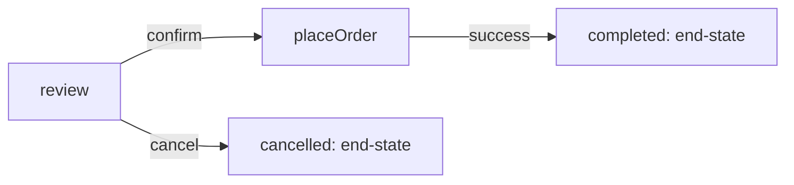

# Kiểm tra trạng thái kết thúc, outcome và output

Một bài kiểm thử Spring Web Flow chưa đủ mạnh nếu chỉ xác nhận rằng ứng dụng đã gọi service hoặc không ném exception. Với hành trình nhiều bước, kết quả cuối còn bao gồm việc execution đã kết thúc hay vẫn chờ người dùng, kết thúc bằng nhánh nào và trả những dữ liệu gì cho bên gọi.

Bài thuộc chương **Kiểm thử flow** của module **SPRING_WEB_FLOW**. Bạn sẽ kiểm thử hợp đồng kết thúc của flow qua state, event và transition; phân biệt flow gốc với subflow; đồng thời đặt ranh giới giữa kiểm thử engine, form binding, phiên và tích hợp Spring MVC.

## 1. Ba câu hỏi phải trả lời riêng

Giả sử flow đặt hàng có hai kết quả: `completed` và `cancelled`.

| Câu hỏi | Điều cần chứng minh | Ví dụ |
| --- | --- | --- |
| Execution đã kết thúc chưa? | Không còn một flow session đang hoạt động trong execution đó | Người dùng đã hoàn thành toàn bộ hành trình |
| Outcome là gì? | Đúng định danh kết quả mà bên gọi dựa vào để xử lý tiếp | `completed`, không phải `cancelled` |
| Output là gì? | Đúng các thuộc tính công khai của kết quả | `orderId` là `Long`, bằng `401L` |

Ba câu hỏi có thể phát hiện ba nhóm lỗi khác nhau:

- Flow vẫn dừng ở màn hình xác nhận dù service đã tạo đơn hàng.
- Flow kết thúc nhưng transition dẫn tới nhánh hủy.
- Flow kết thúc đúng nhánh nhưng quên xuất `orderId` hoặc ánh xạ sai nguồn dữ liệu.

Đối tượng [FlowExecutionOutcome](https://docs.spring.io/spring-webflow/docs/current/api/org/springframework/webflow/execution/FlowExecutionOutcome.html) cung cấp `getId()` và `getOutput()`. Hãy coi chúng là hợp đồng mà bên gọi nhận được khi execution kết thúc, thay vì kiểm thử bằng cách dò dữ liệu nội bộ còn sót lại.

## 2. End-state, event và outcome có quan hệ gì?

Một `end-state` kết thúc **flow session hiện tại**. Nếu đó là flow gốc, toàn bộ execution kết thúc. Nếu đó là subflow, quyền điều khiển quay về flow cha và execution có thể tiếp tục. Đây là sự phân biệt được mô tả trong [EndState API](https://docs.spring.io/spring-webflow/docs/current/api/org/springframework/webflow/engine/EndState.html).



Trong sơ đồ:

- `confirm` là event người dùng gửi khi đang ở `review`.
- `success` là event của action sau khi tạo đơn hàng.
- `completed` là định danh end-state và là outcome khi flow gốc kết thúc ở đó.

Vì vậy, một test gửi `confirm` không được mặc định mong outcome là `confirm`. Tên event đầu vào và tên outcome có thể khác nhau hoàn toàn.

Một view-state tên `done` vẫn chỉ là view-state. Việc giao diện hiển thị “Đã hoàn thành” cũng không chứng minh execution đã kết thúc. Hãy kiểm tra vòng đời của execution bằng API tương ứng.

## 3. Phân biệt chưa chạy, đang chạy và đã kết thúc

[FlowExecutionContext API](https://docs.spring.io/spring-webflow/docs/current/api/org/springframework/webflow/execution/FlowExecutionContext.html) phân biệt `hasStarted()`, `isActive()` và `hasEnded()`.

| Vòng đời | `hasStarted()` | `isActive()` | `hasEnded()` | Outcome |
| --- | --- | --- | --- | --- |
| Chưa bắt đầu | `false` | `false` | `false` | `null` |
| Đã bắt đầu, đang hoạt động | `true` | `true` | `false` | `null` |
| Đã kết thúc | `true` | `false` | `true` | Có outcome của execution đã kết thúc |

Không dùng duy nhất `assertFalse(execution.isActive())` để chứng minh kết thúc: execution chưa từng bắt đầu cũng có thể không active.

Ở test sử dụng lớp hỗ trợ của Spring Web Flow, nên diễn đạt ý định trực tiếp:

```java
assertFlowExecutionEnded();
assertFlowExecutionOutcomeEquals("completed");
```

Nếu truy cập trực tiếp execution, một assertion rõ ràng là:

```java
assertTrue(getFlowExecution().hasEnded());
```

Trong lúc flow còn chờ người dùng ở view-state, nó vẫn active. “Đang chờ request tiếp theo” không có nghĩa là execution đã kết thúc.

## 4. Thiết kế hợp đồng output trước khi viết test

Đặt ra hợp đồng cho flow đặt hàng:

| Outcome | Output bắt buộc | Output không được có | Tác dụng phụ |
| --- | --- | --- | --- |
| `completed` | `orderId: Long`, `status: String = CREATED` | `checkoutForm`, `internalToken` | Gọi tạo đơn đúng một lần trong kịch bản này |
| `cancelled` | `reason: String = USER_CANCELLED` | `orderId`, `checkoutForm`, `internalToken` | Không gọi tạo đơn |

Đây là hợp đồng minh họa do ứng dụng định nghĩa. Framework không tự bắt buộc mọi flow thành công phải trả `orderId`, cũng không tự ngăn bạn xuất thêm dữ liệu nội bộ.

Một output cần kiểm tra ít nhất tên thuộc tính, giá trị, kiểu dữ liệu và quy tắc khi thiếu. Với dữ liệu phức tạp, chỉ so reference thường không phản ánh hợp đồng: nên xác nhận các trường nghiệp vụ liên quan hoặc dùng phép so sánh giá trị thích hợp.

Phân biệt hai yêu cầu:

- **Hợp đồng mở:** bên gọi cần một số thuộc tính bắt buộc và chấp nhận các thuộc tính bổ sung.
- **Hợp đồng đóng:** tập key phải đúng như đã công bố, không xuất thêm thuộc tính nào.

Ví dụ trong bài sử dụng hợp đồng đóng để kiểm tra cả việc không làm lộ dữ liệu nội bộ. Với API nội bộ cần khả năng mở rộng, nhóm phát triển có thể chọn hợp đồng mở và chỉ kiểm tra những điều thực sự được cam kết.

## 5. Flow XML minh họa

Giả sử ứng dụng có flow tại `src/main/webapp/WEB-INF/flows/checkout/checkout-flow.xml` với nội dung sau. Đường dẫn này thuộc ví dụ học tập; khi áp dụng, dùng flow thật của ứng dụng.

```xml
<?xml version="1.0" encoding="UTF-8"?>
<flow xmlns="http://www.springframework.org/schema/webflow"
      xmlns:xsi="http://www.w3.org/2001/XMLSchema-instance"
      xsi:schemaLocation="http://www.springframework.org/schema/webflow
                          https://www.springframework.org/schema/webflow/spring-webflow.xsd"
      start-state="review">

    <input name="cartId" type="string" required="true" />

    <view-state id="review">
        <transition on="confirm" to="placeOrder" />
        <transition on="cancel" to="cancelled" />
    </view-state>

    <action-state id="placeOrder">
        <evaluate expression="orderService.placeOrder(flowScope.cartId)"
                  result="flowScope.orderId" />
        <transition on="success" to="completed" />
    </action-state>

    <end-state id="completed">
        <output name="orderId" value="flowScope.orderId" />
        <output name="status" value="'CREATED'" />
    </end-state>

    <end-state id="cancelled">
        <output name="reason" value="'USER_CANCELLED'" />
    </end-state>
</flow>
```

Service trong ví dụ trả `Long`, được lưu vào `flowScope.orderId`. Với cơ chế ánh xạ kết quả mặc định tương ứng, kết quả này dẫn tới event `success` của action. Không thay kiểu trả về bằng một `String` tùy ý rồi giả định event vẫn giống hệt: việc ánh xạ kết quả phương thức sang event là một phần hành vi phải kiểm tra khi sửa action. Xem [EvaluateAction API](https://docs.spring.io/spring-webflow/docs/current/api/org/springframework/webflow/action/EvaluateAction.html).

Output được khai báo theo từng end-state. Một giá trị tồn tại trong flow scope không tự động trở thành output của execution. Nếu bỏ dòng khai báo `orderId`, việc service đã trả `401L` chưa đủ để bên gọi nhận thuộc tính đó.

Các ví dụ input/output của framework được trình bày trong [Spring Web Flow Reference Guide, phần Input/Output Mapping](https://docs.spring.io/spring-webflow/docs/current/reference/index.html). Trong bài này, biểu thức `value` được viết tường minh để người đọc thấy rõ nguồn của output.

## 6. Bộ test cho kết quả thành công và hủy

`AbstractXmlFlowExecutionTests` nạp flow XML và cung cấp các thao tác start/resume. Lớp này kế thừa hạ tầng `junit.framework.TestCase`; ví dụ dưới đây dùng các phương thức `public void test...()` theo mô hình đó, không trộn trực tiếp với vòng đời test JUnit Jupiter.

Nếu dự án chạy JUnit Platform, cần cấu hình engine tương thích với kiểu test đang sử dụng. Hãy đối chiếu phiên bản dependency và cách runner phát hiện test; một lệnh build xanh với **không có test nào được phát hiện** không phải bằng chứng về tính đúng.

Lớp test minh họa:

```java
package example.checkout;

import java.util.Arrays;
import java.util.HashSet;

import org.springframework.webflow.config.FlowDefinitionResource;
import org.springframework.webflow.config.FlowDefinitionResourceFactory;
import org.springframework.webflow.core.collection.AttributeMap;
import org.springframework.webflow.core.collection.LocalAttributeMap;
import org.springframework.webflow.execution.FlowExecutionOutcome;
import org.springframework.webflow.test.MockExternalContext;
import org.springframework.webflow.test.MockFlowBuilderContext;
import org.springframework.webflow.test.execution.AbstractXmlFlowExecutionTests;

public class CheckoutFlowExecutionTests extends AbstractXmlFlowExecutionTests {

    private final StubOrderService orderService = new StubOrderService();

    @Override
    protected FlowDefinitionResource getResource(
            FlowDefinitionResourceFactory resourceFactory) {
        return resourceFactory.createFileResource(
                "src/main/webapp/WEB-INF/flows/checkout/checkout-flow.xml");
    }

    @Override
    protected void configureFlowBuilderContext(
            MockFlowBuilderContext builderContext) {
        builderContext.registerBean("orderService", orderService);
    }

    public void testStartWaitsOnReviewWithoutOutcome() {
        startCheckout();

        assertFlowExecutionActive();
        assertCurrentStateEquals("review");
        assertFalse(getFlowExecution().hasEnded());
        assertNull(getFlowExecutionOutcome());
        assertEquals(0, orderService.calls);
    }

    public void testConfirmEndsWithCompletedAndPublicOutput() {
        startCheckout();
        sendEvent("confirm");

        assertFlowExecutionEnded();
        assertFlowExecutionOutcomeEquals("completed");

        FlowExecutionOutcome outcome = getFlowExecutionOutcome();
        assertNotNull(outcome);
        AttributeMap<Object> output = outcome.getOutput();

        assertTrue(output.contains("orderId"));
        assertTrue(output.get("orderId") instanceof Long);
        assertEquals(Long.valueOf(401L), output.get("orderId"));
        assertEquals("CREATED", output.get("status"));
        assertEquals(new HashSet<String>(Arrays.asList("orderId", "status")),
                output.asMap().keySet());

        assertEquals(1, orderService.calls);
        assertEquals("CART-17", orderService.lastCartId);
    }

    public void testCancelEndsWithoutCreatingOrReturningOrder() {
        startCheckout();

        // Dữ liệu nội bộ được cài có chủ đích để kiểm tra ranh giới output.
        getFlowScope().put("orderId", Long.valueOf(999L));
        getFlowScope().put("checkoutForm", "internal-form-fixture");
        getFlowScope().put("internalToken", "test-only-token");

        sendEvent("cancel");

        assertFlowExecutionEnded();
        assertFlowExecutionOutcomeEquals("cancelled");

        AttributeMap<Object> output = getFlowExecutionOutcome().getOutput();
        assertEquals("USER_CANCELLED", output.get("reason"));
        assertFalse(output.contains("orderId"));
        assertFalse(output.contains("checkoutForm"));
        assertFalse(output.contains("internalToken"));
        assertEquals(new HashSet<String>(Arrays.asList("reason")),
                output.asMap().keySet());

        assertEquals(0, orderService.calls);
    }

    private void startCheckout() {
        LocalAttributeMap<Object> input = new LocalAttributeMap<Object>();
        input.put("cartId", "CART-17");
        startFlow(input, new MockExternalContext());
    }

    private void sendEvent(String eventId) {
        MockExternalContext context = new MockExternalContext();
        context.setEventId(eventId);
        resumeFlow(context);
    }

    public static final class StubOrderService {
        private int calls;
        private String lastCartId;

        public Long placeOrder(String cartId) {
            calls++;
            lastCartId = cartId;
            return Long.valueOf(401L);
        }
    }
}
```

Đây là ví dụ mã học tập, chưa được chạy trong repository của bạn. Nó giả định có dependency Spring Web Flow, hạ tầng test tương thích và resource XML ở đường dẫn đã chỉ ra.

Hạ tầng test có thể dùng view giả lập để tập trung vào engine thay vì render template thật. Vì vậy, test này không yêu cầu bạn coi việc render HTML là một phần của hợp đồng output. Xem [AbstractXmlFlowExecutionTests API](https://docs.spring.io/spring-webflow/docs/current/api/org/springframework/webflow/test/execution/AbstractXmlFlowExecutionTests.html) và [MockFlowBuilderContext API](https://docs.spring.io/spring-webflow/docs/current/api/org/springframework/webflow/test/MockFlowBuilderContext.html) về nạp definition và đăng ký dependency kiểm thử.

### Những lỗi mà từng assertion phát hiện

| Assertion | Lỗi có thể phát hiện |
| --- | --- |
| `assertCurrentStateEquals("review")` sau start | Start-state hoặc điều hướng ban đầu bị đổi |
| `assertFlowExecutionEnded()` sau confirm | Flow đi tới view-state thay vì end-state |
| `assertFlowExecutionOutcomeEquals("completed")` | Transition kết thúc sai nhánh |
| `output.contains("orderId")` | Thiếu thuộc tính đầu ra |
| `instanceof Long` và so sánh `401L` | Sai kiểu hoặc ánh xạ nhầm giá trị |
| So sánh tập key | Trả thêm dữ liệu ngoài hợp đồng đóng |
| `orderService.calls == 0` khi hủy | Tạo đơn hàng ngoài ý muốn |
| `lastCartId == CART-17` khi xác nhận | Gọi service với dữ liệu không thuộc giỏ hàng đang kiểm thử |

Dùng một stub đơn giản giúp test ổn định và quan sát được lời gọi. Điều này không chứng minh cơ sở dữ liệu đã commit đơn hàng: đó là trách nhiệm của kiểm thử tầng service hoặc kiểm thử tích hợp phù hợp.

## 7. Đừng đọc active flow scope sau khi root flow kết thúc

Cách kiểm tra sau đây sai về ý định:

```java
sendEvent("confirm");
assertFlowExecutionEnded();

// Không dùng flow scope của active session làm hợp đồng sau kết thúc.
assertEquals(Long.valueOf(401L), getFlowScope().get("orderId"));
```

Sau khi flow gốc kết thúc, không còn active flow session để đọc theo cách thông thường. Ngay cả khi một test giữ sẵn reference tới map cũ và vẫn đọc được object, điều đó cũng không chứng minh output đã được trả đúng.

Kiểm tra qua outcome:

```java
sendEvent("confirm");
assertFlowExecutionEnded();
assertFlowExecutionOutcomeEquals("completed");

FlowExecutionOutcome outcome = getFlowExecutionOutcome();
assertEquals(Long.valueOf(401L), outcome.getOutput().get("orderId"));
```

Các helper như `getFlowScope()` và `getFlowExecutionOutcome()` được mô tả trong [AbstractFlowExecutionTests API](https://docs.spring.io/spring-webflow/docs/current/api/org/springframework/webflow/test/execution/AbstractFlowExecutionTests.html). Chọn helper theo trạng thái vòng đời đang kiểm tra, tránh ép một flow đã kết thúc quay lại hình dạng của flow đang chạy.

## 8. Kiểm tra thiếu key khác với kiểm tra null

Nếu hợp đồng nói nhánh hủy **không trả** `orderId`, hãy kiểm tra sự hiện diện của key:

```java
assertFalse(output.contains("orderId"));
```

Chỉ dùng assertion sau có thể bỏ sót sự khác biệt giữa thuộc tính vắng mặt và thuộc tính có giá trị null:

```java
assertNull(output.get("orderId"));
```

[AttributeMap API](https://docs.spring.io/spring-webflow/docs/current/api/org/springframework/webflow/core/collection/AttributeMap.html) cung cấp cả `contains(...)` và `get(...)`. Test cần phản ánh cách bên gọi diễn giải dữ liệu, đặc biệt khi output được chuyển tiếp thành response hoặc được ánh xạ vào flow cha.

Với thuộc tính bắt buộc, có thể dùng `getRequired("orderId", Long.class)` để yêu cầu cả sự hiện diện và kiểu tương ứng. Sau đó vẫn cần so sánh với giá trị nghiệp vụ mong đợi.

Nếu `null` được phép trong hợp đồng, viết rõ nó có nghĩa gì. “Chưa có số xác nhận”, “không áp dụng” và “mapping bị lỗi” là những tình huống khác nhau; đừng để một assertion quá rộng chấp nhận cả ba.

## 9. Test từ đầu và test trực tiếp nhánh kết thúc

Có hai cách thiết lập hữu ích, với phạm vi chứng minh khác nhau.

### 9.1. Bắt đầu từ start-state

Bộ test ở trên gọi `startFlow(...)`, kiểm tra flow chờ ở `review`, rồi gửi event. Cách này bao phủ việc truyền input và đường đi từ điểm bắt đầu đến kết quả của ví dụ.

Với một flow dài hơn, một test có thể đi qua nhập địa chỉ, kiểm tra dữ liệu, review và xác nhận. Test như vậy phát hiện việc trạng thái cần thiết không được tạo ở bước trước.

### 9.2. Đặt trực tiếp state đang chờ

Để cô lập một transition gần cuối, có thể thêm phương thức sau vào lớp test minh họa:

```java
public void testConfirmFromPreparedReviewState() {
    setCurrentState("review");
    getFlowScope().put("cartId", "CART-17");

    sendEvent("confirm");

    assertFlowExecutionEnded();
    assertFlowExecutionOutcomeEquals("completed");
    assertEquals(Long.valueOf(401L),
            getFlowExecutionOutcome().getOutput().get("orderId"));
    assertEquals(1, orderService.calls);
}
```

`setCurrentState(...)` là công cụ thiết lập fixture, không phải một lần đi qua toàn bộ hành trình. Test này tự cung cấp `cartId`, nên không chứng minh input mapping hoặc action ở các bước trước đã chạy đúng. Nó cũng không tự chứng minh form binding, validation và entry action của đường đi thực tế.

Ưu tiên đặt fixture tại state đang chờ event, rồi thực sự gửi event để chạy transition và action. Tránh nhảy thẳng vào end-state hoặc tự dựng `FlowExecutionOutcome("completed", ...)` rồi tuyên bố đã kiểm thử flow XML.

## 10. Khi subflow kết thúc nhưng flow cha vẫn hoạt động

Xét biến thể có flow cha `checkout` gọi subflow `payment`. Subflow trả outcome `authorized` cùng `paymentReference`; flow cha đưa người dùng trở lại màn hình `reviewOrder` để xác nhận bước cuối.

Phần cấu hình liên quan trong flow cha:

```xml
<view-state id="reviewOrder">
    <transition on="pay" to="collectPayment" />
    <transition on="confirm" to="completed" />
</view-state>

<subflow-state id="collectPayment" subflow="payment">
    <input name="cartId" value="flowScope.cartId" />
    <transition on="authorized" to="reviewOrder">
        <set name="flowScope.paymentReference"
             value="currentEvent.attributes.paymentReference" />
    </transition>
    <transition on="cancelled" to="reviewOrder" />
</subflow-state>

<end-state id="completed">
    <output name="paymentReference" value="flowScope.paymentReference" />
</end-state>
```

Đây là biến thể độc lập với flow đơn giản ở phần trước. Ứng dụng thực tế phải kiểm soát điều kiện cho phép xác nhận đơn; đoạn trích tập trung vào hợp đồng trao đổi với subflow.

Subflow có thể khai báo nhánh cuối như sau:

```xml
<end-state id="authorized">
    <output name="paymentReference"
            value="flowScope.paymentReference" />
</end-state>

<end-state id="cancelled" />
```

Theo [SubflowState API](https://docs.spring.io/spring-webflow/docs/current/api/org/springframework/webflow/engine/SubflowState.html), kết quả của subflow là cơ sở để flow cha tiếp tục transition. Flow cha có thể lấy output qua event kết quả trong transition tương ứng.

Sau khi subflow trả `authorized`, các assertion phù hợp ở bài kiểm thử flow cha là:

```java
assertFlowExecutionActive();
assertActiveFlowEquals("checkout");
assertCurrentStateEquals("reviewOrder");
assertEquals("PAY-401", getFlowScope().get("paymentReference"));
assertNull(getFlowExecutionOutcome());
```

Đoạn assertion giả định fixture đã đăng ký flow cha với ID `checkout`, đăng ký subflow `payment` và đã thực sự điều khiển subflow trả kết quả. Nó không phải test đầy đủ có thể ghép trực tiếp vào lớp test của flow đơn giản.

Chỉ sau khi flow cha nhận event xác nhận và đi vào end-state của chính nó mới kiểm tra:

```java
assertFlowExecutionEnded();
assertFlowExecutionOutcomeEquals("completed");
assertEquals("PAY-401",
        getFlowExecutionOutcome().getOutput().get("paymentReference"));
```

Nên tách ba trách nhiệm kiểm thử:

1. Test subflow thật xác nhận `authorized` và output thanh toán của nó.
2. Test flow cha với subflow stub xác nhận mapping và điều hướng của cha theo một kết quả đã kiểm soát.
3. Test tích hợp cha–con thật xác nhận hai hợp đồng thực tế tương thích.

Stub giúp cô lập hành vi của flow cha; nó không chứng minh subflow thật trả đúng tên key hay đúng kiểu dữ liệu.

## 11. Nhánh validation và phục hồi lỗi không nên bị nhận nhầm là kết thúc

Một flow có lỗi có thể xử lý theo nhiều cách. Trước khi viết assertion, quyết định rõ đây là lỗi có thể sửa, lỗi có thể retry hay kết quả cuối không thể tiếp tục.

| Tình huống | Kỳ vọng vòng đời | Điều cần kiểm tra |
| --- | --- | --- |
| Form thiếu trường bắt buộc | Vẫn active | Ở lại view-state, có lỗi validation, chưa có outcome |
| Dịch vụ tạm thời không sẵn sàng, flow cho retry | Vẫn active ở bước phục hồi | State đúng, dữ liệu cần retry còn tồn tại, chưa trả output cuối |
| Người dùng chủ động hủy | Kết thúc theo hợp đồng | Outcome `cancelled`, không có output thành công |
| Nghiệp vụ quyết định từ chối cuối cùng | Kết thúc nếu flow được thiết kế như vậy | Outcome riêng như `rejected`, output lỗi công khai đúng |
| Exception không được flow xử lý | Theo cơ chế lỗi của runtime/tích hợp | Test exception hoặc handler; không tự coi là một outcome nghiệp vụ |

Ví dụ, với fixture đã có validation hoạt động, sau khi gửi form không hợp lệ có thể kiểm tra:

```java
assertFlowExecutionActive();
assertCurrentStateEquals("enterAddress");
assertNull(getFlowExecutionOutcome());
```

Các assertion này mới chứng minh vòng đời và vị trí điều hướng. Test validation còn cần kiểm tra mã lỗi hoặc message liên quan, và xác nhận service tạo đơn chưa được gọi.

Sau khi sửa dữ liệu và gửi lại, test phải đi qua transition thật đến end-state, rồi kiểm tra outcome/output. Đừng đặt trước output thành công trong fixture cho đường đi này: điều đó có thể che việc action sau retry không tạo được dữ liệu mới.

Với lỗi có thể lặp lại, kiểm thử việc retry không làm trùng tác dụng phụ bằng cơ chế nghiệp vụ tương ứng. Số lần gọi trong một stub chỉ mô tả kịch bản test đó, không thay thế bằng chứng về idempotency qua nhiều request, snapshot hoặc nhiều instance ứng dụng.

## 12. Outcome không đồng nghĩa redirect, view hoặc HTTP status

Flow có thể trả outcome `completed`, sau đó lớp tích hợp MVC quyết định redirect đến trang chi tiết đơn hàng. Hai hợp đồng này cần được kiểm tra đúng tầng:

| Tầng test | Chứng minh được | Chưa tự chứng minh được |
| --- | --- | --- |
| Test flow execution | Transition, kết thúc, outcome, output với các dependency đã cấu hình | Template render đúng, cookie/session routing đúng |
| Test handler xử lý outcome | Outcome/output được chuyển thành đích điều hướng đúng | Engine thật tạo ra outcome đó |
| Test tích hợp MVC | Request được định tuyến, execution được resume, phản hồi/redirect đúng | Mọi nhánh nghiệp vụ ở tầng lưu trữ đều đúng |
| Test service và dữ liệu | Transaction, dữ liệu lưu, tính nhất quán nghiệp vụ | Flow đã chọn đúng end-state |

[FlowHandler API](https://docs.spring.io/spring-webflow/docs/current/api/org/springframework/webflow/mvc/servlet/FlowHandler.html) cung cấp `handleExecutionOutcome(...)` để tùy biến xử lý kết quả của flow trong môi trường Servlet. Vì thế, một assertion về URL redirect không thay thế assertion về outcome của engine, và một assertion outcome cũng không thay thế kiểm thử redirect.

Nếu test ở tầng `FlowExecutor`, kết quả là `FlowExecutionResult`. Khi đó kiểm tra `isEnded()` trước, rồi kiểm tra `getOutcome().getId()` và output. Không lấy paused key làm bằng chứng đã kết thúc. Xem [FlowExecutionResult API](https://docs.spring.io/spring-webflow/docs/current/api/org/springframework/webflow/executor/FlowExecutionResult.html).

## 13. Các lỗi thiết kế test thường gặp

| Cách kiểm tra yếu | Lý do có thể bỏ sót lỗi | Cách cải thiện |
| --- | --- | --- |
| Chỉ kiểm tra không ném exception | Flow có thể đang ở state sai hoặc vẫn chờ | Assert vòng đời, outcome và output |
| Chỉ kiểm tra service được gọi | Điều hướng sau lời gọi có thể sai | Resume flow thật rồi assert kết quả cuối |
| So outcome với event gửi vào | Event và outcome có vai trò khác nhau | So với end-state mong đợi |
| Chỉ kiểm tra output có object | Có thể sai ID, sai kiểu hoặc dữ liệu cũ | So thuộc tính nghiệp vụ cụ thể |
| Đọc flow scope sau root end | Không phải hợp đồng dữ liệu trả về | Đọc output từ outcome |
| Tự cài giá trị output rồi bỏ qua action | Không kiểm tra nguồn sinh dữ liệu | Để action chạy với stub service có kiểm soát |
| Dùng stub subflow cho mọi test | Cha và con thật có thể lệch hợp đồng | Có test con riêng và test tích hợp cần thiết |
| Chỉ có nhánh thành công | Hủy hoặc retry có thể trả dữ liệu thành công ngoài ý muốn | Kiểm tra các nhánh khác và thuộc tính không được xuất |
| Khẳng định thanh toán đã commit từ outcome | Outcome phản ánh điều hướng được thiết kế | Kiểm tra commit/idempotency ở tầng nghiệp vụ |

Một mẹo hữu ích khi đánh giá sức mạnh test là tự hỏi: nếu đổi transition từ `completed` sang `cancelled`, xóa output `orderId` hoặc trả thêm `internalToken`, assertion nào sẽ thất bại? Nếu không chỉ ra được assertion tương ứng, test đang thiếu một phần hợp đồng.

## 14. Bài thực hành

Dùng flow và lớp test minh họa làm điểm xuất phát:

1. Viết lại hợp đồng `completed` và `cancelled` bằng bảng tên key, kiểu và quy tắc vắng mặt.
2. Thêm output `confirmationCode` do service cung cấp, rồi kiểm tra đúng giá trị nguồn thay vì chỉ kiểm tra khác null.
3. Thêm nhánh `rejected` theo một quy tắc nghiệp vụ rõ ràng. Kiểm tra flow kết thúc bằng outcome đó và không xuất output của nhánh thành công.
4. Thêm lỗi có thể retry. Sau lần lỗi, kiểm tra execution vẫn active và outcome là null; sau lần thử thành công, kiểm tra output cuối.
5. Tạo subflow và test riêng output của nó trước khi test mapping lên flow cha.
6. Bổ sung test tích hợp MVC nếu ứng dụng dùng output để tạo redirect sau kết thúc.

Bài làm đạt yêu cầu khi mỗi nhánh cuối có assertion về vòng đời, định danh outcome và hợp đồng output; các nhánh còn có thể tiếp tục không bị gắn nhầm là kết thúc.

## 15. Câu hỏi tự kiểm tra

**Vì sao `isActive() == false` chưa đủ chứng minh flow đã kết thúc?**

Vì execution chưa bắt đầu cũng không active. Dùng `hasEnded()` hoặc helper khẳng định kết thúc của hạ tầng test.

**Subflow trả `authorized` có làm root outcome thành `authorized` ngay không?**

Không. Flow cha nhận kết quả của subflow để điều hướng tiếp; root outcome chỉ có khi flow gốc kết thúc.

**Flow scope có `orderId` thì bên gọi chắc chắn nhận được không?**

Không. Cần mapping output tương ứng tại end-state mà flow thực sự đi vào.

**Khi nào kiểm tra chính xác toàn bộ tập key?**

Khi tập key là một phần của hợp đồng đóng, chẳng hạn yêu cầu chỉ xuất dữ liệu đã công bố. Với hợp đồng mở, kiểm tra các key bắt buộc và các key bị cấm theo yêu cầu cụ thể.

**Một outcome thành công có chứng minh dữ liệu đã lưu bền vững không?**

Chưa. Nó chứng minh flow đã tạo kết quả theo đường đi được kiểm thử. Commit, xử lý trùng và tính bền vững cần bằng chứng ở tầng nghiệp vụ và tích hợp dữ liệu.

## 16. Tài liệu đối chiếu

- [EndState](https://docs.spring.io/spring-webflow/docs/current/api/org/springframework/webflow/engine/EndState.html): kết thúc flow session gốc hoặc subflow.
- [FlowExecutionContext](https://docs.spring.io/spring-webflow/docs/current/api/org/springframework/webflow/execution/FlowExecutionContext.html): vòng đời và outcome của execution.
- [FlowExecutionOutcome](https://docs.spring.io/spring-webflow/docs/current/api/org/springframework/webflow/execution/FlowExecutionOutcome.html): định danh và output của kết quả cuối.
- [AbstractFlowExecutionTests](https://docs.spring.io/spring-webflow/docs/current/api/org/springframework/webflow/test/execution/AbstractFlowExecutionTests.html): các helper assert, start, resume và thiết lập state.
- [AbstractXmlFlowExecutionTests](https://docs.spring.io/spring-webflow/docs/current/api/org/springframework/webflow/test/execution/AbstractXmlFlowExecutionTests.html): kiểm thử definition viết bằng XML.
- [AttributeMap](https://docs.spring.io/spring-webflow/docs/current/api/org/springframework/webflow/core/collection/AttributeMap.html): kiểm tra thuộc tính output.
- [Spring Web Flow Reference Guide](https://docs.spring.io/spring-webflow/docs/current/reference/index.html): input/output, gọi subflow và ví dụ kiểm thử flow.

Các liên kết `current` theo tài liệu đang được công bố. Khi triển khai bài tập, chọn dependency và tài liệu tương ứng với phiên bản Spring Web Flow, Spring Framework và test runner của ứng dụng.