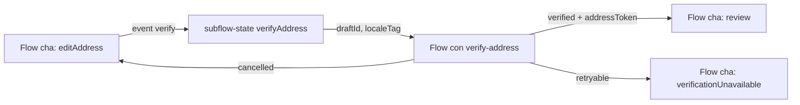

# Giả lập subflow cùng dữ liệu đầu vào, đầu ra

## 1. Mục tiêu bài học

Một flow cha thường giao một phần hành trình cho flow con: chọn địa chỉ, xác minh thông tin, chọn phương thức thanh toán hoặc xác nhận điều khoản. Khi kiểm thử flow cha, chạy toàn bộ giao diện và dịch vụ của flow con khiến test dài, khó tạo tình huống lỗi và dễ thất bại vì những thay đổi nằm ngoài trách nhiệm của flow cha.

Giả lập subflow giúp kiểm thử ranh giới giữa hai flow. Engine vẫn thực thi flow cha và cơ chế gọi/trả về, còn flow con được thay bằng một định nghĩa nhỏ, nhận input có kiểm chứng và trả outcome cùng output do test điều khiển.

Trong phạm vi **SPRING_WEB_FLOW**, bài này giúp bạn:

- Phân biệt input, outcome và output trong một lời gọi subflow.
- Đăng ký flow con giả với đúng flow ID mà flow cha gọi.
- Chứng minh dữ liệu đi từ scope của flow cha tới input của flow con.
- Trả dữ liệu từ end-state giả rồi kiểm tra flow cha nhận và sử dụng đúng.
- Kiểm thử nhánh thành công, hủy, lỗi có thể thử lại và kết quả thiếu dữ liệu.
- Nhận diện giới hạn của test có subflow giả đối với binding, validation, scope, phiên và tích hợp Spring MVC.

Ví dụ dùng API **Spring Web Flow 3.0.0** làm mốc để các chữ ký nhất quán. Bộ hỗ trợ kiểm thử kế thừa `junit.framework.TestCase`, nên các phương thức test được đặt tên `test...`. Dự án cần Spring Web Flow, các phụ thuộc tương thích và khả năng chạy test kiểu JUnit này; nếu chỉ chạy JUnit Platform, cần cấu hình hỗ trợ tương ứng. Đây là mã minh họa để thực hành trong dự án thử nghiệm, không phải mã đã được biên dịch hoặc chạy trong quá trình soạn bài.

## 2. Ba phần độc lập của hợp đồng subflow

Xét hành trình tạo hồ sơ có bước xác minh địa chỉ:



Có ba phần khác nhau cần kiểm tra:

| Phần hợp đồng | Ví dụ | Ý nghĩa |
|---|---|---|
| Input | `draftId = 42L`, `localeTag = "vi-VN"` | Dữ liệu flow cha đưa vào lúc khởi động flow con |
| Outcome | `verified`, `cancelled`, `retryable` | Kết quả kết thúc dùng để chọn transition của flow cha |
| Output | `addressToken = "addr-ok-42"` | Dữ liệu trả về cùng kết quả kết thúc |

Outcome không phải tên thuộc tính chứa toàn bộ kết quả. Output có thể có nhiều trường, nhưng vẫn cần outcome để quyết định nhánh. Hai lần gọi cùng trả `verified` có thể mang hai token khác nhau.

Trong mô hình này, end-state `verified` của flow con tạo kết quả kết thúc có ID `verified`. Khi flow con kết thúc, flow cha tiếp tục; toàn bộ execution chỉ kết thúc nếu root flow cũng đi tới end-state. Xem [Javadoc EndState 3.0.0](https://docs.spring.io/spring-webflow/docs/3.0.0/api/org/springframework/webflow/engine/EndState.html).

### 2.1. Viết hợp đồng trước khi viết stub

Hợp đồng minh họa của `verify-address`:

| Thành phần | Quy tắc |
|---|---|
| Flow ID | `verify-address` |
| Input `draftId` | Bắt buộc, kiểu `Long`, xác định hồ sơ cần xác minh |
| Input `localeTag` | Bắt buộc trong ví dụ, kiểu `String` |
| Outcome `verified` | Phải có `addressToken` là chuỗi không rỗng |
| Outcome `cancelled` | Không có token mới; quay về sửa địa chỉ |
| Outcome `retryable` | Không có token mới; cho người dùng thử lại |
| Thuộc tính nội bộ | Không tự động được sao chép sang flow scope của flow cha |
| Kết quả thiếu token | Flow cha phải chuyển sang nhánh kết quả không hợp lệ |

Quy tắc token không rỗng là chính sách của ví dụ, không phải một quy tắc mặc định của Spring Web Flow. Tương tự, `retryable` là outcome ứng dụng tự đặt tên.

### 2.2. Mock, stub và flow thật tối giản

Trong bài, “flow con giả” là một đối tượng `Flow` thật của engine nhưng chứa rất ít state. Nó đóng vai trò stub vì trả kết quả đã định trước, đồng thời đóng vai trò mock theo nghĩa có assertion kiểm tra input. Không cần dùng Mockito để thay thế chính engine.

Cách này kiểm tra được việc flow cha thực sự gọi subflow và nhận kết quả trả về. Nếu chỉ chèn `addressToken` trực tiếp vào flow scope của flow cha rồi nhảy tới `review`, bạn đã bỏ qua ranh giới đang muốn kiểm tra.

## 3. Flow cha dùng trong bài

Tài nguyên minh họa: `src/test/resources/flows/application-flow.xml`.

```xml
<?xml version="1.0" encoding="UTF-8"?>
<flow xmlns="http://www.springframework.org/schema/webflow"
      xmlns:xsi="http://www.w3.org/2001/XMLSchema-instance"
      xsi:schemaLocation="http://www.springframework.org/schema/webflow
          https://www.springframework.org/schema/webflow/spring-webflow.xsd"
      start-state="editAddress">

    <input name="draftId" type="long" required="true"/>
    <input name="localeTag" type="string" required="true"/>

    <view-state id="editAddress">
        <transition on="verify" to="verifyAddress"/>
    </view-state>

    <subflow-state id="verifyAddress" subflow="verify-address">
        <on-entry>
            <set name="flowScope.addressToken" value="null"/>
        </on-entry>

        <input name="draftId" value="flowScope.draftId"/>
        <input name="localeTag" value="flowScope.localeTag"/>

        <transition on="verified" to="checkAddressResult">
            <set name="flowScope.addressToken"
                 value="currentEvent.attributes.get('addressToken')"/>
        </transition>
        <transition on="cancelled" to="editAddress"/>
        <transition on="retryable" to="verificationUnavailable"/>
    </subflow-state>

    <decision-state id="checkAddressResult">
        <if test="flowScope.addressToken != null and flowScope.addressToken.length() > 0"
            then="review" else="invalidSubflowResult"/>
    </decision-state>

    <view-state id="review">
        <transition on="edit" to="editAddress"/>
        <transition on="confirm" to="done"/>
    </view-state>

    <view-state id="verificationUnavailable">
        <transition on="retry" to="verifyAddress"/>
        <transition on="edit" to="editAddress"/>
    </view-state>

    <view-state id="invalidSubflowResult">
        <transition on="edit" to="editAddress"/>
    </view-state>

    <end-state id="done"/>
</flow>
```

Flow cha có hai tầng input: input khởi động root flow, rồi input riêng của lần gọi `verify-address`. Test cần kiểm tra cả hai tầng, vì truyền input đúng vào root flow chưa chứng minh biểu thức trong `subflow-state` đã lấy đúng dữ liệu.

Token cũ bị xóa mỗi lần vào `verifyAddress`. Chính sách này tránh việc kết quả hủy hoặc lỗi bị hiểu nhầm là vẫn có token mới hợp lệ. Nếu ứng dụng muốn giữ token cũ, cần thiết kế và kiểm thử quy tắc hiệu lực của token đó một cách riêng biệt.

Output chỉ được chép vào flow scope trên transition `verified`. Dùng `currentEvent.attributes.get('addressToken')` để đọc thuộc tính của kết quả kết thúc. Không dùng request parameter để giả vờ đây là output của flow con.

Decision-state kiểm tra thiếu hoặc rỗng đối với token kiểu chuỗi. Nó chưa kiểm tra toàn bộ cấu trúc, quyền sở hữu hay tính xác thực của token, cũng chưa bảo vệ mọi kiểu dữ liệu sai. Trong ứng dụng thật, những điều kiện đó thuộc hợp đồng validation của kết quả và dịch vụ liên quan.

Cú pháp `on-entry`, `input`, transition và end-state thuộc ngôn ngữ XML của Web Flow; có thể đối chiếu cấu trúc tại [schema Spring Web Flow 3.0.0](https://raw.githubusercontent.com/spring-projects/spring-webflow/v3.0.0/spring-webflow/src/main/resources/org/springframework/webflow/engine/model/builder/xml/spring-webflow.xsd).

## 4. Điểm thay thế subflow trong kiểm thử

`MockFlowBuilderContext.registerSubflow(Flow)` đăng ký flow con vào registry được dùng khi dựng và chạy flow đang kiểm thử. Định nghĩa flow giả phải có ID đúng với giá trị `subflow="verify-address"`. Đăng ký một bean tên `verify-address` không tương đương đăng ký flow definition. Xem [Javadoc MockFlowBuilderContext 3.0.0](https://docs.spring.io/spring-webflow/docs/3.0.0/api/org/springframework/webflow/test/MockFlowBuilderContext.html).

Bộ hỗ trợ kiểm thử cũng cho phép truy cập registry bằng `getFlowDefinitionRegistry()`. Chọn một cách đăng ký nhất quán trong fixture để tránh khó xác định định nghĩa nào đang được dùng. Hướng dẫn chính thức có ví dụ đăng ký flow con giả để xác nhận input và trả outcome trong mục [Mocking a subflow](https://docs.spring.io/spring-webflow/docs/2.5.x/reference/html/testing.html#testing-subflows).

Hai mapper cần phân biệt:

| Mapper trong fixture | Source | Target | Vai trò |
|---|---|---|---|
| `Flow.setInputMapper(...)` | Bản đồ input của flow con | Context của flow con | Kiểm tra input và chuẩn bị dữ liệu cục bộ |
| `EndState.setOutputMapper(...)` | Context lúc flow con kết thúc | Bản đồ output mới | Tạo dữ liệu trả cho flow cha |

Ở mapper output của end-state, target là bản đồ output, không phải flow scope của flow cha. Chi tiết này có thể kiểm tra trong [mã nguồn EndState 3.0.0](https://raw.githubusercontent.com/spring-projects/spring-webflow/v3.0.0/spring-webflow/src/main/java/org/springframework/webflow/engine/EndState.java).

## 5. Fixture đầy đủ: nhận input, trả outcome và output

Lớp dưới đây cùng XML ở mục 3 tạo thành ví dụ kiểm thử chính. Đường dẫn tài nguyên dùng `createFileResource()` và giả định test chạy từ thư mục gốc dự án thử nghiệm.

```java
package example.webflow;

import org.springframework.binding.mapping.Mapper;
import org.springframework.binding.mapping.MappingResults;
import org.springframework.webflow.core.collection.AttributeMap;
import org.springframework.webflow.core.collection.LocalAttributeMap;
import org.springframework.webflow.core.collection.MutableAttributeMap;
import org.springframework.webflow.engine.EndState;
import org.springframework.webflow.engine.Flow;
import org.springframework.webflow.engine.builder.support.FlowDefinitionResource;
import org.springframework.webflow.engine.builder.support.FlowDefinitionResourceFactory;
import org.springframework.webflow.execution.RequestContext;
import org.springframework.webflow.test.MockExternalContext;
import org.springframework.webflow.test.MockFlowBuilderContext;
import org.springframework.webflow.test.execution.AbstractXmlFlowExecutionTests;

public class ApplicationSubflowTest extends AbstractXmlFlowExecutionTests {
    private String childOutcome;
    private String childToken;
    private int childStarts;
    private Object receivedDraftId;
    private Object receivedLocaleTag;

    @Override
    protected void setUp() throws Exception {
        super.setUp();
        childOutcome = "verified";
        childToken = "addr-ok-42";
        childStarts = 0;
        receivedDraftId = null;
        receivedLocaleTag = null;
    }

    @Override
    protected FlowDefinitionResource getResource(
            FlowDefinitionResourceFactory factory) {
        return factory.createFileResource(
            "src/test/resources/flows/application-flow.xml");
    }

    @Override
    protected void configureFlowBuilderContext(
            MockFlowBuilderContext builderContext) {
        builderContext.registerSubflow(createAddressSubflow());
    }

    private Flow createAddressSubflow() {
        Flow child = new Flow("verify-address");
        child.setInputMapper(new Mapper() {
            @Override
            public MappingResults map(Object source, Object target) {
                AttributeMap<?> input = (AttributeMap<?>) source;
                receivedDraftId = input.get("draftId");
                receivedLocaleTag = input.get("localeTag");
                childStarts++;

                assertEquals(Long.valueOf(42L), receivedDraftId);
                assertEquals("vi-VN", receivedLocaleTag);

                RequestContext childContext = (RequestContext) target;
                childContext.getFlowScope().put(
                    "childInternal", "not-an-output");
                return null;
            }
        });

        EndState result = new EndState(child, childOutcome);
        result.setOutputMapper(new Mapper() {
            @Override
            @SuppressWarnings("unchecked")
            public MappingResults map(Object source, Object target) {
                MutableAttributeMap<Object> output =
                    (MutableAttributeMap<Object>) target;
                if (childToken != null) {
                    output.put("addressToken", childToken);
                }
                return null;
            }
        });
        return child;
    }

    private void startApplication() {
        LocalAttributeMap<Object> input = new LocalAttributeMap<>();
        input.put("draftId", Long.valueOf(42L));
        input.put("localeTag", "vi-VN");
        startFlow(input, new MockExternalContext());
        assertCurrentStateEquals("editAddress");
    }

    private void signal(String eventId) {
        MockExternalContext request = new MockExternalContext();
        request.setEventId(eventId);
        resumeFlow(request);
    }

    public void testVerifiedMapsOutputAndResumesParent() {
        startApplication();

        signal("verify");

        assertEquals(1, childStarts);
        assertEquals(Long.valueOf(42L), receivedDraftId);
        assertEquals("vi-VN", receivedLocaleTag);
        assertActiveFlowEquals(getFlow().getId());
        assertCurrentStateEquals("review");
        assertFlowExecutionActive();
        assertEquals("addr-ok-42", getFlowScope().get("addressToken"));
        assertEquals(Long.valueOf(42L), getFlowScope().get("draftId"));
        assertFalse(getFlowScope().contains("childInternal"));
    }

    public void testCancelledReturnsToEditWithoutOldToken() {
        childOutcome = "cancelled";
        childToken = null;
        startApplication();
        getFlowScope().put("addressToken", "old-token");

        signal("verify");

        assertEquals(1, childStarts);
        assertCurrentStateEquals("editAddress");
        assertFlowExecutionActive();
        assertNull(getFlowScope().get("addressToken"));
        assertEquals(Long.valueOf(42L), getFlowScope().get("draftId"));
    }

    public void testRetryableKeepsDraftAndOffersRetry() {
        childOutcome = "retryable";
        childToken = null;
        startApplication();

        signal("verify");

        assertEquals(1, childStarts);
        assertCurrentStateEquals("verificationUnavailable");
        assertFlowExecutionActive();
        assertNull(getFlowScope().get("addressToken"));
        assertEquals(Long.valueOf(42L), getFlowScope().get("draftId"));
    }

    public void testVerifiedWithoutOutputIsRejected() {
        childOutcome = "verified";
        childToken = null;
        startApplication();

        signal("verify");

        assertEquals(1, childStarts);
        assertCurrentStateEquals("invalidSubflowResult");
        assertNull(getFlowScope().get("addressToken"));
    }

    public void testVerifiedWithEmptyTokenIsRejected() {
        childToken = "";
        startApplication();

        signal("verify");

        assertCurrentStateEquals("invalidSubflowResult");
        assertEquals("", getFlowScope().get("addressToken"));
    }

    public void testRootEndsOnlyAfterParentConfirm() {
        startApplication();
        signal("verify");
        assertCurrentStateEquals("review");
        assertFlowExecutionActive();

        signal("confirm");

        assertFlowExecutionEnded();
        assertFlowExecutionOutcomeEquals("done");
    }
}
```

### 5.1. Tại sao flow con chỉ cần một end-state?

State đầu tiên được thêm vào `Flow` trở thành start state nếu chưa chỉ định khác. Do đó end-state được tạo ở đây vừa là điểm bắt đầu vừa là điểm kết thúc của stub. Engine gọi flow con, chạy input mapper, nhập end-state, tạo output rồi tiếp tục flow cha ngay trong cùng lần xử lý event. Có thể đối chiếu hành vi start state trong [mã nguồn Flow 3.0.0](https://raw.githubusercontent.com/spring-projects/spring-webflow/v3.0.0/spring-webflow/src/main/java/org/springframework/webflow/engine/Flow.java).

Sau `signal("verify")`, flow cha đã ở `review`, `editAddress`, `verificationUnavailable` hoặc `invalidSubflowResult` tùy kịch bản. Không mong đợi stub tức thời này còn đang hoạt động để gửi event tiếp theo cho nó.

### 5.2. Input mapper đang kiểm tra điều gì?

Mapper đọc đúng dữ liệu ở ranh giới đầu vào của flow con. Nếu flow cha đổi nhầm tên input thành `draft`, lấy sai scope hoặc truyền chuỗi `"42"` thay cho `Long`, assertion trong fixture sẽ phát hiện sai lệch của hợp đồng mẫu.

Target của input mapper là context của flow con. Thuộc tính `childInternal` được đặt vào flow scope của flow con để chứng minh nó không tự xuất hiện trong flow scope của flow cha sau khi trở về.

Mapper của stub không khai báo đầy đủ conversion, validation và input mapping của flow con thật. Assertion về `Long` ở đây chứng minh flow cha đã gửi một `Long`; nó không chứng minh flow con thật chuyển chuỗi HTTP thành số đúng.

### 5.3. Vì sao `return null` trong mapper?

`Mapper.map()` trả về `MappingResults`. Trong fixture thủ công này, thao tác được thực hiện trực tiếp và không tạo đối tượng kết quả mapping, nên trả `null`. Đây không phải output nghiệp vụ của flow con. Output nghiệp vụ nằm trong target map mà mapper đã ghi.

Mẫu không tạo kết quả mapping lỗi. Muốn kiểm tra lỗi mapping có cấu trúc, cần thiết lập mapper hoặc flow XML phù hợp thay vì dùng `null` để biểu diễn lỗi. Cơ chế end-state kiểm tra kết quả mapper trước khi kết thúc có thể đối chiếu trong [mã nguồn EndState](https://raw.githubusercontent.com/spring-projects/spring-webflow/v3.0.0/spring-webflow/src/main/java/org/springframework/webflow/engine/EndState.java).

### 5.4. Giới hạn của fixture có field kịch bản

`childOutcome` được dùng khi tạo định nghĩa end-state, còn `childToken` được đọc khi mapper output chạy. Vì vậy, trong các test chính, luôn đặt kịch bản trước `startApplication()` để tránh phụ thuộc vào thời điểm dựng flow.

Fixture giữ kết quả đã nhận trong field của một đối tượng test và được thiết kế cho từng test riêng biệt. Không dùng chung fixture này giữa nhiều execution chạy đồng thời. Định nghĩa flow trong ứng dụng thật có thể được tái sử dụng, nên không chuyển các field như `receivedDraftId` vào bean production rồi giữ dữ liệu người dùng ở đó.

## 6. Mỗi test cần chứng minh một đường đi dữ liệu

Một kiểm thử đầy đủ cho nhánh `verified` nên đọc được như sau:

```text
Given:
  Root flow nhận draftId = 42L và localeTag = vi-VN.
When:
  Người dùng phát event verify.
Then:
  verify-address nhận đúng draftId và localeTag.
And:
  Flow con kết thúc bằng outcome verified.
And:
  Output chứa addressToken = addr-ok-42.
And:
  Flow cha sao chép token vào flow scope và đi tới review.
And:
  Root execution còn hoạt động; draftId không bị đổi.
```

Nếu chỉ kiểm tra state `review`, có thể bỏ sót lỗi flow cha dùng nhầm token cũ. Nếu chỉ kiểm tra token, có thể bỏ sót transition sang nhánh sai. Nếu stub không kiểm tra input, test có thể xanh dù flow cha gửi nhầm hồ sơ.

Ba điểm quan sát bổ sung cho nhau: đầu vào của flow con, kết quả sau khi trở về flow cha và những dữ liệu không được phép thay đổi.

Các API `startFlow`, `resumeFlow`, assertion active flow, state và outcome được mô tả tại [AbstractFlowExecutionTests 3.0.0](https://docs.spring.io/spring-webflow/docs/3.0.0/api/org/springframework/webflow/test/execution/AbstractFlowExecutionTests.html).

## 7. Phân biệt output với việc sửa trực tiếp scope

Có ba thao tác trông gần giống nhau nhưng kiểm tra những thứ khác nhau:

```java
// Chuẩn bị dữ liệu đầu vào của flow cha trong một test cô lập.
getFlowScope().put("draftId", Long.valueOf(42L));

// Chuẩn bị dữ liệu nội bộ trong input mapper của flow con.
childContext.getFlowScope().put("childInternal", "not-an-output");

// Tạo dữ liệu trả về trong output mapper của end-state flow con.
output.put("addressToken", "addr-ok-42");
```

Chỉ dòng cuối mô phỏng dữ liệu đầu ra qua đúng ranh giới kết thúc subflow. Nếu test tự gọi `getFlowScope().put("addressToken", ...)` trên flow cha rồi assertion kiểm tra chính giá trị đó, output mapping có thể chưa từng chạy.

Trong ví dụ, flow cha lấy output từ thuộc tính của event kết thúc. Spring Web Flow cũng có cấu hình mapping output ở `subflow-state`; lựa chọn vị trí mapping phải phù hợp với việc dữ liệu dùng chung cho mọi outcome hay chỉ hợp lệ trên một nhánh. Đoạn XML của bài đặt mapping trên transition `verified` để việc nhận token gắn rõ với nhánh thành công.

Không đọc `currentEvent` tùy ý ở request sau với giả định nó vẫn là event kết thúc flow con. Dữ liệu cần dùng lâu hơn phải được lưu sang scope phù hợp tại thời điểm nhận kết quả.

## 8. Kịch bản hủy, thử lại và kết quả không hợp lệ

### 8.1. Hủy không đồng nghĩa lỗi kỹ thuật

`cancelled` là một outcome nghiệp vụ. Flow cha trở lại `editAddress` và giữ `draftId`; toàn bộ execution vẫn hoạt động. Kiểm thử hủy phải xác nhận không còn token thành công cũ nếu chính sách yêu cầu xóa token khi bắt đầu xác minh lại.

Nếu flow cha có action lưu hồ sơ hoặc gửi thông báo ở bước sau, thêm spy dịch vụ để khẳng định số lần gọi bằng không sau khi hủy. Chỉ kiểm tra state chưa đủ để chứng minh không có tác dụng phụ trên transition.

### 8.2. Outcome `retryable` không phải một exception

Stub trả `retryable` đang mô phỏng việc flow con đã xử lý một tình huống và kết thúc có kiểm soát. Nó chưa kiểm tra exception handler của flow con hoặc flow cha.

Muốn kiểm tra lỗi kỹ thuật lan ra ngoài subflow, cần một fixture khác có action chủ động ném ngoại lệ và handler tương ứng trong flow đang kiểm tra. Sau đó assertion phải kiểm tra state phục hồi, thông báo và dữ liệu giữ lại. Đừng cho stub trả outcome rồi tuyên bố đã kiểm thử cơ chế bắt ngoại lệ.

### 8.3. Thử lại trong cùng execution

Một test phục hồi cần ít nhất hai lần gọi subflow:

```text
Lần 1:
  input draftId = 42L
  outcome retryable
  không có token
  flow cha ở verificationUnavailable
Lần 2, sau event retry:
  input vẫn là draftId = 42L
  outcome verified
  output addressToken = addr-ok-after-retry
  flow cha ở review
```

Fixture chính có một end-state được chọn khi dựng nên không tự đổi outcome chỉ bằng cách gán lại field sau lần gọi đầu. Có thể xây dựng một stub nhiều nhánh với bộ chọn kịch bản theo lần gọi, hoặc thay định nghĩa trong registry trước lần gọi kế tiếp bằng API đã được fixture kiểm soát. Khi dùng cách thay registry, phải xác nhận lần gọi sau thực sự tra cứu định nghĩa mới, tránh phụ thuộc ngầm vào cơ chế cache hoặc thời điểm resolve subflow.

Một cách dễ hiểu cho bài thực hành nâng cao là tạo stub với action-state đầu tiên, đếm số lần gọi và chọn end-state tương ứng. Test phải kiểm tra input ở cả hai lần; nếu chỉ kiểm tra lần đầu, lỗi mất `draftId` khi retry vẫn có thể bị bỏ qua.

### 8.4. Output thiếu, rỗng hoặc sai kiểu

Các test chính đã minh họa hai tình huống: thiếu key `addressToken` và token là chuỗi rỗng. Đừng gộp chúng thành một test nếu hợp đồng phân biệt hai trường hợp.

Đối với token sai kiểu, ví dụ một số thay vì chuỗi, decision-state dùng `.length()` có thể gây lỗi biểu thức. Nếu yêu cầu sản phẩm là đưa mọi kết quả sai kiểu về `invalidSubflowResult`, cần bổ sung bộ kiểm tra kiểu/kết quả rõ ràng và test tương ứng. Không suy rằng kiểm tra `null` đã bảo vệ mọi dữ liệu hỏng.

### 8.5. Outcome không được hỗ trợ

Nếu flow con trả `unexpected`, flow cha mẫu không có transition cho kết quả đó. Đây là lỗi hợp đồng hoặc cấu hình, không phải tình huống thành công mặc định.

Test âm nên gây đúng kết quả này rồi kiểm tra lỗi điều phối theo API của phiên bản đang dùng. Không dùng một assertion “bất kỳ exception nào cũng đạt”: lỗi không tìm được file XML hoặc assertion input sai không phải bằng chứng đã phát hiện outcome lạ.

Nếu ứng dụng thiết kế một nhánh dự phòng, test phải xác nhận nhánh đó không bỏ qua kiểm tra dữ liệu và không chuyển người dùng vào bước xác nhận khi chưa xác minh thành công.

## 9. Scope tách biệt không có nghĩa là sao chép đối tượng

Flow cha và flow con có flow scope riêng, nhưng một đối tượng mutable được truyền làm input có thể vẫn là cùng tham chiếu trong bộ nhớ. Nếu đưa nguyên `AddressForm` cho flow con rồi flow con sửa nó, việc hủy flow con không mặc nhiên hoàn tác những thay đổi trên đối tượng đó.

Ví dụ lỗi thiết kế:

```text
Flow cha giữ addressForm.
Flow cha truyền cùng addressForm vào flow con.
Flow con sửa addressForm.street.
Người dùng hủy.
Flow cha nhận cancelled nhưng addressForm.street đã bị đổi.
```

Tùy hợp đồng, có thể truyền ID và để flow con làm việc trên bản nháp, truyền bản sao hoặc dùng đối tượng bất biến. Test cần kiểm tra hành vi của model sau `cancelled`, không chỉ sự tồn tại của key trong scope.

Mẫu chính truyền `Long` và `String` để tập trung vào mapping. Nó không chứng minh cơ chế sao chép hoặc rollback model mutable. Không xem conversation scope là cách thay thế output mapping chỉ để hai flow cùng đọc được token; cách đó làm hợp đồng phụ thuộc vào dữ liệu dùng chung và có thể che giấu output bị thiếu.

## 10. Giữ hợp đồng giữa stub và flow con thật

Subflow giả có thể trả `verified` cùng `addressToken`, trong khi flow con thật đã đổi outcome thành `confirmed` và output thành `verificationResult`. Bộ test flow cha vẫn xanh nếu không có kiểm tra nối hai bên.

Nên có ba nhóm kiểm thử bổ sung:

| Nhóm | Dùng flow nào? | Trách nhiệm |
|---|---|---|
| Flow cha với stub | Flow cha thật, flow con giả | Input gửi đi và phản ứng với outcome/output |
| Flow con độc lập | Flow con thật, dịch vụ ngoài giả | Input bắt buộc, validation, các outcome và output thực tế |
| Tích hợp hợp đồng | Flow cha thật và flow con thật | Tên flow, tên input/output, kiểu và nhánh kết thúc còn khớp |

Trong test flow con độc lập, khởi động bằng dữ liệu đúng hợp đồng, chạy tới end-state thật rồi kiểm tra outcome và output của execution đã kết thúc. Đừng dùng flow scope sau khi session đã kết thúc như nguồn chứng minh output; output cần được đọc từ kết quả kết thúc của execution hoặc quan sát ở flow cha trong test tích hợp.

Giữ fixture rõ ràng, không sao chép toàn bộ workflow con vào stub. Mỗi lần contract đổi, cập nhật cả phía cung cấp lẫn phía sử dụng. Với nhiều flow cha dùng chung một flow con, bộ dữ liệu hợp đồng dùng chung có thể giảm sai lệch, nhưng phải có test chạy flow con thật để xác nhận dữ liệu đó vẫn đúng.

## 11. Khi cần giả lập flow con có bước chờ

Stub kết thúc ngay phù hợp để kiểm tra mapping và transition sau khi trở về. Nó không mô phỏng khoảng thời gian người dùng tương tác với flow con.

Khi cần kiểm tra pause/resume, nên dùng một flow con tối giản có view-state chờ event:

```text
verify-address
  chờ tại chooseAddress
  event accept  → end-state verified, có output
  event cancel  → end-state cancelled, không có output
```

Chuỗi assertion khi đó khác ví dụ tức thời:

1. Start flow cha và gửi `verify`.
2. Xác nhận active flow là `verify-address`, state hiện tại là `chooseAddress`.
3. Gửi `accept` cho execution đang hoạt động.
4. Xác nhận active flow đã trở lại flow cha, state là `review` và token được nhận.

Với fixture có bước chờ, event gửi sau bước 2 được xử lý trong flow con đang hoạt động. Gửi nhầm event của flow cha tại thời điểm đó là một lỗi điều phối cần kiểm thử, không phải lý do để ép current state sang flow cha.

Để kiểm tra snapshot, hết phiên hoặc execution key, dùng repository và tích hợp HTTP tương ứng. Stub trong bộ test flow không tự chứng minh dữ liệu sống qua serialization, session timeout hay hai tab cùng thao tác.

## 12. Bảng chẩn đoán test thất bại

| Biểu hiện | Nguyên nhân thường gặp | Điều cần kiểm tra |
|---|---|---|
| Không tìm được subflow | Sai flow ID hoặc đăng ký nhầm registry | `subflow` trong XML và `new Flow(...)` |
| Input nhận `null` | Sai tên input, sai scope hoặc chưa khởi tạo | Biểu thức ở `subflow-state` và root input |
| Nhận `"42"` thay vì `42L` | Nhầm kiểu hoặc bỏ qua conversion cần thiết | Hợp đồng kiểu ở cả hai phía |
| Đến `review` nhưng token sai | Dùng token cũ hoặc ghi trực tiếp scope cha | Xóa dữ liệu cũ, output mapper và transition |
| Stub nhận đúng input nhưng flow con thật lỗi | Stub bỏ qua quy tắc input của flow con thật | Test flow con độc lập và test tích hợp hợp đồng |
| Root kết thúc sớm | Transition của flow cha đi thẳng tới end-state | Assertion execution còn active sau khi flow con trả về |
| Test retry luôn trả lỗi cũ | Stub chọn end-state một lần khi dựng | Cơ chế chọn kết quả theo từng lần gọi |
| Dữ liệu vẫn đổi sau hủy | Truyền cùng đối tượng mutable | Tham chiếu model và quy tắc hủy/rollback |
| Test xanh dù XML mapping bị xóa | Fixture tự điền kết quả vào scope cha | Vị trí ghi output và cách kích hoạt subflow |
| Sai lệch giữa test và HTTP | Test bỏ qua form, MVC, key hoặc session | Test ở ranh giới tích hợp tương ứng |

Để kiểm tra giá trị của test, thử bỏ một input mapping hoặc đổi tên output trong dự án thực hành rồi chạy lại test liên quan. Một test về hợp đồng phải phát hiện được thay đổi phá vỡ chính hợp đồng đó; đây là cách tự đánh giá assertion, không phải yêu cầu phải tạo bộ mutation testing cho mọi bài.

## 13. Bài thực hành

Từ XML và fixture chính, lần lượt thực hiện:

1. Đổi dữ liệu thử nghiệm sang `draftId = 73L`, điều chỉnh token và assertion để chứng minh fixture không phụ thuộc tình cờ vào một ID.
2. Thêm output `verificationProvider`, rồi kiểm tra flow cha chỉ nhận trường này khi outcome là `verified`.
3. Thêm test hủy sau một lần xác minh thành công, bảo đảm token cũ không được dùng lại sau khi người dùng sửa địa chỉ.
4. Tạo stub cho chuỗi `retryable → verified`; khẳng định hai lần đều nhận cùng draft và root chỉ kết thúc sau `confirm`.
5. Tạo một flow con thật tối giản để kiểm tra input bắt buộc và tên output đang khớp với stub.
6. Nếu model là mutable, kiểm thử tình huống flow con sửa model rồi bị hủy, và thực hiện chính sách bảo toàn dữ liệu đã chọn.

Tiêu chí hoàn thành:

- Flow cha được chạy bằng engine, subflow được gọi qua registry với đúng flow ID.
- Test quan sát input thực sự đi vào flow con, gồm cả giá trị và kiểu quan trọng.
- Outcome và output được tạo qua end-state, không được bơm trực tiếp vào scope cha.
- Assertion kiểm tra state, dữ liệu nhận về và execution còn hoạt động hay đã kết thúc.
- Có nhánh hủy, thử lại và kết quả thiếu dữ liệu.
- Có kiểm tra bổ sung với flow con thật để tránh hợp đồng của stub bị lệch.
- Phạm vi kiểm thử được mô tả đúng: stub tức thời chưa kiểm tra form binding, validation nội bộ, HTTP session hay repository production.

Giả lập subflow hiệu quả khi nó làm rõ trách nhiệm của flow cha: gửi đúng dữ liệu, hiểu đúng kết quả và tiếp tục đúng hành trình. Stub càng nhỏ và hợp đồng càng cụ thể, test càng dễ bảo trì mà vẫn phát hiện lỗi ở ranh giới quan trọng giữa hai flow.