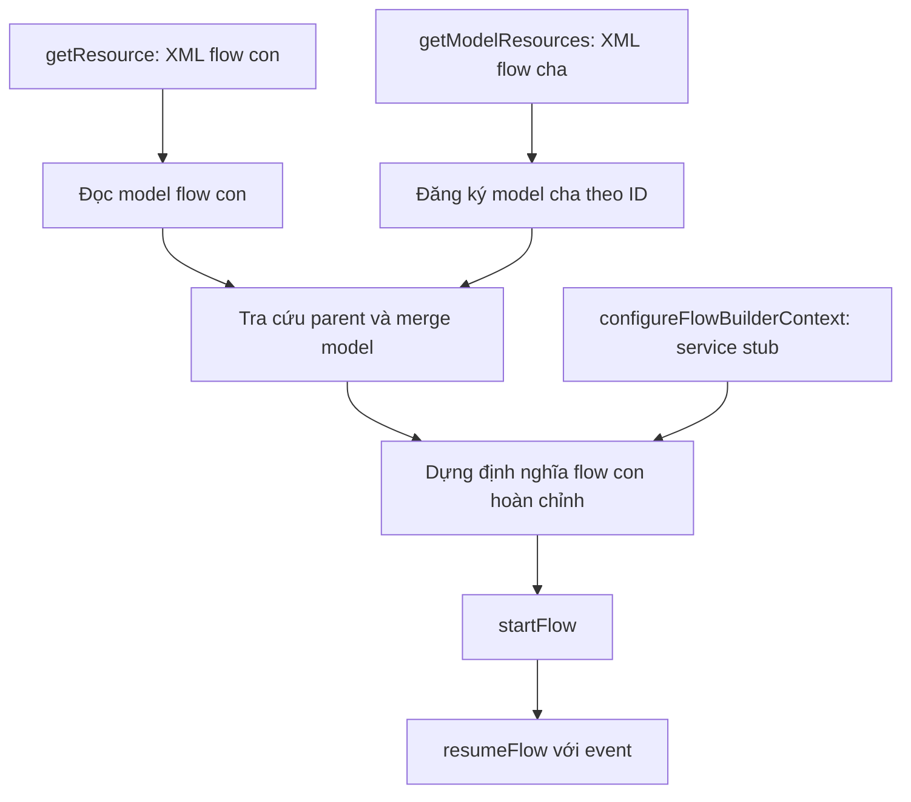

# Nạp tài nguyên flow cha khi kiểm tra inheritance

Một flow đăng ký có thể kế thừa thao tác khởi tạo, transition hủy và cách xử lý lỗi từ một flow dùng chung. Khi chạy trong ứng dụng, các tài nguyên này đã được đăng ký nên flow hoạt động bình thường. Tuy nhiên, một bài kiểm thử chỉ nạp XML của flow đăng ký có thể thất bại ngay khi xây dựng định nghĩa, trước cả lúc xử lý event đầu tiên.

Trong chương **Kiểm thử flow** của module **SPRING_WEB_FLOW**, bài học này tập trung vào cách cung cấp tài nguyên flow cha cho `AbstractXmlFlowExecutionTests`. Mục tiêu là kiểm tra đúng cấu hình được kế thừa trong hành trình nhiều bước, đồng thời giữ điều hướng ở state và transition thay vì dựng lại hành vi bằng mã kiểm thử.

## 1. Vấn đề: có file trên classpath chưa đủ để tra cứu flow cha

Giả sử XML của flow con có:

```xml
<flow parent="common-lifecycle" start-state="enterDetails">
    <!-- Nội dung minh họa; namespace được khai báo trong ví dụ đầy đủ bên dưới. -->
</flow>
```

Giá trị `common-lifecycle` là **ID của flow model cha**, không phải đường dẫn tương đối tới một file XML. Bộ dựng cần tìm được model có ID đó để kết hợp cấu hình cha và con.

Hai điều kiện khác nhau phải cùng được đáp ứng:

1. Tài nguyên XML của flow cha tồn tại và đọc được.
2. Tài nguyên đó được đăng ký với đúng ID trong nơi tra cứu model mà bài kiểm thử sử dụng.

Việc đặt `common-lifecycle.xml` cạnh XML flow con chỉ giúp tổ chức file. Nó không có nghĩa mọi tài nguyên trong thư mục sẽ tự được bài kiểm thử phát hiện.

Trong `AbstractXmlFlowExecutionTests`, hai điểm khai báo cần phân biệt là:

| Phương thức | Vai trò |
| --- | --- |
| `getResource(FlowDefinitionResourceFactory)` | Chọn tài nguyên flow chính đang được kiểm thử |
| `getModelResources(FlowDefinitionResourceFactory)` | Cung cấp các tài nguyên model phụ thuộc để dựng flow chính, thường là flow cha |
| `configureFlowBuilderContext(MockFlowBuilderContext)` | Đăng ký service stub/mock và phụ thuộc runtime phù hợp |

`getModelResources(...)` mặc định trả `null`, với giả định không có inheritance. Bài kiểm thử có inheritance cần override phương thức này. Xem [API AbstractXmlFlowExecutionTests](https://docs.spring.io/spring-webflow/docs/current/api/org/springframework/webflow/test/execution/AbstractXmlFlowExecutionTests.html).

## 2. Hiểu vị trí của inheritance trong quá trình dựng flow

Inheritance được giải quyết khi xây dựng flow model và chuyển model thành định nghĩa có thể thực thi. Nó không phải một lần gọi flow cha khi người dùng bấm nút Next.



`XmlFlowModelBuilder` nhận tài nguyên XML và có thể nhận một model locator để tìm các model cha. `FlowModelRegistry` giữ các model theo ID, thông qua các holder hỗ trợ việc dựng model khi cần. Xem [API XmlFlowModelBuilder](https://docs.spring.io/spring-webflow/docs/current/api/org/springframework/webflow/engine/model/builder/xml/XmlFlowModelBuilder.html) và [API FlowModelRegistry](https://docs.spring.io/spring-webflow/docs/current/api/org/springframework/webflow/engine/model/registry/FlowModelRegistry.html).

Từ cơ chế này, có thể rút ra cách bố trí kiểm thử:

- Chạy flow con sau khi đã cung cấp đủ model cha.
- Giữ cấu hình cha thật nếu mục đích là kiểm tra inheritance.
- Thay service bên ngoài bằng stub/mock để kiểm soát tác dụng phụ.
- Khẳng định hành vi chỉ có trong cha, ngoài việc khẳng định flow con khởi động được.

Đừng sao chép transition của cha vào XML flow con dành riêng cho test. Cách đó có thể tạo một bài kiểm thử xanh ngay cả khi việc tra cứu hoặc merge flow cha thực tế đã hỏng.

## 3. Ví dụ đầy đủ: flow đăng ký kế thừa vòng đời chung

Các đường dẫn và file Java/XML dưới đây là cấu trúc ví dụ để người học áp dụng trong một dự án Spring Web Flow. Phần kiểm thử tập trung vào execution; chưa cần chạy servlet container hay render JSP thật.

```text
src/main/resources/flows/
├── common/
│   └── common-lifecycle.xml
└── registration/
    └── registration.xml

src/test/java/example/flow/
└── RegistrationInheritanceTests.java
```

Hành vi cần kiểm tra:

```text
Bắt đầu registration
  -> action khởi tạo của cha
  -> action khởi tạo của con
  -> enterDetails --next--> review --submit--> done

Từ enterDetails hoặc review:
  cancel -> cancelled, nhờ global transition từ cha
```

### 3.1. Flow cha: khởi tạo và hủy dùng chung

Nội dung `flows/common/common-lifecycle.xml`:

```xml
<?xml version="1.0" encoding="UTF-8"?>
<flow xmlns="http://www.springframework.org/schema/webflow"
      xmlns:xsi="http://www.w3.org/2001/XMLSchema-instance"
      xsi:schemaLocation="http://www.springframework.org/schema/webflow
                          https://www.springframework.org/schema/webflow/spring-webflow.xsd"
      abstract="true">

    <on-start>
        <set name="flowScope.startTrace" value="'parent'"/>
        <evaluate expression="auditService.recordStart()"/>
    </on-start>

    <end-state id="cancelled"/>

    <global-transitions>
        <transition on="cancel" to="cancelled"/>
    </global-transitions>
</flow>
```

Flow cha này chỉ đóng vai trò cấu hình dùng chung. `abstract="true"` biểu thị nó không được thiết kế để khởi chạy trực tiếp. Tuy vậy, test của flow con vẫn cần đọc model của cha; abstract không có nghĩa là bỏ qua tài nguyên đó.

### 3.2. Flow con: giữ điều hướng riêng

Nội dung `flows/registration/registration.xml`:

```xml
<?xml version="1.0" encoding="UTF-8"?>
<flow xmlns="http://www.springframework.org/schema/webflow"
      xmlns:xsi="http://www.w3.org/2001/XMLSchema-instance"
      xsi:schemaLocation="http://www.springframework.org/schema/webflow
                          https://www.springframework.org/schema/webflow/spring-webflow.xsd"
      parent="common-lifecycle"
      start-state="enterDetails">

    <on-start>
        <set name="flowScope.startTrace"
             value="flowScope.startTrace + ',child'"/>
    </on-start>

    <view-state id="enterDetails"
                view="/WEB-INF/views/registration/details.jsp">
        <transition on="next" to="review"/>
    </view-state>

    <view-state id="review"
                view="/WEB-INF/views/registration/review.jsp">
        <transition on="submit" to="done"/>
    </view-state>

    <end-state id="done"/>
</flow>
```

Flow con không khai báo lại `cancelled` hoặc transition `cancel`. Vì thế, các test hủy bên dưới sẽ kiểm chứng cấu hình được đưa vào từ cha.

`start-state="enterDetails"` làm điểm bắt đầu rõ ràng dù model sau merge có thêm state. `startTrace` là dấu vết phục vụ ví dụ kiểm thử: sau khi bắt đầu, giá trị mong đợi là `parent,child`.

Kế thừa flow là merge cấu hình, không phải cơ chế override phương thức như trong Java. Các action khởi tạo của ví dụ được kết hợp để phần cha chạy trước phần con. Có thể đối chiếu cách kết hợp `onStartActions`, state và global transition trong [mã nguồn FlowModel](https://raw.githubusercontent.com/spring-projects/spring-webflow/main/spring-webflow/src/main/java/org/springframework/webflow/engine/model/FlowModel.java).

## 4. Nạp flow cha bằng getModelResources

Ví dụ Java dùng tài nguyên classpath và gán ID tường minh. Nhờ đó, tên file và cấu trúc thư mục không quyết định ngầm giá trị `parent`.

```java
package example.flow;

import org.springframework.webflow.config.FlowDefinitionResource;
import org.springframework.webflow.config.FlowDefinitionResourceFactory;
import org.springframework.webflow.test.MockExternalContext;
import org.springframework.webflow.test.MockFlowBuilderContext;
import org.springframework.webflow.test.execution.AbstractXmlFlowExecutionTests;

public class RegistrationInheritanceTests
        extends AbstractXmlFlowExecutionTests {

    private final AuditServiceStub auditService = new AuditServiceStub();

    @Override
    protected FlowDefinitionResource getResource(
            FlowDefinitionResourceFactory resourceFactory) {

        return resourceFactory.createResource(
                "classpath:/flows/registration/registration.xml",
                null,
                "registration");
    }

    @Override
    protected FlowDefinitionResource[] getModelResources(
            FlowDefinitionResourceFactory resourceFactory) {

        return new FlowDefinitionResource[] {
            resourceFactory.createResource(
                    "classpath:/flows/common/common-lifecycle.xml",
                    null,
                    "common-lifecycle")
        };
    }

    @Override
    protected void configureFlowBuilderContext(
            MockFlowBuilderContext builderContext) {

        builderContext.registerBean("auditService", auditService);
    }

    public void testStartMergesParentAndChildInitialization() {
        startFlow(new MockExternalContext());

        assertCurrentStateEquals("enterDetails");
        assertEquals("parent,child", getRequiredFlowAttribute("startTrace"));
        assertEquals(1, auditService.startCalls);
    }

    public void testInheritedCancelFromDetails() {
        startFlow(new MockExternalContext());

        signal("cancel");

        assertFlowExecutionEnded();
        assertFlowExecutionOutcomeEquals("cancelled");
    }

    public void testInheritedCancelFromReview() {
        startFlow(new MockExternalContext());
        signal("next");
        assertCurrentStateEquals("review");

        signal("cancel");

        assertFlowExecutionEnded();
        assertFlowExecutionOutcomeEquals("cancelled");
        assertEquals(1, auditService.startCalls);
    }

    public void testChildTransitionsRemainAvailable() {
        startFlow(new MockExternalContext());
        signal("next");
        assertCurrentStateEquals("review");

        signal("submit");

        assertFlowExecutionEnded();
        assertFlowExecutionOutcomeEquals("done");
    }

    private void signal(String eventId) {
        MockExternalContext context = new MockExternalContext();
        context.setEventId(eventId);
        resumeFlow(context);
    }

    public static final class AuditServiceStub {
        private int startCalls;

        public void recordStart() {
            startCalls++;
        }
    }
}
```

Ba điểm nối quan trọng của ví dụ:

1. `getResource(...)` trả **flow con**, không trả flow cha.
2. `getModelResources(...)` trả model cha có ID chính xác là `common-lifecycle`.
3. `configureFlowBuilderContext(...)` đăng ký bean `auditService` mà action được kế thừa sẽ gọi.

Overload `createResource(path, attributes, flowId)` cho phép chỉ định ID, trong đó `null` ở ví dụ nghĩa là không cung cấp metadata attributes bổ sung. Các lớp resource factory/resource nằm trong package `org.springframework.webflow.config`. Xem [API FlowDefinitionResourceFactory](https://docs.spring.io/spring-webflow/docs/current/api/org/springframework/webflow/config/FlowDefinitionResourceFactory.html).

`MockFlowBuilderContext.registerBean(...)` là điểm đăng ký stub/mock cho service được gọi từ flow, kể cả action vốn khai báo trong cha. Xem [API MockFlowBuilderContext](https://docs.spring.io/spring-webflow/docs/current/api/org/springframework/webflow/test/MockFlowBuilderContext.html).

Các phương thức `public void test...()` phù hợp với nền tảng `junit.framework.TestCase` của lớp kiểm thử này. Nếu dự án chạy trên JUnit Platform, cần runner/engine hỗ trợ loại test đó; chỉ có Jupiter không đồng nghĩa các phương thức này sẽ được phát hiện. Trước khi đánh giá kết quả, kiểm tra số test thực sự đã chạy.

## 5. ID tài nguyên phải khớp parent, không chỉ khớp tên file

Một lỗi dễ gặp là production đăng ký flow cha bằng ID `common-lifecycle`, còn test nạp đúng XML nhưng để factory tự suy ID khác.

Với ví dụ đang dùng, hợp đồng ánh xạ là:

| Thành phần | Giá trị |
| --- | --- |
| Tài nguyên flow con | `classpath:/flows/registration/registration.xml` |
| ID flow con trong test | `registration` |
| Giá trị `parent` trong XML con | `common-lifecycle` |
| Tài nguyên flow cha | `classpath:/flows/common/common-lifecycle.xml` |
| ID model cha trong test | `common-lifecycle` |

Tên ID không bắt buộc giống tên file. Ví dụ file có thể đổi thành `lifecycle-template.xml` mà `parent="common-lifecycle"` vẫn hợp lệ, nếu test và cấu hình ứng dụng tiếp tục đăng ký ID đó đúng cách.

Khi dùng `createFileResource(...)` hoặc `createClassPathResource(...)`, factory có cơ chế xác định ID từ resource. Không nên đoán ID chỉ bằng tên file khi có base path hoặc quy ước đăng ký khác. Gán ID tường minh là lựa chọn rõ ràng cho bài kiểm thử cần mô phỏng đúng tên logic trong ứng dụng.

Nguồn [FlowDefinitionResourceFactory](https://raw.githubusercontent.com/spring-projects/spring-webflow/main/spring-webflow/src/main/java/org/springframework/webflow/config/FlowDefinitionResourceFactory.java) thể hiện sự tách biệt giữa việc tìm resource và việc xác định ID. Khi áp dụng, đối chiếu API với đúng phiên bản Web Flow của dự án.

### Chọn classpath hay filesystem?

- Dùng `classpath:/...` khi tài nguyên đã được đưa vào main/test runtime classpath. Cách này ít phụ thuộc working directory.
- Dùng filesystem khi flow thực tế ở `src/main/webapp` và bài kiểm thử chủ ý đọc trực tiếp từ source tree.
- Nếu dùng đường dẫn tương đối trên filesystem, xác định thư mục chạy test trong IDE và CI; chạy từ module gốc khác nhau có thể tạo kết quả khác nhau.

Đường dẫn trong ví dụ không phải đề nghị sao chép XML production sang `src/test/resources`. Nếu đã có XML thật dùng được trên classpath, nên nạp chính tài nguyên đó để tránh hai bản cấu hình dần khác nhau.

## 6. State-level inheritance cũng cần tài nguyên model cha

Không có `parent` trên phần tử `<flow>` chưa chắc flow không phụ thuộc model cha. Một state cũng có thể kế thừa state trong flow khác:

```xml
<view-state id="review" parent="common-views#baseReview">
    <!-- ... -->
</view-state>
```

Cú pháp `common-views#baseReview` gồm ID flow model và ID state. Hai state tham gia kế thừa phải cùng loại. State-level inheritance chỉ kết hợp cấu hình state được chỉ định, không tự đưa toàn bộ flow chứa state đó vào flow con. Xem phần [Flow Inheritance trong hướng dẫn Spring Web Flow](https://docs.spring.io/spring-webflow/docs/current/reference/index.html#flow-inheritance).

### 6.1. Tài nguyên chứa state mẫu

Thêm tài nguyên minh họa `flows/common/common-views.xml`:

```xml
<?xml version="1.0" encoding="UTF-8"?>
<flow xmlns="http://www.springframework.org/schema/webflow"
      xmlns:xsi="http://www.w3.org/2001/XMLSchema-instance"
      xsi:schemaLocation="http://www.springframework.org/schema/webflow
                          https://www.springframework.org/schema/webflow/spring-webflow.xsd"
      abstract="true">

    <view-state id="baseReview"
                view="/WEB-INF/views/registration/review.jsp">
        <on-entry>
            <set name="flowScope.reviewPolicy" value="'shared-review'"/>
        </on-entry>
        <transition on="back" to="enterDetails"/>
    </view-state>
</flow>
```

`enterDetails` là state đích sẽ tồn tại trong flow con sau khi dựng. Tài nguyên mẫu này được dùng như model để merge, không được chạy độc lập để kiểm tra hành trình đăng ký.

Trong `registration.xml`, thay riêng state `review` bằng:

```xml
<view-state id="review"
            parent="common-views#baseReview"
            view="/WEB-INF/views/registration/review.jsp">
    <transition on="submit" to="done"/>
</view-state>
```

Flow con vẫn giữ `parent="common-lifecycle"` ở cấp flow. Như vậy, nó có hai nguồn cấu hình kế thừa: vòng đời từ `common-lifecycle` và state mẫu từ `common-views`.

### 6.2. Nạp cả hai model

Thay phần thân `getModelResources(...)` trong test bằng:

```java
return new FlowDefinitionResource[] {
    resourceFactory.createResource(
            "classpath:/flows/common/common-lifecycle.xml",
            null, "common-lifecycle"),
    resourceFactory.createResource(
            "classpath:/flows/common/common-views.xml",
            null, "common-views")
};
```

Thêm phương thức vào cùng lớp kiểm thử:

```java
public void testReviewInheritsEntryActionAndBackTransition() {
    startFlow(new MockExternalContext());
    signal("next");

    assertCurrentStateEquals("review");
    assertEquals("shared-review", getRequiredFlowAttribute("reviewPolicy"));

    signal("back");

    assertCurrentStateEquals("enterDetails");
}
```

Assertion `reviewPolicy` chứng minh action của state cha đã được đưa vào. Event `back` chứng minh transition của state cha có hiệu lực. Kiểm tra chỉ `assertCurrentStateEquals("review")` sẽ yếu hơn vì flow con vốn đã có state này.

Nếu state mẫu dựa vào bean, biến hoặc state đích khác, flow sau merge phải đáp ứng các phụ thuộc đó. Không giả định rằng các khai báo cấp flow của `common-views` đều được kế thừa chỉ vì một state tham chiếu tới `baseReview`.

## 7. Phải nạp đủ chuỗi cha, không chỉ cha trực tiếp

Trong dự án lớn, flow cha cũng có thể kế thừa một flow khác:

```text
registration
  ├── parent: common-lifecycle
  │     └── parent: base-context
  └── review.parent: common-views#baseReview
```

Với đồ thị trên, tài nguyên cần cung cấp cho `getModelResources(...)` gồm:

```java
return new FlowDefinitionResource[] {
    resourceFactory.createResource(
            "classpath:/flows/common/base-context.xml",
            null, "base-context"),
    resourceFactory.createResource(
            "classpath:/flows/common/common-lifecycle.xml",
            null, "common-lifecycle"),
    resourceFactory.createResource(
            "classpath:/flows/common/common-views.xml",
            null, "common-views")
};
```

Đây là biến thể khi đã có `base-context.xml` và `common-lifecycle.xml` khai báo cha tương ứng; không cần thêm tài nguyên giả đó vào ví dụ cơ bản ở phần 3–4.

Nguyên tắc là lần theo tất cả tham chiếu `parent`, ở cả cấp flow và cấp state, cho tới khi không còn phụ thuộc model nào chưa được cung cấp. Việc sắp tài nguyên nền tảng trước giúp người đọc hiểu cấu trúc, nhưng không thay thế việc đăng ký đúng ID và đủ đồ thị.

Trong lớp test chuẩn, các model phụ thuộc được đăng ký vào registry trước khi dựng flow chính. Có thể đối chiếu cơ chế này ở [mã nguồn AbstractXmlFlowExecutionTests](https://raw.githubusercontent.com/spring-projects/spring-webflow/main/spring-webflow/src/main/java/org/springframework/webflow/test/execution/AbstractXmlFlowExecutionTests.java).

Các vấn đề cần phát hiện khi lập danh sách:

- Thiếu một tổ tiên: tìm thấy cha trực tiếp nhưng không dựng được model của cha đó.
- Trùng ID: hai resource khác nhau có cùng tên logic, khiến cấu hình được tra cứu không rõ ràng.
- Kế thừa vòng: A phụ thuộc B, B lại phụ thuộc A; thêm resource không giải quyết được thiết kế này.
- Quét quá rộng: vô tình nạp model không liên quan hoặc hai phiên bản của cùng một template.

Nếu flow có nhiều cha ở cấp flow, ví dụ `parent="common-lifecycle,common-errors"`, thứ tự merge do danh sách `parent` trong XML quyết định. Không dùng việc đảo thứ tự mảng `getModelResources(...)` để sửa hành vi merge của XML.

## 8. Tách ba nhóm phụ thuộc: model cha, service và subflow

Ba nhóm này có thể cùng xuất hiện nhưng được phục vụ ở những thời điểm khác nhau:

| Phụ thuộc | Ví dụ | Cách cung cấp trong kiểm thử |
| --- | --- | --- |
| Model cha cho inheritance | `parent="common-lifecycle"` | `getModelResources(...)` |
| Model chứa state cha | `parent="common-views#baseReview"` | `getModelResources(...)` |
| Service được expression gọi | `auditService.recordStart()` | `configureFlowBuilderContext(...)`, đăng ký stub/mock phù hợp |
| Flow được gọi như subflow | `<subflow-state subflow="verifyIdentity">` | Đăng ký định nghĩa subflow thật hoặc stub trong flow definition registry/context |

Đăng ký một service bean không làm model cha xuất hiện. Ngược lại, nạp XML cha không tự tạo service nằm ngoài XML đó.

Cũng không thể thay việc nạp model cha bằng cách đăng ký một `Flow` rỗng như khi mock subflow. Inheritance cần cấu hình model để merge trước khi execution chạy; subflow cần định nghĩa có thể được gọi trong quá trình thực thi.

Nếu cha có `<bean-import>`, tài nguyên bean được import vẫn là một phụ thuộc riêng. Cần hiểu nó được nạp ở đâu và có định nghĩa nào trùng với stub của test hay không. `registerMockFlowBeans(...)` là một điểm mở rộng dành cho bean cục bộ của flow, nhưng chỉ dùng khi phù hợp với cách flow đang khai báo bean; không thay mọi lỗi thiếu bean bằng việc nạp toàn bộ application context.

Ranh giới kiểm thử hữu ích là **XML con thật + model cha thật + service stub có hành vi được kiểm soát**. Nhờ vậy, test kiểm tra được cấu hình điều phối mà không cần gọi dịch vụ mạng hoặc database để chứng minh một transition được kế thừa.

## 9. Assertion phải chứng minh được hành vi từ cha

Một bài kiểm thử inheritance nên trả lời được câu hỏi: nếu cấu hình quan trọng ở cha bị bỏ đi hoặc thay đổi sai, assertion nào sẽ thất bại?

| Hợp đồng được kế thừa | Assertion thích hợp |
| --- | --- |
| Khởi tạo model/scope | Giá trị cần thiết có mặt sau `startFlow(...)` |
| Action cha chạy trước action con | Dữ liệu hoặc dấu vết phản ánh thứ tự mong đợi |
| Global transition hủy | Event từ các state liên quan đưa execution tới outcome mong đợi |
| Action ở state cha | Tác dụng quan sát được sau khi thực sự đi vào state con |
| Transition ở state cha | Event được khai báo riêng ở cha đưa tới đúng state đích |
| Exception handler được kế thừa | Service stub ném lỗi xác định, flow đi vào nhánh phục hồi đúng |
| Flow con còn điều hướng riêng | Các event cục bộ vẫn dẫn tới state/outcome đúng sau merge |

### 9.1. Dùng startFlow khi kiểm tra khởi tạo

`setCurrentState(...)` hữu ích khi muốn cô lập một transition, nhưng nó không thay thế việc chạy đầy đủ đường khởi tạo. Nếu hợp đồng cần kiểm tra là action `<on-start>` từ cha, hãy gọi `startFlow(...)` và assert kết quả sau đó.

Tương tự, muốn kiểm tra `<on-entry>` được kế thừa thì nên đi vào state bằng transition thực tế. Ép current state có thể bỏ qua chính chuỗi hành động mà test muốn chứng minh. Các API khởi động, tiếp tục execution và đặt state phục vụ các mục đích khác nhau, như mô tả trong [mã nguồn AbstractFlowExecutionTests](https://raw.githubusercontent.com/spring-projects/spring-webflow/main/spring-webflow/src/main/java/org/springframework/webflow/test/execution/AbstractFlowExecutionTests.java).

### 9.2. Kiểm tra trạng thái còn hoạt động và kết quả kết thúc đúng lúc

Khi flow đang ở view-state, kiểm tra current state và scope cần thiết. Khi flow đã kết thúc, kiểm tra `assertFlowExecutionEnded()` cùng outcome. Tránh tiếp tục đọc active flow scope như thể execution vẫn đang dừng tại một view-state sau end-state.

Trong ví dụ, `auditService.startCalls` là dữ liệu của stub nằm ngoài execution nên vẫn có thể kiểm tra sau khi flow kết thúc. Scope của execution và dữ liệu quan sát của stub có vòng đời khác nhau.

### 9.3. Không dùng thành công khi dựng flow thay cho kiểm tra hành vi

Một test chỉ gọi `getFlowDefinition()` chứng minh được rằng tập resource hiện tại có thể tạo ra định nghĩa. Nó chưa chứng minh event `cancel` chọn đúng transition, action khởi tạo chỉ chạy một lần hoặc state con còn giữ nhánh `submit`.

Có thể giữ một kiểm tra dựng flow để bắt lỗi cấu hình sớm, nhưng các hợp đồng inheritance quan trọng vẫn cần được thực thi bằng event và assertion có ý nghĩa.

## 10. Chẩn đoán lỗi theo giai đoạn

Không nên gom mọi lỗi khi gọi `startFlow(...)` thành “inheritance bị sai”. Quá trình dựng và khởi chạy có nhiều giai đoạn; exception bên ngoài có thể bọc nguyên nhân sâu hơn.

| Biểu hiện | Khả năng cần kiểm tra | Cách xác minh |
| --- | --- | --- |
| Không mở được XML cha | Sai path, resource chưa có trên classpath | Kiểm tra vị trí resource và cách đóng gói/chạy test |
| Không tìm thấy model cha | Thiếu `getModelResources(...)` hoặc sai ID | Đối chiếu `parent` với ID truyền vào factory |
| Cha trực tiếp có mặt nhưng vẫn lỗi model | Thiếu tổ tiên hoặc state cha khác | Lần theo toàn bộ đồ thị `parent` |
| Không tìm thấy state trong parent reference | Sai phần sau dấu `#` | Đối chiếu ID state trong đúng model cha |
| Lỗi kiểu state khi merge | State con và cha khác loại | Kiểm tra view/action/decision/end-state của hai bên |
| Không tìm thấy bean khi chạy action | Expression từ cha có dependency chưa đăng ký | Đăng ký service stub đúng tên và chữ ký phương thức |
| Không tìm thấy state đích | Transition kế thừa trỏ tới state chưa có trong flow con | Kiểm tra định nghĩa sau merge và phạm vi inheritance |
| Dữ liệu khởi tạo khác mong đợi | Merge action hoặc thứ tự gây tác động khác | Assert dấu vết/giá trị cụ thể, xem action cha và con |
| IDE chạy được, CI lỗi đường dẫn | Filesystem path phụ thuộc working directory | Chuẩn hóa đường dẫn hoặc dùng resource classpath |
| Test xanh nhưng số test bằng không | Runner không phát hiện kiểu test | Kiểm tra test report và engine đang sử dụng |

Quy trình đọc lỗi:

1. Đọc nguyên nhân sâu nhất có thông tin về resource, model ID, state ID hoặc bean.
2. Xác định lỗi ở bước mở tài nguyên, tra model, merge, dựng định nghĩa hay thực thi action.
3. Sửa đúng nhóm phụ thuộc trước khi thay assertion hoặc business logic.
4. Giữ bài kiểm thử có khả năng thất bại khi phụ thuộc thật bị thiếu; không bắt exception rồi bỏ qua để test tiếp tục.

### Đường dẫn resource trong flow cha sau merge

Một template có view hoặc bean import dùng đường dẫn tương đối có thể hoạt động khi nằm cạnh flow con nhưng hỏng khi được dùng từ thư mục khác. Sau merge, cách phân giải đường dẫn có thể dựa trên flow con. Hướng dẫn Web Flow khuyến nghị đường dẫn resource trong cha phải rõ ràng theo cơ chế phân giải được sử dụng.

Ví dụ đã dùng các view path bắt đầu bằng `/WEB-INF/...` để thể hiện vị trí trong ứng dụng web. Chúng không phải đường dẫn tuyệt đối trên hệ điều hành. Bài kiểm thử execution với mock view cũng chưa chứng minh JSP thật tồn tại hoặc render được; phần đó thuộc kiểm thử tích hợp MVC/view riêng.

## 11. Giữ test độc lập mà vẫn phản ánh cấu hình ứng dụng

Một số cách làm khiến bài kiểm thử khó tin cậy dù vẫn chạy xanh:

- Tạo bản sao flow cha trong test nhưng quên cập nhật khi XML thật thay đổi.
- Đưa transition kế thừa trực tiếp vào XML con chỉ để tránh lỗi lookup.
- Dùng chung stub có bộ đếm hoặc trạng thái giữa các test mà không reset.
- Bật cache định nghĩa trong khi từng test thay resource hoặc dependency, rồi vô tình kiểm tra cấu hình cũ.
- Nạp toàn bộ tài nguyên bằng wildcard rộng khiến test phụ thuộc flow không liên quan.
- Chỉ kiểm tra event của con, không có assertion nào quan sát được hành vi từ cha.

Đối với ví dụ, mỗi test case có stub riêng và không bật cache định nghĩa. Khi cần tối ưu thời gian dựng trong suite lớn, chỉ dùng cache nếu cấu hình được cache ổn định và các mock/stub không mang trạng thái không mong muốn giữa các lần chạy.

`AbstractExternalizedFlowExecutionTests` có hỗ trợ cache định nghĩa và mặc định không bật. Xem [mã nguồn AbstractExternalizedFlowExecutionTests](https://raw.githubusercontent.com/spring-projects/spring-webflow/main/spring-webflow/src/main/java/org/springframework/webflow/test/execution/AbstractExternalizedFlowExecutionTests.java) trước khi thay cơ chế này trong một lớp test có nhiều biến thể resource.

Phạm vi được chứng minh cũng cần rõ ràng:

| Bài kiểm thử này có thể chứng minh | Cần lớp kiểm thử bổ sung |
| --- | --- |
| Model cha được lookup và merge để dựng flow con | Registry production có đúng ID và tài nguyên đã đóng gói |
| Event dẫn tới state/outcome được kế thừa | Nút giao diện gửi đúng request/event trong Spring MVC |
| Action khởi tạo gọi đúng stub | Service thật làm việc đúng với database hoặc API ngoài |
| Scope có dữ liệu sau action | Snapshot/session giữ dữ liệu đúng qua nhiều request thực tế |
| Nhánh event đơn giản hoạt động | Binding, conversion và validation thật của form |

Ví dụ không khai báo form model nên event `next` được phát trực tiếp. Khi thêm binding hoặc validation vào flow thật, cần chuẩn bị model, request parameters và service phụ thuộc tương ứng; đừng coi event được xử lý thành công trong ví dụ đơn giản là bằng chứng form đã được kiểm thử đầy đủ.

## 12. Bài thực hành và tiêu chí hoàn thành

### Bối cảnh

Một flow đăng ký dùng `common-lifecycle` để khởi tạo dữ liệu và hủy hành trình. State `review` kế thừa từ `common-views#baseReview`. Trong môi trường ứng dụng, flow hoạt động; test mới viết lại báo thiếu model cha.

### Các bước thực hiện

1. Liệt kê mọi tham chiếu `parent` của flow và state; xác định tài nguyên cùng ID logic tương ứng.
2. Đặt flow đăng ký vào `getResource(...)`; đặt các model cha thật vào `getModelResources(...)`.
3. Đăng ký `auditService` stub, không gọi hệ thống audit bên ngoài.
4. Chạy đường khởi tạo và khẳng định `parent,child`, đồng thời kiểm tra action audit chỉ chạy một lần.
5. Gửi `cancel` từ cả `enterDetails` và `review`; kiểm tra execution kết thúc với `cancelled`.
6. Gửi `next` rồi `back`; kiểm tra action và transition của state cha được áp dụng.
7. Gửi `next` rồi `submit`; kiểm tra nhánh cục bộ của flow con vẫn kết thúc với `done`.
8. Trong một biến thể thử nghiệm có chủ đích, bỏ một model cha để xác nhận suite phát hiện lỗi dựng, rồi khôi phục cấu hình đúng.

### Tiêu chí tự kiểm tra

- ID model trong test khớp từng `parent`, kể cả phần flow ID trước dấu `#`.
- Cha có tổ tiên thì toàn bộ chuỗi cần thiết đều có resource.
- Các XML cha được dùng làm model để merge, không bị khởi chạy thay cho flow con.
- Test có assertion thất bại nếu action hoặc transition quan trọng của cha biến mất.
- Service mock/stub được tách khỏi việc cung cấp model cha.
- Test runner thực sự chạy các phương thức test và báo số lượng mong đợi.
- Phạm vi kết luận không bao gồm MVC, rendering, session hoặc database nếu chúng chưa được kiểm thử.

Điểm cốt lõi là cung cấp đúng **tài nguyên + ID + phụ thuộc** cho quá trình dựng flow, rồi kiểm tra hành vi kế thừa qua execution của flow con. Khi đó, bài kiểm thử bảo vệ được cấu hình điều phối dùng chung và phát hiện thay đổi làm hỏng hành trình nhiều bước.
