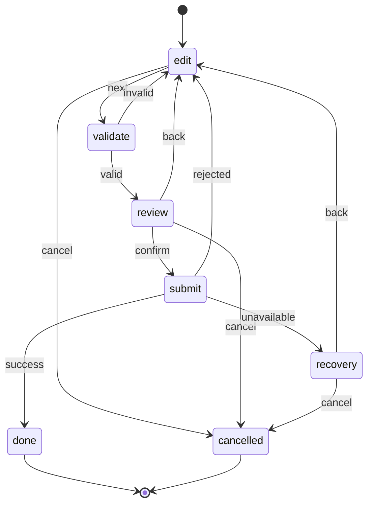

# Tổ chức đường dẫn kiểm thử cho thành công, lỗi, quay lại và hủy

Một flow có thể xử lý đúng hành trình nhập thông tin rồi xác nhận, nhưng vẫn làm mất dữ liệu khi người dùng quay lại hoặc gửi đơn ngoài ý muốn khi họ bấm hủy. Kiểm thử flow vì thế cần phản ánh các lựa chọn thực tế của người dùng và các kết quả khác nhau của dịch vụ.

Trong chương **Kiểm thử flow** của module **SPRING_WEB_FLOW**, bài này tập trung vào cách tổ chức các đường đi thành một bộ test dễ đọc và dễ bảo trì. Mục tiêu là bảo vệ hợp đồng giữa state, event, transition, dữ liệu trong scope và tác dụng phụ; đồng thời xác định rõ phần nào cần kiểm thử form binding, validation, tích hợp Spring MVC hoặc phục hồi phiên ở tầng khác.

## 1. Đường dẫn kiểm thử là một kịch bản có hợp đồng

Một đường dẫn kiểm thử mô tả điểm xuất phát, tiền điều kiện, chuỗi event và các kết quả có thể quan sát. Nó không phải đường dẫn đến tệp XML hay thư mục chứa test.

Ví dụ:

```text
Xuất phát: flow mới, có bản nháp
Event:     next → confirm
Dịch vụ:   kiểm tra hợp lệ; gửi đơn thành công
Kết quả:   outcome done, output có mã tham chiếu, gửi đơn đúng một lần
```

Đối với nhánh quay lại:

```text
Xuất phát: review, có bản nháp đã nhập
Event:     back
Kết quả:   về edit, dữ liệu còn nguyên, chưa gửi đơn
```

Chỉ kiểm tra state cuối cùng thường chưa đủ. Hai đường đi có thể cùng kết thúc tại `edit` nhưng có ý nghĩa khác nhau: dữ liệu không hợp lệ, dịch vụ từ chối hoặc người dùng chủ động quay lại. Mỗi trường hợp cần assert dữ liệu và tác dụng phụ phù hợp.

Một hợp đồng kiểm thử nên trả lời bốn câu hỏi:

1. Người dùng hoặc dịch vụ đã tạo ra event nào?
2. Flow đang ở state nào hoặc đã kết thúc với outcome nào?
3. Dữ liệu cần tiếp tục có còn đúng không?
4. Có thao tác nghiệp vụ nào phải được thực hiện hoặc tuyệt đối chưa được thực hiện?

## 2. Vẽ đồ thị trước khi chọn test

Giả sử flow đặt hàng có cấu trúc sau:



Ở đây, các event có hai nguồn:

- Người dùng tạo `next`, `confirm`, `back`, `cancel` tại màn hình đang chờ tương tác.
- Action trả về `valid`, `invalid`, `success`, `rejected`, `unavailable` để engine chọn transition tiếp theo.

Đừng phát `success` trực tiếp tại `review` để kiểm tra thành công. Hành trình thật cần `confirm`, sau đó action `submit` mới tạo ra kết quả `success`. Test phải đi qua phần điều phối mà nó có trách nhiệm bảo vệ.

### Phân biệt các loại lỗi

| Loại lỗi | Điểm phát hiện | Kết quả cần kiểm tra |
| --- | --- | --- |
| Binding | Chuyển tham số request sang model | Giá trị bị từ chối được hiển thị lại; chưa gọi thao tác nghiệp vụ |
| Validation | Kiểm tra dữ liệu nhập hoặc điều kiện trước bước tiếp theo | Ở lại hoặc quay lại form, có phản hồi phù hợp |
| Từ chối nghiệp vụ | Dịch vụ nhận yêu cầu nhưng kết luận không chấp nhận | Quay về state cho phép sửa, không báo thành công |
| Sự cố đã phân loại | Lớp action biết dịch vụ chưa tiếp nhận yêu cầu | Đi tới recovery state theo hợp đồng |
| Kết quả chưa xác định | Timeout khi yêu cầu có thể đã được tiếp nhận | Giữ mã đối chiếu, kiểm tra trạng thái trước khi gửi lại |
| Exception không dự kiến | Lỗi lập trình hoặc hạ tầng ngoài các trường hợp đã xử lý | Kiểm tra cơ chế xử lý ngoại lệ thực tế, không giả định tự phục hồi |

Ví dụ trong bài chọn `unavailable` với hợp đồng hẹp: dịch vụ xác nhận chưa tiếp nhận yêu cầu và chưa tạo đơn. Nếu hệ thống không có bảo đảm này, đường phục hồi phải chuyển sang kiểm tra trạng thái; không thể dùng lại nhánh cho phép sửa rồi gửi tiếp một cách tùy tiện.

## 3. Lập ma trận đường đi và tiêu chí đạt

Ma trận giúp tách việc chọn trường hợp kiểm thử khỏi việc viết mã fixture.

| Mã | Điểm bắt đầu | Event hoặc kết quả được điều khiển | Đích mong đợi | Assert bổ sung |
| --- | --- | --- | --- | --- |
| P01 | Flow mới | `next`, valid, `confirm`, success | `done` | Có output; gửi đúng một lần |
| P02 | `edit` | `next`, invalid | `edit` | Có mã lỗi; giữ bản nháp; chưa gửi |
| P03 | `review` | `confirm`, rejected | `edit` | Mã lỗi nghiệp vụ; không có outcome thành công |
| P04 | `review` | `confirm`, unavailable | `recovery` | Giữ bản nháp; chưa tự gửi lại |
| P05 | `review` | `back` | `edit` | Dữ liệu không mất; chưa gửi |
| P06 | `edit` | `cancel` | `cancelled` | Kết thúc; chưa gửi |
| P07 | `review` | `cancel` | `cancelled` | Kết thúc; chưa gửi |
| P08 | `recovery` | `cancel` | `cancelled` | Kết thúc; không gửi thêm |
| P09 | `recovery` | `back` | `edit` | Giữ bản nháp và khả năng sửa |
| P10 | Flow mới | invalid → sửa → valid → success | `done` | Lỗi cũ được xóa; dữ liệu mới được dùng |
| P11 | Flow mới | review → back → sửa → review → success | `done` | Gửi nội dung đã sửa, không dùng dữ liệu xem lại cũ |

P01 kiểm tra một hành trình nối từ đầu đến cuối. P02–P09 có thể là test nhánh với state xuất phát và fixture rõ ràng. P10–P11 kiểm tra lịch sử ngắn, nơi kết quả phụ thuộc vào việc trước đó đã có lỗi hoặc đã quay lại sửa.

Không cần liệt kê vô hạn mọi chuỗi `back → next → back → next`. Hãy chọn số vòng hữu hạn đủ phát hiện rủi ro cụ thể, chẳng hạn dữ liệu cũ, lỗi không được xóa hoặc action bị gọi lặp. Nếu số lần lặp có ý nghĩa nghiệp vụ, bổ sung trường hợp ở ranh giới đó.

## 4. Định nghĩa flow mẫu để đối chiếu với test

XML sau minh họa hợp đồng điều phối trong ma trận. Các view chưa khai báo model/binder; việc kiểm tra dữ liệu được mô phỏng qua action để tập trung vào đường đi. Đây không phải cấu hình hoàn chỉnh cho binding một form sản phẩm.

```xml
<?xml version="1.0" encoding="UTF-8"?>
<flow xmlns="http://www.springframework.org/schema/webflow"
      xmlns:xsi="http://www.w3.org/2001/XMLSchema-instance"
      xsi:schemaLocation="http://www.springframework.org/schema/webflow
          https://www.springframework.org/schema/webflow/spring-webflow.xsd">

    <on-start>
        <evaluate expression="orderActions.newDraft()"
                  result="flowScope.draft" />
    </on-start>

    <view-state id="edit" view="orderForm">
        <transition on="next" to="validate" />
        <transition on="cancel" to="cancelled" bind="false" />
    </view-state>

    <action-state id="validate">
        <evaluate expression="orderActions.validate(flowScope.draft)" />
        <transition on="valid" to="review">
            <set name="flowScope.errorCode" value="null" />
        </transition>
        <transition on="invalid" to="edit">
            <set name="flowScope.errorCode" value="'INVALID_DRAFT'" />
        </transition>
    </action-state>

    <view-state id="review" view="orderReview">
        <transition on="confirm" to="submit" />
        <transition on="back" to="edit" bind="false" />
        <transition on="cancel" to="cancelled" bind="false" />
    </view-state>

    <action-state id="submit">
        <evaluate expression="orderActions.submit(flowScope.draft)" />
        <transition on="success" to="done" />
        <transition on="rejected" to="edit">
            <set name="flowScope.errorCode" value="'ORDER_REJECTED'" />
        </transition>
        <transition on="unavailable" to="recovery">
            <set name="flowScope.errorCode" value="'SERVICE_UNAVAILABLE'" />
        </transition>
    </action-state>

    <view-state id="recovery" view="orderRecovery">
        <transition on="back" to="edit" bind="false" />
        <transition on="cancel" to="cancelled" bind="false" />
    </view-state>

    <end-state id="done">
        <output name="reference" value="flowScope.draft.reference" />
    </end-state>

    <end-state id="cancelled" />
</flow>
```

`errorCode` ở đây là dữ liệu điều phối do ứng dụng quy ước để view chọn phản hồi phù hợp. Nó không phải thuộc tính có sẵn của Web Flow và không tự tạo message trong `MessageContext`. Ứng dụng thật cần ánh xạ sang thông báo được bản địa hóa hoặc thêm message qua action; test giao diện phải kiểm tra phần hiển thị đó.

`bind="false"` trên event quay lại/hủy thể hiện lựa chọn không cập nhật model từ request khi rời màn hình theo hướng đó. Với view có model, thuộc tính này cũng ngăn quy trình binding và validation tương ứng; `validate="false"` chỉ tắt validation và không tương đương với tắt binding. Tham khảo phần Suppressing Binding của [Spring Web Flow Reference Guide](https://docs.spring.io/spring-webflow/docs/current/reference/index.html).

Do flow mẫu chưa có model form, test điều phối bên dưới chưa chứng minh hành vi hủy khi trường số đang chứa chuỗi không hợp lệ. Trường hợp ấy phải được kiểm tra thêm với view, model và request binding thật.

## 5. Tổ chức fixture và test double

Với XML flow, có thể kế thừa `AbstractXmlFlowExecutionTests`, chỉ định tài nguyên flow và đăng ký bean giả. Lớp cơ sở dùng mô hình `junit.framework.TestCase`, nên cần runner tương thích với quy ước test cũ; không mặc định một lớp chỉ dùng JUnit Jupiter sẽ chạy cùng vòng đời này. Xem [API AbstractXmlFlowExecutionTests](https://docs.spring.io/spring-webflow/docs/current/api/org/springframework/webflow/test/execution/AbstractXmlFlowExecutionTests.html).

Ví dụ dưới dùng đường dẫn minh họa của ứng dụng cần kiểm thử. Khi áp dụng, trỏ đến XML sản phẩm để test bảo vệ đúng định nghĩa đang được sử dụng.

```java
package com.example.order;

import org.springframework.webflow.engine.builder.support.FlowDefinitionResource;
import org.springframework.webflow.engine.builder.support.FlowDefinitionResourceFactory;
import org.springframework.webflow.test.MockExternalContext;
import org.springframework.webflow.test.MockFlowBuilderContext;
import org.springframework.webflow.test.execution.AbstractXmlFlowExecutionTests;

public class OrderFlowPathsTests extends AbstractXmlFlowExecutionTests {

    private final StubOrderActions actions = new StubOrderActions();

    @Override
    protected FlowDefinitionResource getResource(
            FlowDefinitionResourceFactory factory) {
        return factory.createFileResource(
                "src/main/webapp/WEB-INF/flows/order/order-flow.xml");
    }

    @Override
    protected void configureFlowBuilderContext(MockFlowBuilderContext context) {
        context.registerBean("orderActions", actions);
    }

    private OrderDraft givenStateWithDraft(String state) {
        setCurrentState(state);
        OrderDraft draft = new OrderDraft("ORDER-TEST", 2);
        getFlowScope().put("draft", draft);
        return draft;
    }

    private void signal(String eventId) {
        MockExternalContext context = new MockExternalContext();
        context.setEventId(eventId);
        resumeFlow(context);
    }

    // Các phương thức test ở các mục tiếp theo đặt trong lớp này.

    public static class OrderDraft {
        private final String reference;
        private int quantity;

        public OrderDraft(String reference, int quantity) {
            this.reference = reference;
            this.quantity = quantity;
        }

        public String getReference() {
            return reference;
        }

        public int getQuantity() {
            return quantity;
        }

        public void setQuantity(int quantity) {
            this.quantity = quantity;
        }
    }

    public static class StubOrderActions {
        private String validationOutcome = "valid";
        private String submitOutcome = "success";
        private int submitCalls;
        private int submittedQuantity;
        private OrderDraft submittedDraft;

        public OrderDraft newDraft() {
            return new OrderDraft("ORDER-NEW", 2);
        }

        public String validate(OrderDraft draft) {
            if (draft == null) {
                throw new IllegalArgumentException("draft is required");
            }
            return validationOutcome;
        }

        public String submit(OrderDraft draft) {
            if (draft == null) {
                throw new IllegalArgumentException("draft is required");
            }
            submitCalls++;
            submittedDraft = draft;
            submittedQuantity = draft.getQuantity();
            return submitOutcome;
        }
    }
}
```

Stub điều khiển kết quả nghiệp vụ và ghi nhận tham số đã nhận. `submittedQuantity` là giá trị chụp tại lúc gọi; chỉ giữ tham chiếu `submittedDraft` sẽ không đủ nếu đối tượng đó còn bị sửa về sau.

Các outcome trong stub không thay thế việc kiểm thử thuật toán validation hoặc xử lý exception của action thật. Chúng cho phép kiểm tra XML điều phối đúng khi nhận từng kết quả đã quy định.

`MockExternalContext.setEventId(...)` cung cấp event cho lượt xử lý; `signal()` tạo context mới cho mỗi lượt để tránh sót event cũ. Tên truyền vào là `confirm`, không phải tên nút HTML `_eventId_confirm`. Tham khảo [API MockExternalContext](https://docs.spring.io/spring-webflow/docs/current/api/org/springframework/webflow/test/MockExternalContext.html).

Helper `givenStateWithDraft(...)` dùng đặt state trực tiếp để kiểm tra nhánh. Nó không bảo vệ `<on-start>` hoặc đường đi trước đó; `setCurrentState(...)` là cơ chế bỏ qua khởi động thông thường để đưa execution đến điểm kiểm thử. Tham khảo [FlowExecutionImpl.setCurrentState](https://docs.spring.io/spring-webflow/docs/current/api/org/springframework/webflow/engine/impl/FlowExecutionImpl.html). Vì vậy cần giữ các test đi từ đầu như P01 và P10–P11.

## 6. Nhóm thành công: kiểm tra cả outcome và tác dụng phụ

P01 đi từ đầu flow, qua kiểm tra hợp lệ rồi xác nhận:

```java
public void testValidDraftConfirmEndsWithDone() {
    startFlow(new MockExternalContext());
    assertCurrentStateEquals("edit");

    OrderDraft draft = (OrderDraft) getFlowScope().get("draft");
    assertNotNull(draft);

    signal("next");
    assertCurrentStateEquals("review");
    assertEquals(0, actions.submitCalls);

    signal("confirm");

    assertFlowExecutionEnded();
    assertFlowExecutionOutcomeEquals("done");
    assertEquals(draft.getReference(),
            getFlowExecutionOutcome().getOutput().get("reference"));
    assertEquals(1, actions.submitCalls);
    assertSame(draft, actions.submittedDraft);
    assertEquals(2, actions.submittedQuantity);
}
```

Assert “chưa gửi” tại `review` bảo vệ ranh giới giữa xem lại và xác nhận. Assert outcome phân biệt hoàn tất thành công với kết thúc do hủy. Output là hợp đồng sau khi flow kết thúc; không tiếp tục đọc flow scope như thể session vẫn đang hoạt động.

Các helper kiểm tra state, execution và outcome thuộc [API AbstractFlowExecutionTests](https://docs.spring.io/spring-webflow/docs/current/api/org/springframework/webflow/test/execution/AbstractFlowExecutionTests.html).

Một lời gọi stub không chứng minh database đã commit đúng hoặc hệ thống chống gửi trùng khi request bị retry. Những thuộc tính đó cần test ở tầng dịch vụ và tích hợp tương ứng.

## 7. Nhóm lỗi: tách dữ liệu không hợp lệ, từ chối và sự cố dịch vụ

### P02: dữ liệu không hợp lệ

```java
public void testInvalidDraftNextReturnsToEditWithoutSubmitting() {
    OrderDraft draft = givenStateWithDraft("edit");
    actions.validationOutcome = "invalid";

    signal("next");

    assertCurrentStateEquals("edit");
    assertSame(draft, getFlowScope().get("draft"));
    assertEquals("INVALID_DRAFT", getFlowScope().get("errorCode"));
    assertEquals(0, actions.submitCalls);
}
```

Test này bảo vệ transition theo kết quả `invalid`. Nó chưa kiểm tra rằng số lượng bằng 0 thực sự bị validator phát hiện. Muốn bảo vệ quy tắc đó, thêm test validator/action thật với dữ liệu sai. Muốn bảo vệ lỗi chuyển đổi chuỗi sang số, thêm test binding với request tương ứng.

### P03: dịch vụ từ chối yêu cầu

```java
public void testRejectedSubmissionReturnsToEditWithDraft() {
    OrderDraft draft = givenStateWithDraft("review");
    actions.submitOutcome = "rejected";

    signal("confirm");

    assertFlowExecutionActive();
    assertCurrentStateEquals("edit");
    assertSame(draft, getFlowScope().get("draft"));
    assertEquals("ORDER_REJECTED", getFlowScope().get("errorCode"));
    assertEquals(1, actions.submitCalls);
}
```

Không kiểm tra `submitCalls == 0` ở đây: yêu cầu phải được gửi đến action để nhận kết quả từ chối. Nếu muốn chứng minh “không có đơn được tạo”, cần quan sát tầng thực sự tạo đơn trong một test thích hợp; counter gọi action chỉ cho biết action đã được gọi.

### P04: dịch vụ chưa tiếp nhận yêu cầu

```java
public void testUnavailableSubmissionEntersRecoveryWithoutAutomaticRetry() {
    OrderDraft draft = givenStateWithDraft("review");
    actions.submitOutcome = "unavailable";

    signal("confirm");

    assertCurrentStateEquals("recovery");
    assertSame(draft, getFlowScope().get("draft"));
    assertEquals("SERVICE_UNAVAILABLE", getFlowScope().get("errorCode"));
    assertEquals(1, actions.submitCalls);
}
```

Counter bằng 1 kiểm tra flow không tự gọi lại action ngay trong đường xử lý này. Hợp đồng “chưa tạo đơn” phải do tầng action/dịch vụ thực thi và được kiểm thử riêng.

Nếu action thật bắt một exception đã phân loại rồi trả `unavailable`, cần thêm test action cho ánh xạ đó. Cho stub trả chuỗi không chứng minh cơ chế bắt exception hoạt động. Nếu XML dùng `on-exception`, hãy kích hoạt exception thật của hợp đồng qua test double phù hợp và để engine chạy handler; không thay bằng một event cùng tên rồi coi là tương đương.

## 8. Nhóm quay lại: kiểm tra dữ liệu và lịch sử ngắn

P05 bảo vệ việc rời `review` để sửa:

```java
public void testReviewBackKeepsDraftWithoutSubmitting() {
    OrderDraft draft = givenStateWithDraft("review");

    signal("back");

    assertCurrentStateEquals("edit");
    assertSame(draft, getFlowScope().get("draft"));
    assertEquals(2, draft.getQuantity());
    assertEquals(0, actions.submitCalls);
}
```

P11 kiểm tra rằng lần xác nhận sau khi sửa dùng dữ liệu mới:

```java
public void testBackThenEditUsesUpdatedQuantityOnConfirm() {
    startFlow(new MockExternalContext());
    signal("next");
    assertCurrentStateEquals("review");

    signal("back");
    assertCurrentStateEquals("edit");
    OrderDraft draft = (OrderDraft) getFlowScope().get("draft");
    draft.setQuantity(5);

    signal("next");
    assertCurrentStateEquals("review");
    signal("confirm");

    assertFlowExecutionOutcomeEquals("done");
    assertEquals(1, actions.submitCalls);
    assertEquals(5, actions.submittedQuantity);
}
```

Thay đổi `draft` trực tiếp ở test này mô phỏng model sau khi người dùng sửa thành công. Nó kiểm tra việc tái sử dụng model qua các state, chưa kiểm tra binding từ một request HTTP.

Event `back` của flow cũng không đồng nghĩa với nút Back của trình duyệt. Nút trình duyệt có thể liên quan URL execution cũ, snapshot và request được gửi lại; cần kịch bản tích hợp riêng theo cấu hình repository và lịch sử điều hướng.

## 9. Nhóm hủy: kiểm tra tại từng màn hình cho phép hủy

Hủy ở `edit`, `review` và `recovery` là ba transition khác nhau, dù cùng đi tới `cancelled`. Có thể dùng một helper nhỏ để giữ các test ngắn:

```java
private void assertCancelFrom(String state) {
    givenStateWithDraft(state);

    signal("cancel");

    assertFlowExecutionEnded();
    assertFlowExecutionOutcomeEquals("cancelled");
    assertEquals(0, actions.submitCalls);
}

public void testCancelFromEdit() {
    assertCancelFrom("edit");
}

public void testCancelFromReview() {
    assertCancelFrom("review");
}

public void testCancelFromRecovery() {
    assertCancelFrom("recovery");
}
```

Helper trên bắt đầu trực tiếp ở từng màn hình nên counter ban đầu bằng 0. Nó không mô phỏng một lần gửi thất bại trước khi vào `recovery`.

Để bảo vệ lịch sử “đã thử gửi, nhận unavailable rồi hủy”, viết thêm một test chuỗi ngắn. Counter mong đợi khi kết thúc là 1, vì lần thử trước đó đã xảy ra; điều cần chứng minh là thao tác hủy không tạo lần gọi thứ hai.

```java
public void testCancelAfterUnavailableDoesNotSubmitAgain() {
    givenStateWithDraft("review");
    actions.submitOutcome = "unavailable";

    signal("confirm");
    assertCurrentStateEquals("recovery");
    assertEquals(1, actions.submitCalls);

    signal("cancel");

    assertFlowExecutionOutcomeEquals("cancelled");
    assertEquals(1, actions.submitCalls);
}
```

Kết thúc flow bằng `cancelled` không tự rollback một transaction đã commit và không tự hủy tác vụ ngoài hệ thống. Nếu sản phẩm có đặt giữ chỗ hoặc tài nguyên cần giải phóng, hợp đồng hủy phải quy định cleanup hoặc bù trừ và có assert tương ứng.

## 10. Nhánh lỗi rồi sửa: kiểm tra thông tin cũ được dọn đúng lúc

P10 bắt lỗi dễ bị bỏ sót: dữ liệu đã sửa hợp lệ nhưng thông báo lỗi cũ vẫn bám theo hành trình.

```java
public void testInvalidThenCorrectedDraftClearsErrorAndCompletes() {
    startFlow(new MockExternalContext());
    actions.validationOutcome = "invalid";

    signal("next");
    assertCurrentStateEquals("edit");
    assertEquals("INVALID_DRAFT", getFlowScope().get("errorCode"));
    assertEquals(0, actions.submitCalls);

    OrderDraft draft = (OrderDraft) getFlowScope().get("draft");
    draft.setQuantity(3);
    actions.validationOutcome = "valid";

    signal("next");
    assertCurrentStateEquals("review");
    assertNull(getFlowScope().get("errorCode"));

    signal("confirm");
    assertFlowExecutionOutcomeEquals("done");
    assertEquals(3, actions.submittedQuantity);
    assertEquals(1, actions.submitCalls);
}
```

Với `MessageContext` và binding errors trong ứng dụng thật, vòng đời thông báo khác với một chuỗi `errorCode` do ứng dụng tự quản lý. Cần kiểm tra việc render lại và chuyển màn hình theo cấu hình thực tế, không suy ra chỉ từ test xóa mã lỗi này.

P09 có thể được bổ sung bằng cùng mẫu: bắt đầu tại `recovery`, giữ draft, phát `back`, xác nhận state `edit` và draft còn nguyên. Nếu muốn kiểm tra số lần gọi qua lịch sử, bắt đầu từ `review` và tạo kết quả `unavailable` trước.

## 11. Chia lớp và đặt tên theo hành vi cần bảo vệ

Khi số lượng test tăng, có thể tổ chức theo nhóm trách nhiệm:

```text
OrderFlowStartupTests
OrderFlowSuccessTests
OrderFlowValidationPathsTests
OrderFlowRecoveryPathsTests
OrderFlowBackPathsTests
OrderFlowCancelPathsTests
```

Đây là gợi ý tổ chức, không phải yêu cầu tạo đủ sáu lớp cho một flow nhỏ. Một lớp có các test được đặt tên rõ ràng vẫn phù hợp nếu dễ đọc.

Tên test nên phản ánh điều kiện, event và kết quả:

```text
testRejectedSubmissionReturnsToEditWithDraft
 testReviewBackKeepsDraftWithoutSubmitting
 testCancelAfterUnavailableDoesNotSubmitAgain
```

Không gom tất cả vào một `testAllPaths()` với nhiều khối điều kiện. Mỗi test cần có execution, stub và dữ liệu độc lập để có thể chạy riêng hoặc chạy theo thứ tự bất kỳ.

Chỉ chia sẻ phần setup cơ học như nạp XML, đăng ký bean hoặc tạo external context. Các lựa chọn quan trọng như `submitOutcome = "rejected"` nên xuất hiện ngay trong test để người đọc thấy nguyên nhân của đường đi.

Một helper “tự đi đến màn hình cần thiết” có thể che nhiều hành vi. Hãy dùng tên chỉ rõ nó đặt state trực tiếp hay chạy từ đầu, và không để helper setup thực hiện luôn thao tác cần được kiểm tra.

## 12. Đánh giá độ bao phủ mà không đếm test máy móc

Code coverage của Java không mô tả đầy đủ transition trong XML. Nhiều test đi qua cùng các action vẫn có thể bỏ sót hoàn toàn một event `cancel` hoặc một nhánh `rejected`.

Nên rà soát các điểm sau khi triển khai bộ test:

| Phạm vi | Câu hỏi đánh giá |
| --- | --- |
| Transition | Mỗi event và mỗi outcome quan trọng đã có test chưa? |
| Điều kiện | Hai kết quả của điều kiện nghiệp vụ quan trọng đã được kích hoạt chưa? |
| Dữ liệu | Bản nháp, dữ liệu đã sửa và output có được kiểm tra chưa? |
| Tác dụng phụ | Nhánh nào phải gửi, không gửi hoặc không gửi thêm? |
| Kết thúc | Phân biệt `done` với `cancelled` bằng outcome chưa? |
| Lịch sử | Có test cho quay lại rồi sửa, lỗi rồi sửa không? |
| Binding và view | Có test riêng cho dữ liệu request, lỗi trường và nội dung render không? |
| Phiên và phục hồi | Có test phù hợp khi execution hết hiệu lực hoặc URL cũ được dùng lại không? |
| Subflow | Đã kiểm tra input, output và outcome trả về flow cha chưa? |

Với subflow, không cần nhân toàn bộ đường đi của flow con vào mọi test flow cha. Có thể kiểm tra flow con độc lập và dùng test double cho hợp đồng input/output ở flow cha, sau đó giữ một số kịch bản tích hợp cần thiết.

Một bộ test được tổ chức tốt cho biết rõ đường đi nào hỏng, dữ liệu nào sai và tác dụng phụ nào vượt ranh giới. Ma trận đường đi định hướng việc chọn test; fixture minh bạch giúp test đáng tin; các assert về state, dữ liệu, outcome và lời gọi nghiệp vụ giúp kết luận có ý nghĩa.