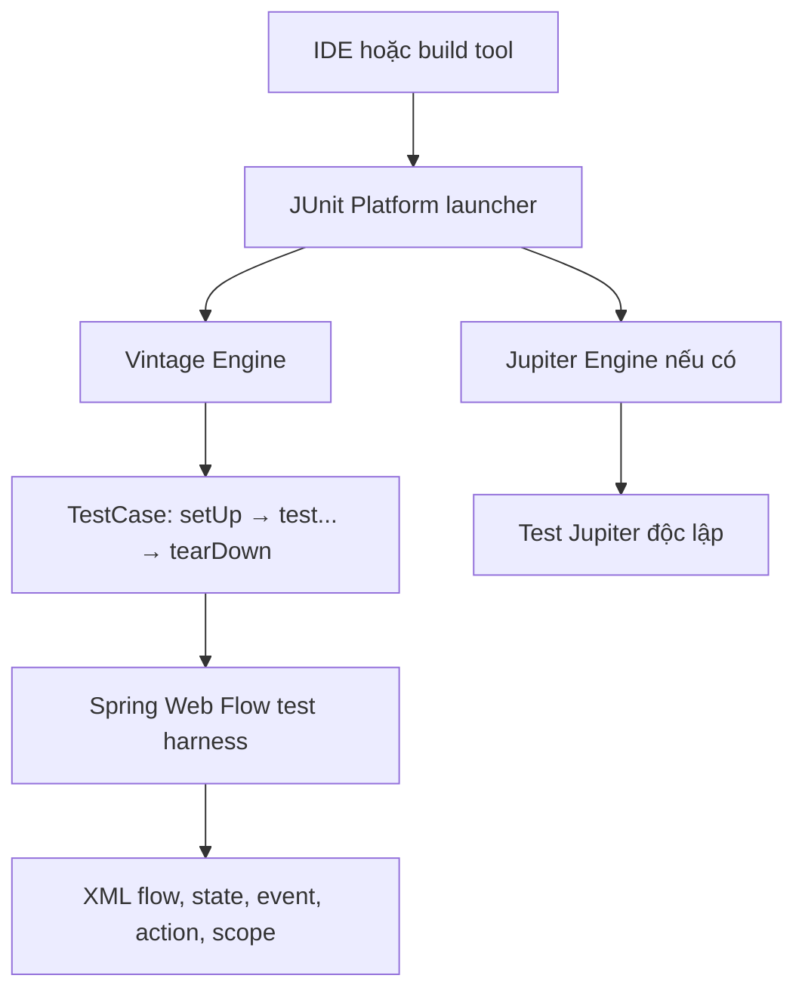

# Chạy kiểm thử kế thừa TestCase qua JUnit Platform với engine tương thích

## 1. Vì sao đổi bộ chạy có thể làm test flow biến mất?

Một dự án Spring Web Flow có thể có các lớp kiểm thử kế thừa `AbstractXmlFlowExecutionTests` từ nhiều năm trước. Khi cấu hình build chuyển sang JUnit Platform để chạy test mới, những lớp này vẫn biên dịch nhưng không còn xuất hiện trong báo cáo. Nếu chỉ nhìn dòng build thành công, nhóm phát triển có thể tưởng các transition quan trọng vẫn được bảo vệ.

Điểm cần hiểu là **JUnit Platform không đồng nghĩa với JUnit Jupiter**. Platform điều phối việc phát hiện và thực thi; engine hiểu mô hình test cụ thể. Với lớp kế thừa `junit.framework.TestCase`, engine tương thích trong cấu hình của bài là **JUnit Vintage**.

Bài này thuộc chương **Kiểm thử flow** của module **SPRING_WEB_FLOW**. Mục tiêu là giữ các kiểm thử điều hướng state/event đang có, đưa chúng vào cùng quy trình chạy với test mới và chứng minh chúng thực sự được thực thi. Việc này giúp tiếp tục kiểm tra các hành trình web nhiều bước mà chưa phải viết lại toàn bộ test harness.

### Phạm vi phiên bản của ví dụ

Ví dụ minh họa API test của **Spring Web Flow 3.0.1**, dùng JDK 17, **JUnit 5.10.3 BOM**, `junit:junit:4.13.2` và **Maven Surefire 3.2.5**. Nhánh Gradle dùng cú pháp Groovy của Gradle 8.x. Đây là một bộ mốc cụ thể để giải thích cơ chế, không phải khẳng định các phiên bản này là mới nhất hoặc yêu cầu hạ phiên bản dự án hiện có.

Các đoạn build bổ sung vào một dự án đã có dependency Spring Web Flow phù hợp. Nếu dự án dùng Spring Boot BOM hoặc nền tảng quản lý dependency khác, cần chọn một nơi sở hữu phiên bản JUnit và kiểm tra cây dependency thực tế trước khi áp dụng.

## 2. Chuỗi kế thừa quyết định mô hình test

Trong Spring Web Flow 3.0.1, chuỗi lớp cơ sở là:

```text
BookingFlowTests
  → AbstractXmlFlowExecutionTests
  → AbstractExternalizedFlowExecutionTests
  → AbstractFlowExecutionTests
  → junit.framework.TestCase
```

Mã nguồn [AbstractFlowExecutionTests 3.0.1](https://raw.githubusercontent.com/spring-projects/spring-webflow/v3.0.1/spring-webflow/src/main/java/org/springframework/webflow/test/execution/AbstractFlowExecutionTests.java) xác nhận lớp này kế thừa `TestCase` và cung cấp các helper như `startFlow`, `resumeFlow`, `assertCurrentStateEquals` và `assertFlowExecutionEnded`.

Do đó, một test như sau mang mô hình JUnit 3 dù file nguồn nằm trong dự án có nhiều dependency JUnit 5:

```java
public void testStartsAtChooseRoom() {
    startFlow(new MockExternalContext());
    assertCurrentStateEquals("chooseRoom");
}
```

Từ khóa cần chú ý là `public`, kiểu trả về `void`, tên bắt đầu bằng `test` và không có tham số. Thêm dependency Jupiter không tự biến phương thức này thành Jupiter test.

| Thành phần | Trách nhiệm | Có tự chạy TestCase không? |
| --- | --- | --- |
| `junit:junit:4.13.2` | Cung cấp API JUnit 4 và API tương thích `junit.framework` | Chưa đủ để Platform có engine |
| `junit-platform-launcher` | API khởi chạy và nhận kết quả trên Platform | Không sở hữu mô hình test |
| `junit-jupiter-api` | Annotation và API để viết Jupiter test | Không phải engine Vintage |
| `junit-jupiter-engine` | Phát hiện và chạy Jupiter test | Không chạy test JUnit 3 theo quy ước tên |
| `junit-vintage-engine` | Phát hiện và chạy test theo mô hình JUnit 3/4 | Có, với dependency tương thích |

Theo [JUnit 5.10.3 User Guide](https://docs.junit.org/5.10.3/user-guide/index.html#overview-what-is-junit-5), Vintage hỗ trợ test JUnit 3/4 trên Platform và yêu cầu JUnit 4.12 trở lên trên classpath hoặc module path. Việc chọn `junit:junit:4.13.2` vẫn cho phép sử dụng `junit.framework.TestCase`; không cần thêm riêng `junit:3.8.2`.

## 3. Phân biệt đường chạy và đường thực thi flow



Engine giải quyết việc tìm và gọi test. Spring Web Flow test harness giải quyết việc dựng và chạy flow. Đây là hai lớp chẩn đoán khác nhau:

- Nếu không tìm thấy test, kiểm tra engine, classpath, bộ lọc và hình thức lớp/phương thức.
- Nếu đã vào phương thức test nhưng lỗi khi `startFlow`, kiểm tra XML, bean, expression hoặc cấu hình flow.
- Nếu flow chạy nhưng assertion sai, kiểm tra trạng thái, outcome và hợp đồng hành vi mong đợi.

Thêm Vintage không tự cấu hình Spring MVC, conversion service hoặc validation như môi trường production. Một test dùng mock view cũng không chứng minh template HTML render chính xác.

## 4. Cấu hình Maven để Platform có Vintage

### 4.1. Dependency phục vụ test

Trong `pom.xml` của module chứa test, bổ sung hoặc hợp nhất các phần sau vào cấu hình sẵn có:

```xml
<properties>
    <junit.version>5.10.3</junit.version>
</properties>

<dependencyManagement>
    <dependencies>
        <dependency>
            <groupId>org.junit</groupId>
            <artifactId>junit-bom</artifactId>
            <version>${junit.version}</version>
            <type>pom</type>
            <scope>import</scope>
        </dependency>
    </dependencies>
</dependencyManagement>

<dependencies>
    <!-- Giữ dependency Spring Web Flow của ứng dụng hiện có. -->
    <dependency>
        <groupId>junit</groupId>
        <artifactId>junit</artifactId>
        <version>4.13.2</version>
        <scope>test</scope>
    </dependency>

    <dependency>
        <groupId>org.junit.vintage</groupId>
        <artifactId>junit-vintage-engine</artifactId>
        <scope>test</scope>
    </dependency>
</dependencies>
```

Đặt `junit` ở test scope để mã test có thể biên dịch các lớp cơ sở kế thừa `TestCase`. Vintage cần có ở runtime của test. BOM điều phối phiên bản các artifact JUnit cùng hệ; BOM không tự kéo bất kỳ engine nào vào classpath.

Khi muốn chạy thêm test Jupiter trong cùng module, thêm dependency sau vào `dependencies`:

```xml
<dependency>
    <groupId>org.junit.jupiter</groupId>
    <artifactId>junit-jupiter</artifactId>
    <scope>test</scope>
</dependency>
```

Không cần thêm Jupiter chỉ để các test `TestCase` hoạt động. Dependency này phục vụ các test viết theo mô hình Jupiter riêng.

### 4.2. Cấu hình Surefire

```xml
<build>
    <plugins>
        <plugin>
            <groupId>org.apache.maven.plugins</groupId>
            <artifactId>maven-surefire-plugin</artifactId>
            <version>3.2.5</version>
            <configuration>
                <failIfNoTests>true</failIfNoTests>
            </configuration>
        </plugin>
    </plugins>
</build>
```

Tài liệu [Surefire 3.2.5 với JUnit Platform](https://maven.apache.org/surefire-archives/surefire-3.2.5/maven-surefire-plugin/examples/junit-platform.html) mô tả việc cung cấp Vintage để chạy test JUnit 3/4 trên Platform. Ví dụ ở đây đặt engine trong dependency của module; không thêm đồng thời một bản engine khác vào dependency của plugin nếu không có nhu cầu riêng.

Với dự án đã quản lý Surefire ở parent, hãy sửa đúng nơi sở hữu cấu hình hoặc kiểm tra effective POM. Đừng tạo nhiều cấu hình plugin mâu thuẫn chỉ để có cùng chuỗi XML.

`failIfNoTests` giúp phát hiện trường hợp toàn bộ lượt chạy không có test. Nó không chứng minh nhóm legacy đã chạy nếu module vẫn có các test Jupiter. Vì vậy còn cần chạy chọn riêng lớp legacy và kiểm tra báo cáo.

### 4.3. Chạy chọn lớp trước, chạy module sau

Ví dụ lệnh PowerShell tại thư mục module Maven:

```powershell
.\mvnw.cmd '-Dtest=example.flow.BookingFlowTests' test
.\mvnw.cmd test
```

Nếu dự án không có Maven Wrapper, dùng lệnh Maven tương ứng đã được cài trong môi trường. Đối với build nhiều module, chọn đúng module chứa test; không suy ra test đã được chạy chỉ từ kết quả của module tổng hợp.

Với lớp tên `BookingFlowTests`, hậu tố `Tests` nằm trong mẫu tên mặc định của Surefire 3.2.5. Tên như `BookingFlowSpec` cần cấu hình include thích hợp. Các mẫu mặc định được liệt kê trong [Surefire: Inclusions and Exclusions](https://maven.apache.org/surefire-archives/surefire-3.2.5/maven-surefire-plugin/examples/inclusion-exclusion.html).

## 5. Cấu hình Gradle tương đương

Đây là phần bổ sung trong `build.gradle` Groovy của module đã áp dụng Java plugin và có Spring Web Flow:

```groovy
dependencies {
    testImplementation platform('org.junit:junit-bom:5.10.3')
    testImplementation 'junit:junit:4.13.2'
    testRuntimeOnly 'org.junit.vintage:junit-vintage-engine'
    testRuntimeOnly 'org.junit.platform:junit-platform-launcher'

    // Chỉ thêm nếu module có test Jupiter:
    // testImplementation 'org.junit.jupiter:junit-jupiter'
}

tasks.withType(Test).configureEach {
    useJUnitPlatform()

    testLogging {
        events 'passed', 'failed', 'skipped'
    }
}
```

Hai điều kiện phải cùng tồn tại: task chọn JUnit Platform, và runtime có engine phù hợp. `testRuntimeOnly` dành cho engine đủ để chạy nhưng không đưa API engine vào mã nguồn test. Khai báo launcher tường minh cũng giúp runtime test không phụ thuộc ngầm vào thư viện do công cụ cung cấp. Tham khảo [Gradle: Testing in Java & JVM projects](https://docs.gradle.org/current/userguide/java_testing.html).

Lệnh minh họa tại thư mục có wrapper:

```powershell
.\gradlew.bat test --tests 'example.flow.BookingFlowTests' --rerun-tasks
.\gradlew.bat test
```

`--rerun-tasks` hữu ích khi xác minh lần đầu để tránh đọc kết quả của task đang up-to-date; không cần dùng cho mọi lần chạy thông thường.

Nếu cấu hình hiện tại có:

```groovy
useJUnitPlatform {
    includeEngines 'junit-jupiter'
}
```

thì việc thêm Vintage vào dependency vẫn chưa đủ, vì bộ lọc đã loại nó. Với lượt chạy hỗn hợp, bỏ giới hạn đó hoặc cho phép cả `junit-jupiter` và `junit-vintage`. Với một task chuyên chạy legacy, có thể chỉ cho phép `junit-vintage`.

## 6. Một flow nhỏ để kiểm tra đường chạy thật

Để phân biệt lỗi engine với lỗi nghiệp vụ, bắt đầu bằng flow nhỏ có hai màn hình và hai outcome. Cấu trúc tài nguyên giả định của ví dụ:

```text
src/main/resources/flows/booking/booking-flow.xml
src/test/java/example/flow/BookingFlowTests.java
```

Nội dung `booking-flow.xml`:

```xml
<flow xmlns="http://www.springframework.org/schema/webflow"
      xmlns:xsi="http://www.w3.org/2001/XMLSchema-instance"
      xsi:schemaLocation="
        http://www.springframework.org/schema/webflow
        https://www.springframework.org/schema/webflow/spring-webflow.xsd">

    <view-state id="chooseRoom">
        <transition on="next" to="review"/>
        <transition on="cancel" to="cancelled"/>
    </view-state>

    <view-state id="review">
        <transition on="confirm" to="reserve"/>
        <transition on="back" to="chooseRoom"/>
    </view-state>

    <action-state id="reserve">
        <evaluate expression="bookingService.reserve()"/>
        <transition on="success" to="completed"/>
        <transition on="unavailable" to="review"/>
    </action-state>

    <end-state id="completed"/>
    <end-state id="cancelled"/>
</flow>
```

Trong ứng dụng thật, service thường nhận model đặt phòng và principal hoặc định danh từ máy chủ. Ví dụ không đưa form binding vào để tập trung vào engine, việc gửi event và kết quả điều hướng.

Flow XML này có thể được dựng trong test bằng mock view; nó chưa cung cấp template `chooseRoom` hoặc `review` cho trình duyệt. Không triển khai nguyên ví dụ như một tính năng web hoàn chỉnh.

## 7. Viết test đúng quy ước TestCase

Lớp sau có **bốn phương thức test**, mỗi phương thức bắt đầu một flow execution độc lập:

```java
package example.flow;

import org.springframework.webflow.config.FlowDefinitionResource;
import org.springframework.webflow.config.FlowDefinitionResourceFactory;
import org.springframework.webflow.test.MockExternalContext;
import org.springframework.webflow.test.MockFlowBuilderContext;
import org.springframework.webflow.test.execution.AbstractXmlFlowExecutionTests;

public class BookingFlowTests extends AbstractXmlFlowExecutionTests {
    private BookingServiceStub bookingService;

    @Override
    protected void setUp() throws Exception {
        super.setUp();
        bookingService = new BookingServiceStub();
        setCacheFlowDefinition(false);
    }

    @Override
    protected FlowDefinitionResource getResource(
            FlowDefinitionResourceFactory resourceFactory) {
        return resourceFactory.createClassPathResource(
                "/flows/booking/booking-flow.xml", getClass());
    }

    @Override
    protected void configureFlowBuilderContext(
            MockFlowBuilderContext builderContext) {
        builderContext.registerBean("bookingService", bookingService);
    }

    public void testStartsAtChooseRoom() {
        startFlow(new MockExternalContext());

        assertCurrentStateEquals("chooseRoom");
        assertEquals(0, bookingService.calls);
    }

    public void testCancelEndsWithoutReservation() {
        startFlow(new MockExternalContext());
        sendEvent("cancel");

        assertFlowExecutionEnded();
        assertFlowExecutionOutcomeEquals("cancelled");
        assertEquals(0, bookingService.calls);
    }

    public void testConfirmCompletesReservation() {
        startFlow(new MockExternalContext());
        sendEvent("next");
        assertCurrentStateEquals("review");
        assertEquals(0, bookingService.calls);

        sendEvent("confirm");

        assertFlowExecutionEnded();
        assertFlowExecutionOutcomeEquals("completed");
        assertEquals(1, bookingService.calls);
    }

    public void testUnavailableCanBeRetried() {
        bookingService.available = false;
        startFlow(new MockExternalContext());
        sendEvent("next");
        sendEvent("confirm");

        assertCurrentStateEquals("review");
        assertFalse(getFlowExecution().hasEnded());
        assertEquals(1, bookingService.calls);

        bookingService.available = true;
        sendEvent("confirm");

        assertFlowExecutionEnded();
        assertFlowExecutionOutcomeEquals("completed");
        assertEquals(2, bookingService.calls);
    }

    private void sendEvent(String eventId) {
        MockExternalContext context = new MockExternalContext();
        context.setEventId(eventId);
        resumeFlow(context);
    }

    public static class BookingServiceStub {
        private boolean available = true;
        private int calls;

        public String reserve() {
            calls++;
            return available ? "success" : "unavailable";
        }
    }
}
```

`getResource` trỏ đến tài nguyên classpath; dấu `/` đầu đường dẫn giúp tài nguyên được tìm từ gốc classpath thay vì tương đối theo package `example.flow`. Cách khai báo resource và cơ chế mở rộng lớp test được minh họa trong mã nguồn [AbstractXmlFlowExecutionTests 3.0.1](https://raw.githubusercontent.com/spring-projects/spring-webflow/v3.0.1/spring-webflow/src/main/java/org/springframework/webflow/test/execution/AbstractXmlFlowExecutionTests.java).

`configureFlowBuilderContext` đưa stub vào đúng bean name mà XML gọi. [MockFlowBuilderContext](https://raw.githubusercontent.com/spring-projects/spring-webflow/v3.0.1/spring-webflow/src/main/java/org/springframework/webflow/test/MockFlowBuilderContext.java) hỗ trợ đăng ký bean và subflow cho môi trường kiểm thử. Không cần dựng toàn bộ web application context chỉ để một service stub được tìm thấy.

Mỗi lần `sendEvent` tạo context mới, tương ứng một lần tương tác mới. `setEventId` chuẩn bị event cho mock view khi resume, như được mô tả trong [MockExternalContext](https://raw.githubusercontent.com/spring-projects/spring-webflow/v3.0.1/spring-webflow/src/main/java/org/springframework/webflow/test/MockExternalContext.java). Nó không gửi HTTP request thật và không kiểm tra execution key của repository production.

### Vì sao tắt cache trong ví dụ?

Stub mang trạng thái và được tạo lại cho từng test. Ta tắt cache flow definition để flow vừa dựng dùng đúng stub của fixture hiện tại. Lớp cơ sở có cơ chế cache và mặc định không bật; lời gọi tường minh giúp ý định của ví dụ rõ ràng. Nếu bật cache để tăng tốc, phải kiểm tra vòng đời dependency được giữ trong definition. Xem [AbstractExternalizedFlowExecutionTests 3.0.1](https://raw.githubusercontent.com/spring-projects/spring-webflow/v3.0.1/spring-webflow/src/main/java/org/springframework/webflow/test/execution/AbstractExternalizedFlowExecutionTests.java).

Không dùng stub `static` dùng chung chỉ để né vấn đề vòng đời. Điều đó dễ làm kết quả phụ thuộc thứ tự chạy và gây xung đột khi bật thực thi song song.

### Các assertion bảo vệ điều gì?

| Test | Điều kiện được bảo vệ |
| --- | --- |
| `testStartsAtChooseRoom` | Flow bắt đầu ở màn chọn phòng; chưa đặt chỗ |
| `testCancelEndsWithoutReservation` | Nhánh hủy kết thúc với outcome đúng và không gọi lưu |
| `testConfirmCompletesReservation` | Phải đi qua review; chỉ confirm mới gọi reserve |
| `testUnavailableCanBeRetried` | Hết chỗ quay lại review; lần thử lại có thể kết thúc thành công |

Đây là kiểm tra orchestration của flow, không chứng minh service đặt phòng xử lý đúng tranh chấp giao dịch hoặc chống tạo trùng. Stub chỉ mô phỏng kết quả của service theo hợp đồng mà flow cần.

## 8. Giữ lifecycle của TestCase nhất quán

### 8.1. setUp và tearDown vẫn là hook của lớp cơ sở

Với `TestCase`, fixture được chuẩn bị qua `setUp()` và dọn qua `tearDown()`. Nếu override, hãy dùng `@Override` để trình biên dịch kiểm tra chữ ký và gọi superclass theo hợp đồng của hệ thống kế thừa. Mã nguồn [TestCase của JUnit 4.13.2](https://raw.githubusercontent.com/junit-team/junit4/r4.13.2/src/main/java/junit/framework/TestCase.java) thể hiện đường gọi `setUp`, phương thức test và `tearDown`.

Đây là mẫu dọn tài nguyên nếu test thực sự mở tài nguyên riêng:

```java
@Override
protected void tearDown() throws Exception {
    try {
        // Đóng tài nguyên do fixture của lớp này đã mở, nếu có.
    } finally {
        super.tearDown();
    }
}
```

Ví dụ flow ở trên không mở tài nguyên bên ngoài nên không cần thêm một `tearDown` rỗng. Với fixture phức tạp, cũng cần xử lý trường hợp khởi tạo thất bại giữa chừng; đừng giả định mọi tài nguyên luôn được mở thành công.

Các annotation `@BeforeEach`, `@AfterEach` hoặc `@ExtendWith(MockitoExtension.class)` thuộc mô hình Jupiter. Vintage không áp dụng các Jupiter extension đó cho lượt chạy legacy. Nếu một mock được khởi tạo bằng Jupiter extension trong lớp `TestCase`, test có thể nhận `null` dù tên test đã được phát hiện đúng.

### 8.2. Quy tắc phát hiện phương thức vẫn quan trọng

Với kiểu phát hiện thông thường của `TestCase`, lớp phải public và có constructor public thích hợp; phương thức test là public, không tham số, trả về void và bắt đầu bằng `test`. Không thêm constructor cần dependency như cách một Jupiter extension có thể hỗ trợ.

Ví dụ sau không phải phương thức test legacy hợp lệ theo quy ước tên:

```java
// Trong một lớp TestCase, tên này không được tự nhận diện như test...()
public void startsAtChooseRoom() {
    // ...
}
```

Đổi tên thành `testStartsAtChooseRoom`, hoặc viết một lớp Jupiter độc lập với harness thích hợp. Cách `TestSuite` thu thập các phương thức được thể hiện trong [TestSuite của JUnit 4.13.2](https://raw.githubusercontent.com/junit-team/junit4/r4.13.2/src/main/java/junit/framework/TestSuite.java).

### 8.3. Tránh một lớp có hai mô hình test

Không thêm `org.junit.jupiter.api.Test` lên các phương thức `test...` của lớp flow legacy chỉ để chúng xuất hiện trong IDE. Khi cả hai engine cùng hiện diện, cách trộn này có thể làm cùng logic được phát hiện bởi nhiều engine và nhận lifecycle khác nhau. Báo cáo tăng số test không có nghĩa độ bao phủ hành vi tăng.

Tương tự, `@RunWith` và `@ExtendWith` không phải hai tên cho cùng một cơ chế. Chỉ thêm runner hoặc extension khi test thực sự thuộc mô hình đó và cấu hình của nó yêu cầu. Chạy `TestCase` bằng Vintage không đòi hỏi `@RunWith(JUnitPlatform.class)`.

Trong các test legacy, assertion được kế thừa từ `TestCase`. Nếu gọi thêm assertion của thư viện khác, điều đó không quyết định engine sẽ chạy test. Hãy phân biệt thư viện assertion với cơ chế discovery/lifecycle.

## 9. Cho test cũ và test Jupiter cùng tồn tại

Một module có thể giữ `BookingFlowTests` dưới Vintage và bổ sung test Jupiter trong lớp khác. Ví dụ nhỏ sau chỉ dùng để quan sát hai mô hình cùng xuất hiện trong báo cáo; nó không thay cho kiểm thử nghiệp vụ:

```java
package example.flow;

import org.junit.jupiter.api.Test;
import static org.junit.jupiter.api.Assertions.assertNotNull;

class BookingResourceJupiterTest {
    @Test
    void flowDefinitionIsOnClasspath() {
        assertNotNull(getClass().getResource(
                "/flows/booking/booking-flow.xml"));
    }
}
```

Để chạy lớp này, cần dependency Jupiter đã nêu trong phần cấu hình. Với đúng hai lớp của ví dụ và không có test khác, kết quả mong đợi là bốn test flow legacy cộng một test Jupiter. Trong dự án thực tế, so sánh riêng danh sách của hai lớp thay vì áp tổng số năm cho toàn module.

Trong thời gian chuyển đổi, nên giữ ranh giới rõ:

- Test kế thừa harness `TestCase`: quy ước `test...`, fixture `setUp`/`tearDown`, chạy qua Vintage.
- Test Jupiter độc lập: `@Test`, fixture và extension Jupiter, chạy qua Jupiter Engine.
- Phần dữ liệu hoặc helper dùng chung: Java thuần khi có thể, tránh phụ thuộc ngược vào lifecycle của một engine.

Không chạy toàn bộ `TestCase` bằng một Jupiter `@Test` chỉ gọi lần lượt các method. Cách đó có thể làm báo cáo chỉ có một test, bỏ qua fixture riêng của từng ca và khiến lỗi của ca đầu ngăn các ca sau được thực hiện.

## 10. Chứng minh test đã chạy trên đường Platform

Một bằng chứng tốt gồm ba phần: công cụ dùng Platform, runtime có Vintage và các test legacy xuất hiện với kết quả cụ thể.

### 10.1. Kiểm tra cấu hình đã được giải quyết

Với Maven, xem log của lượt chạy chọn `BookingFlowTests`; trong cấu hình Surefire của bài, provider được dùng cần là `org.apache.maven.surefire.junitplatform.JUnitPlatformProvider`. Nếu log chỉ ra provider JUnit 3/4 cũ, việc test chạy thành công chưa chứng minh nó đã đi qua Platform.

Có thể kiểm tra dependency và cấu hình hiệu lực bằng các lệnh sau:

```powershell
.\mvnw.cmd dependency:tree '-Dscope=test'
.\mvnw.cmd help:effective-pom
```

Đối với Gradle, kiểm tra runtime của source set chứa test:

```powershell
.\gradlew.bat dependencies --configuration testRuntimeClasspath
.\gradlew.bat dependencyInsight --dependency junit-vintage-engine --configuration testRuntimeClasspath
```

Cần thấy `junit-vintage-engine`, `junit:junit:4.13.2` và các artifact Platform được giải quyết nhất quán. Với BOM 5.10.3, nhóm Platform dùng dòng phiên bản 1.10.3; không ép mọi artifact mang số 5.10.3 chỉ vì chúng cùng thuộc hệ sinh thái JUnit 5.

Nếu dùng source set riêng như `flowTest`, kiểm tra configuration và task tương ứng; `testRuntimeClasspath` của source set mặc định không phản ánh mọi task tùy chỉnh.

### 10.2. Kiểm tra báo cáo ở mức lớp và phương thức

Với cấu hình mặc định, Maven ghi báo cáo dưới `target/surefire-reports`; Gradle ghi kết quả XML dưới `build/test-results/test` và báo cáo HTML dưới `build/reports/tests/test`.

Đối chiếu tối thiểu:

1. Có lớp `example.flow.BookingFlowTests` trong kết quả mới tạo.
2. Có đủ bốn tên phương thức `test...` của ví dụ.
3. Số failure/error/skipped đúng với tình huống đang kiểm chứng.
4. Báo cáo thuộc lượt chạy hiện tại, không phải file còn lại từ lần chạy trước.

Khi IDE hiển thị cây theo engine, lớp legacy nên xuất hiện dưới Vintage. Nếu IDE không hiện tên engine, vẫn có thể đối chiếu lệnh build, runtime classpath và lượt chạy chọn riêng lớp.

### 10.3. Dùng một lỗi có chủ đích để kiểm tra đường báo lỗi

Trong nhánh thực hành, tạm đổi assertion của `testStartsAtChooseRoom` thành một state chắc chắn sai:

```java
assertCurrentStateEquals("stateDoesNotExist");
```

Chạy chọn riêng lớp. Kết quả phải thất bại và chỉ đúng assertion vừa đổi. Sau đó khôi phục `chooseRoom` và chạy lại để kết quả trở về thành công.

Nếu lượt chạy vẫn thành công trong khi assertion sai, chưa thể tin cấu hình: test có thể bị bỏ qua, đang chạy lớp khác hoặc báo cáo chưa được cập nhật. Bài thực hành này kiểm tra cơ chế báo lỗi, không phải một thay đổi để giữ lại trong bộ test.

### 10.4. Chạy riêng legacy khi cần phát hiện bỏ sót

Một task Gradle chuyên legacy có thể giới hạn `includeEngines 'junit-vintage'` và chỉ chọn nhóm lớp legacy. Khi cấu hình task riêng, phải nối đúng test classes và runtime classpath của source set; chỉ đặt tên task chưa đủ.

Với Surefire 3.2.5, có thể áp dụng bộ lọc engine trong một profile dành riêng cho lượt kiểm tra legacy:

```xml
<configuration>
    <includeJUnit5Engines>
        <engine>junit-vintage</engine>
    </includeJUnit5Engines>
    <failIfNoTests>true</failIfNoTests>
</configuration>
```

Đây là phần cấu hình hợp nhất vào plugin của profile, không phải lý do thay lượt chạy chung bằng Vintage-only. Nếu đặt nó cho toàn module, các test Jupiter sẽ bị loại. Luôn chạy chọn riêng lớp quan trọng khi xác minh việc chuyển đổi; một task còn các test khác vẫn có thể thành công dù mất một nhóm test.

## 11. Chẩn đoán từ giai đoạn lỗi

| Hiện tượng | Giai đoạn đáng kiểm tra | Hướng xử lý |
| --- | --- | --- |
| Không biên dịch được vì thiếu `junit.framework.TestCase` | Compile classpath của test | Bổ sung `junit:junit` ở test scope/configuration phù hợp |
| Chỉ test Jupiter xuất hiện | Engine hoặc bộ lọc | Kiểm tra Vintage trên runtime và `includeEngines`/`excludeEngines` |
| Báo không có TestEngine | Runtime của Platform | Bổ sung engine thực hiện mô hình cần chạy; launcher đơn lẻ chưa đủ |
| Vintage không khởi tạo được vì phiên bản JUnit | Dependency bị thay thế | Kiểm tra JUnit 4.13.2 đã giải quyết; loại xung đột với JUnit 3.x |
| `NoSuchMethodError` trong package Platform | Artifact lệch phiên bản | Kiểm tra BOM, dependency bị ép phiên bản và classpath của IDE |
| `No tests found` cho một lớp | Selector hoặc hình thức test | Kiểm tra tên đầy đủ, lớp public và method `public void test...()` |
| `No tests found in ...` dưới nhánh legacy | Quy ước TestCase | Không dùng tên method Jupiter trong lớp chỉ chạy bằng Vintage |
| Mock là null dù test có chạy | Fixture/lifecycle | Chuyển khởi tạo cần thiết về hook legacy, không trông đợi Jupiter extension |
| Lỗi không tìm thấy XML khi `startFlow` | Resource lookup | Kiểm tra đường dẫn classpath và tài nguyên đã được đưa vào runtime |
| Lỗi không tìm thấy `bookingService` | Dựng flow/context | Kiểm tra `configureFlowBuilderContext` và bean name |
| Action reserve chạy nhưng không có transition khớp | Hợp đồng event | Kiểm tra chuỗi `success`/`unavailable` do service trả về |
| Một logic test xuất hiện hai lần | Trộn mô hình hoặc suite | Kiểm tra Jupiter annotation trong lớp TestCase và việc chọn đồng thời suite/lớp con |
| Test riêng thành công, cả bộ thất bại | Cô lập fixture | Tìm stub static, cache definition giữ dependency cũ và dữ liệu dùng chung |

Không giải quyết lỗi engine bằng cách sửa transition đang đúng. Ngược lại, khi stack trace đã vào `startFlow` và báo bean không tồn tại, tiếp tục thêm engine sẽ không sửa được nguyên nhân đó.

Trong IDE, reimport cấu hình build rồi chạy lại bằng cùng task với CI nếu có thể. Một IDE từng tự cung cấp JUnit runner không chứng minh runtime của build server cũng có cùng dependency.

## 12. Giới hạn kiểm thử và lộ trình chuyển dần

### 12.1. Những gì ví dụ chưa xác minh

Ví dụ dùng mock context và service stub. Nó chưa kiểm tra form binding, conversion lỗi, Bean Validation theo nhóm, Spring MVC handler adapter, template, CSRF, lưu snapshot trong phiên hay phục hồi execution key hết hạn. Từng khả năng cần test tại ranh giới phù hợp.

Nếu flow có subflow, có thể đăng ký subflow stub để kiểm tra input/output và outcome ở flow cha, rồi kiểm thử riêng flow con. Nếu XML có kế thừa flow model, dùng hook model resource phù hợp của harness để cung cấp model cha. Đưa Vintage vào classpath không tự cung cấp những dependency này.

Đối với phục hồi lỗi, phân biệt hai mức:

- Outcome nghiệp vụ dự kiến: ví dụ `unavailable` đưa người dùng về review, như test đã minh họa.
- Exception và lỗi hạ tầng: cần kịch bản riêng theo exception handler, transaction và chính sách bắt đầu lại của ứng dụng.

Không dùng ca `unavailable` để kết luận flow đã xử lý mọi exception hoặc đã giữ được dữ liệu sau khi phiên mất.

### 12.2. Di chuyển sang Jupiter theo từng lớp

Vintage có thể giữ đường chạy ổn định trong thời gian chuyển đổi. Khi muốn chuyển một test flow sang Jupiter, hãy xác định trước harness hoặc cách composition tương thích với phiên bản Web Flow đang dùng. Chỉ đổi import và thêm `@Test` mà vẫn kế thừa `TestCase` không phải một lần chuyển đổi hoàn chỉnh.

Một trình tự thực tế:

1. Ghi nhận danh sách test legacy và hành vi state/outcome đang được bảo vệ.
2. Cho chúng chạy ổn định qua Platform và Vintage; xác nhận đường báo lỗi.
3. Chọn một lớp để chuyển cùng lifecycle, cách tạo dependency và assertion phù hợp.
4. Đối chiếu hành vi cũ/mới, đặc biệt nhánh hủy, back, lỗi và thử lại.
5. Loại bỏ bản legacy tương ứng để tránh chạy trùng cùng kịch bản vô tình.
6. Chỉ bỏ Vintage khỏi module khi không còn test hoặc suite nào phụ thuộc mô hình legacy.

Không lấy số test lớn hơn làm mục tiêu duy nhất. Một ca kiểm tra đúng outcome và số lần gọi service có thể bảo vệ hành vi rõ hơn nhiều ca chỉ gọi `startFlow` rồi không kiểm tra kết quả.

## 13. Bài thực hành

Các bước dưới đây là hướng dẫn để người học chạy trong dự án thực hành; tài liệu này không tuyên bố các lệnh build đã được chạy tại thời điểm biên soạn.

| Bước | Thao tác | Dấu hiệu cần quan sát |
| --- | --- | --- |
| 1 | Tạo flow và lớp `BookingFlowTests` trong dự án thực hành | XML ở classpath; test biên dịch |
| 2 | Thêm Vintage và chọn JUnit Platform | Cả bốn phương thức legacy được phát hiện |
| 3 | Chạy chọn riêng lớp legacy | Kết quả có đúng bốn test của lớp |
| 4 | Đổi tạm một assertion sang state sai | Build thất bại và chỉ đúng phương thức |
| 5 | Khôi phục assertion và chạy lại | Kết quả trở về thành công |
| 6 | Thêm lớp Jupiter minh họa và dependency của nó | Hai lớp chạy cùng lượt; riêng ví dụ có tổng năm test |
| 7 | Tạm giới hạn engine về Jupiter trong nhánh thực hành | Nhận ra lớp legacy bị loại qua danh sách kết quả |
| 8 | Khôi phục cấu hình hỗn hợp và chạy toàn module | Danh sách test legacy và Jupiter đều đầy đủ |
| 9 | Bổ sung test sự kiện back từ review | Quay về `chooseRoom`, chưa gọi reserve |
| 10 | Thử chạy từ IDE và từ build tool | Cùng lớp và phương thức quan trọng được thực thi |

Khi hoàn tất, người học cần giải thích được vì sao `junit:junit:4.13.2` vẫn chạy test theo kiểu JUnit 3; vì sao BOM hoặc `useJUnitPlatform()` đơn lẻ chưa đủ; và vì sao build xanh vẫn phải được đối chiếu với danh sách test. Đây là nền tảng để giữ độ tin cậy của các kiểm thử flow khi thay đổi công cụ chạy hoặc chuyển dần sang mô hình test mới.
