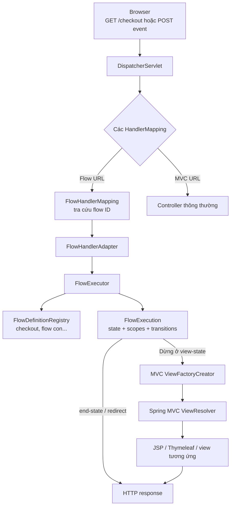

# Kiểm tra FlowHandlerMapping, adapter và ViewResolver

**Spring Web Flow** giúp mô hình hóa hành trình web nhiều bước qua **state, event, transition và subflow**. Khi tích hợp với Spring MVC, một đường dẫn như `/checkout` có thể bắt đầu flow; request tiếp theo gửi event `next`, `back` hoặc `confirm` để tiếp tục execution đang có. Trong flow, các màn hình nhập liệu thực hiện **form binding và validation**, còn `action-state` xử lý nghiệp vụ và chọn nhánh theo event; dữ liệu tồn tại qua những request khác nhau nhờ các scope và cơ chế lưu execution.

Các kiểm thử chỉ gọi trực tiếp `FlowExecutor` có thể xác minh state và transition nhưng chưa chứng minh **request HTTP thực sự được đưa đến Web Flow**, **adapter có khởi động/tiếp tục đúng execution** và **view được giải quyết bằng cấu hình của Spring MVC**. Đây là nội dung trung tâm của chương **Kiểm thử tích hợp**: **kiểm tra `FlowHandlerMapping`, `FlowHandlerAdapter` và `ViewResolver` như một chuỗi hoàn chỉnh**, từ URL đến màn hình kết quả.

## 1. Đường đi của request trong ứng dụng tích hợp

Trong cấu hình Spring MVC truyền thống, `DispatcherServlet` nhận request và hỏi các `HandlerMapping` xem thành phần nào xử lý URL. `FlowHandlerMapping` nhận diện URL của flow đã đăng ký, `FlowHandlerAdapter` điều phối với `FlowExecutor`, rồi Web Flow xử lý state/event và yêu cầu render view thông qua cơ chế tạo view thích hợp.



Các bước quan trọng cần hiểu:

1. **Mapping:** request `/checkout` được liên kết với flow `checkout`; URL khác vẫn có thể do MVC controller xử lý.
2. **Adapter:** Web Flow được thực thi qua `FlowExecutor`; adapter chọn đường khởi động hay tiếp tục execution theo request.
3. **Execution:** event và dữ liệu request làm flow đi qua các state; với `view-state`, binder và validator có thể chặn transition nếu input không hợp lệ.
4. **View resolution:** tên view mà flow yêu cầu được giải quyết thành view thật bằng các resolver đã cấu hình cho Web Flow.
5. **HTTP/session:** response, redirect, execution key và session giúp trình duyệt tiếp tục hành trình qua các request.

**Mỗi lớp có trách nhiệm riêng.** Mapping đúng chưa chứng minh binding đúng; `FlowExecutor` chạy đúng chưa chứng minh `ViewResolver` tìm được template; màn hình hiển thị đúng chưa đảm bảo request kế tiếp tiếp tục cùng execution.

## 2. Vai trò của ba thành phần cần kiểm tra

| Thành phần | Chức năng | Bằng chứng mong đợi trong test |
| --- | --- | --- |
| `FlowHandlerMapping` | Kết nối URL đến `FlowHandler` cho flow đã đăng ký | URL `/checkout` được xử lý bởi Web Flow; URL MVC không bị chiếm nhầm |
| `FlowHandlerAdapter` | Kết nối `FlowHandler` với `FlowExecutor`, xử lý launch/resume và response | Request đầu khởi động flow; request có execution key và event tiếp tục đúng state |
| `ViewResolver` thông qua `MvcViewFactoryCreator` | Biến view name trong flow thành Spring MVC `View` | `checkout/form` được giải quyết thành view/template cần thiết; lỗi view được nhận diện |

Ngoài ra, `FlowDefinitionRegistry` và `FlowExecutor` là phụ thuộc bắt buộc của đường xử lý. Một integration test thiếu registry thật, thiếu adapter hoặc thay toàn bộ engine bằng mock chỉ kiểm thử một phần của chuỗi.

### Vì sao nhiều handler mapping có thể gây lỗi?

Spring MVC có thể đồng thời chứa `RequestMappingHandlerMapping` cho `@Controller`, handler cho static resource và `FlowHandlerMapping`. Chúng được xét theo **thứ tự ưu tiên** (`order` hoặc cấu hình tương đương). Nếu `/checkout` vừa là endpoint controller vừa là flow ID, mapping có ưu tiên cao hơn có thể nhận request trước.

Vì vậy bài test cần kiểm tra **handler thực tế được chọn** thay vì chỉ mong HTTP trả 200. Response thành công có thể tới từ một controller khác, khiến flow chưa từng được khởi động.

## 3. Cấu hình tích hợp mẫu

Ví dụ dưới đây sử dụng cách cấu hình XML thường gặp của **Spring Web Flow 2.x**. Đây là mẫu tham khảo để hiểu các mối nối; tên namespace, phiên bản Spring MVC và kiểu view công nghệ của dự án thật cần tương thích với thư viện được triển khai.

```xml
<beans xmlns="http://www.springframework.org/schema/beans"
       xmlns:xsi="http://www.w3.org/2001/XMLSchema-instance"
       xmlns:webflow="http://www.springframework.org/schema/webflow-config"
       xsi:schemaLocation="
         http://www.springframework.org/schema/beans
         http://www.springframework.org/schema/beans/spring-beans.xsd
         http://www.springframework.org/schema/webflow-config
         http://www.springframework.org/schema/webflow-config/spring-webflow-config.xsd">

    <!-- Flow registry cung cấp định nghĩa cho engine. -->
    <webflow:flow-registry id="flowRegistry"
                           base-path="/WEB-INF/flows"
                           flow-builder-services="flowBuilderServices">
        <webflow:flow-location id="checkout"
                               path="checkout/checkout.xml" />
    </webflow:flow-registry>

    <webflow:flow-executor id="flowExecutor"
                           flow-registry="flowRegistry" />

    <!-- Cho phép Web Flow tạo view bằng cơ chế Spring MVC. -->
    <webflow:flow-builder-services id="flowBuilderServices"
                                   view-factory-creator="mvcViewFactoryCreator" />

    <bean id="mvcViewFactoryCreator"
          class="org.springframework.webflow.mvc.builder.MvcViewFactoryCreator">
        <property name="viewResolvers">
            <list>
                <ref bean="jspViewResolver" />
            </list>
        </property>
    </bean>

    <bean id="jspViewResolver"
          class="org.springframework.web.servlet.view.InternalResourceViewResolver">
        <property name="prefix" value="/WEB-INF/views/" />
        <property name="suffix" value=".jsp" />
    </bean>

    <!-- DispatcherServlet cần thấy hai bean tích hợp này. -->
    <bean class="org.springframework.webflow.mvc.servlet.FlowHandlerMapping">
        <property name="flowRegistry" ref="flowRegistry" />
        <property name="order" value="0" />
    </bean>

    <bean class="org.springframework.webflow.mvc.servlet.FlowHandlerAdapter">
        <property name="flowExecutor" ref="flowExecutor" />
    </bean>
</beans>
```

Ví dụ có một flow ID `checkout`, một MVC view resolver cho JSP và hai bean mapping/adapter. Trong hệ thống thật, có thể có các `ViewResolver` khác (Thymeleaf, Tiles, resource view...) và cấu hình khác về thứ tự mapping hoặc cách tạo view.

**Điều quan trọng về context:** `FlowHandlerMapping` và `FlowHandlerAdapter` phải được `DispatcherServlet` nhìn thấy trong `WebApplicationContext` mà nó sử dụng (hoặc thông qua quan hệ parent/child context được cấu hình đúng). Việc bean tồn tại ở một context khác chưa bảo đảm servlet hiện tại sẽ sử dụng nó.

### Những phần phải đồng bộ

| Liên kết cấu hình | Nếu sai sẽ xảy ra gì? |
| --- | --- |
| `FlowHandlerMapping.flowRegistry` → `flowRegistry` | Không nhận diện đúng URL flow |
| `FlowHandlerAdapter.flowExecutor` → `flowExecutor` | Handler được tìm thấy nhưng không thể chạy flow đúng |
| `FlowExecutor.flowRegistry` → `flowRegistry` | Không truy cập được định nghĩa đã đăng ký |
| `flowRegistry.flow-builder-services` → `flowBuilderServices` | Flow được build với tập service/view factory khác kỳ vọng |
| `flowBuilderServices.view-factory-creator` → `mvcViewFactoryCreator` | View resolution có thể không dùng resolver MVC dự kiến |
| `MvcViewFactoryCreator.viewResolvers` → danh sách resolver | Tên view không được giải quyết hoặc bị resolver khác chiếm |

Đừng “sửa” lỗi mapping bằng cách đổi tên view, hoặc sửa lỗi thiếu template bằng cách thay flow ID. Kiểm thử nên chỉ ra chính xác lớp đang sai.

## 4. Một flow nhỏ để kiểm tra từ URL đến view

Giả sử `checkout.xml` được đăng ký với ID `checkout`:

```xml
<?xml version="1.0" encoding="UTF-8"?>
<flow xmlns="http://www.springframework.org/schema/webflow"
      xmlns:xsi="http://www.w3.org/2001/XMLSchema-instance"
      xsi:schemaLocation="
          http://www.springframework.org/schema/webflow
          http://www.springframework.org/schema/webflow/spring-webflow.xsd">

    <var name="checkoutForm" class="com.example.checkout.CheckoutForm" />

    <view-state id="enterDetails"
                view="checkout/form"
                model="checkoutForm">
        <binder>
            <binding property="quantity" required="true" />
        </binder>

        <transition on="next" to="reviewOrder" />
        <transition on="cancel" to="cancelled"
                    bind="false" validate="false" />
    </view-state>

    <view-state id="reviewOrder" view="checkout/review">
        <transition on="back" to="enterDetails" />
        <transition on="confirm" to="submitOrder" />
    </view-state>

    <action-state id="submitOrder">
        <evaluate expression="orderAction.submit(flowScope.checkoutForm)" />
        <transition on="success" to="completed" />
        <transition on="failed" to="technicalError" />
    </action-state>

    <view-state id="technicalError" view="checkout/error">
        <transition on="retry" to="submitOrder" />
        <transition on="cancel" to="cancelled" />
    </view-state>

    <end-state id="completed" view="checkout/completed" />
    <end-state id="cancelled" />
</flow>
```

Ví dụ giả định `CheckoutForm.quantity` là `Integer`, validation có quy tắc số lượng lớn hơn 0, và `orderAction.submit` trả event `success` hoặc `failed`. Cần tạo các bean, model, validator và trang JSP trong dự án thực tế.

Với `InternalResourceViewResolver` trong mục trước, các view name được giải quyết như sau:

| Tên view trong flow | Tài nguyên JSP dự kiến |
| --- | --- |
| `checkout/form` | `/WEB-INF/views/checkout/form.jsp` |
| `checkout/review` | `/WEB-INF/views/checkout/review.jsp` |
| `checkout/error` | `/WEB-INF/views/checkout/error.jsp` |
| `checkout/completed` | `/WEB-INF/views/checkout/completed.jsp` |

Đây là ánh xạ tên view theo cấu hình `prefix`/`suffix`. Nó không chứng minh JSP tồn tại hoặc đã render đúng; hai vấn đề đó cần kiểm tra tiếp.

## 5. Kiểm tra FlowHandlerMapping: URL nào vào flow?

Bước đầu tiên của integration test là xác minh **handler mà DispatcherServlet chọn**.

Ví dụ test với Spring Test, `MockMvc` và JUnit 5, trong môi trường có cấu hình tương thích:

```java
import static org.junit.jupiter.api.Assertions.assertNotNull;
import static org.junit.jupiter.api.Assertions.assertTrue;
import static org.springframework.test.web.servlet.request.MockMvcRequestBuilders.get;

import org.junit.jupiter.api.BeforeEach;
import org.junit.jupiter.api.Test;
import org.springframework.beans.factory.annotation.Autowired;
import org.springframework.test.context.ContextConfiguration;
import org.springframework.test.context.junit.jupiter.SpringExtension;
import org.springframework.test.context.web.WebAppConfiguration;
import org.springframework.test.web.servlet.MockMvc;
import org.springframework.test.web.servlet.MvcResult;
import org.springframework.test.web.servlet.setup.MockMvcBuilders;
import org.springframework.web.context.WebApplicationContext;
import org.springframework.webflow.mvc.servlet.FlowHandler;
import org.junit.jupiter.api.extension.ExtendWith;

@ExtendWith(SpringExtension.class)
@WebAppConfiguration
@ContextConfiguration(locations = "classpath:/spring/test-webflow-mvc.xml")
class CheckoutFlowMvcTest {

    @Autowired
    private WebApplicationContext webContext;

    private MockMvc mvc;

    @BeforeEach
    void setUp() {
        mvc = MockMvcBuilders.webAppContextSetup(webContext).build();
    }

    @Test
    void checkoutUrlIsHandledByWebFlow() throws Exception {
        MvcResult result = mvc.perform(get("/checkout")).andReturn();

        assertNotNull(result.getHandler());
        assertTrue(result.getHandler() instanceof FlowHandler);
        assertTrue(result.getResponse().getStatus() < 400);
    }
}
```

**Ý nghĩa assertion:** `getHandler() instanceof FlowHandler` xác nhận URL đã được Web Flow tiếp nhận, giúp phát hiện tình huống `@Controller` khác chiếm đường dẫn. Kiểm tra status không lỗi cho biết đường xử lý ban đầu hoàn tất ở mức HTTP. Cấu hình mẫu giả định MVC TestContext thực sự nạp registry, executor, mapping, adapter và tài nguyên XML.

Nếu ứng dụng dùng redirect sau khi khởi động flow, response có thể là **3xx** thay vì **200**. Lúc đó test nên assert mã redirect và `Location` cụ thể theo cấu hình, sau đó đi theo URL mới, thay vì cố buộc mọi request phải trả 200.

### Kiểm tra tránh chiếm nhầm URL của controller

Giả sử ứng dụng có `@GetMapping("/products")`. Thêm test cho `GET /products` và kiểm tra handler của endpoint này là controller mong đợi. Điều này quan trọng khi điều chỉnh `order` của `FlowHandlerMapping`: ưu tiên quá cao, ID flow trùng URL controller hoặc đăng ký pattern quá rộng có thể làm định tuyến đổi ngoài ý muốn.

Với một URL không thuộc flow và không có MVC controller nào xử lý, kết quả bình thường có thể là 404. Test nên phân biệt **không tìm thấy flow** với **URL MVC không tồn tại** bằng cách kiểm tra mapping và log phù hợp.

## 6. Kiểm tra FlowHandlerAdapter: launch và resume

`FlowHandlerAdapter` nhận `FlowHandler` do mapping tìm thấy và sử dụng `FlowExecutor` để vận hành execution. Kiểm thử cần đi qua ít nhất hai lượt HTTP:

1. **Launch:** request mở flow `checkout`, đi đến `enterDetails` và tạo execution tương ứng.
2. **Resume:** request sau tiếp tục chính execution đó, gửi event `next` với dữ liệu form; flow thực hiện binding/validation và chuyển đến `reviewOrder` khi hợp lệ.

```text
GET /checkout
  DispatcherServlet → FlowHandlerMapping → FlowHandlerAdapter
  FlowExecutor.launch("checkout")
  execution ở enterDetails
  view checkout/form được chọn

POST /checkout?execution=<key-do-web-flow-sinh>
  _eventId_next=...
  quantity=3
  FlowHandlerAdapter → FlowExecutor.resume(...)
  bind quantity → validate → transition next → reviewOrder
```

**Execution key không nên tự gán cố định trong test**, ví dụ `e1s1`. Key và hình thức URL phụ thuộc cấu hình repository, redirect và cách tạo URL của Web Flow. Hãy lấy URL tiếp tục execution từ response/view đã render hoặc cơ chế kiểm thử cấp ứng dụng phù hợp. Đồng thời giữ cookie/session từ request trước khi thực hiện request tiếp theo.

### Form phát event đúng cách

Trong ví dụ JSP sử dụng URL tiếp tục do Web Flow cung cấp:

```jsp
<form method="post" action="${flowExecutionUrl}">
    <label for="quantity">Số lượng</label>
    <input id="quantity" name="quantity" type="text" />
    <button type="submit" name="_eventId_next">Tiếp tục</button>
    <button type="submit" name="_eventId_cancel">Hủy</button>
</form>
```

`flowExecutionUrl` là một giá trị phục vụ tiếp tục flow trong cơ chế render view tương ứng. Một ứng dụng có thể dùng cách tạo form action khác; điều quan trọng là request gửi đúng **execution**, **event** và **dữ liệu form**.

Test cần quan sát các trường hợp:

| Request | Kết quả kỳ vọng |
| --- | --- |
| GET URL flow mới | Khởi động flow và hiển thị/redirect tới view đầu |
| POST có key hợp lệ + event `next` | Tiếp tục execution hiện tại, không khởi động flow mới |
| POST `next` với quantity hợp lệ | Model được bind và tới `reviewOrder` |
| POST `next` với quantity sai kiểu | Ở lại form, có lỗi binding |
| POST `cancel` với form chưa hợp lệ | Vẫn có thể kết thúc theo `bind="false" validate="false"` |
| Request với key hết hạn hoặc sai | Được xử lý theo chính sách lỗi execution của ứng dụng |
| Trùng event `confirm` | Service xử lý gửi lặp an toàn, không tạo đơn trùng |

Nếu request `POST` luôn quay về `enterDetails` với model mới, cần kiểm tra execution key, session/cookie, cấu hình redirect và repository trước khi nghi ngờ transition.

## 7. Kiểm tra ViewResolver và MvcViewFactoryCreator

Trong ví dụ XML, `MvcViewFactoryCreator` nhận danh sách MVC view resolvers. Khi `view-state` yêu cầu `checkout/form`, hạ tầng tạo view của Web Flow cần giải quyết view name này thành view phù hợp. Với `InternalResourceViewResolver`:

```text
view name: checkout/form
prefix:    /WEB-INF/views/
suffix:    .jsp
resolved:  /WEB-INF/views/checkout/form.jsp
```

Đối với cấu hình **render trực tiếp** (không redirect tại lượt kiểm thử), một test `MockMvc` có thể xác nhận tên view và URL forward:

```java
// Chỉ áp dụng khi request trả trực tiếp view qua InternalResourceViewResolver.
mvc.perform(get("/checkout"))
   .andExpect(status().isOk())
   .andExpect(view().name("checkout/form"))
   .andExpect(forwardedUrl("/WEB-INF/views/checkout/form.jsp"));
```

Các static import như `status`, `view` và `forwardedUrl` đến từ `MockMvcResultMatchers`. Nếu cấu hình thực tế redirect trước khi render, cần **theo redirect** bằng request tiếp theo rồi mới assert view; không nên áp đặt snippet trên cho mọi dự án.

**Giới hạn của MockMvc với JSP:** MockMvc có thể chứng minh view name được chọn và forward tới đường dẫn dự kiến, nhưng **không chạy đầy đủ servlet/JSP engine như một container thật**. Kiểm thử JSP tồn tại, tag library, template render và HTML cuối cùng cần một test với servlet container hoặc trình duyệt phù hợp.

### Nhiều ViewResolver và thứ tự ưu tiên

Khi ứng dụng có nhiều resolvers, cần quan sát:

- `MvcViewFactoryCreator` nhận đúng danh sách resolver dự kiến và theo thứ tự đúng.
- Resolver cho Thymeleaf/JSP/Tiles không giải quyết nhầm tên view của công nghệ khác.
- Một `InternalResourceViewResolver` có xu hướng xử lý nhiều tên view và thường cần đứng cuối chuỗi khi phối hợp với resolver khác.
- Đường dẫn thực của tài nguyên phù hợp với tên trong `view-state` và quyền truy cập của container.
- Các view khác nhau như `checkout/form`, `checkout/review`, `checkout/error` được giải quyết nhất quán.

Nếu flow chuyển đúng state nhưng trả trang trắng, 404 cho JSP, lỗi template hoặc vòng chuyển hướng, cần kiểm tra phần **view resolution/rendering** riêng với flow transition. Đổi event không giải quyết được tệp template thiếu.

## 8. Ma trận tích hợp ba thành phần

Nên chọn test độc lập cho từng đường đi rồi ghép thành hành trình nhiều request:

| Tình huống | Mapping cần đúng | Adapter cần đúng | ViewResolver cần đúng |
| --- | --- | --- | --- |
| `GET /checkout` | Chọn FlowHandler `checkout` | Launch execution | Render hoặc chuyển hướng đến `checkout/form` |
| Submit `next` hợp lệ | Giữ route đến flow | Resume đúng key, bind và transition | Hiển thị `checkout/review` |
| Submit `next` lỗi | Giữ route đến flow | Resume, nhận lỗi binding/validation, không tiếp tục | Render lại `checkout/form` có thông báo |
| Submit `back` | Giữ route đến flow | Resume đúng event, giữ scope | Hiển thị `checkout/form` với dữ liệu |
| Submit `confirm` thành công | Giữ route đến flow | Gọi action, nhận `success`, kết thúc | Hiển thị/redirect trang hoàn tất phù hợp |
| Submit `confirm` gặp lỗi kỹ thuật được xử lý | Giữ route đến flow | Nhận event `failed`, sang `technicalError` | Render `checkout/error` |
| Truy cập `/products` | Trả về handler MVC đúng | Flow adapter không tiếp nhận nhầm | Controller view nếu có |
| Key hết hạn hoặc sai | Có thể vẫn tới handler flow | Từ chối/khôi phục theo chính sách | Hiển thị trang xử lý lỗi rõ ràng |

Mỗi case nên kiểm tra **status/redirect**, **handler**, **active state hoặc outcome**, **giá trị model/scope**, **thông báo** và **số lần service được gọi** nếu có side effect. Kiểm tra nhiều góc độ giúp phát hiện những lỗi chỉ xuất hiện khi các thành phần phối hợp.

## 9. Binding, validation và thông báo lỗi qua HTTP

Ở `enterDetails`, binder được phép nhận `quantity`. Test hợp lệ phải xác minh `"3"` từ form được chuyển thành `Integer(3)` trong model. Test sai kiểu và sai quy tắc có bản chất khác nhau:

| Input | Giai đoạn lỗi | Hành vi đúng |
| --- | --- | --- |
| `quantity=abc` | Conversion/binding | Thông báo nhập số không hợp lệ; vẫn ở view nhập |
| `quantity=-2` | Validation | Thông báo số lượng phải dương; chưa chuyển bước |
| `quantity=3` | Không có lỗi form | Có thể chuyển đến `reviewOrder` |
| Gửi thêm `approved=true` khi binder không cho phép | Binding bảo vệ property | `approved` không bị cập nhật ngoài quyền |

**Một validator Java tồn tại trong context không chứng minh Web Flow đã gọi nó**. Integration test cần xác minh toàn bộ chu trình xử lý: lỗi xuất hiện và transition bị chặn, không chỉ gọi trực tiếp `validator.validate(...)`.

Với template, nên kiểm tra message hiển thị bên cạnh đúng trường, giữ giá trị người dùng đã nhập khi bị từ chối và không lộ stack trace. Lỗi nghiệp vụ khi `orderAction.submit` chạy sau đó cần một nhánh riêng; chẳng hạn tồn kho thay đổi không phải lỗi parse `Integer`.

Nếu có tích hợp Spring Security/CSRF, POST trong test cũng phải tuân thủ cấu hình bảo vệ. Response 403 vì thiếu CSRF token là lỗi thiết lập request kiểm thử, không chứng minh `FlowHandlerAdapter` hoặc transition sai. Khi dùng `MockMvc`, hãy nạp filter chain phù hợp và cung cấp CSRF token theo cơ chế của ứng dụng.

## 10. Kiểm tra session, execution key, redirect và back

Một hành trình Web Flow thường kéo dài qua nhiều HTTP request, nên ngoài thành phần MVC cần kiểm tra cơ chế lưu execution.

**Session và cookie.** Request sau phải mang đủ session context để repository tìm được execution cũ. Test nhiều request nên bảo toàn cookie/session đã trả về. Tạo một session mới giữa `enterDetails` và `reviewOrder` có thể khiến engine không khôi phục được execution.

**Execution key.** URL hoặc form dùng key được tạo bởi engine. Không cố đoán định dạng key và không dùng key của execution A để thao tác execution B. Với một key sai/hết hạn, kiểm tra chính sách ứng dụng: thông báo phiên hết hạn, bắt đầu lại hoặc chuyển sang trang phục hồi theo thiết kế.

**Redirect.** Flow có thể redirect khi render, sau event hoặc khi kết thúc tùy cấu hình. Test nên phân biệt `302 Location` với `200 view rendered`, và giữ session khi theo redirect. Không nên hard-code giả định “mỗi event tương ứng chính xác một request/response 200”.

**Back/refresh.** Người dùng quay lại bằng event `back` hay nút Back của browser có thể tạo các đường đi khác nhau tùy repository và history policy. Hãy kiểm tra dữ liệu `flowScope` vẫn đúng sau khi sửa form, và hành vi request cũ không gây side effect ngoài ý muốn.

**Retry.** Nếu `submitOrder` có thể tạo đơn hoặc giữ hàng, service cần hỗ trợ idempotency hoặc kiểm soát gửi lặp. Đường đi HTTP hợp lệ không tự bảo vệ khỏi hai request `confirm`.

### Một kịch bản nhiều request

```text
Request 1: GET /checkout
  -> FlowHandlerMapping nhận diện checkout
  -> FlowHandlerAdapter launch
  -> execution tạo key K1; view enterDetails

Request 2: POST <flowExecutionUrl chứa K1>
           event next, quantity=3, cùng session
  -> adapter resume
  -> binder + validator thành công
  -> view reviewOrder; URL/key tiếp tục theo engine sinh

Request 3: POST <URL tiếp tục do Request 2 cung cấp>
           event back, cùng session
  -> view enterDetails; quantity dự kiến vẫn là 3

Request 4: POST <URL tiếp tục hiện tại>
           event next, quantity=5
  -> view reviewOrder; model cập nhật thành 5
```

Đừng tái sử dụng `K1` một cách máy móc nếu engine đã cấp key mới sau mỗi lần pause/transition. Test phải luôn dùng URL/key hiện hành theo cơ chế của ứng dụng.

## 11. Khi nào cần container thật thay vì chỉ MockMvc?

`MockMvc` với `webAppContextSetup(...)` có thể nạp handler mapping, adapter, flow registry và flow executor của ứng dụng trong test context. Nó hữu ích để kiểm tra mapping, event, binding và lựa chọn view. Tuy nhiên vẫn có giới hạn so với môi trường servlet đang chạy:

| Nhu cầu | MockMvc | Servlet container / browser |
| --- | --- | --- |
| Khẳng định request được map vào `FlowHandler` | Phù hợp | Có thể kiểm chứng từ bên ngoài |
| Kiểm tra event launch/resume và scope | Phù hợp nếu context đầy đủ | Phù hợp |
| Khẳng định tên Spring MVC view/forward target | Phù hợp | Phù hợp |
| Thực sự chạy JSP và tag library | Không đầy đủ | Cần container |
| Kiểm tra HTML hiển thị và action URL thực tế | Hạn chế với JSP | Phù hợp |
| Cookie/session/redirect thực tế ở trình duyệt | Mô phỏng được một phần | Phù hợp hơn |
| Security filter, reverse proxy và URL rewriting | Tùy cấu hình test | Cần test ở môi trường tương ứng |

Chiến lược hữu ích là dùng **flow-execution test** cho nhiều nhánh, **MockMvc** để chứng minh cấu hình MVC/Web Flow phối hợp và **một vài bài test với embedded servlet container hoặc trình duyệt** cho đường render thật, redirect, session và HTTP bảo mật.

## 12. Chẩn đoán lỗi theo từng lớp

| Triệu chứng | Lớp nghi ngờ | Cần kiểm tra |
| --- | --- | --- |
| `GET /checkout` trả 404 | Mapping/registry | Flow ID, URL, resource đăng ký, context chứa bean |
| `GET /checkout` vào controller sai | Thứ tự HandlerMapping | Mapping `order` và URL trùng |
| Handler flow được chọn nhưng không launch | Adapter/executor | Bean `FlowHandlerAdapter`, reference `flowExecutor`, lỗi startup |
| Request `next` khởi động flow mới | Resume/session | Execution key, session/cookie, URL form |
| Event `next` không chuyển state | Binding/validation/event | Tên event, thông báo lỗi, validator và transition |
| State đã đổi nhưng không hiển thị trang | View factory/resolver | `MvcViewFactoryCreator`, resolver order, view name, resource |
| View name đúng nhưng JSP lỗi 404 | JSP/container | Prefix/suffix, vị trí tệp và servlet/JSP runtime |
| Chỉ các đường lỗi mới thất bại | Flow branch/service | Event trả về, transition, exception handling |
| Request cũ không phục hồi được | Repository/history | Key đang dùng, timeout, snapshot policy |
| 403 khi POST | Security | CSRF token, filter chain, quyền truy cập |
| Test qua MockMvc đạt nhưng browser lỗi | Chênh lệch runtime | JSP render, cookie, redirect, proxy, URL encoding |

### Trình tự kiểm tra tiết kiệm thời gian

1. **Xác định handler:** request có thực sự vào `FlowHandlerMapping` không?
2. **Xác định execution:** adapter khởi động hay resume, key/session có hợp lệ không?
3. **Xác định state:** event có được nhận, binding/validation có chặn không, transition nào được chọn?
4. **Xác định view:** Web Flow yêu cầu view name nào, `MvcViewFactoryCreator` và resolver giải quyết ra sao?
5. **Xác định response:** redirect/forward/status/cookie/HTML có đúng với môi trường chạy không?

Chẩn đoán theo chuỗi này giúp xác định chính xác cấu hình hoặc hành vi cần sửa, tránh điều chỉnh controller, flow XML và view cùng lúc khi chưa biết nguyên nhân.

## 13. Ma trận kiểm thử tự thực hành

Với cấu hình và `checkout` minh họa, hãy viết một bộ integration test đáp ứng các yêu cầu:

1. **Mapping:** `GET /checkout` được chọn bởi `FlowHandlerMapping`; `GET /products` vẫn dùng controller MVC dự kiến.
2. **Launch:** yêu cầu đầu tạo execution đúng và hiển thị/redirect đến `checkout/form`.
3. **View resolution:** view name `checkout/form` ánh xạ đúng JSP; xác minh template thực bằng một test có container nếu dùng JSP.
4. **Resume hợp lệ:** gửi `_eventId_next` với `quantity=3` bằng execution URL hiện hành và cùng session; sang `reviewOrder`.
5. **Conversion error:** gửi `quantity=abc`; không sang `reviewOrder` và thông báo lỗi gắn với quantity.
6. **Validation error:** gửi `quantity=-2`; vẫn ở `enterDetails`; service tạo đơn chưa được gọi.
7. **Cancel:** gửi `_eventId_cancel` khi form sai; kết thúc đúng outcome, không bị validation chặn.
8. **Quay lại:** từ `reviewOrder` về `enterDetails`, sửa quantity thành 5, sau đó xác nhận model lưu 5.
9. **Action lỗi:** giả lập `orderAction.submit` trả `failed`; active state là `technicalError` và view `checkout/error` được giải quyết.
10. **Session/timeout:** thử key hợp lệ, key sai và session hết hạn; xác minh thông báo hoặc recovery theo chính sách của ứng dụng.
11. **Retry:** nhấn thử lại sau lỗi; bảo đảm service không tạo giao dịch trùng.
12. **Bảo mật:** gửi thêm property không được bind và test CSRF khi filter bảo vệ có bật.

Một test case rõ ràng nên ghi **Given–When–Then** và quan sát đồng thời handler, HTTP status/redirect, state, data scope, message và số lần gọi service. Khi một trường hợp thất bại, hãy phân loại xem lỗi thuộc mapping, adapter, event/binding, view resolver, repository hay runtime servlet.

Trong **Spring Web Flow**, tích hợp đúng nghĩa là người dùng có thể đi **từ URL ban đầu qua nhiều request, state và event đến view kết quả**. `FlowHandlerMapping` bảo đảm request đến flow dự kiến, `FlowHandlerAdapter` cùng `FlowExecutor` duy trì hành trình, còn `MvcViewFactoryCreator` và `ViewResolver` đưa state thành giao diện hiển thị. Kiểm thử cả ba lớp cùng session, validation, redirect và đường phục hồi giúp phát hiện những lỗi mà một unit test cho flow hoặc một controller test riêng lẻ sẽ bỏ sót.
