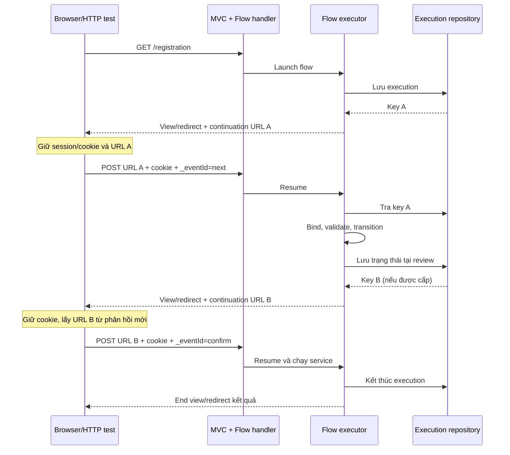
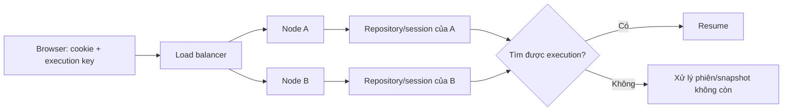

# Duy trì session, cookie và execution key qua nhiều yêu cầu khi kiểm thử tích hợp Spring Web Flow

## 1. Vấn đề: mỗi request riêng lẻ chưa đủ để kiểm thử một flow

Spring Web Flow (SWF) dùng **state**, **event**, **transition** và **subflow** để điều phối các hành trình web nhiều bước. Một lần đặt hàng có thể gồm: nhập thông tin → xem lại → xác nhận → hoàn tất. Giữa hai lần nhấn nút, server phải nhận ra **flow execution** đang chạy, khôi phục dữ liệu form và xử lý event trong đúng state.

Vì vậy, kiểm thử tích hợp không chỉ gửi một request `POST` rồi kiểm tra HTTP status. Nó cần mô phỏng một **trình duyệt có trạng thái qua nhiều request**:

1. Khởi chạy flow và nhận phản hồi từ server.
2. Giữ cookie/HTTP session giống một trình duyệt thật.
3. Lấy **continuation URL/execution key** mới nhất do Web Flow tạo.
4. Gửi event cùng dữ liệu form đến đúng continuation URL.
5. Duy trì session giữa các bước, đọc URL mới khi flow tiếp tục.
6. Xác minh state, validation, dữ liệu và side effect nghiệp vụ.

Ví dụ luồng request minh họa:

```text
GET  /app/registration
     -> Server khởi chạy execution; phản hồi có session và URL tiếp tục.

POST /app/registration?execution=e1s1
     Cookie: JSESSIONID=<cookie-của-cùng-trình-duyệt>
     _eventId=next&fullName=An%20Nguyen&email=an%40example.test
     -> Khôi phục execution, bind/validate rồi chuyển sang review.

POST /app/registration?execution=e1s2
     Cookie: JSESSIONID=<cookie-của-cùng-trình-duyệt>
     _eventId=confirm
     -> Khôi phục bước review, gọi service rồi kết thúc flow.
```

Các khóa `e1s1`, `e1s2` và tên cookie `JSESSIONID` chỉ là **giá trị minh họa thường gặp**. Không tự tạo khóa, không giả định key luôn đổi sau mỗi event, và không mặc định mọi ứng dụng đều dùng cùng tên cookie hay cùng chính sách redirect.

## 2. Ba loại trạng thái phải giữ đúng

| Thành phần | Nơi nó xuất hiện | Vai trò trong chuỗi request | Lỗi hay gặp |
| --- | --- | --- | --- |
| **HTTP session** | Đối tượng `HttpSession` phía server, hoặc session store ngoài JVM | Giữ ngữ cảnh của trình duyệt, nơi repository có thể gắn execution | Mỗi request trong test tạo một session khác |
| **Session cookie** | Header `Set-Cookie` từ server và `Cookie` ở request sau | Giúp container/server tìm đúng HTTP session trong HTTP thực | Gửi nhầm cookie, thiếu path/domain, cookie hết hạn |
| **Execution key** | Thường ở tham số URL `execution` trong continuation URL | Cho Web Flow nhận diện execution/snapshot cần resume | Dùng lại start URL hoặc hardcode key cũ |
| **Event ID** | `_eventId=next` hay tên nút `_eventId_next` | Chọn transition trong state hiện tại | Không gửi event hoặc gửi tên không khớp |
| **Form fields** | HTTP body/query theo cách view được cấu hình | Binding, conversion và validation | Dữ liệu thiếu hoặc không được bind |
| **CSRF token** | Form/header theo Spring Security | Bảo vệ request thay đổi trạng thái | Test POST bị từ chối trước khi tới Web Flow |

### 2.1. Session và cookie không đồng nghĩa

**Session** là trạng thái được server quản lý. **Cookie** là một phương tiện phổ biến để trình duyệt gửi lại ID của session đó. Cookie không chứa toàn bộ `flowScope` hoặc toàn bộ execution trong cấu hình lưu session phổ biến.

Trong HTTP thực, lần đầu vào flow có thể khiến server gửi:

```http
HTTP/1.1 200 OK
Set-Cookie: JSESSIONID=...; Path=/app; HttpOnly
```

Ở request sau, browser gửi lại cookie khi thỏa các quy tắc `Domain`, `Path`, `Secure`, `SameSite` và chính sách cookie của trình duyệt:

```http
POST /app/registration?execution=...
Cookie: JSESSIONID=...
```

Không phải phản hồi nào cũng có `Set-Cookie` mới. Trình duyệt lưu và gửi lại cookie hợp lệ đã nhận trước đó, kể cả khi phản hồi gần nhất không lặp lại header này.

### 2.2. Cookie session và execution key giải quyết hai câu hỏi khác nhau

```text
Session cookie -> "Đây là phiên HTTP nào?"
Execution key  -> "Trong phiên/repository ấy, tiếp tục flow nào?"
Event ID       -> "Tại state hiện hành, người dùng muốn làm gì?"
```

Nếu một session có hai flow execution độc lập (chẳng hạn hai tab được mở từ hai start URL), chỉ cookie không đủ để phân biệt chúng. Ngược lại, chỉ có execution key nhưng thiếu ngữ cảnh session/repository phù hợp có thể không khôi phục được execution.

### 2.3. Không coi execution key là business ID

Execution key là giá trị **opaque** do framework/repository cấp; một định dạng ví dụ là `e1s1` nhưng không phải hợp đồng ổn định. Một `orderId` hay `registrationId` trong database có vòng đời riêng và có thể được truy vấn sau khi flow kết thúc. Không dùng execution key như mã hồ sơ lâu dài hoặc mã xác thực.

## 3. Bức tranh test tích hợp nhiều request



Sơ đồ này minh họa quan hệ giữa các thành phần, không khẳng định mọi cấu hình Web Flow đều ghi snapshot mới hoặc redirect sau mỗi lần chuyển state. Kiểm thử cần dựa vào **phản hồi thật của ứng dụng**, không dự đoán trước một chuỗi key.

## 4. Chuẩn bị một flow đơn giản cho kiểm thử

Giả sử ứng dụng dùng Spring MVC tích hợp Spring Web Flow, có form model `RegistrationForm` và bean `registrationService`. Flow sau giúp kiểm thử launch, resume, back và confirm:

```xml
<?xml version="1.0" encoding="UTF-8"?>
<flow xmlns="http://www.springframework.org/schema/webflow"
      xmlns:xsi="http://www.w3.org/2001/XMLSchema-instance"
      xsi:schemaLocation="
        http://www.springframework.org/schema/webflow
        http://www.springframework.org/schema/webflow/spring-webflow.xsd">

    <var name="registrationForm"
         class="com.example.registration.RegistrationForm" />

    <view-state id="enterDetails"
                view="registration/details"
                model="registrationForm">
        <binder>
            <binding property="fullName" required="true" />
            <binding property="email" required="true" />
        </binder>
        <transition on="next" to="review" />
        <transition on="cancel" to="cancelled"
                    bind="false" validate="false" />
    </view-state>

    <view-state id="review"
                view="registration/review"
                model="registrationForm">
        <transition on="back" to="enterDetails"
                    bind="false" validate="false" />
        <transition on="confirm" to="completed">
            <evaluate
                expression="registrationService.register(registrationForm)"
                result="flowScope.registrationId" />
        </transition>
    </view-state>

    <end-state id="completed"
               view="externalRedirect:contextRelative:/registration/success" />
    <end-state id="cancelled"
               view="externalRedirect:contextRelative:/registration/cancelled" />
</flow>
```

Ví dụ giả định đã có `flow-registry`, `flow-executor`, `FlowHandlerMapping`, `FlowHandlerAdapter`, view resolver và service. Hãy chọn phiên bản Spring Web Flow tương thích với Spring Framework/Spring MVC trong dự án; các ví dụ test bên dưới không tự tạo cơ sở hạ tầng Web Flow.

### 4.1. View cần gửi tới URL tiếp tục, không phải start URL

Với JSP trong tích hợp thông dụng, form ở `enterDetails` có thể dùng:

```jsp
<form method="post" action="${flowExecutionUrl}">
    <label for="fullName">Họ tên</label>
    <input id="fullName" name="fullName">

    <label for="email">Email</label>
    <input id="email" name="email" type="email">

    <button type="submit" name="_eventId_next" value="next">
        Tiếp tục
    </button>
    <button type="submit" name="_eventId_cancel" value="cancel">
        Hủy
    </button>
</form>
```

Ở trang `review`, nút `_eventId_back` hoặc `_eventId_confirm` gửi event tương ứng về continuation URL được tạo cho view đó. Khi app bật Spring Security, form POST còn cần **CSRF token**; form model phải được validate và dữ liệu render ra HTML phải escape phù hợp.

Trong integration test, việc giữ session sẽ vô ích nếu form lại submit tới `/registration` **không có execution key**: server có thể hiểu đó là yêu cầu launch mới, làm mất tiến độ đang kiểm thử.

## 5. Kiểm thử với MockMvc: giữ cùng một `MockHttpSession`

Ở tầng Spring MVC test, `MockMvc` cho phép giả lập nhiều request Servlet mà không cần chạy một server HTTP thật. Trọng tâm là sử dụng lại **cùng đối tượng `MockHttpSession`** khi gửi các bước tiếp theo.

```java
// Minh họa ý tưởng quan trọng của MockMvc:
MvcResult launch = mockMvc.perform(get("/registration"))
    .andReturn();

MockHttpSession session =
    (MockHttpSession) launch.getRequest().getSession(false);
assertNotNull(session, "Flow phải có session khi dùng session repository");

// Lấy continuation URL thực tế từ phản hồi/view.
String nextUrl = continuationUrlFrom(launch);

MvcResult review = mockMvc.perform(
        post(nextUrl)
            .session(session)
            .with(csrf())
            .param("_eventId", "next")
            .param("fullName", "An Nguyen")
            .param("email", "an@example.test"))
    .andReturn();

String reviewUrl = continuationUrlFrom(review);
MvcResult completed = mockMvc.perform(
        post(reviewUrl)
            .session(session)
            .with(csrf())
            .param("_eventId", "confirm"))
    .andReturn();
```

Đoạn trên là **khung minh họa**, không phải test độc lập có thể copy chạy nếu chưa khai báo `mockMvc`, `csrf()` và hàm `continuationUrlFrom`. Trong ứng dụng không bật CSRF, không cần `with(csrf())`; khi có Spring Security, import `SecurityMockMvcRequestPostProcessors.csrf` từ thư viện spring-security-test. Assertion về kết quả cần phù hợp view/redirect thực tế.

Điểm cốt lõi:

- `session(session)` giữ cùng **server-side mock session** qua nhiều lần gọi.
- `nextUrl` và `reviewUrl` phải đến từ **response được hệ thống tạo**, không phải `"/registration?execution=e1s1"` viết cứng.
- Với thao tác xác nhận, mock `registrationService` để kiểm tra service chỉ được gọi khi đến đúng event/state và dữ liệu đã bind.
- Các lần tiếp tục cần giữ cùng auth/security context khi test có phân quyền; `@WithMockUser` hoặc request post-processor phù hợp có thể được dùng theo cấu hình test.

### 5.1. Tạo test theo một ứng dụng giả định

Đoạn mã dưới đây là skeleton cho ứng dụng **Spring Boot + Spring MVC + Web Flow đã được cấu hình**. Cách lấy continuation URL phụ thuộc việc view là redirect hay được render trực tiếp:

```java
@SpringBootTest
@AutoConfigureMockMvc
class RegistrationFlowIntegrationTest {

    @Autowired
    private MockMvc mockMvc;

    @Test
    void nextAndConfirmUseTheSameSession() throws Exception {
        MvcResult start = mockMvc.perform(get("/registration"))
            .andReturn();

        MockHttpSession session =
            (MockHttpSession) start.getRequest().getSession(false);
        assertNotNull(session);

        String enterDetailsUrl = continuationUrlFrom(start);

        MvcResult review = mockMvc.perform(
                post(enterDetailsUrl)
                    .session(session)
                    .with(csrf())
                    .param("_eventId", "next")
                    .param("fullName", "An Nguyen")
                    .param("email", "an@example.test"))
            .andReturn();

        String reviewUrl = continuationUrlFrom(review);

        MvcResult finish = mockMvc.perform(
                post(reviewUrl)
                    .session(session)
                    .with(csrf())
                    .param("_eventId", "confirm"))
            .andReturn();

        assertTrue(finish.getResponse().getStatus() >= 200);
        assertTrue(finish.getResponse().getStatus() < 400);
        // Bổ sung verify(registrationService).register(...)
        // và assert state/result/redirect theo hợp đồng thực tế.
    }

    private String continuationUrlFrom(MvcResult result) {
        String redirect = result.getResponse().getRedirectedUrl();
        if (redirect != null && redirect.contains("execution=")) {
            return redirect;
        }

        ModelAndView mav = result.getModelAndView();
        if (mav != null) {
            Object url = mav.getModel().get("flowExecutionUrl");
            if (url != null) {
                return url.toString();
            }
        }

        throw new AssertionError(
            "Không tìm thấy continuation URL; cần đọc action URL " +
            "từ HTML/view thực tế hoặc follow redirect với cùng session.");
    }
}
```

Imports cần thiết tùy cấu hình test, điển hình gồm `org.springframework.test.web.servlet.MockMvc`, `org.springframework.test.web.servlet.MvcResult`, `org.springframework.mock.web.MockHttpSession`, `org.springframework.web.servlet.ModelAndView`, các API JUnit Jupiter và static imports cho `get`, `post`, `csrf`. Trong ứng dụng không dùng Spring Boot, dùng cấu hình Spring Test phù hợp với dự án.

**Giới hạn của helper trên:** continuation URL không phải lúc nào cũng xuất hiện ở redirect hoặc trực tiếp trong `ModelAndView`. Có view render thành HTML, form action được sinh trong JSP/Thymeleaf/JSF; lúc đó test phải **render và phân tích HTML hoặc dùng browser test**, không bịa key. Ngoài ra, `contains("execution=")` chỉ phù hợp URL handler minh họa; handler tùy biến có thể dùng cơ chế khác.

### 5.2. Follow redirect nhưng vẫn giữ session

`MockMvc` không phải trình duyệt thật: nó **không tự động follow toàn bộ redirect chain** như browser. Nếu phản hồi là 302 tới một continuation URL, test có thể cần:

1. Đọc header `Location`.
2. Gửi `GET` đến Location với `.session(session)`.
3. Tiếp tục cho đến khi tới view có form, với giới hạn số redirect để tránh vòng lặp.
4. Trích action URL của form hoặc biến được view cung cấp.
5. Gửi POST event đến URL đó với **cùng session**.

Không được dùng `MockMvcResultMatchers.status().isOk()` một cách cứng nhắc ở mọi bước: một bước có thể trả 200, bước khác 302 theo chính sách redirect. Hãy assert đúng hành vi đã cấu hình và tránh để test vô tình bỏ qua response 302 rồi đọc nhầm model.

### 5.3. Vì sao chỉ gửi cookie giả vào MockMvc là chưa đủ?

Trong HTTP thật, container dùng cookie để tra session. Nhưng `MockMvc` chạy với **mock Servlet request/session** bên trong test; việc tự thêm:

```java
// Không tương đương với việc tái sử dụng server-side MockHttpSession:
mockMvc.perform(get("/registration")
    .cookie(new Cookie("JSESSIONID", "chuoi-tu-bia")));
```

không bảo đảm Spring Test sẽ khôi phục đúng object `MockHttpSession` chứa execution trước đó. Với MockMvc, cách trực tiếp, rõ ràng là **truyền cùng `MockHttpSession`**; để kiểm tra việc gửi/nhận cookie theo chuẩn HTTP, cần test với server thật hoặc browser.

## 6. Kiểm thử HTTP/browser: cookie jar là yếu tố bắt buộc

Một browser test hoặc HTTP client có **cookie jar** giúp kiểm thử đúng hành vi session cookie, CSRF, redirect và URL ở ngoài biên Servlet mock.

### 6.1. Kịch bản với Playwright

Ví dụ TypeScript mang tính hướng dẫn, giả định ứng dụng cung cấp hai màn hình có label/nút tương ứng và test đã cấu hình `baseURL`:

```typescript
import { test, expect } from '@playwright/test';

test('giữ session xuyên qua các bước đăng ký', async ({ page }) => {
  await page.goto('/registration');

  const firstFormAction = await page.locator('form').first()
    .getAttribute('action');
  expect(firstFormAction).toBeTruthy();

  await page.getByLabel('Họ tên').fill('An Nguyen');
  await page.getByLabel('Email').fill('an@example.test');
  await page.getByRole('button', { name: 'Tiếp tục' }).click();

  await expect(page.getByRole('button', { name: 'Xác nhận' }))
    .toBeVisible();

  const reviewFormAction = await page.locator('form').first()
    .getAttribute('action');
  expect(reviewFormAction).toBeTruthy();

  // Không giả định hai action URL phải khác nhau.
  // Browser giữ session cookie và gửi đúng form action được render.
  await page.getByRole('button', { name: 'Xác nhận' }).click();

  await expect(page).toHaveURL(/\/registration\/success/);
});
```

**Điểm mạnh:** cùng `page` trong cùng `BrowserContext` sẽ giữ cookie/session như trình duyệt. CSRF token ẩn trong form thường được gửi tự nhiên khi submit bằng nút thật; JavaScript hoặc API-client test phải xử lý token đúng cách nếu gửi request trực tiếp.

**Điểm cần chú ý:** Playwright chỉ biết những gì giao diện thực sự hiển thị. Tên nút, URL kết thúc, locator và ràng buộc xác thực trong ví dụ phải được điều chỉnh cho dự án. Test phải cô lập dữ liệu đăng ký và dọn dẹp bản ghi tạo ra.

### 6.2. Khác nhau giữa tab mới và browser context mới

Trong Playwright:

- Hai trang được tạo bằng `context.newPage()` **cùng một BrowserContext** thường dùng chung cookie jar, tương tự hai tab cùng phiên trình duyệt.
- Một context khác, tạo bằng `browser.newContext()`, có **cookie jar độc lập** nếu không chủ động nạp storage state.
- Một trang mới đi vào **start URL** thường khởi tạo execution mới; nhân bản trang có continuation URL có thể khiến hai tab cùng tham chiếu một execution/snapshot.

Vì thế kiểm thử “hai tab có độc lập không” phải phân biệt:

1. **Hai start requests** trong cùng cookie jar → hai execution có thể độc lập nếu repository cho phép.
2. **Hai tab dùng cùng continuation URL** → có thể cùng execution, phải kiểm tra concurrency và retry.
3. **Hai context khác cookie** → không được vô tình tiếp tục execution của nhau khi repository dựa vào HTTP session.

## 7. Thứ tự xử lý: launch → lấy key → resume → lấy key mới

Một nguyên tắc quan trọng là **không hardcode execution key** trong bài kiểm thử:

```text
SAI:
  GET /registration
  POST /registration?execution=e1s1&...
  POST /registration?execution=e1s2&...

ĐÚNG:
  GET /registration
  -> lấy action/continuation URL thực tế
  POST continuation_URL_1 + event next
  -> lấy action/continuation URL mới của view review
  POST continuation_URL_2 + event confirm
```

Key có thể mang thông tin snapshot và có thể thay đổi tùy repository/config. Ngay cả khi một lần chạy cụ thể tình cờ trả `e1s1` rồi `e1s2`, test không được dựa vào cấu trúc chuỗi để dự đoán giá trị tiếp theo.

### 7.1. Gửi event theo hai quy ước

Trong HTTP form tích hợp phù hợp, Web Flow hỗ trợ các cách biểu đạt event:

```text
_eventId=next

hoặc tên tham số:
_eventId_next=next
```

Đây là **hai cách khác nhau** để phát event `next`. Nếu test dùng `_eventId=next` còn UI thật dùng `_eventId_next`, cả hai có thể đều hợp lệ, nhưng integration test của giao diện nên xác nhận **tên tham số mà view thực sự gửi**, tránh lỗi do gõ sai hậu tố.

### 7.2. Khi không có key hoặc key cũ

Một POST về **start URL** mà không có key có thể khởi chạy flow mới hoặc gặp xử lý route khác, chứ không tự tiếp tục state cũ. Một key đã hết hiệu lực có thể gây exception hoặc được ánh xạ thành thông báo “phiên thao tác hết hạn” tùy exception handler của ứng dụng.

Không khẳng định mặc định mọi lỗi key đều trả 404, 403 hay redirect. Trong test, kiểm tra **hợp đồng xử lý lỗi đã cấu hình** và quan trọng nhất: không rò dữ liệu execution khác, không chạy lại service nhạy cảm và có đường khởi chạy/phục hồi hợp lệ.

## 8. Ma trận kiểm thử session, cookie và execution key

| Kịch bản | Session/cookie | Execution key | Event | Kỳ vọng |
| --- | --- | --- | --- | --- |
| Launch mới | Chưa có hoặc có session hợp lệ | Không gửi key | Không bắt buộc | Tạo execution mới ở initial state |
| Next hợp lệ | Giữ nguyên session | Key từ view nhập liệu | `next` | Bind/validate và đi tới review |
| Back hợp lệ | Giữ nguyên session | Key từ view review | `back` | Về bước sửa theo transition |
| Confirm hợp lệ | Giữ nguyên session | Key từ view review | `confirm` | Gọi service và kết thúc |
| Thiếu cookie | Không có session gốc | Giữ key đã cấp ở session khác | `next` | Không được truy cập dữ liệu session kia |
| Cookie sai | Một session độc lập | Key của execution A | `next` | Không resume nhầm A; lỗi có kiểm soát |
| Thiếu key | Giữ session | Không gửi | `next` | Không được giả định tiếp tục execution cũ |
| Key đã evict | Giữ session | Snapshot/execution không còn | `next` | Lỗi/phục hồi đúng chính sách |
| Session hết hạn | Session đã invalidated | Key cũ | `next` | Không còn trạng thái cũ; có lối bắt đầu lại |
| Sai event | Giữ session | Key đúng | `unknown` | Không bỏ qua transition/validation |
| Form invalid | Giữ session | Key đúng | `next` | Ở lại state hoặc báo lỗi validation |
| CSRF sai/thiếu | Giữ session | Key đúng | `confirm` | Bị chặn theo cấu hình Spring Security |
| Hai tab độc lập | Cùng session | Hai key từ hai start requests | Mỗi tab event riêng | Dữ liệu hai execution không trộn |
| Hai tab nhân bản | Cùng session | Cùng key/snapshot | Hai event gần đồng thời | Không tạo side effect trùng |
| Sau end-state | Cùng session hoặc session mới | Key của execution đã kết thúc | `next` | Không phụ thuộc vào việc key cũ còn resume được |

Các kỳ vọng về **mã HTTP cụ thể** phải lấy từ ứng dụng và cách ánh xạ exception, không dựa vào suy đoán.

## 9. Kiểm thử session timeout và phục hồi

Flow dài dễ gặp tình huống người dùng nhập form lâu, để tab không hoạt động, rồi gửi event khi session đã hết hạn.

### 9.1. Mô phỏng đúng bằng môi trường test

Với MockMvc, có thể giữ tham chiếu `MockHttpSession` để kiểm tra thuộc tính trước/sau nhiều request. Nhưng khi muốn **mô phỏng hết hạn**, không nên gọi `session.invalidate()` rồi tiếp tục truyền chính object đã invalidated vào các request như một session hợp lệ.

Một hướng kiểm thử dễ kiểm soát:

1. Launch flow và nhận key A với session A.
2. Làm mất session A trong môi trường test (logout/invalidate hoặc reset session store theo cách được hỗ trợ).
3. Gửi request chứa key A nhưng **không mang session A**, hoặc dùng một session B độc lập.
4. Xác nhận ứng dụng không khôi phục được dữ liệu của A và xử lý timeout theo hợp đồng.
5. Nếu hệ thống hỗ trợ draft, đăng nhập/xác thực lại rồi start flow mới bằng draft ID đã kiểm tra quyền.

Với server/browser test, có thể xóa cookie của BrowserContext hoặc cho session thực sự hết hạn trong cấu hình test, rồi gửi lại continuation URL cũ. Chỉ xóa cookie ở browser chưa đủ để kết luận bản ghi session server đã được giải phóng; hai mặt cần được phân biệt.

### 9.2. Không dùng execution key làm cơ chế phục hồi dài hạn

Khi người dùng cần tiếp tục sau nhiều giờ hoặc qua phiên đăng nhập mới, hãy lưu **draft/đối tượng nghiệp vụ** vào database với kiểm tra quyền và version. Sau đó khởi chạy **execution mới** từ draft ID. Snapshot/flow scope cũ có thể đã biến mất.

Điều này đặc biệt quan trọng với checkout, hồ sơ nhập nhiều bước, form tài chính hoặc quy trình phê duyệt cần giữ dữ liệu qua deploy.

## 10. Kiểm thử đa node và session store

Trong môi trường có load balancer, một request có thể được chuyển tới node khác sau khi flow đã khởi chạy:



Tùy kiến trúc, có thể sử dụng **sticky session**, **session replication** hoặc **session store chung**. Mục tiêu của integration test là xác nhận execution có thể được truy xuất khi request chuyển node **nếu hệ thống hứa hỗ trợ tình huống đó**.

Kịch bản gợi ý:

1. Khởi chạy flow tại node A, ghi nhận cookie/session và continuation URL.
2. Chuyển request resume sang node B theo cách của môi trường staging.
3. Xác nhận repository thực sự nhìn thấy state, không chỉ nhận được key.
4. Gửi tiếp event, kiểm tra dữ liệu form còn nguyên.
5. Thử restart/stop một node theo chính sách failover, quan sát timeout/restore.

Một test chỉ chạy MockMvc trên một application context **không chứng minh** hệ thống session replication hoặc sticky routing hoạt động. Cần có kiểm thử HTTP/infra với kiến trúc thực tế.

## 11. Các lỗi dễ gặp và hướng chẩn đoán

| Triệu chứng | Nguyên nhân thường gặp | Hướng kiểm tra |
| --- | --- | --- |
| Sau Next quay lại trang nhập đầu tiên | Đã POST tới start URL không có key | Kiểm tra `action` của form và continuation URL |
| Báo execution không tìm thấy | Cookie/session mất, key cũ, repository khác node | Xem cookie, key, session store, retention |
| MockMvc mỗi request mất dữ liệu form | Không truyền lại `MockHttpSession` | Lấy session từ request trước rồi `.session(session)` |
| Đã giữ session nhưng vẫn báo lỗi | Key không được lấy từ phản hồi mới hoặc snapshot bị evict | So sánh key thực tế của từng bước và repository limit |
| Browser test chạy nhưng MockMvc test thất bại | MockMvc không tự follow redirect/render như browser | Thêm logic follow redirect/extract form action |
| MockMvc pass nhưng browser mất phiên | Domain/Path/SameSite/Secure của cookie không khớp | Kiểm tra cookie jar và network headers |
| POST bị 403 trước khi tới flow | Thiếu CSRF token hoặc auth context | Kiểm tra Spring Security filter/test setup |
| Event `next` không chuyển state | Sai `_eventId`, validation fail, thiếu transition | Kiểm tra request payload, active state và errors |
| Test nhiều tab bị lẫn dữ liệu | Hai tab dùng cùng key hoặc ứng dụng lưu dữ liệu ở session scope dùng chung | Phân biệt start URL riêng và duplicated continuation URL |
| Sau confirm có hai bản ghi | Double-click/retry hoặc flow side effect không idempotent | Kiểm tra transaction, unique constraint và service |
| Chỉ lỗi sau deployment | Serialization/definition/session store không tương thích | Test rolling deploy, cleanup và recovery |

### 11.1. Quy trình debug một test bị lỗi

Nên log các dữ liệu **không nhạy cảm** theo chuỗi:

```text
request # -> HTTP method -> URL -> có cookie/session?
          -> có execution key? -> event nào?
          -> state trước/sau -> redirect/view nào?
          -> validation errors? -> service được gọi?
```

Tránh in nguyên cookie session, token CSRF, mật khẩu, biểu mẫu có dữ liệu cá nhân hoặc toàn bộ execution object graph vào log CI. Sử dụng correlation/trace ID thay thế nếu cần liên kết nhiều request.

### 11.2. Phân biệt ba nhóm thất bại

- **Không vào được flow:** route/handler mapping sai, security chặn, URL không khớp.
- **Không khôi phục được execution:** session/cookie/key/repository/snapshot có vấn đề.
- **Khôi phục rồi nhưng không chuyển state:** event, binding, validation, transition hoặc service action lỗi.

Ba nhóm này có nguyên nhân và cách kiểm thử khác nhau. Không sửa cấu hình session khi nguyên nhân chỉ là `_eventId` sai, và không sửa transition khi key đã hết hạn.

## 12. Thiết kế test ổn định và có khả năng bảo trì

Một bài test nhiều request dễ trở nên giòn nếu phụ thuộc chi tiết implementation thay vì hành vi:

**Nên làm:**

- Lấy continuation URL được hệ thống cung cấp tại mỗi view/redirect.
- Dùng cùng `MockHttpSession` ở MockMvc hoặc cùng cookie jar/browser context ở kiểm thử HTTP.
- Xác minh kết quả nghiệp vụ, state/view/redirect và dữ liệu form, không chỉ HTTP status.
- Kiểm tra cả happy path và negative path: validation, sai cookie, expired session, key cũ, CSRF.
- Dùng mock/fake cho tác vụ ngoài (email, thanh toán, API bên thứ ba) và dọn dẹp dữ liệu test.
- Ghi rõ policy khi request đang ở một view-state có redirect hay direct-render.
- Cô lập dữ liệu và phiên của từng test; chạy song song chỉ khi database/session store được tách hoặc có khóa hợp lý.

**Không nên làm:**

- Hardcode `e1s1`, `e1s2` hoặc suy ra key mới bằng cách tăng chữ số.
- Giả định Cookie `JSESSIONID` luôn được set ở mọi response.
- Mở một HTTP client/cookie jar mới cho mỗi request rồi mong flow vẫn ở bước cũ.
- Coi một test MockMvc có cùng session là đủ để khẳng định behavior của cookie trên browser thật.
- Coi `confirm` là idempotent chỉ vì flow cuối cùng sẽ đi tới end-state.
- Cố gắng resume execution đã kết thúc như một URL bền vững.

### 12.1. Checklist tối thiểu cho PR kiểm thử tích hợp

- [ ] Test tạo execution từ start URL đúng flow ID.
- [ ] Lấy continuation URL thực tế của bước đầu.
- [ ] Giữ cùng session/cookie qua ít nhất hai lần resume.
- [ ] Gửi đúng event theo nút của view và đúng field binding.
- [ ] Assert state, validation và dữ liệu form sau Next/Back.
- [ ] Kiểm tra service action/side effect tại Confirm, tránh bản ghi trùng.
- [ ] Có negative test cho session hết hạn hoặc cookie/session khác.
- [ ] Nếu bật security, kiểm tra CSRF và quyền truy cập.
- [ ] Với môi trường cluster, kiểm tra một trường hợp cross-node/failover khi thuộc yêu cầu hệ thống.

## 13. Bài tập thực hành

### Bài 1 — Tìm lỗi mất session

Một test chạy:

```java
MvcResult first = mockMvc.perform(get("/registration")).andReturn();
String url = continuationUrlFrom(first);
MvcResult second = mockMvc.perform(
    post(url).param("_eventId", "next")).andReturn();
```

**Câu hỏi:** vì sao có thể không khôi phục được execution?

**Gợi ý đáp án:** `second` không dùng lại `MockHttpSession` của `first`. Cần lấy `MockHttpSession` từ request đầu rồi truyền `.session(session)` cho request thứ hai. Còn phải gửi form fields, CSRF/auth nếu ứng dụng yêu cầu và xác nhận `url` đúng continuation URL.

### Bài 2 — Phân biệt cookie và key

Tab A dùng session S và key A. Một client khác không có cookie của S gửi key A.

**Câu hỏi:** client thứ hai có được quyền tiếp tục flow của A không?

**Gợi ý đáp án:** không được suy ra quyền truy cập chỉ từ key. Với session repository gắn với HTTP session, client không có ngữ cảnh session phù hợp thường không thể khôi phục state. Dù key được chấp nhận ở repository tùy biến, service vẫn phải kiểm tra xác thực/authorization.

### Bài 3 — Key qua ba bước

Sau GET start, view đầu có action URL `/registration?execution=KEY_A`; sau POST `next`, view review có action URL `/registration?execution=KEY_B`.

**Câu hỏi:** event `confirm` nên gửi tới URL nào?

**Đáp án:** dùng **URL của view review** là `KEY_B`, không dùng lại URL đầu và không tự suy đoán phần chữ/số của key. Nếu implementation cho cùng key qua hai bước, vẫn phải đọc URL hiện hành do framework cấp.

### Bài 4 — Tạo test hai tab

Hãy mô tả test mở hai tab trong cùng một browser context, nhưng **mỗi tab đi vào start URL**. Mỗi tab nhập email khác nhau rồi tới review.

**Kỳ vọng:** hai execution được nhận diện riêng khi repository cho phép, dữ liệu form không trộn. Sau đó thử nhân bản một tab đã có continuation URL để quan sát hành vi khi hai tab sử dụng **cùng key**.

### Bài 5 — Session expiry

Sau bước review, session hết hạn. Người dùng bấm Confirm từ form cũ và nhận thông báo phiên thao tác hết hạn.

**Câu hỏi:** có nên tạo một execution giả từ key cũ để tiếp tục không?

**Đáp án:** không. Hãy xử lý timeout có kiểm soát; nếu có bản nháp nghiệp vụ thì xác thực lại, mở flow mới và nạp dữ liệu qua draft ID. Không xem execution key là cơ chế lưu dữ liệu lâu dài.

## 14. Tóm tắt

- Kiểm thử tích hợp Spring Web Flow phải giữ **session/cookie và execution key** qua nhiều request; event ID và dữ liệu form là các thông tin bổ sung.
- Với **MockMvc**, tái sử dụng `MockHttpSession` qua `.session(session)`. Với **HTTP/browser test**, dùng cookie jar hoặc cùng BrowserContext và quan sát quy tắc cookie/redirect thật.
- Luôn lấy **continuation URL hiện hành từ phản hồi/view**. Không hardcode hoặc tự sinh execution key.
- Kiểm tra cả **launch, resume, Back, Confirm, validation và end-state**, cũng như session expiry, key cũ, CSRF và nhiều tab.
- Tách lỗi **routing**, **khôi phục execution** và **xử lý event/binding** để chẩn đoán nhanh.
- Trạng thái nghiệp vụ cần tồn tại lâu hơn session phải được lưu bền vững; execution URL không phải mã phục hồi vĩnh viễn.
