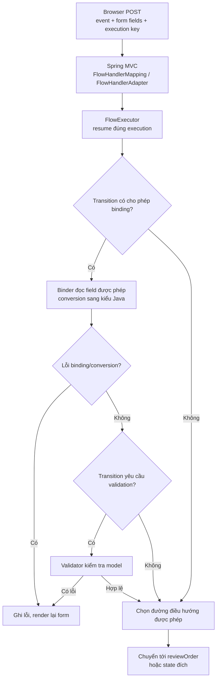
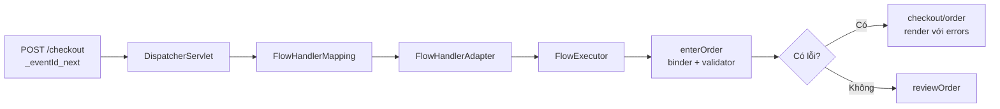
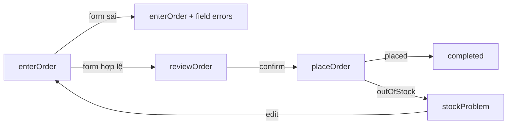

# Kiểm tra binding, conversion và validation từ dữ liệu form

Trong **Spring Web Flow**, một màn hình nhập liệu là một phần của hành trình gồm nhiều **state, event, transition và subflow**. Người dùng có thể nhập thông tin giao hàng ở `view-state`, nhấn **Tiếp tục** để xem lại đơn, rồi xác nhận để hệ thống gọi `action-state` thực hiện nghiệp vụ. Muốn hành trình an toàn, dữ liệu HTTP phải được **bind** vào đúng model, **convert** sang kiểu Java thích hợp và **validate** trước khi được phép chuyển sang bước tiếp theo.

Bài học thuộc chương **Kiểm thử tích hợp**, tập trung vào việc **kiểm tra binding, conversion và validation từ dữ liệu form trong chuỗi HTTP thực tế**, không chỉ gọi trực tiếp một validator hoặc một converter. Mục tiêu là chứng minh rằng Spring MVC chuyển request vào đúng flow execution, dữ liệu người dùng đến được Web Flow binder, lỗi được trả về đúng màn hình và action nghiệp vụ không chạy khi form chưa hợp lệ.

Các ví dụ dùng phong cách cấu hình **Spring Web Flow 2.x** và Spring MVC. Hãy kiểm tra khả năng tương thích của API, dependency, phiên bản Spring, JSP/Thymeleaf và cơ chế validator thực tế trước khi đưa trực tiếp vào dự án.

## 1. Vì sao cần kiểm thử tích hợp thay vì chỉ unit test?

Một unit test có thể xác minh `Integer.valueOf("3")` thành công, hoặc `OrderFormValidator` từ chối số lượng âm. Nhưng hai kết quả đó **không chứng minh**:

- HTTP form gửi đúng tên property và đúng event của Web Flow.
- `FlowHandlerMapping` và `FlowHandlerAdapter` đưa request tới **execution đang chạy**, thay vì khởi động một flow mới.
- Web Flow binder chỉ cập nhật những field được cho phép.
- Conversion service dùng trong **Web Flow** thực sự biết cách chuyển giá trị request sang kiểu Java.
- Validator được cấu hình và được gọi vào đúng thời điểm.
- Binding hoặc validation thất bại **chặn transition** sang bước xử lý nghiệp vụ.
- Thông báo lỗi và giá trị người dùng đã nhập xuất hiện ở đúng view.
- Request tiếp theo giữ session, execution key và model đúng.

Đây là khác biệt giữa kiểm tra **một hàm** với kiểm tra **toàn bộ đường đi của dữ liệu và điều hướng**.

| Mức kiểm thử | Điều chứng minh tốt | Điều chưa chứng minh |
| --- | --- | --- |
| Unit test converter | Phép chuyển kiểu hoạt động với input đã cho | Web Flow thực sự sử dụng converter đó |
| Unit test validator | Một model có lỗi bị đánh dấu đúng | Validator được kích hoạt khi submit event |
| Flow-execution test | Engine xử lý event, binding, validation và state theo test context | HTTP routing, form action, cookie/session và render template thực |
| MockMvc + Web Flow | Spring MVC mapping/adapter, request parameter, session, response/view chọn đúng | JSP engine và trình duyệt thực có thể chưa được chạy đầy đủ |
| Servlet-container/browser test | Form HTML, cookie, redirect, CSRF, template và chuỗi request thực | Không thay thế các test nhánh chi tiết ở tầng engine |

Nên dùng **unit test** để kiểm tra nhiều biến thể dữ liệu, **flow-execution test** để kiểm tra chuyển trạng thái và **một tập integration test HTTP** để chứng minh các lớp làm việc cùng nhau.

## 2. Chuỗi xử lý form trong một view-state

Giả sử flow `checkout` đang ở state `enterOrder`, có model `orderForm` và transition `next` tới `reviewOrder`. Người dùng gửi form:

```http
POST /checkout?execution=<key-do-framework-cap>
Content-Type: application/x-www-form-urlencoded

quantity=3&addressLine=12+Nguyen+Hue&deliveryMethod=STANDARD&_eventId_next=
```

Mô hình trách nhiệm:



Đây là **sơ đồ logic của đường submit thông thường**. Chi tiết vòng đời nội bộ, thời điểm callback và hành vi với lỗi có thể phụ thuộc phiên bản, validator và transition. Đặc biệt, không nên suy rằng mọi lỗi chuyển kiểu đều khiến mọi validator không được gọi; test cần tập trung vào **kết quả người dùng nhìn thấy** và **việc transition không vượt qua điều kiện kiểm tra**.

Trong toàn bộ chuỗi, có bốn khái niệm khác nhau:

| Khái niệm | Câu hỏi | Ví dụ |
| --- | --- | --- |
| **Event** | Người dùng muốn làm gì? | `_eventId_next` → `next` |
| **Binding** | Field này có được gán vào model không? | Gán `quantity`, không cho sửa `approved` |
| **Conversion** | Chuỗi từ HTTP chuyển được sang kiểu Java không? | `"3"` → `Integer(3)` |
| **Validation** | Dữ liệu có đáp ứng quy tắc không? | Số lượng phải lớn hơn 0 |

## 3. Ví dụ form model và quy tắc kiểm tra

Dùng model tách biệt khỏi entity cơ sở dữ liệu:

```java
package com.example.checkout;

import java.io.Serializable;

public class OrderForm implements Serializable {
    private Integer quantity;
    private String addressLine;
    private String deliveryMethod;

    public Integer getQuantity() {
        return quantity;
    }

    public void setQuantity(Integer quantity) {
        this.quantity = quantity;
    }

    public String getAddressLine() {
        return addressLine;
    }

    public void setAddressLine(String addressLine) {
        this.addressLine = addressLine;
    }

    public String getDeliveryMethod() {
        return deliveryMethod;
    }

    public void setDeliveryMethod(String deliveryMethod) {
        this.deliveryMethod = deliveryMethod;
    }
}
```

Ví dụ quy tắc:

1. `quantity` phải là số nguyên dương.
2. `addressLine` không được `null`, rỗng hoặc chỉ gồm khoảng trắng.
3. `deliveryMethod` phải là `STANDARD` hoặc `EXPRESS`.
4. Giao nhanh (`EXPRESS`) không cho phép số lượng lớn hơn 10.

Ràng buộc cuối là **cross-field validation** vì cần so sánh hai field. Việc tồn kho thực tế còn đủ hay không là **business rule** phụ thuộc dữ liệu thay đổi ở service, không chỉ là validation form.

### Spring Validator minh họa

```java
package com.example.checkout;

import org.springframework.stereotype.Component;
import org.springframework.validation.Errors;
import org.springframework.validation.Validator;

@Component("orderFormValidator")
public class OrderFormValidator implements Validator {

    @Override
    public boolean supports(Class<?> type) {
        return OrderForm.class.isAssignableFrom(type);
    }

    @Override
    public void validate(Object target, Errors errors) {
        OrderForm form = (OrderForm) target;

        if (form.getQuantity() == null) {
            errors.rejectValue("quantity", "order.quantity.required",
                "Cần nhập số lượng.");
        } else if (form.getQuantity() <= 0) {
            errors.rejectValue("quantity", "order.quantity.positive",
                "Số lượng phải lớn hơn 0.");
        }

        String address = form.getAddressLine();
        if (address == null || address.trim().isEmpty()) {
            errors.rejectValue("addressLine", "order.address.required",
                "Cần nhập địa chỉ giao hàng.");
        }

        String method = form.getDeliveryMethod();
        if (!"STANDARD".equals(method) && !"EXPRESS".equals(method)) {
            errors.rejectValue("deliveryMethod", "order.method.invalid",
                "Phương thức giao hàng không hợp lệ.");
        }

        if ("EXPRESS".equals(method)
                && form.getQuantity() != null
                && form.getQuantity() > 10) {
            errors.rejectValue("quantity", "order.express.limit",
                "Giao nhanh chỉ hỗ trợ tối đa 10 sản phẩm.");
        }
    }
}
```

Tên bean `orderFormValidator` là tên theo convention tương ứng với model `orderForm`. **Việc đặt `@Component` chưa đủ để chứng minh Web Flow đang gọi validator đó**: cần bảo đảm cơ chế tìm/đăng ký validator phù hợp với phiên bản Web Flow, Spring context và cấu hình validation của ứng dụng. Integration test phải kiểm tra điều này bằng cách submit dữ liệu sai và khẳng định flow không chuyển state.

Trong validator, kiểm tra `null` trước khi so sánh số lượng. Khi field `quantity=abc` không thể convert thành `Integer`, model có thể không nhận được giá trị mới; không được giả định luôn có một `Integer` hợp lệ để so sánh.

## 4. Định nghĩa flow để test toàn bộ đường đi

Một định nghĩa `checkout.xml` rút gọn:

```xml
<?xml version="1.0" encoding="UTF-8"?>
<flow xmlns="http://www.springframework.org/schema/webflow"
      xmlns:xsi="http://www.w3.org/2001/XMLSchema-instance"
      xsi:schemaLocation="
          http://www.springframework.org/schema/webflow
          http://www.springframework.org/schema/webflow/spring-webflow.xsd">

    <var name="orderForm" class="com.example.checkout.OrderForm" />

    <view-state id="enterOrder"
                view="checkout/order"
                model="orderForm">
        <binder>
            <binding property="quantity" required="true" />
            <binding property="addressLine" required="true" />
            <binding property="deliveryMethod" required="true" />
        </binder>

        <transition on="next" to="reviewOrder" />
        <transition on="cancel" to="cancelled"
                    bind="false" validate="false" />
    </view-state>

    <view-state id="reviewOrder" view="checkout/review">
        <transition on="edit" to="enterOrder" />
        <transition on="confirm" to="placeOrder" />
    </view-state>

    <action-state id="placeOrder">
        <evaluate expression="checkoutAction.place(flowScope.orderForm)" />
        <transition on="placed" to="completed" />
        <transition on="outOfStock" to="stockProblem" />
    </action-state>

    <view-state id="stockProblem" view="checkout/out-of-stock">
        <transition on="edit" to="enterOrder" />
    </view-state>

    <end-state id="completed" view="checkout/completed" />
    <end-state id="cancelled" />
</flow>
```

Các lớp `OrderForm`, `checkoutAction`, validator, view và cơ chế xử lý lỗi được ứng dụng cung cấp. Ví dụ `checkoutAction.place` phải trả event `placed` hoặc `outOfStock` đúng hợp đồng; nếu ném exception, exception không mặc nhiên biến thành event `outOfStock`.

Test cần phân biệt hai đường:

**Đường form hợp lệ:**

```text
enterOrder
  -- POST next, quantity=3, addressLine có giá trị,
     deliveryMethod=STANDARD -->
reviewOrder
  -- POST confirm -->
placeOrder
  -- event placed -->
completed
```

**Đường dữ liệu form sai:**

```text
enterOrder
  -- POST next, quantity=abc -->
binding/conversion error
  → vẫn ở enterOrder, hiển thị lỗi, chưa gọi checkoutAction.place

enterOrder
  -- POST next, quantity=-3 -->
validation error
  → vẫn ở enterOrder, hiển thị lỗi, chưa vào reviewOrder
```

## 5. Kiểm tra binder chỉ nhận field được cho phép

`<binder>` trong `view-state` khai báo danh sách property mà request có thể gán vào model:

```xml
<binder>
    <binding property="quantity" required="true" />
    <binding property="addressLine" required="true" />
    <binding property="deliveryMethod" required="true" />
</binder>
```

Giả sử domain có một thuộc tính `approved` hoặc `unitPrice` do server kiểm soát. Client tự gửi thêm:

```text
quantity=3
addressLine=12 Nguyen Hue
deliveryMethod=STANDARD
approved=true
unitPrice=0
_eventId_next=
```

Test phải xác nhận **các property không được khai báo không bị cập nhật từ HTTP**. Hành vi cụ thể của binder đối với tham số ngoài danh sách (bỏ qua hay ghi nhận lỗi) cần được xác nhận theo cấu hình và phiên bản; không ép test vào một phản hồi HTTP cố định khi mục tiêu là chống mass assignment.

**Không dùng entity JPA trực tiếp làm form model nếu chứa field nhạy cảm không nên bind.** Một DTO riêng với những trường thực sự được phép nhập, kết hợp binder whitelist và kiểm tra quyền ở service, tạo nhiều lớp bảo vệ hơn.

### Trường bắt buộc không đồng nghĩa giá trị hợp lệ

`required="true"` thể hiện yêu cầu binding của một property nhưng không thay thế kiểm tra nội dung. Chuỗi `"   "` có thể là một giá trị chuỗi được bind thành công mà vẫn phải bị validator xem là địa chỉ rỗng. Chuỗi `"abc"` đối với `Integer` là lỗi conversion trước khi có giá trị số để kiểm tra quy tắc `> 0`.

Trong test, nên tách ít nhất ba tình huống:

| Input | Điều cần kiểm tra |
| --- | --- |
| Bỏ hẳn `quantity` | Báo thiếu input/binding theo cấu hình |
| `quantity=abc` | Báo lỗi chuyển kiểu |
| `quantity=-3` | Báo lỗi validation sau khi chuyển kiểu thành công |

## 6. Conversion từ form string sang kiểu Java

Dữ liệu của form HTML thường là **chuỗi**. Nếu model khai báo `Integer quantity`, cần conversion `String → Integer`. Nếu model khai báo `LocalDate deliveryDate`, cần bảo đảm conversion cho ngày theo format mà người dùng gửi. Các kiểu `BigDecimal`, enum, UUID hay value object nghiệp vụ cũng có thể yêu cầu quy tắc chuyển kiểu phù hợp.

| Tham số HTTP | Kiểu đích | Kết quả | Lỗi thường gặp |
| --- | --- | --- | --- |
| `quantity=3` | `Integer` | `Integer(3)` | Không |
| `quantity=abc` | `Integer` | Không convert được | Sai định dạng số nguyên |
| `quantity=2.5` | `Integer` | Thường lỗi conversion | Có phần thập phân |
| `deliveryDate=2026-12-25` | `LocalDate` | Phụ thuộc converter/formatter | Không có hỗ trợ ngày hoặc format không khớp |
| `amount=1250.50` | `BigDecimal` | Phụ thuộc quy tắc số/locale | Dấu phân cách thập phân khác dự kiến |
| `deliveryMethod=EXPRESS` | Enum ứng dụng | Chuyển thành enum nếu converter hỗ trợ | Giá trị không trùng enum hoặc có format khác |

Trong các phiên bản Web Flow sử dụng **Spring Binding**, cần phân biệt hai interface:

- `org.springframework.binding.convert.service.ConversionService` thuộc Spring Binding/Web Flow.
- `org.springframework.core.convert.ConversionService` thuộc Spring Core, thường dùng cùng hạ tầng binding/formatting của Spring MVC.

Chúng **không mặc nhiên là cùng một interface**. Việc đăng ký formatter hoặc converter cho Spring MVC không bảo đảm converter đó đã được Web Flow dùng trong `view-state`. Cần kiểm tra `FlowBuilderServices`, `ConversionService` thích hợp và cơ chế tích hợp của phiên bản đang chạy.

### Trường ngày tháng và locale

Giả sử người dùng nhập ngày bằng `25/12/2026`. Nếu converter chỉ nhận ISO-8601 `2026-12-25`, dữ liệu sẽ lỗi dù về mặt lịch là ngày hợp lệ. Integration test nên có cả:

1. Ngày đúng format mà UI yêu cầu.
2. Ngày sai format.
3. Ngày không tồn tại (`31/02/2026`).
4. Các locale cần hỗ trợ, nếu hệ thống chấp nhận nhiều kiểu hiển thị.

Không nên lặng lẽ chuyển một chuỗi ngày lỗi thành hôm nay hoặc một số tiền lỗi thành `0`. Người dùng cần biết giá trị bị từ chối để sửa, còn service phải nhận dữ liệu đã có kiểu và đã được kiểm tra.

## 7. Validation sau conversion: kiểm tra cả kết quả điều hướng

Khi conversion thành công, validator có thể kiểm tra field và các quan hệ giữa field:

| Dữ liệu đã bind | Quy tắc | Kết quả mong đợi |
| --- | --- | --- |
| `quantity=3`, `STANDARD`, địa chỉ hợp lệ | Hợp lệ | Transition `next` có thể sang `reviewOrder` |
| `quantity=-3` | Số lượng phải dương | Ở `enterOrder`, lỗi `quantity` |
| `addressLine="   "` | Không được chỉ có khoảng trắng | Ở `enterOrder`, lỗi `addressLine` |
| `deliveryMethod=OTHER` | Chỉ nhận `STANDARD`/`EXPRESS` | Ở `enterOrder`, lỗi `deliveryMethod` |
| `quantity=15` và `EXPRESS` | Giao nhanh tối đa 10 | Ở `enterOrder`, lỗi liên trường |

**Validator phải được kích hoạt trong flow execution**, chứ không chỉ được gọi bằng unit test. Một lỗi cấu hình phổ biến là test unit `OrderFormValidator` đạt nhưng submit `quantity=-3` vẫn chuyển tới `reviewOrder`, vì flow không tìm thấy hoặc không gọi validator.

Nếu dự án dùng **Bean Validation** với `@NotNull`, `@Min` hay `@NotBlank`, phải có Bean Validation provider và cơ chế tích hợp được kích hoạt. Tùy thế hệ Spring, package annotation có thể là `javax.validation.*` hoặc `jakarta.validation.*`; không nên trộn hai nhóm dependency và mặc định mọi annotation sẽ chạy.

### Không trùng lặp thông báo

Một điều kiện như `quantity > 0` có thể được viết cả trong Spring `Validator` lẫn Bean Validation. Nếu cả hai cùng được chạy mà không phối hợp, người dùng có thể nhận hai thông báo cho cùng một lỗi. Integration test nên kiểm tra **mã lỗi, field được gắn và số lượng thông báo phù hợp**.

## 8. Event next, back, cancel và chính sách binding/validation

Không phải transition nào cũng thể hiện ý định chấp nhận form hiện tại. Đối với event `next`, cần bind/validate trước khi chuyển đến bước xác nhận. Đối với `cancel`, thường không nên bắt người dùng sửa dữ liệu để được hủy hành trình.

```xml
<transition on="next" to="reviewOrder" />

<transition on="cancel" to="cancelled"
            bind="false" validate="false" />
```

So sánh:

| Event | Mục đích | Binding | Validation | Điều cần test |
| --- | --- | --- | --- | --- |
| `next` | Chấp nhận dữ liệu và đi tiếp | Có | Có | Form sai không được chuyển state |
| `back` | Quay về bước trước | Tùy nghiệp vụ | Thường không bắt buộc | Không bị kẹt vì form chưa hoàn chỉnh |
| `cancel` | Hủy hành trình | Thường không | Thường không | Có thể hủy ngay cả khi field không parse được |
| `saveDraft` | Lưu bản nháp | Có thể có | Quy tắc riêng | Không yêu cầu mọi trường hoàn chỉnh |
| `confirm` | Xác nhận giao dịch | Tùy state chứa form | Bảo vệ mọi điều kiện còn cần thiết | Action không chạy với dữ liệu không đạt |

**`bind="false"` và `validate="false"` không tương đương nhau.** Nếu tắt validation nhưng vẫn bind, converter vẫn có thể gặp lỗi khi người dùng gửi `quantity=abc`. Nếu mục tiêu là hủy và bỏ dữ liệu nhập dở, thường cần bỏ cả binding lẫn validation.

Không nên tắt validation trên transition tạo đơn chỉ để làm test “xanh”. Khi vượt qua bước form, tầng service vẫn phải kiểm tra quyền, bất biến giao dịch và dữ liệu cập nhật theo thời gian thực.

## 9. JSP form: tên trường, event và execution URL

Với view `checkout/order` được giải quyết thành JSP, biểu mẫu có thể có cấu trúc:

```jsp
<form method="post" action="${flowExecutionUrl}">
    <label for="quantity">Số lượng</label>
    <input id="quantity" name="quantity" type="text" />

    <label for="addressLine">Địa chỉ</label>
    <input id="addressLine" name="addressLine" type="text" />

    <label for="deliveryMethod">Giao hàng</label>
    <select id="deliveryMethod" name="deliveryMethod">
        <option value="STANDARD">Tiêu chuẩn</option>
        <option value="EXPRESS">Giao nhanh</option>
    </select>

    <button type="submit" name="_eventId_next">Tiếp tục</button>
    <button type="submit" name="_eventId_cancel">Hủy</button>
</form>
```

Trong thực tế, cần dùng form tag/view technology tương ứng để **hiển thị thông báo lỗi và giữ giá trị bị từ chối**. Đoạn HTML chỉ làm rõ tên field, event và URL submit. Ký hiệu `flowExecutionUrl` là URL tiếp tục execution được Web Flow cung cấp trong môi trường render tương ứng; không thay thế nó bằng một URL cố định khi ứng dụng cần execution key.

Các lỗi thường gặp mà integration test cần phát hiện:

- Input HTML viết `name="qty"` nhưng model/binder chờ `quantity`.
- Nút gửi `_eventId_continue` trong khi XML khai báo `on="next"`.
- Form action trỏ về `/checkout` **không có execution key**, khiến POST không resume đúng lần chạy.
- Giao diện disable input và không gửi field bắt buộc, nhưng binder vẫn yêu cầu field đó.
- Select gửi giá trị ngoài tập hợp cho phép.
- JSP/Thymeleaf không render thông báo field error dù binder đã ghi nhận lỗi.

**Giới hạn MockMvc đối với JSP:** MockMvc có thể khẳng định handler, status, view name và forward URL, nhưng không nhất thiết thực thi đầy đủ JSP/Servlet engine. Muốn kiểm tra HTML thực sự được tạo ra và giá trị field được render đúng, cần test chạy với servlet container hoặc browser phù hợp.

## 10. Tích hợp Spring MVC: xác minh request đến đúng flow

Ở tầng web, Spring MVC thường dùng `FlowHandlerMapping` để nhận diện flow URL, `FlowHandlerAdapter` để giao tiếp với `FlowExecutor` và registry để tra cứu định nghĩa flow.



Một cấu hình test phải nạp **đúng WebApplicationContext** chứa những thành phần trên; nếu chỉ tạo một mock controller trả `checkout/order`, test không chạy qua binding của Web Flow.

Kiểm tra mapping cơ bản bằng MockMvc:

```java
// Phác thảo assertion; setup Spring TestContext và bean thực
// cần được cung cấp bởi ứng dụng.
MvcResult result = mvc.perform(get("/checkout")).andReturn();

assertNotNull(result.getHandler());
assertTrue(result.getHandler() instanceof FlowHandler);
```

Điều này chỉ xác nhận **routing bước đầu**. Kiểm thử tích hợp binding phải tiếp tục POST đến URL/key hiện hành của execution cùng với request parameters, rồi kiểm tra state và thông báo.

## 11. Thiết kế integration test nhiều request

Một harness kiểm thử HTTP tốt nên quản lý **session**, **URL tiếp tục execution** và **dữ liệu model**. Đừng hard-code `execution=e1s1` vì cách sinh key phụ thuộc repository và state hiện tại.

```text
Given:
  WebApplicationContext có flow registry, executor, mapping, adapter,
  view factory, conversion service, validator và action bean/fake.

Request 1:
  GET /checkout
  → xác nhận FlowHandler xử lý
  → ghi nhận session/cookie và flow execution URL hiện hành

Request 2:
  POST <URL tiếp tục hiện hành>
  session giống Request 1
  _eventId_next=
  quantity=abc
  addressLine=12 Nguyen Hue
  deliveryMethod=STANDARD
  → xác nhận vẫn ở enterOrder, có lỗi quantity
  → checkoutAction.place chưa được gọi

Request 3:
  POST <URL/key hợp lệ hiện hành>
  quantity=-2, các field còn lại hợp lệ
  → xác nhận lỗi validation trên quantity
  → vẫn ở enterOrder

Request 4:
  POST <URL/key hợp lệ hiện hành>
  quantity=3, các field còn lại hợp lệ
  → xác nhận chuyển tới reviewOrder
  → flowScope.orderForm.quantity = Integer(3)
```

Không giả định mọi request trả HTTP 200: Web Flow có thể dùng **redirect** ở một số thời điểm. Test cần đi theo response phù hợp để quan sát view hoặc state, đồng thời giữ session/cookie và dùng key mới nếu repository tạo key mới.

### Mẫu helper test cho HTTP submit

Ví dụ dưới đây minh họa cách truyền parameter và giữ session bằng `MockMvc`; `resumeUrl` phải được lấy từ response/view của lần trước theo cơ chế ứng dụng:

```java
// Các biến mvc, resumeUrl và session phải được khởi tạo
// bởi setup của bài integration test trong WebApplicationContext thật.
MvcResult submit = mvc.perform(
        post(resumeUrl)
            .session(session)
            .param("_eventId_next", "")
            .param("quantity", "abc")
            .param("addressLine", "12 Nguyen Hue")
            .param("deliveryMethod", "STANDARD"))
    .andReturn();

// Tiếp tục xác nhận handler/status/redirect, view-state,
// MessageContext hoặc thông báo hiển thị và service không được gọi.
```

Đây là **trích đoạn bên trong một test**, không phải class Java độc lập. Các static import cho `post` đến từ `MockMvcRequestBuilders`. Khi Web Flow dùng URL chứa query `execution`, phải dùng đúng URL/parameter do framework tạo; tùy cấu hình, `post(resumeUrl)` có thể cần dùng một URI được giữ nguyên query và mã hóa phù hợp.

## 12. Unit test validator để cô lập quy tắc

Dù trọng tâm là integration test, unit test giúp xác định lỗi xuất phát từ chính quy tắc hay cách Web Flow tích hợp quy tắc đó.

```java
import static org.junit.jupiter.api.Assertions.assertFalse;
import static org.junit.jupiter.api.Assertions.assertTrue;

import org.junit.jupiter.api.Test;
import org.springframework.validation.BeanPropertyBindingResult;
import org.springframework.validation.Errors;

class OrderFormValidatorTest {

    @Test
    void negativeQuantityIsRejected() {
        OrderForm form = new OrderForm();
        form.setQuantity(-2);
        form.setAddressLine("12 Nguyen Hue");
        form.setDeliveryMethod("STANDARD");

        Errors errors =
            new BeanPropertyBindingResult(form, "orderForm");

        new OrderFormValidator().validate(form, errors);

        assertTrue(errors.hasFieldErrors("quantity"));
    }

    @Test
    void validStandardOrderHasNoValidationErrors() {
        OrderForm form = new OrderForm();
        form.setQuantity(3);
        form.setAddressLine("12 Nguyen Hue");
        form.setDeliveryMethod("STANDARD");

        Errors errors =
            new BeanPropertyBindingResult(form, "orderForm");

        new OrderFormValidator().validate(form, errors);

        assertFalse(errors.hasErrors());
    }
}
```

Hai test này chứng minh validator hoạt động với object Java đã có kiểu. Chúng **không kiểm tra** conversion `quantity=abc`, không chạy binder Web Flow và không chứng minh transition `next` bị chặn. Cần bổ sung test ở các lớp bên trên.

## 13. Ma trận test tích hợp cần bao phủ

Các case dưới đây nên được chạy với một flow execution mới hoặc trạng thái được kiểm soát rõ. Khi tiếp tục cùng execution để kiểm tra submit lại, phải theo dõi URL/key hiện hành.

| Mã | Input / event | Điều cần chứng minh |
| --- | --- | --- |
| F01 | `next`, quantity=3, STANDARD, địa chỉ hợp lệ | Bind `Integer(3)`, sang `reviewOrder` |
| F02 | `next`, quantity=abc | Lỗi conversion gắn vào `quantity`; ở `enterOrder` |
| F03 | `next`, quantity=2.5 | Xử lý sai kiểu số nguyên theo converter đang dùng |
| F04 | `next`, quantity=-2 | Lỗi validation `quantity`; không chuyển state |
| F05 | `next`, quantity thiếu hẳn | Bị chặn do required/binding/validation |
| F06 | `next`, địa chỉ chỉ gồm khoảng trắng | Lỗi `addressLine` |
| F07 | `next`, deliveryMethod=OTHER | Lỗi `deliveryMethod` |
| F08 | `next`, quantity=15 + EXPRESS | Lỗi cross-field trên `quantity` |
| F09 | `next`, quantity=10 + EXPRESS | Đạt quy tắc giao nhanh nếu các field khác hợp lệ |
| F10 | `next`, gửi thêm field `approved=true` | Field ngoài whitelist không làm đổi model/domain |
| F11 | `cancel`, quantity=abc | Hủy được, bỏ binding/validation theo transition |
| F12 | Submit sai rồi sửa thành quantity=3 | Lần mới dùng dữ liệu mới; lỗi cũ không tồn tại sai |
| F13 | `edit` từ review, sửa 3 thành 5 | Model liên bước nhận 5; giá trị phụ thuộc được cập nhật |
| F14 | `confirm` khi tồn kho thay đổi | Service trả `outOfStock`; flow sang `stockProblem` |
| F15 | POST bằng key cũ/hết hạn | Xử lý đúng chính sách repository/session |
| F16 | Request POST thiếu CSRF token khi bảo vệ đang bật | Security từ chối trước khi đánh giá logic form |

Với mỗi case, nên quan sát **active state hoặc outcome**, **message code/field**, **giá trị đã bind**, **status/redirect** và **số lần gọi service nghiệp vụ**.

### Những assertion có giá trị cao

- Với `quantity=abc`, assert lỗi thuộc **conversion/binding**, không chỉ có trang lỗi chung.
- Với `quantity=-2`, assert lỗi thuộc **validation**, không nhầm với parse error.
- Với submit thất bại, assert **vẫn ở state nhập liệu** và `checkoutAction.place` chưa chạy.
- Với submit hợp lệ, assert `flowScope.orderForm.quantity` đúng kiểu và giá trị.
- Với field ngoài whitelist, assert **không ghi đè thuộc tính server-controlled**.
- Với cancel, assert flow kết thúc `cancelled` dù form hiện tại chứa giá trị không parse được.
- Với một chuỗi request sửa dữ liệu, assert state và model hiện tại thay đổi đúng, không dùng giá trị trước đó.

## 14. Trình bày và kiểm thử thông báo lỗi

Web Flow cung cấp hạ tầng thông báo (thường qua `MessageContext` của Spring Binding) để đưa lỗi binding và validation tới view. Một thông báo tốt cần:

1. Gắn với field cụ thể như `quantity`, `addressLine` hoặc `deliveryMethod`.
2. Phân biệt lỗi nhập định dạng với lỗi ràng buộc nghiệp vụ.
3. Có mã lỗi để hỗ trợ i18n (ví dụ `order.quantity.positive`).
4. Giữ lại giá trị người dùng cần sửa, kể cả giá trị bị từ chối khi conversion thất bại nếu view/binder hỗ trợ.
5. Không lộ stack trace, tên class nội bộ hoặc câu lệnh SQL.
6. Không để thông báo của lần submit sai trước tiếp tục hiển thị sau khi người dùng đã sửa hợp lệ.

Ví dụ bundle tiếng Việt:

```properties
order.quantity.required=Cần nhập số lượng.
order.quantity.positive=Số lượng phải lớn hơn 0.
order.address.required=Cần nhập địa chỉ giao hàng.
order.method.invalid=Phương thức giao hàng không hợp lệ.
order.express.limit=Giao nhanh chỉ hỗ trợ tối đa 10 sản phẩm.
```

Ở tầng HTTP, test kiểm tra message đã render, còn ở tầng flow-execution, test có thể quan sát message context nếu API hỗ trợ. **MessageContext của Web Flow không nên được giả định giống hệt `BindingResult` trong mọi cấu hình Spring MVC**; việc tương thích với form tags cần được xác minh qua integration test thực.

## 15. Scope, session và dữ liệu qua các lần submit

Trong flow XML, `<var name="orderForm" .../>` tạo model tồn tại trong phạm vi flow và được sử dụng ở nhiều state. Nhờ đó người dùng có thể:

```text
enterOrder(quantity=3)
    → reviewOrder
    → edit
    → enterOrder(quantity=5)
    → reviewOrder
    → confirm
    → placeOrder(quantity=5)
```

Test phải xác nhận lần xác nhận cuối sử dụng **5**, không phải **3**. Nếu tổng tiền đã tính từ quantity=3, quy tắc nghiệp vụ cần đảm bảo nó được tính lại trước khi đặt hàng.

| Dữ liệu | Scope hoặc nơi quản lý điển hình | Cần kiểm tra |
| --- | --- | --- |
| Giá trị form theo nhiều bước | `flowScope` | Cập nhật sau khi người dùng sửa |
| Thông tin tạm một request | `requestScope` | Không được kỳ vọng tồn tại mãi |
| Trạng thái riêng của màn hình | `viewScope` | Vòng đời khi rời/quay lại view |
| Thông báo ngắn hạn | `flashScope` hoặc message mechanism phù hợp | Không lưu lỗi cũ quá lâu |
| Khóa execution | `FlowExecutionRepository`/HTTP URL | Resume đúng execution và session |
| Dữ liệu kho và thanh toán | Service/DB | Không tin snapshot form cũ là dữ liệu cuối cùng |

Một lỗi test phổ biến là tạo **session mới** khi POST hoặc dùng lại execution key của request trước dù key hiện hành đã thay đổi. Khi đó Web Flow có thể không tìm được execution, khiến test báo lỗi session thay vì lỗi binding. Cần kiểm tra điều này trước khi sửa validator.

## 16. Sự khác biệt giữa lỗi form và lỗi nghiệp vụ sau form

Nếu `quantity=3`, địa chỉ hợp lệ và phương thức giao hàng phù hợp, form có thể qua validation nhưng hệ thống kho vẫn chỉ còn hai sản phẩm. Lỗi này thuộc **business validation**, xảy ra khi `checkoutAction.place` gọi service nghiệp vụ.



Test nên kiểm tra cả hai loại lỗi:

- **Form error:** người dùng sửa dữ liệu ngay tại form, không gọi service tạo đơn.
- **Business outcome:** dữ liệu form đã hợp lệ; service kiểm tra kho/quyền/giao dịch theo trạng thái hiện tại rồi trả event phù hợp để flow điều hướng.

Không đưa mọi exception service về lỗi `quantity` chỉ vì người dùng đang đặt hàng. Ngược lại, không chuyển mọi lỗi nhập liệu sang trang “Hệ thống gặp sự cố” khi có thể hiển thị thông báo tại trường cần sửa.

## 17. Chẩn đoán khi kiểm thử tích hợp thất bại

| Triệu chứng | Lớp cần kiểm tra | Hướng xử lý |
| --- | --- | --- |
| GET flow URL trả 404 | Mapping/registry | Flow ID và cấu hình `FlowHandlerMapping` |
| Submit form khởi động một flow mới | HTTP/session/execution key | Dùng URL tiếp tục và session hiện hành |
| `quantity=abc` không tạo lỗi | Binder/conversion | Kiểm tra tên field, kiểu property và conversion service Web Flow |
| `quantity=-2` vẫn sang review | Validation integration | Kiểm tra validator thực sự được gọi và transition có validate |
| Form hợp lệ vẫn bị chặn | Required binding/validator | Kiểm tra field thiếu, khoảng trắng, message context |
| Field `approved` bị đổi từ request | Binder/DTO | Whitelist property và tránh bind trực tiếp entity |
| Nút cancel bị lỗi chuyển kiểu | Transition config | Kiểm tra cả `bind="false"` và `validate="false"` |
| State đúng nhưng không thấy lỗi | View rendering | Message codes, view resolver, template, form tag integration |
| Sau back, model là giá trị cũ | Scope hoặc binding | Xem thời điểm update `flowScope` và tính lại dữ liệu phụ thuộc |
| HTTP 403 ngay khi POST | Security/CSRF | Test dùng đúng filter chain và token |
| Unit validator đạt, integration thất bại | Test context/Web Flow config | Xem cấu hình bean, validation lifecycle và engine thực |
| Chỉ lỗi với ngày/số ở locale khác | Formatting/conversion | Test format, locale và converter được đăng ký |

### Trình tự xác minh hữu ích

```text
1. URL và execution key có đúng không?
2. DispatcherServlet chọn FlowHandlerMapping/Adapter chưa?
3. Request đang ở view-state nào và nhận event nào?
4. Binder cho phép những field nào?
5. ConversionService có xử lý được giá trị sang kiểu đích không?
6. Validator có được thực thi không, với model nào?
7. MessageContext/field errors có đúng không?
8. Transition có bị chặn khi lỗi và được phép khi hợp lệ không?
9. Dữ liệu flowScope và side effect sau request có đúng không?
10. ViewResolver/template có hiển thị kết quả cho người dùng không?
```

Việc tách lớp như vậy giúp không sửa logic flow chỉ vì test HTTP mất session hoặc không sửa converter khi lỗi thật sự nằm ở validation bean chưa được tích hợp.

## 18. Bài thực hành: kiểm thử toàn bộ form checkout

Hãy xây dựng một flow `checkout` tương tự mục 4, có form `OrderForm`, `OrderFormValidator` và fake service tạo đơn. Bộ test cần đáp ứng:

1. Khởi động flow bằng URL thực qua Spring MVC; lưu session và URL tiếp tục execution hiện hành.
2. Submit `quantity=3`, địa chỉ hợp lệ, `STANDARD`; assert sang `reviewOrder` và model giữ đúng `Integer(3)`.
3. Submit `quantity=abc`; assert có lỗi conversion tại `quantity`, view vẫn là `enterOrder`.
4. Submit `quantity=-2`; assert có lỗi validation tại `quantity`, không gọi action tạo đơn.
5. Submit địa chỉ chỉ gồm khoảng trắng; assert lỗi `addressLine`.
6. Submit `quantity=15` với `EXPRESS`; assert lỗi cross-field; thử lại với `quantity=10` và xác nhận hợp lệ.
7. Gửi thêm `approved=true` hoặc một field không có trong binder; assert không sửa dữ liệu server-controlled.
8. Nhấn `cancel` khi `quantity=abc`; xác nhận hủy được và không gọi action nghiệp vụ.
9. Đi tới review, quay lại sửa số lượng từ 3 thành 5, rồi xác nhận service nhận 5.
10. Giả lập kho hết hàng sau khi form đã hợp lệ; assert flow tới `stockProblem` thay vì gắn lỗi chuyển kiểu.
11. Kiểm tra message tiếng Việt và giá trị nhập bị từ chối qua một test render HTML thật.
12. Kiểm tra key sai/hết hạn, session/cookie và CSRF trong trường hợp ứng dụng có bật bảo vệ.

Với mỗi test, mô tả **Given–When–Then** và kiểm chứng đồng thời **state, errors, model, HTTP response và số lần gọi service**. Chỉ khi các kiểm tra này cùng đạt mới có cơ sở nói rằng binding, conversion và validation từ dữ liệu form đã được tích hợp đúng với hành vi điều hướng của Spring Web Flow.

Trong **Spring Web Flow**, dữ liệu form không chỉ cần trở thành object Java hợp lệ, mà còn phải làm flow **đi đúng hoặc dừng đúng state**. Kiểm thử tích hợp nối Spring MVC, `FlowExecutor`, binder, conversion service, validator, message context và view thành một chuỗi có thể quan sát. Kiểm tra đủ dữ liệu hợp lệ, sai kiểu, vi phạm quy tắc, thao tác cancel/back và nhiều request sẽ bảo vệ hành trình web nhiều bước khỏi những lỗi mà unit test riêng lẻ khó phát hiện.
