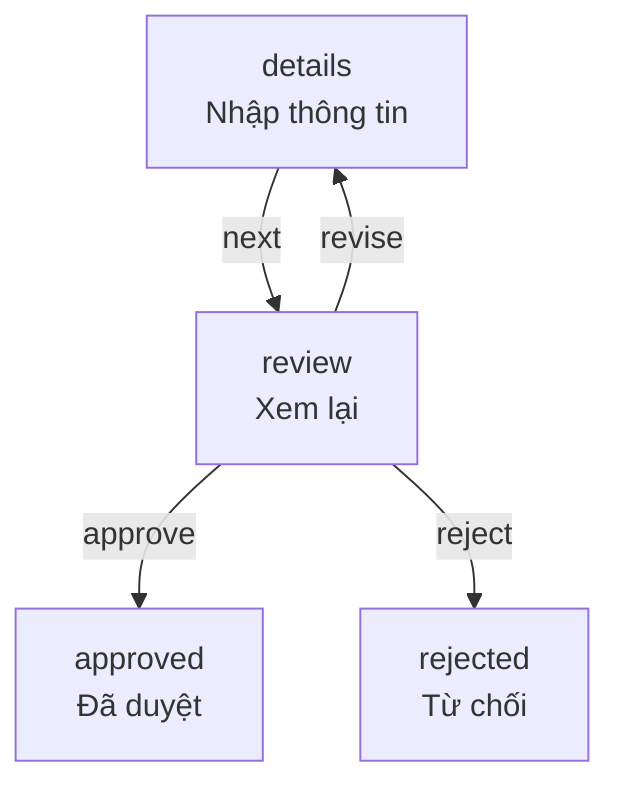

# Kiểm tra quyền ở URL, flow, state và transition

Một ứng dụng Spring Web Flow có thể cho người dùng đi qua nhiều màn hình, nhưng **không phải ai mở được URL cũng có quyền thực hiện mọi hành động trong flow**. Người dùng có thể đăng nhập và được phép mở quy trình đặt lịch, nhưng không được vào bước duyệt; một người quản lý có thể xem màn hình review nhưng không có quyền bấm xác nhận; một người có vai trò APPROVER vẫn không được duyệt một bản ghi thuộc tenant khác.

Vì vậy, kiểm tra quyền cần được đặt ở nhiều ranh giới. **Spring Security bảo vệ request URL**, còn Spring Web Flow có thể kiểm tra quyền khi bắt đầu flow, vào state hoặc thực hiện transition. Cuối cùng, service nghiệp vụ phải xác nhận quyền trên **tài nguyên cụ thể** trước khi đọc hoặc thay đổi dữ liệu.

Bài học thuộc chương **Kiểm thử tích hợp** của module **SPRING_WEB_FLOW**. Module mô hình hóa hành trình web nhiều bước qua **state, event, transition và subflow**, thực hành form binding, validation, quản lý scope/phiên, tích hợp Spring MVC và phục hồi lỗi. Ta sẽ dùng một flow duyệt đặt lịch để thiết kế chính sách quyền, cấu hình các tầng bảo vệ và kiểm thử bằng HTTP request thật trong Spring MVC test context.

## 1. Một người dùng có thể đi tới đâu và được làm gì?

Giả sử ứng dụng có flow `booking`:



Các vai trò:

- **USER**: tạo và xem yêu cầu đặt lịch của chính mình.
- **MANAGER**: vào màn hình review để kiểm tra yêu cầu.
- **APPROVER**: thực hiện transition approve.
- **ADMIN**: quản trị ứng dụng theo chính sách riêng.

Ta cần trả lời bốn câu hỏi khác nhau:

1. Người dùng có được gửi request tới URL của flow không?
2. Người dùng có được bắt đầu flow này không?
3. Người dùng có được vào một state cụ thể không?
4. Người dùng có được thực hiện transition cụ thể không?

Sau đó còn một câu hỏi ở tầng nghiệp vụ: **người dùng có quyền duyệt chính booking đang được tham chiếu không?**

| Ranh giới | Ví dụ chính sách | Thành phần phù hợp |
|---|---|---|
| URL / HTTP request | Chỉ người đã đăng nhập được gọi `/booking`; `/admin/**` cần ADMIN | Spring Security request authorization |
| Toàn flow | Chỉ USER mới được bắt đầu hành trình booking | `<secured>` ở cấp `<flow>` + `SecurityFlowExecutionListener` |
| State | Chỉ MANAGER được vào `review` | `<secured>` trong state |
| Transition | Chỉ APPROVER được thực hiện event `approve` | `<secured>` trong transition |
| Tài nguyên nghiệp vụ | Chỉ chủ sở hữu hoặc approver đúng tenant được duyệt booking ID đó | Service authorization / method security |

**Không có một tầng nào thay thế toàn bộ các tầng còn lại.** Bảo vệ URL giúp chặn request không được phép trước khi vào ứng dụng; flow security bảo vệ những điểm điều hướng bên trong hành trình; service authorization kiểm tra quyền trên dữ liệu thực tế.

## 2. Phân biệt xác thực và phân quyền

**Xác thực (authentication)** trả lời: “Người đang gửi request là ai?” Ví dụ Spring Security tạo một `Authentication` đại diện cho tài khoản đã đăng nhập.

**Phân quyền (authorization)** trả lời: “Danh tính này có được phép thực hiện hành động đang yêu cầu không?” Quyết định có thể dựa trên role, authority, tenant, chủ sở hữu dữ liệu hoặc trạng thái nghiệp vụ.

Ví dụ:

| Người dùng | Authorities | Hành động | Kết quả mong muốn |
|---|---|---|---|
| Chưa đăng nhập | Không có | GET `/booking` | Chuyển tới login hoặc trả 401 theo cấu hình |
| An | `ROLE_USER` | Bắt đầu booking | Được phép |
| An | `ROLE_USER` | Vào state review | Bị từ chối |
| Bình | `ROLE_MANAGER` | Vào review | Được phép nếu flow-level policy cũng cho phép |
| Chi | `ROLE_USER, ROLE_MANAGER` | approve | Bị từ chối nếu thiếu `ROLE_APPROVER` |
| Dũng | `ROLE_USER, ROLE_APPROVER` | approve booking thuộc tenant khác | Bị từ chối ở service nếu không có quyền trên booking |

Role và authority thường được gắn vào `Authentication` dưới dạng `GrantedAuthority`. Trong Spring Security, `hasRole("ADMIN")` là cách viết tiện cho authority `ROLE_ADMIN`; còn thuộc tính trong `<secured attributes="ROLE_ADMIN"/>` thường ghi đầy đủ tên authority.

**Đăng nhập thành công không có nghĩa là được phép với mọi flow hoặc mọi bản ghi.** Không dùng việc ẩn nút, đổi URL hoặc giữ một execution key như bằng chứng quyền đã được xác nhận.

## 3. Tầng 1 — Bảo vệ URL bằng Spring Security

Request của Spring MVC đi qua Spring Security filter chain trước khi tới `DispatcherServlet`. Ở tầng này, ứng dụng có thể áp dụng chính sách theo path và HTTP method.

Ví dụ Java configuration theo API `SecurityFilterChain` và `authorizeHttpRequests`:

```java
@Configuration
@EnableWebSecurity
public class WebSecurityConfiguration {

    @Bean
    SecurityFilterChain applicationSecurity(HttpSecurity http)
            throws Exception {

        http
            .authorizeHttpRequests(authorize -> authorize
                .requestMatchers("/login", "/public/**")
                    .permitAll()
                .requestMatchers("/booking", "/booking/**")
                    .authenticated()
                .requestMatchers("/admin/**")
                    .hasRole("ADMIN")
                .anyRequest()
                    .authenticated()
            )
            .formLogin(Customizer.withDefaults());

        return http.build();
    }
}
```

Đây là ví dụ cho Spring Security hiện đại. Cần bổ sung import và cấu hình authentication provider/login phù hợp với dự án. Nếu flow được công bố dưới path như `/flows/booking`, có context servlet riêng hoặc dùng custom URL handler, hãy thay request matcher theo **URL mà filter thực sự nhận**.

Ý nghĩa:

- `/booking` và các request tiếp tục flow dưới path đó yêu cầu người dùng đã xác thực.
- `/admin/**` yêu cầu authority tương ứng với `ROLE_ADMIN`.
- `/login` và `/public/**` được phép truy cập công khai để người chưa đăng nhập có thể mở trang login và tài nguyên public.
- Những request còn lại yêu cầu authentication; ứng dụng có thể thay rule cuối bằng `denyAll()` nếu đã cho phép tường minh login, tài nguyên tĩnh và mọi endpoint cần thiết.

### 3.1. URL matcher không biết state hiện tại

Trong nhiều cấu hình SWF, các state của cùng một flow được phục vụ thông qua **cùng flow URL**, còn execution key và event được truyền qua tham số hoặc cơ chế URL handler. Vì vậy, Spring Security request matcher thường nhìn thấy path `/booking`, không tự biết request đang ở state `details` hay `review`.

Đây là lý do cần thêm flow-level, state-level và transition-level security. Không cố phân quyền state chỉ bằng cách suy đoán query parameter `execution` hoặc tên event trong request URL.

Nếu thật sự cần custom request matcher theo query parameter hoặc method, hãy định nghĩa rõ hợp đồng HTTP và test riêng. Nhưng event/transition vẫn phải được bảo vệ tại flow và service để request giả mạo không vượt qua kiểm soát nghiệp vụ.

### 3.2. Thứ tự rule và phạm vi filter chain

Spring Security xét các request authorization rule theo thứ tự khai báo và dùng rule đầu tiên khớp. Hãy đặt rule cụ thể trước rule tổng quát:

```java
.authorizeHttpRequests(authorize -> authorize
    .requestMatchers("/admin/reports/**").hasAuthority("REPORT_VIEW")
    .requestMatchers("/admin/**").hasRole("ADMIN")
    .anyRequest().authenticated()
)
```

Ngoài `requestMatchers`, `securityMatcher` ở cấp `SecurityFilterChain` quyết định **filter chain nào** được chọn cho request. Nếu không có filter chain nào khớp, request có thể không được bảo vệ bởi chain mà bạn nghĩ đang áp dụng. Khi ứng dụng có nhiều servlet hoặc nhiều chain, phải test URL flow thực tế trong đúng servlet mapping.

### 3.3. URL security không thay thế CSRF

CSRF bảo vệ request thay đổi trạng thái khỏi một số kiểu gửi request xuyên site; nó **không xác nhận người dùng có quyền approve booking**. Một request có CSRF token hợp lệ vẫn phải qua authorization của flow và service.

Không tắt CSRF toàn ứng dụng chỉ để làm một test POST chạy được. Dùng Spring Security Test `csrf()` cho request hợp lệ và viết test riêng để chứng minh request thiếu token bị từ chối nếu chính sách yêu cầu.

## 4. Tầng 2 — Bảo vệ toàn flow bằng secured

Spring Web Flow cung cấp phần tử `<secured>` để khai báo security rule ngay trong flow definition. Để các rule này **thực sự được thực thi**, cần đủ ba phần:

1. Cấu hình Spring Security và authentication/authorization.
2. Đặt `<secured>` ở flow, state hoặc transition cần bảo vệ.
3. Đăng ký `SecurityFlowExecutionListener` vào `FlowExecutor`.

Thiếu listener, các rule trong XML không tự bảo vệ flow execution.

Ví dụ đặt rule ở cấp flow:

```xml
<flow xmlns="http://www.springframework.org/schema/webflow"
      xmlns:xsi="http://www.w3.org/2001/XMLSchema-instance"
      xsi:schemaLocation="
          http://www.springframework.org/schema/webflow
          http://www.springframework.org/schema/webflow/spring-webflow.xsd">

    <secured attributes="ROLE_USER"/>

    <view-state id="details" view="booking/details">
        <transition on="next" to="review"/>
    </view-state>

    <view-state id="review" view="booking/review">
        <transition on="approve" to="approved"/>
    </view-state>

    <end-state id="approved"/>
</flow>
```

Rule `ROLE_USER` được đặt trực tiếp bên trong `<flow>`, nên người dùng phải có authority đó để đi vào flow. Quy tắc này có ý nghĩa khác với rule URL: URL filter có thể chỉ yêu cầu authentication, còn flow yêu cầu thêm role USER.

### 4.1. Đăng ký SecurityFlowExecutionListener

Ví dụ cấu hình XML:

```xml
<webflow:flow-executor
        id="flowExecutor"
        flow-registry="flowRegistry">

    <webflow:flow-execution-listeners>
        <webflow:listener ref="securityFlowExecutionListener"/>
    </webflow:flow-execution-listeners>
</webflow:flow-executor>

<bean id="securityFlowExecutionListener"
      class="org.springframework.webflow.security.SecurityFlowExecutionListener"/>
```

Listener này kết nối các rule `<secured>` trong flow definition với cơ chế quyết định quyền của Spring Security. Nếu một quyết định bị từ chối, listener có thể ném `AccessDeniedException`; ngoại lệ cần được để lan tới cơ chế xử lý bảo mật phù hợp.

**Không bắt và nuốt `AccessDeniedException` trong action hoặc exception handler chung** rồi tiếp tục flow như thể thao tác thành công. Nếu làm vậy, người dùng có thể không được chuyển tới login/403 đúng chính sách, hoặc flow tiếp tục ở trạng thái không an toàn.

### 4.2. Flow-level rule có tác dụng gì?

Flow-level rule phù hợp với điều kiện chung cho toàn hành trình, chẳng hạn:

- Người dùng phải đăng nhập.
- Người dùng phải có role USER.
- Chỉ nhóm nhân viên mới được mở quy trình nội bộ.

Nó không đủ để kiểm tra quyền trên **một booking cụ thể**. Nếu flow nhận `bookingId` từ URL hoặc dữ liệu form, service vẫn phải tải bản ghi và xác minh chủ sở hữu/tenant trước khi trả thông tin hoặc ghi thay đổi.

## 5. Tầng 3 — Bảo vệ state

Một flow có thể cho USER nhập thông tin nhưng chỉ MANAGER được vào màn hình review. Đặt `<secured>` bên trong state cần bảo vệ:

```xml
<view-state id="review"
            view="booking/review">
    <secured attributes="ROLE_MANAGER"/>

    <transition on="back"
                to="details"
                bind="false"
                validate="false"/>

    <transition on="approve"
                to="approved"/>

    <transition on="reject"
                to="rejected"/>
</view-state>
```

Khi flow định vào `review`, security listener kiểm tra authority theo rule gắn với state. Người thiếu `ROLE_MANAGER` bị từ chối trước khi vào state được bảo vệ.

### 5.1. State security khác việc ẩn một trang

Nếu view không hiển thị link đến review nhưng state không được bảo vệ, người dùng vẫn có thể tìm cách kích hoạt event/điều hướng tới state thông qua request hoặc lỗi logic ở nơi khác. **Ẩn nút không phải authorization.**

Ngược lại, nếu state được bảo vệ mà view vẫn hiện nút cho mọi người, người không có quyền sẽ gặp lỗi khi gửi request. Đây là UX không tốt nhưng không làm rule mất hiệu lực. Nên kết hợp:

- Kiểm tra quyền phía server bằng `<secured>`.
- Ẩn/hiện nút theo quyền để giao diện dễ dùng.
- Hiển thị thông báo phù hợp khi quyền thay đổi.
- Kiểm tra quyền trên tài nguyên trong service.

### 5.2. State có thể cần quyền khác nhau

Một flow nội bộ có thể có các state:

| State | Quyền cần có | Mục đích |
|---|---|---|
| `details` | `ROLE_USER` | Người dùng nhập yêu cầu |
| `review` | `ROLE_MANAGER` | Quản lý xem nội dung |
| `audit` | `AUDIT_READ` | Nhân viên kiểm toán xem lịch sử |
| `adminOverride` | `ROLE_ADMIN` | Quản trị xử lý ngoại lệ |

Không nhất thiết mọi flow đều cần nhiều role. Hãy gắn rule ở nơi có ranh giới quyền thực sự, tránh tạo role quá nhỏ hoặc trùng nghĩa khiến chính sách khó vận hành.

## 6. Tầng 4 — Bảo vệ transition

Một người có thể được xem state `review` nhưng không được thực hiện mọi hành động trong state đó. Ví dụ MANAGER được xem booking, còn chỉ APPROVER mới được xác nhận.

Đặt `<secured>` bên trong transition:

```xml
<view-state id="review" view="booking/review">
    <secured attributes="ROLE_MANAGER"/>

    <transition on="approve" to="approved">
        <secured attributes="ROLE_APPROVER"/>
    </transition>

    <transition on="reject" to="rejected">
        <secured attributes="ROLE_REJECTOR"/>
    </transition>

    <transition on="revise"
                to="details"
                bind="false"
                validate="false"/>
</view-state>
```

Trong ví dụ:

- `ROLE_MANAGER` cần thiết để vào `review`.
- `ROLE_APPROVER` cần thiết để thực hiện transition `approve`.
- `ROLE_REJECTOR` cần thiết để thực hiện transition `reject`.
- `revise` không có rule riêng trong ví dụ; nó vẫn nằm dưới các chính sách flow/state và service liên quan.

Người có `ROLE_MANAGER` nhưng thiếu `ROLE_APPROVER` có thể xem review, nhưng không được thực hiện approve. Đây là cách tách **quyền đọc** và **quyền hành động**.

### 6.1. Transition security được kiểm tra khi nào?

Flow security listener kiểm tra transition được chọn tại giai đoạn thực thi transition, trước khi transition diễn ra. Do đó, request gửi event trực tiếp vẫn phải đi qua rule này; không phụ thuộc nút approve có xuất hiện trên HTML hay không.

Listener thực hiện quyết định ở những điểm trong vòng đời flow tương ứng: khi tạo flow session, khi chuẩn bị vào state và khi thực hiện transition. Đây là các **điểm kiểm tra theo giai đoạn**, không phải một bộ giám sát liên tục cho mọi lần đọc dữ liệu trong service. Quyền có thể bị thu hồi hoặc trạng thái booking có thể đổi sau khi người dùng đã vào review; service vẫn phải xác minh lại ngay trước thao tác có side effect.

### 6.2. Rule nhiều authority: any và all

Phần tử `secured` hỗ trợ danh sách authority và thuộc tính `match`:

```xml
<!-- Có ít nhất một trong hai authority -->
<secured attributes="ROLE_MANAGER, ROLE_ADMIN"
         match="any"/>

<!-- Cần cả hai authority -->
<secured attributes="ROLE_MANAGER, BOOKING_APPROVE"
         match="all"/>
```

- `match="any"`: cho phép nếu có ít nhất một authority phù hợp.
- `match="all"`: yêu cầu tất cả authority được liệt kê.
- Nếu bỏ `match`, mặc định thường là `any`.

Cách diễn giải cụ thể cần đối chiếu phiên bản SWF và decision manager/authorization manager đang sử dụng. Nếu đã thay bộ quyết định quyền mặc định, hãy kiểm thử rõ semantics của `match`; đừng giả định custom manager tự hiểu thuộc tính này như mặc định.

## 7. Kết hợp ba tầng URL, flow và state/transition

Ví dụ chính sách tổng thể:

~~~mermaid
flowchart TD
    R["HTTP request /booking"] --> U{"URL rule"}
    U -->|"Anonymous"| L["Login / 401"]
    U -->|"Authenticated"| F{"Flow rule ROLE_USER"}
    F -->|"Denied"| D1["Access denied"]
    F -->|"Allowed"| S{"State rule"}
    S -->|"Review cần MANAGER"| D2["Access denied nếu thiếu role"]
    S -->|"Allowed"| T{"Transition rule"}
    T -->|"approve cần APPROVER"| D3["Access denied nếu thiếu role"]
    T -->|"Allowed"| B["Service kiểm tra booking owner/tenant"]
    B -->|"Denied"| D4["Access denied"]
    B -->|"Allowed"| C["Thực hiện nghiệp vụ"]
~~~

Ví dụ ma trận:

| Request/hành động | Authentication | Flow | State | Transition | Service | Kết quả |
|---|---|---|---|---|---|---|
| GET bắt đầu booking | USER | ROLE_USER | details | — | — | Cho phép |
| GET bắt đầu booking | Anonymous | — | — | — | — | Login/401 |
| Vào review | USER | ROLE_USER | ROLE_MANAGER | — | — | Từ chối ở state |
| Vào review | MANAGER | ROLE_USER (nếu có) | ROLE_MANAGER | — | — | Cho phép |
| approve | MANAGER | ROLE_USER | ROLE_MANAGER | ROLE_APPROVER | — | Từ chối ở transition nếu thiếu APPROVER |
| approve | MANAGER + APPROVER | ROLE_USER | ROLE_MANAGER | ROLE_APPROVER | Không phải owner/tenant | Service từ chối |
| approve | MANAGER + APPROVER | ROLE_USER | ROLE_MANAGER | ROLE_APPROVER | Được phép trên booking | Cho phép nếu nghiệp vụ hợp lệ |

**Một request chỉ thành công khi đi qua mọi kiểm tra bắt buộc.** Nếu bị từ chối ở URL layer, flow chưa chạy. Nếu URL được phép nhưng state/transition bị từ chối, request đã tới flow nhưng không được tiếp tục. Nếu các rule flow đều pass mà service từ chối, đó là quyền trên tài nguyên hoặc điều kiện nghiệp vụ.

## 8. Flow XML hoàn chỉnh hơn cho quy trình duyệt

Ví dụ tích hợp các rule:

~~~xml
<?xml version="1.0" encoding="UTF-8"?>
<flow xmlns="http://www.springframework.org/schema/webflow"
      xmlns:xsi="http://www.w3.org/2001/XMLSchema-instance"
      xsi:schemaLocation="
          http://www.springframework.org/schema/webflow
          http://www.springframework.org/schema/webflow/spring-webflow.xsd">

    <secured attributes="ROLE_USER"/>

    <var name="draft"
         class="com.example.booking.BookingDraft"/>

    <view-state id="details"
                view="booking/details"
                model="draft">
        <binder>
            <binding property="customerName" required="true"/>
            <binding property="requestedDate" required="true"/>
        </binder>

        <transition on="next" to="review"/>
        <transition on="cancel"
                    to="cancelled"
                    bind="false"
                    validate="false"/>
    </view-state>

    <view-state id="review"
                view="booking/review"
                model="draft">
        <secured attributes="ROLE_MANAGER"/>

        <transition on="approve" to="persistApproval">
            <secured attributes="ROLE_APPROVER"/>
        </transition>

        <transition on="reject" to="rejected">
            <secured attributes="ROLE_REJECTOR"/>
        </transition>

        <transition on="revise"
                    to="details"
                    bind="false"
                    validate="false"/>
    </view-state>

    <action-state id="persistApproval">
        <evaluate expression="bookingService.approve(draft.id)"/>
        <transition on="success" to="approved"/>
    </action-state>

    <end-state id="approved"/>
    <end-state id="rejected"/>
    <end-state id="cancelled"/>
</flow>
~~~

Ví dụ này giả định `BookingDraft` có thuộc tính `id`, bean `bookingService` được đăng ký và action trả về outcome `success` theo hợp đồng SWF. Nếu dữ liệu được tạo bởi người dùng ở bước details, flow-level `ROLE_USER` không có nghĩa người đó được tự duyệt; state và transition yêu cầu thêm quyền.

**Điểm quan trọng:** service `bookingService.approve(draft.id)` phải tải booking từ kho dữ liệu và kiểm tra người đang gọi có quyền duyệt bản ghi đó. Không tin `draft.id` chỉ vì nó nằm trong flow scope; dữ liệu flow có thể bắt nguồn từ request và phải được kiểm tra.

Nếu service ném `AccessDeniedException`, đừng biến ngoại lệ thành outcome `success`. Hãy để cơ chế bảo mật xử lý hoặc ánh xạ theo chính sách rõ ràng, bảo đảm không có side effect nào xảy ra trước khi quyền được xác nhận.

## 9. Tích hợp SecurityFlowExecutionListener với FlowExecutor

Một flow definition chứa `<secured>` nhưng listener không được đăng ký thì **flow security rules không được xử lý như mong đợi**. Cấu hình executor phải sử dụng listener:

~~~xml
<webflow:flow-executor id="flowExecutor"
                       flow-registry="flowRegistry">
    <webflow:flow-execution-listeners>
        <webflow:listener ref="securityFlowExecutionListener"/>
    </webflow:flow-execution-listeners>
</webflow:flow-executor>

<bean id="securityFlowExecutionListener"
      class="org.springframework.webflow.security.SecurityFlowExecutionListener"/>
~~~

Kiểm tra các điểm sau khi tích hợp:

- Bean listener tồn tại trong Spring context mà flow executor dùng.
- Executor thực sự được Spring MVC `FlowHandlerAdapter` sử dụng.
- Dependency Spring Web Flow và Spring Security tương thích với nhau.
- Spring Security filter chain đang bảo vệ đúng servlet/request path.
- Authentication hiện tại được truyền tới request/flow execution.
- Các `AccessDeniedException` không bị custom handler bắt và bỏ qua.

### 9.1. Khác biệt API giữa Web Flow 2.x và 3.x

Phiên bản ảnh hưởng cách tùy biến decision logic:

- Ở các bản Web Flow 2.x, tài liệu thường mô tả `SecurityFlowExecutionListener` sử dụng `AccessDecisionManager`.
- Từ Web Flow 3.0.1, API `AccessDecisionManager` trong listener được đánh dấu deprecated để chuyển sang `AuthorizationManager`.
- Web Flow 3.0.1+ cung cấp `setAuthorizationManagerInitializer(...)` để tùy biến authorization manager theo từng `SecurityRule`.

Không copy một cấu hình custom `AccessDecisionManager` cũ vào ứng dụng Web Flow 3.x mới mà không kiểm tra cảnh báo deprecation và API đang có. Nếu chỉ dùng role/authority thông thường, cấu hình listener mặc định có thể đã đủ; chỉ tùy biến khi chính sách thật sự cần.

## 10. Phân quyền theo tài nguyên: role không đủ cho mọi trường hợp

Một rule như:

~~~xml
<secured attributes="ROLE_APPROVER"/>
~~~

chỉ trả lời người gọi có authority APPROVER hay không. Nó không tự trả lời:

- Booking có thuộc tenant của người này không?
- Người này có được phân công duyệt booking này không?
- Booking còn ở trạng thái PENDING không?
- Booking đã bị người khác duyệt chưa?
- Người dùng có quyền xem email hoặc dữ liệu cá nhân trong booking không?

Đây là **object-level authorization**. Hãy kiểm tra tại service, nơi có thể tải tài nguyên và áp dụng chính sách theo dữ liệu thực:

~~~java
@Service
public class BookingService {

    private final BookingRepository repository;
    private final BookingAuthorization authorization;

    public BookingService(
            BookingRepository repository,
            BookingAuthorization authorization) {
        this.repository = repository;
        this.authorization = authorization;
    }

    @Transactional
    @PreAuthorize("hasAuthority('ROLE_APPROVER')")
    public String approve(UUID bookingId) {
        Authentication actor = SecurityContextHolder.getContext()
                .getAuthentication();
        Booking booking = repository.findById(bookingId)
                .orElseThrow(BookingNotFoundException::new);

        if (!authorization.canApprove(actor, booking)) {
            throw new AccessDeniedException(
                    "Không có quyền duyệt yêu cầu này");
        }

        if (booking.getStatus() != BookingStatus.PENDING) {
            throw new InvalidBookingStateException();
        }

        booking.approve(actor.getName());
        return "success";
    }
}
~~~

Đây là ví dụ về cấu trúc; `BookingAuthorization`, repository và exception là thành phần do ứng dụng định nghĩa. `@PreAuthorize` cần method security được bật bằng `@EnableMethodSecurity`; `SecurityContextHolder` cung cấp principal hiện tại để kiểm tra quyền theo booking. Phương thức trả về `success` để action-state có thể phát outcome tương ứng trong ví dụ XML. Nên dùng transaction/locking hoặc optimistic version phù hợp để hai approver không đồng thời duyệt cùng một booking ở trạng thái cũ. Chữ ký `approve(UUID bookingId)` cũng khớp với lời gọi `bookingService.approve(draft.id)` trong flow XML ở phần 8.

Ví dụ trên dùng method security với `@PreAuthorize`; cấu hình ứng dụng cần bật `@EnableMethodSecurity`. Kiểm tra quyền theo chủ sở hữu/tenant vẫn cần truy cập tài nguyên thực tế và không nên chỉ dựa trên một tham số do client gửi.

### 10.1. Không tin dữ liệu hidden field hoặc flowScope như nguồn quyền

Ví dụ form gửi:

~~~html
<input type="hidden" name="bookingId" value="123"/>
<input type="hidden" name="ownerId" value="current-user"/>
~~~

Người dùng có thể sửa các giá trị này. Flow scope giúp duy trì dữ liệu giữa các bước, nhưng **không biến dữ liệu thành đáng tin cậy**. Khi thực hiện thao tác, service phải tải booking theo ID và kiểm tra quyền bằng principal đã xác thực, tenant hiện tại và trạng thái server-side.

### 10.2. Không dựa vào tên state để phân quyền

State ID `review` là tên nội bộ của flow definition, không phải role. Việc UI chỉ render link tới review cho MANAGER không đủ. Hãy đặt secured rule trong state và kiểm tra service ở mọi hành động có side effect.

## 11. Subflow cần chính sách bảo vệ riêng

Một flow cha có thể gọi subflow xác minh địa chỉ hoặc phê duyệt thanh toán. Không nên mặc định vì flow cha đã được bảo vệ thì mọi cách gọi subflow đều được bảo vệ theo cùng chính sách.

Ví dụ:

~~~xml
<subflow-state id="paymentReview"
               subflow="payment-review">
    <secured attributes="ROLE_PAYMENT_REVIEWER"/>

    <input name="paymentId"
           value="draft.paymentId"/>

    <transition on="approved" to="complete"/>
    <transition on="rejected" to="paymentError"/>
</subflow-state>
~~~

Rule trên bảo vệ việc đi vào subflow-state trong flow cha. Nếu `payment-review` cũng có thể được khởi động độc lập hoặc có các state/transition nhạy cảm, hãy khai báo rule ở flow/state/transition của **flow con** và bảo đảm listener áp dụng cho execution đó.

Ngoài ra, service xử lý thanh toán vẫn phải xác minh quyền trên payment record. Input mapping từ flow cha chỉ là dữ liệu truyền vào, không phải bằng chứng quyền.

## 12. AccessDeniedException và phục hồi điều hướng

Khi listener từ chối flow/state/transition, nó có thể ném `AccessDeniedException`. Spring Security có thể dùng exception này để chuyển người dùng chưa xác thực tới login hoặc trả phản hồi từ chối theo cấu hình.

Phân biệt:

| Tình trạng | Kết quả thường mong đợi |
|---|---|
| Chưa xác thực, truy cập URL được bảo vệ | Redirect tới login hoặc 401 tùy authentication entry point |
| Đã đăng nhập nhưng thiếu role ở URL | 403 hoặc trang access denied |
| Được URL cho phép nhưng thiếu role ở flow/state | Từ chối flow execution, đi qua exception handling của Spring Security |
| Được vào state nhưng thiếu authority ở transition | Không thực hiện transition; không chạy action phía sau |
| Role đúng nhưng không sở hữu tài nguyên | Service từ chối; không có side effect |
| CSRF token thiếu/sai | Filter từ chối request trước khi flow xử lý |

Không khẳng định mọi ứng dụng đều trả đúng một mã HTTP cho mọi trường hợp; login entry point, access denied handler, exception translation và servlet integration quyết định response cuối cùng.

### 12.1. Đừng biến lỗi quyền thành event nghiệp vụ bình thường

Một lỗi validation như email sai có thể được hiển thị ngay tại form. Một lỗi authorization không nên bị biến thành message “dữ liệu chưa hợp lệ” rồi tiếp tục hành trình.

Nếu custom exception handler bắt mọi exception và chuyển về state `review`, hãy bảo đảm `AccessDeniedException` được xử lý riêng hoặc được để lan tới Spring Security. Nếu không, một người thiếu quyền có thể vẫn nhận được dữ liệu hoặc thực hiện action mà flow tưởng đã từ chối.

### 12.2. Thông báo an toàn

Thông báo cho người dùng nên đủ rõ để họ biết cần đăng nhập, liên hệ quản trị viên hoặc quay về danh sách. Không tiết lộ:

- Tên role nội bộ hoặc danh sách authority đầy đủ.
- Chi tiết policy/tenant của người khác.
- ID tài nguyên mà người dùng không được biết.
- Stack trace, query hoặc dữ liệu nhạy cảm.

Log nội bộ có thể ghi audit event theo correlation ID và user ID phù hợp chính sách, nhưng không log session cookie, CSRF token hay execution key đầy đủ.

## 13. Kiểm thử quyền ở cả bốn tầng

Một test flow engine có thể chứng minh transition hoạt động, nhưng không chứng minh Spring Security filter chặn URL. Một HTTP test chỉ kiểm tra 403 cũng chưa chứng minh action không ghi dữ liệu. Cần thiết kế test theo đúng ranh giới.

### 13.1. Ma trận vai trò và request

| Test | Authentication | Request / event | Quyền thiếu | Kết quả |
|---|---|---|---|---|
| S01 | Anonymous | GET `/booking` | Đăng nhập | Login/401 |
| S02 | USER | GET `/booking` | Không thiếu | Mở flow |
| S03 | USER | Vào `review` | MANAGER | Bị từ chối |
| S04 | MANAGER + USER | Vào `review` | Không thiếu | Vào được review |
| S05 | MANAGER + USER | Event `approve` | APPROVER | Bị từ chối |
| S06 | MANAGER + USER + APPROVER | Event `approve` | Không thiếu role | Transition được phép |
| S07 | APPROVER | Approve booking tenant khác | Quyền trên tài nguyên | Service từ chối |
| S08 | APPROVER | POST không CSRF | CSRF token | Filter từ chối nếu CSRF bật |
| S09 | USER | Gửi trực tiếp event approve | APPROVER | Không thể vượt transition rule |
| S10 | User có quyền trước đó | Quyền bị thu hồi giữa hành trình | Quyền hiện tại | Service phải kiểm tra lại trước side effect |

### 13.2. Test URL bằng MockMvc

Ví dụ dùng Spring Security Test:

~~~java
@SpringBootTest
@AutoConfigureMockMvc
class BookingUrlAuthorizationIT {

    @Autowired
    MockMvc mvc;

    @Test
    void anonymousCannotOpenBookingFlow() throws Exception {
        mvc.perform(get("/booking"))
            .andExpect(status().is3xxRedirection());
    }

    @Test
    @WithMockUser(roles = "USER")
    void authenticatedUserCanOpenBookingFlow() throws Exception {
        mvc.perform(get("/booking"))
            .andExpect(status().isOk());
    }

    @Test
    @WithMockUser(roles = "USER")
    void userCannotOpenAdminUrl() throws Exception {
        mvc.perform(get("/admin/bookings"))
            .andExpect(status().isForbidden());
    }
}
~~~

Ví dụ giả định ứng dụng dùng form login nên anonymous được redirect; nếu cấu hình REST-style entry point, assertion có thể là 401. URL và view response cần điều chỉnh theo ứng dụng. Quan trọng là **filter chain thực sự được nạp trong test**; nếu test slice bỏ qua security filters, kết quả PASS không chứng minh URL được bảo vệ.

### 13.3. Test transition trực tiếp, không chỉ test nút giao diện

Ở flow `review`, ẩn nút approve với người không có APPROVER là UX tốt nhưng chưa đủ. Test cần gửi POST event `approve` trực tiếp tới **flow execution URL** đang hoạt động, giữ session và CSRF token hợp lệ, sau đó xác nhận:

- Security listener từ chối transition.
- Flow không đi vào state `approved`.
- Service `bookingService.approve(...)` không được gọi.
- Không có bản ghi hoặc side effect được tạo.
- Response được xử lý theo access denied policy của ứng dụng.

Nếu test chỉ xác nhận HTML không có nút approve, request giả mạo vẫn có thể chưa được kiểm tra.

### 13.4. Test service với tài nguyên khác chủ sở hữu

Dùng test service hoặc integration test với dữ liệu hai tenant:

1. Tạo booking thuộc tenant A.
2. Đăng nhập actor thuộc tenant B nhưng có role APPROVER.
3. Đặt SecurityContext của test thành actor B rồi gọi `bookingService.approve(bookingIdA)`.
4. Xác nhận `AccessDeniedException` hoặc kết quả từ chối theo contract.
5. Xác nhận trạng thái booking vẫn là PENDING và không có audit/notification side effect giả thành công.

Test này bảo vệ against IDOR và chứng minh role không thay thế quyền trên tài nguyên.

### 13.5. Test CSRF riêng

Với Spring Security Test, request hợp lệ có thể thêm `.with(csrf())`. Một test khác cố ý bỏ token:

~~~java
@Test
@WithMockUser(roles = "USER")
void postWithoutCsrfIsRejected() throws Exception {
    mvc.perform(post("/booking")
            .param("_eventId_next", ""))
        .andExpect(status().isForbidden());
}
~~~

Test này chỉ có ý nghĩa nếu CSRF đang bật và endpoint thực sự nằm trong filter chain. Đừng dùng nó để kết luận người dùng thiếu role; đây là hai lý do từ chối khác nhau.

## 14. Các lỗi cấu hình và cách chẩn đoán

| Triệu chứng | Nguyên nhân có thể | Cách kiểm tra |
|---|---|---|
| URL được mở dù chưa đăng nhập | Request matcher không khớp, filter chain không áp dụng, endpoint nằm ngoài chain | Kiểm tra URL thực, servlet path và SecurityFilterChain |
| Có `<secured>` nhưng state vẫn vào được | Chưa đăng ký SecurityFlowExecutionListener hoặc executor dùng listener khác | Kiểm tra flow executor thực tế |
| Flow bị từ chối ngay khi bắt đầu | Flow-level rule yêu cầu authority người dùng chưa có | Kiểm tra Authentication và authorities |
| Vào review được nhưng approve bị từ chối | Transition rule cần role khác | Kiểm tra `<secured>` trong transition |
| Nút bị ẩn nhưng POST event vẫn chạy | Chỉ kiểm soát giao diện, thiếu transition/service rule | Gửi trực tiếp event trong HTTP test |
| Có role APPROVER nhưng vẫn duyệt được booking tenant khác | Chưa có object-level authorization | Kiểm tra service tải bản ghi và owner/tenant |
| Luôn nhận login redirect thay vì 403 | Authentication entry point/exception translation | Phân biệt anonymous với authenticated nhưng thiếu quyền |
| Không có response phù hợp sau AccessDeniedException | Custom handler bắt/nuốt exception | Kiểm tra exception flow và propagation |
| Test pass nhưng production bỏ qua quyền | Test context không nạp filter/listener thật hoặc khác cấu hình | Dùng integration context tương đương runtime |
| Subflow không được bảo vệ khi gọi trực tiếp | Chỉ bảo vệ state ở flow cha | Bảo vệ flow/state/transition của subflow và service |

### 14.1. Kiểm tra Authentication tại request

Khi debug, cần xác nhận principal và authorities thực tế trong request. Đừng suy luận từ tên tài khoản hoặc label hiển thị trên giao diện. Nếu dùng custom user details, kiểm tra mapping role/authority và prefix `ROLE_`.

### 14.2. Kiểm tra listener đang gắn vào đúng executor

Một ứng dụng có thể tạo nhiều `FlowExecutor` hoặc nhiều registry. Nếu MVC adapter dùng executor không có security listener, cấu hình listener ở một executor khác sẽ không bảo vệ flow đang chạy. Kiểm tra wiring từ `FlowHandlerAdapter` tới executor thực tế.

### 14.3. Không để exception bị chuyển thành outcome thành công

Tìm các `try/catch` quanh action/service và exception handler. Đảm bảo `AccessDeniedException` không bị chuyển thành `success`, không bị nuốt, và không dẫn tới việc ghi dữ liệu sau khi quyền bị từ chối.

## 15. Bài tập thực hành: bảo vệ quy trình duyệt đặt lịch

Xây dựng flow `booking` có các state:

```text
details → review → approved
                  └→ rejected
```

Áp dụng chính sách:

- Tất cả request vào `/booking` cần authentication.
- Chỉ `ROLE_USER` được khởi động flow.
- Chỉ `ROLE_MANAGER` được vào `review`.
- Chỉ `ROLE_APPROVER` được thực hiện `approve`.
- Chỉ `ROLE_REJECTOR` được thực hiện `reject`.
- Service chỉ cho phép approver được phân công và thuộc tenant phù hợp duyệt booking.

**Các bước:**

1. Cấu hình Spring Security URL rules và xác nhận matcher khớp URL flow thực tế.
2. Thêm `<secured attributes="ROLE_USER"/>` ở flow root.
3. Thêm `<secured attributes="ROLE_MANAGER"/>` ở state review.
4. Thêm secured rule riêng cho transition approve và reject.
5. Đăng ký `SecurityFlowExecutionListener` vào đúng `FlowExecutor`.
6. Tạo service kiểm tra booking owner, tenant, trạng thái và quyền của actor.
7. Viết HTTP test anonymous, USER, MANAGER, APPROVER và REJECTOR.
8. Gửi trực tiếp event approve từ người thiếu quyền; xác nhận transition và service không chạy.
9. Test approver có role nhưng không thuộc tenant; xác nhận service từ chối.
10. Kiểm tra CSRF, subflow và response AccessDeniedException theo cấu hình thực tế.

### Câu hỏi tự kiểm tra

**1. URL rule và flow rule khác nhau thế nào?** URL rule bảo vệ request path ở filter chain; flow rule được kiểm tra bởi security listener khi flow bắt đầu/đi vào các giai đoạn được bảo vệ.

**2. Vì sao thêm `<secured>` mà quên listener là chưa đủ?** Vì phần tử chỉ khai báo rule trong flow definition; `SecurityFlowExecutionListener` mới thực hiện quyết định quyền trong execution.

**3. Có thể dùng state security để thay thế URL security không?** Không. URL filter có thể chặn request trước khi vào flow; state security bảo vệ điểm điều hướng bên trong flow.

**4. Nếu MANAGER được xem review nhưng không được approve, đặt rule ở đâu?** Đặt `ROLE_MANAGER` trên state review và `ROLE_APPROVER` trên transition approve.

**5. Vì sao role APPROVER không đủ để duyệt mọi booking?** Vì cần kiểm tra quyền trên tài nguyên cụ thể như owner, tenant, người được phân công và trạng thái booking.

**6. Ẩn nút approve có bảo vệ transition không?** Không. Request có thể được gửi trực tiếp; cần secured rule ở transition và kiểm tra service.

**7. CSRF có thay thế authorization không?** Không. CSRF chống một kiểu request xuyên site; authorization quyết định người dùng có quyền thực hiện hành động hay không.

**8. Nếu AccessDeniedException bị catch trong action thì sao?** Spring Security có thể không nhận được ngoại lệ để chuyển login/403 theo chính sách; không được nuốt hoặc biến nó thành success.

## 16. Checklist trước khi phát hành

- [ ] URL flow được bảo vệ bởi đúng Spring Security filter chain.
- [ ] Các rule URL có thứ tự rõ ràng, không để matcher tổng quát che matcher cụ thể.
- [ ] Authentication và authority mapping đã được xác minh bằng test.
- [ ] Flow root có `<secured>` khi cần giới hạn người được bắt đầu.
- [ ] State nhạy cảm có secured rule ở đúng state.
- [ ] Transition có side effect hoặc hành động đặc quyền có secured rule.
- [ ] `SecurityFlowExecutionListener` được gắn vào đúng `FlowExecutor` mà MVC sử dụng.
- [ ] Version SWF/Spring Security tương thích; không dùng API deprecated mà chưa có kế hoạch.
- [ ] Subflow và đường vào trực tiếp của subflow có chính sách riêng.
- [ ] Service kiểm tra quyền trên tài nguyên cụ thể, tenant, owner và trạng thái.
- [ ] Không tin hidden field, execution key hoặc dữ liệu trong flow scope như bằng chứng quyền.
- [ ] CSRF được bật và kiểm thử theo request thay đổi trạng thái.
- [ ] AccessDeniedException được truyền tới cơ chế xử lý bảo mật phù hợp.
- [ ] Test anonymous, role thiếu, role đủ, event giả mạo và tài nguyên khác tenant.
- [ ] Test xác nhận action/service không tạo side effect khi bị từ chối.
- [ ] Log/audit không làm lộ cookie, token, execution key hoặc dữ liệu cá nhân.

**Ghi nhớ:** Bảo vệ Spring Web Flow cần nhiều ranh giới phối hợp: **URL security** chặn request không được phép; **flow/state/transition security** kiểm tra quyền điều hướng bên trong hành trình; **service authorization** xác minh quyền trên bản ghi thực tế trước khi thực hiện nghiệp vụ. Để rule trong flow có hiệu lực, phải đăng ký `SecurityFlowExecutionListener` vào đúng `FlowExecutor`. Kiểm thử bằng request trực tiếp, không chỉ kiểm tra nút hiển thị, để bảo đảm người dùng không thể vượt quyền bằng cách tự gửi event hoặc sửa dữ liệu.

### Tài liệu tham khảo

- [Spring Web Flow 3.0 Reference — Securing Flows](https://docs.spring.io/spring-webflow/docs/3.0.2/reference/)
- [Spring Web Flow 2.5.1 Reference — Securing Flows](https://docs.spring.io/spring-webflow/docs/2.5.1.RELEASE/reference/htmlsingle/)
- [SecurityFlowExecutionListener API — Spring Web Flow 3.0.1](https://docs.spring.io/spring-webflow/docs/3.0.1/api/org/springframework/webflow/security/SecurityFlowExecutionListener.html)
- [Spring Security Reference — Authorize HttpServletRequests](https://docs.spring.io/spring-security/reference/servlet/authorization/authorize-http-requests.html)
- [Spring Security Reference — Java Configuration](https://docs.spring.io/spring-security/reference/servlet/configuration/java.html)

