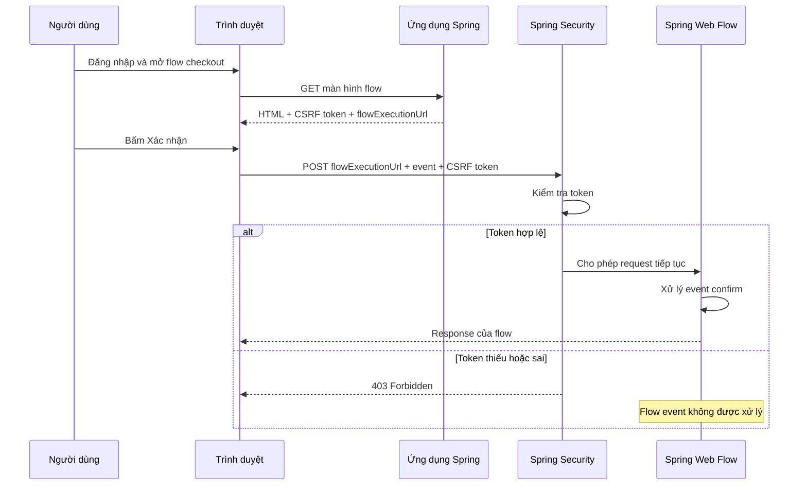
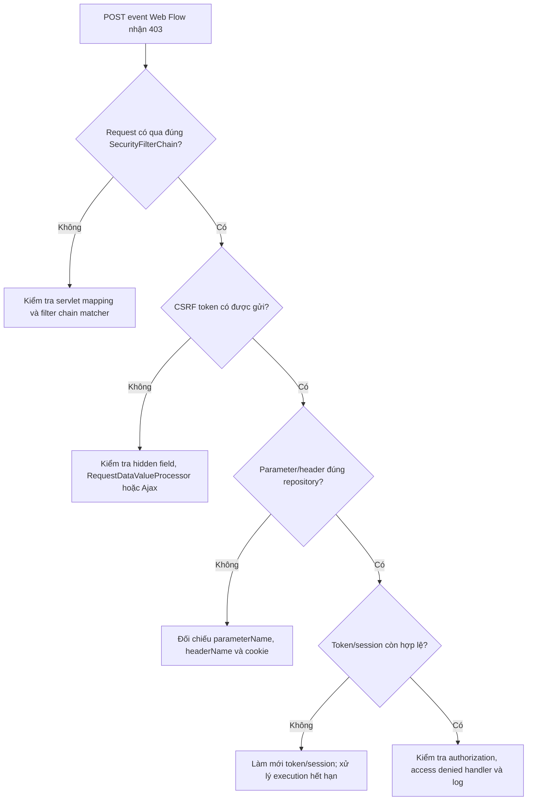

# Kiểm tra token CSRF cho các yêu cầu thay đổi trạng thái

Một flow Spring Web Flow thường xử lý dữ liệu qua nhiều request: người dùng mở màn hình, nhập biểu mẫu, chuyển bước, xác nhận hoặc hủy thao tác. Khi ứng dụng dùng xác thực dựa trên session/cookie, trình duyệt có thể tự gửi thông tin đăng nhập kèm request. Kẻ tấn công có thể lợi dụng hành vi đó để khiến trình duyệt gửi một yêu cầu thay đổi dữ liệu ngoài ý muốn. Đây là kiểu tấn công **Cross-Site Request Forgery (CSRF)**.

Spring Security bảo vệ các request thay đổi trạng thái bằng **CSRF token**. Với Spring Web Flow, điều quan trọng là mọi POST/PUT/PATCH/DELETE đi vào FlowExecutor và có thể làm thay đổi execution hoặc dữ liệu nghiệp vụ đều phải đi qua cơ chế kiểm tra token. Một flow execution key, event ID hay URL tiếp tục flow không thay thế được CSRF token.

Bài này thuộc chương **Kiểm thử tích hợp** của module **SPRING_WEB_FLOW**. Nội dung kết nối state, event, transition, form binding, validation, scope, Spring MVC, subflow và phục hồi flow execution. Bạn sẽ cấu hình bảo vệ, đưa token vào form/Ajax request, kiểm tra filter chain và viết integration test cho token thiếu, sai và hợp lệ.

Sau bài học, bạn có thể:

1. Giải thích vì sao request tiếp tục flow cần CSRF protection khi dùng session/cookie authentication.
2. Phân biệt CSRF token với flow execution key, event ID, session ID và authentication.
3. Bảo đảm form JSP/Spring Form Tags gửi token khi phát event của Web Flow.
4. Gửi token qua header hoặc form data khi dùng Ajax.
5. Giữ CSRF protection cho cả flow cha, subflow và các URL FlowExecutor.
6. Kiểm thử token thiếu, token sai, token hợp lệ, request an toàn và request Ajax bằng Spring Security Test/MockMvc.
7. Xử lý token hết hạn, session thay đổi và response 403 mà không vô tình thực hiện lại thao tác ghi.

## 1. CSRF xảy ra như thế nào trong một flow nhiều bước?

Giả sử người dùng đã đăng nhập vào ứng dụng đặt hàng. Trình duyệt giữ session cookie và tự gửi cookie đó tới domain ứng dụng. Người dùng mở một trang bên ngoài có nội dung độc hại. Trang đó cố gửi một POST tới endpoint đang xử lý flow checkout, chẳng hạn event xác nhận đơn hàng.

Nếu server chỉ kiểm tra session cookie, request có thể được xem là đến từ người dùng đã đăng nhập. Browser gửi cookie tự động; nó không chứng minh người dùng chủ động bấm nút xác nhận trong ứng dụng.

CSRF token bổ sung một giá trị khó đoán mà trang bên ngoài không thể đọc từ origin của ứng dụng. Server so sánh token nhận được với token hợp lệ gắn với request/session hoặc cơ chế repository đã cấu hình. Request thiếu hoặc sai token bị từ chối trước khi event của Web Flow được xử lý.



Điểm kiểm soát thường nằm trong Spring Security filter chain, trước khi request được chuyển tới Spring MVC/FlowExecutor. Vì vậy, với token sai, transition confirm và action đặt hàng không được chạy.

### Vì sao flow nhiều bước vẫn cần token?

Mỗi lần submit form có thể:

- Cập nhật model trong flowScope hoặc viewScope.
- Chuyển sang view-state khác.
- Gọi subflow.
- Ghi dữ liệu hoặc thực hiện side effect.
- Kết thúc flow execution.

Một request có thể chỉ chuyển state nhưng vẫn thay đổi trạng thái execution. Hãy bảo vệ các request đó khi chúng dùng cơ chế xác thực tự động của browser.

## 2. Phân biệt CSRF token với các định danh khác

Các giá trị dưới đây thường xuất hiện cùng nhau trong request Web Flow nhưng có mục đích khác nhau:

| Giá trị | Mục đích | Có thay thế CSRF token không? |
| --- | --- | --- |
| CSRF token | Chứng minh request có token mà trang hợp lệ của ứng dụng nhận được | Đây là giá trị được kiểm tra cho CSRF |
| Flow execution key/URL | Xác định execution cần tiếp tục | Không |
| Event ID, ví dụ _eventId_confirm | Chọn transition/event trong flow | Không |
| Session cookie | Nhận diện session đã xác thực | Không |
| Authentication principal | Xác định người dùng đã đăng nhập | Không |
| Authorization check | Xác định người dùng có quyền làm hành động hay không | Không |

Một URL như flowExecutionUrl có thể chứa execution key. Kẻ tấn công không thể đọc nội dung trang cùng origin để lấy token nếu không có lỗ hổng khác, nhưng không nên coi execution key là cơ chế CSRF. URL có thể bị lộ qua log, lịch sử, referrer hoặc các đường dẫn chia sẻ; CSRF token phải được truyền theo cơ chế riêng.

CSRF cũng không thay thế authorization. Một request có token hợp lệ vẫn phải kiểm tra người dùng có quyền xác nhận đúng đơn hàng hay không.

## 3. Phương thức HTTP và nguyên tắc thay đổi trạng thái

Theo cấu hình CSRF mặc định phổ biến của Spring Security, các phương thức an toàn GET, HEAD, TRACE, OPTIONS thường không yêu cầu CSRF token; các phương thức thay đổi trạng thái như POST, PUT, PATCH, DELETE được kiểm tra.

Vì vậy, thiết kế flow nên tuân thủ:

- GET dùng để mở trang, render view hoặc đọc dữ liệu.
- POST dùng để gửi event làm thay đổi execution hoặc dữ liệu nghiệp vụ.
- PUT, PATCH, DELETE nếu được ứng dụng sử dụng cũng cần token theo cấu hình bảo vệ.
- Không đặt thao tác xác nhận, hủy đặt chỗ, thanh toán hay cập nhật dữ liệu trên GET.

Ví dụ flow:

```xml
<view-state id="reviewOrder" view="checkout/review">
    <transition on="edit" to="enterDetails"/>
    <transition on="confirm" to="submitOrder"/>
    <transition on="cancel" to="cancelled"/>
</view-state>

<action-state id="submitOrder">
    <evaluate expression="orderService.submit(order)"/>
    <transition on="success" to="completed"/>
</action-state>
```

Các event confirm và cancel được gửi bằng POST từ form. Việc render màn reviewOrder bằng GET không nên tự submit đơn hoặc hủy đơn.

**Lưu ý:** Spring Security quyết định request nào cần token dựa trên HTTP method và cấu hình matcher, chứ không tự hiểu event nào trong XML là nghiệp vụ thay đổi trạng thái. Nếu ứng dụng dùng GET để gửi event có side effect, bộ lọc mặc định có thể không bảo vệ event đó. Hãy sửa thiết kế HTTP method thay vì dựa vào tên event.

## 4. Bật CSRF protection trong Spring Security

Trong ứng dụng Spring Security hiện đại, CSRF protection được bật mặc định với cấu hình web thông thường. Có thể cấu hình tường minh để người đọc thấy chính sách:

```java
import org.springframework.context.annotation.Bean;
import org.springframework.security.config.Customizer;
import org.springframework.security.config.annotation.web.builders.HttpSecurity;
import org.springframework.security.web.SecurityFilterChain;

@Bean
SecurityFilterChain applicationSecurity(HttpSecurity http) throws Exception {
    http
        .authorizeHttpRequests(authorize -> authorize
            .requestMatchers("/assets/**").permitAll()
            .anyRequest().authenticated()
        )
        .csrf(Customizer.withDefaults());

    return http.build();
}
```

Đây là cấu hình minh họa cho Spring Security 6.x. Ứng dụng cần bổ sung chính sách đăng nhập, phân quyền và các matcher phù hợp với URL thực tế. Với phiên bản cũ hoặc XML namespace, cú pháp cấu hình khác nhưng nguyên tắc vẫn là để CSRF filter bảo vệ endpoint nhận request của flow.

### Không loại FlowExecutor khỏi CSRF matcher

Một lỗi nguy hiểm là thêm ngoại lệ rộng như bỏ qua toàn bộ /flows/**, /webflow/** hoặc endpoint xử lý event vì “Web Flow đã có execution key”. Execution key không chống CSRF. Nếu FlowExecutor nhận POST dùng session cookie, request đó vẫn cần token.

Chỉ loại trừ một endpoint khi có lý do kiến trúc cụ thể, chẳng hạn API stateless không dùng credential tự động gửi bởi browser, và đã có cơ chế xác thực phù hợp. Không tạo ngoại lệ cho toàn bộ ứng dụng để sửa lỗi 403 trên một form.

### Filter chain phải bao phủ URL thực tế

Kiểm tra mapping của DispatcherServlet, FlowHandlerMapping và FlowExecutor trong ứng dụng. Spring Security cần áp dụng cho URL mà browser thực sự POST tới, không chỉ URL trang hiển thị. Nếu request đi vào một servlet path khác hoặc một filter chain riêng, hãy kiểm tra thứ tự và matcher tương ứng.

## 5. Token được lưu và xác minh như thế nào?

Spring Security dùng CsrfTokenRepository để lưu và tải token. Cấu hình mặc định dựa trên HTTP session (HttpSessionCsrfTokenRepository) trong nhiều cấu hình servlet truyền thống. Khi render form, ứng dụng đưa token vào HTML; khi browser submit, token quay lại trong parameter hoặc header theo chính sách.

Hai mô hình thường gặp:

| Repository | Nơi lưu token | Cách browser gửi thường gặp |
| --- | --- | --- |
| HttpSessionCsrfTokenRepository | HTTP session phía server | Hidden form parameter hoặc request header |
| CookieCsrfTokenRepository | Cookie CSRF, thường tên XSRF-TOKEN | Header X-XSRF-TOKEN hoặc parameter theo cấu hình |

CookieCsrfTokenRepository hữu ích với SPA/Ajax vì JavaScript có thể đọc cookie token để gửi header. Cookie cần được cấu hình cẩn thận; nếu JavaScript phải đọc cookie, cookie đó không thể đặt HttpOnly. Không đưa session cookie ra JavaScript chỉ để giải quyết CSRF.

### Token có thể được tạo trì hoãn hoặc thay đổi

Một số phiên bản Spring Security hiện đại dùng deferred token và cơ chế masking để giảm rủi ro BREACH. Vì vậy cách token xuất hiện trong request attribute/HTML có thể khác giữa phiên bản. Hãy dùng integration của Spring Security với Spring MVC form tags hoặc lấy CsrfToken theo API đúng phiên bản, thay vì tự tái tạo token.

Sau đăng nhập, đăng xuất hoặc thay đổi session, token có thể bị xóa và tạo lại. Trang/JavaScript giữ token cũ có thể nhận 403 ở request kế tiếp. Cần render hoặc lấy token mới theo luồng xác thực của ứng dụng.

## 6. Đưa token vào JSP dùng Spring Form Tags

Với JSP sử dụng Spring Form Tags, Spring MVC có cơ chế RequestDataValueProcessor. Khi tích hợp CsrfRequestDataValueProcessor của Spring Security đúng cách, tag form:form có thể tự chèn hidden CSRF field vào form.

Ví dụ:

```jsp
<%@ taglib prefix="form" uri="http://www.springframework.org/tags/form" %>

<form:form modelAttribute="order"
           action="${flowExecutionUrl}"
           method="post">

    <form:input path="deliveryNote"/>

    <button type="submit" name="_eventId_confirm" value="">
        Xác nhận đơn hàng
    </button>

    <button type="submit" name="_eventId_cancel" value="">
        Hủy
    </button>
</form:form>
```

Trong ví dụ, flowExecutionUrl là URL tiếp tục execution; _eventId_confirm và _eventId_cancel chọn event. CSRF token là field riêng do Spring Security/MVC integration đưa vào.

**Đừng chỉ nhìn source JSP để kết luận token đã được gửi.** Hãy mở HTML sau render hoặc Network request để xác nhận form thực tế có hidden field token. Nếu RequestDataValueProcessor không được cấu hình hoặc view không dùng Spring Form Tags, token có thể không tự xuất hiện.

### Form HTML thuần

Với HTML form tự viết, thêm hidden field theo CsrfToken mà Spring Security expose trong request:

```jsp
<form action="${flowExecutionUrl}" method="post">
    <input type="hidden"
           name="${_csrf.parameterName}"
           value="${_csrf.token}"/>

    <input name="deliveryNote" type="text"/>

    <button type="submit" name="_eventId_confirm" value="">
        Xác nhận
    </button>
</form>
```

Trong JSP thực tế, nên escape giá trị đưa vào attribute HTML, ví dụ dùng c:out hoặc cơ chế escaping phù hợp. Tên request attribute _csrf và cách expose token cần đối chiếu với phiên bản Spring Security đang chạy.

Nếu form:form đã tự thêm token, không chèn thêm hidden field thứ hai cùng tên một cách máy móc. Một form chỉ cần gửi token hợp lệ theo contract đã cấu hình.

## 7. Kết hợp flowExecutionUrl, event ID và token

Một request POST của Web Flow thường cần đủ ba phần:

1. **URL execution hiện tại** để FlowExecutor tiếp tục đúng flow execution.
2. **Event parameter** để Web Flow chọn transition.
3. **CSRF token** để Spring Security xác minh request.

Ví dụ payload khái niệm:

```text
POST /app/flowExecution?execution=e1s4

deliveryNote=Giao+giờ+hành+chính
_eventId_confirm=
_csrf=<token>
```

Tên parameter CSRF mặc định thường là _csrf, nhưng có thể thay đổi theo repository/configuration. execution=e1s4 chỉ là ví dụ minh họa; URL thật phải lấy từ view đang render.

Nếu thiếu execution key, flow có thể không resume đúng execution. Nếu thiếu event ID, Web Flow không biết event nào được gửi. Nếu thiếu CSRF token, Spring Security từ chối request trước khi Web Flow xử lý. Đây là ba lỗi khác nhau và cần chẩn đoán riêng.

## 8. Gửi CSRF token trong Ajax/fetch

Khi dùng Ajax để submit event Web Flow, token cần được gửi theo một trong hai cách: nằm trong FormData như hidden form field, hoặc được gửi qua header mà server chấp nhận.

### Cách A: gửi hidden field cùng FormData

Nếu form đã chứa hidden token, new FormData(form) sẽ đưa token vào payload:

```javascript
async function submitFlowEvent(form, eventName) {
    const body = new FormData(form);
    body.set("_eventId_" + eventName, "");

    const response = await fetch(form.action, {
        method: "POST",
        credentials: "same-origin",
        body
    });

    return response;
}
```

Đoạn ví dụ giả định token parameter là _csrf, đã có sẵn trong form. Không tự đặt Content-Type khi gửi FormData; browser cần tự thêm multipart boundary.

### Cách B: gửi token qua header

Một trang có thể render token và tên header thành meta tag:

```jsp
<meta name="_csrf" content="${_csrf.token}"/>
<meta name="_csrf_header" content="${_csrf.headerName}"/>
```

JavaScript đọc hai giá trị và gửi header:

```javascript
async function postFlowEvent(form, eventName) {
    const tokenElement =
        document.querySelector('meta[name="_csrf"]');
    const headerElement =
        document.querySelector('meta[name="_csrf_header"]');

    if (!tokenElement || !headerElement) {
        throw new Error("Trang chưa cung cấp CSRF token");
    }

    const headers = {};
    headers[headerElement.content] = tokenElement.content;

    const body = new FormData(form);
    body.set("_eventId_" + eventName, "");

    return fetch(form.action, {
        method: "POST",
        credentials: "same-origin",
        headers,
        body
    });
}
```

Tên header phụ thuộc CsrfTokenRepository và cấu hình. Với CookieCsrfTokenRepository, tên header thường là X-XSRF-TOKEN; với repository session, header mặc định thường là X-CSRF-TOKEN. Hãy đọc headerName được expose thay vì hard-code khi có thể.

Nếu token đã có trong FormData, có thể dùng cách A và không cần gửi thêm header. Nếu dùng header, bảo đảm header name và token khớp với cấu hình server. Không gửi token trong query string hoặc URL.

### Xử lý response 403

Ajax client cần phân biệt 403 CSRF/authentication/authorization với response fragment thành công:

```javascript
const response = await postFlowEvent(form, "confirm");

if (response.status === 403) {
    // Hiển thị thông báo và yêu cầu tải lại/đồng bộ token.
    // Không tự động gửi lại thao tác confirm.
    throw new Error("Yêu cầu bị từ chối; hãy tải lại trang và thử lại.");
}

if (!response.ok) {
    throw new Error("Không thể xử lý yêu cầu flow.");
}
```

Không parse trang lỗi 403 hoặc trang login thành resultsPanel. Không tự động retry event confirm với token cũ; thao tác có side effect cần được người dùng xác nhận lại sau khi token/session được làm mới.

## 9. Cookie repository, SameSite và các lớp phòng vệ

Với SPA hoặc ứng dụng dùng JavaScript nhiều, có thể chọn CookieCsrfTokenRepository. Cấu hình minh họa:

```java
import org.springframework.security.web.csrf.CookieCsrfTokenRepository;

@Bean
SecurityFilterChain applicationSecurity(HttpSecurity http) throws Exception {
    CookieCsrfTokenRepository repository =
        CookieCsrfTokenRepository.withHttpOnlyFalse();

    http
        .authorizeHttpRequests(authorize -> authorize
            .anyRequest().authenticated()
        )
        .csrf(csrf -> csrf
            .csrfTokenRepository(repository)
        );

    return http.build();
}
```

withHttpOnlyFalse() cho phép JavaScript đọc cookie CSRF để gửi header. Chỉ dùng lựa chọn này khi client cần đọc cookie và hiểu rõ rủi ro XSS: nếu trang có XSS, script độc hại cùng origin có thể đọc token. CSRF token không chống XSS.

Cookie SameSite có thể giảm một số request cross-site, nhưng chỉ là lớp phòng vệ bổ sung. Nó không thay thế token vì cấu hình browser, luồng điều hướng, subdomain và yêu cầu tích hợp có thể khác nhau. CORS cũng không thay thế CSRF: CORS kiểm soát việc đọc/chia sẻ response cross-origin, còn CSRF tập trung vào request được browser gửi kèm credential.

Ngoài token, ứng dụng vẫn cần HTTPS cho phiên đăng nhập; cookie session Secure, HttpOnly và SameSite phù hợp; output encoding và phòng chống XSS; authorization cho từng đơn hàng/tài nguyên; kiểm tra Origin/Referer như lớp bổ sung nếu phù hợp; không log CSRF token hoặc đưa token vào URL.

## 10. Bảo vệ mọi event thay đổi trạng thái, kể cả subflow

Khi parent gọi subflow, request browser vẫn đi vào endpoint xử lý flow execution. Các event bên trong child như continue, confirm, cancel cũng thường được gửi bằng POST tới execution URL đang hoạt động.

Ví dụ:

```xml
<subflow-state id="payment" subflow="payment">
    <input name="orderId" value="flowScope.order.id"/>
    <transition on="approved" to="completeOrder"/>
    <transition on="cancelled" to="paymentCancelled"/>
</subflow-state>
```

Form trong child cũng phải gửi CSRF token. Không có một token riêng cho child trừ khi ứng dụng tự thiết kế cơ chế đó; thông thường request vẫn được Spring Security kiểm tra theo repository/token hiện hành.

Cần rà soát form ở view-state đầu tiên; form ở view-state review/confirm; nút hủy và quay lại nếu gửi POST; event trong subflow; request Ajax phân trang/lọc có làm thay đổi flow execution; endpoint upload hoặc endpoint hỗ trợ flow nếu có; request bắt đầu flow bằng POST nếu endpoint đó thay đổi trạng thái.

Một transition nội bộ có thể không ghi database nhưng vẫn thay đổi flow execution. Nếu request dùng POST và nằm trong security filter chain, nó vẫn phải gửi token.

## 11. Tránh loại trừ CSRF cho FlowExecutor một cách rộng

Khi gặp lỗi 403, đôi khi người phát triển thêm matcher bỏ qua CSRF cho toàn bộ URL flow. Điều đó làm mất lớp bảo vệ đúng nơi cần bảo vệ.

Không dùng cấu hình kiểu:

```java
// Không dùng ngoại lệ rộng như thế này cho endpoint flow có session.
http.csrf(csrf -> csrf
    .ignoringRequestMatchers("/flow/**")
);
```

Nếu có một endpoint thực sự cần miễn CSRF, hãy chứng minh nó không dùng credential tự động gửi bởi browser và có cơ chế bảo vệ thay thế. Đối với flow Web MVC dựa trên session cookie, form event nên tiếp tục được bảo vệ.

Nếu ứng dụng có API stateless dùng bearer token trong Authorization header mà browser không tự gắn credential, đánh giá riêng endpoint đó theo threat model. Không suy rộng kết luận này sang các form Web Flow dùng session.

## 12. CSRF và validation/binding là hai lớp kiểm tra khác nhau

CSRF filter chạy trước khi Web Flow bind form hoặc xử lý event. Vì vậy:

| Tình huống | Tầng xử lý | Kết quả thường thấy |
| --- | --- | --- |
| Token thiếu/sai | Spring Security CSRF filter | 403; flow event không chạy |
| Token hợp lệ nhưng field sai kiểu | Web Flow binding/conversion | Binding error; view có thể render lại |
| Token hợp lệ nhưng dữ liệu không thỏa quy tắc | Web Flow validation | Validation message; transition có thể không hoàn tất |
| Token và dữ liệu hợp lệ nhưng user không có quyền | Authorization/service | 403 hoặc outcome từ chối theo chính sách |
| Token hợp lệ, dữ liệu hợp lệ, service thành công | Flow/action/service | Transition và side effect theo thiết kế |

Không sửa lỗi binding bằng cách tắt CSRF. Không sửa lỗi 403 CSRF bằng cách thay validator. Đọc response status và log của filter chain để xác định request bị chặn ở tầng nào.

### Validation thất bại không phải lý do bỏ token

Khi người dùng gửi form sai dữ liệu, request vẫn là POST và cần token. Token chứng minh request đến từ trang hợp lệ; validation chứng minh dữ liệu phù hợp. Hai kiểm tra phục vụ mục tiêu khác nhau.

## 13. Kiểm thử tích hợp bằng MockMvc và Spring Security Test

Unit test cho action hoặc transition không đủ để chứng minh CSRF filter hoạt động. Cần test request đi qua **security filter chain thực tế** trước khi tới FlowExecutor.

Spring Security Test cung cấp request post processor csrf() để thêm token hợp lệ cho MockMvc. Có thể dùng csrf().useInvalidToken() để mô phỏng token sai và csrf().asHeader() để kiểm thử cách gửi qua header. API cụ thể cần đối chiếu phiên bản spring-security-test của dự án.

Ví dụ kiểm thử POST event:

```java
import static org.springframework.security.test.web.servlet.request
    .SecurityMockMvcRequestPostProcessors.csrf;
import static org.springframework.test.web.servlet.request
    .MockMvcRequestBuilders.post;
import static org.springframework.test.web.servlet.result
    .MockMvcResultMatchers.status;

@Test
void confirmRequiresValidCsrfToken() throws Exception {
    mockMvc.perform(post(flowExecutionUrl)
            .param("_eventId_confirm", ""))
        .andExpect(status().isForbidden());

    mockMvc.perform(post(flowExecutionUrl)
            .param("_eventId_confirm", "")
            .with(csrf().useInvalidToken()))
        .andExpect(status().isForbidden());

    MvcResult accepted = mockMvc.perform(post(flowExecutionUrl)
            .param("_eventId_confirm", "")
            .with(csrf()))
        .andReturn();

    // Assert response/state theo PRG và view strategy của ứng dụng.
    assertThat(accepted.getResponse().getStatus()).isNotEqualTo(403);
}
```

Đoạn cuối minh họa ý tưởng; response status thực tế của Web Flow có thể là redirect hoặc status khác tùy view/PRG configuration. Trong test dự án, hãy assert kết quả phù hợp với flow, đồng thời kiểm tra state/action thay vì mặc định mọi POST hợp lệ phải trả 200.

### Kiểm tra header cho Ajax

```java
@Test
void ajaxEventAcceptsConfiguredCsrfHeader() throws Exception {
    MvcResult result = mockMvc.perform(post(flowExecutionUrl)
            .param("_eventId_search", "")
            .with(csrf().asHeader()))
        .andReturn();

    assertThat(result.getResponse().getStatus()).isNotEqualTo(403);
}
```

Test này giả định header mặc định của test post processor phù hợp với repository/configuration. Nếu ứng dụng dùng custom header hoặc cookie repository, kiểm tra đúng tên header và cookie trong request.

### Giữ session và execution URL nhất quán

Một integration test thực tế nên:

1. Gửi GET để mở flow.
2. Lấy session và flowExecutionUrl từ response/view đã render.
3. Lấy CSRF token thực tế từ HTML hoặc request attribute.
4. Gửi POST với cùng session, execution URL và event ID.
5. Gửi lại request không có token để xác nhận 403.
6. Assert action/service không được gọi khi token sai.
7. Gửi token hợp lệ và assert flow chuyển state hoặc service được gọi đúng một lần.

Không dùng một URL execution giả định hoặc session mới cho mỗi bước nếu mục tiêu là kiểm tra cùng một flow execution.

## 14. Bộ test bắt buộc cho token CSRF

| ID | Kịch bản | Điều cần xác nhận |
| --- | --- | --- |
| T1 | GET mở flow | Trang được render; token có thể được tạo/expose theo cấu hình |
| T2 | GET không có token | Request đọc/render an toàn không bị CSRF filter chặn |
| T3 | POST event thiếu token | 403; transition không chạy |
| T4 | POST event có token sai | 403; action/service không được gọi |
| T5 | POST event có token hợp lệ | Request qua filter và Web Flow xử lý event |
| T6 | POST confirm | Token được kiểm tra trước action ghi đơn |
| T7 | POST cancel | Token vẫn được yêu cầu nếu request dùng session |
| T8 | POST event trong subflow | Child event được bảo vệ |
| T9 | Ajax gửi token parameter | Filter chấp nhận token hợp lệ |
| T10 | Ajax gửi token header | Filter chấp nhận đúng header theo repository |
| T11 | Token cũ sau login/logout | Client lấy token mới hoặc xử lý 403 |
| T12 | Session hết hạn | Không tự động xác nhận lại với execution/token cũ |
| T13 | Flow URL không nằm trong matcher dự kiến | Test phát hiện filter chain không bao phủ endpoint |
| T14 | Custom matcher/ignore rule | Không vô tình miễn CSRF cho FlowExecutor |
| T15 | GET có side effect | Kiến trúc/test phát hiện thao tác thay đổi trạng thái dùng sai method |
| T16 | Hai execution khác nhau | Token/session không bị trộn sai |
| T17 | Token hợp lệ nhưng user thiếu quyền | Authorization vẫn từ chối |
| T18 | Request có token nhưng binding lỗi | Binding error được xử lý riêng, không phải CSRF 403 |
| T19 | Response 403 trong Ajax | Client hiển thị lỗi, không parse như fragment |
| T20 | Retry sau 403 | Không tự động lặp event ghi nghiệp vụ |

### Assert side effect không chạy khi token sai

Chỉ kiểm tra status 403 có thể chưa đủ nếu cấu hình filter chain hoặc test setup không đi qua action mong muốn. Hãy mock service và xác nhận nó không được gọi:

```java
verify(orderService, never()).submit(any());
```

Với request token hợp lệ, assert service được gọi đúng một lần sau khi flow tới action-state. Đây là bằng chứng hữu ích rằng CSRF filter đứng trước luồng nghiệp vụ.

## 15. Kiểm thử HTML form đã render

Test server-side token processor nên xác minh HTML thực tế:

- Form action là flowExecutionUrl hiện tại.
- Form dùng method POST cho event thay đổi trạng thái.
- Có hidden input mang đúng parameter name CSRF.
- Event submitter có tên _eventId_<event>.
- Không có nhiều hidden field CSRF xung đột.
- Không đưa token vào URL.
- Khi dùng Spring Form Tags, kiểm tra RequestDataValueProcessor thực sự chèn token.

Nếu view dùng HTML thuần, kiểm tra hidden input được tạo từ CsrfToken. Nếu view dùng JSF, cần xác minh cách JSF form/Ajax request tích hợp token với Spring Security; đừng giả định Spring Form Tags và JSF có cùng cơ chế.

Một test snapshot HTML có thể hữu ích, nhưng integration test request thật vẫn cần thiết để xác minh server từ chối token sai.

## 16. Token hết hạn, login/logout và phục hồi flow

CSRF token có thể không còn hợp lệ sau khi session bị invalidated, người dùng đăng xuất/đăng nhập lại hoặc ứng dụng xoay token. Flow execution cũng có thể hết hạn độc lập. Hai trạng thái này không giống nhau:

| Lỗi | Dấu hiệu | Cách phục hồi |
| --- | --- | --- |
| CSRF token thiếu/sai | 403 từ security filter | Tải trang/refresh token theo cơ chế ứng dụng |
| Session hết hạn | Có thể chuyển login hoặc 401/403 tùy cấu hình | Đăng nhập lại; khởi chạy hoặc khôi phục flow theo chính sách |
| Execution hết hạn | FlowExecutor không resume được execution | Khởi chạy flow mới hoặc khôi phục draft bền vững |
| Event không hợp lệ | Flow không tìm thấy transition phù hợp | Hiển thị lỗi flow/event và kiểm tra state |
| Authorization thất bại | User không có quyền với resource | Từ chối truy cập; không chỉ refresh token |

Khi Ajax nhận 403, không tự động gửi lại confirm với token cũ. Hãy hiển thị thông báo, tải lại trang hoặc lấy token mới, xác nhận execution còn hợp lệ rồi yêu cầu người dùng thực hiện lại thao tác. Với thao tác ghi quan trọng, service vẫn cần idempotency để chống gửi lặp do người dùng refresh hoặc double-click.

Nếu session hết hạn nhưng đơn hàng đã được tạo ở request trước, việc retry phải tra cứu trạng thái đơn theo idempotency/correlation key trước khi tạo mới. CSRF protection không thay thế transaction hay idempotency.

## 17. Chẩn đoán lỗi 403 theo thứ tự

Khi request Web Flow nhận 403, hãy xác định nó bị từ chối ở tầng nào.



Checklist chẩn đoán:

1. Xác nhận request method là POST/PUT/PATCH/DELETE như dự kiến.
2. Xác nhận URL thực tế được Spring Security filter chain bảo vệ.
3. Xem Network request có token parameter hoặc header không.
4. Đối chiếu tên parameter/header với CsrfToken.
5. Kiểm tra session cookie có được gửi và session còn tồn tại không.
6. Kiểm tra token có bị stale sau login/logout không.
7. Kiểm tra có custom CsrfTokenRepository hoặc RequestMatcher không.
8. Đọc log/access denied handler để phân biệt CSRF với authorization.
9. Xác nhận request không bị chuyển thành POST thiếu token do JavaScript tạo FormData sai.
10. Chỉ sau khi filter chấp nhận request mới điều tra event/transition của Web Flow.

Không log giá trị token đầy đủ. Nếu cần correlation, log request ID, endpoint, method, kết quả CSRF validation và trạng thái session ở mức an toàn.

## 18. Các sai lầm thường gặp

| Sai lầm | Hậu quả | Cách sửa |
| --- | --- | --- |
| Nghĩ flow execution key là CSRF token | Request cross-site vẫn có thể dùng session cookie | Gửi và kiểm tra token riêng |
| Đưa event confirm lên GET | Filter mặc định có thể không yêu cầu token cho GET | Dùng POST cho event thay đổi trạng thái |
| Bỏ qua CSRF cho toàn bộ URL FlowExecutor | Mọi event dựa trên session mất lớp bảo vệ | Giữ filter bảo vệ endpoint flow |
| Cho rằng form:form luôn có token trong mọi cấu hình | Request thiếu token và nhận 403 | Kiểm tra RequestDataValueProcessor và HTML render |
| Dùng form HTML thuần nhưng quên hidden input | POST không có token | Thêm hidden field theo CsrfToken |
| Ajax chỉ gửi execution URL và event | Thiếu token header/parameter | Thêm token vào FormData hoặc header |
| Hard-code header không khớp repository | Server không tìm được token | Dùng headerName/cấu hình thực tế |
| Xem SameSite hoặc CORS là thay thế CSRF | Còn đường request cross-site chưa được bảo vệ | Dùng token và các lớp phòng vệ bổ sung |
| Tắt CSRF để sửa lỗi 403 | Làm mất bảo vệ request dùng session | Sửa form, token và filter chain |
| Tự retry confirm sau 403 | Có thể lặp side effect khi trạng thái không rõ | Làm mới token và xác nhận lại có kiểm soát |
| Chỉ test token hợp lệ | Không phát hiện filter bị vô hiệu hóa | Test thiếu, sai và hợp lệ |
| Chỉ test filter mà không test FlowExecutor | Không chứng minh event/action không chạy khi token sai | Assert state và service invocation |

## 19. Bài thực hành: bảo vệ flow checkout và payment subflow

Hãy xây dựng một integration test cho flow checkout gọi subflow payment.

Các request cần bảo vệ:

1. POST continue từ màn nhập địa chỉ.
2. POST choosePayment để mở subflow.
3. POST confirm trong payment child.
4. POST cancel hoặc back trong child.
5. POST placeOrder ở flow cha.
6. Ajax POST search hoặc refresh nếu event đó cập nhật flow execution.

Yêu cầu:

- Cấu hình Spring Security bảo vệ URL FlowExecutor.
- Form dùng flowExecutionUrl và gửi CSRF token.
- Ajax dùng token parameter hoặc header theo repository.
- Viết test thiếu token, token sai, token hợp lệ.
- Với token sai, assert payment/order service không được gọi.
- Với token hợp lệ, assert đúng transition và service invocation.
- Kiểm tra response 403 không bị client parse thành fragment.
- Kiểm tra token sau login/logout và session timeout.
- Xác nhận event GET không thực hiện side effect.
- Không thêm ignore matcher rộng cho flow endpoint.

Đầu ra mong đợi gồm cấu hình SecurityFilterChain, một view JSP hoặc HTML, Ajax helper, test MockMvc và bảng kết quả test. Ghi rõ version Spring Security/Spring Web Flow để đối chiếu API.

## 20. Checklist trước khi hoàn tất

- [ ] CSRF protection được bật cho ứng dụng dùng session/cookie authentication.
- [ ] URL thực tế của FlowExecutor nằm trong SecurityFilterChain.
- [ ] Không miễn CSRF cho toàn bộ endpoint flow chỉ vì có execution key.
- [ ] Request thay đổi trạng thái dùng POST/PUT/PATCH/DELETE phù hợp.
- [ ] GET chỉ render/đọc và không tạo side effect.
- [ ] Form JSP/Spring Form Tags gửi token qua RequestDataValueProcessor hoặc hidden field.
- [ ] Form HTML thuần có hidden token đúng parameter name.
- [ ] Ajax gửi token qua FormData hoặc header đúng repository.
- [ ] flowExecutionUrl, event ID và CSRF token được xử lý như ba giá trị riêng.
- [ ] Subflow events và event hủy/quay lại cũng được bảo vệ.
- [ ] CSRF 403 được phân biệt với binding, validation, authentication và authorization.
- [ ] Client không tự retry event ghi sau 403 bằng token cũ.
- [ ] Có test token thiếu, sai, hợp lệ, header, form parameter và request GET.
- [ ] Test xác nhận action/service không chạy khi token sai.
- [ ] Token không xuất hiện trong URL, log hoặc dữ liệu chia sẻ.
- [ ] Session/token rotation và execution expiry có hướng phục hồi rõ ràng.

**Kết luận:** trong Spring Web Flow, CSRF token bảo vệ các request mà browser gửi kèm session/cookie để tiếp tục execution và phát event. Hãy giữ riêng ba thành phần **flow execution URL**, **event ID** và **CSRF token**; dùng POST cho thao tác thay đổi trạng thái; đưa token vào form/Ajax request; và kiểm thử filter chain trước khi event đến FlowExecutor. Khi token thiếu hoặc sai, request phải bị từ chối trước action nghiệp vụ. Khi token hợp lệ, Web Flow vẫn cần binding, validation, authorization và idempotency theo đúng trách nhiệm của từng tầng.
