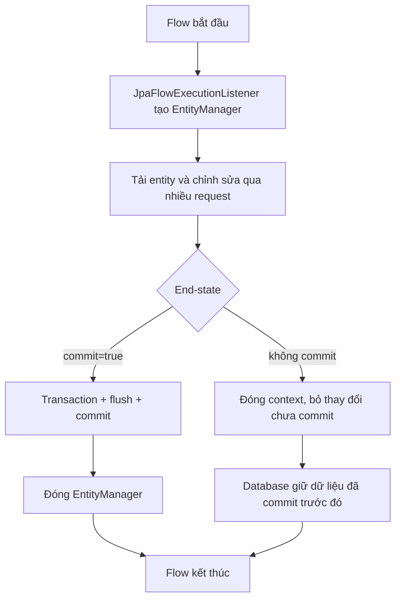
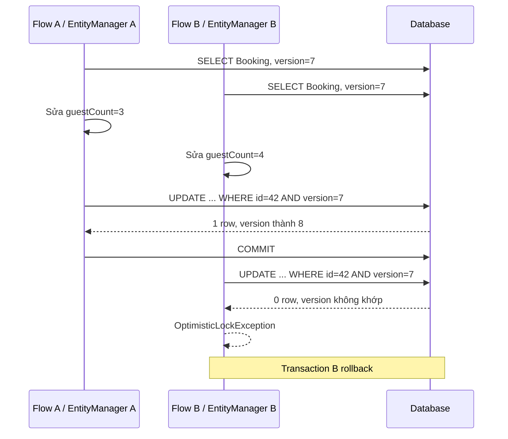

# Kiểm tra commit, hủy và xung đột khóa lạc quan

Trong **Spring Web Flow**, một quy trình nhiều bước có thể giữ entity JPA trong persistence context qua nhiều request. Người dùng có thể chỉnh sửa thông tin, xem lại, quay về sửa tiếp rồi mới xác nhận. Khi flow kết thúc, ứng dụng phải bảo đảm thay đổi được lưu đúng lúc; nếu người dùng hủy, thay đổi chưa xác nhận không được ghi xuống database; nếu một người khác đã sửa cùng bản ghi, hệ thống phải phát hiện xung đột và bảo vệ dữ liệu mới hơn.

Với mô hình **Flow-Managed Persistence Context (FMPC)**, `JpaFlowExecutionListener` giữ một `EntityManager` gắn với flow execution và commit khi flow đi đến end-state có `commit="true"`. Cơ chế này thường kết hợp với optimistic locking bằng `@Version`. Vì vậy, kiểm thử cần chứng minh được ba hành vi độc lập:

1. **Commit:** thay đổi chỉ xuất hiện trong database sau khi flow kết thúc ở commit end-state.
2. **Cancel:** thay đổi chưa commit bị loại bỏ khi flow kết thúc ở end-state không commit.
3. **Conflict:** hai flow cùng sửa một entity từ một version cũ; flow commit sau phải nhận xung đột thay vì ghi đè thay đổi đã commit trước.

Bài học thuộc chương **Kiểm thử tích hợp**, tập trung vào thiết kế fixture, gắn `JpaFlowExecutionListener` vào flow test, kiểm tra dữ liệu bằng persistence context mới, mô phỏng hai execution đồng thời, xác minh rollback và xây dựng đường xử lý cho người dùng khi dữ liệu đã thay đổi.

## 1. Hành vi cần kiểm thử của flow-managed persistence

FMPC tạo persistence context khi flow bắt đầu, giữ context đó trong `flowScope`, bind context vào thread khi xử lý một request và unbind khi flow tạm dừng. Khi flow kết thúc:

- End-state có `commit="true"` yêu cầu listener commit các thay đổi trong transaction.
- End-state không có `commit="true"` kết thúc flow mà không yêu cầu listener commit.
- Sau khi kết thúc, listener unbind và đóng persistence context.

Các thao tác dữ liệu trung gian nên chạy non-transactional hoặc trong read-only transaction phù hợp với JPA transaction manager/provider. Một transaction read-write riêng được commit ở giữa flow có thể làm thay đổi database ngay cả khi người dùng chọn Hủy sau đó.



**Một test chỉ kiểm tra flow tới đúng end-state là chưa đủ.** Cần đọc lại database sau khi execution kết thúc để xác nhận kết quả persistence.

## 2. Chuẩn bị đúng cấu hình trước khi viết test

Flow cần khai báo persistence context:

```xml
<flow xmlns="http://www.springframework.org/schema/webflow">
    <persistence-context />
    <!-- states, transitions và end-states -->
</flow>
```

`FlowExecutor` của test phải gắn `JpaFlowExecutionListener` với đúng `EntityManagerFactory` và `PlatformTransactionManager`:

```xml
<webflow:flow-executor id="flowExecutor"
                       flow-registry="flowRegistry">
    <webflow:flow-execution-listeners>
        <webflow:listener ref="jpaFlowExecutionListener" />
    </webflow:flow-execution-listeners>
</webflow:flow-executor>

<bean id="jpaFlowExecutionListener"
      class="org.springframework.webflow.persistence.JpaFlowExecutionListener">
    <constructor-arg ref="entityManagerFactory" />
    <constructor-arg ref="transactionManager" />
</bean>
```

Trong test, điều quan trọng là listener thật phải chạy. Nếu test chỉ dùng mock service trả về entity giả mà không gắn listener, nó không kiểm tra được commit/cancel lifecycle của FMPC.

Các service/repository được flow gọi phải dùng cùng persistence unit. DAO Spring-managed với `@PersistenceContext` có thể sử dụng `EntityManager` hiện hành đã được listener bind. Không tạo một `EntityManager` độc lập trong service rồi kỳ vọng thay đổi đó tự thuộc FMPC.

## 3. Entity mẫu có optimistic version

Dùng một entity nhỏ để kiểm tra kết quả có thể quan sát rõ:

```java
package com.example.booking;

import javax.persistence.Column;
import javax.persistence.Entity;
import javax.persistence.Id;
import javax.persistence.Version;

@Entity
public class Booking {

    @Id
    private Long id;

    @Version
    private Long version;

    @Column(nullable = false)
    private String guestName;

    @Column(nullable = false)
    private Integer guestCount;

    protected Booking() {
    }

    public Booking(Long id, String guestName, Integer guestCount) {
        this.id = id;
        this.guestName = guestName;
        this.guestCount = guestCount;
    }

    public Long getId() {
        return id;
    }

    public Long getVersion() {
        return version;
    }

    public String getGuestName() {
        return guestName;
    }

    public void setGuestName(String guestName) {
        this.guestName = guestName;
    }

    public Integer getGuestCount() {
        return guestCount;
    }

    public void setGuestCount(Integer guestCount) {
        this.guestCount = guestCount;
    }
}
```

Ví dụ dùng `javax.persistence` để phù hợp với Spring Web Flow 2.5.x và thế hệ JPA tương ứng. `@Version` có thể dùng một trong các kiểu số nguyên được JPA hỗ trợ; `Long` phù hợp cho ví dụ này. Mỗi entity chỉ nên có một version attribute, được khai báo ở entity root hoặc mapped superclass. Persistence provider tự tăng version khi ghi entity; ứng dụng không được tự gán version như một field form thông thường.

Không bind `version` trực tiếp từ HTTP request. Version là dữ liệu kiểm soát đồng thời do persistence provider quản lý.

## 4. Flow mẫu có nhánh xác nhận và hủy

Flow đặt phòng dưới đây tải entity managed, áp dụng các field được phép sửa rồi cho người dùng xem lại:

```xml
<?xml version="1.0" encoding="UTF-8"?>
<flow xmlns="http://www.springframework.org/schema/webflow"
      xmlns:xsi="http://www.w3.org/2001/XMLSchema-instance"
      xsi:schemaLocation="
          http://www.springframework.org/schema/webflow
          http://www.springframework.org/schema/webflow/spring-webflow.xsd">

    <persistence-context />

    <input name="bookingId"
           type="java.lang.Long"
           required="true" />

    <on-start>
        <evaluate
            expression="bookingRepository.findForFlow(bookingId)"
            result="flowScope.booking" />
        <evaluate
            expression="bookingMapper.toForm(flowScope.booking)"
            result="flowScope.bookingForm" />
    </on-start>

    <view-state id="editBooking"
                view="booking/edit"
                model="bookingForm">
        <transition on="review" to="applyChanges" />
        <transition on="cancel" to="cancelled"
                    bind="false" validate="false" />
    </view-state>

    <action-state id="applyChanges">
        <evaluate expression="bookingAction.apply" />
        <transition on="success" to="reviewBooking" />
    </action-state>

    <view-state id="reviewBooking" view="booking/review">
        <transition on="back" to="editBooking" />
        <transition on="confirm" to="confirmed" />
        <transition on="cancel" to="cancelled" />
    </view-state>

    <end-state id="confirmed" commit="true" />
    <end-state id="cancelled" />
</flow>
```

`bookingAction.apply` chỉ chép các field hợp lệ từ DTO vào entity đang managed. Ví dụ action kế thừa `MultiAction` để dùng helper `success()`:

```java
import org.springframework.webflow.action.MultiAction;
import org.springframework.webflow.execution.Event;
import org.springframework.webflow.execution.RequestContext;

public class BookingAction extends MultiAction {

    public Event apply(RequestContext context) {
        Booking booking =
            (Booking) context.getFlowScope().get("booking");
        BookingForm form =
            (BookingForm) context.getFlowScope().get("bookingForm");

        booking.setGuestName(form.getGuestName());
        booking.setGuestCount(form.getGuestCount());

        return success();
    }
}
```

Action này không mở transaction read-write riêng. Listener vẫn sở hữu persistence context và quyết định commit ở end-state. Nếu service/action được gắn `@Transactional` mặc định ở cấp class, cần xem lại transaction boundary để tránh commit sớm.

## 5. Tách test flow, test persistence và test HTTP

Một bộ test tốt kiểm tra đúng tầng:

| Tầng | Mục tiêu | Công cụ thường dùng |
| --- | --- | --- |
| Unit test action/service | Field được áp dụng đúng, rule nghiệp vụ đúng | JUnit, mock |
| Flow execution test | Event dẫn tới đúng state/end-state, nhánh confirm/cancel đúng | `AbstractXmlFlowExecutionTests`, `MockExternalContext` |
| JPA integration test | Commit, rollback và version check tác động lên database thật | JPA provider, transaction manager, test database |
| MVC/HTTP integration test | Request đi qua adapter, redirect và thông báo conflict được hiển thị | MockMvc hoặc servlet container |

Không thay test persistence bằng mock `EntityManager` nếu mục tiêu là xác nhận optimistic locking. Cần có JPA provider và database thực hiện câu lệnh update với điều kiện version.

## 6. Gắn JpaFlowExecutionListener vào flow execution test

Spring Web Flow cung cấp `AbstractXmlFlowExecutionTests` để kiểm tra flow XML. Test base này có `setFlowExecutionListener(...)` và `setFlowExecutionListeners(...)` để gắn listener vào execution do test tạo.

Ví dụ khung test:

```java
public class BookingFlowPersistenceTests
        extends AbstractXmlFlowExecutionTests {

    private EntityManagerFactory entityManagerFactory;
    private PlatformTransactionManager transactionManager;
    private BookingRepository bookingRepository;
    private BookingMapper bookingMapper;
    private BookingAction bookingAction;

    @Override
    protected void setUp() throws Exception {
        super.setUp();
        setFlowExecutionListener(
            new JpaFlowExecutionListener(
                entityManagerFactory, transactionManager));
    }

    @Override
    protected FlowDefinitionResource getResource(
            FlowDefinitionResourceFactory factory) {
        return factory.createClassPathResource(
            "flows/booking/booking.xml", getClass());
    }

    @Override
    protected void configureFlowBuilderContext(
            MockFlowBuilderContext builderContext) {
        builderContext.registerBean("bookingRepository",
                                    bookingRepository);
        builderContext.registerBean("bookingMapper", bookingMapper);
        builderContext.registerBean("bookingAction", bookingAction);
    }
}
```

Đây là khung tích hợp: các field `EntityManagerFactory`, transaction manager và bean nghiệp vụ phải được khởi tạo từ test fixture thật hoặc inject từ Spring test context. Cấu hình listener phải dùng đúng cặp factory/transaction manager mà repository dùng.

Nếu chỉ kiểm tra flow path mà chưa cần JPA, có thể đăng ký stub service. Nhưng các test trong bài này phải dùng listener và persistence provider thật để kiểm chứng database.

## 7. Seed dữ liệu và đọc lại bằng persistence context mới

Tạo dữ liệu ban đầu trong một transaction độc lập. Ví dụ dưới đây giả định test persistence unit dùng resource-local transaction; nếu dự án dùng JTA, hãy tạo fixture bằng transaction manager của test thay cho `EntityTransaction` trực tiếp:

```java
private void seedBooking(Long id, String guestName, int guestCount) {
    EntityManager entityManager =
        entityManagerFactory.createEntityManager();
    EntityTransaction transaction = entityManager.getTransaction();

    try {
        transaction.begin();
        entityManager.persist(
            new Booking(id, guestName, guestCount));
        transaction.commit();
    } catch (RuntimeException ex) {
        if (transaction.isActive()) {
            transaction.rollback();
        }
        throw ex;
    } finally {
        entityManager.close();
    }
}
```

Khi xác minh kết quả, hãy mở persistence context mới và trả về snapshot đơn giản:

```java
private BookingSnapshot readBooking(Long id) {
    EntityManager entityManager =
        entityManagerFactory.createEntityManager();
    EntityTransaction transaction = entityManager.getTransaction();

    try {
        transaction.begin();
        Booking booking = entityManager.find(Booking.class, id);

        BookingSnapshot snapshot = new BookingSnapshot(
            booking.getGuestName(),
            booking.getGuestCount(),
            booking.getVersion());

        transaction.commit();
        return snapshot;
    } finally {
        if (transaction.isActive()) {
            transaction.rollback();
        }
        entityManager.close();
    }
}
```

`BookingSnapshot` chỉ chứa giá trị cần assert, không giữ entity managed; đây là DTO bất biến nhỏ với constructor và getter cho `guestName`, `guestCount`, `version`. Đọc bằng context mới tránh trường hợp first-level cache trả lại object cũ trong bộ nhớ và khiến test tưởng database đã được cập nhật.

Ví dụ cấu trúc DTO:

```java
public final class BookingSnapshot {
    private final String guestName;
    private final Integer guestCount;
    private final Long version;

    public BookingSnapshot(String guestName, Integer guestCount, Long version) {
        this.guestName = guestName;
        this.guestCount = guestCount;
        this.version = version;
    }

    public String getGuestName() { return guestName; }
    public Integer getGuestCount() { return guestCount; }
    public Long getVersion() { return version; }
}
```

## 8. Test xác nhận: chỉ commit khi tới commit end-state

Kịch bản:

1. Seed booking có `guestCount = 2`.
2. Khởi động flow với `bookingId`.
3. Thay đổi form thành `guestCount = 4`.
4. Gửi event `review`, flow áp dụng thay đổi lên entity managed và dừng ở `reviewBooking`.
5. Gửi event `confirm`, flow kết thúc tại `confirmed` có `commit="true"`.
6. Đọc booking bằng persistence context mới.

Ví dụ điều khiển flow:

```java
public void testConfirmCommitsManagedChanges() {
    seedBooking(42L, "Lan", 2);
    Long initialVersion = readBooking(42L).getVersion();

    MutableAttributeMap<Object> input = new LocalAttributeMap<>();
    input.put("bookingId", 42L);
    startFlow(input, new MockExternalContext());

    BookingForm form = new BookingForm();
    form.setGuestName("Lan");
    form.setGuestCount(4);
    getFlowScope().put("bookingForm", form);

    MockExternalContext review = new MockExternalContext();
    review.setEventId("review");
    resumeFlow(review);
    assertCurrentStateEquals("reviewBooking");

    BookingSnapshot beforeConfirm = readBooking(42L);
    assertEquals(Integer.valueOf(2), beforeConfirm.getGuestCount());

    MockExternalContext confirm = new MockExternalContext();
    confirm.setEventId("confirm");
    resumeFlow(confirm);

    assertFlowExecutionEnded();
    assertFlowExecutionOutcomeEquals("confirmed");

    BookingSnapshot saved = readBooking(42L);
    assertEquals(Integer.valueOf(4), saved.getGuestCount());
    assertTrue(saved.getVersion() > initialVersion);
}
```

Test cần xác nhận cả outcome và database. Việc flow tới `confirmed` chỉ chứng minh điều hướng; giá trị `guestCount` và version đọc từ context mới mới chứng minh commit đã xảy ra.

Nếu muốn kiểm tra rõ ranh giới trước commit, có thể đọc database ở thời điểm flow đang dừng tại `reviewBooking` và xác nhận giá trị vẫn là `2`. Sau đó mới gửi event `confirm` và xác nhận giá trị chuyển thành `4`.

## 9. Test hủy: thay đổi chưa commit không được lưu

Nhánh hủy phải kết thúc tại end-state không có `commit="true"`. Test:

1. Seed booking có `guestCount = 2`.
2. Khởi động flow và tải entity managed.
3. Đổi form thành `guestCount = 5`.
4. Gửi event `review` để action áp dụng thay đổi lên entity managed và dừng ở `reviewBooking`.
5. Đọc database bằng context mới; giá trị vẫn phải là 2 vì flow chưa commit.
6. Gửi event `cancel` để đi tới `cancelled`.
7. Xác nhận flow đã kết thúc và đọc booking bằng persistence context mới.

```java
public void testCancelDiscardsUncommittedChanges() {
    seedBooking(42L, "Lan", 2);

    MutableAttributeMap<Object> input = new LocalAttributeMap<>();
    input.put("bookingId", 42L);
    startFlow(input, new MockExternalContext());

    BookingForm form = new BookingForm();
    form.setGuestName("Lan");
    form.setGuestCount(5);
    getFlowScope().put("bookingForm", form);

    MockExternalContext review = new MockExternalContext();
    review.setEventId("review");
    resumeFlow(review);
    assertCurrentStateEquals("reviewBooking");

    BookingSnapshot pending = readBooking(42L);
    assertEquals(Integer.valueOf(2), pending.getGuestCount());

    MockExternalContext cancel = new MockExternalContext();
    cancel.setEventId("cancel");
    resumeFlow(cancel);

    assertFlowExecutionEnded();
    assertFlowExecutionOutcomeEquals("cancelled");

    BookingSnapshot unchanged = readBooking(42L);
    assertEquals(Integer.valueOf(2), unchanged.getGuestCount());
}
```

Giá trị database vẫn là `2` chứng minh thay đổi chỉ tồn tại trong persistence context của flow và đã bị loại bỏ khi flow kết thúc không commit.

### Hủy không thể hoàn tác transaction đã commit trước đó

Nếu một action trung gian gọi service có transaction read-write và service đó commit thay đổi, việc đi tới `cancelled` không thể tự rollback transaction đã hoàn tất. Test nên có thêm một trường hợp kiểm tra cấu hình service:

- Đường đi bình thường không tạo transaction read-write trung gian.
- Không có thao tác repository nào ghi dữ liệu trước end-state xác nhận.
- Các truy vấn bổ sung nếu cần transaction phải dùng read-only transaction tương thích với transaction manager/provider.

Không dùng `cancelled` như một cơ chế bù trừ cho side effect đã commit ở service khác, email đã gửi hoặc API bên ngoài đã gọi.

## 10. Vì sao phải đọc bằng EntityManager mới?

JPA persistence context có first-level cache. Nếu test giữ entity hoặc đọc lại bằng cùng `EntityManager`, kết quả có thể phản ánh object đang nằm trong bộ nhớ thay vì trạng thái database sau commit/rollback.

Quy trình kiểm chứng nên là:

```text
EntityManager của flow
  → tải Booking
  → chỉnh guestCount
  → commit hoặc cancel
  → listener đóng EntityManager

EntityManager kiểm chứng mới
  → mở transaction mới
  → SELECT Booking theo ID
  → assert guestCount và version
  → đóng EntityManager
```

Không chỉ gọi `entityManager.clear()` trên cùng context của flow rồi coi đó là test độc lập. Tạo context mới giúp xác minh dữ liệu thực sự đã được transaction ghi vào database.

## 11. Optimistic locking bảo vệ dữ liệu như thế nào?

Optimistic locking giả định xung đột không xảy ra thường xuyên, nên không khóa bản ghi trong toàn bộ thời gian người dùng mở form. Persistence provider đọc version cùng entity và kiểm tra version đó khi cập nhật hoặc xóa.

Ví dụ:

1. Flow A đọc booking ở version `7`.
2. Flow B cũng đọc booking ở version `7`.
3. Flow A thay đổi số khách và commit; provider cập nhật version lên `8`.
4. Flow B vẫn giữ entity ở version `7`.
5. Flow B commit; provider phát hiện version trong database là `8`, không còn bằng version `7` mà B đã đọc.
6. Provider ném `OptimisticLockException` và transaction hiện hành bị đánh dấu rollback.



Hai flow không cần chạy trên hai thread cùng một thời điểm để tái hiện xung đột. Chỉ cần cả hai giữ một bản entity đã đọc từ cùng version, sau đó commit lần lượt.

## 12. Test hai flow execution cùng sửa một booking

Để kiểm tra xung đột thực tế, cần tạo **hai flow execution độc lập**, mỗi execution có một persistence context riêng. Có thể dùng cùng một `SharedAttributeMap` làm session map cho hai `MockExternalContext` khi test repository mặc định dựa trên HTTP session; API mock cung cấp `setSessionMap(SharedAttributeMap)`. Như vậy hai execution cùng thuộc một test session nhưng vẫn có execution key và `EntityManager` riêng.

| Bước | Flow A | Flow B |
| --- | --- | --- |
| 1 | Tải booking version 7 | |
| 2 | | Tải cùng booking version 7 |
| 3 | Sửa số khách thành 3 | Sửa số khách thành 4 |
| 4 | Tạm dừng ở màn hình review | Tạm dừng ở màn hình review |
| 5 | Xác nhận và commit thành công, version thành 8 | |
| 6 | | Xác nhận và thử commit version 7 |
| 7 | | Nhận optimistic locking conflict và rollback |

Với session-based execution repository, hai request test cần dùng cùng test session nếu repository lưu các execution dưới session đó. Mỗi execution vẫn phải có execution key riêng. Nếu test dùng repository khác, cấu hình hai execution theo cách repository đó yêu cầu.

Có thể điều khiển hai execution qua `FlowExecutor`:

```java
import org.springframework.webflow.core.collection.LocalAttributeMap;
import org.springframework.webflow.core.collection.MutableAttributeMap;
import org.springframework.webflow.core.collection.SharedAttributeMap;
import org.springframework.webflow.executor.FlowExecutionResult;
import org.springframework.webflow.executor.FlowExecutor;
import org.springframework.webflow.test.MockExternalContext;

private MutableAttributeMap<Object> inputFor(Long bookingId) {
    MutableAttributeMap<Object> input = new LocalAttributeMap<>();
    input.put("bookingId", bookingId);
    return input;
}

private MockExternalContext event(
        String eventId, SharedAttributeMap<Object> sessionMap) {
    MockExternalContext context = new MockExternalContext();
    context.setSessionMap(sessionMap);
    context.setEventId(eventId);
    return context;
}

private MockExternalContext reviewEvent(
        int guestCount, SharedAttributeMap<Object> sessionMap) {
    MockExternalContext context = new MockExternalContext();
    context.setSessionMap(sessionMap);
    context.setEventId("review");
    context.putRequestParameter("guestCount",
                                Integer.toString(guestCount));
    return context;
}

public void testTwoExecutionsWithSameInitialVersion() {
    MockExternalContext externalContextA = new MockExternalContext();
    MockExternalContext externalContextB = new MockExternalContext();
    externalContextB.setSessionMap(externalContextA.getSessionMap());

    FlowExecutionResult a = flowExecutor.launchExecution(
        "booking", inputFor(42L), externalContextA);
    FlowExecutionResult b = flowExecutor.launchExecution(
        "booking", inputFor(42L), externalContextB);

    assertTrue(a.isPaused());
    assertTrue(b.isPaused());

    String keyA = a.getPausedKey();
    String keyB = b.getPausedKey();

    // Cả hai execution đang dừng sau khi đã tải cùng version.
    // Bind giá trị khác nhau vào form của từng execution.
    FlowExecutionResult reviewA =
        flowExecutor.resumeExecution(
            keyA, reviewEvent(3, externalContextA.getSessionMap()));
    assertTrue(reviewA.isPaused());
    FlowExecutionResult confirmA =
        flowExecutor.resumeExecution(
            reviewA.getPausedKey(),
            event("confirm", externalContextA.getSessionMap()));
    assertTrue(confirmA.isEnded());

    // Sau đó tiếp tục B từ snapshot cũ.
    FlowExecutionResult reviewB =
        flowExecutor.resumeExecution(
            keyB, reviewEvent(4, externalContextB.getSessionMap()));
    assertTrue(reviewB.isPaused());

    try {
        flowExecutor.resumeExecution(
            reviewB.getPausedKey(),
            event("confirm", externalContextB.getSessionMap()));
        fail("Expected an optimistic locking conflict");
    } catch (RuntimeException ex) {
        assertTrue(hasOptimisticLockCause(ex));
    }
}
```

Đây là khung điều khiển execution; `event(...)` tạo `MockExternalContext` có event ID tương ứng và test fixture phải cung cấp cùng session/repository context cho hai execution khi dùng session-backed storage. Cần bảo đảm form của A và B chứa giá trị khác nhau trước khi gửi event `review`.

Một cách khác là chạy hai instance test harness độc lập với cùng database fixture. Điều quan trọng là không dùng chung `EntityManager` giữa A và B, vì dùng chung context sẽ không mô phỏng được hai người dùng đọc hai revision riêng.

## 13. Assert xung đột mà không phụ thuộc exception wrapper

JPA provider có thể phát hiện version mismatch trong một API call, khi `flush()` hoặc khi transaction commit. Khi đi qua Spring transaction manager và Web Flow, exception có thể được bọc trong `FlowException`, transaction exception hoặc exception dịch của Spring.

Do đó, test tích hợp không nên khẳng định mọi cấu hình đều ném đúng một exception wrapper ở cùng một dòng code. Hãy:

1. Xác nhận thao tác commit thất bại.
2. Duyệt cause chain để tìm `javax.persistence.OptimisticLockException` hoặc exception optimistic-lock tương ứng do Spring dịch.
3. Xác nhận transaction bị rollback.
4. Đọc database bằng persistence context mới và xác nhận dữ liệu của flow A vẫn được giữ.
5. Xác nhận thay đổi của flow B không ghi đè dữ liệu của A.

Ví dụ helper kiểm tra cause chain:

```java
private boolean hasOptimisticLockCause(Throwable error) {
    Throwable current = error;
    while (current != null) {
        if (current instanceof javax.persistence.OptimisticLockException
                || current instanceof
                   org.springframework.dao.OptimisticLockingFailureException) {
            return true;
        }
        current = current.getCause();
    }
    return false;
}
```

Nếu dự án dùng exception translation khác, bổ sung đúng loại exception của stack đó. Không chỉ kiểm tra thông báo lỗi dạng text vì nội dung phụ thuộc provider, database và ngôn ngữ.

## 14. Kiểm tra transaction rollback sau lỗi commit

JPA yêu cầu persistence provider ném `OptimisticLockException` khi version kiểm tra không khớp; transaction đang hoạt động được đánh dấu rollback. Test nên xác minh kết quả database sau lỗi:

| Dữ liệu | Trước test | Sau A commit | Sau B conflict |
| --- | --- | --- | --- |
| `guestCount` | 2 | 3 | 3 |
| `version` | 7 | 8 | 8 |

Flow B không được ghi `guestCount = 4` hoặc tăng version thêm một lần. Đây là bằng chứng transaction B không để lại cập nhật một phần.

Nếu commit thất bại do constraint khác, áp dụng cùng nguyên tắc: kiểm tra transaction rollback và dữ liệu còn nguyên theo trạng thái trước transaction lỗi. Có thể bổ sung test vi phạm unique constraint hoặc not-null constraint để kiểm tra nhánh commit failure tổng quát.

## 15. Không bọc toàn bộ test trong transaction rollback-only

Một lỗi phổ biến là đặt `@Transactional` trên toàn bộ test rồi mong `JpaFlowExecutionListener` commit như production. Transaction test có thể tạo một transaction ngoài, khiến transaction của listener tham gia hoặc bị ràng buộc vào transaction test tùy propagation/configuration. Kết quả quan sát sau test có thể không phản ánh ranh giới commit thật.

Với test commit/cancel/conflict:

- Tạo fixture ban đầu trong transaction riêng và commit fixture trước khi flow bắt đầu.
- Để listener mở transaction commit cuối như trong ứng dụng.
- Đọc kết quả bằng transaction/persistence context mới sau khi flow kết thúc.
- Tránh transaction test bao trùm toàn bộ vòng đời flow nếu mục tiêu là xác minh commit thật.
- Nếu framework test bắt buộc dùng transaction quản lý, cấu hình propagation và điểm commit rõ ràng; không suy luận từ một test rollback-only.

Điều này đặc biệt quan trọng với optimistic locking: flow A phải thật sự commit version mới xuống database trước khi flow B thử commit.

## 16. Test nhánh subflow và quyết định commit của flow cha

Nếu subflow khai báo `<persistence-context />` và dùng lại context do parent tạo, listener bỏ qua commit flag ở end-state của subflow. Flow cha giữ quyền quyết định cuối cùng.

Nên có hai test:

| Kịch bản | Kết quả mong đợi |
| --- | --- |
| Subflow sửa booking, kết thúc; parent tiếp tục rồi confirm | Database chỉ thay đổi khi parent tới end-state commit |
| Subflow sửa booking, kết thúc; parent chọn cancel | Thay đổi chưa commit không được lưu |

Nếu subflow được chạy độc lập như root flow, nó có thể sở hữu persistence context riêng và end-state của chính nó có thể quyết định commit. Test cần phân biệt hai cách khởi chạy đó.

## 17. Xử lý conflict trong ứng dụng

Khi commit thất bại do optimistic locking, dữ liệu trong persistence context của flow đã cũ. Không nên tự động thử commit lại cùng entity vì transaction đã rollback và version không còn khớp.

Một đường xử lý phù hợp:

1. Ghi nhận conflict ở ranh giới flow/service và log ID nghiệp vụ cùng correlation ID, tránh log dữ liệu cá nhân.
2. Thông báo rằng bản ghi đã được người khác cập nhật.
3. Đọc lại phiên bản mới trong persistence context/transaction mới.
4. Hiển thị giá trị mới nhất cùng những field người dùng đã nhập nếu có thể giữ an toàn dưới dạng DTO.
5. Cho người dùng so sánh, chọn lại hoặc áp dụng lại thay đổi có chủ đích.
6. Tạo flow execution mới hoặc một thao tác service mới dựa trên version mới nhất.

Không coi việc reload rồi ghi đè tự động là cách xử lý conflict. Làm như vậy có thể xóa mất thay đổi của người khác, chính là vấn đề optimistic locking cần ngăn chặn.

Commit diễn ra trong lifecycle listener khi root flow kết thúc ở commit state. Vì thế exception có thể xuất hiện ở ranh giới kết thúc execution, không nhất thiết trong action đã sửa entity. Kiểm thử cần bao phủ cả exception từ thao tác xác nhận cuối và phản hồi HTTP/flow phù hợp. Chi tiết wrapper và exception handler có thể khác theo transaction manager, provider và cách cấu hình `FlowExecutor`.

## 18. Ma trận kiểm thử tổng hợp

| Nhóm | Kịch bản | Assertion bắt buộc |
| --- | --- | --- |
| Commit | Confirm tới end-state `commit="true"` | Database có thay đổi sau khi flow kết thúc |
| Commit | Flow đang ở review trước confirm | Database chưa có thay đổi trung gian |
| Cancel | Hủy từ màn hình edit | Database giữ nguyên giá trị ban đầu |
| Cancel | Hủy sau khi đã qua subflow | Parent không commit context dùng chung |
| Transaction boundary | Service trung gian được gọi | Không có read-write transaction commit sớm |
| Optimistic lock | Hai flow tải cùng version | Cả hai có version ban đầu giống nhau |
| Optimistic lock | Flow A commit trước | Version tăng và dữ liệu A được lưu |
| Optimistic lock | Flow B commit sau | Nhận optimistic lock exception, transaction rollback |
| Rollback | Đọc sau conflict bằng context mới | Dữ liệu A vẫn nguyên, dữ liệu B không xuất hiện |
| Commit failure | Vi phạm constraint khi commit | Transaction rollback, không có ghi một phần |
| Subflow | Child kết thúc, parent tiếp tục | Child không tự commit context của parent |
| Test isolation | Fixture được seed trước flow | Test không dùng chung persistence context để assert |
| MVC integration | Commit conflict đi qua HTTP | Người dùng nhận phản hồi conflict phù hợp |

## 19. Lỗi thường gặp khi viết test

| Triệu chứng | Nguyên nhân có thể | Cách sửa |
| --- | --- | --- |
| Test cancel vẫn thấy dữ liệu đổi | Service trung gian đã commit transaction read-write | Kiểm tra `@Transactional`, flush và transaction boundary |
| Test commit không ghi database | Flow thiếu persistence context, listener không được gắn hoặc end-state thiếu `commit="true"` | Kiểm tra XML, FlowExecutor và listener |
| Test báo dữ liệu đã lưu trước confirm | Test đọc cùng persistence context hoặc service đã commit sớm | Đọc bằng context mới và kiểm tra service |
| Hai flow không phát sinh conflict | Dùng chung EntityManager hoặc flow thứ hai tải entity sau khi A commit | Bảo đảm cả hai load cùng version trước commit đầu tiên |
| Conflict chỉ xuất hiện khi commit, không ở action | Version check được thực hiện tại flush/commit | Assert ở ranh giới kết thúc flow và kiểm tra cause chain |
| Test A commit nhưng B không resume được | Execution key/session context không được giữ đúng trong test repository | Dùng repository/session fixture đúng và lưu paused key mới |
| Test optimistic lock bị rollback toàn bộ fixture | Test-managed transaction bao trùm cả hai flow | Commit fixture độc lập, bỏ transaction ngoài |
| Version không tăng như mong đợi | Entity không có `@Version`, field bị gán thủ công hoặc update không diễn ra | Kiểm tra mapping và để provider quản lý version |
| Test chỉ pass với mock database | Mock không thực hiện version predicate/transaction thật | Chạy JPA integration test với provider và database |
| Hủy parent nhưng dữ liệu child vẫn lưu | Subflow dùng transaction read-write riêng hoặc context không được propagate | Kiểm tra persistence-context ở parent/child và service boundary |

## 20. Bài thực hành: kiểm tra đủ ba kết quả commit, cancel và conflict

Xây dựng flow `booking` dùng `JpaFlowExecutionListener` và entity `Booking` có `@Version`.

Yêu cầu:

1. Tạo fixture booking với `guestCount = 2`.
2. Viết flow có `editBooking`, `reviewBooking`, end-state `confirmed` với `commit="true"` và end-state `cancelled` không commit.
3. Gắn `JpaFlowExecutionListener` vào test execution hoặc `FlowExecutor` thật.
4. Viết test confirm thay đổi thành 4 và kiểm tra bằng EntityManager mới.
5. Viết test cancel thay đổi thành 5 nhưng database vẫn là 2.
6. Đọc database ở màn hình review để chứng minh thay đổi trung gian chưa commit.
7. Tạo hai flow execution độc lập, cùng tải booking ở một version.
8. Cho flow A sửa thành 3 và commit; cho flow B sửa thành 4 rồi commit sau.
9. Assert flow B nhận optimistic locking conflict, transaction rollback và database vẫn giữ giá trị 3.
10. Thêm test cho subflow dùng chung persistence context và để parent quyết định commit/cancel.
11. Thêm test commit failure do constraint và xác nhận không có dữ liệu ghi một phần.
12. Nếu ứng dụng chạy qua MVC, thêm integration test xác nhận conflict được hiển thị thành thông báo có thể hành động cho người dùng.

Hoàn thành khi test chứng minh được cả ba hành vi trên database thật: xác nhận lưu thay đổi, hủy loại bỏ thay đổi chưa commit và flow dùng version cũ không thể ghi đè dữ liệu mới. Mỗi assertion về persistence phải đọc bằng transaction/persistence context độc lập sau khi flow đã đi qua đúng end-state.

## 21. Tài liệu tham khảo

- [Spring Web Flow 2.5.1 Reference Guide — Flow Managed Persistence](https://docs.spring.io/spring-webflow/docs/2.5.1.RELEASE/reference/htmlsingle/): flow-scoped persistence context, `commit="true"`, transaction trung gian và propagation sang subflow.
- [JpaFlowExecutionListener API — Spring Web Flow 2.5.1](https://docs.spring.io/spring-webflow/docs/2.5.1.RELEASE/api/org/springframework/webflow/persistence/JpaFlowExecutionListener.html): vòng đời EntityManager, bind/unbind theo request, commit và close khi flow kết thúc.
- [Spring Web Flow 2.5.1 Reference Guide — Testing flows](https://docs.spring.io/spring-webflow/docs/2.5.1.RELEASE/reference/htmlsingle/): `AbstractXmlFlowExecutionTests`, mock external context, flow startup và event handling.
- [AbstractXmlFlowExecutionTests API — Spring Web Flow 2.5.1](https://docs.spring.io/spring-webflow/docs/2.5.x/api/org/springframework/webflow/test/execution/AbstractXmlFlowExecutionTests.html): test base cho flow XML.
- [AbstractExternalizedFlowExecutionTests API — Spring Web Flow 2.5.1](https://docs.spring.io/spring-webflow/docs/2.5.x/api/org/springframework/webflow/test/execution/AbstractExternalizedFlowExecutionTests.html): `setFlowExecutionListener` và `setFlowExecutionListeners`.
- [Java EE 8 JPA — @Version](https://jakarta.ee/specifications/platform/8/apidocs/javax/persistence/Version.html): kiểu version hợp lệ và quy tắc kiểm tra version khi ghi entity, phù hợp namespace `javax.persistence`.
- [Java EE 8 JPA — OptimisticLockException](https://jakarta.ee/specifications/platform/8/apidocs/javax/persistence/OptimisticLockException.html): exception có thể phát sinh ở API call, flush hoặc commit; transaction active bị đánh dấu rollback.

Kiểm thử FMPC phải đi xa hơn việc xác nhận flow đến đúng state. Hãy gắn listener thật, quan sát dữ liệu bằng persistence context mới, giữ transaction trung gian không commit ngoài ý muốn và mô phỏng hai flow cùng đọc một version. Khi đó test sẽ xác minh được điều quan trọng nhất của quy trình nhiều bước: chỉ lưu khi người dùng xác nhận và không ghi đè thay đổi mà người khác đã commit.
