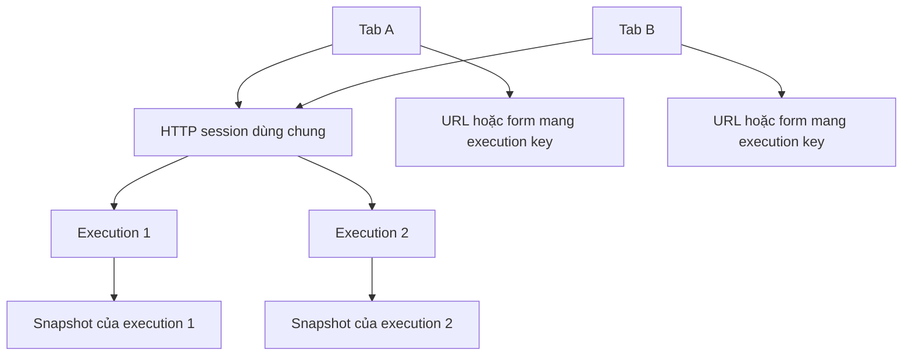

# Kiểm tra Back, Refresh, nhiều tab và phiên hết hạn

Một flow hoạt động đúng khi người dùng bấm tuần tự các nút chưa chắc hoạt động đúng khi họ dùng Back, tải lại trang, mở hai tab hoặc quay lại sau khi phiên đã hết hạn. Những thao tác này tác động đồng thời lên lịch sử trình duyệt, request HTTP, execution key, snapshot và dữ liệu nghiệp vụ.

Bài thuộc chương **Kiểm thử tích hợp** của module **SPRING_WEB_FLOW**. Mục tiêu là kiểm tra toàn bộ đường đi từ trình duyệt qua Spring MVC đến flow executor và repository, rồi xác nhận hành trình được tiếp tục hoặc phục hồi đúng mà không làm lẫn form hay tạo tác dụng phụ ngoài ý muốn.

## 1. Kết quả cần kiểm tra ở nhiều lớp

Một trang hiển thị đúng chưa đủ để kết luận test đạt. Với mỗi kịch bản, cần quan sát ít nhất ba lớp:

| Lớp | Câu hỏi kiểm tra | Ví dụ |
| --- | --- | --- |
| Trình duyệt và HTTP | Đang ở màn hình nào, có redirect hoặc gửi lại POST không? | Refresh ở trang review chỉ tải lại dữ liệu hiển thị |
| Flow và phiên | Request dùng execution nào, snapshot còn hợp lệ không? | Tab B không khôi phục nhầm form của tab A |
| Nghiệp vụ | Có phát sinh thao tác bền vững hay không? | Chỉ có một đơn hàng cho một yêu cầu xác nhận đã xử lý |

Một phản hồi `200 OK` có thể là trang đăng nhập, trang bắt đầu lại hoặc trang báo lỗi được render bình thường. Test cần kiểm tra nội dung có ý nghĩa và kết quả nghiệp vụ cụ thể.

Sau bài này, bạn có thể thiết kế ma trận kiểm thử bốn nhóm thao tác, xây dựng fixture có thể tái hiện và lựa chọn đúng giữa test HTTP phía server với test bằng trình duyệt thật.

## 2. Mô hình: tab, session, execution và snapshot



Các quan hệ cần nhớ:

- Hai tab trong cùng hồ sơ trình duyệt thường dùng chung cookie phiên của ứng dụng.
- Hai tab có thể khởi chạy hai execution độc lập trong cùng session.
- Sao chép URL đang có execution key sang tab khác có thể làm cả hai tab thao tác cùng execution, hoặc cùng một điểm snapshot của execution đó.
- Execution key phải được coi là giá trị do runtime cấp. Không tự tăng phần số hoặc suy ra execution mới từ hình dạng chuỗi.
- Lịch sử trang của trình duyệt và lịch sử snapshot trên server là hai cơ chế khác nhau.

Với [SessionBindingConversationManager](https://docs.spring.io/spring-webflow/docs/current/api/org/springframework/webflow/conversation/impl/SessionBindingConversationManager.html), conversation được lưu qua các thuộc tính session. Đừng áp dụng kết luận về mất dữ liệu phiên cho mọi repository tùy biến mà chưa kiểm tra cách triển khai thật.

Ví dụ URL như `/checkout?execution=...` trong bài chỉ minh họa cấu hình URL của ứng dụng. Test cần đọc key từ URL, form hoặc redirect mà ứng dụng thực sự trả về.

## 3. Chốt chính sách trước khi viết assertion

Framework cung cấp cơ chế, còn sản phẩm phải quyết định trải nghiệm mong muốn. Có flow cho sửa bước trước, có flow yêu cầu bắt đầu lại sau một mốc không thể đảo ngược.

Ví dụ hợp đồng cho một hành trình đặt hàng:

| Thao tác | Chính sách minh họa | Điều không được xảy ra |
| --- | --- | --- |
| Back trước khi xác nhận | Khôi phục bước còn được hỗ trợ và cho tiếp tục | Tạo đơn hoặc trộn dữ liệu từ hành trình khác |
| Refresh ở màn hình chờ | Hiển thị lại màn hình theo trạng thái hợp lệ | Thực hiện lại thao tác ghi ngoài ý muốn |
| Mở hai hành trình mới trong hai tab | Form riêng theo execution | Tab B sửa form của tab A |
| Mở cùng URL execution trong hai tab | Chấp nhận hoặc từ chối request cũ theo chính sách đã chọn | Cùng lệnh nghiệp vụ được thực hiện hai lần |
| Session không còn dùng được | Trang phục hồi hoặc đăng nhập theo cấu hình | Tự chạy lại POST xác nhận cũ |
| Execution hoặc snapshot đã bị loại bỏ | Thông báo và lối đi tiếp được xác định | Lặp redirect hoặc trả stack trace cho người dùng |

Test không nên chấp nhận đồng thời “về màn hình cũ hoặc bắt đầu lại hoặc báo lỗi” chỉ để ít thất bại. Với mỗi cấu hình triển khai, chọn một kết quả mong đợi rõ ràng, rồi kiểm tra đúng kết quả đó.

## 4. Chọn đúng tầng kiểm thử

| Tầng | Phù hợp để kiểm tra | Giới hạn |
| --- | --- | --- |
| Test flow definition | State, event, transition, binding/validation theo fixture | Không tái hiện lịch sử và cache trình duyệt thật |
| Test HTTP bằng MockMvc | Mapping MVC, handler, session giả lập, request với key cũ | Không chạy trình duyệt hoặc timeout thật của container |
| Test HTTP trên server đang chạy | Cookie, redirect, container và repository thật | Không tự có hành vi Back, DOM hoặc JavaScript |
| Test trình duyệt | Back, Refresh, nhiều tab, form và trải nghiệm phục hồi | Cần thêm probe để xác nhận tác dụng phụ nghiệp vụ |

[MockMvc](https://docs.spring.io/spring-framework/reference/testing/mockmvc/overview.html) thực thi xử lý Spring MVC qua `DispatcherServlet` với các đối tượng Servlet giả lập. Muốn kiểm thử Web Flow ở tầng này, cấu hình test phải bao gồm flow handler mapping, handler adapter, executor, registry và repository liên quan. Một test chỉ nạp controller thông thường không tự bao phủ đường đi của flow.

Dùng trình duyệt cho hành vi lịch sử thật, đồng thời dùng test phía server để kiểm soát chính xác request cũ, giới hạn repository và lỗi phục hồi.

## 5. Chuẩn bị fixture có thể quan sát

Dùng hành trình minh họa:

```text
address --next--> review --next--> payment --confirm--> completed
                         <-- Back của trình duyệt --
```

Giả định ứng dụng phục vụ flow tại `/checkout?cartId=...` và có:

- Form nhập tên người nhận ở `address`, lưu vào dữ liệu của execution.
- Màn hình `review` hiển thị dữ liệu đã gửi.
- Màn hình `payment` có nút xác nhận cuối.
- Sau kết thúc, chuyển đến trang xác nhận đơn hàng có thể tải lại độc lập.
- Một nơi quan sát đơn hàng và lệnh thanh toán đã ghi nhận trong môi trường test.

Các marker như `screen-review` hoặc `recipient-summary` trong ví dụ là selector ổn định phục vụ test, không phải API Spring Web Flow. URL, nhãn nút và cấu trúc form cần thay bằng hợp đồng của ứng dụng thực tế.

### Dữ liệu phải cô lập

Mỗi test dùng mã giỏ hàng hoặc mã yêu cầu riêng. Nếu chạy song song, không dùng một bộ đếm toàn hệ thống rồi mong nó chỉ phản ánh test hiện tại.

Probe có thể là truy vấn repository kiểm thử, stub dịch vụ thanh toán có lưu request hoặc API nội bộ của bộ test. Probe nên đọc trạng thái mà ứng dụng thực sự ghi nhận, không chỉ đọc biến JavaScript trên trang.

Khi dùng fixture phía server để thao tác session, phải xác định chính xác session của test. Không vô hiệu hóa tất cả session để làm một ca kiểm thử nhanh hơn.

## 6. Back: trang cũ hiển thị được chưa chứng minh snapshot còn dùng được

Trình duyệt có thể hiển thị lại trang từ cache hoặc khôi phục trạng thái trang đã lưu mà không gửi request mới ngay lập tức. Vì vậy, bước “bấm Back rồi thấy form” chưa kiểm tra đầy đủ khả năng tiếp tục flow.

Một kịch bản có ý nghĩa:

1. Khởi chạy flow và nhập dữ liệu ở `address`.
2. Gửi form để đến `review`; lưu URL của bước này nếu ứng dụng dùng key trên URL.
3. Đi tiếp đến `payment`.
4. Bấm Back thật của trình duyệt.
5. Kiểm tra màn hình và dữ liệu theo snapshot được hỗ trợ.
6. Gửi event từ màn hình vừa quay lại.
7. Kiểm tra server xử lý request đó đúng chính sách, và chưa tạo đơn hàng trước xác nhận cuối.

Không mặc định mọi field sẽ luôn mang giá trị mới nhất đã nhập ở bất kỳ tab nào. Dữ liệu được khôi phục phụ thuộc snapshot nào được tham chiếu, cách binding và cách ứng dụng quản lý object. Test cần đối chiếu với trạng thái đã lưu ở điểm lịch sử cụ thể.

### Chính sách history của transition

[History API](https://docs.spring.io/spring-webflow/docs/current/api/org/springframework/webflow/engine/History.html) phân biệt bảo toàn lịch sử, bỏ lịch sử của view đang rời và vô hiệu hóa cả lịch sử trước đó. Ví dụ trích từ một view-state:

```xml
<transition on="next" to="payment" history="preserve" />
```

Hoặc ở một mốc nghiệp vụ mà ứng dụng muốn chặn quay lại các bước trước:

```xml
<transition on="confirm" to="submitOrder" history="invalidate" />
```

`history="invalidate"` không xóa lịch sử trong giao diện trình duyệt và không hoàn tác giao dịch trong database. Nó tác động tới lịch sử khôi phục của flow theo cơ chế runtime.

Khi kiểm tra chính sách chặn Back, hãy thử cả việc mở lại URL cũ và gửi form cũ. Giao diện có thể còn xuất hiện từ cache, nhưng server vẫn phải xử lý request tiếp theo theo hợp đồng đã xác định.

## 7. Refresh: xác định đang tải lại GET hay gửi lại POST

Hai thao tác đều được người dùng gọi là Refresh nhưng có ý nghĩa khác nhau:

| Vị trí Refresh | Cần quan sát |
| --- | --- |
| GET đang render một view-state | State, model và các action phục vụ render |
| POST chưa có redirect | Khả năng trình duyệt gửi lại form và tác dụng phụ |
| GET sau POST–Redirect–GET | Redirect đã tách lần hiển thị khỏi POST trước chưa |
| Trang kết quả sau khi flow kết thúc | Có đọc lại đơn đã tạo hay khởi chạy hành trình mới ngoài ý muốn |

[FlowExecutorBuilder API](https://docs.spring.io/spring-webflow/docs/current/api/org/springframework/webflow/config/FlowExecutorBuilder.html) có các tùy chọn redirect khi pause và redirect khi vẫn ở cùng state. Không giả định mọi request, kể cả validation hoặc Ajax, luôn có cùng chuỗi redirect.

POST–Redirect–GET giúp giảm việc gửi lại POST khi tải lại trang sau redirect, nhưng không tự bảo đảm idempotency. Một URL cũ, request bị lặp hoặc hai tab vẫn có thể gửi lại yêu cầu nghiệp vụ.

### Assertion cần có

Với Refresh trước xác nhận cuối:

- Vẫn ở màn hình chờ hợp lệ theo chính sách.
- Dữ liệu đã binding còn đúng.
- Số đơn và số lệnh thanh toán bền vững chưa tăng.

Với Refresh trang kết quả:

- Vẫn hiển thị cùng mã đơn hàng đã tạo.
- Không tạo thêm đơn hoặc charge mới.
- Không tự điều hướng trở lại bước xác nhận với lệnh cũ còn sẵn sàng gửi lại.

Action dùng để nạp dữ liệu cho view có thể chạy lại khi render; đừng kiểm tra rằng mọi service chỉ được gọi đúng một lần nếu hợp đồng không yêu cầu điều đó. Hãy phân biệt đọc dữ liệu với thao tác ghi nghiệp vụ.

## 8. Ví dụ trình duyệt: Back và Refresh

Ví dụ dùng Playwright Test với `baseURL` đã cấu hình. Các API `goBack()` và `reload()` được mô tả trong [Page API](https://playwright.dev/docs/api/class-page). Mã dưới đây là mẫu học tập, chưa được chạy trên ứng dụng của bạn.

```typescript
import { test, expect, type Page } from '@playwright/test';

async function prepareReview(page: Page, cartId: string, recipient: string) {
  await page.goto(`/checkout?cartId=${encodeURIComponent(cartId)}`);
  await expect(page.getByTestId('screen-address')).toBeVisible();
  await page.getByLabel('Tên người nhận').fill(recipient);
  await page.getByRole('button', { name: 'Tiếp tục', exact: true }).click();
  await expect(page.getByTestId('screen-review')).toBeVisible();
  await expect(page.getByTestId('recipient-summary')).toHaveText(recipient);
}

test('Back từ payment về review rồi tiếp tục được', async ({ page }) => {
  await prepareReview(page, 'CART-BACK-01', 'An Nguyễn');

  await page.getByRole('button', { name: 'Tiếp tục', exact: true }).click();
  await expect(page.getByTestId('screen-payment')).toBeVisible();

  await page.goBack();
  await expect(page.getByTestId('screen-review')).toBeVisible();
  await expect(page.getByTestId('recipient-summary')).toHaveText('An Nguyễn');

  // Gửi request từ trang cũ để kiểm tra server chấp nhận snapshot/key đó.
  await page.getByRole('button', { name: 'Tiếp tục', exact: true }).click();
  await expect(page.getByTestId('screen-payment')).toBeVisible();
});

test('Refresh review giữ dữ liệu đã gửi', async ({ page }) => {
  await prepareReview(page, 'CART-REFRESH-01', 'Bình Trần');

  await page.reload();
  await expect(page.getByTestId('screen-review')).toBeVisible();
  await expect(page.getByTestId('recipient-summary')).toHaveText('Bình Trần');
});
```

Hai test trên kiểm tra giao diện và khả năng tiếp tục theo chính sách cho phép Back. Chúng cần được bổ sung assertion nghiệp vụ qua probe đã mô tả, chẳng hạn:

```text
trước thao tác: countOrders(cartId) == 0
sau Back và gửi next: countOrders(cartId) == 0
sau Refresh review: countOrders(cartId) == 0
sau confirm thành công: countOrders(cartId) == 1
sau Refresh trang kết quả: countOrders(cartId) == 1
```

Nếu lưu dữ liệu bất đồng bộ, probe phải chờ điều kiện có giới hạn thời gian và theo tín hiệu đáng tin cậy. Một lần đọc quá sớm thấy số đếm chưa tăng không chứng minh tác vụ nền sẽ không tạo thêm dữ liệu sau đó.

## 9. Nhiều tab: kiểm tra hai execution độc lập

Muốn kiểm tra hai tab cùng session, dùng hai page trong cùng browser context. Hai context riêng chủ yếu kiểm tra hai phiên trình duyệt độc lập, không tái hiện lỗi dùng chung dữ liệu session.

Playwright mô tả nhiều page trong một context tại [Pages](https://playwright.dev/docs/pages). Ví dụ sau dùng helper `prepareReview` ở phần trước:

```typescript
test('hai flow mới trong cùng session không lẫn form', async ({ context }) => {
  const tabA = await context.newPage();
  const tabB = await context.newPage();

  try {
    await prepareReview(tabA, 'CART-TAB-A', 'Người nhận A');
    await prepareReview(tabB, 'CART-TAB-B', 'Người nhận B');

    await tabA.reload();
    await expect(tabA.getByTestId('screen-review')).toBeVisible();
    await expect(tabA.getByTestId('recipient-summary'))
      .toHaveText('Người nhận A');

    await tabB.reload();
    await expect(tabB.getByTestId('screen-review')).toBeVisible();
    await expect(tabB.getByTestId('recipient-summary'))
      .toHaveText('Người nhận B');
  } finally {
    await tabA.close();
    await tabB.close();
  }
});
```

Hai lần gọi URL khởi chạy không có execution key phải thực sự tạo hai hành trình mới theo cấu hình ứng dụng. Có ứng dụng cố ý tái sử dụng một flow đang mở; nếu vậy, fixture trên cần thay bằng cơ chế khởi chạy mới đã công bố.

Để mở rộng test:

1. Hoàn thành tab A rồi xác nhận tab B vẫn tiếp tục được.
2. Sửa dữ liệu ở A, gửi form, sau đó tải lại B và xác nhận dữ liệu B không đổi.
3. Hoàn thành B và truy vấn đơn hàng theo từng giỏ hàng để kiểm tra dữ liệu đã lưu.

Các lỗi thường bị lộ ở đây gồm form đặt nhầm trong HTTP session, field mutable trong service singleton và thuộc tính “current checkout” dùng chung cho mọi execution của người dùng.

## 10. Nhiều tab: hai bản sao của cùng execution

Đây là kịch bản khác hoàn toàn với phần trước:

```text
Tab A đến payment và có URL chứa execution key K.
Tab B mở chính URL đó trong cùng session.
Tab A xác nhận thành công.
Tab B gửi form vẫn còn mở.
```

Không khẳng định B tự có execution độc lập chỉ vì nó nằm trong tab mới. B có thể đang giữ một snapshot cũ hoặc tham chiếu đến execution đã kết thúc.

Thiết kế ít nhất hai test:

| Test | Cách điều khiển | Kỳ vọng nghiệp vụ |
| --- | --- | --- |
| Gửi lần lượt | A hoàn thành trước, sau đó B gửi | Một yêu cầu nghiệp vụ ổn định không tạo hai kết quả |
| Gửi chồng lấn | Hai request cùng đến gần thời điểm xử lý cuối | Đạt quy tắc idempotency hoặc từ chối xung đột đã công bố |

Ở test gửi lần lượt, yêu cầu giao diện của B phải cụ thể: ví dụ chuyển về trang đơn đã tạo hoặc hiển thị trang hành trình không còn khả dụng. Không coi cả hai là cùng một kỳ vọng nếu sản phẩm chỉ chọn một.

[FlowExecutionLock](https://docs.spring.io/spring-webflow/docs/current/api/org/springframework/webflow/execution/repository/FlowExecutionLock.html) bảo vệ truy cập đồng thời vào một execution theo cơ chế repository. Nó không bảo đảm hai execution khác nhau sẽ không tạo hai đơn cho cùng một yêu cầu nghiệp vụ, cũng không biến một request gửi lại thành thao tác đúng một lần.

Để kiểm tra chống lặp, định danh yêu cầu nghiệp vụ phải ổn định qua những lần gửi lại được coi là cùng yêu cầu. Tạo khóa mới trong mỗi lần click sẽ biến hai lần gửi thành hai lệnh khác nhau và làm test mất ý nghĩa.

Nếu cần tái hiện tranh chấp có kiểm soát, dùng một điểm đồng bộ ở stub dịch vụ trong bộ test: giữ request A trước bước ghi, cho B tới điểm quan sát được rồi thả tiếp. Không dựa vào hai lệnh click chạy gần nhau hoặc `sleep` để khẳng định đã có cạnh tranh thật.

## 11. Phân biệt các nguyên nhân “không tiếp tục được”

| Nguyên nhân | Dấu hiệu cần xác minh | Không nên kết luận vội |
| --- | --- | --- |
| HTTP session đã hết hạn hoặc bị invalidate | Session cũ không còn hợp lệ | Mọi lỗi key đều là hết phiên |
| Execution đã kết thúc hoặc bị loại khỏi repository | Không còn execution được tham chiếu | Người dùng chắc chắn đã đăng xuất |
| Snapshot cũ bị loại | Execution có thể vẫn còn, nhưng điểm lịch sử cũ mất | Toàn bộ session đã biến mất |
| Key sai định dạng hoặc không thuộc phiên hiện tại | Request không truy cập được execution mong muốn | Khôi phục dữ liệu từ URL là an toàn |
| Lỗi deserialize hoặc phục hồi hạ tầng | Có nguyên nhân kỹ thuật cần điều tra | Đây chỉ là một lần timeout bình thường |

[NoSuchFlowExecutionException](https://docs.spring.io/spring-webflow/docs/current/api/org/springframework/webflow/execution/repository/NoSuchFlowExecutionException.html) biểu thị không tìm thấy execution, chẳng hạn execution đã bị xóa. [SnapshotNotFoundException](https://docs.spring.io/spring-webflow/docs/current/api/org/springframework/webflow/execution/repository/snapshot/SnapshotNotFoundException.html) biểu thị không tìm thấy snapshot. Lỗi snapshot có thể xuất hiện trong chuỗi nguyên nhân của lỗi truy cập/phục hồi tùy repository.

[FlowExecutionRestorationFailureException](https://docs.spring.io/spring-webflow/docs/current/api/org/springframework/webflow/execution/repository/FlowExecutionRestorationFailureException.html) mô tả việc không thể phục hồi execution. Đừng mặc định mọi instance của exception này đều do người dùng chờ quá lâu; test cần tách các nguyên nhân mà ứng dụng có chính sách khác nhau.

## 12. Session hết hạn: kiểm tra hậu quả và cơ chế timeout riêng

Có hai mục tiêu kiểm thử:

1. **Kiểm tra hậu quả session không còn hợp lệ:** chủ động invalidate đúng session rồi gửi request từ trang cũ.
2. **Kiểm tra idle timeout thật:** để container hoặc kho session làm session hết hạn theo cấu hình triển khai, rồi xác nhận hành vi đó.

Mục tiêu thứ nhất nhanh và ổn định hơn cho nhiều test tích hợp, nhưng không chứng minh bộ hẹn giờ hết phiên của container đang cấu hình đúng.

Theo [HttpSession API](https://jakarta.ee/specifications/servlet/6.1/apidocs/jakarta.servlet/jakarta/servlet/http/HttpSession.html), session có thao tác invalidate và cấu hình khoảng không hoạt động. Trong bộ test phía server, ý tưởng có thể là:

```java
// Đoạn trích trong hạ tầng test có quyền truy cập request của đúng phiên.
HttpSession session = request.getSession(false);
if (session != null) {
    session.invalidate();
}
```

Với ứng dụng dùng Jakarta Servlet, kiểu `HttpSession` nằm trong `jakarta.servlet.http`; ứng dụng đời cũ có thể dùng namespace khác. Đoạn mã trên không phải một endpoint bắt buộc phải bổ sung vào sản phẩm.

### Kịch bản kiểm tra hậu quả

```text
Khởi chạy checkout và đến payment.
Ghi nhận chưa có đơn hoặc charge nào cho yêu cầu test.
Hạ tầng test invalidate đúng HTTP session ở server.
Giữ nguyên trang và form cũ trong trình duyệt.
Người dùng bấm confirm từ trang cũ.
Xác nhận đúng trang phục hồi/đăng nhập theo cấu hình.
Xác nhận không có đơn hoặc charge mới từ request không còn hợp lệ.
Thực hiện lối đi tiếp và xác nhận không gặp vòng lặp redirect.
```

Không gọi `page.reload()` hoặc điều hướng về trang đầu trước khi gửi form cũ nếu mục tiêu là tái hiện POST từ màn hình còn mở: làm như vậy có thể đã thay key hoặc lấy token mới và vô tình tránh tình huống cần kiểm tra.

Ở ứng dụng có Spring Security, session mất hiệu lực có thể làm mất cả xác thực hoặc token CSRF. Request có thể bị filter chặn trước khi đến flow executor. Test tích hợp phải bao gồm filter thật và kiểm tra trải nghiệm cuối; test riêng cho repository có thể cần fixture khác để thực sự đi tới lỗi phục hồi flow.

### Xóa cookie không tương đương server hết phiên

`context.clearCookies()` làm phía trình duyệt mất cookie trong phạm vi tương ứng; nó không tự invalidate session còn tồn tại trên server. Đây là test hữu ích cho tình huống client mất dấu phiên, nhưng cần đặt tên đúng mục tiêu. Xem [BrowserContext API](https://playwright.dev/docs/api/class-browsercontext).

Cũng không dùng việc chỉnh đồng hồ JavaScript của trình duyệt để chứng minh idle timeout phía server đã xảy ra. Hai đồng hồ và hai cơ chế không đồng nhất.

### Kiểm tra timeout thật

Dùng profile test có timeout ngắn phù hợp và giữ client thực sự không hoạt động. Kiểm tra request nền, polling, heartbeat hoặc tab thứ hai có đang gửi request làm phiên tiếp tục được truy cập hay không. Phải xác nhận session cũ hết hiệu lực trước khi đánh giá bước phục hồi.

Với session phân tán, thời điểm loại bỏ có thể phụ thuộc cơ chế của kho session. Dùng quan sát có giới hạn thời gian theo triển khai thực tế thay cho một khoảng ngủ cố định và kết luận từ cảm giác “đã chờ đủ lâu”.

## 13. Hết khả năng lưu execution và snapshot

Một tab cũ không tiếp tục được dù người dùng vẫn đăng nhập chưa chắc là lỗi timeout. Repository có thể đã loại execution hoặc snapshot theo giới hạn tài nguyên.

Ví dụ cấu hình cho một profile kiểm thử nhỏ:

```xml
<webflow:flow-executor id="flowExecutor" flow-registry="flowRegistry">
    <webflow:flow-execution-repository
            max-executions="2"
            max-execution-snapshots="3" />
</webflow:flow-executor>
```

Đây là đoạn trích cấu hình, với namespace `webflow` là `http://www.springframework.org/schema/webflow-config`. Hai con số là lựa chọn minh họa, không phải khuyến nghị cho production.

Theo [Spring Web Flow Reference Guide](https://docs.spring.io/spring-webflow/docs/current/reference/index.html), giới hạn execution áp dụng theo session; vượt giới hạn có thể làm execution cũ nhất bị loại, còn giới hạn snapshot điều khiển số điểm lịch sử được giữ cho từng execution.

Hai ca kiểm thử riêng:

- Khởi chạy đủ hành trình mới trong cùng session để vượt giới hạn execution, rồi quay lại tab chứa hành trình cũ nhất. Kiểm tra chính sách phục hồi mà không đồng nhất nó với đăng xuất.
- Tạo đủ bước lưu lịch sử để một snapshot đã ghi nhận bị loại, rồi truy cập URL lịch sử đó. Đồng thời kiểm tra URL hiện hành vẫn dùng được nếu execution còn hợp lệ.

Đếm số trang hoặc số click không luôn bằng số snapshot được tạo. Nếu cần kiểm tra biên chính xác, lấy bằng chứng từ repository hoặc từ trace kiểm thử thay vì giả định mỗi click tạo một snapshot mới.

## 14. Chính sách phục hồi và handler tích hợp MVC

Ứng dụng có thể tùy biến xử lý lỗi truy cập flow ở lớp handler. Ví dụ dưới đây chọn một trang phục hồi chung cho trường hợp không tìm thấy execution, không khẳng định nguyên nhân chắc chắn là hết phiên:

```java
package example.checkout;

import jakarta.servlet.http.HttpServletRequest;
import jakarta.servlet.http.HttpServletResponse;

import org.springframework.webflow.core.FlowException;
import org.springframework.webflow.execution.repository.NoSuchFlowExecutionException;
import org.springframework.webflow.mvc.servlet.AbstractFlowHandler;

public final class CheckoutFlowHandler extends AbstractFlowHandler {

    @Override
    public String getFlowId() {
        return "checkout";
    }

    @Override
    public String handleException(FlowException exception,
                                  HttpServletRequest request,
                                  HttpServletResponse response) {
        if (exception instanceof NoSuchFlowExecutionException) {
            return "contextRelative:/flow-unavailable";
        }
        return null;
    }
}
```

Cần đăng ký handler vào cấu hình MVC/Web Flow của ứng dụng và cung cấp trang đích. Trang có thể cho bắt đầu lại hoặc đi đến nơi tra cứu kết quả đã lưu, tùy hợp đồng nghiệp vụ. Không tự phát lại POST xác nhận cũ khi người dùng chọn lối phục hồi.

Hành vi mặc định cũng phải được nhận diện khi viết test: [FlowHandlerAdapter API](https://docs.spring.io/spring-webflow/docs/current/api/org/springframework/webflow/mvc/servlet/FlowHandlerAdapter.html) mô tả việc cố khởi chạy execution mới khi gặp `NoSuchFlowExecutionException` trong xử lý mặc định tương ứng. Vì vậy, test không được giả định framework luôn tự hiển thị một trang “hết phiên” cố định.

Lỗi phục hồi dạng khác không nhất thiết đi qua nhánh `instanceof` trong ví dụ. Nếu muốn xử lý snapshot bị loại hoặc nguyên nhân cụ thể trong chuỗi exception, phải bổ sung chính sách và test tương ứng, thay vì bắt mọi lỗi rồi che mất vấn đề hạ tầng.

## 15. Ma trận hồi quy tối thiểu

| Mã | Tiền điều kiện | Thao tác | Kết quả chính cần assert |
| --- | --- | --- | --- |
| B1 | Snapshot trước còn được giữ | Back rồi gửi next | Đúng màn hình, dữ liệu snapshot hợp lệ, tiếp tục được |
| B2 | Lịch sử đã bị invalidate | Mở/gửi từ URL cũ | Phục hồi đúng chính sách, không lặp ghi nghiệp vụ |
| R1 | View đang chờ sau GET | Refresh | Màn hình và dữ liệu đúng, chưa có tác dụng phụ ghi |
| R2 | Đã tạo đơn và chuyển trang kết quả | Refresh kết quả | Cùng đơn, không tạo thêm đơn/charge |
| T1 | Hai lần khởi chạy mới cùng session | Sửa và gửi xen kẽ | Hai form và hai kết quả không bị tráo |
| T2 | Hai tab mở cùng key | A hoàn thành rồi B gửi | Một kết quả nghiệp vụ, B nhận phản hồi đã công bố |
| T3 | Hai request xác nhận chồng lấn | Đồng bộ tại điểm xử lý | Đúng quy tắc chống lặp/xung đột |
| S1 | Form cũ còn mở | Invalidate session rồi POST | Đúng phục hồi/đăng nhập, không ghi nghiệp vụ mới |
| S2 | Session thật có idle timeout ngắn | Không hoạt động đến khi hết hạn rồi gửi | Timeout thật và phục hồi đều được chứng minh |
| E1 | Sắp vượt giới hạn execution | Mở thêm hành trình rồi quay lại tab cũ | Không lẫn dữ liệu; xử lý execution mất đúng |
| H1 | Snapshot cũ đã bị loại | Mở URL cũ | Xử lý mất lịch sử đúng, execution còn lại vẫn dùng được |

Với ứng dụng dùng Ajax, bổ sung biến thể phản hồi của request bất đồng bộ khi session/execution mất hiệu lực. Một phản hồi HTML đầy đủ hoặc redirect thông thường có thể cần được frontend xử lý khác với request tải trang; test phải kiểm tra người dùng cuối có thực sự đến được màn hình phục hồi.

## 16. Giữ test ổn định và kết quả có thể giải thích

Dùng assertion chờ theo điều kiện như màn hình đích, giá trị form hoặc trạng thái lệnh, với timeout hữu hạn. Tránh `sleep` cố định và không bật retry vô hạn để biến một lỗi tranh chấp thành test thỉnh thoảng xanh.

Khi thất bại, nên thu được:

- URL, HTTP method và chuỗi redirect liên quan đến thao tác.
- Dấu vết tương quan session/execution được xử lý phù hợp trong môi trường test.
- State hoặc snapshot đang được truy cập nếu hạ tầng quan sát có hỗ trợ.
- Ảnh trang hoặc trace trình duyệt ở bước lỗi.
- Bản ghi nghiệp vụ theo mã dữ liệu riêng của test.

Đừng ghi tràn lan toàn bộ cookie, token hay dữ liệu form chỉ để dễ debug. Dùng định danh tương quan hoặc dữ liệu fixture có kiểm soát để điều tra đúng request.

Đặt tên test mô tả hợp đồng cụ thể, ví dụ `backFromPaymentCanResumePreservedReview`, `refreshConfirmationDoesNotCreateSecondOrder` và `stalePostAfterSessionInvalidationShowsRecovery`. Tên như `testBackWorks` không cho biết điều gì đang được bảo đảm.

## 17. Bài thực hành và tiêu chí hoàn thành

Chọn một flow có ít nhất ba view-state và một thao tác ghi cuối hành trình:

1. Ghi chính sách Back tại từng mốc, kể cả sau mốc không thể đảo ngược.
2. Xác định Refresh ở mỗi bước là GET hay POST và điều gì có thể chạy lại khi render.
3. Viết hai ca nhiều tab: hai execution mới và hai tab dùng cùng key.
4. Kiểm tra hậu quả session bị invalidate, rồi có một ca riêng cho timeout thật.
5. Giảm giới hạn repository trong profile test để kiểm tra execution/snapshot bị loại.
6. Bổ sung probe xác nhận số và nội dung kết quả nghiệp vụ.

Hoàn thành khi các trường hợp có kỳ vọng cụ thể, dữ liệu giữa các execution không bị lẫn, request cũ được xử lý có kiểm soát và tác dụng phụ nghiệp vụ không bị lặp ngoài hợp đồng.

## 18. Câu hỏi tự kiểm tra

**Vì sao thấy trang review sau Back chưa đủ?**

Vì trình duyệt có thể hiển thị trang cũ từ cache. Cần gửi request tiếp theo từ trang đó để kiểm tra khả năng phục hồi phía server.

**Hai tab khác nhau có luôn là hai flow execution không?**

Không. Tab thứ hai có thể mở URL của execution đang tồn tại. Phải phân biệt cách khởi chạy và key được gửi.

**Refresh sau redirect có chứng minh không thể tạo đơn trùng không?**

Không. Nó chỉ kiểm tra một đường tải lại cụ thể. Request gửi lại, hai tab và cạnh tranh ở tầng nghiệp vụ vẫn cần kiểm thử riêng.

**Invalidate session có chứng minh idle timeout được cấu hình đúng không?**

Không. Nó kiểm tra hậu quả khi phiên mất hiệu lực; bộ hẹn giờ và cơ chế hết phiên thật cần ca riêng.

**Tại sao vẫn đăng nhập nhưng tab cũ không tiếp tục được?**

Execution hoặc snapshot có thể đã kết thúc, bị vô hiệu hóa lịch sử hoặc bị loại theo giới hạn repository, trong khi session xác thực còn tồn tại.

## 19. Tài liệu đối chiếu

- [Spring Web Flow — History](https://docs.spring.io/spring-webflow/docs/current/api/org/springframework/webflow/engine/History.html): chính sách lịch sử của view-state.
- [Spring Web Flow — FlowExecutorBuilder](https://docs.spring.io/spring-webflow/docs/current/api/org/springframework/webflow/config/FlowExecutorBuilder.html): redirect khi pause và giới hạn lưu execution/snapshot.
- [Spring Web Flow — FlowHandlerAdapter](https://docs.spring.io/spring-webflow/docs/current/api/org/springframework/webflow/mvc/servlet/FlowHandlerAdapter.html): xử lý flow trong tích hợp Servlet MVC.
- [Spring Framework — MockMvc Overview](https://docs.spring.io/spring-framework/reference/testing/mockmvc/overview.html): phạm vi kiểm thử HTTP phía server không cần server chạy thật.
- [Jakarta Servlet — HttpSession](https://jakarta.ee/specifications/servlet/6.1/apidocs/jakarta.servlet/jakarta/servlet/http/HttpSession.html): vòng đời session, invalidate và timeout.
- [Playwright — Pages](https://playwright.dev/docs/pages): nhiều tab trong cùng browser context.
- [Playwright — Page API](https://playwright.dev/docs/api/class-page): điều hướng Back và reload.

Các ví dụ cần được điều chỉnh theo phiên bản Spring Web Flow, Spring Framework, Servlet API và Playwright của dự án. Những liên kết `current` theo tài liệu đang công bố; đối chiếu tài liệu đúng phiên bản khi triển khai.