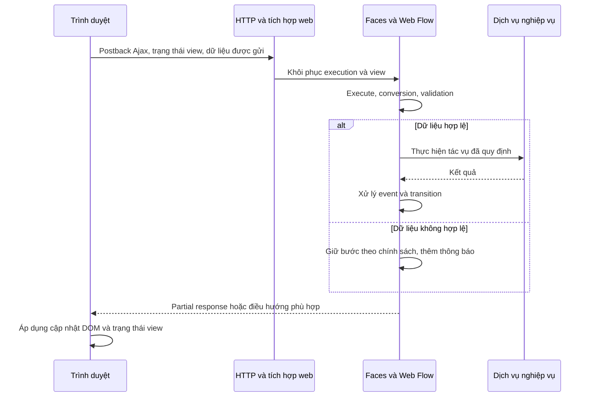

# Kiểm tra Ajax và giao diện Faces khi có sử dụng

## 1. Mục tiêu và phạm vi áp dụng

Một bài kiểm thử flow có thể xác nhận event `preview` được xử lý đúng, nhưng giao diện vẫn không đổi vì request Ajax thiếu trường đầu vào, response cập nhật sai component hoặc JavaScript không áp dụng được kết quả. Với Faces, còn có vòng đời component, conversion, validation và ViewState cần đi qua đúng cách.

Trong module **SPRING_WEB_FLOW**, kiểm thử tích hợp Ajax cần nối được ba bằng chứng: thao tác trên giao diện tạo đúng request, request tạo kết quả điều phối và dữ liệu đúng, rồi trình duyệt hiển thị đúng kết quả sau khi nhận response.

Sau bài học, bạn có thể:

- Chọn phạm vi kiểm thử theo công nghệ giao diện thực sự đang dùng.
- Phân biệt Ajax dùng với Spring MVC và giao thức partial response của Faces.
- Kiểm tra vùng được xử lý, vùng được render và những phần giao diện cần giữ nguyên.
- Chứng minh validation ngăn điều hướng hoặc tác vụ nghiệp vụ khi dữ liệu chưa hợp lệ.
- Kiểm tra các request liên tiếp, state của flow, ViewState, hết phiên và nhánh phục hồi.
- Thiết kế kiểm thử trình duyệt có điều kiện chờ rõ ràng và bằng chứng chẩn đoán.

**“Khi có sử dụng” là một điều kiện về phạm vi.** Nếu ứng dụng không dùng Faces, không thêm Faces chỉ để có test cho mục này. Nếu ứng dụng không có Ajax, kiểm tra form submit và điều hướng đầy trang theo công nghệ đang có. Khi bỏ qua một nhóm kiểm thử, ghi rõ lý do theo kiến trúc; không đánh dấu đã kiểm tra Faces bằng một bài test chỉ chạy flow engine.

Ví dụ Faces trong bài dùng mốc Spring Web Flow 3.x và Jakarta Faces 4.0. Hướng dẫn Spring Web Flow 3.x yêu cầu JSF 4.0 trở lên cho phần tích hợp này; xem [JSF Integration](https://docs.spring.io/spring-webflow/docs/3.0.x/reference/#spring-faces). Mã phía trình duyệt dùng Playwright Test với TypeScript để minh họa. Các ví dụ cần được đưa vào ứng dụng thử nghiệm có cấu hình tương thích; chúng chưa được chạy trong quá trình soạn bài học.

## 2. Xác định đúng loại Ajax trước khi đặt assertion

| Kiến trúc giao diện | Request/response có thể gặp | Trọng tâm kiểm thử |
|---|---|---|
| Spring MVC với Ajax riêng | JSON, HTML fragment hoặc hợp đồng riêng | Payload, nhận diện Ajax, fragment và hành vi JavaScript |
| Spring MVC với Web Flow | Ajax qua adapter và cơ chế view đã cấu hình | Event, execution key, redirect và vùng cập nhật |
| Faces tích hợp Web Flow | Postback theo component và partial response Faces | Execute/render, ViewState, validation và sự kiện flow |
| Thư viện component Faces | Bổ sung queue, process/update, callback riêng | Hành vi của thư viện cùng hợp đồng ứng dụng |

Không mặc định mọi request có `X-Requested-With` đều được framework xử lý như mong muốn. Cách nhận diện Ajax phải phù hợp adapter và thư viện đang cấu hình. Đối với Spring MVC/Web Flow, `AjaxHandler` là một điểm tích hợp cần đối chiếu với phía client; xem [Handling Ajax Requests](https://docs.spring.io/spring-webflow/docs/current/reference/#spring-js-ajax).

Không yêu cầu response JSON đối với một request Faces Ajax. Cũng không đưa tham số Faces vào một endpoint trả HTML fragment tự thiết kế rồi coi đó là kiểm thử đúng giao thức.

## 3. Bốn ranh giới cần quan sát



Mỗi ranh giới trả lời một câu hỏi khác nhau:

1. **HTTP:** request đến đúng endpoint, giữ đúng phiên và mang đủ trạng thái cần thiết chưa?
2. **Framework:** request được xử lý qua đúng vòng đời và flow đang hoạt động chưa?
3. **Nghiệp vụ:** model, state và tác dụng phụ có đúng không?
4. **Trình duyệt:** component có thực sự thay đổi, lỗi có hiển thị và thao tác tiếp theo còn hoạt động không?

HTTP 200 chỉ là một phần bằng chứng. Một partial response chứa lỗi hoặc một trang đăng nhập HTML được trả sau redirect vẫn có thể đi kèm một response cuối cùng mang status 200.

## 4. Execute và render trong Faces

`execute` xác định những component tham gia phần xử lý của vòng đời request. `render` xác định những component được mã hóa lại để gửi về phía client. Render một ô nhập liệu không đồng nghĩa giá trị của nó đã được xử lý vào model. Xem [Jakarta EE Tutorial: Using Ajax with Jakarta Faces](https://jakarta.ee/learn/docs/jakartaee-tutorial/current/web/faces-ajax/faces-ajax.html).

Ví dụ:

```xml
<f:ajax execute="@this guests" render="messages quotePanel"/>
```

Trong ngữ cảnh form của ví dụ bên dưới:

- Nút phát request và trường `guests` cần được xử lý.
- Vùng thông báo và vùng báo giá cần được cập nhật.
- Trường ghi chú nằm ngoài render không nên bị thay thế DOM bởi thao tác xem trước.

Các biểu thức tìm component chịu ảnh hưởng của naming container. `guests` trong Facelets có thể trở thành client ID `booking:guests`, hoặc có thêm tiền tố khi nằm trong template/component phức hợp. Không suy client ID bằng cách nối chuỗi tùy ý; hãy đối chiếu DOM đã render và cây component. Xem [VDL của f:ajax 4.0](https://jakarta.ee/specifications/faces/4.0/vdldoc/f/ajax).

Đối với test, cần phân biệt ba thứ: dữ liệu có trong HTTP payload, component có tham gia execute, và model cuối cùng có được cập nhật. Tùy cách thu thập form của thư viện, một trường có thể xuất hiện trong payload nhưng không nằm trong tập xử lý component.

## 5. Môi trường kiểm thử cần đại diện cho phần tích hợp

### 5.1. Những thành phần phải có

Với một ứng dụng Faces thực sự, môi trường tích hợp cần có:

- Servlet container tương thích, cấu hình điều phối HTTP của ứng dụng và filter cần thiết.
- Faces implementation, tài nguyên JavaScript, view Facelets và cấu hình tích hợp Web Flow/Faces.
- Flow registry, executor, repository và các bean được flow sử dụng.
- Dữ liệu thử nghiệm xác định được và cơ chế đăng nhập nếu hành trình yêu cầu.
- Trình duyệt chạy JavaScript để kiểm tra việc áp dụng partial response.

Không chỉ đăng ký một bean Faces trong test context rồi kết luận đã kiểm tra cả vòng đời Faces. Tương tự, `MockMvc` hữu ích để kiểm tra ranh giới MVC nhưng không chạy JavaScript của trình duyệt; một test chỉ dựng MVC context thường cũng chưa bao gồm toàn bộ runtime Faces.

### 5.2. Phần có thể giả lập

Có thể thay dịch vụ báo giá, cổng thanh toán hoặc API ngoài bằng stub có kiểm soát để tạo kết quả xác định. Khi mục tiêu là tích hợp giao diện, giữ lại các phần đang cần kiểm chứng: HTTP routing, Faces lifecycle, Web Flow, render và JavaScript client.

Nếu chặn request Ajax ở trình duyệt rồi tự trả response thành công, test đó chỉ kiểm tra client với response giả. Nó không chứng minh server xử lý form, validation hoặc transition đúng.

### 5.3. Dữ liệu và cô lập phiên

Mỗi test cần draft hoặc mã nghiệp vụ riêng nếu có ghi dữ liệu. Mỗi browser context nên có phiên độc lập, trừ tình huống cố ý kiểm tra nhiều tab trong một phiên. Không tái dùng execution key chụp từ test khác.

Đối với thời gian, tiền tệ hoặc nội dung dịch, cố định locale và dữ liệu fixture. Không assertion một chuỗi báo giá thay đổi theo dịch vụ ngoài đang chạy thật nếu điều đó nằm ngoài mục tiêu của bài test.

## 6. Hành trình mẫu: xem trước báo giá

Hành trình có hai bước:

```text
enterBookingDetails
  preview  → ở lại bước hiện tại, cập nhật báo giá
  proceed  → reviewBooking khi dữ liệu hợp lệ
reviewBooking
  back     → enterBookingDetails
```

Hợp đồng fixture:

| Thuộc tính | Giá trị/quy tắc |
|---|---|
| `bookingForm.guests` | `Integer`, từ 1 đến 6 |
| `bookingForm.note` | Ghi chú, không được xử lý trong preview của ví dụ |
| `bookingForm.quoteVersion` | Bắt đầu bằng 0, tăng một sau mỗi preview hợp lệ |
| `bookingForm.quoteText` | Kết quả xác định từ dịch vụ báo giá giả |
| Preview không hợp lệ | Giữ nguyên quoteVersion, hiển thị lỗi, không gọi dịch vụ báo giá |
| Preview hợp lệ | Cập nhật báo giá, không tạo booking và không kết thúc flow |

Bộ đếm quoteVersion trong ví dụ là dữ liệu fixture để quan sát kết quả, không phải một yêu cầu phải hiển thị chi tiết kỹ thuật này trong sản phẩm. Khi kiểm tra ứng dụng thật, có thể dùng một dấu hiệu nghiệp vụ tương đương hoặc quan sát dịch vụ ở môi trường test.

### 6.1. Facelets minh họa

Đoạn sau giả định `bookingForm` là model được flow cung cấp, có getter/setter đúng kiểu và đã được khởi tạo. Trang nằm trong ứng dụng đã có cấu hình Faces/Web Flow; đây không phải toàn bộ cấu hình khởi động ứng dụng.

```xml
<!DOCTYPE html>
<html xmlns="http://www.w3.org/1999/xhtml"
      xmlns:h="jakarta.faces.html"
      xmlns:f="jakarta.faces.core">
<h:head>
    <title>Thông tin đặt chỗ</title>
</h:head>
<h:body>
    <h1>Thông tin đặt chỗ</h1>
    <h:form id="booking">
        <h:outputLabel for="guests" value="Số khách"/>
        <h:inputText id="guests"
                     value="#{bookingForm.guests}"
                     required="true"
                     requiredMessage="Nhập số khách"
                     converterMessage="Số khách phải là số nguyên"
                     validatorMessage="Số khách phải từ 1 đến 6">
            <f:validateLongRange minimum="1" maximum="6"/>
        </h:inputText>

        <h:outputLabel for="note" value="Ghi chú"/>
        <h:inputText id="note" value="#{bookingForm.note}"/>

        <h:panelGroup id="messages" layout="block">
            <h:messages/>
        </h:panelGroup>

        <h:panelGroup id="quotePanel" layout="block">
            <h:outputText id="quoteText" value="#{bookingForm.quoteText}"/>
            <h:outputText id="quoteVersion"
                          value="#{bookingForm.quoteVersion}"/>
        </h:panelGroup>

        <h:commandButton id="preview" value="Xem trước" action="preview">
            <f:ajax execute="@this guests" render="messages quotePanel"/>
        </h:commandButton>

        <h:commandButton id="proceed" value="Tiếp tục" action="proceed">
            <f:ajax execute="@form" render="@form"/>
        </h:commandButton>
    </h:form>
</h:body>
</html>
```

Vùng `messages` luôn có trong DOM, kể cả lúc chưa có lỗi. Nếu chỉ tạo component bọc khi có thông báo, lần Ajax đầu tiên có thể không tìm thấy phần tử đích ở client để thay thế. Với thư viện component khác, kiểm tra cơ chế cập nhật vùng chưa tồn tại theo chính tài liệu của thư viện.

### 6.2. Phần điều phối flow tương ứng

```xml
<view-state id="enterBookingDetails" view="enterBookingDetails.xhtml">
    <transition on="preview">
        <evaluate expression="quoteService.refresh(bookingForm)"/>
    </transition>
    <transition on="proceed" to="reviewBooking"/>
</view-state>

<view-state id="reviewBooking" view="reviewBooking.xhtml">
    <transition on="back" to="enterBookingDetails"/>
</view-state>
```

Đây là phần trích trong một flow hợp lệ có model và service đã đăng ký. Transition `preview` không có `to`, nên mô tả xử lý tại bước hiện tại. `quoteService.refresh()` trong fixture cập nhật quoteText và tăng quoteVersion sau khi nhận model hợp lệ; nó không thực hiện đặt chỗ.

`action="preview"` ở command component biểu diễn sự kiện điều phối trong tích hợp này. Không thay nó bằng một tên phương thức tùy ý rồi mặc định Web Flow sẽ nhận cùng event. Hướng dẫn về [Handling JSF Events With Spring Web Flow](https://docs.spring.io/spring-webflow/docs/3.0.x/reference/#spring-faces-events) mô tả việc nối sự kiện Faces với flow.

## 7. Kiểm tra request và partial response

### 7.1. Request có những dấu hiệu gì?

Với Jakarta Faces 4.0, một Ajax request chuẩn có thể quan sát:

```text
Header:
  Faces-Request: partial/ajax

Các tham số liên quan:
  jakarta.faces.partial.ajax
  jakarta.faces.source
  jakarta.faces.partial.execute
  jakarta.faces.partial.render
  jakarta.faces.ViewState
```

Tên nguồn là client ID của component thực tế, ví dụ `booking:preview`. Cơ chế Faces nhận diện Ajax qua header được mô tả tại [PartialViewContext 4.0](https://jakarta.ee/specifications/faces/4.0/apidocs/jakarta/faces/context/PartialViewContext.html); các tham số phía JavaScript được mô tả tại [faces.ajax 4.0](https://jakarta.ee/specifications/faces/4.0/jsdoc/faces.ajax.html).

Ứng dụng dùng stack cũ có thể có tên tham số hoặc namespace khác. Không trộn ví dụ Jakarta với cấu hình `javax` của một runtime cũ mà không kiểm tra tương thích. Không tự tạo thủ công ViewState hoặc execution key để né quy trình khôi phục view.

### 7.2. Response phải được đọc theo cấu trúc

Đối với Faces Ajax, response bình thường dùng XML partial response. Ví dụ rút gọn, không phải payload đầy đủ để phát lại:

```xml
<partial-response>
    <changes>
        <update id="booking:messages"><![CDATA[...]]></update>
        <update id="booking:quotePanel"><![CDATA[...]]></update>
    </changes>
</partial-response>
```

Response thực tế còn có thể có thông tin trạng thái view hoặc chỉ dẫn khác. Giao thức có nhánh lỗi và redirect; vì vậy, chỉ tìm chuỗi `quotePanel` trong body không chứng minh đã nhận một cập nhật thành công. Xem [Jakarta Faces 4.0, phần partial processing và response](https://jakarta.ee/specifications/faces/4.0/jakarta-faces-4.0.html).

Ở test của thao tác xem trước thành công, hãy kiểm tra:

- HTTP status và content type phù hợp.
- XML parse được, root là `partial-response`.
- Không có phần tử lỗi hoặc redirect ngoài dự kiến.
- Có update cho các vùng mà hợp đồng fixture yêu cầu.
- DOM cuối cùng chứa dữ liệu mới và thao tác tiếp theo vẫn thành công.

Không snapshot toàn bộ ViewState hoặc execution key. Những giá trị này phụ thuộc runtime và cơ chế lưu trạng thái; nên kiểm tra khả năng sử dụng qua chuỗi request thay vì so sánh với một hằng số.

## 8. Ví dụ kiểm thử Playwright

Giả định ứng dụng thử nghiệm đã chạy, `baseURL` được cấu hình, đường dẫn `/spring/booking` mở flow mới, không có bước đăng nhập chưa xử lý và dữ liệu fixture đáp ứng mục 6. Form trong ví dụ không có naming container bổ sung, nên client ID bắt đầu bằng `booking:`.

### 8.1. Helper chờ đúng response và kiểm tra giao thức

```ts
import { test, expect, type Page, type Response } from '@playwright/test';

async function clickFacesAjax(
  page: Page,
  sourceClientId: string,
  buttonName: string,
): Promise<Response> {
  const responsePromise = page.waitForResponse(response => {
    const request = response.request();
    const form = new URLSearchParams(request.postData() ?? '');
    return request.method() === 'POST'
      && request.headers()['faces-request'] === 'partial/ajax'
      && form.get('jakarta.faces.source') === sourceClientId;
  });

  await page.getByRole('button', { name: buttonName, exact: true }).click();
  return await responsePromise;
}

async function expectPreviewResponse(page: Page, response: Response) {
  expect(response.status()).toBe(200);
  expect(response.headers()['content-type'] ?? '')
    .toMatch(/(?:text|application)\/xml/i);

  const xmlText = await response.text();
  const parsed = await page.evaluate(text => {
    const document = new DOMParser().parseFromString(text, 'application/xml');
    return {
      root: document.documentElement.localName,
      parseErrors: document.getElementsByTagName('parsererror').length,
      errors: document.getElementsByTagName('error').length,
      redirects: document.getElementsByTagName('redirect').length,
      updateIds: Array.from(document.getElementsByTagName('update'))
        .map(node => node.getAttribute('id')),
    };
  }, xmlText);

  expect(parsed.parseErrors).toBe(0);
  expect(parsed.root).toBe('partial-response');
  expect(parsed.errors).toBe(0);
  expect(parsed.redirects).toBe(0);
  expect(parsed.updateIds).toContain('booking:messages');
  expect(parsed.updateIds).toContain('booking:quotePanel');
}
```

Đăng ký chờ response trước thao tác click để tránh bỏ lỡ response nhanh. Điều kiện theo source giúp không nhận nhầm request polling hoặc Ajax khác. API chờ response được mô tả tại [Playwright Page.waitForResponse](https://playwright.dev/docs/api/class-page#page-wait-for-response).

Helper dành cho form URL-encoded và giao thức đã nêu; với multipart hoặc thư viện dùng transport riêng, cần điều chỉnh cách xác định request. Những assertion về update ID là hợp đồng của fixture này, không phải quy tắc yêu cầu mọi ứng dụng Faces luôn cập nhật hai vùng như nhau.

### 8.2. Validation sai, sửa đúng và gửi lần tiếp theo

```ts
test('preview validates input and remains usable after partial updates',
  async ({ page }) => {
    const pageErrors: string[] = [];
    page.on('pageerror', error => pageErrors.push(error.message));

    await page.goto('/spring/booking');
    await expect(page.getByRole('heading', {
      name: 'Thông tin đặt chỗ', exact: true,
    })).toBeVisible();

    const guests = page.getByLabel('Số khách', { exact: true });
    const note = page.getByLabel('Ghi chú', { exact: true });
    const messages = page.locator('[id="booking:messages"]');
    const revision = page.locator('[id="booking:quoteVersion"]');
    const viewState = page.locator(
      '[id="booking"] input[name="jakarta.faces.ViewState"]',
    );

    await expect(revision).toHaveText('0');
    await expect(viewState).toHaveCount(1);
    await expect(viewState).not.toHaveValue('');

    await note.fill('Giữ nội dung đang nhập');
    const originalNoteElement = await note.elementHandle();
    if (!originalNoteElement) throw new Error('Missing note element');

    await guests.fill('0');
    const invalid = await clickFacesAjax(page, 'booking:preview', 'Xem trước');
    await expectPreviewResponse(page, invalid);
    await expect(messages).toContainText('Số khách phải từ 1 đến 6');
    await expect(revision).toHaveText('0');

    await guests.fill('2');
    const valid = await clickFacesAjax(page, 'booking:preview', 'Xem trước');
    await expectPreviewResponse(page, valid);
    await expect(revision).toHaveText('1');
    await expect(messages).not.toContainText('Số khách phải từ 1 đến 6');
    await expect(note).toHaveValue('Giữ nội dung đang nhập');
    expect(await originalNoteElement.evaluate(node => node.isConnected))
      .toBe(true);
    await expect(viewState).not.toHaveValue('');

    await guests.fill('3');
    const next = await clickFacesAjax(page, 'booking:preview', 'Xem trước');
    await expectPreviewResponse(page, next);
    await expect(revision).toHaveText('2');
    await expect(note).toHaveValue('Giữ nội dung đang nhập');
    expect(pageErrors).toEqual([]);
    await originalNoteElement.dispose();
  });
```

Assertion DOM của Playwright chờ điều kiện trong giới hạn timeout; không cần thêm `sleep` để hy vọng Ajax đã xong. Xem [Playwright Assertions](https://playwright.dev/docs/test-assertions).

Giá trị revision chứng minh fixture đã xử lý preview hợp lệ theo hợp đồng. Để chứng minh tuyệt đối dịch vụ không được gọi khi validation sai, bổ sung bộ ghi lời gọi ở phía server hoặc assertion dữ liệu nghiệp vụ; giao diện đứng yên một mình chưa đủ bằng chứng cho mọi tác dụng phụ.

Giữ tham chiếu tới phần tử ghi chú giúp phát hiện phần tử đó bị thay thế trong kịch bản này. Nội dung ghi chú còn trên trình duyệt chưa chứng minh nó đã được lưu vào model server: trường này cố ý không nằm trong execute của preview.

Không yêu cầu ViewState phải đổi chuỗi sau mỗi request. Test kiểm tra có trạng thái view và tiếp tục dùng được qua nhiều lần postback. Cơ chế lưu trạng thái có thể tái sử dụng biểu diễn mà vẫn hợp lệ.

`pageerror` phát hiện lỗi JavaScript không được xử lý; nó không thay thế việc quan sát callback lỗi của Faces hoặc thư viện component. Test giao thức và DOM bổ sung bằng chứng về kết quả của từng request.

## 9. Kiểm tra transition giữa hai view

Sau khi preview hoạt động, cần một test khác đi qua chuyển state:

```text
Given: enterBookingDetails đang có số khách hợp lệ.
When: nhấn Tiếp tục bằng Ajax.
Then: giao diện reviewBooking xuất hiện theo cơ chế điều hướng đã cấu hình.
And: số khách trên bước review khớp giá trị vừa nhập.
When: nhấn Quay lại.
Then: bước nhập liệu trở lại với draft đúng.
When: thực hiện preview lần nữa.
Then: request được xử lý bình thường với view/flow đang hoạt động.
```

Response cho chuyển view có thể khác response cập nhật tại cùng view. Không áp helper `expectPreviewResponse()` một cách máy móc cho mọi transition: hợp đồng điều hướng có thể dùng partial redirect hoặc cơ chế cập nhật khác tùy tích hợp.

Assertion nên dựa vào view được người dùng nhìn thấy và dữ liệu hiển thị. Nếu cần chứng minh chính xác state ID, kết hợp với phép quan sát flow executor hoặc listener trong cấu hình test. Không đưa state nội bộ lên giao diện sản phẩm chỉ để tiện assertion.

Một chuỗi “chuyển bước → quay lại → Ajax lần nữa” thường phát hiện lỗi mà thao tác preview đơn lẻ bỏ sót: form action cũ, ViewState không đồng bộ, execution key cũ hoặc component không được khởi tạo lại đúng.

## 10. Ma trận tình huống cần có

| Tình huống | Điều cần quan sát ở giao diện | Điều cần kiểm tra phía server |
|---|---|---|
| Preview hợp lệ | Báo giá đổi, không rời bước | Model đúng, dịch vụ được gọi đúng |
| Thiếu trường bắt buộc | Lỗi tại vùng thông báo | Không chạy tác vụ bị chặn bởi validation |
| Sai định dạng số | Có lỗi conversion | Không cập nhật model bằng giá trị sai |
| Ngoài khoảng hợp lệ | Có lỗi validation | Không chuyển bước thành công |
| Execute thiếu một trường | Kết quả theo chính sách dữ liệu cũ/mới | Xác nhận tập xử lý và model thực nhận |
| Render thiếu messages | Phát hiện lỗi không hiển thị | Server có thông báo nhưng client chưa nhận đúng vùng |
| Cập nhật liên tiếp | Lần sau vẫn hoạt động | Trạng thái view và execution được nối đúng |
| Chuyển view qua Ajax | Bước đích hiện đúng | Transition và output mapping đúng |
| Dịch vụ tạm lỗi | Có hướng xử lý, nút không kẹt vô hạn | Nhánh phục hồi giữ draft và không báo thành công |
| Hết phiên/execution | Khôi phục hoặc đăng nhập lại theo chính sách | Không tái dùng dữ liệu của execution khác |
| Hai lần xác nhận gần nhau | Kết quả nhất quán | Không tạo trùng giao dịch nghiệp vụ |
| Tài nguyên Faces lỗi tải | Phát hiện thao tác không hoạt động | Mapping tài nguyên và đường dẫn triển khai đúng |

Với bảng này, chọn những dòng có ý nghĩa cho ứng dụng và gắn mỗi dòng với assertion cụ thể. Không cần viết một bài end-to-end lớn bao trùm mọi tổ hợp; giữ test nhỏ ở đúng ranh giới, rồi dùng vài hành trình trình duyệt đại diện.

## 11. Hết phiên, lỗi dịch vụ và redirect

### 11.1. Hết phiên giữa hai thao tác Ajax

Quy trình kiểm thử cần gây ra đúng điều kiện hết phiên hoặc mất execution trên môi trường test. Xóa cookie ở client, vô hiệu hóa HTTP session ở server và xóa snapshot execution là các tình huống khác nhau; hãy đặt tên test đúng với tình huống đã tạo.

Sau khi gây lỗi, gửi một thao tác từ view đang mở và kiểm tra:

- Người dùng nhận kết quả phục hồi hoặc đăng nhập lại theo thiết kế.
- Không có HTML trang đăng nhập bị nhét vào vùng báo giá.
- Không có vòng lặp request hoặc spinner chạy mãi.
- Draft được giữ hoặc mất theo chính sách đã công bố, không lẫn với execution khác.
- Sau khi hoàn thành khôi phục, người dùng có thể bắt đầu hoặc tiếp tục một hành trình hợp lệ.

Không mặc định listener của flow sẽ quan sát được mọi lỗi: lỗi tra cứu execution hoặc khôi phục view có thể xảy ra trước khi logic nghiệp vụ của flow được chạy.

### 11.2. Lỗi nghiệp vụ và lỗi transport

Dịch vụ trả kết quả không hợp lệ, server ném exception, HTTP 500 và kết nối bị ngắt là những tình huống khác nhau. Mỗi tình huống cần một chính sách về thông báo, trạng thái draft và khả năng thử lại.

Nếu dùng Playwright để ngắt một request, test đó kiểm tra hành vi phía client trước lỗi transport. Nếu dùng dịch vụ stub ném lỗi trên server, test có thể kiểm chứng handler và nhánh phục hồi của ứng dụng. Không coi hai kỹ thuật là thay thế hoàn toàn cho nhau.

### 11.3. Redirect trong Ajax

HTTP client theo redirect có thể nhận một body thành công cuối cùng và che giấu điều hướng không mong muốn. Khi lỗi nằm ở redirect, lưu chuỗi response và kiểm tra cơ chế client dùng để chuyển trang.

Với Faces, cần phân biệt redirect được biểu diễn trong giao thức partial response với redirect HTTP thông thường. Với Ajax tùy chỉnh của Spring MVC, cơ chế đó có thể khác. Hợp đồng test phải phản ánh adapter đã cấu hình, không chỉ một mẫu request do người viết test tự đặt ra.

## 12. Đồng thời, nhiều tab và tác dụng phụ lặp

Hai request preview nối tiếp không tương đương hai lần xác nhận giao dịch chạy đồng thời. Nếu sản phẩm có nút xác nhận cuối cùng, cần kiểm tra khả năng chống trùng tại dịch vụ và dữ liệu bền vững, kể cả khi giao diện đã disable nút.

Thư viện Faces có thể xếp hàng Ajax. Nhấn nhanh hai lần rồi thấy kết quả đúng chưa chứng minh server an toàn trước mọi cạnh tranh. Muốn kiểm tra cạnh tranh ở server, tạo điểm đồng bộ có kiểm soát và đối chiếu quy tắc lock/repository cùng cơ chế chống trùng nghiệp vụ.

Với hai tab, phân biệt:

- Hai tab mở hai execution độc lập: draft và kết quả không được lẫn.
- Hai tab cùng thao tác một execution hoặc snapshot cũ: kết quả xung đột cần đúng chính sách.
- Hai browser context khác phiên: không được chia sẻ dữ liệu hội thoại riêng tư.

Không cố định giả định “key luôn đổi” hoặc “key luôn giữ nguyên”. Hãy kiểm tra hành vi sử dụng key, sự cô lập dữ liệu và khả năng tiếp tục flow.

## 13. Làm test ổn định và dễ chẩn đoán

### 13.1. Chờ đúng điều kiện

Chờ request tương ứng với thao tác, sau đó chờ DOM đạt điều kiện nghiệp vụ. Không lấy `networkidle` làm điều kiện chung nếu trang có polling. Không dùng thời gian chờ cố định để bù cho một selector sai hoặc request không được phát ra.

Dùng locator theo role/label cho thao tác người dùng. Khi cần kiểm tra update ID của Faces, dùng client ID thực tế và tránh lỗi escape dấu `:` trong CSS bằng selector thuộc tính như `[id="booking:quotePanel"]`.

### 13.2. Thu thập bằng chứng

Khi test thất bại, lưu các bằng chứng phù hợp:

- Trace, screenshot và lỗi JavaScript/callback Ajax.
- URL, method, source component và tập execute/render của request liên quan.
- Status, content type và cấu trúc response, đặc biệt error/redirect/update ID.
- Correlation ID cùng log state/event và số lần gọi dịch vụ trong môi trường test.

Cookie, ViewState, token và dữ liệu form có thể chứa thông tin cần bảo vệ. Khi lưu artifact dùng chung, lọc dữ liệu không cần thiết thay vì đưa toàn bộ payload vào báo cáo. Bằng chứng cần đủ để chỉ ra ranh giới lỗi, không nhất thiết chứa mọi byte của request.

### 13.3. Các lỗi cấu hình thường gặp

| Dấu hiệu | Hướng kiểm tra |
|---|---|
| Nút chỉ hoạt động khi bỏ Ajax | JavaScript tài nguyên, header nhận diện và cấu hình adapter |
| Giá trị mới không tới service | Execute, converter/validator và thời điểm cập nhật model |
| Server có lỗi nhưng trang im lặng | Render messages, component đích và callback lỗi |
| Response đúng nhưng DOM không đổi | Client ID, component wrapper và lỗi JavaScript |
| Ajax lần đầu được, lần sau hỏng | ViewState, form action và execution URL sau cập nhật |
| Chuyển view xong nút không dùng được | Tài nguyên/script và khởi tạo lại component sau thay view |
| Chạy riêng xanh, chạy cả bộ đỏ | Chia sẻ session, draft, service stub hoặc dữ liệu tĩnh |
| HTTP 200 nhưng giao diện lạ | Trang đăng nhập, redirect ngầm hoặc partial response có lỗi |

## 14. Bài thực hành và tiêu chí hoàn thành

Trong ứng dụng thử nghiệm có Ajax/Faces, thực hiện:

1. Kiểm tra trang đầu tải được tài nguyên cần thiết và có form hoạt động.
2. Gửi dữ liệu sai để kiểm tra conversion, validation và vùng thông báo.
3. Sửa dữ liệu, gửi lại và chứng minh kết quả mới được render.
4. Thực hiện thêm một request để xác nhận trạng thái view còn dùng được.
5. Chuyển sang bước kế tiếp, quay lại và kiểm tra Ajax hoạt động tiếp.
6. Gây một lỗi dịch vụ và một tình huống hết phiên/execution có kiểm soát.
7. Nếu có thao tác ghi cuối cùng, kiểm tra không tạo trùng tác dụng phụ khi retry hoặc gửi lặp.

Tiêu chí chấp nhận:

- Test phản ánh đúng công nghệ giao diện đang dùng; phần không áp dụng được ghi rõ lý do.
- Có bằng chứng request, response và DOM thay vì chỉ status 200.
- Validation sai chặn tác vụ cần chặn; dữ liệu hợp lệ được xử lý đúng.
- Cập nhật từng phần không làm mất dữ liệu cục bộ cần giữ theo hợp đồng.
- ViewState, phiên và execution được kiểm tra qua chuỗi thao tác có ý nghĩa.
- Lỗi có kết quả phục hồi rõ ràng và test không phụ thuộc dịch vụ ngoài hỏng thật.
- Những phần chỉ được giả lập hoặc chưa kiểm tra, như concurrency hay repository production, được mô tả đúng phạm vi.

Một bài kiểm thử Ajax/Faces hữu ích phải nối được hành động của người dùng với dữ liệu và điều phối bên trong, rồi quay lại kết quả hiển thị. Chính chuỗi bằng chứng đó mới cho thấy hành trình web nhiều bước tiếp tục hoạt động sau mỗi lần cập nhật giao diện.