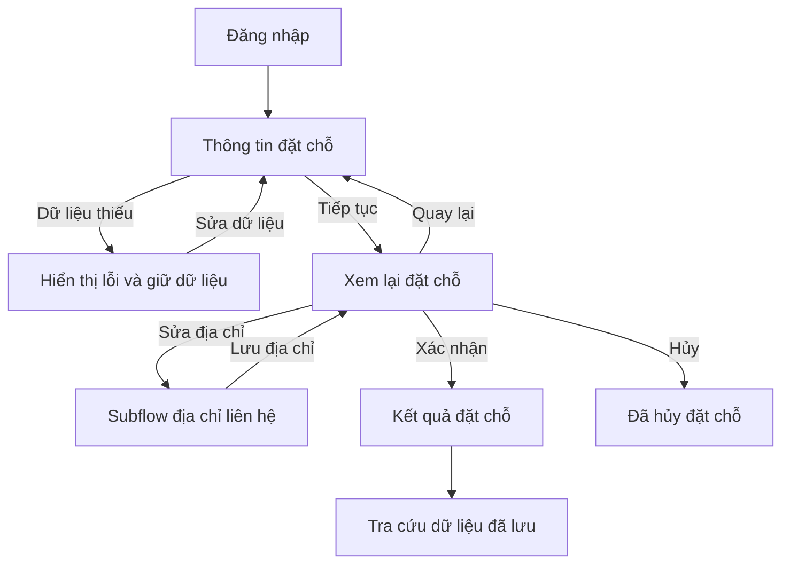

# Tự động hóa trình duyệt cho hành trình hoàn chỉnh

Một bộ kiểm thử flow có thể chứng minh event `confirm` dẫn tới end-state mong muốn. Nhưng người dùng vẫn không hoàn thành được hành trình nếu nút gửi sai event, form mất execution URL, cookie phiên không được gửi, lỗi validation không xuất hiện hoặc trang kết quả chỉ hiển thị thành công dù dữ liệu chưa được lưu.

Kiểm thử bằng trình duyệt đưa các phần đó vào cùng một hành trình quan sát được. Bài thuộc chương **Kiểm thử tích hợp** của module **SPRING_WEB_FLOW**, hướng dẫn thiết kế và tự động hóa một quy trình web nhiều bước đi qua Spring MVC, Web Flow, form binding, validation, subflow, quản lý phiên và kết quả nghiệp vụ.

Ví dụ dùng **Playwright Java và JUnit Jupiter**, với một ứng dụng Spring Web Flow đã chạy trên HTTP. Các URL, nhãn giao diện và mã `data-testid` trong bài là hợp đồng của ứng dụng minh họa, không phải endpoint hoặc thuộc tính mà Spring Web Flow tự sinh cho mọi dự án.

## 1. Xác định phạm vi của một hành trình hoàn chỉnh

Một kịch bản hoàn chỉnh nên bắt đầu từ điểm mà người dùng thật có thể truy cập và kết thúc bằng kết quả nghiệp vụ có thể kiểm chứng.

Ví dụ đặt chỗ:

1. Đăng nhập bằng tài khoản thử nghiệm.
2. Mở hành trình đặt chỗ mới.
3. Gửi dữ liệu thiếu và nhận lỗi validation từ server.
4. Sửa dữ liệu rồi sang bước xem lại.
5. Quay lại để chỉnh số khách và tùy chọn nhận thông báo.
6. Mở subflow nhập địa chỉ liên hệ, lưu và trở lại flow cha.
7. Xác nhận đặt chỗ.
8. Đọc lại kết quả từ chức năng tra cứu đặt chỗ đã lưu.



Phân biệt ba tầng kiểm tra:

| Tầng | Điều nó kiểm chứng tốt | Điều còn cần tầng khác bổ sung |
| --- | --- | --- |
| Test trực tiếp flow engine | State, transition, scope, input/output của subflow | DOM, JavaScript, cookie và đường đi HTTP thật |
| Test tích hợp MVC/HTTP | Mapping, security filter, binding, validation, xử lý request | Khả năng tương tác của trình duyệt với giao diện |
| Test trình duyệt | Hành trình qua UI, navigation, form, phiên và kết quả người dùng nhìn thấy | Toàn bộ tổ hợp nghiệp vụ hoặc mọi tình huống đồng thời |

Không đưa mọi nhánh nhỏ vào một bài test UI rất dài. Giữ một số hành trình trọng yếu qua trình duyệt, còn tổ hợp quy tắc và dữ liệu biên có thể được kiểm tra nhanh hơn ở tầng flow hoặc service.

## 2. Những đặc điểm của Web Flow mà test trình duyệt phải tôn trọng

### Execution URL là dữ liệu động của một phiên thực thi

Khi một flow dừng ở view-state, request tiếp theo phải tiếp tục đúng flow execution. Một URL có thể chứa tham số execution với giá trị thay đổi theo phiên hoặc snapshot. Không ghi cứng một giá trị như `e1s1` vào test rồi dùng lại cho mọi lần chạy.

Test nên mở điểm bắt đầu hành trình và tương tác với form/link do ứng dụng render. Như vậy, chính ứng dụng cung cấp thông tin tiếp tục flow. Tài liệu Web Flow mô tả execution URL và hành vi tạm dừng tại view-state. [Spring Web Flow Reference Guide](https://docs.spring.io/spring-webflow/docs/3.0.x/reference/)

Không yêu cầu URL phải đổi sau mọi event. Cách biểu diễn URL có thể phụ thuộc cấu hình redirect, chế độ nhúng, AJAX và cách tích hợp. Heading, nội dung tóm tắt và khả năng thực hiện bước kế tiếp thường là bằng chứng ổn định hơn cho hành vi nghiệp vụ.

### Nút phải phát event, form phải giữ đúng action

Với tích hợp MVC, Web Flow nhận event qua tham số `_eventId` hoặc tên tham số có tiền tố `_eventId_`. Một nút trong template có thể được viết như sau:

```html
<button type="submit" name="_eventId" value="next">Tiếp tục</button>
<button type="submit" name="_eventId" value="cancel">Hủy</button>
```

Test trình duyệt bấm đúng nút để kiểm tra đường đi đó, thay vì tự POST một event ở bên ngoài UI. Redirect sau khi xử lý form cũng là hành vi bình thường; phản hồi POST trung gian chưa phải trang cuối cùng cần assertion. [Tài liệu MVC integration và phát event](https://docs.spring.io/spring-webflow/docs/current/reference/)

### Cookie, CSRF và đăng nhập phải theo cùng browser context

Giữ đăng nhập và hành trình trong cùng context để trình duyệt gửi cookie và token đúng cách. Nếu ứng dụng dùng Spring Security, bật cấu hình bảo vệ mà môi trường kiểm thử cần kiểm chứng. Việc test tự đọc token rồi bỏ qua form chỉ kiểm tra một đường khác với hành vi đang mô phỏng.

Một request nhận HTTP 200 cũng có thể đang hiển thị lại trang đăng nhập. Vì vậy, cần assertion trang mong muốn và dữ liệu liên quan, không chỉ kiểm tra mã trạng thái.

## 3. Chuẩn bị ứng dụng và dữ liệu có thể tái lập

Trước khi chạy test, thống nhất hợp đồng của fixture:

| Thành phần | Hợp đồng dùng trong bài |
| --- | --- |
| Đăng nhập | `/login`; sau đăng nhập có heading “Tài khoản của tôi” |
| Khởi động flow | `/booking`; có heading “Thông tin đặt chỗ” |
| Form chính | Nhãn “Mã tham chiếu”, “Họ tên”, “Email”, “Số khách”, “Nhận thông báo” |
| Xem lại | Heading “Xem lại đặt chỗ”; các vùng dữ liệu có test id ổn định |
| Địa chỉ | Heading “Địa chỉ liên hệ”; nhãn “Đường và số nhà”, “Thành phố” |
| Hoàn tất | Heading “Đặt chỗ thành công”; mã đặt chỗ có dạng `BK-...` |
| Hủy | Heading “Đã hủy đặt chỗ” |
| Tra cứu | `/account/bookings?clientReference=...`; truy vấn dữ liệu đã lưu theo mã tham chiếu |

Mã tham chiếu là một thuộc tính của đặt chỗ minh họa, dùng để đối chiếu dữ liệu từng lần chạy. Nó không phải execution key và cũng không mặc nhiên là idempotency key.

Các điều kiện dữ liệu cần rõ ràng:

- Có tài khoản thử nghiệm với quyền phù hợp; thông tin đăng nhập lấy từ môi trường chạy.
- Có loại chỗ hoặc nguồn lực đặt chỗ được seed ổn định, đủ cho từng worker.
- Mỗi kịch bản có mã tham chiếu riêng để không khớp nhầm bản ghi cũ.
- Chức năng tra cứu đọc dữ liệu sau khi thao tác xác nhận đã commit, không chỉ đọc bản nháp trong flow/session.
- Danh sách lọc theo mã tham chiếu hiển thị đầy đủ các bản ghi khớp trong fixture, không che trùng bằng phân trang hoặc tự gộp dòng.
- Môi trường kiểm thử có cơ chế dọn dữ liệu theo run/worker, kể cả khi test thất bại giữa chừng.

Trình duyệt mới không làm sạch database. Hai browser context riêng vẫn có thể đặt chung một nguồn lực sắp hết hoặc dùng cùng dữ liệu của tài khoản. Khi chạy song song, cần cô lập cả dữ liệu phía server.

Với dịch vụ bên ngoài như email hoặc thanh toán, xác định biên tích hợp: có thể chạy sandbox hoặc stub ở biên dịch vụ. Nếu chặn toàn bộ request xác nhận ngay trong trình duyệt để trả thành công giả, kịch bản đó không còn chứng minh đường xác nhận thật của Spring Web Flow và service.

## 4. Thiết kế locator và điểm chờ ổn định

Ưu tiên những gì người dùng nhận biết: role, accessible name và label. Với vùng tóm tắt hoặc kết quả cần định danh chính xác, dùng test id làm hợp đồng kiểm thử. Playwright hỗ trợ các cách định vị này và phân giải lại locator khi tương tác. [Playwright Java: Locators](https://playwright.dev/java/docs/locators)

Ví dụ:

```java
page.getByLabel("Họ tên").fill("Nguyễn An");
page.getByRole(AriaRole.BUTTON,
        new Page.GetByRoleOptions().setName("Tiếp tục").setExact(true)).click();
assertThat(page.getByTestId("review-name")).hasText("Nguyễn An");
```

Không dùng một chuỗi CSS phụ thuộc vào vị trí như `div:nth-child(3) > button:nth-child(2)` để biểu diễn ý nghĩa “Xác nhận”. Một nút trang trí được thêm vào cũng có thể làm test bấm nhầm.

Playwright tự chờ điều kiện tương tác và có assertion tự thử lại. Tuy nhiên, việc nút bấm được chưa chứng minh tác vụ nghiệp vụ phía server đã hoàn thành. Sau hành động, hãy chờ một trạng thái ứng dụng cụ thể, chẳng hạn heading của bước tiếp theo hoặc mã kết quả. [Playwright Java: Auto-waiting](https://playwright.dev/java/docs/actionability)

```java
button("Tiếp tục").click();
assertThat(heading("Xem lại đặt chỗ")).isVisible();
assertThat(page.getByTestId("review-guests")).hasText("2");
```

Tránh `Thread.sleep(...)`, chờ cố định hoặc dùng `networkidle` làm tiêu chuẩn duy nhất cho mọi trang. Analytics, polling hoặc request nền không nhất thiết liên quan đến việc người dùng có thể tiếp tục hành trình.

Với assertion “không có bản ghi”, phải biết truy vấn đã kết thúc. Trong fixture, `booking-list-ready` chỉ được hiển thị khi lần đọc danh sách hiện tại đã hoàn tất thành công. Nếu chỉ thấy một bảng rỗng trong lúc đang tải rồi assertion số dòng bằng 0, test có thể xanh trước khi dữ liệu thực xuất hiện.

## 5. Cấu hình một module test trình duyệt bằng Maven

Có thể đặt bộ test trong module E2E riêng. POM dưới đây là ví dụ cho JDK 17, dùng phiên bản được ghim để tái lập. Nó không tự khởi động ứng dụng Spring Web Flow.

```xml
<project xmlns="http://maven.apache.org/POM/4.0.0"
         xmlns:xsi="http://www.w3.org/2001/XMLSchema-instance"
         xsi:schemaLocation="http://maven.apache.org/POM/4.0.0
           https://maven.apache.org/xsd/maven-4.0.0.xsd">
    <modelVersion>4.0.0</modelVersion>
    <groupId>example</groupId>
    <artifactId>webflow-browser-tests</artifactId>
    <version>1.0-SNAPSHOT</version>

    <properties>
        <maven.compiler.release>17</maven.compiler.release>
        <project.build.sourceEncoding>UTF-8</project.build.sourceEncoding>
        <playwright.version>1.64.0</playwright.version>
        <junit.version>5.11.4</junit.version>
    </properties>

    <dependencies>
        <dependency>
            <groupId>com.microsoft.playwright</groupId>
            <artifactId>playwright</artifactId>
            <version>${playwright.version}</version>
            <scope>test</scope>
        </dependency>
        <dependency>
            <groupId>org.junit.jupiter</groupId>
            <artifactId>junit-jupiter</artifactId>
            <version>${junit.version}</version>
            <scope>test</scope>
        </dependency>
    </dependencies>

    <build>
        <plugins>
            <plugin>
                <groupId>org.apache.maven.plugins</groupId>
                <artifactId>maven-compiler-plugin</artifactId>
                <version>3.13.0</version>
            </plugin>
            <plugin>
                <groupId>org.codehaus.mojo</groupId>
                <artifactId>exec-maven-plugin</artifactId>
                <version>3.5.0</version>
            </plugin>
            <plugin>
                <groupId>org.apache.maven.plugins</groupId>
                <artifactId>maven-failsafe-plugin</artifactId>
                <version>3.6.1</version>
                <configuration>
                    <failIfNoTests>true</failIfNoTests>
                </configuration>
                <executions>
                    <execution>
                        <goals>
                            <goal>integration-test</goal>
                            <goal>verify</goal>
                        </goals>
                    </execution>
                </executions>
            </plugin>
        </plugins>
    </build>
</project>
```

Playwright Java được phân phối qua Maven; thư viện đi cùng browser binaries tương ứng. Khi nâng phiên bản thư viện, cập nhật browser được cài trong máy chạy hoặc image CI cho phù hợp. [Installation](https://playwright.dev/java/docs/intro), [Browsers](https://playwright.dev/java/docs/browsers)

Đặt lớp test tên `BookingJourneyIT` để dùng quy ước integration test của bộ cấu hình này. Chạy tới phase `verify` để Failsafe thực hiện cả bước chạy lẫn đánh giá kết quả. [Maven Failsafe: Usage](https://maven.apache.org/surefire/maven-failsafe-plugin/usage.html)

## 6. Khung test: context riêng, trace và ảnh khi thất bại

Lớp sau tạo runtime và browser riêng cho mỗi test để ví dụ dễ theo dõi. Với bộ test lớn có thể tái sử dụng browser có kiểm soát và vẫn tạo context mới cho từng test. Context giúp cô lập cookie và browser storage; nó không thay thế cách ly dữ liệu ứng dụng. [Playwright Java: Test runners](https://playwright.dev/java/docs/test-runners), [Isolation](https://playwright.dev/java/docs/browser-contexts)

Đặt phần khung trong `src/test/java/example/e2e/BookingJourneyIT.java`; thêm các phương thức test ở mục sau vào cùng lớp.

```java
package example.e2e;

import java.net.URLEncoder;
import java.nio.charset.StandardCharsets;
import java.nio.file.Files;
import java.nio.file.Path;
import java.util.UUID;
import java.util.regex.Pattern;

import com.microsoft.playwright.Browser;
import com.microsoft.playwright.BrowserContext;
import com.microsoft.playwright.BrowserType;
import com.microsoft.playwright.Locator;
import com.microsoft.playwright.Page;
import com.microsoft.playwright.Playwright;
import com.microsoft.playwright.Tracing;
import com.microsoft.playwright.options.AriaRole;
import org.junit.jupiter.api.AfterEach;
import org.junit.jupiter.api.BeforeEach;
import org.junit.jupiter.api.Test;
import org.junit.jupiter.api.TestInfo;
import org.junit.jupiter.api.extension.AfterTestExecutionCallback;
import org.junit.jupiter.api.extension.RegisterExtension;

import static com.microsoft.playwright.assertions.PlaywrightAssertions.assertThat;

class BookingJourneyIT {
    private Playwright playwright;
    private Browser browser;
    private BrowserContext context;
    private Page page;
    private Path artifacts;
    private String baseUrl;
    private String username;
    private String password;

    @RegisterExtension
    final AfterTestExecutionCallback failureScreenshot = testContext -> {
        if (testContext.getExecutionException().isPresent()
                && page != null && !page.isClosed() && artifacts != null) {
            try {
                page.screenshot(new Page.ScreenshotOptions()
                        .setPath(artifacts.resolve("failure.png"))
                        .setFullPage(true));
            } catch (RuntimeException diagnosticFailure) {
                System.err.println("Không ghi được ảnh chẩn đoán của test.");
            }
        }
    };

    @BeforeEach
    void setUp(TestInfo testInfo) throws Exception {
        baseUrl = System.getenv().getOrDefault(
                "E2E_BASE_URL", "http://localhost:8080").replaceAll("/+$", "");
        username = requiredEnvironment("E2E_USER");
        password = requiredEnvironment("E2E_PASSWORD");
        String testName = testInfo.getTestMethod().orElseThrow().getName();
        artifacts = Path.of("target", "e2e-artifacts",
                testName + "-" + UUID.randomUUID());
        Files.createDirectories(artifacts);

        playwright = Playwright.create();
        browser = playwright.chromium().launch(new BrowserType.LaunchOptions()
                .setHeadless(!Boolean.parseBoolean(
                        System.getenv().getOrDefault("E2E_HEADED", "false"))));
        context = browser.newContext(new Browser.NewContextOptions()
                .setLocale("vi-VN")
                .setTimezoneId("Asia/Ho_Chi_Minh"));
        context.tracing().start(new Tracing.StartOptions()
                .setScreenshots(true).setSnapshots(true).setSources(true));
        page = context.newPage();
        page.setDefaultTimeout(10_000);
        page.setDefaultNavigationTimeout(30_000);
    }

    @AfterEach
    void tearDown() {
        try {
            if (context != null && artifacts != null) {
                try {
                    context.tracing().stop(new Tracing.StopOptions()
                            .setPath(artifacts.resolve("trace.zip")));
                } catch (RuntimeException diagnosticFailure) {
                    System.err.println("Không ghi được trace của test.");
                }
            }
        } finally {
            try {
                if (context != null) {
                    context.close();
                }
            } finally {
                try {
                    if (browser != null) {
                        browser.close();
                    }
                } finally {
                    if (playwright != null) {
                        playwright.close();
                    }
                }
            }
        }
    }

    private static String requiredEnvironment(String name) {
        String value = System.getenv(name);
        if (value == null || value.isBlank()) {
            throw new IllegalStateException("Thiếu biến môi trường " + name);
        }
        return value;
    }

    private Locator button(String name) {
        return page.getByRole(AriaRole.BUTTON,
                new Page.GetByRoleOptions().setName(name).setExact(true));
    }

    private Locator heading(String name) {
        return page.getByRole(AriaRole.HEADING,
                new Page.GetByRoleOptions().setName(name).setExact(true));
    }

    private void login() {
        page.navigate(baseUrl + "/login");
        page.getByLabel("Tên đăng nhập").fill(username);
        page.getByLabel("Mật khẩu").fill(password);
        button("Đăng nhập").click();
        assertThat(heading("Tài khoản của tôi")).isVisible();
    }

    private void openDetails() {
        page.navigate(baseUrl + "/booking");
        assertThat(heading("Thông tin đặt chỗ")).isVisible();
    }

    private void fillValidDetails(String clientReference) {
        page.getByLabel("Mã tham chiếu").fill(clientReference);
        page.getByLabel("Họ tên").fill("Nguyễn An");
        page.getByLabel("Email").fill("nguyen.an@example.test");
        page.getByLabel("Số khách").fill("1");
    }

    private void openSavedBookings(String clientReference) {
        String encoded = URLEncoder.encode(clientReference, StandardCharsets.UTF_8);
        page.navigate(baseUrl + "/account/bookings?clientReference=" + encoded);
        assertThat(heading("Đặt chỗ của tôi")).isVisible();
        assertThat(page.getByTestId("booking-list-ready")).isVisible();
    }

    private Locator bookingRows(String clientReference) {
        return page.getByTestId("booking-row")
                .filter(new Locator.FilterOptions().setHasText(clientReference));
    }

    // Thêm các phương thức @Test ở mục 7 và 8 vào đây.
}
```

Callback chụp ảnh chạy sau phương thức test và trước bước đóng context. Trace được dừng và lưu ở teardown. Nếu việc ghi chẩn đoán gặp lỗi, ví dụ không dùng lỗi đó để che mất nguyên nhân test nghiệp vụ đã thất bại.

`setDefaultTimeout` của thao tác và timeout của assertion là các cấu hình cần phân biệt. Nếu một kết quả bất đồng bộ cần thời gian riêng, đặt timeout có giới hạn cho đúng assertion đó; không kéo dài mọi timeout để tránh điều tra nguyên nhân chậm.

Tránh dùng cùng object Playwright từ nhiều thread tùy ý. Nếu mở rộng chạy song song, tạo và sử dụng runtime/context theo worker hoặc thread đúng mô hình của runner. [Playwright Java: Multithreading](https://playwright.dev/java/docs/multithreading)

## 7. Kịch bản chính: từ lỗi validation đến dữ liệu đã lưu

Thêm phương thức sau vào lớp `BookingJourneyIT`:

```java
@Test
void completesBookingThroughValidationBackAndAddressSubflow() {
    String clientReference = "E2E-" + UUID.randomUUID();
    login();
    openDetails();

    page.getByLabel("Mã tham chiếu").fill(clientReference);
    page.getByLabel("Email").fill("nguyen.an@example.test");
    page.getByLabel("Số khách").fill("1");
    page.getByLabel("Nhận thông báo").check();
    button("Tiếp tục").click();

    assertThat(heading("Thông tin đặt chỗ")).isVisible();
    assertThat(page.getByTestId("full-name-error"))
            .hasText("Vui lòng nhập họ tên");
    assertThat(page.getByLabel("Email")).hasValue("nguyen.an@example.test");
    assertThat(page.getByLabel("Nhận thông báo")).isChecked();

    page.getByLabel("Họ tên").fill("Nguyễn An");
    button("Tiếp tục").click();

    assertThat(heading("Xem lại đặt chỗ")).isVisible();
    assertThat(page.getByTestId("review-name")).hasText("Nguyễn An");
    assertThat(page.getByTestId("review-email"))
            .hasText("nguyen.an@example.test");
    assertThat(page.getByTestId("review-client-reference"))
            .hasText(clientReference);

    button("Quay lại").click();
    assertThat(heading("Thông tin đặt chỗ")).isVisible();
    assertThat(page.getByLabel("Họ tên")).hasValue("Nguyễn An");
    assertThat(page.getByLabel("Mã tham chiếu")).hasValue(clientReference);
    page.getByLabel("Số khách").fill("2");
    page.getByLabel("Nhận thông báo").uncheck();
    button("Tiếp tục").click();

    assertThat(heading("Xem lại đặt chỗ")).isVisible();
    assertThat(page.getByTestId("review-guests")).hasText("2");
    assertThat(page.getByTestId("review-newsletter")).hasText("Không");

    button("Sửa địa chỉ").click();
    assertThat(heading("Địa chỉ liên hệ")).isVisible();
    page.getByLabel("Đường và số nhà").fill("12 Nguyễn Trãi");
    page.getByLabel("Thành phố").fill("Đà Nẵng");
    button("Lưu địa chỉ").click();

    assertThat(heading("Xem lại đặt chỗ")).isVisible();
    assertThat(page.getByTestId("review-address"))
            .hasText("12 Nguyễn Trãi, Đà Nẵng");
    assertThat(page.getByTestId("review-name")).hasText("Nguyễn An");
    assertThat(page.getByTestId("review-guests")).hasText("2");

    button("Xác nhận").click();
    assertThat(heading("Đặt chỗ thành công")).isVisible();
    assertThat(page.getByTestId("booking-reference"))
            .hasText(Pattern.compile("BK-[A-Z0-9-]+"));
    String bookingReference = page.getByTestId("booking-reference")
            .textContent().trim();

    openSavedBookings(clientReference);
    Locator row = bookingRows(clientReference);
    assertThat(row).hasCount(1);
    assertThat(row.getByTestId("booking-client-reference"))
            .hasText(clientReference);
    assertThat(row.getByTestId("booking-code")).hasText(bookingReference);
    assertThat(row.getByTestId("booking-guests")).hasText("2");
    assertThat(row.getByTestId("booking-status")).hasText("Đã xác nhận");
}
```

Các assertion kiểm tra những tích hợp khác nhau:

| Đoạn hành trình | Bằng chứng thu được |
| --- | --- |
| Gửi thiếu họ tên | Lỗi được render trên đúng trang; dữ liệu hợp lệ còn hiển thị |
| Xem lại dữ liệu có dấu | Binding và encoding không làm hỏng tên tiếng Việt |
| Quay lại rồi sửa số khách | Dữ liệu hành trình còn được giữ và có thể cập nhật |
| Bỏ chọn checkbox | Trường false được truyền và thể hiện đúng sau postback |
| Vào rồi ra subflow | Dữ liệu địa chỉ được đưa về cha; dữ liệu cha vẫn có ý nghĩa |
| Xác nhận và mở trang tra cứu | Kết quả có mã định danh, đọc lại được qua chức năng riêng |

### Phân biệt lỗi từ browser với validation từ server

Fixture của kịch bản này cần cho phép gửi form thiếu họ tên tới server, chẳng hạn form được thiết kế dùng `novalidate` và hiển thị lỗi do validator phía server trả về. Nếu form dùng HTML `required` và trình duyệt chặn submit, test phải có expectation khác cho kiểm tra phía client.

Không xóa `required` bằng JavaScript trong test rồi gọi đó là đường đi tự nhiên của người dùng. Nếu cần xác minh bắt buộc ở server khi UI không cho gửi dữ liệu thiếu, bổ sung một test HTTP ở tầng khác hoặc thiết kế kịch bản server-side thích hợp.

Khi cần bằng chứng rằng submit đã tới server, quan sát request/response trong trace hoặc đăng ký chờ response trước hành động. Điều kiện chờ phải lọc đúng request của flow và phương thức HTTP, tránh bắt nhầm request nền. [Playwright Page API](https://playwright.dev/java/docs/api/class-page#page-wait-for-response)

### Không suy diễn trực tiếp nội dung scope từ một ảnh giao diện

Test trên chứng minh dữ liệu nhìn thấy được vẫn đúng sau các bước. Nó không đọc trực tiếp `flowScope` hay `conversationScope`. Nếu cần chỉ ra chính xác scope nào sở hữu dữ liệu, bổ sung test engine tương ứng.

Tương tự, một dòng trong trang tra cứu chỉ có giá trị kiểm chứng persistence theo hợp đồng thực của chức năng đó. Nếu trang tra cứu vẫn được dựng từ session hoặc endpoint đã bị mock toàn bộ, không được kết luận database đã nhận đúng dữ liệu.

## 8. Thêm một số nhánh quan trọng mà không kéo dài test chính

### Hủy từ trang xem lại không tạo đặt chỗ đã xác nhận

```java
@Test
void cancellingDoesNotCreateConfirmedBooking() {
    String clientReference = "E2E-" + UUID.randomUUID();
    login();
    openDetails();
    fillValidDetails(clientReference);
    button("Tiếp tục").click();
    assertThat(heading("Xem lại đặt chỗ")).isVisible();

    button("Hủy").click();
    assertThat(heading("Đã hủy đặt chỗ")).isVisible();

    openSavedBookings(clientReference);
    assertThat(bookingRows(clientReference)).hasCount(0);
}
```

Expectation số bản ghi bằng 0 dựa trên chính sách của ứng dụng minh họa: chỉ tạo bản ghi đặt chỗ khi xác nhận. Nếu hệ thống lưu draft hoặc audit khi hủy, cần truy vấn đúng loại bản ghi và kiểm tra trạng thái, không yêu cầu mọi bảng dữ liệu đều không có gì.

### Reload trang kết quả không tạo thêm một đặt chỗ

```java
@Test
void refreshingReceiptKeepsOneSavedBooking() {
    String clientReference = "E2E-" + UUID.randomUUID();
    login();
    openDetails();
    fillValidDetails(clientReference);
    button("Tiếp tục").click();
    assertThat(heading("Xem lại đặt chỗ")).isVisible();
    button("Xác nhận").click();
    assertThat(heading("Đặt chỗ thành công")).isVisible();
    assertThat(page.getByTestId("booking-reference"))
            .hasText(Pattern.compile("BK-[A-Z0-9-]+"));
    String bookingReference = page.getByTestId("booking-reference")
            .textContent().trim();

    page.reload();
    assertThat(heading("Đặt chỗ thành công")).isVisible();
    assertThat(page.getByTestId("booking-reference")).hasText(bookingReference);

    openSavedBookings(clientReference);
    Locator row = bookingRows(clientReference);
    assertThat(row).hasCount(1);
    assertThat(row.getByTestId("booking-code")).hasText(bookingReference);
}
```

Ứng dụng minh họa cần có trang kết quả đọc được qua GET sau khi flow kết thúc. Nếu sản phẩm chuyển về trang danh sách hoặc trang chi tiết với URL khác, điều chỉnh kịch bản theo hành vi đó.

Kịch bản reload không chứng minh hệ thống chống được mọi lần submit lặp hoặc race condition. Nút bị disable, client gửi lại sau timeout và hai request đồng thời là các trường hợp khác; phần đảm bảo chỉ tạo một kết quả cần được kiểm tra thêm ở service/HTTP cùng cơ chế idempotency của ứng dụng.

### Phiên hết hạn, browser Back và hai tab

| Kịch bản | Thiết lập có kiểm soát | Điều cần xác nhận |
| --- | --- | --- |
| HTTP session hết hạn | Fixture phía server làm mất hiệu lực đúng session hiện tại | Người dùng nhận đúng trang/phản hồi phục hồi; không xác nhận nhầm một draft khác |
| Execution đã bị loại khỏi repository | Kết thúc hoặc loại đúng execution đang thử theo cơ chế của môi trường test | Chính sách báo hết hạn/bắt đầu lại đúng; không phụ thuộc thông báo lỗi mặc định bất kỳ |
| Browser Back | Dùng thao tác lịch sử trình duyệt sau các bước đã xác định | Chính sách backtracking và dữ liệu trên trang cũ đúng yêu cầu |
| Hai hành trình trong cùng phiên | Hai `Page` trong cùng `BrowserContext`, mỗi trang mở điểm bắt đầu flow mới | Dữ liệu của hai execution không bị trộn |
| Hai người dùng | Hai browser context và tài khoản riêng | Không nhìn thấy hoặc sửa dữ liệu của nhau |

Không dùng `clearCookies()` như bằng chứng duy nhất rằng HTTP session phía server đã hết hạn: thao tác đó chỉ làm browser mất cookie và có thể khiến server tạo phiên khác. Cũng không dùng thời gian chờ dài để “hy vọng” timeout xảy ra đúng lúc; nên có fixture xác định tình trạng hết hạn.

Hai tab sao chép cùng execution URL có thể đang cùng tham chiếu một hành trình. Muốn kiểm tra hai execution độc lập, cả hai phải khởi chạy flow mới; muốn kiểm tra việc dùng chung URL thì phải mô tả thành một kịch bản riêng.

## 9. Chạy local và đưa vào CI

Trong module test riêng, sau khi ứng dụng và dữ liệu đã sẵn sàng, có thể cài Chromium bằng PowerShell:

```powershell
mvn test-compile exec:java "-Dexec.mainClass=com.microsoft.playwright.CLI" "-Dexec.classpathScope=test" "-Dexec.args=install chromium"
```

Cung cấp `E2E_USER` và `E2E_PASSWORD` qua môi trường chạy hoặc secret của CI; không ghi mật khẩu vào mã nguồn. Base URL và chế độ hiển thị có thể cấu hình như sau:

```powershell
$env:E2E_BASE_URL = 'http://localhost:8080'
$env:E2E_HEADED = 'true'
mvn verify "-Dit.test=BookingJourneyIT"
```

Chuỗi CI nên thể hiện rõ các giai đoạn:

1. Build ứng dụng và module test từ cùng revision cần kiểm chứng.
2. Khởi động database/dịch vụ phụ trợ và seed dữ liệu riêng cho run.
3. Khởi động ứng dụng, chờ readiness có thời hạn và kiểm tra khả năng phục vụ chức năng cần dùng.
4. Cài browser và system dependencies phù hợp, hoặc dùng image đã chuẩn bị khớp phiên bản Playwright.
5. Chạy Failsafe tới `verify`.
6. Thu report, trace, ảnh và server log kể cả khi có lỗi; dọn tài nguyên trong bước luôn chạy.

Không coi việc cổng TCP đã mở là bằng chứng ứng dụng sẵn sàng: migration, cache hoặc dịch vụ cần thiết có thể chưa dùng được. Đối với Linux CI, Playwright cung cấp cách cài browser cùng system dependencies hoặc dùng image phù hợp. [Playwright Java: Continuous Integration](https://playwright.dev/java/docs/ci)

Khi tối ưu thời gian, chia bộ test theo rủi ro và trình duyệt. Một tập nhỏ hành trình thiết yếu có thể chạy trên mỗi pull request; các tổ hợp trình duyệt và tình huống chậm có thể chạy ở bộ regression phù hợp. Việc chia nhóm không được làm mất kịch bản quyết định release của sản phẩm.

## 10. Dùng trace để tìm lỗi thay vì tăng thời gian chờ

Trace giúp xem hành động, DOM snapshot và request đã xảy ra trước lỗi. Trong ví dụ, mỗi test lưu một `trace.zip` ở thư mục artifact riêng. Có thể mở bằng CLI, thay đường dẫn dưới đây bằng artifact thực tế:

```powershell
mvn exec:java "-Dexec.mainClass=com.microsoft.playwright.CLI" "-Dexec.classpathScope=test" "-Dexec.args=show-trace target/e2e-artifacts/<test-run>/trace.zip"
```

Playwright Trace Viewer hỗ trợ đối chiếu các bước và dữ liệu chẩn đoán đã ghi. [Trace viewer](https://playwright.dev/java/docs/trace-viewer)

Khi dùng Java với JUnit và `context.tracing()` như trong ví dụ, trace không tự thay thế report assertion của JUnit. Giữ cả hai để biết assertion nào thất bại và hành động trình duyệt đã dẫn đến nó. [Tracing API](https://playwright.dev/java/docs/api/class-tracing)

| Biểu hiện | Bằng chứng nên xem trước |
| --- | --- |
| Bấm Tiếp tục nhưng vẫn ở trang cũ | Lỗi validation, event gửi lên, action URL của form |
| Bị đưa về đăng nhập | Cookie phiên, chính sách security, CSRF và redirect |
| Tên tiếng Việt bị lỗi | Nội dung request/response và cấu hình encoding |
| Bỏ chọn checkbox nhưng vẫn hiện Có | Field marker, request parameter và binding của form |
| Ra khỏi subflow thì mất dữ liệu cha | Mapping output, vòng đời model và logic khởi tạo lại |
| Có trang thành công nhưng tra cứu không thấy | Service/transaction, truy vấn tra cứu và mã tham chiếu |
| Test chạy riêng được nhưng chạy bộ thì lỗi | Dữ liệu dùng chung, tài khoản, tài nguyên khan hiếm và parallelism |
| Không tìm thấy nút | Accessible name, trạng thái tải, overlay hoặc template render sai |

Ảnh, trace và server log có thể chứa dữ liệu form, cookie hoặc thông tin phiên. Dùng dữ liệu giả, giới hạn quyền truy cập artifact và thời gian lưu theo môi trường kiểm thử. Khi cần liên kết log, ưu tiên mã tham chiếu hoặc correlation id; không cần công khai execution URL đầy đủ trong report chia sẻ rộng.

## 11. Giữ bộ test dễ bảo trì và kết quả đáng tin

Khi nhiều kịch bản lặp lại thao tác, có thể tách page object theo các trang hoặc bước như `BookingDetailsPage`, `BookingReviewPage` và `AddressPage`. Các lớp đó nên cung cấp thao tác có nghĩa: nhập dữ liệu, tiếp tục, sửa địa chỉ hoặc xác nhận. Không để một helper âm thầm đi qua nhiều bước rồi bắt mọi lỗi để trả `true`.

Giữ expected value quan trọng ở mức kịch bản hoặc trả dữ liệu quan sát được để kịch bản assertion. Nếu helper và assertion đều đọc cùng một giá trị sai từ DOM rồi so sánh với nhau, test không còn đối chiếu được yêu cầu nghiệp vụ.

Một số nguyên tắc thực hành:

- Mỗi test tự tạo tiền điều kiện; không phụ thuộc test trước đã đăng nhập hoặc đã tạo đặt chỗ.
- Không dùng `force` để vượt qua một nút bị che hoặc disabled nếu đó là lỗi mà người dùng cũng gặp.
- Chỉ retry ở mức có giới hạn và vẫn ghi nhận test đã fail lần đầu; retry không phải cách sửa race condition.
- Mỗi lần thử lại cần dữ liệu được cô lập hoặc đối chiếu đúng kết quả của lần thử, tránh tạo trùng do chính cơ chế retry.
- Không tự bấm Xác nhận lần nữa sau timeout mà chưa xác định lần đầu đã thành công hay chưa.
- Đọc report để đảm bảo test được phát hiện và thực sự chạy; build xanh với 0 test không phải bằng chứng tích hợp tốt.

Một bài kiểm thử hành trình có giá trị khi trả lời được người dùng đã thực hiện gì, ứng dụng phải chuyển sang bước nào, dữ liệu nào phải còn đúng và kết quả nghiệp vụ nào đã được kiểm chứng. Với Spring Web Flow, các điểm nối quan trọng là form/event, URL tiếp tục, scope của hành trình, ranh giới subflow và thao tác xác nhận cuối cùng; thiết kế assertion quanh những điểm đó sẽ giúp lỗi tích hợp xuất hiện rõ ràng hơn.