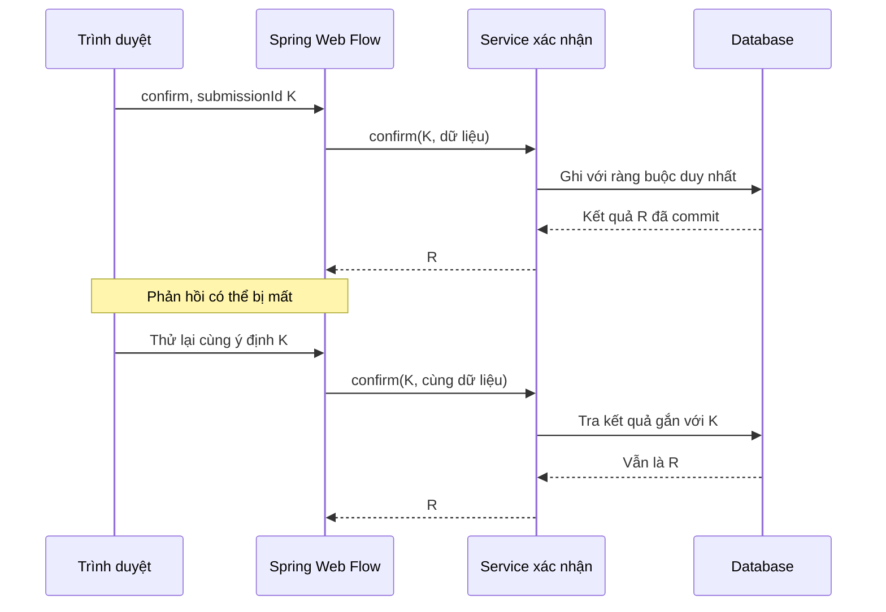

# Kiểm tra service không ghi lặp khi gửi xác nhận nhiều lần

Trong một hành trình đăng ký nhiều bước, người dùng có thể bấm Xác nhận hai lần, mở cùng màn hình ở hai tab hoặc gửi lại request vì chưa nhận được phản hồi. Web Flow giúp tổ chức state, event và transition, nhưng kết luận “chỉ ghi một đăng ký” phải được kiểm chứng tại service và database.

Bài học thuộc chương **Kiểm thử tích hợp** của module **SPRING_WEB_FLOW**. Nội dung tập trung vào cách xây dựng và kiểm tra hợp đồng chống ghi lặp khi flow gọi service xác nhận, bao gồm gửi lại tuần tự, gửi đồng thời, mất phản hồi sau commit và thử lại sau rollback. Ví dụ dùng đăng ký dịch vụ, Spring JDBC, transaction của Spring và PostgreSQL để quan sát dữ liệu đã commit thực sự.

## 1. Định nghĩa chính xác “không ghi lặp”

Một service có tính idempotent đối với thao tác xác nhận khi các lần gọi đại diện cho **cùng một ý định nghiệp vụ** không tạo thêm tác dụng phụ nghiệp vụ đã hoàn tất.

Trong ví dụ này, cùng ý định được nhận diện bởi bộ khóa:

```text
(tenantId, actorId, submissionId)
```

`submissionId` là định danh ổn định của một lần xác nhận logic, được gắn với bản nháp hoặc yêu cầu phía server. Nó phải được giữ nguyên khi thử lại. Khóa không được sinh lại cho mỗi lần gọi service hoặc mỗi lần bấm nút.

Hợp đồng cần kiểm tra:

| Trường hợp | Kết quả mong đợi |
| --- | --- |
| Cùng khóa, cùng dữ liệu, gọi hai lần | Một bản ghi, cùng mã đăng ký được trả về |
| Cùng khóa, cùng dữ liệu, gọi đồng thời | Một bản ghi sau commit; các lần thành công nhận cùng mã |
| Cùng khóa nhưng dữ liệu khác | Báo xung đột; không sửa kết quả xác nhận trước đó |
| Khác khóa, hai yêu cầu hợp lệ độc lập | Hai bản ghi, không loại nhầm yêu cầu thứ hai |
| Lần đầu rollback | Chưa có bản ghi; thử lại được phép tạo một kết quả |
| Lần đầu commit nhưng mất phản hồi | Thử lại lấy kết quả đã có, không tạo thêm bản ghi |

Hợp đồng này không đòi hỏi service chỉ được gọi một lần. Hai request hợp lệ có thể gọi service hai lần, trong khi số lần ghi nghiệp vụ thành công vẫn là một.

Nếu hai khóa khác nhau vẫn có thể đại diện cho cùng một đối tượng chỉ được xác nhận một lần, cần thêm ràng buộc nghiệp vụ, chẳng hạn duy nhất theo `draftId`. Idempotency key không tự ngăn mọi bản ghi trùng về mặt ngữ nghĩa.

## 2. Phân biệt bảo vệ execution với bảo vệ dữ liệu nghiệp vụ

`DefaultFlowExecutionRepository` có cơ chế dọn execution cùng lịch sử snapshot khi execution kết thúc. Điều đó giúp khóa execution cũ không tiếp tục được hành trình đã hoàn tất. Repository cũng có hợp đồng khóa khi truy cập execution. Xem [API DefaultFlowExecutionRepository](https://docs.spring.io/spring-webflow/docs/current/api/org/springframework/webflow/execution/repository/impl/DefaultFlowExecutionRepository.html) và [API FlowExecutionRepository](https://docs.spring.io/spring-webflow/docs/current/api/org/springframework/webflow/execution/repository/FlowExecutionRepository.html).

Tuy nhiên, các tình huống sau vẫn cần hợp đồng ở service:

- Dữ liệu nghiệp vụ đã commit nhưng việc lưu execution hoặc trả response thất bại.
- Một endpoint khác cũng gọi cùng service xác nhận.
- Hai execution khác nhau cùng xác nhận một bản nháp.
- Một cơ chế retry gọi lại sau lỗi kết nối.
- Ứng dụng chạy nhiều instance và request không luôn đi qua cùng một khóa cục bộ.

Ba loại định danh thường bị nhầm:

| Định danh | Mục đích |
| --- | --- |
| Execution key | Tiếp tục đúng execution/snapshot của Web Flow |
| CSRF token | Bảo vệ request theo cơ chế chống CSRF |
| Submission ID | Nhận diện cùng một lần xác nhận nghiệp vụ qua các lần thử |

Không dùng execution key làm submission ID: execution key có thể thay đổi theo lịch sử và vòng đời flow. CSRF token cũng không thay thế idempotency key.



Sơ đồ mô tả đường thử lại được ứng dụng cho phép. Nếu execution đã kết thúc thì request mang key cũ có thể bị chặn trước service; ứng dụng cần đường tra cứu kết quả hoặc phục hồi phù hợp. Không giả định mọi request cũ đều được tiếp tục vào flow.

## 3. Đặt ranh giới kiểm thử đủ sâu

Một unit test dùng `verify(repository, times(1)).save(...)` chỉ chứng minh cách gọi mock trong kịch bản cụ thể. Nó không chứng minh unique constraint, transaction hoặc hai kết nối cạnh tranh hoạt động đúng.

Một kiểm thử tích hợp service nên đi qua:

```text
test
  -> bean service qua proxy transaction của Spring
  -> JDBC/repository thật
  -> database có schema và constraint thật
  -> commit
  -> truy vấn kiểm chứng ngoài transaction đã hoàn tất
```

Kiểm thử request bổ sung đường đi:

```text
request
  -> Spring MVC / FlowHandlerAdapter
  -> flow execution và event confirm
  -> service thật
  -> database thật
```

Hai lớp kiểm thử trả lời hai câu hỏi khác nhau. Lớp service chứng minh chống ghi lặp tại biên nghiệp vụ; lớp request chứng minh các event, session và đường phục hồi được nối đúng tới biên đó.

Với ví dụ SQL bên dưới, dùng PostgreSQL tương thích với môi trường triển khai. Một database thay thế trong bộ nhớ không nhất thiết có cùng cú pháp `ON CONFLICT`, mức cô lập hoặc cách xử lý cạnh tranh.

## 4. Mô hình dữ liệu: dùng constraint làm trọng tài

Đây là schema minh họa cho một xác nhận tạo đúng một bản ghi. Các cột payload giữ dữ liệu đã xác nhận và không bị sửa bởi thao tác replay:

```sql
CREATE TABLE confirmed_registration (
    registration_id UUID PRIMARY KEY,
    tenant_id UUID NOT NULL,
    actor_id UUID NOT NULL,
    submission_id UUID NOT NULL,
    product_code VARCHAR(80) NOT NULL,
    contact_email VARCHAR(320) NOT NULL,
    created_at TIMESTAMPTZ NOT NULL DEFAULT CURRENT_TIMESTAMP,

    CONSTRAINT uq_registration_submission
        UNIQUE (tenant_id, actor_id, submission_id)
);
```

Ràng buộc nằm ở database nên có hiệu lực với nhiều thread, nhiều kết nối và nhiều instance ứng dụng cùng dùng database đó.

Cách “đọc trước rồi ghi nếu chưa tồn tại” không đủ:

```text
Request A: chưa có K
Request B: chưa có K
Request A: insert
Request B: insert
```

Nếu không có ràng buộc thích hợp, cả hai có thể ghi thành công. Nếu có constraint nhưng service xử lý xung đột sai, dữ liệu có thể không bị trùng nhưng người dùng vẫn nhận lỗi ngoài hợp đồng.

Ví dụ chọn:

```sql
INSERT ...
ON CONFLICT ON CONSTRAINT uq_registration_submission DO NOTHING;
```

Sau đó service đọc lại bản ghi theo khóa logic và so sánh payload. Chỉ constraint được chỉ định mới được xử lý như replay; không nuốt mọi lỗi toàn vẹn dữ liệu. Xem [tài liệu INSERT của PostgreSQL](https://www.postgresql.org/docs/current/sql-insert.html).

Thiết kế này phù hợp với ví dụ một bản ghi bất biến. Nếu thao tác tạo nhiều bảng hoặc có trạng thái xử lý dài, có thể cần bảng idempotency riêng lưu khóa, dấu vân tay request, trạng thái và kết quả. Khi đó việc đánh dấu hoàn tất và ghi nghiệp vụ phải được thiết kế nguyên tử trong phạm vi cần bảo vệ.

## 5. Service mẫu: ghi hoặc trả lại kết quả đã có

Ví dụ Java dùng record và text block, phù hợp với Java 17 trở lên. Đặt lớp tại package tương ứng khi áp dụng vào dự án. Không có lời gọi dịch vụ ngoài trong ví dụ; tác dụng phụ được bảo vệ là bản ghi đăng ký trong database.

```java
package example.registration;

import java.io.Serializable;
import java.util.Objects;
import java.util.UUID;
import org.springframework.jdbc.core.JdbcTemplate;
import org.springframework.transaction.annotation.Isolation;
import org.springframework.transaction.annotation.Transactional;

public class RegistrationService {

    public record Actor(UUID tenantId, UUID actorId) {}

    public record Command(String productCode, String contactEmail) {}

    public record Receipt(UUID registrationId) implements Serializable {}

    private record StoredRegistration(
            UUID registrationId, String productCode, String contactEmail) {}

    public static final class ConfirmationConflict extends RuntimeException {
        public ConfirmationConflict() {
            super("Submission đã được xác nhận với dữ liệu khác");
        }
    }

    private final JdbcTemplate jdbc;

    public RegistrationService(JdbcTemplate jdbc) {
        this.jdbc = jdbc;
    }

    @Transactional(isolation = Isolation.READ_COMMITTED)
    public Receipt confirm(Actor actor, UUID submissionId, Command command) {
        Objects.requireNonNull(actor);
        Objects.requireNonNull(actor.tenantId());
        Objects.requireNonNull(actor.actorId());
        Objects.requireNonNull(submissionId);
        Objects.requireNonNull(command);

        String product = requiredText(command.productCode());
        String email = requiredText(command.contactEmail());

        jdbc.update("""
                INSERT INTO confirmed_registration (
                    registration_id, tenant_id, actor_id, submission_id,
                    product_code, contact_email
                ) VALUES (?, ?, ?, ?, ?, ?)
                ON CONFLICT ON CONSTRAINT uq_registration_submission
                DO NOTHING
                """,
                UUID.randomUUID(), actor.tenantId(), actor.actorId(),
                submissionId, product, email);

        StoredRegistration stored = jdbc.queryForObject("""
                SELECT registration_id, product_code, contact_email
                FROM confirmed_registration
                WHERE tenant_id = ? AND actor_id = ? AND submission_id = ?
                """,
                (rs, rowNum) -> new StoredRegistration(
                        rs.getObject("registration_id", UUID.class),
                        rs.getString("product_code"),
                        rs.getString("contact_email")),
                actor.tenantId(), actor.actorId(), submissionId);

        Objects.requireNonNull(stored);
        if (!stored.productCode().equals(product)
                || !stored.contactEmail().equals(email)) {
            throw new ConfirmationConflict();
        }

        return new Receipt(stored.registrationId());
    }

    private static String requiredText(String value) {
        if (value == null || value.isBlank()) {
            throw new IllegalArgumentException("Thiếu dữ liệu xác nhận");
        }
        return value.trim();
    }
}
```

### 5.1. Vì sao có hai câu lệnh SQL?

Ở PostgreSQL `READ COMMITTED`, `INSERT ... ON CONFLICT DO NOTHING` có thể không insert vì một transaction cạnh tranh vừa thắng, dù hàng đó chưa nằm trong snapshot khi câu lệnh insert bắt đầu. Một câu `SELECT` tiếp theo có snapshot mới và đọc được kết quả đã commit. Xem [tài liệu Transaction Isolation của PostgreSQL](https://www.postgresql.org/docs/current/transaction-iso.html).

Thiết kế mẫu giả định bản ghi xác nhận không bị xóa hoặc đổi khóa/payload trong khoảng replay. Không gộp máy móc insert và select thành một câu lệnh có cùng snapshot rồi cho rằng mọi tình huống đồng thời đều tương đương. Nếu đổi sang `REPEATABLE READ`, `SERIALIZABLE` hoặc database khác, cần đánh giá lại thuật toán và chính sách retry.

### 5.2. Ranh giới transaction phải có hiệu lực thật

Service phải là bean được gọi qua proxy transaction, có transaction manager phù hợp với `JdbcTemplate`. Tạo service bằng `new` trong test rồi gọi trực tiếp không kiểm tra được cấu hình transaction. Self-invocation cũng có thể bỏ qua advice trong chế độ proxy mặc định. Xem [hướng dẫn dùng @Transactional](https://docs.spring.io/spring-framework/reference/data-access/transaction/declarative/annotations.html).

Trong các test chính bên dưới, không có transaction bao ngoài nên mỗi lần gọi service bắt đầu và hoàn tất transaction riêng. Khai báo isolation chỉ được áp dụng khi transaction thích hợp được tạo; đừng giả định nó đổi isolation của mọi transaction bên ngoài mà service tham gia.

### 5.3. Phạm vi của ví dụ

- Dữ liệu được so sánh là hai trường đã chuẩn hóa bằng `trim`; nếu command có thêm trường ảnh hưởng nghiệp vụ, phải đưa chúng vào hợp đồng so sánh.
- `Actor` phải do server xác định từ ngữ cảnh đã xác thực và được kiểm tra quyền. Không bind `tenantId` hoặc `actorId` tùy ý từ form.
- `submissionId` cần được ràng buộc với ý định/bản nháp hợp lệ của chủ thể đó. Unique constraint không thay thế kiểm tra quyền hoặc quy tắc một bản nháp chỉ được xác nhận một lần.
- Validation về sản phẩm, email và quyền đăng ký vẫn cần ở các tầng thích hợp. `requiredText` chỉ làm ví dụ gọn hơn.
- Nếu dữ liệu đăng ký được chỉnh sửa về sau, cần giữ riêng payload xác nhận gốc hoặc dấu vân tay ổn định để replay không bị so sánh với dữ liệu đã thay đổi.

## 6. Chuẩn bị môi trường kiểm thử có commit thật

Giả sử dự án có Spring Context, Spring JDBC/Tx, Spring Test, PostgreSQL JDBC driver và JUnit Jupiter. Schema ở phần 4 được migration hoặc fixture tạo trong database kiểm thử trước khi chạy suite.

Cấu hình tối thiểu sau minh họa kết nối tới database kiểm thử riêng. Các property `it.jdbc.url`, `it.jdbc.user` và `it.jdbc.password` được môi trường chạy test cung cấp; không đặt thông tin production vào fixture.

```java
package example.registration;

import javax.sql.DataSource;
import org.springframework.beans.factory.annotation.Value;
import org.springframework.context.annotation.Bean;
import org.springframework.context.annotation.Configuration;
import org.springframework.jdbc.core.JdbcTemplate;
import org.springframework.jdbc.datasource.DataSourceTransactionManager;
import org.springframework.jdbc.datasource.DriverManagerDataSource;
import org.springframework.transaction.PlatformTransactionManager;
import org.springframework.transaction.annotation.EnableTransactionManagement;

@Configuration
@EnableTransactionManagement
public class RegistrationJdbcTestConfig {

    @Bean
    DataSource dataSource(
            @Value("${it.jdbc.url}") String url,
            @Value("${it.jdbc.user}") String user,
            @Value("${it.jdbc.password}") String password) {
        return new DriverManagerDataSource(url, user, password);
    }

    @Bean
    JdbcTemplate jdbcTemplate(DataSource dataSource) {
        JdbcTemplate jdbc = new JdbcTemplate(dataSource);
        jdbc.setQueryTimeout(5);
        return jdbc;
    }

    @Bean
    PlatformTransactionManager transactionManager(DataSource dataSource) {
        return new DataSourceTransactionManager(dataSource);
    }

    @Bean
    RegistrationService registrationService(JdbcTemplate jdbcTemplate) {
        return new RegistrationService(jdbcTemplate);
    }
}
```

`DriverManagerDataSource` chỉ là lựa chọn đơn giản cho ví dụ test, không phải cấu hình pool production. Khi dùng pool, cần ít nhất đủ kết nối cho các transaction cạnh tranh; một pool chỉ có một kết nối có thể vô tình tuần tự hóa test.

Không đặt `@Transactional` trên lớp test này. Transaction test mặc định thường rollback sau test; điều đó có thể che đường commit, làm các lần gọi cùng dùng một transaction và không phản ánh request độc lập. Transaction test của Spring gắn với thread hiện tại, nên worker thread không tự tham gia transaction của thread test. Xem [Transaction Management trong Spring TestContext](https://docs.spring.io/spring-framework/reference/testing/testcontext-framework/tx.html).

Mỗi test dùng tenant/actor ngẫu nhiên riêng để truy vấn và dọn đúng dữ liệu của mình. Không dùng `DELETE FROM confirmed_registration` không có điều kiện trong một suite chạy song song.

## 7. Kiểm thử tích hợp: tuần tự, đồng thời và payload xung đột

Lớp dưới đây gọi service thật và truy vấn database thật. Không dùng mock repository hoặc mock service.

```java
package example.registration;

import static org.junit.jupiter.api.Assertions.*;

import java.util.UUID;
import java.util.concurrent.CyclicBarrier;
import java.util.concurrent.ExecutorService;
import java.util.concurrent.Executors;
import java.util.concurrent.Future;
import java.util.concurrent.TimeUnit;
import org.junit.jupiter.api.AfterEach;
import org.junit.jupiter.api.BeforeEach;
import org.junit.jupiter.api.Test;
import org.springframework.beans.factory.annotation.Autowired;
import org.springframework.jdbc.core.JdbcTemplate;
import org.springframework.test.context.junit.jupiter.SpringJUnitConfig;
import org.springframework.transaction.support.TransactionSynchronizationManager;
import example.registration.RegistrationService.Actor;
import example.registration.RegistrationService.Command;
import example.registration.RegistrationService.ConfirmationConflict;
import example.registration.RegistrationService.Receipt;

@SpringJUnitConfig(RegistrationJdbcTestConfig.class)
class RegistrationServiceIntegrationTest {

    @Autowired RegistrationService service;
    @Autowired JdbcTemplate jdbc;

    private final Actor actor = new Actor(UUID.randomUUID(), UUID.randomUUID());
    private final Command command = new Command("JAVA-TRACK", "learner@example.test");

    @BeforeEach
    void requireIndependentServiceTransactions() {
        assertFalse(TransactionSynchronizationManager.isActualTransactionActive());
    }

    @AfterEach
    void cleanOwnRows() {
        jdbc.update("""
                DELETE FROM confirmed_registration
                WHERE tenant_id = ? AND actor_id = ?
                """, actor.tenantId(), actor.actorId());
    }

    @Test
    void repeatedConfirmationReturnsTheCommittedResult() {
        UUID key = UUID.randomUUID();

        Receipt first = service.confirm(actor, key, command);
        Receipt second = service.confirm(actor, key, command);

        assertEquals(first.registrationId(), second.registrationId());
        assertEquals(1L, count(key));
        assertEquals(first.registrationId(), persistedId(key));
    }

    @Test
    void concurrentConfirmationCreatesOneRegistration() throws Exception {
        UUID key = UUID.randomUUID();
        CyclicBarrier start = new CyclicBarrier(2);
        ExecutorService workers = Executors.newFixedThreadPool(2);

        Future<Receipt> first = null;
        Future<Receipt> second = null;
        try {
            first = workers.submit(() -> {
                start.await(5, TimeUnit.SECONDS);
                return service.confirm(actor, key, command);
            });
            second = workers.submit(() -> {
                start.await(5, TimeUnit.SECONDS);
                return service.confirm(actor, key, command);
            });

            Receipt a = first.get(10, TimeUnit.SECONDS);
            Receipt b = second.get(10, TimeUnit.SECONDS);

            assertEquals(a.registrationId(), b.registrationId());
            assertEquals(1L, count(key));
            assertEquals(a.registrationId(), persistedId(key));
        } finally {
            if (first != null) first.cancel(true);
            if (second != null) second.cancel(true);
            workers.shutdownNow();
            assertTrue(workers.awaitTermination(10, TimeUnit.SECONDS));
        }
    }

    @Test
    void changedPayloadWithSameKeyIsRejectedWithoutChangingTheRow() {
        UUID key = UUID.randomUUID();
        Receipt first = service.confirm(actor, key, command);

        assertThrows(ConfirmationConflict.class, () ->
                service.confirm(actor, key,
                        new Command("OTHER-TRACK", "other@example.test")));

        assertEquals(1L, count(key));
        assertEquals(first.registrationId(), persistedId(key));
        assertEquals("JAVA-TRACK", jdbc.queryForObject("""
                SELECT product_code FROM confirmed_registration
                WHERE tenant_id = ? AND actor_id = ? AND submission_id = ?
                """, String.class, actor.tenantId(), actor.actorId(), key));
        assertEquals("learner@example.test", jdbc.queryForObject("""
                SELECT contact_email FROM confirmed_registration
                WHERE tenant_id = ? AND actor_id = ? AND submission_id = ?
                """, String.class, actor.tenantId(), actor.actorId(), key));
    }

    @Test
    void independentSubmissionsAreNotCollapsedIntoOne() {
        UUID firstKey = UUID.randomUUID();
        UUID secondKey = UUID.randomUUID();

        Receipt first = service.confirm(actor, firstKey, command);
        Receipt second = service.confirm(actor, secondKey, command);

        assertNotEquals(first.registrationId(), second.registrationId());
        assertEquals(1L, count(firstKey));
        assertEquals(1L, count(secondKey));
    }

    private long count(UUID key) {
        return jdbc.queryForObject("""
                SELECT COUNT(*) FROM confirmed_registration
                WHERE tenant_id = ? AND actor_id = ? AND submission_id = ?
                """, Long.class, actor.tenantId(), actor.actorId(), key);
    }

    private UUID persistedId(UUID key) {
        return jdbc.queryForObject("""
                SELECT registration_id FROM confirmed_registration
                WHERE tenant_id = ? AND actor_id = ? AND submission_id = ?
                """, UUID.class, actor.tenantId(), actor.actorId(), key);
    }
}
```

### Đọc đúng sức mạnh của test đồng thời

Barrier giúp hai worker bắt đầu gần nhau; mỗi worker gọi proxy service và dùng transaction riêng. Cả hai `Future` đều phải hoàn thành thành công trước khi đánh giá số bản ghi. Nếu chỉ kiểm tra `COUNT(*) = 1`, test có thể bỏ sót việc request thứ hai ném lỗi ngoài mong đợi.

Barrier ở đầu service chưa chứng minh chính xác hai lệnh insert đã cùng chờ tại unique index. Muốn kiểm tra lịch cạnh tranh xác định, có thể bổ sung test điều khiển một transaction giữ bản ghi chưa commit bằng latch, cho transaction khác bắt đầu xác nhận, rồi chủ động cho transaction thứ nhất commit hoặc rollback. Đồng bộ ở điểm cụ thể thay cho dùng `sleep` để đoán thời điểm.

Giới hạn thời gian chờ giúp suite phát hiện deadlock hoặc kết nối bị giữ. Cần cấu hình timeout kết nối và truy vấn phù hợp với môi trường test, đồng thời bảo đảm worker đã dừng trước khi dọn dữ liệu. Không dùng timeout tạo thread ngầm rồi giả định transaction và cleanup vẫn như luồng test ban đầu.

## 8. Hai tình huống phục hồi bắt buộc: rollback và mất phản hồi

### 8.1. Rollback phải cho phép thử lại

Thêm field và các import tương ứng vào lớp test:

```java
import org.springframework.transaction.PlatformTransactionManager;
import org.springframework.transaction.TransactionDefinition;
import org.springframework.transaction.support.TransactionTemplate;

@Autowired PlatformTransactionManager transactionManager;
```

Thêm test sau cùng các helper/nested class vào lớp `RegistrationServiceIntegrationTest`:

```java
@Test
void rollbackDoesNotLeaveACompletedSubmission() {
    UUID key = UUID.randomUUID();
    TransactionTemplate transaction = new TransactionTemplate(transactionManager);
    transaction.setIsolationLevel(TransactionDefinition.ISOLATION_READ_COMMITTED);

    assertThrows(ForcedRollback.class, () ->
            transaction.executeWithoutResult(status -> {
                service.confirm(actor, key, command);
                throw new ForcedRollback();
            }));

    assertEquals(0L, count(key));

    Receipt retry = service.confirm(actor, key, command);

    assertEquals(1L, count(key));
    assertEquals(retry.registrationId(), persistedId(key));
}

private static final class ForcedRollback extends RuntimeException {}
```

Đây là test cố ý có một transaction bao ngoài do `TransactionTemplate` điều khiển. Service tham gia transaction đó theo propagation mặc định; exception được ném sau lệnh service nhưng trước commit để chứng minh bản ghi bị rollback.

Nếu thiết kế dùng bảng idempotency riêng, kiểm tra thêm rằng không còn bản ghi “COMPLETED” cho một thao tác nghiệp vụ đã rollback. Đừng đặt việc giữ khóa idempotency trong một transaction độc lập rồi vô tình chặn mãi lần retry. Transaction `REQUIRES_NEW` có vòng đời commit/rollback độc lập với transaction bên ngoài, như mô tả trong [hướng dẫn Transaction Propagation](https://docs.spring.io/spring-framework/reference/data-access/transaction/declarative/tx-propagation.html).

### 8.2. Mất phản hồi sau commit phải trả lại cùng kết quả

Thêm test và exception minh họa:

```java
@Test
void retryAfterCommittedResponseIsLostReturnsExistingRegistration() {
    UUID key = UUID.randomUUID();

    assertThrows(SimulatedResponseLoss.class, () -> {
        service.confirm(actor, key, command);
        // Không có transaction ngoài: proxy service đã commit trước khi trả về.
        throw new SimulatedResponseLoss();
    });

    assertEquals(1L, count(key));
    UUID committedId = persistedId(key);

    Receipt retry = service.confirm(actor, key, command);

    assertEquals(committedId, retry.registrationId());
    assertEquals(1L, count(key));
}

private static final class SimulatedResponseLoss extends RuntimeException {}
```

Test mô phỏng việc bên gọi không nhận được kết quả sau khi service đã commit. Nó kiểm tra hợp đồng phục hồi của service, chưa mô phỏng socket, reverse proxy hoặc lỗi snapshot Web Flow thật.

Để kiểm tra tích hợp Web Flow sâu hơn, tạo lỗi tại ranh giới **sau commit nghiệp vụ nhưng trước khi response/execution được lưu thành công**, rồi gửi lại cùng ý định. Bằng chứng cuối vẫn là mã kết quả ổn định và số bản ghi đã commit, kể cả khi đường phản hồi của flow thay đổi.

## 9. Nối hợp đồng service vào state xác nhận của Web Flow

Đoạn XML sau là trích đoạn của một flow đã có bước nhập và kiểm tra dữ liệu. `submissionId` đã được lấy từ bản nháp thuộc người dùng hiện tại; `registrationForm.toCommand()` tạo command từ model đã bind/validate.

```xml
<view-state id="review"
            view="/WEB-INF/views/registration/review.jsp">
    <transition on="confirm" to="persistConfirmation"
                bind="false" validate="false"/>
</view-state>

<action-state id="persistConfirmation">
    <evaluate
        expression="registrationService.confirm(currentActor.require(), flowScope.submissionId, flowScope.registrationForm.toCommand())"
        result="flowScope.confirmation"/>
    <transition on="success" to="done"/>
</action-state>

<end-state id="done"/>
```

Đây không phải một file flow đầy đủ; namespace, khai báo model, khởi tạo bản nháp và các nhánh lỗi thuộc phần cấu hình của ứng dụng. Bean `currentActor` trong ví dụ do ứng dụng cung cấp, không phải một biến có sẵn mang đúng tên đó trong Web Flow.

`bind="false"` và `validate="false"` chỉ phù hợp với màn hình review không nhận thêm thay đổi và model đã được kiểm tra ở bước trước. Nếu màn hình xác nhận cho chỉnh dữ liệu hoặc có điều kiện cần kiểm tra lại, phải thiết kế binding/validation tương ứng. Service vẫn phải bảo vệ các invariant nghiệp vụ độc lập với giao diện.

Action xác nhận nằm ở bước xử lý event, tránh đặt thao tác ghi vào `on-render`, nơi có thể chạy khi view được render lại. Việc gọi POJO service bằng `evaluate`, nhận kết quả và chuyển state thuộc cơ chế action của Web Flow. Xem [Spring Web Flow Reference Guide](https://docs.spring.io/spring-webflow/docs/current/reference/index.html).

Submission ID cần có vòng đời phù hợp:

- Có mặt trước lần confirm đầu tiên.
- Không đổi khi validation thất bại, Back/Refresh hoặc gửi lại cùng yêu cầu.
- Được truyền rõ ràng nếu một subflow tham gia xác nhận.
- Có thể tìm lại từ bản nháp nếu ứng dụng hỗ trợ phục hồi sau khi execution mất.
- Chỉ đổi khi server chấp nhận một ý định nghiệp vụ mới.

Chỉ giữ khóa trong `requestScope` không đáp ứng hành trình nhiều request. Giữ trong `flowScope` có thể đủ cho execution hiện tại, nhưng muốn phục hồi sau khi session/flow hết hạn thì cần liên kết bền vững với bản nháp hoặc đối tượng nghiệp vụ.

## 10. Kiểm tra gửi lại request qua Spring MVC và Web Flow

Kiểm thử service ở trên cần được bổ sung bằng một số kịch bản request có chọn lọc. `MockMvc` đi qua `DispatcherServlet` với mock Servlet API, giúp kiểm tra cấu hình MVC mà không cần server đang chạy. Xem [tổng quan MockMvc](https://docs.spring.io/spring-framework/reference/testing/mockmvc/overview.html).

Với Web Flow, context test phải chứa các thành phần runtime thật cần thiết: flow registry, executor, handler mapping, `FlowHandlerAdapter`, service và transaction manager. Một slice chỉ tạo controller hoặc mock service không chứng minh được đường ghi của flow.

### 10.1. Kịch bản gửi lại cùng request xác nhận

```text
1. Tạo bản nháp và đăng nhập bằng chủ thể test.
2. Mở flow, giữ cùng session/cookie.
3. Đi qua các bước nhập liệu, lấy URL/key thật của màn hình review.
4. Xác nhận fixture đã tới review; database chưa có đăng ký cho submissionId.
5. Gửi POST confirm với execution key của review.
6. Kiểm tra hợp đồng thành công; truy vấn thấy một bản ghi và lấy registrationId.
7. Gửi lại request confirm đã chụp ở bước 5.
8. Kiểm tra phản hồi dành cho execution/key cũ theo chính sách ứng dụng.
9. Truy vấn lại: vẫn một bản ghi, cùng registrationId và payload ban đầu.
```

Giữ nguyên request cũ ở bước 7 có ý nghĩa khác với việc dùng key mới nhất trả về từ bước 5. Cần biết test đang kiểm tra replay key cũ, replay một event hợp lệ hay retry qua đường phục hồi riêng.

Không hard-code key như `e1s1`; lấy key từ response/redirect/model thực tế theo cấu hình dự án. Đừng tự động theo mọi redirect mà bỏ qua kết quả POST cần kiểm tra.

### 10.2. Phải khẳng định phản hồi, không chỉ số dòng

Nếu execution đã kết thúc, request cũ có thể không gọi service. Ứng dụng có thể thiết kế thông báo hành trình đã hoàn tất hoặc chuyển tới kết quả có kiểm tra quyền. Kiểm thử phải khẳng định đúng chính sách đã chọn.

Không có một HTTP status chung mà mọi ứng dụng Web Flow bắt buộc trả về cho replay. Không chấp nhận tùy ý mọi lỗi 4xx/5xx chỉ vì số dòng vẫn bằng một. Một HTTP 500 ngoài dự kiến vẫn là lỗi tích hợp dù constraint đã ngăn trùng dữ liệu.

Ngược lại, nếu request thứ hai bị chặn trước service, test đó chưa chứng minh service idempotent. Đây là lý do cần giữ cả kiểm thử gọi service hai lần và kiểm thử request gửi lại.

### 10.3. Giữ các request hợp lệ theo mục tiêu test

Nếu đang kiểm tra chống ghi lặp, request cần có session, principal và CSRF token hợp lệ theo cấu hình. Trong MockMvc có tích hợp Spring Security, có thể dùng `with(csrf())` cho POST khi CSRF được bật. Xem [Testing with CSRF Protection](https://docs.spring.io/spring-security/reference/servlet/test/mockmvc/csrf.html).

Một request bị từ chối vì thiếu CSRF, chưa đăng nhập hoặc validation thất bại không phải bằng chứng tốt cho khả năng chống ghi lặp khi xác nhận hợp lệ. Các nhánh từ chối đó nên có test riêng và khẳng định không tạo bản ghi.

## 11. Những tác dụng phụ khác cũng cần bằng chứng riêng

Một đăng ký có thể tạo audit, email, event hoặc gọi hệ thống ngoài. `COUNT(*) = 1` trong bảng đăng ký chỉ chứng minh không có đăng ký thứ hai, không chứng minh các tác dụng phụ khác chỉ xảy ra một lần.

| Tác dụng phụ | Bằng chứng kiểm tra phù hợp |
| --- | --- |
| Bản ghi nghiệp vụ | Số bản ghi theo khóa logic, ID và dữ liệu đã commit |
| Bản ghi audit của việc xác nhận thành công | Số sự kiện nghiệp vụ theo registration/submission, phân biệt với log từng lần thử |
| Outbox event | Một event logic được tạo cùng transaction với đăng ký |
| Consumer nhận event nhiều lần | Cùng event ID không tạo lại tác dụng phụ đã hoàn tất |
| Gọi hệ thống ngoài | Khóa chống lặp được truyền ổn định và kết quả retry được kiểm tra ở biên tích hợp |

Nếu bổ sung outbox vào thiết kế mẫu, chỉ đường thực sự tạo đăng ký mới được tạo event nghiệp vụ, và cả hai phải nằm trong cùng transaction. Nhánh replay trả kết quả cũ không tạo thêm event xác nhận.

Outbox vẫn có thể được gửi nhiều lần nếu publisher lỗi sau khi gửi nhưng trước khi đánh dấu đã gửi. Consumer cần chính sách chống lặp phù hợp. Không suy ra bảo đảm “exactly once” cho email hoặc hệ thống ngoài từ một unique constraint trong database nội bộ.

Audit cho mỗi lần thử có thể có nhiều dòng theo chủ đích. Cần phân biệt “đã nhận một request” với “đã xác nhận một đăng ký” để assertion không loại nhầm dữ liệu quan sát hợp lệ.

## 12. Bẫy phổ biến và bài thực hành

### Các bẫy khiến test xanh nhưng thiếu bằng chứng

- Chỉ disable nút bằng JavaScript rồi không thử request lặp trực tiếp.
- Sinh submission ID mới trong mỗi lần retry, khiến test không còn kiểm tra cùng ý định.
- Dùng mock service trong test muốn chứng minh dữ liệu đã được chống lặp.
- Chỉ đếm số lần gọi `save`, không đọc dữ liệu sau commit.
- Chỉ assert một dòng sau test đồng thời, bỏ qua exception của worker còn lại.
- Chạy hai tác vụ trên một thread hoặc một kết nối duy nhất rồi kết luận đã kiểm tra cạnh tranh.
- Dựa vào `synchronized` trong service để bảo vệ nhiều instance.
- Bắt mọi lỗi constraint và trả thành công mà không đối chiếu khóa cùng payload.
- Dùng `ON CONFLICT DO UPDATE` để ghi đè payload cũ, làm replay thay đổi kết quả đã xác nhận.
- Để test transaction bao ngoài che việc commit hoặc dùng state JPA chưa flush thay cho dữ liệu thực tế.
- Chỉ kiểm tra session hiện tại mà bỏ qua retry sau khi execution/session không còn.

### Bài thực hành

Áp dụng cho một flow `details -> review -> persistConfirmation -> done`:

1. Xác định submission ID ổn định và phạm vi chủ thể của khóa.
2. Đặt unique constraint thật trong database kiểm thử cùng loại với triển khai.
3. Chạy các test tuần tự, đồng thời, payload xung đột và hai ý định độc lập.
4. Tạo rollback trước commit, xác nhận không còn dữ liệu và retry tạo được một kết quả.
5. Mô phỏng mất phản hồi sau commit, xác nhận retry trả lại ID đã lưu.
6. Gửi lại request confirm qua MVC/Web Flow với session và token hợp lệ; kiểm tra cả phản hồi lẫn dữ liệu.
7. Nếu có outbox hoặc hệ thống ngoài, mở rộng assertion cho tác dụng phụ tương ứng.

Hoàn thành khi cùng một ý định xác nhận tạo đúng một kết quả nghiệp vụ đã commit, mọi lần thử lại được xử lý theo hợp đồng rõ ràng và các yêu cầu độc lập vẫn hoạt động. Bằng chứng nằm ở kết quả bền vững và đường phục hồi đã kiểm thử, cùng với cấu hình state, event và transition đưa người dùng qua hành trình đúng cách.
