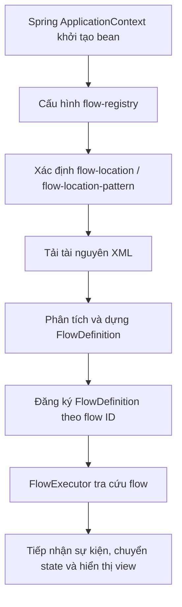
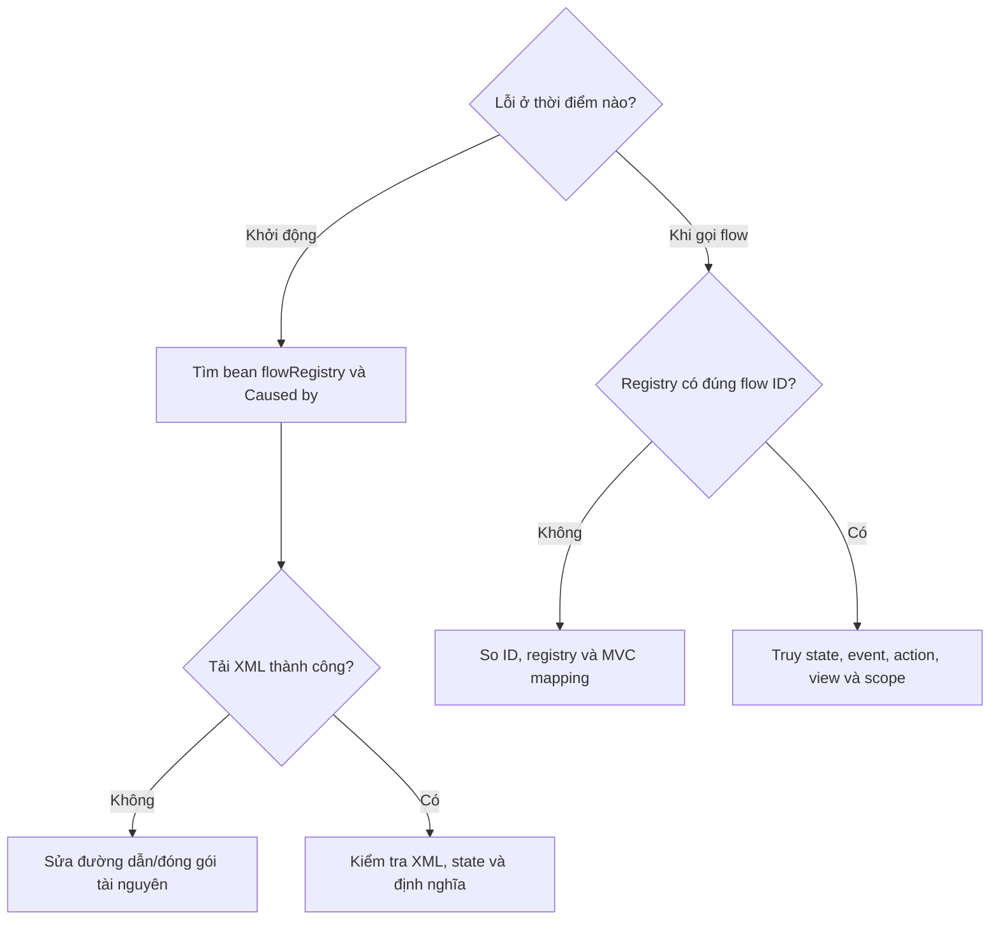

# Đọc log khởi tạo registry và dựng định nghĩa trong Spring Web Flow

Khi ứng dụng dùng **Spring Web Flow** không khởi động được hoặc truy cập một flow trả về lỗi, chỉ nhìn dòng cuối như `BeanCreationException` hay HTTP 404 thường không đủ để chẩn đoán. Cần xác định lỗi nằm ở **đăng ký flow trong registry**, **tải tài nguyên XML**, **dựng định nghĩa flow** hay **thực thi flow sau khi đã dựng xong**. Bài này hướng dẫn đọc log theo đúng chuỗi khởi tạo, dùng ví dụ luồng thanh toán (`checkout`) có nhiều bước.

Sau bài học, bạn có thể xác định flow ID và tài nguyên tương ứng, bật log đúng phạm vi, đọc chuỗi ngoại lệ đến nguyên nhân gốc, phân biệt lỗi lúc khởi tạo với lỗi khi chạy, và kiểm tra một bản sửa bằng bằng chứng cụ thể.

## 1. Hiểu chuỗi khởi tạo trước khi đọc log

Trong Spring Web Flow, **flow** là tập hợp state, event và transition mô tả hành trình nhiều bước. **FlowDefinitionRegistry** cung cấp các định nghĩa flow theo ID; **FlowExecutor** dùng các định nghĩa ấy để khởi tạo hoặc tiếp tục một lần thực thi. Với tích hợp Spring MVC, các thành phần như `FlowHandlerMapping` và `FlowHandlerAdapter` giúp chuyển yêu cầu HTTP đến Web Flow.

Một cấu hình thông dụng dùng Spring XML namespace tạo registry qua cơ chế của `FlowDefinitionRegistryFactoryBean`. Quá trình có thể hình dung như sau:



Mỗi mắt xích cung cấp một hướng điều tra khác nhau:

| Mắt xích | Câu hỏi cần trả lời | Dấu hiệu cần tìm |
| --- | --- | --- |
| Bean cấu hình | `flowRegistry` có được Spring khởi tạo thành công không? | Tên bean trong `BeanCreationException`, lỗi cấu hình namespace/bean |
| Nguồn định nghĩa | Registry tìm XML ở vị trí nào? | `base-path`, `flow-location`, đường dẫn tài nguyên, lỗi không tìm thấy file |
| Phân tích XML | XML có đúng cú pháp và schema không? | `SAXParseException`, dòng/cột, phần tử hoặc thuộc tính không hợp lệ |
| Dựng flow | State, transition và các tham chiếu có nhất quán không? | Flow ID, state ID, đích transition, thông điệp từ quá trình dựng/kiểm tra |
| Tra cứu/thực thi | Flow đã đăng ký có được tìm thấy và chạy đúng không? | `NoSuchFlowDefinitionException`, lỗi expression, lỗi view, HTTP mapping |

**Lưu ý về thời điểm:** Không phải mọi ứng dụng đều tạo hoặc kiểm tra toàn bộ định nghĩa theo cùng một lịch. Tùy cách cấu hình, phiên bản và cơ chế tải, một lỗi có thể lộ ra khi Spring dựng `ApplicationContext` hoặc khi flow lần đầu được yêu cầu. Vì vậy, trước hết hãy ghi lại **lỗi xuất hiện lúc khởi động hay sau một HTTP request**.

## 2. Cấu hình mẫu để đối chiếu với log

Giả sử ứng dụng triển khai dưới dạng web application có thư mục `/WEB-INF/flows`. Trong một file cấu hình Spring XML đã khai báo namespace `webflow`, có thể đăng ký flow như sau:

```xml
<!-- Đoạn cấu hình trong Spring XML đã khai báo namespace webflow -->
<webflow:flow-registry id="flowRegistry" base-path="/WEB-INF/flows">
    <webflow:flow-location
        path="/checkout/checkout-flow.xml"
        id="checkout" />
</webflow:flow-registry>

<webflow:flow-executor
    id="flowExecutor"
    flow-registry="flowRegistry" />
```

Cấu hình chỉ ra ba dữ kiện quan trọng cho chẩn đoán:

- **Bean registry:** `flowRegistry`. Đây là tên cần tìm trong log khởi tạo Spring.
- **Flow ID:** `checkout`. Đây là khóa định danh mà registry/flow executor tra cứu, không phải tên view.
- **Nguồn XML:** `/WEB-INF/flows/checkout/checkout-flow.xml`. Đường dẫn phải đúng với cấu trúc tài nguyên của kiểu đóng gói và triển khai đang dùng.

Một định nghĩa tối giản trong `checkout-flow.xml` có thể là:

```xml
<?xml version="1.0" encoding="UTF-8"?>
<flow xmlns="http://www.springframework.org/schema/webflow"
      xmlns:xsi="http://www.w3.org/2001/XMLSchema-instance"
      xsi:schemaLocation="
          http://www.springframework.org/schema/webflow
          http://www.springframework.org/schema/webflow/spring-webflow-2.0.xsd"
      start-state="cart">

    <view-state id="cart" view="checkout/cart">
        <transition on="continue" to="review" />
    </view-state>

    <view-state id="review" view="checkout/review">
        <transition on="confirm" to="completed" />
    </view-state>

    <end-state id="completed" />
</flow>
```

Khi kiểm tra sự cố, hãy giữ rõ sự phân biệt:

- `checkout` là **ID của flow** trong registry.
- `cart`, `review` và `completed` là **ID của các state** bên trong flow.
- `continue` và `confirm` là **event** gây chuyển trạng thái.
- `checkout/cart` và `checkout/review` là **tên view** để tầng giao diện phân giải.

Chẳng hạn, đổi `id="checkout"` thành `id="payment"` trong đăng ký có thể khiến request vẫn gọi `checkout` không tìm thấy flow, dù file XML hợp lệ. Đổi `view="checkout/review"` chỉ ảnh hưởng phân giải view; đó không phải là đổi flow ID.

## 3. Bật log đúng phạm vi

Bắt đầu với nhóm logger của Spring Web Flow. Nếu ứng dụng dùng Spring Boot và có hỗ trợ `application.properties`, có thể bật tạm thời:

```properties
logging.level.org.springframework.webflow=DEBUG
logging.level.org.springframework.beans.factory.support=DEBUG
```

Trong ứng dụng sử dụng Logback trực tiếp, cấu hình tương đương có thể là:

```xml
<configuration>
    <logger name="org.springframework.webflow" level="DEBUG" />
    <logger name="org.springframework.beans.factory.support" level="DEBUG" />

    <!-- Các appender và cấu hình root logger hiện có vẫn được giữ lại. -->
</configuration>
```

`org.springframework.webflow` giúp tìm hoạt động của Web Flow; `org.springframework.beans.factory.support` hỗ trợ xác định bean đang được tạo và quan hệ phụ thuộc khi Spring khởi tạo context. Logger cụ thể và số lượng thông điệp thay đổi theo phiên bản, nên **không được giả định** mọi bước trong sơ đồ đều tạo một dòng log riêng.

Nên thực hiện theo thứ tự:

1. Ghi thời điểm khởi động/reproduce, tên môi trường và flow ID gặp lỗi.
2. Bật `DEBUG` cho phạm vi hẹp, tái hiện đúng một lần, lưu **cả đoạn log trước và sau ngoại lệ**.
3. Tìm `flowRegistry`, `flowExecutor`, `FlowDefinition`, đường dẫn XML, `Caused by:` và tên flow.
4. Tắt hoặc giảm mức log sau khi xác định được nguyên nhân; tránh ghi dữ liệu form, session ID hoặc thông tin người dùng vào log chia sẻ.

Để lọc một file log cục bộ, có thể dùng lệnh sau nếu môi trường đã có `rg`:

```bash
rg -n "flowRegistry|flowExecutor|FlowDefinition|checkout-flow.xml|Caused by:|SAXParseException|NoSuchFlowDefinition" application.log
```

Lệnh lọc giúp định vị vùng cần đọc; để hiểu chuỗi ngoại lệ, phải mở thêm các dòng xung quanh, vì kết quả lọc riêng lẻ có thể mất thứ tự và ngữ cảnh.

## 4. Đọc log theo đường đi của nguyên nhân gốc

Một lỗi đăng ký file không tồn tại có thể tạo chuỗi tương tự ví dụ sau. **Đây là log minh họa đã rút gọn, không phải các câu thông điệp nguyên văn được đảm bảo ở mọi bản Spring Web Flow.**

```text
08:30:14.021 DEBUG ...DefaultListableBeanFactory
    Creating shared instance of singleton bean 'flowRegistry'

08:30:14.047 ERROR ...ApplicationContext
    Error creating bean with name 'flowRegistry'

org.springframework.beans.factory.BeanCreationException:
    Error creating bean with name 'flowRegistry'
    ...
Caused by: java.io.FileNotFoundException:
    ServletContext resource
    [/WEB-INF/flows/checkout/checkout-flow.xml] could not be opened
```

Cách đọc:

1. Dòng `Creating ... 'flowRegistry'` xác định Spring đang xử lý bean registry.
2. `BeanCreationException` cho biết bean không tạo được. **Nó là lỗi bao ngoài**, chưa đủ để kết luận XML sai hay bean thiếu.
3. `Caused by: FileNotFoundException` chỉ nguyên nhân cần giải quyết trước: tài nguyên flow không tìm thấy.
4. Đường dẫn trong exception phải được so với `base-path`, `flow-location` và file thực sự nằm trong bản triển khai. Nếu là ứng dụng đóng gói JAR, không thể mặc định mọi tài nguyên `/WEB-INF` của kiểu WAR đều tồn tại như cũ.

Thói quen hữu ích là ghi một dòng chẩn đoán theo mẫu:

> `Giai đoạn: tải tài nguyên | Bean: flowRegistry | Flow ID: checkout | Nguồn: /WEB-INF/flows/checkout/checkout-flow.xml | Nguyên nhân sâu nhất: FileNotFoundException`

Nếu lần tái hiện tiếp theo chuyển từ `FileNotFoundException` sang lỗi state/transition, điều đó thường nghĩa là quá trình đã đi xa hơn bước tải file. Hãy xem đó là **lỗi tiếp theo trong chuỗi**, cần phân tích bằng log mới.

### Vì sao đọc từ `Caused by` lại quan trọng?

Spring có nhiều tầng bọc exception: bean factory có thể bọc lỗi lúc tạo registry; registry hoặc builder có thể bọc lỗi lúc xử lý XML. Thông điệp ở đầu stack trace chỉ nêu thành phần thất bại, còn **nguyên nhân ở cuối chuỗi** thường đưa ra đường dẫn, dòng XML, biểu thức hoặc ID sai. Đừng sửa nhiều thành phần chỉ dựa trên chữ `BeanCreationException`.

## 5. Nhận diện lỗi theo giai đoạn

| Hiện tượng trong log hoặc HTTP | Giai đoạn nghi ngờ | Kiểm tra trước |
| --- | --- | --- |
| `BeanCreationException` có tên bean `flowRegistry` | Khởi tạo registry | Mở toàn bộ chuỗi `Caused by`, kiểm tra cấu hình registry và tài nguyên |
| `FileNotFoundException` hoặc thông báo không đọc được flow XML | Tải nguồn | Kiểm tra đường dẫn thực sau đóng gói, `base-path`, `flow-location`, phân biệt classpath và servlet context |
| `SAXParseException` có số dòng/cột | Phân tích XML | Đọc đúng dòng trong flow XML; so namespace, schema, thẻ đóng và thuộc tính |
| Báo state/transition không hợp lệ hoặc trùng ID | Dựng/kiểm tra định nghĩa hoặc giải quyết transition | So ID state, đích `to`, state khởi đầu và các nhánh chuyển |
| `NoSuchFlowDefinitionException` khi gọi flow | Tra cứu registry lúc chạy | So flow ID đang được yêu cầu với ID đã đăng ký, và registry được executor sử dụng |
| Lỗi đánh giá biểu thức, binding, validation hay action | Thực thi flow | Kiểm tra biểu thức, bean/action, scope, dữ liệu input và state đang hoạt động |
| HTTP 404 nhưng không có lỗi dựng flow | Định tuyến HTTP/MVC | Kiểm tra `FlowHandlerMapping`, URL và context path trước khi quy lỗi cho XML |

Một dấu hiệu **không chứng minh** lỗi ở nơi có tên gần giống. Ví dụ, lỗi `NoSuchFlowDefinitionException` xảy ra khi tra cứu ID. Nó có thể do flow chưa được đăng ký, đăng ký với ID khác hoặc executor trỏ sang registry khác; không thể suy ra ngay rằng nội dung XML bị hỏng.

Tương tự, lỗi phân giải view sau khi chuyển đến `review` chứng tỏ flow đã tiến đến bước hiển thị view. Cần kiểm tra view resolver/template tương ứng thay vì chỉ sửa đăng ký registry.

## 6. Truy từ flow ID về file, rồi về state

Giả sử ứng dụng mở flow `checkout` thành công ở môi trường phát triển nhưng lỗi ở môi trường triển khai. Làm lần lượt ba đối chiếu:

**Đối chiếu 1 — ID registry:** Tìm cấu hình `<webflow:flow-location ... id="checkout" />` hoặc quy tắc sinh ID từ mẫu đường dẫn. Với cấu hình mẫu ở trên, ID được chỉ rõ là `checkout`; không cần phỏng đoán từ tên `checkout-flow.xml`.

**Đối chiếu 2 — Vị trí XML:** Xác định tài nguyên mà registry thực sự đọc. Nếu dùng `/WEB-INF/flows`, kiểm tra nội dung web application đã triển khai. Nếu cấu hình là `classpath:`, kiểm tra tài nguyên có nằm trên runtime classpath không. Một file có mặt trong cây mã nguồn không đảm bảo nó xuất hiện trong gói chạy.

**Đối chiếu 3 — Liên kết giữa các state:** Khi XML đã được tải, kiểm tra từng `transition`:

```xml
<view-state id="cart" view="checkout/cart">
    <!-- Sai chính tả: không có state 'reviev' trong flow mẫu -->
    <transition on="continue" to="reviev" />
</view-state>
```

Trong ví dụ, state thực sự có ID `review`. Sửa `to="reviev"` thành `to="review"` rồi tái hiện và kiểm tra log. Lỗi tham chiếu có thể xuất hiện khi xây dựng/kiểm tra định nghĩa hoặc khi giải quyết đích chuyển trạng thái, phụ thuộc phiên bản và cách transition được đánh giá. Vì vậy, **mốc thời gian lỗi** vẫn là bằng chứng quan trọng.

Không nên sửa lung tung nhiều `id` để làm mất lỗi. Đổi ID state có thể làm các transition, action, subflow hoặc đường đi sau đó mất tính nhất quán.

## 7. Kiểm tra registry có những flow ID nào

Nếu ứng dụng Spring Boot đã khởi động thành công, có thể đặt một probe tạm thời ở thời điểm sau khi context được tạo để liệt kê ID đăng ký. Ví dụ sau dùng API của Spring Web Flow và cơ chế `ApplicationRunner` của Spring Boot:

```java
import java.util.Arrays;

import org.slf4j.Logger;
import org.slf4j.LoggerFactory;
import org.springframework.boot.ApplicationArguments;
import org.springframework.boot.ApplicationRunner;
import org.springframework.stereotype.Component;
import org.springframework.webflow.definition.registry.FlowDefinitionRegistry;

@Component
public class FlowRegistryProbe implements ApplicationRunner {
    private static final Logger log =
            LoggerFactory.getLogger(FlowRegistryProbe.class);

    private final FlowDefinitionRegistry registry;

    public FlowRegistryProbe(FlowDefinitionRegistry registry) {
        this.registry = registry;
    }

    @Override
    public void run(ApplicationArguments args) {
        log.info("Registered flow IDs: {}",
                Arrays.toString(registry.getFlowDefinitionIds()));
    }
}
```

Nếu kết quả chứa `checkout`, bạn biết ID đó đã có trong registry được tiêm vào probe. Tuy nhiên, **ID có mặt chưa chứng minh mọi state, view, action đều chạy đúng**. Probe cũng không chạy được nếu `ApplicationContext` đã thất bại trước đó, nên lúc khởi động lỗi vẫn phải dựa vào stack trace.

Trong ứng dụng Spring MVC truyền thống không dùng Boot, có thể thực hiện phép kiểm tương đương bằng một thành phần khởi chạy sau khi context sẵn sàng. Không cần thêm Boot chỉ để chạy probe.

Khi có nhiều registry hoặc nhiều application context, cần kiểm tra đúng **registry mà `FlowExecutor` thực sự dùng**. Một probe được tiêm nhầm registry có thể cho danh sách ID hợp lệ nhưng không giải thích được lỗi của request đang điều tra.

## 8. Tách lỗi lúc khởi tạo và lỗi lúc thực thi

Hai tình huống thường bị nhầm:

**Tình huống A — lỗi ngay khi khởi động.** Context không hoàn tất do XML flow không tìm thấy hoặc không đọc được. Hướng xử lý là cấu hình `flowRegistry`, đường dẫn resource và lỗi phân tích/dựng định nghĩa. Khi ứng dụng chưa sẵn sàng phục vụ HTTP, việc thay URL truy cập sẽ không giải quyết gốc.

**Tình huống B — khởi động thành công, lỗi khi người dùng nhấn “Tiếp tục”.** Có thể flow đã đăng ký đúng, nhưng sự kiện `continue`, transition, validation, dữ liệu `flowScope` hoặc action đang có vấn đề. Thu thập log ở lần gửi event, xác định state hiện tại và event được gửi; đừng chỉ kiểm tra log boot.

Một trình tự điều tra ngắn:



Nếu lỗi là HTTP 404, kiểm tra URL mapping và context path trước. Nếu request đã đến `FlowExecutor` và báo thiếu flow definition, kiểm tra flow ID/registry. Nếu request đã khởi chạy flow và thất bại tại action, xem log của logic nghiệp vụ và binding thay vì mặc định quay về bước tải XML.

## 9. Một ca xử lý trọn vẹn

**Bối cảnh:** Nhóm chuyển ứng dụng từ kiểu triển khai có `/WEB-INF/flows` sang một cách đóng gói khác. Khi bật ứng dụng, Spring báo không tạo được `flowRegistry`.

**Bằng chứng thu được:**

```text
BeanCreationException: Error creating bean with name 'flowRegistry'
    ...
Caused by: FileNotFoundException:
    /WEB-INF/flows/checkout/checkout-flow.xml
```

**Cách xử lý:** Đầu tiên, xác minh vị trí tài nguyên trong artifact chạy. Giữ nguyên flow ID `checkout` nếu các URL và subflow đang dựa vào nó. Chọn đúng cách khai báo resource tương ứng kiểu triển khai, đưa XML vào đúng vị trí, rồi khởi động lại.

**Kiểm tra sau sửa:**

- Spring context khởi động thành công; lỗi tải XML cũ không còn.
- Registry được kiểm tra có ID `checkout`.
- Request khởi tạo flow `checkout` đi đến state `cart`; event `continue` đi đến `review`, rồi `confirm` kết thúc ở `completed`.
- Nếu một lỗi mới xuất hiện, lưu lại nguyên nhân gốc mới và thời điểm xuất hiện. Thành công của khởi tạo registry chưa thay thế việc kiểm tra luồng thực tế.

Ví dụ này dùng route và view giả định. URL chính xác trong dự án còn phụ thuộc `FlowHandlerMapping`, servlet mapping, context path và cấu hình giao diện.

## 10. Checklist khi nhận một log lỗi thực tế

Dùng checklist này để tránh bỏ qua bằng chứng quan trọng:

1. **Thời điểm:** lỗi xảy ra khi dựng context, khi gọi flow, hay khi gửi event?
2. **Bean:** stack trace nhắc `flowRegistry`, `flowExecutor` hay một bean khác?
3. **Nguyên nhân:** chuỗi `Caused by` sâu nhất chỉ ra thiếu file, XML sai, ID không hợp lệ, biểu thức hay view?
4. **Định danh:** flow ID được yêu cầu có trùng với ID mà registry đăng ký không?
5. **Đường dẫn:** resource thực nằm ở đâu trong gói triển khai và môi trường chạy?
6. **Luồng state:** event đang xử lý là gì, state hiện tại và `transition.to` là gì?
7. **Readback:** sau sửa, log đã vượt qua giai đoạn lỗi cũ chưa, registry có ID đúng chưa, đường đi nhiều bước có chạy được không?

Không nên dựa vào một dòng thông báo chung hoặc tìm cách “im lặng hóa” log bằng việc giảm mức logger trước khi xác định lỗi. Với những flow dùng giao dịch, dữ liệu phiên hoặc thông tin cá nhân, log cần đủ để nối thời điểm và state/event nhưng không nên ghi toàn bộ dữ liệu nhạy cảm của người dùng.

## 11. Bài thực hành tự kiểm tra

Cho cấu hình:

```xml
<webflow:flow-registry id="flowRegistry" base-path="/WEB-INF/flows">
    <webflow:flow-location
        path="/orders/order-flow.xml"
        id="order" />
</webflow:flow-registry>
```

Nhật ký cho biết:

```text
BeanCreationException: Error creating bean with name 'flowRegistry'
Caused by: java.io.FileNotFoundException:
    /WEB-INF/flows/orders/order-flow.xml
```

Hãy xác định (a) flow ID, (b) giai đoạn thất bại, (c) hai thứ cần kiểm tra trước tiên, và (d) bằng chứng cần có sau khi sửa.

**Gợi ý đáp án:** (a) `order`; (b) tải tài nguyên khi khởi tạo registry; (c) giá trị `base-path`/`flow-location` và vị trí thực của `order-flow.xml` trong artifact triển khai; (d) context tạo được registry, ID `order` xuất hiện khi tra cứu, và request đi vào được state mở đầu của flow. Nếu bước cuối lỗi ở action hoặc view, đó là một phát hiện mới cần đọc log tương ứng.

Việc đọc log khởi tạo hiệu quả dựa trên một chuỗi đối chiếu có thể kiểm chứng: **bean registry → flow ID → tài nguyên XML → định nghĩa state/transition → thực thi qua FlowExecutor**. Khi bám chuỗi này và đọc `Caused by` cùng mốc thời gian, bạn sẽ biết chính xác nên sửa cấu hình, file XML hay logic flow đang chạy.
