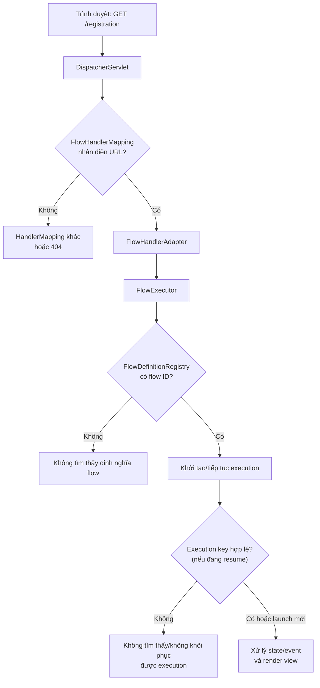
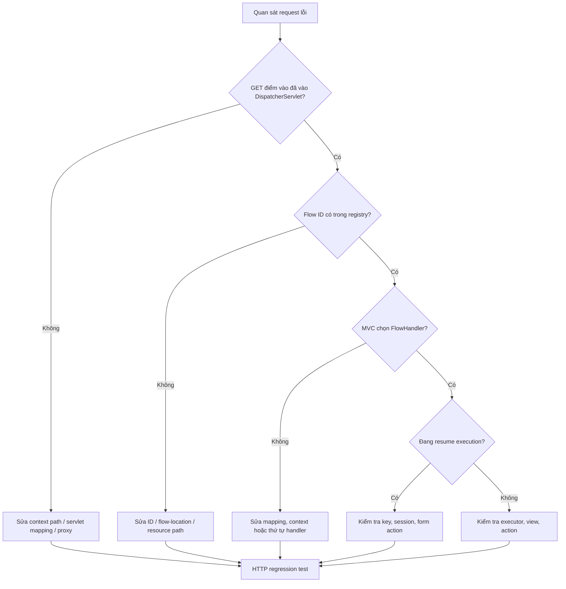

# Flow không được tìm thấy do đường dẫn hoặc định danh trong Spring Web Flow

Một tình huống dễ gặp khi triển khai **Spring Web Flow (SWF)**: file XML của flow đã tồn tại, ứng dụng khởi động không báo lỗi rõ ràng, nhưng truy cập `/registration` lại nhận **404**. Ở trường hợp khác, trang đầu hiển thị bình thường, đến lúc bấm **Tiếp tục** mới xuất hiện lỗi “không tìm thấy flow” hoặc “không tìm thấy lần thực thi flow”. Hai biểu hiện này có thể giống nhau với người dùng nhưng nằm ở những lớp khác nhau của hệ thống.

Bài học thuộc chương **Chẩn đoán lỗi** trong `SPRING_WEB_FLOW`. Khi dùng Spring Web Flow để quản lý các hành trình nhiều bước bằng **state, event, transition và subflow**, việc nhận diện chính xác flow là bước đầu tiên trước khi bàn tới **form binding, validation, scope/phiên, tích hợp Spring MVC hoặc phục hồi lỗi**. Mục tiêu của bài là xác định *lỗi xảy ra tại bước nào*, tìm bằng chứng tương ứng và sửa đúng cấu hình hoặc đường dẫn.

## 1. Hiểu đường đi từ URL đến flow đang chạy

Một request bắt đầu flow thường đi qua chuỗi:



Các nút có trách nhiệm khác nhau:

| Thành phần | Chức năng | Khi xảy ra lỗi |
|---|---|---|
| `DispatcherServlet` | Nhận request thuộc ứng dụng Spring MVC | URL có thể không vào đúng servlet |
| `FlowHandlerMapping` | Diễn giải URL thành flow ID và chọn flow handler | URL không khớp flow đã đăng ký |
| `FlowDefinitionRegistry` | Lưu các flow definition cùng ID | Thiếu flow ID, đăng ký sai path, sai tên |
| `FlowHandlerAdapter` | Nối handler của flow với executor | Handler được tìm nhưng không được xử lý đúng |
| `FlowExecutor` | Bắt đầu hoặc tiếp tục một flow execution | Không tìm thấy execution, event không hợp lệ, lỗi action |
| Execution repository | Lưu/khôi phục trạng thái một execution theo khóa | Key cũ, sai, hết hạn hoặc bị loại khỏi repository |

**Chẩn đoán phải bắt đầu từ biểu hiện quan sát được**, thay vì mặc định mọi trường hợp 404 hay mọi exception có chữ “flow” đều là do file XML bị thiếu.

## 2. Phân biệt bốn loại định danh thường bị nhầm

Giả sử ứng dụng đăng ký flow có ID `registration`, với các state `contact`, `address` và `review`.

| Khái niệm | Giá trị minh họa | Ý nghĩa |
|---|---|---|
| **Flow ID** | `registration` | Tên định nghĩa flow do registry biết |
| **URL/lookup path** | `/registration` | Đường dẫn HTTP mà MVC/URL handler dùng để chọn flow |
| **State ID** | `contact`, `review` | Vị trí hiện tại bên trong một flow |
| **Execution key** | `execution=<opaque-key>` | Mã tham chiếu một lần chạy cụ thể của flow |
| **Event ID** | `next`, `back`, `confirm` | Hành động yêu cầu một transition |

Flow ID chỉ ra **mẫu hành trình**. Execution key trỏ tới **một hành trình đang diễn ra**. State ID và event ID thuộc logic bên trong flow.

Ví dụ, hai tab của cùng một người dùng có thể cùng dùng flow ID `registration` nhưng có hai execution khác nhau với dữ liệu bản nháp độc lập. Việc cố định `execution=e1s1` trong link hoặc form có thể khiến request tiếp theo trỏ vào execution không tồn tại. `e1s1` chỉ là dạng ví dụ, **không phải khóa nên tự tạo hoặc hardcode**.

Một nhầm lẫn phổ biến khác là tưởng state `review` có URL công khai `/registration/review`. SWF thông thường quản lý state qua execution và event; chỉ riêng việc XML có `<view-state id="review">` **không tự sinh endpoint** `/registration/review`.

## 3. Nhận diện các triệu chứng trước khi sửa

Không phải cùng một lỗi “flow không được tìm thấy” có cùng nguyên nhân.

| Biểu hiện | Lớp nên kiểm tra đầu tiên | Khả năng thường gặp |
|---|---|---|
| GET điểm vào `/registration` trả 404 | MVC/FlowHandlerMapping | Sai URL, sai flow ID, registry không đăng ký, request không vào servlet |
| GET một URL khác vẫn chạy MVC bình thường | Registry + mapping flow | Flow riêng bị thiếu hoặc bị đặt ID khác |
| Có lỗi tra cứu flow definition | `FlowDefinitionRegistry` | ID của flow cha/subflow hoặc cấu hình registry không khớp |
| Trang đầu mở được nhưng POST tiếp theo lỗi | Execution URL + repository + session | Execution key thiếu/cũ/sai, session thay đổi |
| POST trả 403 trước khi vào flow | Spring Security/CSRF | Token hoặc quyền không hợp lệ |
| URL được nhận diện nhưng trang trả 500 | Adapter/executor/action/view | Bean thiếu, exception, lỗi render hoặc cấu hình không tương thích |
| POST hiển thị lại trang hiện tại mà không chuyển bước | Binding/validation/event | Gửi sai event ID hoặc không qua được validation |
| Chỉ môi trường production lỗi | Context path, proxy, deployment | URL rewrite, thiếu query string, khác chữ hoa/thường, cấu hình môi trường |

**HTTP 404 không tự chứng minh rằng registry bị thiếu flow.** Một controller khác, security filter, reverse proxy hoặc view layer cũng có thể tham gia tạo phản hồi lỗi tùy cấu hình ứng dụng. Cần xem request thực tế và log tại lớp xử lý liên quan.

## 4. Kiểm tra registry: tệp XML có thật chưa đủ

Giả sử file định nghĩa tồn tại ở:

```text
src/main/webapp/WEB-INF/flows/registration/registration.xml
```

Một cấu hình Spring Web Flow 2.x sử dụng XML có thể đăng ký như sau:

```xml
<?xml version="1.0" encoding="UTF-8"?>
<beans xmlns="http://www.springframework.org/schema/beans"
       xmlns:xsi="http://www.w3.org/2001/XMLSchema-instance"
       xmlns:webflow="http://www.springframework.org/schema/webflow-config"
       xsi:schemaLocation="
          http://www.springframework.org/schema/beans
          http://www.springframework.org/schema/beans/spring-beans.xsd
          http://www.springframework.org/schema/webflow-config
          http://www.springframework.org/schema/webflow-config/spring-webflow-config.xsd">

    <webflow:flow-registry id="flowRegistry">
        <webflow:flow-location
            id="registration"
            path="/WEB-INF/flows/registration/registration.xml"/>
    </webflow:flow-registry>

    <webflow:flow-executor id="flowExecutor"
                           flow-registry="flowRegistry"/>

    <bean class="org.springframework.webflow.mvc.servlet.FlowHandlerMapping">
        <property name="flowRegistry" ref="flowRegistry"/>
        <property name="order" value="0"/>
    </bean>

    <bean class="org.springframework.webflow.mvc.servlet.FlowHandlerAdapter">
        <property name="flowExecutor" ref="flowExecutor"/>
    </bean>
</beans>
```

Trong ví dụ, `registration` mới là **ID được dùng để lookup**; đường dẫn `/WEB-INF/flows/registration/registration.xml` là nơi đọc **định nghĩa XML**. Không phải vì file nằm trong thư mục `registration` mà registry chắc chắn có ID `registration` nếu bạn đã cấu hình ID khác.

### Lỗi 4.1: ID đăng ký không trùng ID được yêu cầu

```xml
<!-- ID thật được registry biết là register, không phải registration -->
<webflow:flow-location
    id="register"
    path="/WEB-INF/flows/registration/registration.xml"/>
```

Khi URL handler diễn giải request thành flow ID `registration`, lookup có thể thất bại mặc dù file XML tồn tại và đọc được.

Có hai hướng sửa hợp lệ: đổi ID đăng ký về `registration` nếu đó là hợp đồng URL mong muốn, hoặc thay đổi điểm vào/URL handler để yêu cầu đúng ID `register`. Chọn một hợp đồng định danh rõ ràng; không đổi rải rác cả URL, file, state và bean theo phỏng đoán.

### Lỗi 4.2: Đường dẫn tệp được khai báo sai

```xml
<!-- Ví dụ sai nếu file thực nằm ở WEB-INF/flows/registration/ -->
<webflow:flow-location
    id="registration"
    path="/WEB-INF/flow/registration/registration.xml"/>
```

`flow` và `flows` khác nhau. Cần đối chiếu **đường dẫn tệp thực tế trong gói triển khai**, không chỉ trong thư mục mã nguồn. Khi ứng dụng được đóng gói thành WAR/JAR, vị trí tài nguyên có thể khác tùy cách build, web application context và cơ chế resource loading.

Dấu hiệu thường gặp là lỗi nạp/parse định nghĩa flow lúc khởi động hoặc lúc registry được dùng. Cần kiểm tra log liên quan resource, không chỉ HTTP status cuối cùng.

### Lỗi 4.3: Dùng flow-location-pattern mà suy đoán nhầm ID

Đăng ký theo pattern thuận tiện khi có nhiều flow, nhưng quy tắc tạo ID từ tên và thư mục tùy thuộc cấu hình và cơ chế registry builder. Ví dụ:

```xml
<webflow:flow-registry id="flowRegistry">
    <webflow:flow-location-pattern
        value="/WEB-INF/flows/**/*-flow.xml"/>
</webflow:flow-registry>
```

Nếu tệp có tên `registration-flow.xml`, **không nên tự giả định** registry chắc chắn tạo ID `registration`. Với pattern, hãy xác nhận danh sách ID mà registry thực sự đăng ký; nếu muốn kiểm soát định danh và URL chính xác, một khai báo `<webflow:flow-location id="..." path="..."/>` tường minh thường dễ chẩn đoán hơn.

### Lỗi 4.4: Flow không được nạp vào đúng Spring context

Registry có thể được khai báo trong một file cấu hình nhưng file đó chưa được import, hoặc được nạp ở một context không được `DispatcherServlet` dùng để tra mapping/adapter. Khi đó sửa mỗi đường dẫn file flow không giải quyết được vấn đề.

Hãy xác minh rằng ứng dụng thực sự tạo các bean `flowRegistry`, `flowExecutor`, `FlowHandlerMapping` và `FlowHandlerAdapter` trong cấu hình MVC hợp lệ. Với Spring Boot, **không nên mặc định** thư viện SWF tự động đăng ký mọi bean chỉ vì dependency có mặt; cách cấu hình phụ thuộc phiên bản và cơ chế tích hợp của ứng dụng.

## 5. Kiểm tra URL thực tế, context path và servlet mapping

Một URL nhìn trong trình duyệt có thể khác **lookup path** mà `FlowHandlerMapping` nhận được.

Xem các lớp đường dẫn:

```text
https://example.test/app/registration?execution=<key>
                     └───┬───┘
                   context path /app

Đường dẫn bên trong ứng dụng: /registration
Phần tiếp tục execution: ?execution=<key>
```

Nếu deployment chạy dưới `/app`, gọi `https://example.test/registration` có thể không đến đúng ứng dụng. Ngược lại, nếu form nối `/app` hai lần, URL `/app/app/registration` cũng có thể không khớp flow.

### Checklist về URL

1. Chép **nguyên URL thực tế** từ thanh địa chỉ hoặc Network tab của trình duyệt, gồm path, query string và phương thức HTTP.
2. Xác nhận **context path** của ứng dụng và **servlet mapping** của `DispatcherServlet`.
3. Xác nhận rewrite từ reverse proxy và phần path/query được chuyển vào ứng dụng.
4. So khớp tên flow mà `FlowUrlHandler` diễn giải từ request với ID đã đăng ký.
5. Kiểm tra chữ hoa/thường, dấu gạch ngang, dấu gạch dưới, dấu `/` cuối và mã hóa URL.
6. Phân biệt điểm vào flow với URL trả về của form đang tiếp tục execution.

**Ví dụ các khác biệt có thể quan trọng:**

| URL nhận được | Flow ID dự kiến trong ví dụ | Điều cần xem |
|---|---|---|
| `/registration` | `registration` | Đường dẫn bắt đầu hợp lệ nếu mapping đã cấu hình tương ứng |
| `/Registration` | Không tự coi là `registration` | Case-sensitivity và quy tắc lookup |
| `/registration/` | Tùy cấu hình | Slash cuối có được chuẩn hóa không? |
| `/register` | Có thể là `register` | URL thực tế có trùng ID? |
| `/registration/review` | Không tự suy ra state | Có mapping riêng được công bố không? |
| `/app/registration` | Có thể là `registration` | `/app` là context path hay một phần route? |
| `/registration?execution=...` | `registration` + execution key | Key và session có hợp lệ không? |

Kết quả cụ thể phụ thuộc phiên bản Spring MVC/SWF, `FlowUrlHandler`, quy tắc path matching và cấu hình triển khai. Không nên ép tất cả URL trên thành một kết quả cố định khi chưa có bằng chứng từ hệ thống.

### FlowUrlHandler có vai trò gì?

`FlowHandlerMapping` phối hợp với cơ chế `FlowUrlHandler` (thường dùng `DefaultFlowUrlHandler`) để diễn giải URL thành flow ID. Bộ xử lý URL còn liên quan đến việc tạo URL bắt đầu và **tiếp tục execution**.

Nếu ứng dụng tùy biến URL, ví dụ công bố `/journeys/registration` nhưng flow ID là `registration`, cần có quy tắc thống nhất cho cả chiều:

- **Nhận request:** `/journeys/registration` phải được phân giải thành flow ID `registration`.
- **Tạo URL tiếp tục:** action của form phải quay về đúng route nhận diện được execution hiện tại.

Chỉ sửa một chiều có thể khiến GET mở được flow nhưng POST `next` bị 404. Khi chẩn đoán, đọc **action URL đã render**, không chỉ URL của request đầu tiên.

## 6. Kiểm tra FlowHandlerMapping và thứ tự HandlerMapping

Spring MVC có thể có nhiều `HandlerMapping`: controller annotations, static resources và handler của SWF. `DispatcherServlet` xét chúng theo thứ tự cấu hình, thông thường `order` **nhỏ hơn được ưu tiên trước**.

Một cấu hình tối thiểu ở phía SWF:

```xml
<bean class="org.springframework.webflow.mvc.servlet.FlowHandlerMapping">
    <property name="flowRegistry" ref="flowRegistry"/>
    <property name="order" value="0"/>
</bean>

<bean class="org.springframework.webflow.mvc.servlet.FlowHandlerAdapter">
    <property name="flowExecutor" ref="flowExecutor"/>
</bean>
```

Các lỗi cần kiểm tra:

- Chỉ có `FlowHandlerAdapter` mà thiếu `FlowHandlerMapping`: MVC không có cơ chế nhận diện URL là flow.
- Mapping tham chiếu **registry khác** với registry dùng để tạo executor: mapping và executor có thể không thống nhất về danh sách flow.
- Mapping/adapter được tạo trong context không thuộc cấu hình xử lý request của `DispatcherServlet`.
- Có controller `@GetMapping("/registration")` và flow cũng sở hữu `/registration`: mapping của controller có thể được chọn trước tùy thứ tự.
- Một route rộng của controller hoặc custom `HandlerMapping` che mất flow endpoint.

Nếu request được một controller khác xử lý, có thể thấy response 200 hoặc 404 nhưng hoàn toàn **không có flow execution nào được bắt đầu**. Cần quan sát handler đã được MVC chọn, không chỉ nhìn response status.

### Tránh xung đột URL với controller

Ví dụ:

```java
@Controller
class RegistrationLandingController {
    @GetMapping("/registration")
    String index() {
        return "registration/landing";
    }
}
```

Nếu flow có ID `registration` và cũng được công bố dưới URL này, hãy quyết định rõ endpoint thuộc **landing controller** hay **flow**. Có thể đặt landing tại `/registration-info` và giữ `/registration` là điểm bắt đầu flow, hoặc cấu hình URL flow khác một cách nhất quán.

## 7. Không tìm thấy flow definition khác không tìm thấy execution

Đây là ranh giới quan trọng nhất trong chẩn đoán.

### 7.1. Không tìm thấy flow definition

Registry không biết định nghĩa ứng với ID được yêu cầu. Tùy điểm gọi API/cấu hình, việc tra cứu có thể xuất hiện một exception kiểu **`NoSuchFlowDefinitionException`** hoặc lỗi nhận diện handler ở MVC.

Các câu hỏi cần trả lời:

- ID được yêu cầu thực sự là gì?
- Registry có ID đó không?
- File XML của ID đó được nạp từ đâu?
- Có sự khác nhau giữa flow cha, subflow và flow ID dùng trong URL không?

**Đừng sửa session hoặc execution key** khi vấn đề cốt lõi là registry không có định nghĩa flow.

### 7.2. Không tìm thấy hoặc không khôi phục được flow execution

Định nghĩa có thể vẫn tồn tại, nhưng request gửi khóa tham chiếu tới một lần chạy không còn hợp lệ, chẳng hạn:

```http
POST /registration?execution=<stale-or-invalid-key>
Content-Type: application/x-www-form-urlencoded

_eventId_next=&email=lan@example.test
```

Lỗi có thể xảy ra do session hết hạn, execution repository đã loại snapshot, khóa bị sửa, session cookie bị mất hoặc người dùng gửi lại URL cũ theo cách ứng dụng không hỗ trợ.

Trường hợp này thuộc **khôi phục execution**, không phải đăng ký flow definition. Cần kiểm tra:

- Session/cookie có được bảo toàn từ GET tới POST không?
- Form có dùng **flow execution URL** do SWF tạo không?
- Ứng dụng có dùng execution key mới sau mỗi bước không?
- Repository cho phép lịch sử bao nhiêu snapshot/execution?
- Có chính sách hết hạn/redirect về bước bắt đầu không?
- Hệ thống chạy nhiều node có chia sẻ session hoặc định tuyến sticky session phù hợp không?

Không tự động khởi động flow mới để “giải cứu” một POST lỗi rồi âm thầm làm mất dữ liệu người dùng. Nếu cho khởi động lại, cần có thông báo rõ ràng và cơ chế khôi phục bản nháp nếu nghiệp vụ yêu cầu.

### 7.3. Subflow ID sai

Flow cha có thể chứa:

```xml
<subflow-state id="verifyAddress" subflow="address-verification">
    <transition on="verified" to="review"/>
</subflow-state>
```

`address-verification` là **ID của flow con** được tìm theo quy tắc registry của ứng dụng. Nếu registry chỉ có ID `addressVerification`, việc đi tới subflow mới phát sinh lỗi, mặc dù flow cha đã chạy qua nhiều màn hình trước đó.

Cách xác minh:

1. Tìm `subflow="..."` trong **flow definition đang được kiểm tra**.
2. Đối chiếu tên subflow với registry.
3. Kiểm tra đường dẫn tài nguyên của flow con.
4. Sau khi sửa ID, kiểm tra hợp đồng `input`/`output` của subflow và transition quay về flow cha.

Không đồng nhất `id="verifyAddress"` của **subflow-state** với `subflow="address-verification"`: một bên là tên state trong flow cha, một bên là định danh flow con.

## 8. Quy trình chẩn đoán 7 bước có thể lặp lại

Dùng cùng quy trình từ môi trường local đến staging/production, ưu tiên những kiểm tra có thể chứng minh hoặc bác bỏ giả thuyết nhanh.

### Bước 1: Xác định request lỗi đầu tiên

Ghi lại URL đã gọi, HTTP method, status, redirect `Location` (nếu có) và hành động người dùng trước khi lỗi xảy ra. Tách **GET mở flow** và **POST tiếp tục flow** thành hai phép thử khác nhau. Không đăng log token, cookie hoặc execution key đầy đủ vào hệ thống chia sẻ.

Ví dụ dùng `curl` để kiểm tra điểm vào công khai:

```bash
curl -i 'http://localhost:8080/my-app/registration'
```

`/my-app` chỉ là context path minh họa. Nếu flow yêu cầu đăng nhập, kết quả có thể là redirect login hoặc 401/403 theo chính sách; cần hiểu điều đó trước khi quy kết là lỗi routing.

### Bước 2: Xác nhận servlet đã nhận request

Xem mapping của `DispatcherServlet`, context path, cổng/server và reverse proxy. Nếu request không vào đúng ứng dụng, thay đổi `flowRegistry` sẽ không tạo tác dụng.

### Bước 3: Xác nhận flow ID được yêu cầu

Kiểm tra cách `FlowUrlHandler` nhận diện lookup path. Đối chiếu đúng ký tự, chữ hoa/thường và tiền tố URL; tránh suy flow ID từ tên thư mục một cách tự động.

### Bước 4: Xác nhận registry thực sự biết ID ấy

Soát cấu hình `flow-registry`, `flow-location`/`flow-location-pattern`, đường dẫn tài nguyên và log khi nạp flow. Với một ứng dụng cần kiểm tra chương trình, có thể dùng đoạn mã **minh họa API** sau trong một test được cấu hình đủ bean:

```java
@Autowired
FlowDefinitionRegistry flowRegistry;

@Test
void registrationFlowIsRegistered() {
    FlowDefinition definition =
            flowRegistry.getFlowDefinition("registration");

    assertNotNull(definition);
    assertEquals("registration", definition.getId());
}
```

Imports, phiên bản API, ngữ cảnh test và cách registry được tạo tùy dự án. Điều cần xác nhận là **registry thực tế** mà MVC đang dùng chứa ID `registration`, không phải một registry giả được tạo riêng trong test.

### Bước 5: Xác nhận MVC chọn đúng FlowHandler

Dù registry có flow, `FlowHandlerMapping` vẫn phải có mặt và nhận được request. Bật log có giới hạn hoặc kiểm tra handler trong integration test để xác nhận request được route tới handler của SWF.

Nếu request bị một controller khác nhận, sửa sự xung đột URL/mapping trước khi chẩn đoán action bên trong flow.

### Bước 6: Nếu GET thành công nhưng POST lỗi, kiểm tra execution

Lấy action URL mới từ form HTML; giữ đúng session, cookie và CSRF; gửi event có tên hợp lệ. Không tái sử dụng execution key được sao chép từ ví dụ, test khác hoặc phiên trước.

### Bước 7: Thử lại đúng thao tác rồi khóa lỗi bằng test

Sau khi thay đổi cấu hình, chạy lại request gây lỗi **và** một đường đi thành công qua nhiều state. Viết regression test cho URL, flow ID và event đã lỗi; kiểm tra cả URL controller lân cận để đảm bảo thay đổi không tạo xung đột mới.



## 9. Sử dụng log và quan sát đúng lớp

Trong môi trường phát triển hoặc test, có thể tăng mức log tạm thời cho các nhóm:

```properties
# Ví dụ cấu hình logging trong ứng dụng Spring Boot.
logging.level.org.springframework.web.servlet=DEBUG
logging.level.org.springframework.webflow=DEBUG
```

Khi cần xem sâu hơn, có thể tạm thời dùng `TRACE` cho logger hẹp liên quan đến mapping hoặc execution; chỉ bật trong môi trường có quyền truy cập giới hạn. **Không bật log thô toàn bộ request/response ở production** nếu có nguy cơ lộ cookie, CSRF token, execution key, form fields hoặc dữ liệu cá nhân.

Tìm bằng chứng theo lớp:

| Nhóm log | Bằng chứng có ích |
|---|---|
| Servlet/MVC mapping | Path đã được DispatcherServlet nhận, handler nào được chọn |
| SWF registry / flow builder | Tài nguyên definition được nạp, flow ID thực tế, lỗi parse |
| SWF execution | Flow được launch hay resume, state/event nào được xử lý |
| View rendering | View name/template được tìm thấy hay không |
| Security filter | Request bị chặn vì authentication/authorization/CSRF |
| Proxy/server | Rewrite URL, mất query string, route sai service/node |

Nếu có stack trace, đọc **loại exception và phần nguyên nhân sâu nhất**. Một 500 do không tìm thấy bean trong action có thể xảy ra sau khi flow đã được nhận diện đúng; xử lý bằng cách đổi flow ID sẽ chỉ làm mất thêm thời gian.

### Cẩn thận với log ở môi trường nhiều phiên

Dùng correlation ID/request ID do ứng dụng phát hành để theo dõi một chuỗi request, kết hợp timestamp và flow ID. Chỉ log execution key dưới dạng rút gọn hoặc băm nếu thật sự cần và được chính sách bảo mật cho phép. Không dùng email người dùng làm correlation ID.

## 10. Kiểm thử để bắt lỗi trước khi triển khai

Có ít nhất ba ranh giới cần test:

| Loại test | Kiểm tra | Không đủ để chứng minh |
|---|---|---|
| Registry test | Flow ID có định nghĩa hợp lệ | MVC đã nhận diện URL |
| Flow execution test | State/event/transition, flow scope, subflow | URL công khai, session, view render |
| HTTP integration test | GET/POST qua MVC, handler, execution URL, security | Mọi nhánh nội bộ và toàn bộ hành vi trình duyệt |

### 10.1. Test registry

Bắt đầu bằng một assertion tra cứu ID thật như ví dụ ở bước 4. Nếu dùng pattern, kiểm tra ID được khai báo/đăng ký thực sự thay vì mặc định tên file sẽ được biến thành URL mong đợi.

Test này giúp phát hiện sai ID và thiếu flow resource trước khi phải mở trình duyệt.

### 10.2. Test flow engine

Với bộ kiểm thử flow của SWF, có thể khởi động flow theo ID/definition đã cung cấp, phát event `next` và kiểm tra state. Điều này hữu ích cho logic điều hướng nhưng **không chạy qua `DispatcherServlet`**. Một test như vậy có thể PASS trong khi endpoint public vẫn trả 404 do thiếu `FlowHandlerMapping`.

### 10.3. Test HTTP qua Spring MVC

Khung test dùng `MockMvc` khi dự án đã cấu hình SWF và MVC trong web application context:

```java
@SpringBootTest
@AutoConfigureMockMvc
class RegistrationEntryIT {

    @Autowired
    MockMvc mvc;

    @Test
    void registrationUrlResolvesToFlow() throws Exception {
        MvcResult result = mvc.perform(get("/registration"))
                .andReturn();

        // Chỉ minh họa; dùng assertion đúng với contract
        // của view/redirect và security ở dự án thực.
        assertThat(result.getResponse().getStatus())
                .isBetween(200, 399);

        // Kiểm tra handler thực tế là handler của SWF
        // hoặc kiểm tra view/form đặc trưng của flow.
        assertThat(result.getHandler()).isNotNull();
    }
}
```

Ví dụ này là **khung hướng dẫn**, không phải lớp test tự chạy độc lập; cần thêm imports, dependency và cấu hình Spring MVC/SWF phù hợp. Assertion handler **không null** chỉ chứng minh có handler, chưa chứng minh đúng **FlowHandler**. Một integration test hoàn chỉnh cần kiểm tra cụ thể handler của SWF hoặc response đặc trưng cho flow; đồng thời không được coi mọi 302 là thành công nếu đó là redirect tới trang đăng nhập ngoài dự kiến.

Nếu kiểm thử view JSP bằng `MockMvc`, cần biết MockMvc có thể trả **forward tới JSP** mà không thực thi JSP thành HTML hoàn chỉnh. Muốn kiểm tra HTML được render thật, có thể dùng servlet container test phù hợp.

### 10.4. Test GET → POST → Back

Một kịch bản end-to-end ở mức server:

1. GET `/registration` với session test, xác nhận flow bắt đầu đúng.
2. Đọc form action URL hoặc execution key từ phản hồi.
3. POST tới URL đó, giữ session/cookie và CSRF token nếu cần; gửi `_eventId_next` với field hợp lệ.
4. Đọc lại phản hồi, xác nhận đã sang state mới, không chỉ kiểm tra HTTP 200.
5. Bấm `_eventId_back`, xác nhận quay về state trước và giữ dữ liệu đã nhập.
6. Bắt đầu một flow mới trong cùng session, xác nhận dữ liệu của hai execution không ghi đè.

Ở bước 3, URL của form phải lấy từ framework. Khi execution repository tạo snapshot key mới, test cần dùng URL trả về **của state mới**, không lặp lại một key cũ theo cách chưa được ứng dụng cho phép.

### 10.5. Các case regression quan trọng

| ID | Tình huống | Kỳ vọng cần chứng minh |
|---|---|---|
| R01 | GET URL flow đã công bố | MVC nhận đúng flow, render/redirect theo contract |
| R02 | GET ID flow không được đăng ký | Không nhầm sang flow khác; phản hồi theo contract |
| R03 | Thay đổi flow-location thành path sai (test cấu hình) | Test registry phát hiện thất bại |
| R04 | Có controller trùng URL với flow | Test nhận diện đúng handler đã chọn |
| R05 | POST form dùng execution key đúng | Tiếp tục flow, không launch ngoài ý muốn |
| R06 | POST với key không tồn tại/hết hạn | Hiển thị lỗi hoặc redirect an toàn |
| R07 | POST thiếu CSRF | Bị chặn nếu security yêu cầu |
| R08 | Chuyển vào subflow có ID tồn tại | Subflow khởi động, trả về flow cha đúng |
| R09 | URL dưới context path của môi trường triển khai | Proxy/servlet phân giải chính xác |
| R10 | Hai flow execution trong cùng session | Không lẫn dữ liệu |
| R11 | URL static resource/controller lân cận | Không bị flow mapping chặn nhầm |

Không cần lặp mọi ca ở mọi tầng. Các nhánh state nhiều tổ hợp nên thử sâu bằng flow test; các trường hợp URL, session, form action, security cần HTTP test.

## 11. Những cách sửa dễ tạo thêm lỗi

### 11.1. Đổi tên file XML nhưng không đổi ID của registry

Tên tệp và flow ID có thể khác nhau. Nếu chỉ đổi file mà không sửa `path`, định nghĩa có thể không được nạp. Nếu đổi ID mà không cập nhật URL/subflow reference, request có thể không được nhận diện. Mỗi thay đổi cần đối chiếu từng quan hệ cụ thể.

### 11.2. Tạo thêm controller chuyển tiếp mọi URL về flow

Một controller catch-all dễ che route khác, khiến lỗi mapping khó quan sát hơn và có thể gây vòng lặp redirect. Tốt hơn hãy cấu hình `FlowHandlerMapping` và `FlowUrlHandler` đúng, phân định rõ endpoint thuộc MVC controller hay flow.

### 11.3. Giả lập execution key để POST cho “đúng”

Không tự dựng `execution=e1s1` rồi dùng cho mọi phiên. Key có thể gắn với repository/session/snapshot và được thay đổi theo request. Khi test, lấy từ response; khi render form, dùng URL của SWF.

### 11.4. Mở flow mới khi một POST cũ thất bại mà không thông báo

Hành động này có thể khiến người dùng mất toàn bộ dữ liệu nháp đang nhập. Hãy xử lý timeout hoặc execution key không hợp lệ theo contract minh bạch: báo phiên đã hết hạn, đưa về điểm bắt đầu an toàn hoặc khôi phục bản nháp đã lưu bền vững nếu hệ thống thực sự hỗ trợ.

### 11.5. Nới lỏng bảo mật vì POST trả 403

403 do CSRF/authorization không được khắc phục bằng cách tắt filter cho mọi endpoint. Kiểm tra đúng token, session, quyền truy cập và flow URL trước khi sửa chính sách.

### 11.6. Đánh đồng 404 với lỗi của flow engine

Khi `DispatcherServlet` chưa từng nhận request, flow definition có đúng đến đâu cũng không giải quyết được. Cần xác nhận từng lớp từ server/proxy tới Spring MVC, sau đó mới đi vào registry/executor.

## 12. Bài tập: chẩn đoán flow đặt lịch không mở được

Giả sử dự án dự định công bố flow **`appointment`** tại URL `/appointment`, nhưng cấu hình thực tế là:

```xml
<webflow:flow-registry id="flowRegistry">
    <webflow:flow-location
        id="appointments"
        path="/WEB-INF/flows/appointment/appointment.xml"/>
</webflow:flow-registry>
```

Trong khi đó UI liên kết đến:

```html
<a href="/appointment">Đặt lịch</a>
```

**Nhiệm vụ 1 – Xác định nguyên nhân:** Registry có ID `appointments` (số nhiều), nhưng URL được thiết kế để tìm ID `appointment` (số ít) theo quy tắc URL handler đang giả định. Hãy xác minh bằng registry test hoặc log mapping trước khi thay đổi.

**Nhiệm vụ 2 – Đề xuất sửa:** Nếu `/appointment` là hợp đồng URL mong muốn, có thể đổi `id="appointments"` thành `id="appointment"`. Giữ `path` nếu file XML đã đúng, và xem flow khác có tham chiếu ID cũ không.

**Nhiệm vụ 3 – Kiểm thử:** Viết một test registry xác nhận ID `appointment` tồn tại, thêm HTTP test GET `/appointment`, kiểm tra request được xử lý bởi flow phù hợp và đi tiếp được qua event `next`.

**Nhiệm vụ 4 – Tạo thêm lỗi thứ hai:** Cho trang đầu mở được, sau đó sửa form thành:

```html
<!-- Cố ý sai: không sử dụng execution URL hiện hành -->
<form action="/appointment/review" method="post">
    <button name="_eventId_next">Tiếp tục</button>
</form>
```

Dự đoán tác động: việc đăng ký flow ID `appointment` **không tự đăng ký URL `/appointment/review`**. Request có thể không tìm được handler flow hoặc được một handler khác xử lý, tùy ứng dụng. Sửa bằng cách dùng URL tiếp tục execution do SWF cung cấp.

**Nhiệm vụ 5 – Tạo lỗi subflow:** Trong flow `appointment`, tham chiếu `subflow="payment-check"` nhưng registry chỉ có `paymentReview`. Hãy xem vì sao bước đầu vẫn chạy được nhưng lỗi xuất hiện khi vào subflow; sửa ID tham chiếu theo registry hoặc khai báo flow con bằng ID hợp lệ.

### Câu hỏi tự kiểm tra

**1. Nếu XML flow nằm đúng thư mục nhưng GET trả 404, kiểm tra gì trước?** Kiểm tra URL thực, `DispatcherServlet`, `FlowHandlerMapping` và ID trong registry; sự tồn tại của file không đủ chứng minh mapping hợp lệ.

**2. `/appointment/review` có tự động chuyển tới state `review` không?** Không. State được SWF quản lý thông qua execution và event; URL public do cấu hình mapping quyết định.

**3. Nếu GET chạy được nhưng POST với `execution` cũ thất bại, nên sửa flow ID không?** Chưa có căn cứ. Cần xem execution key, session và repository trước.

**4. Vì sao cùng URL có thể bị controller nhận thay vì flow?** Vì có nhiều `HandlerMapping` và chúng được xét theo thứ tự; URL trùng khiến trách nhiệm xử lý không rõ.

**5. Có thể giải quyết mọi 403 bằng cách thay `FlowHandlerMapping` không?** Không. 403 thường thuộc chính sách bảo mật; cần kiểm tra authentication, authorization và CSRF.

**6. Flow cha chạy đúng nhưng tới `subflow-state` lại lỗi tìm flow thì sao?** Kiểm tra ID của flow con trong thuộc tính `subflow` và registry của ứng dụng.

## 13. Checklist khi xử lý sự cố flow không được tìm thấy

- [ ] Xác định request đầu tiên lỗi: GET bắt đầu hay POST tiếp tục.
- [ ] Chụp lại đúng method, path, query và status; ẩn token/cookie nhạy cảm.
- [ ] Kiểm tra request có đến `DispatcherServlet` không.
- [ ] Xác nhận context path, servlet mapping, proxy rewrite và slash/case.
- [ ] Kiểm tra `FlowUrlHandler` diễn giải đúng flow ID.
- [ ] Registry thực sự chứa flow ID và nạp đúng file định nghĩa XML.
- [ ] `FlowHandlerMapping` và `FlowHandlerAdapter` nằm trong context MVC hợp lệ.
- [ ] Không có controller hoặc mapping khác chiếm endpoint ngoài dự định.
- [ ] Không nhầm flow ID với state ID, event ID hoặc execution key.
- [ ] Nếu là POST, action URL đến từ SWF và session/key/CSRF hợp lệ.
- [ ] Nếu là subflow, thuộc tính `subflow` khớp ID của flow con được đăng ký.
- [ ] Nếu lỗi chỉ xuất hiện ở production, kiểm tra artifact được đóng gói và cấu hình triển khai thực.
- [ ] Có registry test + HTTP test cho đường đi từng lỗi từng gặp.
- [ ] Sau sửa lỗi, xác minh flow đi qua các bước và không ảnh hưởng controller khác.

**Ghi nhớ:** “Không tìm thấy flow” có thể là lỗi **không nhận diện URL**, **không có flow definition trong registry** hoặc **không tìm thấy flow execution cần tiếp tục**. Ba trường hợp liên quan nhưng khác nhau về cách khắc phục. Chẩn đoán lần lượt từ request thực tế → MVC mapping → flow ID/registry → executor/repository → state/event giúp tìm đúng nguyên nhân và tránh những thay đổi cấu hình không cần thiết.

