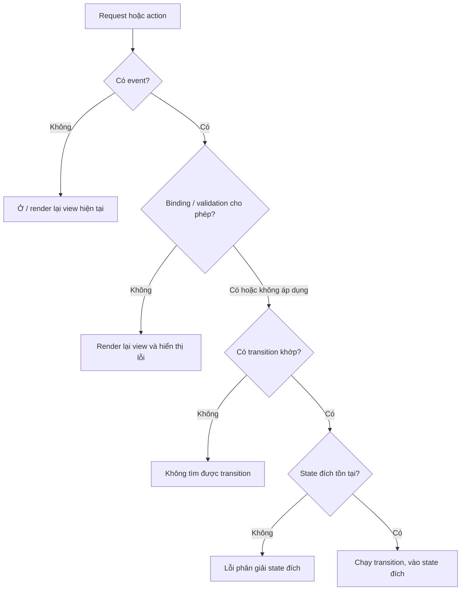

# State đích thiếu và transition không khớp sự kiện

Trong **Spring Web Flow**, một hành trình web được mô tả bằng các **state** và **transition**. Người dùng có thể nhấn nút Xác nhận, Hủy hoặc Quay lại; Web Flow nhận một **event**, tìm transition tương ứng ở state đang hoạt động, rồi đi tới **state đích** được khai báo. Khi một trong hai mắt xích này không đúng, màn hình có thể đứng yên, request thất bại hoặc ứng dụng phát sinh exception.

Hai lỗi rất dễ nhầm trong quá trình phát triển là:

- **State đích không tồn tại:** event đã có transition, nhưng thuộc tính `to` trỏ tới một state ID không được định nghĩa trong flow phù hợp.
- **Transition không khớp sự kiện:** Web Flow đã nhận event, nhưng tại state hiện tại không có transition nào xử lý event ID đó hoặc thỏa điều kiện chuyển.

Việc chẩn đoán đúng loại lỗi giúp sửa nhanh bản định nghĩa flow, form, action hoặc subflow; tránh thêm transition tùy tiện chỉ để làm biến mất exception.

## 1. Mục tiêu học tập

Sau bài này, bạn có thể:

1. Đọc một định nghĩa flow XML và truy ra cặp **state hiện tại → event → transition → state đích**.
2. Phân biệt lỗi không tìm thấy state với `NoMatchingTransitionException`.
3. Kiểm tra cách nút HTML/JSP phát event qua `_eventId` hoặc `_eventId_<event>`.
4. Phân tích event của `action-state`, `decision-state` và outcome từ subflow.
5. Nhận biết trường hợp form binding/validation làm view hiển thị lại dù transition đã được khai báo.
6. Khoanh vùng bằng log, request payload, flow ID, state ID và bộ kiểm thử Web Flow.
7. Viết các ca hồi quy để lỗi không tái xuất hiện khi đổi tên state hoặc event.

## 2. Chuỗi xử lý một sự kiện

Giả sử đang ở màn hình `reviewOrder` và người dùng nhấn Xác nhận. Web Flow phải giải quyết lần lượt các câu hỏi:

1. Request có tiếp tục đúng **flow execution** và state đang hoạt động không?
2. Request/hoạt động nội bộ có phát ra **event ID** nào?
3. Nếu state là `view-state` có model, binding và validation có cho phép xử lý event không?
4. Có transition phù hợp với event trong state hiện tại (hoặc vùng global transition áp dụng) không?
5. Transition đó có đi tới **state đích** có thật và hợp lệ không?
6. Khi vào state mới, các action, view hoặc subflow có chạy thành công không?



Sơ đồ minh họa đường đi thường gặp của `view-state`; đối với `action-state`, event đến từ kết quả action và không có bước bind form HTML. Tùy phiên bản, kiểu transition và cách xây dựng flow, lỗi state đích có thể được phát hiện **khi nạp định nghĩa** hoặc **khi thực thi**. Vì vậy cần dựa vào stack trace thực tế thay vì giả định một tên exception duy nhất.

## 3. Bảng phân biệt nhanh các triệu chứng

| Triệu chứng | Nghi vấn chính | Cần kiểm tra trước |
| --- | --- | --- |
| Ứng dụng lỗi khi khởi tạo hoặc nạp flow | `to` trỏ tới state chưa có, khai báo sai XML, reference không hợp lệ | Tên state đích và danh sách `id` trong flow |
| Lỗi xảy ra ngay sau nút Xác nhận; log có `NoMatchingTransitionException` | Event ID không được state hiện tại xử lý | Event thực tế, state hiện tại, các thẻ `transition` |
| Nhấn nút không chuyển trang nhưng không có exception rõ ràng | Request không phát event hoặc validation chặn transition | Network request, `_eventId`, thông báo binding/validation |
| Action chạy xong rồi báo không khớp transition | Kết quả action được ánh xạ thành event khác với `on` | Kiểu/giá trị trả về của action |
| Flow cha không xử lý được kết quả flow con | `end-state` của subflow trả outcome khác với transition ở cha | ID của end-state con và `on` tại `subflow-state` cha |
| Lỗi chỉ xuất hiện sau khi đổi tên state | Tham chiếu `to` cũ vẫn tồn tại | Tất cả transition, decision-state và nhánh điều hướng liên quan |
| Không tìm được template/JSP nhưng state đã vào thành công | Vấn đề view resolution, **không đồng nhất** với thiếu state | `view` của `view-state` và ViewResolver |
| Không tìm được subflow | ID `subflow` không có trong registry | `FlowDefinitionRegistry`, không chỉ danh sách state của cha |

**Nguyên tắc:** Luôn ghi nhận ít nhất bốn giá trị: **flow ID, state ID, event ID, target state ID (nếu có)**. Chỉ nhìn tên nút bấm hoặc URL thường không đủ để xác định lỗi.

## 4. Lỗi thứ nhất: `to` trỏ tới state không tồn tại

### 4.1. Ví dụ gây lỗi

Giả sử flow thanh toán có các state `reviewOrder` và `confirmed`:

```xml
<flow xmlns="http://www.springframework.org/schema/webflow"
      xmlns:xsi="http://www.w3.org/2001/XMLSchema-instance"
      xsi:schemaLocation="http://www.springframework.org/schema/webflow
                          https://www.springframework.org/schema/webflow/spring-webflow.xsd">

    <view-state id="reviewOrder">
        <!-- Sai: không tồn tại state id="confirmation". -->
        <transition on="confirm" to="confirmation" />
    </view-state>

    <end-state id="confirmed" />
</flow>
```

Khi event `confirm` được xử lý, Web Flow cần chuyển đến `confirmation`. Tuy nhiên, flow chỉ khai báo `confirmed`. **Tên state phải khớp ID**, không tự động suy từ tên view, tên nút, tiêu đề giao diện hay tên phương thức service.

Sửa thành:

```xml
<view-state id="reviewOrder">
    <transition on="confirm" to="confirmed" />
</view-state>

<end-state id="confirmed" />
```

Mỗi state ID trong cùng một flow phải được định nghĩa nhất quán. Khi đổi tên `confirmed` thành `orderCompleted`, phải cập nhật mọi nơi đang trỏ tới ID cũ.

### 4.2. Đừng nhầm `id` của state với thuộc tính `view`

```xml
<view-state id="collectAddress"
            view="forms/shippingAddress">
    <transition on="next" to="reviewOrder" />
</view-state>

<view-state id="reviewOrder"
            view="orders/review" />
```

Ở ví dụ này:

- `collectAddress` và `reviewOrder` là **state ID** dùng trong `to`.
- `forms/shippingAddress` và `orders/review` là **tên view/template** để ViewResolver tìm và render.
- `to="orders/review"` là sai nếu flow không có state ID đúng bằng `orders/review`.

Nếu `to="reviewOrder"` đúng mà template `orders/review` không tìm thấy, đó là lỗi **view resolution**, không phải lỗi state đích thiếu.

### 4.3. Lỗi có thể được phát hiện lúc nạp hoặc lúc chạy

Web Flow phải xây dựng/resolve definition của flow từ XML. Với target tĩnh không hợp lệ, cấu hình có thể bị từ chối khi xây dựng hoặc khi chạy transition, phụ thuộc phiên bản và cách phân giải. Với target động thông qua biểu thức, đường đi sai có thể chỉ lộ ra ở một nhánh dữ liệu cụ thể.

**Không nên chẩn đoán dựa trên một tên exception được đoán trước.** Hãy kiểm tra thông báo lỗi và cause chain để tìm ID state không được phân giải, file định nghĩa flow và transition nguồn.

### 4.4. Cách sửa theo trình tự

1. Tìm `<transition ... to="...">` ở state liên quan.
2. So sánh giá trị `to` với các state ID được khai báo trong **cùng flow**.
3. Nếu đích là subflow, xác định state cha dùng `<subflow-state>` với ID nào; tham chiếu `to` đến **ID state cha**, còn thuộc tính `subflow` đến **flow definition ID** trong registry.
4. Nếu đích là `end-state`, bảo đảm đúng tên outcome mong muốn.
5. Nếu đã đổi tên state, tìm tất cả tham chiếu cũ trong transition và decision-state có liên quan.
6. Nạp lại định nghĩa flow và chạy test cho đường đi đã sửa.

## 5. Transition không khớp với event hiện tại

Trong Web Flow, `<transition on="submit" to="reviewOrder"/>` có nghĩa: **khi state chứa transition này nhận event ID `submit`**, transition có thể được chọn để đi tới `reviewOrder`.

### 5.1. Ví dụ: event và `on` khác nhau

```xml
<view-state id="editOrder">
    <transition on="proceed" to="reviewOrder" />
</view-state>

<view-state id="reviewOrder" />
```

Nhưng form gửi event `continue`:

```html
<form method="post" action="${flowExecutionUrl}">
    <button type="submit"
            name="_eventId_continue"
            value="Continue">Tiếp tục</button>
</form>
```

Trong trường hợp này, **state `editOrder` nhận `continue` nhưng chỉ khai báo `proceed`**. Nếu event đã được phát và không có transition phù hợp ở phạm vi áp dụng, Web Flow có thể ném `NoMatchingTransitionException`, thường gắn với flow/state/event cụ thể.

Có hai cách sửa, tùy hợp đồng muốn giữ:

```xml
<!-- Giữ tên event từ giao diện. -->
<transition on="continue" to="reviewOrder" />
```

Hoặc sửa phần giao diện:

```html
<button type="submit" name="_eventId_proceed" value="Proceed">
    Tiếp tục
</button>
```

Không có quy tắc chung cho việc dùng `submit`, `next`, `proceed` hoặc `continue`. Điều quan trọng là **cùng một event ID** được dùng từ giao diện tới transition.

### 5.2. Tên label không quyết định event

```html
<button type="submit"
        name="_eventId_confirm"
        value="Xác nhận đơn hàng">
    Thanh toán
</button>
```

Event gửi tới Web Flow là **`confirm`**, không phải `Thanh toán` và cũng không phải `Xác nhận đơn hàng`. Tên hiển thị có thể được dịch sang nhiều ngôn ngữ; `on="confirm"` trong XML vẫn ổn định.

### 5.3. Hai cách phát event trên form HTML

**Cách A — nút mang tên event** (phù hợp form có nhiều hành động):

```html
<form method="post" action="${flowExecutionUrl}">
    <button type="submit" name="_eventId_next">Tiếp tục</button>
    <button type="submit" name="_eventId_cancel">Hủy</button>
</form>
```

```xml
<view-state id="editOrder">
    <transition on="next" to="reviewOrder" />
    <transition on="cancel" to="cancelled" />
</view-state>
```

**Cách B — hidden input** (phù hợp form chỉ có một lựa chọn):

```html
<form method="post" action="${flowExecutionUrl}">
    <input type="hidden" name="_eventId" value="next" />
    <button type="submit">Tiếp tục</button>
</form>
```

Nếu request không chứa một event parameter hợp lệ, view có thể chỉ được hiển thị lại và **không có event nào để tìm transition**. Đó là tình huống khác với event được phát nhưng không khớp.

Khi dùng JavaScript/Ajax, kiểm tra payload thực tế trong Network tab: tên thuộc tính, form serialization, HTTP method và URL tiếp tục flow. Đừng suy từ thao tác click rằng server chắc chắn đã nhận `_eventId`.

## 6. Vì sao `NoMatchingTransitionException` xuất hiện?

`NoMatchingTransitionException` thuộc package `org.springframework.webflow.engine`. Nó được dùng khi **không tìm được transition cho một event đã phát tại state hiện tại**. Phải kiểm tra event và state cùng lúc vì một event có thể hợp lệ ở state A nhưng không được hỗ trợ ở state B.

Ví dụ flow:

```xml
<view-state id="editOrder">
    <transition on="next" to="reviewOrder" />
</view-state>

<view-state id="reviewOrder">
    <transition on="confirm" to="confirmed" />
    <transition on="back" to="editOrder" />
</view-state>

<end-state id="confirmed" />
```

Nếu người dùng đang ở `editOrder` mà gửi `confirm` thì **không khớp**, mặc dù flow có `on="confirm"` ở `reviewOrder`. Web Flow tìm transition theo **state đang hoạt động**, không quét mọi transition trong tất cả các state.

### 6.1. Các điều kiện cũng ảnh hưởng đến việc chọn transition

Một transition có thể có biểu thức điều kiện:

```xml
<view-state id="reviewOrder">
    <transition on="confirm"
                if="orderReady"
                to="confirmed" />
</view-state>
```

Nếu điều kiện không thỏa, transition này không được thực thi. Cần phân biệt **event tên sai** với **event đúng nhưng guard/criteria không cho chọn transition**. Không nên sửa bằng cách xóa điều kiện nghiệp vụ khi chưa hiểu nguyên nhân.

Nếu yêu cầu là người dùng phải biết lý do chưa thể tiếp tục, hãy trả thông báo validation hoặc tổ chức nhánh xử lý rõ ràng, thay vì để event rơi vào tình huống không có transition khả dụng.

## 7. Action-state phát ra event khác với nút HTML

`view-state` thường nhận event từ request, còn `action-state` tạo event từ **kết quả thực thi action**.

Ví dụ:

```xml
<action-state id="checkAvailability">
    <evaluate expression="inventoryService.isAvailable(cartId)" />
    <transition on="yes" to="reviewOrder" />
    <transition on="no" to="outOfStock" />
</action-state>
```

Nếu `isAvailable` trả về `boolean`, Spring Web Flow ánh xạ `true` thành **`yes`** và `false` thành **`no`**. Viết nhầm `on="true"` hay `on="false"` có thể tạo lỗi không khớp.

| Kiểu kết quả của action | Event ID theo quy tắc mapping thông dụng | Transition phù hợp |
| --- | --- | --- |
| `String "approved"` | `approved` | `on="approved"` |
| `boolean true` | `yes` | `on="yes"` |
| `boolean false` | `no` | `on="no"` |
| Enum `APPROVED` | `APPROVED` | `on="APPROVED"` |
| Các kiểu khác không có kết quả event chuyên biệt | Thường là `success` | `on="success"` |

Quy tắc mapping được Spring Web Flow mô tả trong phần **Action Outcome Event Mappings**. Với action tùy biến trả trực tiếp một đối tượng `Event`, dùng ID của chính event đó.

### 7.1. Ví dụ action trả String

Java:

```java
public String checkOrder(Long orderId) {
    return orderService.isPayable(orderId)
            ? "approved"
            : "rejected";
}
```

XML:

```xml
<action-state id="checkOrder">
    <evaluate expression="checkoutAction.checkOrder(orderId)" />
    <transition on="approved" to="payment" />
    <transition on="rejected" to="reviewOrder" />
</action-state>
```

Nếu Java đổi giá trị trả về từ `approved` sang `accepted` mà XML vẫn giữ `on="approved"`, lỗi xuất hiện sau khi action chạy. Cần kiểm tra **giá trị event thực tế của action**, không chỉ code XML.

### 7.2. Đừng bỏ qua nhánh lỗi của service

Nếu action trả event `error` hoặc `rejected`, phải có transition tương ứng ở `action-state` nếu đó là một kết quả có thể xảy ra. Một hành trình thanh toán chỉ có `on="success"` sẽ xử lý kém khi service chủ động trả `error`.

Ví dụ:

```xml
<action-state id="submitPayment">
    <evaluate expression="paymentAction.submit(payment)" />
    <transition on="success" to="paymentComplete" />
    <transition on="rejected" to="editPayment" />
    <transition on="temporaryFailure" to="retryPayment" />
</action-state>
```

Chỉ định nghĩa outcome mà service thực sự có thể trả. Không đồng nhất một `Exception` ném ra với event `error`: exception cần được xử lý, chuyển thành kết quả nghiệp vụ hoặc thông qua cơ chế exception handler thích hợp.

## 8. Decision-state: kiểm tra cả `then` và `else`

`decision-state` quyết định state kế tiếp thông qua biểu thức điều kiện, không dựa trên nút HTML:

```xml
<decision-state id="chooseNext">
    <if test="cart.total &gt; 0"
        then="payment"
        else="emptyCart" />
</decision-state>
```

Nếu định nghĩa flow không có state `emptyCart`, chỉ những phiên có `cart.total` không lớn hơn 0 mới đi vào nhánh lỗi. Đây là ví dụ điển hình của **state đích thiếu trong một nhánh ít được kiểm thử**.

Sửa bằng cách thêm state hợp lệ hoặc đổi nhánh tới state có sẵn:

```xml
<view-state id="emptyCart" />
```

Trong một số cấu hình, builder có thể phát hiện reference thiếu ngay lúc nạp flow; trong những cấu hình khác, lỗi lộ ra khi điều kiện chọn nhánh đó. Tạo test cho **cả nhánh `then` và `else`**.

## 9. Subflow: flow ID, state ID và outcome là ba thứ khác nhau

Spring Web Flow cho phép flow cha gọi flow con bằng `<subflow-state>`:

```xml
<subflow-state id="shippingStep" subflow="shipping-address">
    <input name="orderId" value="flowScope.orderId" />
    <transition on="selected" to="reviewOrder" />
    <transition on="cancelled" to="reviewOrder" />
</subflow-state>
```

Trong ví dụ:

| Thành phần | Giá trị | Vai trò |
| --- | --- | --- |
| State ID ở flow cha | `shippingStep` | State cha dùng trong `to="shippingStep"` |
| Flow definition ID của con | `shipping-address` | ID phải được registry nhận diện |
| Outcome của con | `selected`, `cancelled` | ID `end-state` của flow con |
| Transition của cha | `on="selected"`, `on="cancelled"` | Phản ứng khi con kết thúc |
| State tiếp theo của cha | `reviewOrder` | ID phải tồn tại trong flow cha |

Flow con:

```xml
<flow xmlns="http://www.springframework.org/schema/webflow">
    <input name="orderId" type="long" required="true" />
    <view-state id="chooseAddress">
        <transition on="confirm" to="selected" />
        <transition on="cancel" to="cancelled" />
    </view-state>
    <end-state id="selected" />
    <end-state id="cancelled" />
</flow>
```

Ba lỗi có bản chất khác nhau:

1. Flow cha chuyển `to="shippingStep"` nhưng state thực được đặt `id="shipStep"`: **thiếu state đích ở cha**.
2. State cha tồn tại nhưng `subflow="shipping-address"` không được registry đăng ký: **không tìm được định nghĩa flow con**.
3. Flow con kết thúc với `id="addressChosen"` nhưng cha chỉ có `on="selected"`: **outcome không khớp transition của subflow-state**.

Khi trace lỗi, xác định chính xác đang đứng ở flow cha hay flow con, vì hai flow có bộ state ID riêng.

## 10. Validation khiến view đứng yên dù transition đúng

Một triệu chứng thường bị chẩn đoán nhầm là: form có `_eventId_next`, state có `<transition on="next"...>` nhưng màn hình không chuyển.

Ví dụ:

```xml
<view-state id="editShipping" model="shippingForm">
    <transition on="next" to="reviewOrder" />
    <transition on="cancel" to="cancelled"
                bind="false" validate="false" />
</view-state>
```

Với `model="shippingForm"`, Web Flow có thể thực hiện binding và validation trước khi cho phép xử lý chuyển state. Nếu trường bắt buộc bị thiếu hoặc chuyển kiểu thất bại, view thường được render lại để người dùng sửa dữ liệu. Điều này **không có nghĩa** `on="next"` hoặc `to="reviewOrder"` sai.

Quy trình kiểm tra:

1. Xác nhận request có `_eventId_next` và đang tiếp tục đúng execution.
2. Xem thông báo lỗi binding/validation của `shippingForm`.
3. Kiểm tra trường form gửi lên có tên khớp property của model không.
4. Kiểm tra converter/formatter cho kiểu đặc biệt như ngày, enum hoặc số tiền.
5. Chỉ khi binding/validation đã cho phép xử lý event mới truy tiếp transition/target.

### 10.1. Khi dùng nút Hủy hoặc Quay lại

Nút Hủy không nên bị chặn vì form chưa hợp lệ. Có thể tắt binding và validation ở transition:

```xml
<transition on="cancel" to="cancelled"
            bind="false" validate="false" />
```

Nếu nút Quay lại cần giữ các giá trị đã nhập nhưng không muốn kiểm tra nghiệp vụ, có thể chỉ tắt validation, tùy yêu cầu:

```xml
<transition on="back" to="previousStep"
            validate="false" />
```

Với trường hợp đầu vào đã sai kiểu và binding thất bại, việc chỉ tắt validation chưa chắc đủ để tiếp tục. Cần chọn hành vi phù hợp của `bind` và `validate` một cách có chủ đích.

## 11. Quy trình chẩn đoán từ request đến target

Thay vì sửa ngay XML khi nhìn thấy màn hình đứng yên, hãy thu thập bằng chứng theo thứ tự sau:

### Bước 1 — Xác nhận flow execution còn hoạt động

Kiểm tra request đang gửi tới URL tiếp tục đúng flow, có execution key nếu cơ chế Web Flow cần. Request mới mở nhầm URL có thể **khởi chạy flow khác** và khiến state hiện tại không như bạn nghĩ.

Nếu log báo execution không còn trong repository hoặc session hết hạn, ưu tiên xử lý vòng đời execution trước; đó không phải lỗi `on`/`to` đơn thuần.

### Bước 2 — Xác định flow ID và state ID đang hoạt động

Ghi lại ID thực tế, ví dụ:

```text
flowId  = checkout
stateId = reviewOrder
```

Đừng chỉ căn cứ tên file template `review.jsp`. Cùng một view có thể được nhiều state sử dụng.

### Bước 3 — Ghi event ID thực sự

Trong Developer Tools → Network, xem form/query parameter:

```text
POST /checkout?execution=...
_eventId_confirm=
```

Ở đây event ID là `confirm`. Nếu parameter là `_eventId=confirm`, ý nghĩa cũng là `confirm`. Nếu không có event parameter, hãy truy vấn cách view tạo request, JavaScript intercept submit và trạng thái binding/validation.

Trong `action-state`, event đến từ kết quả action chứ không đến từ HTML parameter. Khi đó trace giá trị/kiểu trả về của phương thức.

### Bước 4 — Kiểm tra các transition có thể áp dụng

Đọc `<transition>` thuộc **state hiện tại**, rồi xem `<global-transitions>` nếu flow sử dụng cơ chế global transition. Với mỗi ứng viên, kiểm tra:

- `on` có khớp event ID không?
- Có điều kiện `if` hoặc criteria nào làm transition không thể chọn?
- Có transition riêng tại state ghi đè hoặc thay đổi cách xử lý event chung không?
- Nếu là subflow, event đó có phải ID end-state con vừa trả hay không?

### Bước 5 — Kiểm tra `to` và state definition

Khi đã tìm thấy transition đúng, kiểm tra `to` trỏ đến **state ID tồn tại trong flow phù hợp**. Với target động, kiểm tra biểu thức thực sự trả về ID nào ở dữ liệu gây lỗi.

### Bước 6 — Xác nhận các hành động và view ở state kế tiếp

Nếu transition đúng và target tồn tại nhưng request vẫn lỗi, xem action khi vào state, view resolver, subflow registry và service exception. Đừng đổi tên `to` khi chứng cứ cho thấy lỗi xảy ra **sau khi đã vào target**.

## 12. Dùng log và instrumentation có kiểm soát

Trong môi trường phát triển, bật `DEBUG` chọn lọc cho Spring Web Flow để nhìn rõ hơn quá trình nhận event, chọn transition và chuyển state:

```properties
# Ví dụ Spring Boot; chỉ bật lúc chẩn đoán để tránh log lớn.
logging.level.org.springframework.webflow=DEBUG
```

Tên logger chi tiết và nội dung log phụ thuộc phiên bản framework. Không nên yêu cầu một dòng log có câu chữ cố định trong test; hãy tập trung vào **flow ID/state ID/event ID/target ID** và stack trace có nguyên nhân gốc.

### 12.1. Listener chỉ ghi metadata điều hướng

Nếu ứng dụng đã có `FlowExecutionListener`, có thể ghi lại các event và state mà không sao chép dữ liệu form:

```java
public final class TransitionTraceListener
        implements FlowExecutionListener {

    private static final Logger log =
            LoggerFactory.getLogger(TransitionTraceListener.class);

    @Override
    public void eventSignaled(RequestContext context, Event event) {
        String flowId = context.getActiveFlow().getId();
        String stateId = context.getCurrentState() == null
                ? "(starting)"
                : context.getCurrentState().getId();

        log.debug("flow={} state={} event={}",
                flowId, stateId, event.getId());
    }
}
```

Đoạn mã giả định các import `FlowExecutionListener`, `RequestContext`, `Event` và SLF4J có trong dự án và listener đã được đăng ký với executor. Với phiên bản Web Flow cũ, chữ ký/interface adapter có thể khác; đối chiếu API Javadoc của dependency đang sử dụng.

Đừng log toàn bộ request parameters, OTP, mật khẩu, token hoặc object trong `flowScope` để tìm lỗi event. Các ID điều hướng và mã tương quan thường đủ cho bước đầu.

## 13. Ví dụ hoàn chỉnh có thể dùng làm mốc so sánh

Flow sau minh họa một đường đi rõ ràng: `editOrder` → `reviewOrder` → `checkOrder` → `confirmed` hoặc quay về `reviewOrder`. Ví dụ giả định các view tương ứng đã tồn tại và bean `orderAction` có các phương thức được dùng.

```xml
<flow xmlns="http://www.springframework.org/schema/webflow"
      xmlns:xsi="http://www.w3.org/2001/XMLSchema-instance"
      xsi:schemaLocation="http://www.springframework.org/schema/webflow
                          https://www.springframework.org/schema/webflow/spring-webflow.xsd">

    <on-start>
        <evaluate expression="orderAction.newOrderForm()"
                  result="flowScope.orderForm" />
    </on-start>

    <view-state id="editOrder" model="orderForm">
        <transition on="next" to="reviewOrder" />
        <transition on="cancel" to="cancelled"
                    bind="false" validate="false" />
    </view-state>

    <view-state id="reviewOrder">
        <transition on="confirm" to="checkOrder" />
        <transition on="back" to="editOrder" />
        <transition on="cancel" to="cancelled" />
    </view-state>

    <action-state id="checkOrder">
        <!-- checkOrder trả đúng "approved" hoặc "rejected". -->
        <evaluate expression="orderAction.checkOrder(orderForm)" />
        <transition on="approved" to="confirmed" />
        <transition on="rejected" to="reviewOrder" />
    </action-state>

    <end-state id="confirmed" />
    <end-state id="cancelled" />
</flow>
```

Đoạn Java đi cùng:

```java
public String checkOrder(OrderForm orderForm) {
    return orderService.canConfirm(orderForm)
            ? "approved"
            : "rejected";
}
```

Các invariant dễ kiểm tra:

| State hiện tại | Event | Target |
| --- | --- | --- |
| `editOrder` | `next` | `reviewOrder` |
| `editOrder` | `cancel` | `cancelled` |
| `reviewOrder` | `confirm` | `checkOrder` |
| `reviewOrder` | `back` | `editOrder` |
| `checkOrder` | `approved` | `confirmed` |
| `checkOrder` | `rejected` | `reviewOrder` |

Trong thiết kế thật, phương thức xác nhận nghiệp vụ cần kiểm tra quyền truy cập, trạng thái hiện hành và giao dịch tại service. Bài này tập trung vào tính đúng của đường đi giữa các state.

## 14. Thiết kế kiểm thử ngăn lỗi tái diễn

Web Flow cung cấp hỗ trợ kiểm thử flow như `AbstractXmlFlowExecutionTests`, `MockExternalContext` và các phương thức kiểm tra current state. Với bài toán này, kiểm thử **đường đi thực tế** quan trọng hơn kiểm tra chuỗi XML theo văn bản.

### 14.1. Kiểm tra đường đi thành công

Một test flow có thể có cấu trúc minh họa:

```java
// Bên trong test kế thừa AbstractXmlFlowExecutionTests,
// đã cấu hình XML flow và mock orderAction theo test fixture.
public void testReviewToConfirmation() {
    startFlow();
    assertCurrentStateEquals("editOrder");

    signalEvent("next");
    assertCurrentStateEquals("reviewOrder");

    signalEvent("confirm");
    // orderAction.checkOrder(...) trả "approved" trong test này.
    assertFlowExecutionEnded();
    assertFlowExecutionOutcomeEquals("confirmed");
}
```

Đây là khung minh họa. Fixture phải tạo model `orderForm`, các mock service/bean và view cần thiết; API assertion cần đối chiếu với phiên bản thư viện test. Mục đích là xác nhận cả tên event từ view **và** event do action trả về.

### 14.2. Ma trận test tình huống lỗi

| Ca kiểm thử | Dữ liệu/tác động | Kỳ vọng |
| --- | --- | --- |
| Event hợp lệ tại state đúng | `next` tại `editOrder` | Đến `reviewOrder` |
| Event không được state hiện tại hỗ trợ | `confirm` tại `editOrder` | Thể hiện rõ thiếu transition; không âm thầm xác nhận |
| Event từ HTML sai tên | UI gửi `continue` thay vì `next` | Test tích hợp phát hiện request không có đường đi mong đợi |
| Form validation thất bại | `next` nhưng trường bắt buộc rỗng | Ở lại `editOrder` và có lỗi validation |
| Action trả event nhánh thành công | `checkOrder` trả `approved` | Kết thúc `confirmed` |
| Action trả event nhánh từ chối | `checkOrder` trả `rejected` | Quay lại `reviewOrder` |
| Action trả event không được xử lý | `checkOrder` trả `pending` | Test phát hiện nhánh không được khai báo |
| Tham chiếu state đích thiếu | `to="confirmation"` trong khi chỉ có `confirmed` | Flow nạp/chạy fail theo cơ chế phân giải; test phải phát hiện |
| Decision chọn nhánh ít gặp | Dữ liệu đi tới `else="emptyCart"` | Có state `emptyCart` hợp lệ |
| Subflow trả outcome mới | Con trả `addressChosen` | Cha xử lý rõ hoặc test phát hiện thiếu transition |
| Session/execution không còn | Submit URL với execution key hết hiệu lực | Báo lỗi vòng đời riêng, không kết luận nhầm transition |

### 14.3. Kiểm thử cấu hình và integration

Ở mức definition, bảo đảm **mọi target tĩnh `to` / `then` / `else`** có đích hợp lệ trong flow hoặc theo quy tắc resolution hiện hành. Nếu dùng target động, tạo input đại diện cho từng giá trị có thể sinh ra.

Ở mức HTTP, submit form thực với nút `_eventId_*` và verify view/state kết quả. Chỉ unit test XML mà không kiểm tra template có thể bỏ sót lỗi nút đặt tên sai; chỉ test UI mà không kiểm tra nhánh action sẽ bỏ sót event từ service.

## 15. Những cách sửa vội dễ che giấu vấn đề

**Thêm transition “bắt tất cả” cho mọi event chưa biết.** Điều này có thể làm biến mất exception nhưng khiến event đánh máy sai bị đưa sang màn hình khác. Hãy chuẩn hóa event hợp lệ và xử lý event không hỗ trợ có chủ đích.

**Bỏ validation khi nút Tiếp tục không chạy.** Nếu nguyên nhân là form không hợp lệ, việc vô hiệu validation có thể cho phép dữ liệu sai qua các bước tiếp theo. Chỉ tắt validation cho các event như Hủy/Quay lại khi nghiệp vụ cho phép.

**Đổi tên `view` thay vì `to`.** Nếu lỗi là state ID thiếu, việc đổi đường dẫn JSP/template không giải quyết được. Kiểm tra riêng hai khái niệm.

**Đổi output của subflow thay vì outcome.** Flow cha chọn transition dựa trên ID `end-state` con; một trường output tên `status` không tự biến thành event `selected`.

**Bắt exception và quay về start-state ngay lập tức.** Việc này làm mất đường đi gây lỗi và có thể khiến người dùng gửi lại thanh toán/đăng ký nhiều lần. Phải xử lý lỗi nghiệp vụ và trạng thái giao dịch phù hợp.

**Sửa XML nhưng chỉ test màn hình đầu.** Lỗi target ở nhánh `else` hoặc event `rejected` có thể không lộ nếu test luôn đi đường thành công.

## 16. Bài tập thực hành

Bạn nhận được flow bị lỗi:

```xml
<flow xmlns="http://www.springframework.org/schema/webflow">
    <view-state id="shipping">
        <transition on="submit" to="review" />
        <transition on="cancel" to="cancelled" />
    </view-state>

    <view-state id="review">
        <transition on="confirm" to="completed" />
    </view-state>

    <end-state id="complete" />
    <end-state id="cancelled" />
</flow>
```

Form tại `shipping` gửi:

```html
<button type="submit" name="_eventId_continue">
    Tiếp tục
</button>
```

**Nhiệm vụ:**

1. Chỉ ra lỗi **transition không khớp event** giữa form và state `shipping`.
2. Chỉ ra lỗi **state đích thiếu** giữa `review` và end-state `complete`.
3. Sửa bằng cách giữ event `continue` và outcome `complete`; viết lại đúng hai transition.
4. Giải thích vì sao event `confirm` gửi ngay từ màn hình `shipping` vẫn không hợp lệ sau khi sửa.
5. Viết ba test: vào `review`, kết thúc `complete` và phát event không hợp lệ tại `shipping`.

**Đối chiếu kết quả:** trong flow đã sửa phải có:

```xml
<transition on="continue" to="review" />
<transition on="confirm" to="complete" />
```

Trong thực tế cần bổ sung action/validation để đảm bảo đơn hàng được xử lý đúng, nhưng hai dòng trên giải quyết chính xác hai lỗi điều hướng của đề bài.

## 17. Checklist chẩn đoán trong một phút

1. **Flow ID?** Đang chạy flow nào; có gọi subflow không?
2. **Current state ID?** State hiện tại có đúng như màn hình đang quan sát không?
3. **Event ID?** Đến từ `_eventId`, kết quả action hay outcome con?
4. **Binding/validation?** Event đã thực sự được xử lý hay view bị giữ lại vì form không hợp lệ?
5. **Transition?** Có `on` tương ứng và điều kiện `if` thỏa không?
6. **Target?** `to`/`then`/`else` trỏ đúng state ID hay đang nhầm với view/flow ID?
7. **Sau transition?** Lỗi nằm ở state mới, view resolver, service hoặc registry không?
8. **Regression test?** Đã kiểm thử nhánh thành công, từ chối, hủy và nhánh ít dùng chưa?

## 18. Ghi nhớ

- `NoMatchingTransitionException` nói về **event không tìm được transition phù hợp tại state đang hoạt động**, không đồng nghĩa với thiếu state đích.
- `to`/`then`/`else` trỏ tới **state ID**; `view` là nơi ánh xạ template; `subflow` trỏ tới **flow definition ID** trong registry.
- Với view HTML, event thường đến từ `_eventId=name` hoặc `_eventId_<name>`; label trên nút không quyết định event.
- Với action-state, event được ánh xạ từ kết quả Java: String giữ nguyên, Boolean là `yes/no`, Enum dùng tên enum, nhiều kiểu khác là `success`.
- Model binding và validation có thể ngăn transition và render lại view dù tên `on` và `to` đều đúng.
- Chẩn đoán theo chuỗi **flow → state → event → transition → target → bước tiếp theo**, rồi viết test cho đường đi gây lỗi.

### Tài liệu tham khảo

- [Spring Web Flow Reference Guide 3.0.x — Essential language elements, transitions, actions, view events](https://docs.spring.io/spring-webflow/docs/3.0.x/reference/)
- [`NoMatchingTransitionException` — Spring Web Flow 3.0.1 API](https://docs.spring.io/spring-webflow/docs/3.0.1/api/org/springframework/webflow/engine/NoMatchingTransitionException.html)
- [`TransitionableStateDefinition` — Spring Web Flow 3.0.1 API](https://docs.spring.io/spring-webflow/docs/3.0.1/api/org/springframework/webflow/definition/TransitionableStateDefinition.html)
- [`RequestContext` — Spring Web Flow API](https://docs.spring.io/spring-webflow/docs/3.0.1/api/org/springframework/webflow/execution/RequestContext.html)
