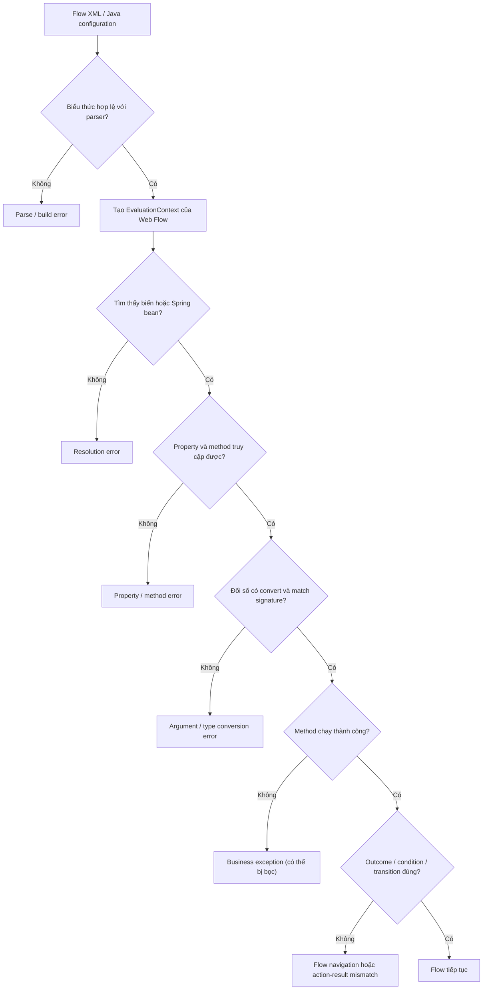
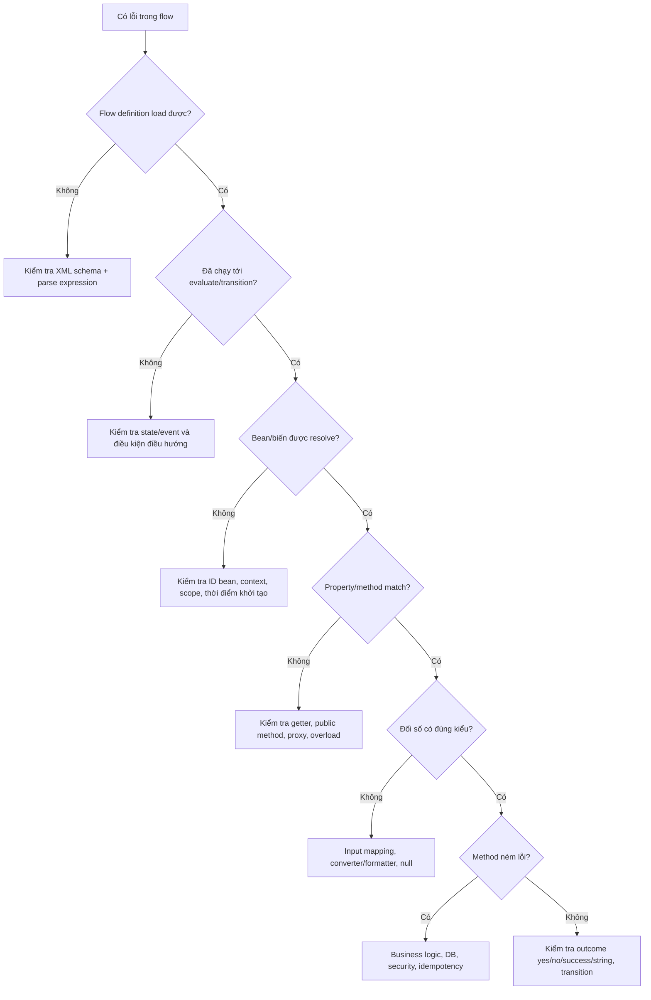

# Lỗi biểu thức, tên bean và phương thức không phù hợp trong Spring Web Flow

## 1. Bối cảnh và mục tiêu

Trong **Spring Web Flow (SWF)**, các luồng web nhiều bước được tổ chức bằng `state`, `event`, `transition` và `subflow`. Một flow có thể dùng biểu thức để lấy dữ liệu từ `flowScope`, gọi Spring bean, quyết định điều kiện chuyển trạng thái hoặc xác định view được render. Biểu thức giúp flow XML gọn, nhưng cũng tạo một nhóm lỗi khó nhận biết khi chạy: sai tên bean, chưa có biến trong scope, gọi nhầm phương thức hoặc truyền sai kiểu tham số.

Xét một action trong flow đặt lịch:

```xml
<on-start>
    <evaluate expression="bookingService.loadBooking(bookingId)"
              result="flowScope.booking" />
</on-start>
```

Chỉ một dòng này chứa nhiều điều kiện phải đúng: parser hiểu cú pháp; Spring Web Flow nhìn thấy bean `bookingService`; bean có phương thức phù hợp với tham số `bookingId`; dữ liệu đầu vào chuyển được sang kiểu đích; và method chạy thành công. Người dùng có thể chỉ nhìn thấy trang lỗi, trong khi log ở server ghi một `ActionExecutionException` bọc nguyên nhân sâu hơn.

Bài thuộc chương **Chẩn đoán lỗi**, trực tiếp trả lời câu hỏi: **khi một biểu thức Web Flow lỗi, làm thế nào xác định đúng lớp lỗi và sửa nguyên nhân gốc?** Nội dung áp dụng cho Spring Web Flow tích hợp Spring MVC và lưu ý riêng cho JSF/Facelets, tập trung vào cách điều tra trên *đúng phiên bản và cấu hình* của ứng dụng.

Sau bài này, bạn có thể:

1. Phân biệt **lỗi parse**, **lỗi resolve bean/biến/property**, **lỗi chữ ký method/conversion**, **exception do nghiệp vụ** và **lỗi event/transition**.
2. Kiểm tra parser thực tế, cú pháp *standard expression* và *template expression*, context đánh giá và thứ tự tra cứu scope.
3. Xác minh chính xác tên bean trong Spring ApplicationContext đang được FlowBuilderServices sử dụng.
4. Kiểm tra visibility, tên, số lượng và kiểu tham số của method; hiểu trường hợp proxy/overload và action outcome.
5. Tạo ví dụ tối thiểu, kiểm thử đường chạy flow và ghi bằng chứng đủ để sửa lỗi mà không làm thay đổi nghiệp vụ ngoài ý muốn.

## 2. Một dòng biểu thức đi qua những tầng nào?



Để chẩn đoán, cần xác định **nơi phát sinh lỗi**, thay vì sửa ngẫu nhiên XML, controller và service cùng lúc.

| Nhóm | Triệu chứng thường gặp | Câu hỏi đầu tiên |
|---|---|---|
| **Cú pháp/parser** | Flow không build được, hoặc `ParseException`/`SpelParseException` | Cú pháp thuộc loại expression nào, parser nào đang dùng? |
| **Tên bean** | Không resolve được `bookingService` hoặc root object | Bean có đúng ID và nằm trong context mà flow nhìn thấy? |
| **Biến/scope** | `bookingId` không tồn tại, đọc `viewScope.booking` ngoài state | Biến được tạo ở bước nào, có tồn tại tại thời điểm evaluate? |
| **Property** | `PROPERTY_OR_FIELD_NOT_READABLE` hoặc getter không tìm thấy | Tên thuộc tính JavaBean đúng chưa, receiver có null không? |
| **Method** | `METHOD_NOT_FOUND`, lỗi invoke, sai số đối số | Method có public, đúng tên, đúng kiểu và arity không? |
| **Conversion** | Không convert được `"abc"` sang `Long` hoặc enum | Kiểu runtime thật, converter/formatter nào được dùng? |
| **Nghiệp vụ** | `IllegalStateException`, lỗi database, quyền truy cập bị từ chối | Method đã chạy rồi ném exception ở dòng nào? |
| **Outcome/event** | Action chạy nhưng flow đứng hoặc đi nhánh bất ngờ | Giá trị trả về map thành event gì, transition đang chờ gì? |

Tên exception và nội dung message có thể thay đổi theo **Spring Framework/SWF version**, parser (SpEL/Unified EL) và tầng wrapper. Đừng dùng một chuỗi log cụ thể như hợp đồng ổn định của framework.

### 2.1. Đọc exception từ ngoài vào trong

Ví dụ *log minh họa*, không phải thông báo nguyên văn của một bản SWF cụ thể:

```text
org.springframework.webflow.execution.ActionExecutionException:
  Exception thrown executing action in state 'loadBooking'
Caused by: org.springframework.expression.spel.SpelEvaluationException:
  Method loadBooking(java.lang.String) cannot be found on BookingService
```

Ở đây, `ActionExecutionException` chỉ nói **action không thực thi thành công**. Nguyên nhân cần xử lý là cách resolve method/đối số trong `Caused by`. Ngược lại, nếu nguyên nhân sâu nhất là `IllegalStateException: booking already confirmed` thì việc sửa cú pháp expression có thể hoàn toàn không liên quan.

Cách đọc thực tế:

1. Ghi flow ID, state ID, event và action XML bị lỗi (đã ẩn thông tin nhạy cảm).
2. Đọc toàn bộ chuỗi `Caused by` tới lỗi gốc; nếu có nhiều cause, xác định cái đầu tiên liên quan logic ứng dụng.
3. Xác minh flow có thực sự chạy tới action đó hay không.
4. Tách **parse-time** (thường khi định nghĩa được build) khỏi **evaluation-time** (khi state/event đang chạy).
5. Dựa vào **receiver + method signature + kiểu runtime** của lỗi để chọn một phép kiểm chứng nhỏ.

## 3. Lỗi biểu thức: standard hay template, SpEL hay Unified EL?

### 3.1. Standard expression không bọc `#{...}`

Spring Web Flow nhận *standard expression* ở nhiều thuộc tính như `<evaluate expression="...">`, `<set value="...">` và điều kiện `<transition if="...">`. Parser đánh giá trực tiếp nội dung của chuỗi.

**Đúng:**

```xml
<evaluate expression="bookingService.loadBooking(bookingId)"
          result="flowScope.booking" />

<transition on="next" to="review"
            if="bookingService.canReview(booking)" />
```

**Sai loại biểu thức:**

```xml
<evaluate expression="#{bookingService.loadBooking(bookingId)}" />
```

Tài liệu Spring Web Flow nêu việc bọc `#{...}` trong *standard expression* là dư thừa và có thể gây `IllegalArgumentException`. Đừng “sửa” lỗi bằng cách thử thêm/bớt delimiter ở tất cả thuộc tính; hãy xác định loại expression của **chính attribute** qua XML schema/reference.

### 3.2. Template expression có đoạn text và đoạn động

Khi cấu hình view ID kết hợp chuỗi tĩnh với một giá trị:

```xml
<view-state id="error"
            view="error-#{externalContext.locale}.xhtml" />
```

Đây là *template expression*: `error-` và `.xhtml` là văn bản cố định, còn `#{externalContext.locale}` được evaluate. Nếu viết `view="error-externalContext.locale.xhtml"`, template engine có thể hiểu toàn bộ là text; nếu viết chuỗi không phù hợp với ViewResolver, expression hợp lệ nhưng **view vẫn không được tìm thấy**.

Nên phân biệt:

| Vị trí | Cú pháp thường dùng | Ai đánh giá? |
|---|---|---|
| `<evaluate expression="...">` | `bookingService.loadBooking(bookingId)` | Web Flow expression parser |
| `<transition if="...">` | `booking != null and booking.ready` | Web Flow expression parser |
| `<set name="..." value="...">` | `requestParameters.bookingId` | Web Flow expression parser + conversion |
| `<view-state view="...">` | `error-#{externalContext.locale}.xhtml` | Template expression của flow |
| `<h:inputText value="#{booking.email}">` | `#{booking.email}` | JSF/Facelets EL lifecycle |
| `<span th:text="${booking.email}">` | `${booking.email}` | Thymeleaf, ngữ cảnh khác với flow XML |

Cùng ký hiệu `#{...}` không có nghĩa cùng parser/context. Trong tích hợp JSF, phần expression của Facelets được JSF đánh giá; còn `<evaluate>` trong flow vẫn do parser cấu hình ở `FlowBuilderServices` xử lý.

### 3.3. Xác minh parser thật của ứng dụng

Spring Web Flow có interface:

```java
org.springframework.binding.expression.ExpressionParser
```

Nó **khác interface**:

```java
org.springframework.expression.ExpressionParser
```

Các class adapter của SWF thường được gặp:

- `org.springframework.webflow.expression.spel.WebFlowSpringELExpressionParser` — dùng Spring Expression Language.
- `org.springframework.webflow.expression.el.WebFlowELExpressionParser` — dùng Unified EL với `ExpressionFactory` phù hợp.

Chọn parser thường diễn ra ở nơi cấu hình `flow-builder-services`:

```xml
<!-- Mảnh cấu hình Spring, không phải nội dung của flow XML -->
<webflow:flow-builder-services id="flowBuilderServices"
                               expression-parser="webFlowExpressionParser" />
```

Khi gặp khác biệt cú pháp sau nâng cấp, cần kiểm kê parser **đã khai báo**, parser **builder/registry thực sự sử dụng**, phiên bản SWF/Spring và EL provider. Các lộ trình builder và classpath có thể ảnh hưởng default; đừng khẳng định parser dựa trên việc thấy jar `spring-expression` hoặc Jakarta EL trong dependency tree.

**Thử nghiệm đúng:** nạp ApplicationContext chứa registry/flow builder thực tế, kiểm tra instance `FlowBuilderServices.getExpressionParser()`, sau đó chạy một flow test với expression lỗi. Chỉ tự tạo `new SpelExpressionParser()` rồi test cú pháp chưa chứng minh flow runtime có cùng property accessor, bean resolver và scope.

## 4. Sai tên bean: có bean trong dự án chưa chắc flow nhìn thấy

### 4.1. Bean ID phải khớp expression

Ví dụ Java service:

```java
package com.example.booking;

import org.springframework.stereotype.Service;

@Service("bookingService")
public class BookingService {
    public BookingDraft loadBooking(Long bookingId) {
        // Đọc dữ liệu đã được kiểm tra quyền trong service thật.
        return new BookingDraft(bookingId);
    }
}
```

Expression tương ứng:

```xml
<evaluate expression="bookingService.loadBooking(bookingId)"
          result="flowScope.booking" />
```

Nếu đổi annotation thành `@Service("reservationService")` nhưng vẫn giữ `bookingService` trong XML, flow có thể không resolve được bean như mong đợi. Nếu dùng `@Service` **không ghi tên**, quy ước mặc định thường đặt bean theo tên class đã decapitalize, nhưng tên thực có thể bị ảnh hưởng bởi custom bean name generator. Trong hệ thống quan trọng, hãy kiểm tra **ID thực tế trong context**, đừng suy từ tên file.

Các trường hợp dễ nhầm:

| Cấu hình | Expression | Vấn đề khả dĩ |
|---|---|---|
| `@Service("bookingService")` | `bookingService.loadBooking(...)` | Tên khớp, kiểm tra tiếp method và args. |
| `@Service("reservationService")` | `bookingService.loadBooking(...)` | Bean không còn tên `bookingService`. |
| `@Bean(name="bookingLookup")` | `bookingService.loadBooking(...)` | Bean tồn tại nhưng dưới ID khác. |
| Bean chỉ có ở context của servlet khác | `bookingService.loadBooking(...)` | Registry đang dùng context không nhìn thấy bean đó. |
| `@Qualifier("special")` trên bean | `special.loadBooking(...)` | Qualifier không nhất thiết là tên bean để resolve expression. |

`@Primary` giải quyết xung đột khi **autowire theo type**; nó không tự đổi bean ID. `@Qualifier` giúp chọn dependency phù hợp nhưng cũng không bảo đảm chuỗi qualifier là tên bean có thể dùng trong EL.

### 4.2. Kiểm tra ApplicationContext đúng, không nhìn nhầm context

Ứng dụng dùng Spring MVC có thể có **root WebApplicationContext** và **child WebApplicationContext** của `DispatcherServlet`. Flow registry được khởi tạo ở context nào quyết định nó nhìn thấy các bean nào. Theo hướng phân cấp thông thường, child context nhìn thấy bean của parent, còn parent không tự nhìn thấy bean chỉ khai báo tại child.

Một số dấu hiệu:

- Controller Spring MVC inject được `bookingService` nhưng Web Flow báo không resolve được.
- Unit test tạo `BookingService` trực tiếp thì chạy, flow test nạp context thật lại lỗi.
- Spring profile `dev` có bean, profile `prod` không tạo bean.
- Component scan chỉ quét `com.example.web`, bỏ qua `com.example.booking`.
- Bean chỉ có sau một `@Conditional...` mà điều kiện môi trường chưa thỏa.

Quy trình xác minh:

1. Tìm bean name trong context **chứa FlowDefinitionRegistry/FlowBuilderServices**.
2. Xác định bean được tạo bằng component scan, XML bean, `@Bean`, factory method hay configuration có điều kiện.
3. Đọc startup log nếu có `BeanCreationException` do bản thân service tạo lỗi trước khi flow chạy.
4. Xác nhận bean thuộc đúng profile, được tạo ở environment đang xảy ra lỗi.
5. Nếu dùng nhiều registry/builder, kiểm tra chính registry phục vụ flow lỗi.

Mã test smoke nhỏ (giả định test dùng Spring Test/JUnit 5 và context thực được nạp):

```java
import static org.junit.jupiter.api.Assertions.*;
import org.junit.jupiter.api.Test;
import org.springframework.beans.factory.annotation.Autowired;
import org.springframework.context.ApplicationContext;

// Đặt trong class test được khởi tạo qua @SpringJUnitConfig(...)
class BookingBeanSmokeTest {
    @Autowired
    ApplicationContext context;

    @Test
    void expectedBeanNameExists() {
        assertTrue(context.containsBean("bookingService"));
        assertNotNull(context.getBean("bookingService"));
    }
}
```

Test trên chỉ hữu ích nếu context được load là **context thực mà flow nhìn thấy**. Tạo một `@TestConfiguration` tự đăng ký `bookingService` rồi assert thành công có thể che vấn đề production.

### 4.3. Không thêm `@` theo thói quen rồi coi là đã sửa

Trong SpEL nói chung, ký hiệu `@beanName` có thể tham chiếu bean khi EvaluationContext có `BeanResolver`. Tuy nhiên, reference của Spring Web Flow thường gọi Spring bean qua dạng `bookingService.method(...)` do SWF tích hợp resolver vào context.

Vì thế, nếu expression `bookingService.loadBooking(...)` thất bại, **đừng thay đại thành `@bookingService.loadBooking(...)` hoặc ngược lại**. Hãy xác minh parser và bean resolver thực, rồi kiểm tra tên bean trong đúng ApplicationContext.

## 5. Sai biến hoặc sai scope: lỗi có thể xuất hiện trước khi chạm bean

Một service đúng tên và đúng method vẫn có thể không được gọi vì đối số không tồn tại.

### 5.1. Thứ tự tìm biến khi không ghi rõ scope

Reference SWF 3.0 mô tả khi đọc biến không ghi scope, engine tra lần lượt:

1. `requestScope`.
2. `flashScope`.
3. `viewScope`.
4. `flowScope`.
5. `conversationScope`.

Nếu không có biến, một `EvaluationException` có thể phát sinh. Khi **gán biến vào scope**, nên ghi scope rõ ràng; chẳng hạn:

```xml
<set name="flowScope.bookingId"
     value="requestParameters.id"
     type="long" />
```

Ví dụ khác cho đọc biến:

```xml
<evaluate expression="bookingService.loadBooking(bookingId)"
          result="flowScope.booking" />
```

Nếu `bookingId` không tồn tại trong các scope hiện hành, lỗi không phải vì `loadBooking` thiếu method. Có thể fix bằng cách khai báo input cho flow:

```xml
<input name="bookingId" type="long" required="true" />
```

Ở flow được khởi chạy bởi URL, hãy xác minh input mapping thực sự cấp giá trị `bookingId` (hoặc chuyển từ request parameter theo một action có kiểm tra) trước khi dùng; khai báo input không tự phát minh dữ liệu cho một request chưa gửi tham số.

### 5.2. Đừng nhầm một scope với scope khác

| Biến | Vòng đời | Lỗi hay gặp |
|---|---|---|
| `requestScope` | Trong một flow request | Gán ở request trước rồi muốn dùng ở request sau. |
| `flashScope` | Thường được dọn sau lần render view | Dùng như chỗ lưu dữ liệu form nhiều bước. |
| `viewScope` | Khi còn trong `view-state` | Rời state rồi vẫn đòi một property trong viewScope cũ. |
| `flowScope` | Trong flow execution | Không khởi tạo hoặc vô tình gán đè bằng dữ liệu khác kiểu. |
| `conversationScope` | Conversation chứa top-level flow và các subflow liên quan | Tưởng là global cache cho mọi người dùng hoặc mọi session. |

Ví dụ nếu `booking` chỉ được tạo trong `on-render` của `review`, nhưng một `on-entry` khác gọi `bookingService.verify(booking)` **trước lúc render**, receiver hoặc đối số vẫn có thể là null. Phải đọc **thời điểm** action chạy: `on-start`, `on-entry`, `on-render`, action-state hoặc transition action.

Đừng sửa lỗi bằng cách đưa mọi object vào `conversationScope`; scope rộng không giải quyết tình trạng sai tên, sai thời điểm hoặc dependency chưa có. Nó còn kéo dài thời gian lưu object trong session.

### 5.3. Null object và safe navigation

```xml
<transition on="next"
            to="review"
            if="booking != null and booking.ready" />
```

Khi dùng Spring EL, có thể sử dụng safe navigation với trường hợp cần đọc:

```xml
<set name="flashScope.customerName"
     value="currentUser?.name" />
```

Tuy nhiên, nếu logic yêu cầu người dùng đăng nhập hoặc booking phải tồn tại, `?.` chỉ **tránh lỗi đọc null**; nó không thay cho kiểm tra quyền, ràng buộc nghiệp vụ hay xử lý input thiếu. Ví dụ `bookingService.confirm(booking?.id)` vẫn có thể gọi service với `null` và gây lỗi ở bên trong.

## 6. Sai tên property và quy tắc truy cập JavaBean

Một biểu thức như:

```xml
<evaluate expression="bookingService.verify(booking.customerEmail)" />
```

đòi object `booking` có property `customerEmail` mà parser có thể đọc. Theo convention JavaBean, property đó thường được cung cấp bởi:

```java
public String getCustomerEmail() {
    return customerEmail;
}
```

Các lỗi thường gặp:

- Class chỉ có `getEmail()` nên property thực tế là `email`.
- Gõ khác chữ hoa/thường: `booking.customeremail` thay vì `booking.customerEmail`.
- Đối tượng `booking` đang null; lỗi ở đoạn receiver, không phải getter.
- Property là nested path, ví dụ `booking.customer.email`, nhưng `booking.customer` chưa được khởi tạo.
- Getter ném `IllegalStateException`; lỗi phát sinh **bên trong getter** khác lỗi không tìm thấy getter.
- Expression đang chạy trên object khác kiểu do biến bị shadow ở `requestScope` hoặc một scope gần hơn.

Trong SpEL, message có thể liên quan `PROPERTY_OR_FIELD_NOT_READABLE`, `PROPERTY_OR_FIELD_NOT_READABLE_ON_NULL` hoặc lỗi invocation của property accessor. Các tên đó giúp nhóm lỗi, nhưng nguyên nhân cụ thể phải xác minh bằng **kiểu runtime của receiver** và **getter thực sự có/được gọi**.

Một sửa đổi nhỏ nhưng đúng nguyên nhân:

```xml
<!-- Model có getEmail(), không có getCustomerEmail() -->
<evaluate expression="bookingService.verify(booking.email)" />
```

Không thêm getter giả `getCustomerEmail()` chỉ để làm log im lặng nếu business model thực chất không có thuộc tính đó. Hãy chọn một tên thống nhất giữa DTO, service contract và flow.

## 7. Sai phương thức: tên, overload, tham số và visibility

Đây là nhóm lỗi thường tốn thời gian nhất vì **bean có tồn tại** và class cũng có một method gần giống.

### 7.1. Đối chiếu chữ ký như một hợp đồng

Java service:

```java
package com.example.booking;

public interface BookingLookup {
    BookingDraft loadBooking(Long bookingId);
    boolean canConfirm(BookingDraft draft);
}

public class BookingService implements BookingLookup {
    @Override
    public BookingDraft loadBooking(Long bookingId) {
        // Ví dụ: tra cứu bản nháp và kiểm tra quyền ở service thật.
        return new BookingDraft(bookingId);
    }

    @Override
    public boolean canConfirm(BookingDraft draft) {
        return draft != null && draft.isReady();
    }
}
```

Flow hợp lý:

```xml
<evaluate expression="bookingService.loadBooking(bookingId)"
          result="flowScope.booking" />

<transition on="confirm"
            to="completed"
            if="bookingService.canConfirm(booking)" />
```

Nếu Java đổi thành `loadBooking(Long id, String tenantId)` mà flow vẫn gọi một đối số, biểu thức không còn khớp chữ ký. Nếu flow truyền `currentUser` (một `Principal`) nhưng method nhận `String username`, cần quyết định có nên truyền `currentUser.name` hoặc thay signature, dựa vào contract nghiệp vụ. Việc parser có khả năng conversion một số kiểu không có nghĩa nó sẽ tự chuyển mọi object thành thứ service mong đợi.

### 7.2. Ma trận lỗi chữ ký thường gặp

| Expression | Method thật | Vấn đề |
|---|---|---|
| `bookingService.loadBooking(id)` | `loadBooking(Long)` | Đúng nếu `id` resolve được và convert tương thích. |
| `bookingService.loadBooking(id)` | `loadBooking(Long, String)` | Thiếu một đối số. |
| `bookingService.loadBooking(id, tenant)` | `loadBooking(Long)` | Thừa đối số. |
| `bookingService.loadbooking(id)` | `loadBooking(Long)` | Sai chữ hoa/thường của method. |
| `bookingService.canConfirm(bookingId)` | `canConfirm(BookingDraft)` | Đang truyền ID thay vì DTO, không chắc có converter. |
| `bookingService.process("12")` | `process(Long)` và `process(String)` | Overload có thể chọn nhánh khác với dự định. |
| `bookingService.hiddenMethod()` | `private hiddenMethod()` | Không có public method tương ứng để gọi theo contract reflection/proxy thông thường. |
| `bookingService.loadBooking(id)` | Method nằm ở implementation nhưng bean là JDK dynamic proxy theo interface khác | Method có thể không được exposed qua type/interface của proxy. |

**Các bước kiểm chứng:**

1. Xác nhận **tên và class/interface runtime của bean** được gọi.
2. Xem các overload **public** và số lượng tham số; chú ý method trên interface nếu dùng JDK proxy.
3. Kiểm tra loại từng argument **trước khi gọi**: `Long`, `String`, `Principal`, enum hay object khác.
4. Kiểm tra conversion service mà Web Flow expression parser sử dụng, không chỉ converter của MVC form binder.
5. Chạy test integration với đúng bean proxy/configuration của ứng dụng.
6. Khi có overload mơ hồ, ưu tiên **đổi tên method cho rõ nghĩa** hoặc biến đổi kiểu trước action thay vì phụ thuộc coercion.

Không nên dựa vào khả năng tự chuyển `"42"` sang `Long` để che input mapping thiếu. Với dữ liệu từ URL, có thể khai báo `<input name="bookingId" type="long" />` hoặc chuyển đổi rõ tại một action rồi mới gọi service.

### 7.3. Có phải service method đã chạy rồi mới lỗi?

So sánh hai tình huống:

**A. Method resolution thất bại trước khi invoke:**

```text
Expression: bookingService.confirm(bookingId)
Method thật: confirm(BookingDraft draft)
Dấu hiệu: method not found hoặc không convert được đối số
```

**B. Method đã chạy nhưng tự ném exception:**

```java
public void confirm(BookingDraft draft) {
    if (draft.isAlreadyConfirmed()) {
        throw new IllegalStateException("Đơn đã được xác nhận");
    }
    // Giao dịch nghiệp vụ ...
}
```

Tình huống B là lỗi nghiệp vụ; biểu thức có thể **hoàn toàn đúng**. Đừng “khắc phục” bằng cách đổi `confirm` thành một method khác nếu chưa xem cause, trace và quy tắc idempotency. Nếu hành động ghi có thể bị gửi lại, xử lý trùng lặp ở service/database.

### 7.4. Điều kiện phải trả ra giá trị phù hợp

Ví dụ:

```xml
<transition on="confirm"
            to="completed"
            if="bookingService.canConfirm(booking)" />
```

Ở đây `canConfirm` cần có ý nghĩa **boolean**; tránh trả về một DTO hoặc chuỗi trạng thái rồi kỳ vọng parser tự đoán true/false. Nếu method trả `Boolean` và có thể null, hãy thiết kế contract xử lý null tường minh trong service hoặc expression.

Một `decision-state` cũng cần điều kiện đúng kiểu:

```xml
<decision-state id="checkBooking">
    <if test="bookingService.canConfirm(booking)"
        then="completed"
        else="review" />
</decision-state>
```

Method trả Boolean cần được kiểm tra trên cả trường hợp true/false, cũng như khi data thiếu hoặc service lỗi.

## 8. Action outcome và transition: lỗi thường bị tưởng là lỗi method

Một `action-state` có thể invoke method rồi phát outcome để Web Flow chọn transition. Reference SWF mô tả mapping thường gặp của kết quả action:

| Giá trị trả về từ POJO action | Event ID được chuyển thành trong action-state |
|---|---|
| `String` | Nội dung của String |
| `Boolean true` | `yes` |
| `Boolean false` | `no` |
| `Enum` | Tên enum |
| Kiểu khác / kết quả thành công thông thường | `success` theo quy tắc action mapping |

Ví dụ:

```xml
<action-state id="checkAvailability">
    <evaluate expression="bookingService.hasCapacity(booking)" />
    <transition on="yes" to="review" />
    <transition on="no" to="soldOut" />
</action-state>
```

Nếu `hasCapacity` trả `boolean` thì các transition cần chờ `yes`/`no`. Cấu hình:

```xml
<action-state id="checkAvailability">
    <evaluate expression="bookingService.hasCapacity(booking)" />
    <transition on="true" to="review" />
    <transition on="false" to="soldOut" />
</action-state>
```

có thể không chọn được nhánh mong muốn, dù method chạy đúng và không có lỗi EL. Đừng kết luận `hasCapacity` “không được gọi” chỉ vì không thấy chuyển state.

**Phân biệt thêm:** `<transition on="confirm">` ở `view-state` lọc event do người dùng phát (ví dụ `_eventId_confirm`), còn outcome của `action-state` là kết quả action được ánh xạ thành event. Hai nguồn event khác nhau, nên cách tìm lỗi cũng khác.

### 8.1. Exception không tự biến thành outcome `error`

Nếu service ném exception không được xử lý, không nên mặc định rằng:

```xml
<transition on="error" to="errorView" />
```

sẽ bắt được mọi Java exception. Đó là transition theo **event ID** `error`. Exception có thể được bọc bởi `ActionExecutionException` và phải được xử lý theo cơ chế exception handling của flow hoặc được chuyển có chủ đích thành kết quả `error` ở tầng action.

Khi xử lý lỗi, cần cân nhắc có thể retry an toàn hay không. Nếu method đã gửi thanh toán hoặc email trước khi ném exception, việc chạy lại expression có thể lặp tác dụng phụ.

## 9. Ví dụ xuyên suốt: từ cấu hình lỗi đến cấu hình đúng

### 9.1. Code service và model

Ứng dụng có Spring bean:

```java
package com.example.booking;

import org.springframework.stereotype.Service;

@Service("bookingService")
public class BookingService {

    public BookingDraft loadBooking(Long bookingId) {
        if (bookingId == null) {
            throw new IllegalArgumentException("Cần bookingId");
        }
        // Trong ứng dụng thật: đọc DB + kiểm tra quyền.
        return new BookingDraft(bookingId);
    }

    public boolean canConfirm(BookingDraft draft) {
        return draft != null && draft.isReady();
    }

    public String submit(BookingDraft draft) {
        if (draft == null || !draft.isReady()) {
            return "invalid";
        }
        // Trong thực tế: có transaction và idempotency.
        return "submitted";
    }
}
```

Giả định `BookingDraft` là Java bean có constructor nhận `Long`, getter `getBookingId()`, boolean getter `isReady()` và các thuộc tính form cần thiết. Flow lưu DTO này trong `flowScope` để tiếp tục nhiều bước.

### 9.2. Một cấu hình cố tình chứa ba lỗi

```xml
<flow xmlns="http://www.springframework.org/schema/webflow">

    <input name="bookingId" type="long" required="true" />

    <on-start>
        <!-- Sai bean name + standard expression bị bọc delimiter -->
        <evaluate expression="#{reservationService.loadBooking(bookingId)}"
                  result="flowScope.booking" />
    </on-start>

    <view-state id="review" view="booking/review">
        <!-- Sai method: service có canConfirm(BookingDraft) -->
        <transition on="confirm"
                    to="submit"
                    if="bookingService.canConfirm(bookingId)" />
    </view-state>

    <action-state id="submit">
        <evaluate expression="bookingService.submit(booking)" />
        <transition on="submitted" to="completed" />
        <transition on="invalid" to="review" />
    </action-state>

    <end-state id="completed" />
</flow>
```

**Phân tích:** lỗi đầu tiên có thể làm định nghĩa lỗi ở parse/build hoặc lúc action được đánh giá trước khi đến transition. Vì vậy phải **sửa từng lớp** và test lại; không có nghĩa cả ba lỗi luôn xuất hiện trong một lần khởi chạy.

1. `#{...}` không phù hợp với standard expression.
2. `reservationService` không khớp `@Service("bookingService")`.
3. `canConfirm(bookingId)` truyền `Long` trong khi method nhận `BookingDraft`.

### 9.3. Cấu hình đã sửa

```xml
<?xml version="1.0" encoding="UTF-8"?>
<flow xmlns="http://www.springframework.org/schema/webflow"
      start-state="review">

    <input name="bookingId" type="long" required="true" />

    <on-start>
        <evaluate expression="bookingService.loadBooking(bookingId)"
                  result="flowScope.booking" />
    </on-start>

    <view-state id="review" view="booking/review">
        <transition on="confirm"
                    to="submit"
                    if="bookingService.canConfirm(booking)" />
        <transition on="cancel" to="cancelled" />
    </view-state>

    <action-state id="submit">
        <evaluate expression="bookingService.submit(booking)" />
        <transition on="submitted" to="completed" />
        <transition on="invalid" to="review" />
    </action-state>

    <end-state id="completed" />
    <end-state id="cancelled" />
</flow>
```

Trong ví dụ này:

- `bookingId` là input có kiểu `long`, đã được flow cung cấp hợp lệ.
- Spring bean có ID `bookingService` và method `loadBooking(Long)`.
- `result="flowScope.booking"` lưu DTO vào flow scope.
- `canConfirm(booking)` dùng đúng kiểu `BookingDraft`.
- `submit(booking)` trả `"submitted"` hoặc `"invalid"`, khớp transition của action-state.
- Màn `review` chỉ đọc model từ flow scope nên không cần bật binding cho `view-state`; `cancel` có thể điều hướng thẳng đến end-state mà không nhận dữ liệu form.

Ví dụ là **khung minh họa về expression/transition**: template `review`, lớp `BookingDraft` đầy đủ, Spring MVC integration, Spring Security và quy trình persistence cần được bổ sung theo ứng dụng thực tế. Không dùng trực tiếp flow này như chức năng đặt chỗ production.

### 9.4. Điều gì vẫn có thể lỗi sau khi sửa expression?

Nếu sau khi sửa ba lỗi trên, log báo `Booking not found` từ service, có thể request chứa ID không tồn tại. Nếu `currentUser` chưa xác thực thì service có thể từ chối. Nếu phiên HTTP đã hết hạn, flow execution không còn để đánh giá expression. Đó là các lỗi **input, nghiệp vụ hoặc execution lifecycle** cần xử lý đúng tầng.

## 10. Chẩn đoán qua log và một quy trình có thứ tự

### 10.1. Những thông tin nên thu thập trước

Với một lỗi tái hiện được, hãy ghi:

- **Môi trường, phiên bản:** Java, Spring Framework, Spring Web Flow, Spring MVC/JSF, parser được cấu hình.
- **Vị trí:** flow ID, state ID, loại action (`on-start`, `on-entry`, `on-render`, action-state, transition).
- **Biểu thức lỗi:** nội dung từ XML tại bản build tương ứng; không lấy từ source ở branch khác.
- **Tên bean:** ID thực, class/interface và Spring context đang phục vụ flow.
- **Kiểu đối số:** các kiểu runtime liên quan, không cần in giá trị cá nhân/nhạy cảm.
- **Exception chain:** tên exception/cause gốc và stack trace phía server.
- **Kết quả:** flow build lỗi, action lỗi, hay action chạy xong nhưng không có transition phù hợp.

Ví dụ log có cấu trúc (minh họa, không phải tính năng mặc định SWF):

```text
flowId=booking
stateId=review
eventId=confirm
action=bookingService.canConfirm(booking)
beanName=bookingService
argumentType=com.example.booking.BookingDraft
exceptionType=SpelEvaluationException
causeCategory=METHOD_NOT_FOUND
```

**Không đưa vào log** cookie/session ID nguyên vẹn, flow execution key đầy đủ, mật khẩu, token, email hay toàn bộ DTO. Một event cần theo dõi qua nhiều request nên dùng trace/correlation ID đã thiết kế phù hợp, giới hạn cardinality metrics và quy định retention.

### 10.2. Tăng log có chọn lọc

Trong môi trường test, có thể tạm tăng mức log cho các package phù hợp với bản thư viện sử dụng, ví dụ:

```properties
# Ví dụ cấu hình logging Spring Boot, chỉ bật trong môi trường chẩn đoán
logging.level.org.springframework.webflow=DEBUG
logging.level.org.springframework.binding=DEBUG
logging.level.org.springframework.expression=DEBUG
```

Phạm vi log thực tế có thể khác giữa các phiên bản; hãy xác minh logger class đang phát thông báo. Trên production, tránh bật DEBUG diện rộng kéo dài vì có thể tăng tải và phát tán dữ liệu input. Nên thu một lần tái hiện nhỏ, tắt mức log tăng cường và lưu evidence cần thiết.

### 10.3. Checklist chẩn đoán theo thứ tự



Hãy chọn **một giả thuyết** từ bảng trên, đưa ra phép thử nhỏ nhất để phủ định/xác nhận, sau đó mới chỉnh code. Ví dụ nếu lỗi method not found, việc đổi tên view resolver không phải hướng điều tra hợp lý.

## 11. Bộ kiểm thử có giá trị hơn việc chỉ chạy parser thuần

### 11.1. Test bean name và contract method

Trong test có Spring ApplicationContext thực mà flow registry sử dụng:

```java
import static org.junit.jupiter.api.Assertions.*;

import org.junit.jupiter.api.Test;
import org.springframework.beans.factory.annotation.Autowired;
import org.springframework.context.ApplicationContext;

class BookingExpressionContractTest {

    @Autowired
    ApplicationContext context;

    @Test
    void bookingServiceHasExpectedContract() {
        Object bean = context.getBean("bookingService");
        assertInstanceOf(BookingLookup.class, bean);
        BookingLookup service = (BookingLookup) bean;

        BookingDraft draft = service.loadBooking(7L);
        assertNotNull(draft);
        assertEquals(7L, draft.getBookingId());
    }
}
```

Ví dụ giả định test được khởi tạo bằng `@SpringJUnitConfig(...)`/test context tương ứng, service implement `BookingLookup` như mục 7 và environment có bản nháp ID 7. Trong test thực, thay DB bằng fixture/double theo cách cấu hình application; không gọi dữ liệu production.

Bài test này xác minh bean ID và API cơ bản nhưng **chưa bảo đảm** expression adapter của SWF dùng cùng context và conversion service.

### 11.2. Test flow execution thật

Cần một bài kiểm thử tích hợp với chính định nghĩa flow XML:

1. Khởi chạy `booking` với `bookingId=7` hợp lệ; assert đi tới `review` và `flowScope.booking` có đúng kiểu.
2. Khởi chạy thiếu `bookingId`; assert phản hồi/exception theo quy tắc input và flow setup.
3. Gửi event `confirm` khi `canConfirm=true`; assert action-state `submit` chạy và đi tới `completed` khi service trả `"submitted"`.
4. Gửi event `confirm` khi `canConfirm=false`; assert không điều hướng như trường hợp hợp lệ.
5. Test riêng method ném lỗi nghiệp vụ; assert exception handler hoặc recovery policy xử lý đúng, không lặp giao dịch.
6. Test service đổi tên bean nhưng XML chưa cập nhật để bảo đảm regression test phát hiện mismatch khi refactor.

Với SWF có thể dùng test support (chẳng hạn `AbstractXmlFlowExecutionTests` hoặc bộ kiểm thử flow phù hợp version). Khi test qua web, cần giữ session và sử dụng execution URL/key thực lấy từ response; đừng ghép thủ công giá trị cố định như `e1s1`.

### 11.3. Ma trận ca kiểm thử

| ID | Trạng thái/biểu thức | Kỳ vọng |
|---|---|---|
| T01 | Standard expression hợp lệ `bookingService.loadBooking(id)` | Parse và invoke thành công. |
| T02 | Bọc `#{...}` sai vào `evaluate expression` | Phát hiện lỗi expression, có vị trí rõ ràng. |
| T03 | Đổi `bookingService` thành tên không tồn tại | Resolution thất bại, test chỉ ra bean name. |
| T04 | Đưa bean vào context không nhìn thấy registry | Test tích hợp phát hiện lỗi, tránh false positive của test context giả. |
| T05 | Dùng `booking.email` khi DTO chỉ có `getContactEmail()` | Property access thất bại. |
| T06 | Truy cập `booking.customer.email` khi customer null | Có lỗi null hoặc xử lý null theo thiết kế. |
| T07 | Truyền `Long` cho method nhận `BookingDraft` | Phát hiện type/signature mismatch. |
| T08 | Đổi method thành quá tải nhận hai args | Test phát hiện arity mismatch. |
| T09 | Trả `boolean true/false` trong action-state | Kết quả ánh xạ sang `yes/no` đúng. |
| T10 | Trả `String "submitted"` từ action-state | Đi theo event `submitted`. |
| T11 | Method chạy rồi ném lỗi business | Cause được giữ, recovery an toàn. |
| T12 | `currentEvent.id` và `requestParameters.id` | Dữ liệu đúng context theo thời điểm action. |
| T13 | POST form qua Spring MVC/JSF | Binding/validation hoạt động và event tới đúng transition. |
| T14 | Flow execution key cũ/hết hạn | Phân biệt lỗi resume với lỗi expression. |
| T15 | Chuyển parser hoặc tăng Spring/SWF version | Cùng bộ test nêu rõ sai khác giữa hai stack. |

Trong STEP 4 của quá trình soạn tài liệu, các ca ở đây là **kế hoạch kiểm thử để người học thực hiện**, chưa phải kết quả đã chạy trên một ứng dụng cụ thể.

## 12. Chú ý riêng khi tích hợp Spring MVC, JSF và subflow

### Spring MVC

Với Spring MVC, lỗi **binding** của form (ví dụ chuyển `"abc"` sang `Long` cho một field) khác lỗi **evaluation** của expression (gọi `bookingService.loadBooking(...)`). Cần kiểm tra xem request đã bind/validate chưa, event có bị chặn do lỗi form không, rồi mới tìm lý do service method không chạy.

Ví dụ người dùng bấm `next` nhưng email invalid. Flow vẫn có thể ở `view-state` để render lỗi; đó là hành vi mong đợi, **không phải lỗi bean resolution**. Một form có nút `cancel` thường cần `bind="false"` để không bị dữ liệu nhập sai cản điều hướng.

### JSF/Facelets

Khi dùng Spring Faces, expression `#{registration.email}` của Facelets được JSF xử lý trong component lifecycle. Nếu log có `jakarta.el.PropertyNotFoundException` hoặc lỗi `MethodExpression` từ JSF, cần kiểm tra **Faces EL resolver, component tree, getter/setter và backing bean** trước. Nó có thể hoàn toàn tách khỏi parser Web Flow dùng cho `<evaluate>`.

Ngược lại, `<evaluate expression="bookingService.loadBooking(id)">` trong flow XML vẫn dùng context của SWF. Đừng cố sửa JSF `faces-config.xml` để chữa một bean name sai trong Spring flow config nếu lỗi gốc phát sinh tại SWF action.

### Subflow

Một subflow có input/output mapping riêng. Nếu flow cha truyền `bookingId` nhưng flow con yêu cầu `reservationId`, expression ở flow con có thể thiếu biến dù parent đang giữ dữ liệu.

```xml
<subflow-state id="collectDetails" subflow="editBooking">
    <input name="reservationId" value="bookingId" />
    <transition on="detailsSaved" to="review" />
</subflow-state>
```

Flow con cần khai báo input `reservationId` phù hợp. Khi chẩn đoán, phân biệt **lỗi truyền input vào subflow** với **lỗi bean/method trong subflow**. Hãy kiểm tra scope thuộc execution/conversation nào, thời điểm input được gán và outcome trả về khi subflow kết thúc.

## 13. Một số sai lầm khi sửa lỗi

**“Bean tồn tại trong source code nên Web Flow chắc chắn resolve được.”** Bean cần được tạo đúng ID trong context mà flow sử dụng. Class có annotation nhưng không được scan vẫn không có bean runtime.

**“Chỉ thêm `@` trước bean name là xong.”** Cú pháp SpEL nói chung và resolver của SWF có khác biệt ngữ cảnh. Cần xác minh parser/context và tên bean thực.

**“Có method cùng tên là parser sẽ tự chọn đúng overload.”** Overload phụ thuộc số lượng/kiểu tham số và converter. Nếu ký tự request chưa chuyển kiểu, invocation có thể mơ hồ hoặc chọn method khác ý định.

**“Bị `ActionExecutionException` nghĩa là expression syntax sai.”** Wrapper này có thể chứa exception do chính business method ném. Phải đọc nguyên nhân sâu nhất.

**“Action trả `true` thì transition `on="true"` sẽ chạy.”** POJO boolean outcome trong action-state thường được ánh xạ thành `yes/no`. Cần đọc quy tắc mapping.

**“Biến có trong `viewScope` ở bước trước thì sang bước sau vẫn đọc được.”** Rời view-state có thể kết thúc viewScope; form nhiều bước thường cần `flowScope` hoặc explicit subflow input/output.

**“Thêm `?.` là đã xử lý xong trường hợp thiếu dữ liệu.”** Safe navigation tránh một số lỗi dereference, nhưng không thay thế validation, authorization, xử lý lỗi nghiệp vụ hay thông báo cho người dùng.

**“Lỗi trên production thì bật DEBUG mọi package và log toàn bộ request.”** Điều này có thể lộ thông tin nhạy cảm và tăng tải. Hãy log có chọn lọc, gắn mã tương quan và thu thông tin type/cause tối thiểu.

**“Một test SpEL với `new SpelExpressionParser()` đủ xác nhận Web Flow.”** Parser thuần thiếu Web Flow request context, scope accessor, bean resolver và builder configuration thực. Cần test flow.

## 14. Bài tập thực hành: sửa bốn lỗi biểu thức trong flow

### Đề bài

Một flow gửi hồ sơ sử dụng service:

```java
@Service("applicationService")
public class ApplicationService {
    public ApplicationDraft findDraft(Long draftId) { /* ... */ }
    public boolean maySubmit(ApplicationDraft draft) { /* ... */ }
    public String submit(ApplicationDraft draft) { /* ... */ }
}
```

Đoạn flow cũ (cố tình sai):

```xml
<flow xmlns="http://www.springframework.org/schema/webflow">
    <input name="draftId" type="long" required="true" />

    <on-start>
        <evaluate expression="#{draftService.findDraft(draftId)}"
                  result="viewScope.draft" />
    </on-start>

    <view-state id="review">
        <transition on="submit"
                    to="send"
                    if="applicationService.maySubmit(draftId)" />
    </view-state>

    <action-state id="send">
        <evaluate expression="applicationService.submit(draft)" />
        <transition on="success" to="completed" />
    </action-state>

    <end-state id="completed" />
</flow>
```

### Yêu cầu

1. Tìm lỗi delimiter ở `<evaluate>` và sửa thành standard expression.
2. Sửa tên bean `draftService` thành ID thực của Spring bean.
3. Giải thích vì sao `result="viewScope.draft"` ở `on-start` không phù hợp: lúc flow bắt đầu, `viewScope` của một view-state chưa có; chọn `flowScope.draft` để dùng xuyên các state.
4. Sửa điều kiện `maySubmit(draftId)` thành gọi đúng kiểu `ApplicationDraft`, bảo đảm biến `draft` tồn tại khi evaluate.
5. Xác minh `submit(draft)` trả String event nào; nếu trả `"submitted"` thì transition `on="success"` không khớp. Thiết kế enum/string outcome rõ ràng và test cả nhánh lỗi.
6. Viết test khi `draftId` thiếu, không convert được, không tìm thấy bản nháp, người dùng không có quyền, và service ném exception sau khi bắt đầu giao dịch.
7. Chạy thử form qua Web Flow execution, phân biệt lỗi binding/validation với lỗi method invocation.

**Gợi ý lời giải cho một phần:**

```xml
<on-start>
    <evaluate expression="applicationService.findDraft(draftId)"
              result="flowScope.draft" />
</on-start>

<view-state id="review">
    <transition on="submit"
                to="send"
                if="applicationService.maySubmit(draft)" />
</view-state>
```

Điều kiện về quyền truy cập và không tìm thấy bản nháp cần được xử lý ở service/flow design trước khi cố tiếp tục. Nếu `submit` trả `"submitted"`, transition của `action-state` phải nhận đúng event đó; đồng thời cần có chính sách xử lý `invalid/error` hoặc exception phù hợp. Đừng chọn thay `submit` bằng `void` chỉ để nhận mặc định `success` nếu điều đó làm mất thông tin trạng thái nghiệp vụ.

### Câu hỏi tự đánh giá

- Một `SpelParseException` và một `SpelEvaluationException` khác nhau về giai đoạn nào?
- Vì sao `@Service` có thể không tạo bean trong context Web Flow?
- Vì sao `currentEvent == 'submit'` có thể sai dù `currentEvent.id == 'submit'` là điều kiện phù hợp?
- Khi nào một `String` request có thể trở thành `Long`, và dịch vụ chuyển kiểu nào được dùng?
- Tại sao một method đã chạy rồi mà flow vẫn không chuyển state?
- Vì sao không thể coi `ActionExecutionException` là lỗi syntax?
- Cách xác minh bean runtime, method proxy và input mapping của subflow là gì?

## 15. Checklist chẩn đoán và tài liệu tham khảo

| Câu hỏi kiểm tra | Bằng chứng mong đợi |
|---|---|
| Biết chính xác flow/state/action gặp lỗi? | Flow ID, state ID và event, không kèm PII |
| Đã đọc chuỗi exception cause? | Root cause, class và method liên quan |
| Phân biệt standard/template expression? | Đối chiếu attribute XML + parser |
| Biết instance parser thực sự của FlowBuilderServices? | Test runtime / bean wiring |
| Tên bean khớp Spring ApplicationContext? | `containsBean/getBean` ở context đúng |
| Biến có scope và thời điểm tồn tại đúng? | Input mapping, scope lookup, state lifecycle |
| Getter/property có trên receiver đúng kiểu? | JavaBean API và object runtime |
| Method đúng tên, arity, visibility, proxy? | Public contract/interface + argument types |
| Conversion service/formatter hoạt động? | Test input đúng/sai và locale nếu cần |
| Action result map đúng event? | Event IDs và transition test |
| Có kiểm thử exception nghiệp vụ? | Recovery, transaction, idempotency |
| Log an toàn và có thể tái hiện? | Correlation ID, version, trace/cause cần thiết |

Khi chẩn đoán lỗi biểu thức trong Spring Web Flow, cách hiệu quả nhất là **đi theo chiều từ XML expression → parser → context → bean/biến → property/method → kiểu đối số → business action → outcome/transition**. Mỗi bước chỉ cần một phép kiểm chứng có thể tái hiện. Nhờ vậy, việc sửa lỗi không vô tình làm thay đổi điều hướng, dữ liệu biểu mẫu hoặc logic bảo mật của hành trình nhiều bước.

### Tài liệu chính thức

1. [Spring Web Flow 3.0.x Reference — Expression Language](https://docs.spring.io/spring-webflow/docs/3.0.x/reference/) — standard/template expressions, scope searching algorithm, implicit variables và parser configuration.
2. [Spring Web Flow 4.0.x Reference](https://docs.spring.io/spring-webflow/docs/4.0.x/reference/) — đối chiếu cú pháp và tích hợp trên dòng Spring Web Flow 4.
3. [Spring Web Flow 3.0.x Reference — Actions](https://docs.spring.io/spring-webflow/docs/3.0.x/reference/) — POJO method invocation, action outcome mapping và transition.
4. [Spring Web Flow 3.0.1 Javadoc — ActionExecutionException](https://docs.spring.io/spring-webflow/docs/3.0.1/api/org/springframework/webflow/execution/ActionExecutionException.html) — exception bọc lỗi từ action và thông tin flow/state/action.
5. [Spring Framework — SpEL Evaluation](https://docs.spring.io/spring-framework/reference/core/expressions/evaluation.html) — parse versus evaluation, EvaluationContext và lưu ý bảo mật.
6. [Spring Framework — SpEL Language Reference](https://docs.spring.io/spring-framework/reference/core/expressions/language-ref.html) — property, method, operators, bean reference, safe navigation và method overload.
7. [Spring Web Flow 2.5.1 Reference](https://docs.spring.io/spring-webflow/docs/2.5.1.RELEASE/reference/htmlsingle/) — đối chiếu khi bảo trì flow legacy sử dụng Unified EL hoặc cú pháp cũ.
