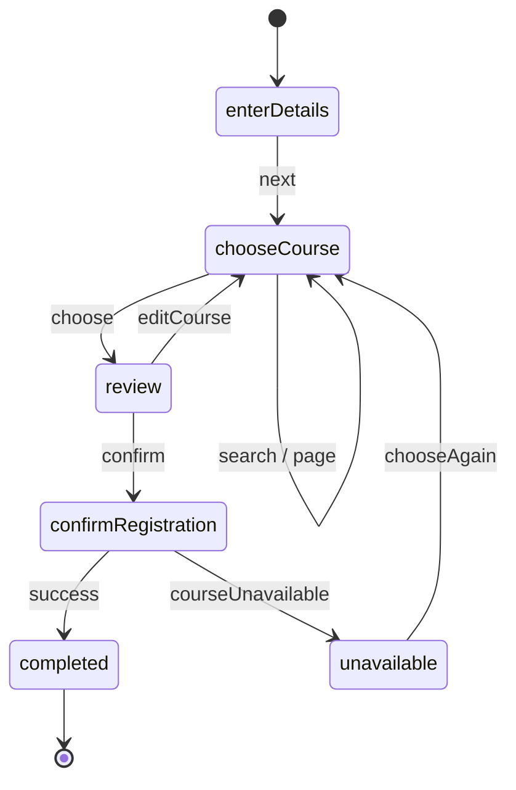
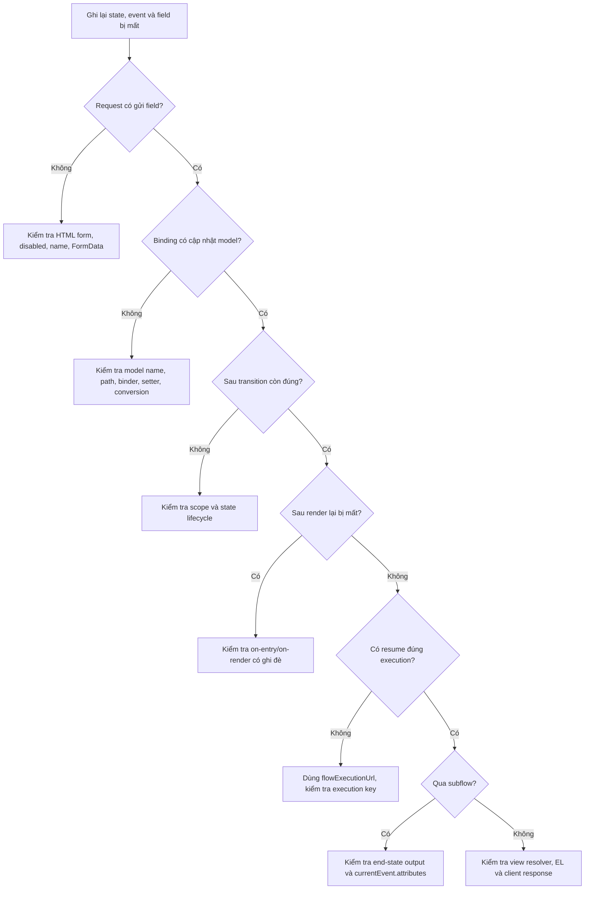

# Dữ liệu mất do chọn sai scope hoặc sai tên biến

Một biểu mẫu nhiều bước có thể hiển thị dữ liệu đúng ở màn đầu nhưng lại trống khi chuyển sang màn tiếp theo, quay lại chỉnh sửa hoặc gửi request Ajax. Trong Spring Web Flow, nguyên nhân thường thuộc một trong hai nhóm: **dữ liệu được lưu trong scope có vòng đời ngắn hơn nhu cầu**, hoặc **view, model, binder và expression đang tham chiếu những tên khác nhau**.

Ví dụ, flow đăng ký khóa học có các bước **nhập thông tin → tìm và chọn khóa học → xem lại → xác nhận**. Nếu bản nháp nằm trong `viewScope` của màn nhập thông tin, nó có thể không còn khi flow sang màn tìm khóa học. Nếu biến được khai báo tên `registrationDraft` nhưng JSP lại bind vào `registration`, form có thể không đọc hoặc cập nhật đúng object. Nếu `on-render` tạo lại object mỗi lần render, dữ liệu vừa nhập có thể bị ghi đè ngay khi validation thất bại.

Bài này thuộc chương **Chẩn đoán lỗi** của module **SPRING_WEB_FLOW**. Mục tiêu là tìm nguyên nhân theo vòng đời dữ liệu thay vì sửa ngẫu nhiên tên biến hoặc chuyển mọi thứ vào HTTP session. Nội dung kết nối với state, event, transition, form binding, validation, scope, Spring MVC, subflow, Ajax và phục hồi flow execution.

Sau bài học, bạn có thể xác định thời điểm dữ liệu mất; chọn scope phù hợp; đối chiếu tên biến giữa XML, Java và view; phát hiện object bị khởi tạo lại; phân biệt lỗi scope với lỗi binding, execution URL và output subflow; đồng thời viết test để chứng minh vòng đời dữ liệu.

## 1. Bắt đầu từ triệu chứng, không đoán ngay scope

Cùng một triệu chứng “form bị mất dữ liệu” có thể đến từ nhiều tầng. Trước khi sửa, hãy ghi lại **giá trị cuối cùng còn đúng ở đâu** và **request/state đầu tiên cho thấy giá trị sai**.

| Triệu chứng | Nhóm nguyên nhân cần kiểm tra đầu tiên |
| --- | --- |
| Dữ liệu mất ngay khi submit form | Tên path/property sai, field không được gửi, binder không cho phép, conversion lỗi |
| Dữ liệu mất sau khi chuyển sang view-state khác | Dữ liệu đặt trong `viewScope` hoặc `requestScope` nhưng cần qua nhiều state |
| Dữ liệu mất sau một lần render lại cùng màn | Object bị tạo lại trong `on-render`, request gửi sai execution, binding không chạy |
| Dữ liệu mất khi quay lại màn trước | View-local variable được tạo mới khi re-enter state; dữ liệu chưa được copy sang flow scope |
| Dữ liệu mất sau khi mở URL mới | Request đã launch flow execution mới thay vì resume execution hiện tại |
| Dữ liệu mất khi flow cha nhận kết quả flow con | Chưa khai báo output ở end-state hoặc parent đọc sai event attribute |
| Chỉ một vài field bị mất | Binder whitelist, tên property, kiểu dữ liệu hoặc HTML form field |
| Chỉ mất trong Ajax | Client dùng execution URL cũ, response đến sai thứ tự, renderer không trả action URL mới |
| Chỉ mất ở tab khác | Hai tab dùng execution khác nhau hoặc cùng execution/snapshot ngoài dự kiến |
| Mất sau timeout/khởi động lại | Dữ liệu chỉ nằm trong execution/session đã hết hạn, chưa có bản nháp bền vững |

Một quy tắc hữu ích: **xác định ranh giới đầu tiên mà giá trị biến mất**. Nếu object vẫn đúng trước transition nhưng sai sau khi sang state, hãy kiểm tra scope và hành động khởi tạo. Nếu object sai ngay sau binding, hãy kiểm tra tên property, binder và dữ liệu request trước khi thay scope.

## 2. Hiểu đúng các scope trước khi sửa lỗi

Spring Web Flow cung cấp nhiều phạm vi dữ liệu. Chúng không thể thay thế tùy ý cho nhau.

| Scope | Vòng đời khái niệm | Dữ liệu phù hợp |
| --- | --- | --- |
| `requestScope` | Một lần xử lý request | Giá trị tạm để xử lý event hiện tại |
| `flashScope` | Ngắn hạn quanh transition/render kế tiếp theo cơ chế Web Flow | Thông báo vừa phát sinh, dữ liệu chuyển tiếp ngắn |
| `viewScope` | Một lần vào và tương tác với một `view-state` | Bộ lọc, trang phân trang, dữ liệu chỉ dùng để render màn hiện tại |
| `flowScope` | Suốt một flow execution | Bản nháp cần qua nhiều view-state |
| `conversationScope` | Phạm vi conversation, có thể chia sẻ trong cấu trúc flow cha/con | Dữ liệu thật sự cần dùng chung giữa các flow liên quan |
| HTTP session | Vòng đời phiên HTTP, rộng hơn một flow execution | Security/session context và dữ liệu cấp phiên có chủ đích |
| Database | Độc lập với request, view, flow và session | Đơn đăng ký đã commit, bản nháp cần khôi phục lâu dài |

`requestScope` không phù hợp để giữ tên/email qua request tiếp theo. `viewScope` không phù hợp để giữ bản nháp cần xuất hiện ở nhiều view-state. `flowScope` là lựa chọn tự nhiên cho dữ liệu của một wizard. `conversationScope` có thể hữu ích với flow cha/con, nhưng cần xác định rõ dữ liệu nào thực sự được chia sẻ.

**HTTP session không đồng nghĩa với flow scope.** Session có thể tồn tại lâu hơn nhiều execution; đặt một biến tên cố định như `sessionMap.registration` có thể khiến hai tab ghi đè dữ liệu của nhau. Hãy ưu tiên scope Web Flow cho dữ liệu thuộc một execution, và chỉ dùng session khi yêu cầu thực sự thuộc cấp phiên.

## 3. Xác định vòng đời mà dữ liệu cần có

Trước khi chọn scope, hãy viết rõ dữ liệu cần tồn tại qua những mốc nào.



| Dữ liệu | Nhập ở đâu? | Cần dùng ở đâu? | Scope/lưu trữ |
| --- | --- | --- | --- |
| `fullName`, `email` | `enterDetails` | `chooseCourse`, `review`, `confirmRegistration` | `flowScope` |
| `keyword`, `pageIndex` | `chooseCourse` | Chỉ màn tìm kiếm; có thể giữ lại nếu UX yêu cầu | `viewScope` hoặc một phần `flowScope` |
| `searchResults` | Service tìm kiếm | Chỉ render `chooseCourse` | `viewScope`, thường có thể truy vấn lại |
| `selectedCourseId` | `chooseCourse` | `review`, `confirmRegistration` | `flowScope` |
| `validationMessage` | Request/state hiện tại | Render thông báo tương ứng | Message context/flash hoặc view phù hợp |
| `registrationId` sau commit | Service | Trang kết quả, tra cứu sau flow | Database |

Nếu một giá trị cần qua nhiều view-state, đừng đặt nó trong view scope của state đầu tiên. Nếu dữ liệu chỉ dùng để render một bảng trong một màn, đừng giữ cả bảng lớn trong flow scope nếu có thể truy vấn lại.

## 4. Lỗi phổ biến: đặt bản nháp nhiều bước trong viewScope

### Triệu chứng

Người dùng nhập tên và email ở `enterDetails`, bấm Tiếp tục sang `review`, nhưng màn review hiển thị các trường trống.

Cấu hình dễ mắc lỗi:

```xml
<flow xmlns="http://www.springframework.org/schema/webflow"
      start-state="enterDetails">

    <view-state id="enterDetails"
                view="registration/details"
                model="registration">
        <var name="registration"
             class="com.example.registration.RegistrationDraft"/>
        <transition on="next" to="review"
                    bind="true" validate="true"/>
    </view-state>

    <view-state id="review" view="registration/review"/>
</flow>
```

Biến `registration` được khai báo bên trong `view-state` nên thuộc view scope của `enterDetails`. Khi flow rời state này, view scope đó không còn là nơi lưu trữ cho màn review. View review cố đọc object của màn trước có thể nhận null, giá trị mặc định hoặc lỗi expression.

### Cách sửa

Nếu bản nháp cần sống qua nhiều state, khai báo biến ở cấp flow:

```xml
<flow xmlns="http://www.springframework.org/schema/webflow"
      start-state="enterDetails">

    <var name="registration"
         class="com.example.registration.RegistrationDraft"/>

    <view-state id="enterDetails"
                view="registration/details"
                model="registration">
        <transition on="next" to="review"
                    bind="true" validate="true"/>
    </view-state>

    <view-state id="review" view="registration/review">
        <transition on="edit" to="enterDetails"/>
        <transition on="confirm" to="submitRegistration"/>
    </view-state>
</flow>
```

Biến cấp flow thuộc flow scope, do đó có thể được dùng ở cả hai view-state trong cùng execution. Không sửa bằng cách chuyển mọi biến sang session; điều đó khiến dữ liệu tồn tại quá lâu và có thể trộn giữa các execution.

## 5. Lỗi ngược lại: giữ dữ liệu chỉ dùng trong một màn quá lâu

Một màn tìm khóa học có thể khai báo `filter` và `results` trong view scope:

```xml
<view-state id="chooseCourse"
            view="catalog/choose"
            model="filter">
    <var name="filter"
         class="com.example.catalog.CourseFilter"/>

    <on-render>
        <evaluate expression="catalogService.search(filter)"
                  result="viewScope.results"/>
    </on-render>

    <transition on="search"/>
    <transition on="choose" to="review"/>
</view-state>
```

Nếu `filter` chỉ dùng cho tìm kiếm và phân trang trong màn này, view scope là phù hợp. Nhưng khi người dùng chọn khóa học, chỉ `selectedCourseId` cần được chuyển sang flow scope:

```xml
<transition on="choose" to="review"
            bind="true" validate="true">
    <set name="flowScope.registration.selectedCourseId"
         value="filter.selectedCourseId"/>
</transition>
```

Nếu review cần cả từ khóa đã dùng để tìm, hãy chuyển riêng thuộc tính đó sang một biến flow scope. Đừng chuyển toàn bộ danh sách kết quả vào flow scope chỉ để giữ một ID.

## 6. Đối chiếu tên biến ở mọi tầng

Một lỗi rất phổ biến là mỗi tầng dùng một tên khác nhau:

| Tầng | Ví dụ tên |
| --- | --- |
| Biến khai báo trong XML | `registrationDraft` |
| Model của view-state | `registration` |
| Spring Form Tags | `modelAttribute="registration"` |
| Property trong form | `path="emailAddress"` |
| JavaBean | `getEmail()` / `setEmail()` |
| Expression trong action | `registrationDraft.email` |

Nếu biến khai báo là `registrationDraft`, view-state phải trỏ tới đúng biến đó. Nếu JavaBean có property `email`, form phải bind đúng `email`. Tên biến và tên property là hai cấp khác nhau.

### Bảng đối chiếu mẫu đúng

| Thành phần | Tên thống nhất |
| --- | --- |
| `<var name="registrationDraft" .../>` | `registrationDraft` |
| `model="registrationDraft"` | `registrationDraft` |
| `modelAttribute="registrationDraft"` | `registrationDraft` |
| `path="email"` | Property `email` |
| JavaBean | `getEmail()` và `setEmail(...)` |
| EL/XML | `registrationDraft.email` hoặc scope-qualified tương ứng |

Ví dụ:

```xml
<flow xmlns="http://www.springframework.org/schema/webflow"
      start-state="enterDetails">
    <var name="registrationDraft"
         class="com.example.registration.RegistrationDraft"/>

    <view-state id="enterDetails"
                view="registration/details"
                model="registrationDraft">
        <binder>
            <binding property="fullName"/>
            <binding property="email"/>
        </binder>
        <transition on="next" to="review"
                    bind="true" validate="true"/>
    </view-state>
</flow>
```

JSP:

```jsp
<%@ taglib prefix="form" uri="http://www.springframework.org/tags/form" %>

<form:form modelAttribute="registrationDraft"
           action="${flowExecutionUrl}"
           method="post">
    <form:input path="fullName"/>
    <form:input path="email"/>
    <form:errors path="email"/>
    <button type="submit" name="_eventId_next">Tiếp tục</button>
</form:form>
```

JavaBean:

```java
public class RegistrationDraft implements Serializable {
    private String fullName;
    private String email;

    public String getFullName() { return fullName; }
    public void setFullName(String fullName) {
        this.fullName = fullName;
    }

    public String getEmail() { return email; }
    public void setEmail(String email) {
        this.email = email;
    }
}
```

Ở đây `registrationDraft` là object model; `email` là property của object đó. Chúng không cần trùng tên, nhưng từng tham chiếu phải đúng cấp.

## 7. Kiểm tra JavaBean property và binder

Ngay cả khi tên model đúng, dữ liệu vẫn có thể không được cập nhật nếu JavaBean không cung cấp property mà form yêu cầu.

Ví dụ lỗi:

```java
public class RegistrationDraft {
    private String email;

    public String getEmail() {
        return email;
    }

    // Thiếu setEmail(...)
}
```

Form có `path="email"` nhưng object không có setter có thể gây lỗi binding hoặc không cập nhật được giá trị như mong đợi, tùy cơ chế binding. Với mutable form model, hãy cung cấp getter/setter phù hợp hoặc dùng kiểu dữ liệu binding được hỗ trợ rõ ràng.

Binder whitelist cũng có thể loại bỏ field:

```xml
<view-state id="enterDetails"
            view="registration/details"
            model="registrationDraft">
    <binder>
        <binding property="fullName"/>
        <binding property="email"/>
    </binder>
</view-state>
```

Nếu form gửi thêm `phoneNumber` nhưng binder không khai báo property này, nó không được bind theo whitelist đã cấu hình. Đối chiếu:

1. `model` có đúng tên object không?
2. `modelAttribute` trong JSP có trùng với tên model không?
3. `path` có đúng property JavaBean không?
4. Binder có cho phép property đó không?
5. JavaBean có getter/setter và kiểu dữ liệu phù hợp không?
6. Request có thực sự gửi field đó không?
7. Có lỗi conversion/validation trong binding result không?

Trình duyệt không gửi một số control trong form, chẳng hạn input có thuộc tính `disabled`. Input `readonly` thường vẫn được gửi. Checkbox không được chọn thường không gửi giá trị. Vì vậy hãy kiểm tra **Network request payload** trước khi sửa scope hoặc JavaBean.

## 8. Sai tên trong expression và scope shadowing

Tên biến trong expression cần khớp với tên được khai báo. Khi có biến trùng tên ở nhiều scope, hãy dùng scope qualifier rõ ràng.

Ví dụ có hai biến cùng tên `filter`:

```xml
<flow xmlns="http://www.springframework.org/schema/webflow">
    <var name="filter"
         class="com.example.catalog.PersistentFilter"/>

    <view-state id="browse" view="catalog/browse">
        <var name="filter"
             class="com.example.catalog.ViewFilter"/>
    </view-state>
</flow>
```

Cấu hình này gây khó đọc và dễ tham chiếu nhầm object. Nên đặt tên khác nhau, ví dụ `savedFilter` và `viewFilter`. Nếu cần truy cập rõ scope, dùng biểu thức scope-qualified phù hợp:

```xml
<set name="flowScope.savedFilter.keyword"
     value="viewScope.viewFilter.keyword"/>
```

Không phụ thuộc vào quy tắc phân giải tên không-qualified khi có shadowing. Khi log hoặc debug, ghi rõ scope cùng tên biến:

```text
flowScope.registrationDraft.email
viewScope.courseFilter.keyword
viewScope.searchResults
```

Cú pháp biểu thức chi tiết phụ thuộc expression language/cấu hình của ứng dụng. Các ví dụ XML dùng cú pháp Spring Web Flow/EL thông dụng; kiểm tra parser và phiên bản trước khi áp dụng.

## 9. Object bị khởi tạo lại trong on-entry hoặc on-render

Một lỗi khác không liên quan trực tiếp tới khai báo scope: object nằm đúng scope nhưng bị **ghi đè bằng instance mới**.

### Khởi tạo lại flow draft khi vào state

```xml
<view-state id="review" view="registration/review">
    <on-entry>
        <evaluate expression="registrationService.newDraft()"
                  result="flowScope.registrationDraft"/>
    </on-entry>
</view-state>
```

Mỗi lần vào `review`, biểu thức có thể thay object flow scope bằng một draft mới. Nếu người dùng quay lại review, dữ liệu trước đó có thể mất. Hãy tạo draft một lần ở cấp flow hoặc khởi tạo có điều kiện, không gán lại mỗi lần vào màn.

### Gán lại model trong on-render

```xml
<view-state id="enterDetails"
            view="registration/details"
            model="registrationDraft">
    <on-render>
        <evaluate expression="registrationService.newDraft()"
                  result="flowScope.registrationDraft"/>
    </on-render>
</view-state>
```

`on-render` có thể chạy nhiều lần, bao gồm khi render lại sau validation hoặc request Ajax. Nếu mỗi lần render đều tạo draft mới, dữ liệu người dùng vừa nhập có thể bị xóa.

Nên phân biệt:

- Tạo model: thực hiện một lần ở thời điểm phù hợp với vòng đời flow.
- Nạp dữ liệu tham chiếu để render: có thể thực hiện trong `on-entry` hoặc `on-render`, tùy tần suất mong muốn.
- Cập nhật model từ form: để binding xử lý theo transition.
- Ghi nghiệp vụ: thực hiện trong action/service có kiểm soát, không đặt trong hook render.

Ví dụ an toàn hơn:

```xml
<flow xmlns="http://www.springframework.org/schema/webflow"
      start-state="enterDetails">
    <var name="registrationDraft"
         class="com.example.registration.RegistrationDraft"/>

    <view-state id="enterDetails"
                view="registration/details"
                model="registrationDraft">
        <on-render>
            <evaluate expression="referenceDataService.getCountries()"
                      result="viewScope.countries"/>
        </on-render>
    </view-state>
</flow>
```

Ở đây `registrationDraft` không bị tạo lại; `countries` là dữ liệu tham chiếu phục vụ view và có thể nạp lại.

## 10. Transition không bind hoặc không validate như dự định

Một form có thể hiển thị dữ liệu người dùng nhập nhưng object server vẫn giữ giá trị cũ. Hãy kiểm tra thuộc tính của transition:

```xml
<transition on="back"
            to="previousStep"
            bind="false"
            validate="false"/>
```

- `bind="false"`: không bind các field request vào model cho transition này.
- `validate="false"`: không chạy validation model theo transition này.
- Hai thuộc tính có tác dụng khác nhau; tắt validation không đồng nghĩa tắt binding.

Nếu nút **Quay lại** dùng `bind="false"`, những thay đổi chưa được bind ở form hiện tại có thể không được giữ. Đó có thể là chính sách mong muốn để rời màn lỗi, nhưng nếu UX cần giữ dữ liệu nhập dở thì phải thiết kế binding phù hợp và xử lý conversion error.

Ngược lại, nếu event tìm kiếm không cần validate toàn bộ model, có thể vẫn bind bộ lọc nhưng tắt validation bắt buộc của bước cuối:

```xml
<transition on="search"
            bind="true"
            validate="false">
    <evaluate expression="catalogService.search(filter)"
              result="viewScope.results"/>
    <render fragments="resultsPanel"/>
</transition>
```

Đừng đặt `bind="false"` cho mọi event rồi thắc mắc vì sao model không thay đổi. Hãy kiểm tra event cụ thể đã được bind hay chưa.

## 11. Tên model trong JSP, Facelets và view resolver

### JSP với Spring Form Tags

```jsp
<form:form modelAttribute="registrationDraft"
           action="${flowExecutionUrl}"
           method="post">
    <form:input path="email"/>
</form:form>
```

`modelAttribute` phải trỏ tới object mà view thực sự nhận được. Nếu XML dùng `model="booking"` nhưng JSP dùng `modelAttribute="registrationDraft"`, cần đồng bộ lại.

### Facelets/JSF

Trong JSF, EL thường dùng `#{registrationDraft.email}`. Nhưng khả năng expose biến Web Flow vào JSF EL phụ thuộc Spring Faces/JSF integration. Đừng sao chép nguyên tên `modelAttribute` của JSP sang JSF mà không kiểm tra EL resolver và lifecycle.

### View resolver

Một view có thể được render đúng template nhưng thiếu model attribute do resolver/adapter không expose biến theo cách bạn nghĩ. Khi gặp lỗi:

- Kiểm tra view-state `model`.
- Kiểm tra biến có tồn tại trong scope tại thời điểm render.
- Kiểm tra adapter có đưa model vào view không.
- Kiểm tra chính xác tên biến trong JSP/Facelets.
- Dùng test HTTP/render hoặc debugger để xác nhận model thực tế, thay vì đoán từ tên file view.

## 12. Dữ liệu mất sau khi mở flow execution mới

Một form dùng URL bắt đầu flow thay vì URL execution có thể tạo một hành trình mới.

Ví dụ không phù hợp cho form tiếp tục flow:

```jsp
<form action="/registration" method="post">
    <input name="email">
    <button type="submit" name="_eventId_next">Tiếp tục</button>
</form>
```

Nếu `/registration` là URL khởi động flow, request có thể khởi chạy execution mới thay vì resume execution hiện tại. Bản nháp cũ vẫn ở execution cũ, còn màn hình mới hiển thị object mới.

Dùng URL do Web Flow cung cấp trong view:

```jsp
<form action="${flowExecutionUrl}" method="post">
    ...
</form>
```

Khi dùng Spring Form Tags:

```jsp
<form:form modelAttribute="registrationDraft"
           action="${flowExecutionUrl}"
           method="post">
    ...
</form:form>
```

Không tự ghép `?execution=...` hoặc lưu execution key cũ vào JavaScript dài hạn. Sau mỗi lần render, dùng URL hiện tại do Web Flow cung cấp.

Dấu hiệu nhận biết execution mới: Network cho thấy POST tới URL khởi động flow; log cho thấy execution mới được launch; flow scope trở về giá trị khởi tạo; URL response chứa execution key khác; dữ liệu cũ vẫn còn trong execution cũ nhưng trang mới không thấy. Nếu cần khôi phục, dùng draft ID bền vững, kiểm tra quyền và nạp lại dữ liệu từ storage.

## 13. Subflow: dữ liệu con không tự động xuất hiện trong flow cha

Khi flow cha gọi flow con, mỗi flow có context và flow scope riêng. Nếu child có `flowScope.paymentResult`, parent không nên truy cập trực tiếp biến nội bộ đó sau khi child kết thúc.

Child phải công bố output ở end-state:

```xml
<end-state id="approved">
    <output name="paymentReference"
            value="flowScope.paymentResult.reference"/>
</end-state>
```

Parent đọc output từ event kết quả:

```xml
<subflow-state id="payment" subflow="payment">
    <input name="orderId" value="flowScope.orderId"/>

    <transition on="approved" to="completeOrder">
        <set name="flowScope.paymentReference"
             value="currentEvent.attributes.paymentReference"/>
    </transition>
</subflow-state>
```

Nếu dữ liệu mất sau khi child kết thúc, kiểm tra:

1. Child có thật sự tới end-state `approved` không?
2. End-state có khai báo `<output>` đúng tên không?
3. Parent transition `on` có trùng ID end-state không?
4. Parent có đọc đúng `currentEvent.attributes.paymentReference` không?
5. Parent có lưu output vào scope của chính nó nếu state sau còn cần không?

Input cũng phải khớp tên giữa child `<input>` và parent mapping. Không giả định mọi biến trong flow scope của child tự động được merge vào parent.

## 14. Ajax, browser Back và nhiều tab

### Ajax request

Nếu Ajax gửi request tới URL execution cũ, request có thể resume snapshot không còn hợp lệ hoặc tác động lên execution khác. Kiểm tra form action/URL Ajax có phải `flowExecutionUrl` hiện tại không; request có đúng event và CSRF token không; response có redirect instruction hoặc trang login/error thay vì fragment không; client có thay action URL sau khi render/transition không; có hai request đồng thời cùng cập nhật một execution không.

Ajax chỉ thay cách gửi/nhận và render; nó không thay đổi vòng đời scope của Web Flow.

### Browser Back

Nút Back của browser có thể hiển thị HTML cache hoặc dùng execution URL/snapshot cũ. Điều đó không chứng minh dữ liệu trong scope hiện tại vẫn tồn tại. Thiết kế event `edit`/`back` rõ ràng trong flow, và xử lý execution hết hạn bằng thông báo hoặc khôi phục draft có kiểm tra quyền.

### Nhiều tab

Nếu mỗi tab khởi chạy execution riêng, mỗi execution có flow scope riêng. Nếu nhân đôi một tab đang chạy và giữ nguyên execution URL, hai tab có thể cùng tác động lên execution/snapshot liên quan. Không dùng một session attribute tên cố định để chứa bản nháp của mọi tab. Nếu yêu cầu cho phép nhiều tab chỉnh sửa cùng một bản nháp, cần draft ID, version/concurrency control và chính sách ghi đè rõ ràng.

## 15. Các dấu hiệu binding/conversion thường bị hiểu nhầm là mất scope

| Triệu chứng | Kiểm tra |
| --- | --- |
| Chỉ field kiểu số bị mất | Chuỗi request có chuyển được sang `int`, `long`, `BigDecimal` không? |
| Field nested không cập nhật | Property path như `address.postalCode` có object `address` và setter hợp lệ không? |
| Chỉ field không có trong binder bị bỏ qua | Binder có whitelist field đó không? |
| Input bị disable không được gửi | HTML `disabled` làm control không tham gia form submission |
| Giá trị checkbox unchecked không xuất hiện | Hành vi HTML checkbox và marker của Spring Form Tags |
| Validation lỗi rồi quay lại giá trị cũ | Binding có chạy không; có action nào tạo lại object không? |
| Property có getter nhưng thiếu setter | Binding không thể cập nhật theo cách mutable bean thông thường |
| Tên `emailAddress` và `email` không khớp | Đối chiếu path với JavaBean property |
| Giá trị bị trim/normalize | Kiểm tra converter, formatter hoặc setter có biến đổi dữ liệu không |
| Chỉ Ajax mất field | Kiểm tra FormData, submitter, tên event và request payload |

Ví dụ conversion lỗi:

```java
public class BookingDraft {
    private Integer seats;

    public Integer getSeats() { return seats; }
    public void setSeats(Integer seats) {
        this.seats = seats;
    }
}
```

Nếu request gửi `seats=abc`, lỗi conversion có thể khiến binding result chứa lỗi và model không nhận giá trị như mong đợi. Đây không phải bằng chứng `flowScope` bị xóa. Hiển thị lỗi đúng field, sửa input và không ghi đè object bằng instance mới trong lúc render lỗi.

## 16. Quy trình chẩn đoán theo từng điểm kiểm tra

Khi nhận báo cáo “dữ liệu biến mất”, đi theo thứ tự sau:



### Bước 1: chụp trạng thái trước và sau event

Ghi nhận flow ID và execution hiện tại; state ID trước/sau event; event được gửi; tên biến, scope và giá trị cần theo dõi; request payload và response; action/hook nào đã chạy. Không log password, access token, dữ liệu thanh toán nhạy cảm hoặc toàn bộ execution token ở môi trường không an toàn.

### Bước 2: kiểm tra request payload

Trong Network, xác minh field có được gửi. Nếu không, sửa HTML/JavaScript hoặc cách render form trước khi sửa XML scope.

### Bước 3: kiểm tra model ngay sau binding

Dùng debugger hoặc test flow để kiểm tra property sau khi Web Flow bind. Nếu giá trị chưa cập nhật, xem model name, binder, JavaBean và conversion error.

### Bước 4: kiểm tra sau transition

Nếu model đúng trước transition nhưng sai ở state tiếp theo, kiểm tra biến nằm trong scope nào, transition có rời state không và có action nào ghi đè.

### Bước 5: kiểm tra lần render kế tiếp

Tìm `<set>`, `<evaluate result="...">`, `on-entry`, `on-render`, action và listener có thể tạo instance mới hoặc reset property.

### Bước 6: xác nhận execution

So sánh URL form với `flowExecutionUrl`, xác nhận request resume execution đúng. Nếu execution hết hạn, khởi động lại/khôi phục draft theo quy trình có kiểm tra quyền.

### Bước 7: kiểm tra ranh giới subflow/view

Nếu qua subflow, kiểm tra input/output/outcome. Nếu render JSF/JSP, kiểm tra view resolver và tên model mà template thực sự nhận.

## 17. Ví dụ hoàn chỉnh: sửa flow đăng ký mất dữ liệu

### Cấu hình có lỗi

```xml
<flow xmlns="http://www.springframework.org/schema/webflow"
      start-state="details">

    <view-state id="details" view="registration/details"
                model="draft">
        <var name="draft"
             class="com.example.RegistrationDraft"/>
        <transition on="next" to="review"/>
    </view-state>

    <view-state id="review" view="registration/review">
        <on-render>
            <evaluate expression="registrationService.newDraft()"
                      result="flowScope.draft"/>
        </on-render>
    </view-state>
</flow>
```

Có hai vấn đề: `draft` khai báo trong view-state `details` nên chỉ thuộc view scope của màn đó; `on-render` của `review` lại tạo draft mới trong flow scope, không phải object đã bind ở màn đầu.

### Cấu hình đã sửa

```xml
<flow xmlns="http://www.springframework.org/schema/webflow"
      start-state="details">

    <var name="draft"
         class="com.example.RegistrationDraft"/>

    <view-state id="details" view="registration/details"
                model="draft">
        <binder>
            <binding property="fullName"/>
            <binding property="email"/>
        </binder>
        <transition on="next" to="review"
                    bind="true" validate="true"/>
    </view-state>

    <view-state id="review" view="registration/review">
        <transition on="edit" to="details"/>
        <transition on="confirm" to="submit"/>
    </view-state>

    <action-state id="submit">
        <evaluate expression="registrationService.submit(draft)"/>
        <transition on="success" to="completed"/>
    </action-state>

    <end-state id="completed" view="registration/completed"/>
</flow>
```

Bản sửa đặt draft ở flow scope, bỏ hành động tạo lại draft khi render review và để action submit dùng cùng object đã bind. Trong ứng dụng thật, cần khai báo service outcome, validator, exception handling và transaction phù hợp.

JSP phải dùng cùng tên model:

```jsp
<%@ taglib prefix="form" uri="http://www.springframework.org/tags/form" %>

<form:form modelAttribute="draft"
           action="${flowExecutionUrl}"
           method="post">
    <form:input path="fullName"/>
    <form:errors path="fullName"/>
    <form:input path="email"/>
    <form:errors path="email"/>
    <button type="submit" name="_eventId_next">Tiếp tục</button>
</form:form>
```

Ở đây XML root `<var name="draft">`, view-state `model="draft"`, JSP `modelAttribute="draft"`; property `fullName`/`email` phải tồn tại trong JavaBean; action dùng `flowExecutionUrl` để tiếp tục execution hiện tại.

## 18. Kiểm thử để ngăn lỗi scope và tên biến tái xuất hiện

Một bộ test cần xác nhận cả **giá trị** và **thời điểm** giá trị còn tồn tại.

| ID | Kịch bản | Kỳ vọng |
| --- | --- | --- |
| T1 | Bắt đầu flow | Draft flow scope được tạo một lần |
| T2 | Submit form hợp lệ | Property được bind vào đúng model |
| T3 | Submit field không có trong binder | Field không được cập nhật trái phép |
| T4 | Submit sai kiểu dữ liệu | Binding error đúng field, không giả thành scope bị mất |
| T5 | Validation thất bại | Draft đã bind không bị khởi tạo lại khi render lỗi |
| T6 | Chuyển sang view-state khác | Dữ liệu cần qua bước vẫn còn trong flow scope |
| T7 | Dữ liệu chỉ trong view scope | Không được giả định còn sau khi rời state |
| T8 | Quay lại view-state | View-local variable được tạo theo vòng đời mới |
| T9 | Event dùng `bind="false"` | Request field không cập nhật model |
| T10 | Event dùng `validate="false"` | Binding vẫn có thể chạy nếu `bind="true"` |
| T11 | Render lại cùng state | `on-render` không reset draft |
| T12 | Mở URL flow mới | Execution mới không nhận draft cũ nếu chưa khôi phục |
| T13 | Resume bằng flowExecutionUrl | Cùng execution tiếp tục đúng dữ liệu |
| T14 | Subflow kết thúc | Parent nhận output được khai báo |
| T15 | Output bị thiếu | Parent phát hiện contract lỗi |
| T16 | Hai execution độc lập | Không lẫn dữ liệu |
| T17 | Execution hết hạn | Hướng dẫn bắt đầu lại/khôi phục, không dùng state cũ |
| T18 | Refresh browser sau confirm | Không tạo đăng ký trùng |

Pseudocode kiểm thử:

```text
startFlow("registration")
  -> assertState("details")
  -> assertFlowScope("draft.email", null)

submit("next", fullName="Lan", email="lan@example.com")
  -> assertState("review")
  -> assertFlowScope("draft.fullName", "Lan")
  -> assertFlowScope("draft.email", "lan@example.com")

submit("edit")
  -> assertState("details")
  -> assertFlowScope("draft.email", "lan@example.com")

submit("next", fullName="Lan", email="lan@example.com")
  -> assertState("review")

submit("confirm")
  -> assertState("completed")
  -> assertRegistrationCreatedExactlyOnce()
```

Đây là pseudocode mô tả assertion, không phải API test chạy trực tiếp. Có thể dùng Spring Web Flow test support để start flow, phát event và kiểm tra scope; dùng mock service để xác nhận số lần gọi. Binding/view model và HTML action URL cần test HTTP hoặc trình duyệt để xác minh toàn bộ tích hợp.

### Test phát hiện on-render ghi đè

Tạo draft, submit một field, làm validation thất bại rồi assert giá trị đã bind vẫn còn trong model. Đồng thời đếm số lần `newDraft()` được gọi. Nếu method chạy lại mỗi lần render, test sẽ bắt được việc object bị thay thế.

### Test tên biến không khớp

Đưa các tên model vào một bảng kiểm tra trong test hoặc integration fixture: tên `<var>`, `model`, `modelAttribute`, `path` và JavaBean property. Một test render JSP có thể phát hiện lỗi `modelAttribute` trước khi người dùng gặp lỗi ở trình duyệt.

## 19. Checklist chẩn đoán nhanh

- [ ] Xác định đúng state và event tại thời điểm dữ liệu mất.
- [ ] Kiểm tra request có thực sự gửi field đó.
- [ ] Đối chiếu tên biến `<var>`, thuộc tính `model`, `modelAttribute` và expression.
- [ ] Đối chiếu `path` với JavaBean property/getter/setter.
- [ ] Kiểm tra binder whitelist có cho phép property không.
- [ ] Đọc binding/conversion errors trước khi kết luận scope bị mất.
- [ ] Chọn scope theo vòng đời: request, view, flow, conversation hoặc storage bền vững.
- [ ] Kiểm tra `<var>` được khai báo ở root flow hay trong view-state.
- [ ] Tìm mọi `<set>`, `<evaluate result>`, `on-entry`, `on-render` có thể ghi đè object.
- [ ] Kiểm tra `bind="false"` và `validate="false"` riêng biệt.
- [ ] Xác minh form/Ajax dùng `flowExecutionUrl` của execution hiện tại.
- [ ] Nếu qua subflow, kiểm tra input, end-state output và `currentEvent.attributes`.
- [ ] Không dựa vào browser Back, cache hoặc session attribute chung để giữ bản nháp.
- [ ] Có test cho chuyển state, quay lại, validation lỗi, Ajax, nhiều tab và execution hết hạn.
- [ ] Service kiểm tra lại quyền/dữ liệu và bảo vệ transaction/idempotency khi ghi.

**Kết luận:** khi dữ liệu biến mất trong Spring Web Flow, hãy lần theo **request → binding → model → scope → transition → render → execution**. Chọn scope theo vòng đời thật sự của dữ liệu; dùng tên biến/property nhất quán ở XML, Java và view; tránh khởi tạo lại bản nháp trong các hook render; và chỉ chuyển dữ liệu cần thiết qua ranh giới state/subflow. Cách chẩn đoán theo từng điểm như vậy giúp sửa đúng nguyên nhân, đồng thời giữ flow nhiều bước dễ hiểu và dễ kiểm thử.
