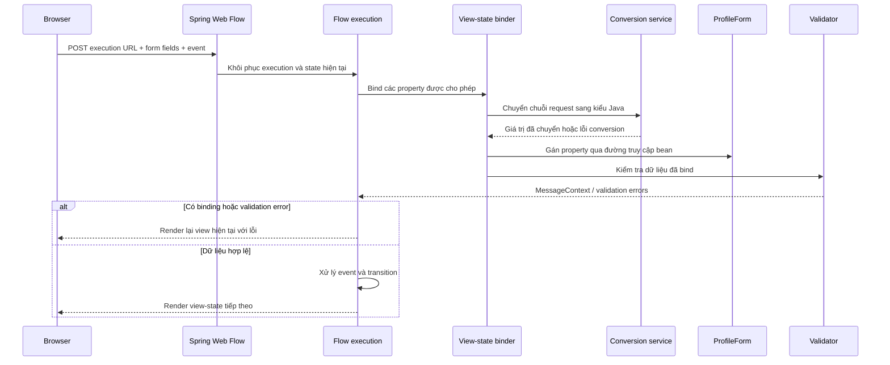
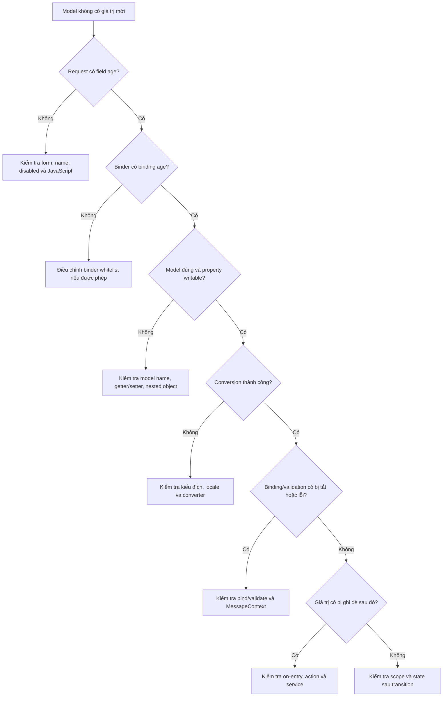

# Form không cập nhật model do binding và conversion trong Spring Web Flow

Trong **Spring Web Flow** (`SPRING_WEB_FLOW`), dữ liệu người dùng nhập trên một `view-state` phải đi qua nhiều bước trước khi trở thành giá trị của JavaBean: trình duyệt gửi HTTP parameter, Web Flow khôi phục flow execution, binder chọn property được phép cập nhật, conversion service chuyển chuỗi sang kiểu Java, rồi validation kiểm tra dữ liệu. Nếu một mắt xích sai, màn hình có thể vẫn hiển thị giá trị người dùng vừa nhập nhưng model phía server không đổi như mong đợi.

Bài thuộc chương **Chẩn đoán lỗi** hướng dẫn tìm nguyên nhân khi form không cập nhật model do binding và conversion. Ta sẽ lần theo request, tên field, model của view-state, binder, getter/setter, converter, validation và event; sau đó áp dụng quy trình chẩn đoán cùng bộ test hồi quy cho một form nhiều bước. Ví dụ dùng cấu hình Spring Web Flow XML và JSP; nguyên tắc tương tự áp dụng cho view technology khác nhưng cách render field/error có thể khác.

## 1. Nhìn đúng đường đi của dữ liệu

Giả sử flow chỉnh sửa hồ sơ có model `profileForm`. Người dùng nhập tên hiển thị và tuổi, sau đó bấm **Tiếp tục** để xem lại.



Có thể phân loại sự cố theo bốn câu hỏi:

1. **Request có gửi đúng field không?** Nếu thiếu parameter hoặc tên không khớp, binder không có giá trị để gán.
2. **Field có được binder cho phép không?** Một property không nằm trong binder khai báo có thể bị bỏ qua.
3. **Giá trị có chuyển được sang kiểu Java không?** Ví dụ `"abc"` không thể chuyển thành `Integer` bằng converter số mặc định.
4. **Model có thể nhận giá trị và event có đi đúng đường không?** Property thiếu setter, model sai, hoặc transition tắt binding đều làm kết quả khác mong đợi.

Không nên kết luận “model không cập nhật” chỉ từ nội dung HTML sau response. Cần quan sát **request thực gửi, lỗi binding, giá trị model phía server và state hiện tại**.

## 2. Kiểm tra model được khai báo trên view-state

Thuộc tính `model` của `view-state` xác định object mà binder sử dụng. Tên này phải trỏ tới biến có trong flow scope hoặc scope mà expression của flow truy cập được.

Ví dụ flow:

```xml
<flow xmlns="http://www.springframework.org/schema/webflow"
      xmlns:xsi="http://www.w3.org/2001/XMLSchema-instance"
      xsi:schemaLocation="
          http://www.springframework.org/schema/webflow
          http://www.springframework.org/schema/webflow/spring-webflow-2.0.xsd"
      start-state="editProfile">

    <var name="profileForm"
         class="com.example.profile.ProfileForm" />

    <view-state id="editProfile"
                view="profile/edit"
                model="profileForm">
        <binder>
            <binding property="displayName" />
            <binding property="age" />
        </binder>
        <transition on="continue" to="reviewProfile" />
    </view-state>

    <view-state id="reviewProfile" view="profile/review" />
</flow>
```

Trong ví dụ:

- `<var name="profileForm".../>` tạo biến model khi flow khởi chạy.
- `model="profileForm"` yêu cầu view-state bind dữ liệu vào biến đó.
- `displayName` và `age` là property của class `ProfileForm`.
- Event `continue` được xử lý sau bước binding/validation của view-state theo cấu hình transition.

Các lỗi cấu hình thường gặp:

| Cấu hình | Hậu quả có thể gặp | Cách kiểm tra |
| --- | --- | --- |
| `model="profile"` nhưng biến tên `profileForm` | Không tìm thấy model theo tên đã khai báo | So tên model với tên biến trong flow |
| Model được tạo ở một state khác nhưng chưa đi qua state đó | Model chưa tồn tại khi binder chạy | Kiểm tra state khởi tạo và đường đi vào view-state |
| Model bị gán lại trong `on-render` | Giá trị vừa bind có thể bị thay thế khi render | Kiểm tra action và thời điểm khởi tạo model |
| Model là `null` | Không có object đích để gán property | Kiểm tra constructor, flow input và kết quả service |
| View-state dùng nhầm model | Field được gán vào object khác với object mà state sau đọc | Kiểm tra expression ở view và action phía sau |

Nếu model được tải từ service, hãy tạo hoặc gán nó trước khi view-state cần binding. Không tạo lại model mỗi lần render nếu mục tiêu là giữ giá trị người dùng đã nhập.

## 3. Đối chiếu tên field trong request với property Java

Binding cần biết request parameter nào tương ứng với property nào. Tên field HTML, đường dẫn trong Spring form tag và property của model phải nhất quán.

JavaBean:

```java
package com.example.profile;

public class ProfileForm {
    private String displayName;
    private Integer age;

    public String getDisplayName() {
        return displayName;
    }

    public void setDisplayName(String displayName) {
        this.displayName = displayName;
    }

    public Integer getAge() {
        return age;
    }

    public void setAge(Integer age) {
        this.age = age;
    }
}
```

Binder:

```xml
<binder>
    <binding property="displayName" />
    <binding property="age" />
</binder>
```

JSP với Spring form tags:

```jsp
<form:form modelAttribute="profileForm"
           method="post"
           action="${flowExecutionUrl}">
    <form:input path="displayName" />
    <form:input path="age" />
    <button type="submit"
            name="_eventId_continue"
            value="1">Tiếp tục</button>
</form:form>
```

HTML tương đương ở mức tên field:

```html
<form method="post" action="${flowExecutionUrl}">
    <input type="text" name="displayName" />
    <input type="text" name="age" />
    <button type="submit" name="_eventId_continue" value="1">
        Tiếp tục
    </button>
</form>
```

Hãy so sánh chính xác:

| Request parameter | Binder property | JavaBean property |
| --- | --- | --- |
| `displayName` | `displayName` | `getDisplayName()/setDisplayName(...)` |
| `age` | `age` | `getAge()/setAge(...)` |

Những khác biệt nhỏ như `display_name`, `displayName`, `profile.displayName` hoặc `profileForm.displayName` không tự động được coi là cùng một property. Binder cần nhận đúng tên/đường dẫn theo cấu hình của view-state.

Với Spring form tags, `path` là đường dẫn tới property; tag sẽ sinh thuộc tính `name` tương ứng. Khi dùng HTML thuần, developer phải tự đặt `name`. Không nhầm thuộc tính `id` (phục vụ label/CSS/JavaScript) với `name` (được gửi trong request).

## 4. Xem request thực tế bằng Network tab

Khi model không đổi, bước đầu tiên là xem request trình duyệt gửi, không chỉ nhìn source template.

Trong DevTools:

1. Mở tab **Network**, bật giữ log nếu trang có redirect.
2. Gửi form bằng nút Tiếp tục.
3. Chọn request POST tương ứng.
4. Kiểm tra URL có execution key của flow hiện tại không.
5. Kiểm tra phần Form Data/Payload có các field mong đợi không.
6. Kiểm tra event parameter, ví dụ `_eventId_continue`.
7. Xem response có render lại view-state hiện tại kèm lỗi hay chuyển sang state tiếp theo.

Ví dụ request tối giản:

```http
POST /app/booking?execution=e1s1
Content-Type: application/x-www-form-urlencoded

displayName=Lan+Nguyen&age=29&_eventId_continue=1
```

Nếu `displayName` không xuất hiện trong payload, binder không thể bind giá trị đó. Nguyên nhân có thể là:

- Input không nằm trong form được submit.
- Field không có thuộc tính `name`.
- Input bị `disabled`; trình duyệt không gửi field disabled.
- JavaScript đã đổi tên, xóa hoặc serialize form không đầy đủ.
- Field nằm ngoài form hoặc bị component khác thay thế.
- Checkbox chưa chọn nên không gửi giá trị; cần xử lý trạng thái unchecked theo thiết kế form.

Thuộc tính `readonly` khác `disabled`: input readonly thường vẫn được gửi, còn input disabled thường không. Dù vậy, không dùng readonly/hidden để bảo vệ dữ liệu nhạy cảm; client có thể sửa request.

## 5. Kiểm tra binder có cho phép property được cập nhật

Khi khai báo `<binder>`, hãy xem property cần bind có nằm trong danh sách không.

Ví dụ binder:

```xml
<binder>
    <binding property="displayName" />
    <binding property="age" />
</binder>
```

Nếu form gửi thêm `email` nhưng binder không khai báo `email`, property này không được cập nhật qua binder của view-state. Đây thường là hành vi có chủ đích: binder giới hạn các field được phép nhận từ client.

Đối chiếu:

| Field gửi từ browser | Có trong binder? | Kết quả cần kiểm tra |
| --- | --- | --- |
| `displayName` | Có | Có thể được bind nếu conversion và property access thành công |
| `age` | Có | Có thể được bind nếu chuỗi chuyển được sang kiểu đích |
| `email` | Không | Không được cập nhật bởi binder khai báo này |
| `accountId` | Không | Không nhận giá trị client qua binder |
| `paid` | Không | Trạng thái thanh toán vẫn do backend quản lý |

Không thêm tất cả property của entity vào binder chỉ để “cho form chạy”. Chỉ bind các trường người dùng có quyền sửa. Với dữ liệu nhạy cảm, dùng form DTO riêng và cập nhật entity qua service có kiểm tra quyền.

Nếu một field hợp lệ bị bỏ qua, kiểm tra binder trước khi viết converter. Converter không thể giúp property chưa được khai báo hoặc bị loại khỏi binding.

## 6. Property JavaBean phải có đường ghi hợp lệ

Spring Binding thường cập nhật JavaBean thông qua property accessor. Kiểm tra các điều kiện:

- Tên property đúng với getter/setter.
- Có setter tương ứng hoặc property có cơ chế ghi được hỗ trợ.
- Setter nhận đúng kiểu dữ liệu mà conversion tạo ra.
- Object trung gian của nested property đã được khởi tạo.
- Model không bị thay thế sau khi binder gán giá trị.

Ví dụ sai vì thiếu setter:

```java
public class ProfileForm {
    private String displayName;

    public String getDisplayName() {
        return displayName;
    }

    // Thiếu setDisplayName(...)
}
```

Ví dụ đúng:

```java
public class ProfileForm {
    private String displayName;

    public String getDisplayName() {
        return displayName;
    }

    public void setDisplayName(String displayName) {
        this.displayName = displayName;
    }
}
```

Nếu property có setter nhưng setter tự bỏ qua giá trị, chuẩn hóa về giá trị cũ hoặc ném exception, binder cũng không thể tạo kết quả mong muốn. Đặt breakpoint trong setter để xác nhận nó có được gọi và giá trị nhận được là gì.

### Nested property

Giả sử form gửi `address.city`. Model cần có đường truy cập hợp lệ:

```java
public class ProfileForm {
    private AddressForm address = new AddressForm();

    public AddressForm getAddress() {
        return address;
    }

    public void setAddress(AddressForm address) {
        this.address = address;
    }
}

public class AddressForm {
    private String city;

    public String getCity() {
        return city;
    }

    public void setCity(String city) {
        this.city = city;
    }
}
```

Nếu `address` là `null`, binder không thể ghi `address.city` cho đến khi object trung gian được khởi tạo hoặc được cung cấp theo cách phù hợp. Kiểm tra cả getter, setter và trạng thái nested object trước khi nghi ngờ conversion.

## 7. Conversion: request string phải phù hợp kiểu Java đích

HTTP form thường gửi dữ liệu dưới dạng chuỗi. Model có thể khai báo `Integer`, `Long`, `BigDecimal`, `LocalDate` hoặc enum. Spring Binding cần converter phù hợp để chuyển giá trị.

Ví dụ:

| Request value | Kiểu property | Khả năng |
| --- | --- | --- |
| `"29"` | `Integer` | Thường chuyển được |
| `"abc"` | `Integer` | Lỗi conversion |
| `"125000"` | `Long` | Thường chuyển được |
| `"1250.50"` | `BigDecimal` | Phụ thuộc converter/locale |
| `"2026-12-25"` | `LocalDate` | Cần converter/formatter phù hợp với phiên bản và định dạng |
| `"EXPRESS"` | `ShippingMethod` | Cần enum converter hoặc converter tương ứng |

Ví dụ lỗi:

```text
Failed to convert property value of type 'java.lang.String'
to required type 'java.lang.Integer' for property 'age';
nested exception: NumberFormatException
```

Lỗi này cho biết binder đã tìm thấy property `age` và thử chuyển chuỗi, nhưng chuỗi không thể chuyển thành `Integer`. Đây khác với trường hợp field không được gửi hoặc property không có setter.

Khi gặp conversion error:

1. Ghi nhận **giá trị nguồn** và **kiểu đích** (không ghi dữ liệu cá nhân vào log).
2. Xác định converter nào đang được dùng.
3. Kiểm tra định dạng mà view gửi, bao gồm dấu thập phân, dấu phân cách hàng nghìn, timezone và locale.
4. Xác minh conversion service của **Spring Web Flow** có converter cần thiết; không giả định converter đăng ký riêng cho Spring MVC tự động được dùng ở mọi chỗ trong Web Flow.
5. Thêm converter/formatter đúng API và cấu hình của phiên bản dự án.
6. Kiểm thử cả dữ liệu hợp lệ, rỗng và sai định dạng.

## 8. Kiểm tra ngày tháng, số và enum

Các loại dữ liệu thường gặp cần quy ước định dạng thống nhất giữa browser và server.

### Ngày tháng

Nếu model dùng `LocalDate`, form có thể gửi `2026-12-25` từ input ngày. Converter phải hiểu định dạng đó. Nếu view gửi `25/12/2026`, converter cần biết định dạng ngày/tháng/năm và locale tương ứng.

Không đổi model thành `String` chỉ để tránh lỗi conversion nếu các bước sau cần ngày để so sánh hoặc tính toán. Hãy chuyển về kiểu miền nghiệp vụ ngay ở ranh giới binding hoặc dùng DTO có định dạng được quy định.

### Số thập phân và tiền

Với `BigDecimal`, `"1250.50"` và `"1.250,50"` có thể mang ý nghĩa khác nhau tùy locale. Cần chọn một định dạng request nhất quán và xác định converter/formatter. Không dùng `Double` cho tiền chỉ để đơn giản hóa parsing vì sai số biểu diễn số thực có thể ảnh hưởng tính toán.

### Enum

Nếu model khai báo:

```java
public enum ShippingMethod {
    STANDARD,
    EXPRESS
}
```

thì giá trị request cần khớp quy tắc converter enum. Chuỗi `express` có thể không chuyển được nếu converter dùng tên constant phân biệt chữ hoa/thường. Nếu giao diện hiển thị nhãn dịch như “Giao nhanh”, không gửi nhãn đó trực tiếp làm giá trị enum; hãy gửi mã ổn định như `EXPRESS`.

## 9. Rỗng, thiếu parameter và giá trị mặc định

Ba trạng thái này không giống nhau:

| Request | Ý nghĩa | Điều cần xem |
| --- | --- | --- |
| `age=29` | Có parameter với giá trị cụ thể | Conversion sang kiểu đích |
| `age=` | Có parameter nhưng chuỗi rỗng | Empty-to-null/conversion và required policy |
| Không có `age` | Parameter không được gửi | Binder xử lý giá trị vắng mặt và giá trị model hiện có |
| `age=0` | Có giá trị số 0 | Required không có nghĩa là số phải dương |

Với kiểu primitive như `int`, không thể gán `null`; kiểu wrapper `Integer` biểu diễn được trạng thái chưa có giá trị. Chọn primitive/wrapper theo nghiệp vụ và kiểm tra cách converter xử lý chuỗi rỗng.

Nếu field không xuất hiện trong request, binder có thể giữ giá trị cũ của model hoặc không cập nhật property đó; đừng giả định parameter vắng mặt đồng nghĩa với gán null. Với checkbox, cần phân biệt unchecked với missing field và dùng quy ước hidden marker hoặc logic mapping phù hợp của view technology.

Đối với field bắt buộc, có thể khai báo `required="true"` trong binding. Đây là kiểm tra sự hiện diện/giá trị cần thiết ở tầng binding; nó không thay thế validator kiểm tra số dương, định dạng email hoặc quy tắc nghiệp vụ.

## 10. Kiểm tra event, bind và validate trên transition

Binding thường được thực hiện khi người dùng gửi event từ view-state. Hãy kiểm tra transition có vô tình tắt binding hoặc validation không.

Ví dụ:

```xml
<view-state id="editProfile"
            view="profile/edit"
            model="profileForm">
    <binder>
        <binding property="displayName" />
        <binding property="age" />
    </binder>

    <transition on="continue"
                to="reviewProfile"
                bind="true"
                validate="true" />

    <transition on="cancel"
                to="cancelled"
                bind="false" />
</view-state>
```

- `bind="true"` cho phép binding được thực hiện cho transition đó.
- `validate="true"` yêu cầu validation theo cấu hình của view-state.
- `bind="false"` trên Hủy bỏ qua binding, phù hợp khi người dùng muốn thoát form chưa hoàn tất.
- Nếu transition dùng `bind="false"` cho event Tiếp tục, dữ liệu mới trên form sẽ không được bind như mong đợi.

Nếu muốn vẫn bind nhưng không chạy validation trên một transition đặc biệt, có thể cân nhắc `validate="false"` theo hỗ trợ của phiên bản Web Flow. Không tắt validation cho event xác nhận dữ liệu quan trọng nếu chưa có kiểm tra tương đương ở service.

Event parameter cũng phải đúng. Với JSP/Spring form tag, URL action thường dùng `${flowExecutionUrl}` và nút submit gửi `_eventId_continue`. Nếu request đến sai execution hoặc event ID không khớp transition, flow có thể không đi theo đường dự kiến dù field đã được bind.

## 11. Model bị ghi đè sau khi binding

Một trường hợp khó nhận biết là binder đã gán giá trị đúng, nhưng một action sau đó tạo lại hoặc nạp lại model và ghi đè thay đổi.

Ví dụ cần xem xét:

```xml
<view-state id="editProfile"
            view="profile/edit"
            model="profileForm">
    <transition on="continue" to="reviewProfile" />
</view-state>

<view-state id="reviewProfile" view="profile/review">
    <on-entry>
        <evaluate expression="profileService.load(profileId)"
                  result="flowScope.profileForm" />
    </on-entry>
</view-state>
```

Nếu `on-entry` tải lại dữ liệu và gán vào cùng biến model, những giá trị vừa nhập có thể bị thay thế. Cần phân biệt ý định:

- Nếu muốn xem lại dữ liệu người dùng vừa gửi, dùng chính model đã bind.
- Nếu cần tải dữ liệu khác, lưu vào biến riêng hoặc chỉ merge những trường được phép.
- Nếu cần kiểm tra dữ liệu mới nhất từ database, so sánh/version và báo xung đột thay vì âm thầm ghi đè.

Đặt breakpoint ngay sau binding và ở `on-entry` state tiếp theo để tìm thời điểm giá trị thay đổi. Kiểm tra cả setter và service được gọi trong transition action.

## 12. Đọc lỗi từ đúng lớp

Các lỗi thường để lại dấu hiệu khác nhau:

| Triệu chứng/log | Lớp có khả năng liên quan | Hướng kiểm tra |
| --- | --- | --- |
| Request không có parameter | HTML/JavaScript/browser | Form, thuộc tính name, disabled, Network payload |
| Field có trong request nhưng model không đổi | Binder/model mapping | model name, binding property, setter |
| `NotWritablePropertyException` | Property accessor | Sai tên property, thiếu setter hoặc nested object null |
| `TypeMismatchException` | Conversion/binding | Kiểu đích, converter, định dạng nguồn |
| `NumberFormatException` | Parsing số | Giá trị gửi, locale, định dạng |
| Lỗi ngày tháng | Date conversion | Pattern, timezone, locale, converter |
| Binding error nhưng view không hiển thị | Error rendering | Error source, message tag và model attribute |
| Model đúng ngay sau submit nhưng sai ở state sau | Flow action/state lifecycle | `on-entry`, action, service load lại, scope |
| Không chuyển state khi submit | Event/validation/transition | Event ID, validation errors, bind/validate flags |
| Field nhạy cảm bị cập nhật | Binder whitelist/security | Property khai báo trong binder và quyền backend |

Đọc exception sâu nhất trong `Caused by`. Ví dụ `TypeMismatchException` có thể bao ngoài `NumberFormatException`; nguyên nhân gốc là chuỗi request không parse được thành kiểu đích.

Không sửa bằng cách bắt mọi exception rồi bỏ qua. Nếu conversion lỗi mà flow vẫn tiếp tục, state sau có thể dùng giá trị cũ hoặc null và tạo ra lỗi nghiệp vụ khó truy tìm hơn.

## 13. Quy trình chẩn đoán từng bước

Áp dụng quy trình này cho một field cụ thể, ví dụ `age`:



Thực hiện theo thứ tự:

1. Chọn **một field lỗi**, không sửa đồng thời nhiều field.
2. Quan sát request payload để xác nhận field có mặt và tên chính xác.
3. Đối chiếu request parameter với `<binding property="..."/>`.
4. Xác nhận view-state dùng đúng model và model chưa null.
5. Kiểm tra JavaBean getter/setter hoặc nested property.
6. Xem kiểu Java đích và lỗi conversion; thử một giá trị hợp lệ tối giản.
7. Kiểm tra transition có `bind`/`validate` phù hợp và MessageContext có lỗi không.
8. Đặt breakpoint sau binding, sau transition action và khi vào state tiếp theo để phát hiện ghi đè.
9. Thêm regression test tái hiện lỗi trước khi hoàn tất sửa chữa.

Quy trình này giúp phân biệt **field không được gửi**, **field bị binder bỏ qua**, **conversion thất bại** và **model bị ghi đè** — bốn nguyên nhân có cách khắc phục khác nhau.

## 14. Ví dụ đầy đủ: sửa lỗi age không được cập nhật

Giả sử form gửi `age` dưới dạng chuỗi. Model dùng `Integer`:

```java
package com.example.profile;

public class ProfileForm {
    private String displayName;
    private Integer age;

    public String getDisplayName() {
        return displayName;
    }

    public void setDisplayName(String displayName) {
        this.displayName = displayName;
    }

    public Integer getAge() {
        return age;
    }

    public void setAge(Integer age) {
        this.age = age;
    }
}
```

Flow:

```xml
<var name="profileForm"
     class="com.example.profile.ProfileForm" />

<view-state id="editProfile"
            view="profile/edit"
            model="profileForm">
    <binder>
        <binding property="displayName" required="true" />
        <binding property="age" />
    </binder>
    <transition on="continue" to="reviewProfile" />
</view-state>

<view-state id="reviewProfile" view="profile/review" />
```

JSP:

```jsp
<form:form modelAttribute="profileForm"
           method="post"
           action="${flowExecutionUrl}">
    <form:input path="displayName" />
    <form:errors path="displayName" />

    <form:input path="age" />
    <form:errors path="age" />

    <button type="submit" name="_eventId_continue" value="1">
        Tiếp tục
    </button>
</form:form>
```

Nếu request gửi `age=29`, conversion sang `Integer` thường thành công và setter `setAge(29)` được gọi. Nếu request gửi `age=twenty-nine`, conversion thất bại; Web Flow ghi lỗi binding và view-state được render lại theo luồng xử lý lỗi.

Nếu `age` không xuất hiện trong request, kiểm tra tên input và việc field có bị disabled hay nằm ngoài form không. Nếu field xuất hiện nhưng không được bind, kiểm tra binder, model và setter. Không cần viết converter tùy chỉnh cho chuỗi số nguyên hợp lệ khi converter mặc định đã xử lý được.

## 15. Bảo vệ model và tránh mass assignment

Một lỗi binding đôi khi là dấu hiệu binder đang cho phép cập nhật quá nhiều property. Nếu form bind trực tiếp vào entity có `accountId`, `role`, `approved` hoặc `paid`, client có thể thử gửi các field đó.

Thiết kế an toàn hơn:

- Dùng form DTO chỉ chứa dữ liệu người dùng được phép sửa.
- Khai báo rõ binder whitelist cho các property cần nhận.
- Không tin hidden input, disabled field hoặc dữ liệu hiển thị read-only.
- Backend xác minh user có quyền sửa bản ghi được chọn.
- Service chỉ áp dụng các field được phép vào entity.
- Tính toán giá, trạng thái thanh toán và quyền ở server.

Ví dụ binder:

```xml
<binder>
    <binding property="displayName" />
    <binding property="age" />
</binder>
```

Không khai báo `role` hoặc `paid` chỉ để tránh lỗi “unknown field”. Field ngoài hợp đồng form nên được bỏ qua hoặc xử lý theo chính sách an toàn của ứng dụng.

## 16. Ma trận kiểm thử hồi quy

Sau khi sửa, kiểm thử nhiều lớp thay vì chỉ xác nhận một giá trị hiển thị đúng.

| Kịch bản | Request | Kết quả mong đợi |
| --- | --- | --- |
| Chuỗi hợp lệ | `age=29` | Model nhận `Integer(29)` |
| Chuỗi không hợp lệ | `age=abc` | Có binding/conversion error; không đi tiếp như dữ liệu hợp lệ |
| Field thiếu | Không có `age` | Model giữ trạng thái theo chính sách missing parameter; không giả định thành null |
| Chuỗi rỗng | `age=` | Xử lý empty/null theo kiểu đích và required policy |
| Binder không khai báo | Gửi `email` ngoài whitelist | Property không bị cập nhật qua binder |
| Sai tên property | Gửi `display_name` thay vì `displayName` | Test phát hiện mapping sai |
| Thiếu setter | Model không có setter phù hợp | Lỗi property access được phát hiện |
| Nested object null | Gửi `address.city` khi `address` null | Xử lý khởi tạo nested object hoặc báo lỗi có kiểm soát |
| Field disabled | Browser không gửi field | Xác nhận missing parameter được xử lý đúng |
| Event Hủy | Gửi `_eventId_cancel` | Binding được bỏ qua nếu transition cấu hình `bind="false"` |
| Giá trị bị ghi đè | Binding thành công, action sau tải lại model | Test phát hiện state tiếp theo dùng giá trị nào |
| Field nhạy cảm | Gửi thêm `paid=true` | Backend không nhận cập nhật trái phép |

Trong integration test, nên xác nhận:

- Request có parameter và event đúng.
- Giá trị model ngay sau binding.
- Binding/validation errors.
- State cuối sau event.
- Giá trị trong model ở state kế tiếp.
- Không có tác dụng phụ ghi database khi binding/conversion thất bại.

Nếu test chỉ assert HTML chứa chuỗi vừa nhập, nó chưa chứng minh object phía server đã được cập nhật.

## 17. Bài thực hành: form hiển thị giá trị mới nhưng state sau vẫn thấy giá trị cũ

Một flow có model:

```java
public class CustomerForm {
    private Integer loyaltyPoints;

    public Integer getLoyaltyPoints() {
        return loyaltyPoints;
    }

    public void setLoyaltyPoints(Integer loyaltyPoints) {
        this.loyaltyPoints = loyaltyPoints;
    }
}
```

Binder:

```xml
<view-state id="editCustomer"
            view="customer/edit"
            model="customer">
    <binder>
        <binding property="loyaltyPoints" />
    </binder>
    <transition on="continue" to="reviewCustomer" />
</view-state>
```

Form:

```html
<form method="post" action="${flowExecutionUrl}">
    <input name="loyaltyPoints" value="120" />
    <button type="submit" name="_eventId_continue" value="1">
        Tiếp tục
    </button>
</form>
```

Người dùng đổi giá trị từ 100 thành 120. Request Network cho thấy `loyaltyPoints=120` đã được gửi, nhưng màn hình `reviewCustomer` vẫn hiển thị 100.

**Câu hỏi:**

1. Những điều kiện nào cần kiểm tra trước khi kết luận conversion lỗi?
2. Nếu binder không khai báo `loyaltyPoints`, điều gì xảy ra?
3. Nếu setter được gọi với `120`, nhưng `on-entry` của state sau tải lại customer từ database, nguyên nhân nằm ở đâu?
4. Nếu property đổi thành `String` nhưng form gửi `abc`, conversion có còn là nguyên nhân không?
5. Cần thêm assertion nào để phân biệt lỗi binding với lỗi ghi đè model?

**Gợi ý lời giải:**

- Xác nhận view-state dùng đúng model `customer`, binder có property `loyaltyPoints`, JavaBean có setter và transition không tắt binding.
- Nếu property không nằm trong binder whitelist, request field không được cập nhật vào model qua binder đó.
- Nếu setter nhận `120` nhưng action `on-entry` tải object mới có giá trị 100 và gán đè, lỗi nằm ở vòng đời/action của flow hoặc logic service.
- Với property kiểu `String`, `abc` có thể bind trực tiếp; cần xem hợp đồng kiểu đích và validation nghiệp vụ.
- Đặt assertion ngay sau binding để xác nhận `120`, rồi assertion ở đầu state `reviewCustomer`. Nếu assertion đầu đúng và assertion sau sai, tìm action hoặc model replacement giữa hai điểm.

**Điểm cần nhớ:** Khi form không cập nhật model, hãy lần theo dữ liệu theo thứ tự **request → binder → property access → conversion → validation → transition → state tiếp theo**. Đối chiếu đúng tên field, model và binder; dùng converter phù hợp với kiểu Java; kiểm tra model có bị ghi đè sau binding hay không. Quan sát request, MessageContext và giá trị model ở các mốc cụ thể sẽ giúp tìm đúng nguyên nhân thay vì sửa ngẫu nhiên ở view hoặc service.

## Tài liệu tham khảo

- [Spring Web Flow 2.5.x Reference Guide — Rendering Views](https://docs.spring.io/spring-webflow/docs/2.5.x/reference/html/views.html)
- [Spring Web Flow 2.5.x Reference Guide — Binding and Validation](https://docs.spring.io/spring-webflow/docs/2.5.x/reference/html/views.html)
- [Spring Binding API — Binding](https://docs.spring.io/spring-webflow/docs/2.5.x/api/org/springframework/binding/Binding.html)
- [Spring Binding API — BindingResult](https://docs.spring.io/spring-webflow/docs/2.5.x/api/org/springframework/binding/BindingResult.html)

Đối chiếu tài liệu của đúng phiên bản Web Flow và conversion service đang dùng, đặc biệt nếu ứng dụng có custom binder, custom converter hoặc view technology riêng.
