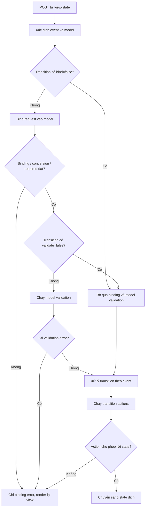

# Validation không chạy hoặc chặn nhầm sự kiện quay lại

Một wizard đặt phòng có các bước chọn phòng, nhập thông tin khách và xác nhận. Người dùng bấm **Tiếp tục** để kiểm tra dữ liệu và sang bước xem lại, hoặc bấm **Quay lại** để đổi lựa chọn. Nếu validator không chạy, dữ liệu sai có thể lọt qua. Nếu validator chạy cả khi bấm Quay lại, người dùng có thể bị mắc kẹt ở màn hình hiện tại chỉ vì một trường chưa hoàn tất.

Trong Spring Web Flow, validation của form gắn với postback của **view-state có khai báo model**. Web Flow bind dữ liệu request vào model, sau đó mới chạy các cơ chế validation đã cấu hình, trừ khi event/transition yêu cầu bỏ qua validation. Khi chẩn đoán, cần xác định đúng event được gửi, state đang xử lý, model được bind, validator được phát hiện và transition có thuộc tính **validate** hoặc **bind** ra sao.

Bài học thuộc chương **Chẩn đoán lỗi** của module **SPRING_WEB_FLOW**. Nội dung tập trung vào hai triệu chứng: validation không chạy và validation chặn nhầm Back/Cancel.

Sau bài học, bạn có thể:

- Phân biệt binding/conversion error với model validation error.
- Kiểm tra view-state, model expression và event được gửi.
- Sửa cấu hình LocalValidatorFactoryBean trong flow-builder-services.
- Kiểm tra quy ước tên validate<StateId> và bean <model>Validator.
- Dùng ValidationContext, MessageContext và validation groups đúng cách.
- Cấu hình validate="false" cho Back và bind="false" cho Cancel.
- Nhận diện trường hợp Back vẫn bị chặn bởi lỗi binding hoặc transition action.
- Lập ma trận kiểm thử cho Next, Back, Cancel và lỗi nhập liệu.

## 1. Nhận diện triệu chứng trước khi sửa

Không phải mọi thông báo lỗi trên form đều do cùng một validator. Hãy phân loại điều đang xảy ra:

| Triệu chứng | Khả năng cần kiểm tra đầu tiên |
| --- | --- |
| Bấm Next nhưng @NotBlank, @Size không được thực thi | Validator Bean Validation chưa được nối vào flow builder, hoặc validation đã bị suppress |
| Model có validateEnterDetails() nhưng method không chạy | view-state ID/model/method signature không khớp quy ước |
| Validator bean không được gọi | Sai bean name, bean không nằm trong Spring context mà flow nhìn thấy, hoặc method signature không được nhận diện |
| Bấm Back vẫn thấy lỗi nghiệp vụ | Transition Back chưa có validate="false" hoặc event thực tế không phải Back |
| Back có validate="false" nhưng vẫn bị giữ ở form | Binding/conversion/required check hoặc transition action vẫn đang chặn |
| Server có lỗi nhưng trang không hiển thị | View không render field errors/MessageContext hoặc message code không tìm thấy |
| Chỉ một số bước được validate | Validation method theo state, validation group hoặc validation-hints không khớp |
| Validator chạy hai lần | Bean Validation và validation theo convention cùng hoạt động, hoặc default và state-specific method đều được gọi |

**Đừng bắt đầu bằng cách tắt toàn bộ validation.** Trước tiên xác định lỗi nằm ở binding, model validation, transition action hay tầng hiển thị thông báo.

## 2. Hiểu đúng thứ tự xử lý của view-state

Với một view-state có model, request gửi event thường đi qua các bước:

1. Web Flow nhận request và xác định execution/state đang hoạt động.
2. View adapter giải mã event, ví dụ next, back hoặc cancel.
3. Nếu binding không bị suppress, Web Flow bind các field được phép từ request vào model.
4. Binding thực hiện type conversion và các kiểm tra required của binder.
5. Nếu validation không bị suppress, Web Flow chạy các cơ chế model validation đã cấu hình.
6. Nếu binding/validation có lỗi, view-state được render lại để người dùng sửa.
7. Nếu có thể tiếp tục, Web Flow xử lý transition khớp event; transition action có thể chấp nhận hoặc từ chối việc rời state.
8. Nếu transition được chấp nhận, flow chuyển sang state đích.



Sơ đồ giải thích vì sao validate="false" không phải lúc nào cũng giải quyết được Back: nó bỏ qua **model validation**, nhưng binding vẫn xảy ra. Nếu chuỗi ngày/số không parse được hoặc một binding required="true" nhận giá trị rỗng, request vẫn có thể gặp lỗi ở bước binding.

## 3. Nguyên nhân khiến validation không chạy

### 3.1. View-state không khai báo model

Web Flow không tự động chạy model validation chỉ vì HTML có input. State phải chỉ định object làm model:

```xml
<var name="booking" class="com.example.booking.Booking" />

<view-state id="enterBookingDetails"
            view="booking/enterDetails"
            model="booking">
    <transition on="next" to="reviewBooking" />
</view-state>
```

Kiểm tra:

- Tên trong model="booking" có khớp biến/attribute đang tồn tại không?
- Model có được tạo trước khi view-state nhận postback không?
- Model có đúng kiểu mà constraint/validator mong đợi không?
- View có submit về execution URL hiện tại và phát event thật không?

Nếu state không có model, các cơ chế validation gắn với model trong lifecycle view-state sẽ không được kích hoạt như mong đợi. Khi đó cần khai báo model hoặc chủ động xử lý request bằng action riêng.

### 3.2. Validator Bean Validation chưa được cấu hình cho flow

Có annotation trên model chưa đủ. Spring Web Flow cần validator được nối vào flow-builder-services. Cấu hình XML thường dùng LocalValidatorFactoryBean:

```xml
<webflow:flow-registry id="flowRegistry"
                       flow-builder-services="flowBuilderServices">
    <webflow:flow-location
            id="booking"
            path="/WEB-INF/flows/booking/booking.xml" />
</webflow:flow-registry>

<webflow:flow-builder-services id="flowBuilderServices"
                               validator="validator" />

<bean id="validator"
      class="org.springframework.validation.beanvalidation.LocalValidatorFactoryBean" />
```

Sau cấu hình, validator được áp dụng lên model sau data binding. Kiểm tra:

- flow-registry có tham chiếu flow-builder-services vừa khai báo không?
- Bean validator có được tạo trong Spring context mà FlowBuilder sử dụng không?
- Bean Validation provider có trên classpath không?
- Constraint import có đúng namespace của phiên bản ứng dụng không?

Với Spring Web Flow 3.x chạy trên Spring Framework 6, dùng Jakarta Validation (jakarta.validation.*). Ứng dụng Web Flow 2.x cũ có thể dùng Java EE Validation (javax.validation.*). Không trộn annotation javax.validation với provider chỉ hỗ trợ jakarta.validation, hoặc ngược lại.

Ví dụ model:

```java
import jakarta.validation.constraints.NotBlank;
import jakarta.validation.constraints.Positive;

public class Booking {
    @NotBlank
    private String guestName;

    @Positive
    private Integer guestCount;

    // Getter và setter
}
```

Nếu provider không nhận diện annotation do lệch namespace/version, model vẫn có thể bind bình thường nhưng constraint không được áp dụng như kỳ vọng.

### 3.3. Method validation theo convention sai tên hoặc sai chữ ký

Web Flow hỗ trợ method validation trực tiếp trên model. Tên method được tạo từ tiền tố validate cộng với **ID của view-state hiện tại**.

Ví dụ state:

```xml
<view-state id="enterBookingDetails"
            model="booking"
            view="booking/enterDetails">
    <transition on="next" to="reviewBooking" />
</view-state>
```

Method trên model phải có tên validateEnterBookingDetails:

```java
import org.springframework.binding.validation.ValidationContext;
import org.springframework.binding.message.MessageBuilder;

public class Booking {
    private LocalDate checkIn;
    private LocalDate checkOut;

    public void validateEnterBookingDetails(ValidationContext context) {
        if (checkIn == null || checkOut == null) {
            return;
        }
        if (!checkOut.isAfter(checkIn)) {
            context.getMessageContext().addMessage(
                new MessageBuilder()
                    .error()
                    .source("checkOut")
                    .defaultText("Ngày trả phòng phải sau ngày nhận phòng.")
                    .build()
            );
        }
    }
}
```

Các lỗi thường gặp:

- Đặt tên validateBookingDetails trong khi state ID là enterBookingDetails.
- Sai chữ hoa/chữ thường trong phần ID được nối vào tên method.
- Method không public.
- Đặt method ở class khác nhưng lại mong Web Flow tìm thấy nó trên model.
- Dùng tham số không đúng quy ước mà Web Flow có thể gọi.
- Có nhiều model nhưng method được đặt trên object không phải model của view-state.

Tên method dựa vào **state đang nhận postback**, không dựa vào event (next, back) hoặc state đích. Nếu người dùng bấm Back từ chooseAmenities, method tương ứng nếu được gọi sẽ gắn với chooseAmenities, không phải state mà transition quay về.

### 3.4. Validator bean không đúng tên hoặc không được Spring quản lý

Có thể tách logic validation khỏi model bằng một validator bean. Với model expression booking, bean theo convention là bookingValidator:

```java
import org.springframework.stereotype.Component;
import org.springframework.binding.validation.ValidationContext;
import org.springframework.binding.message.MessageBuilder;

@Component("bookingValidator")
public class BookingValidator {

    public void validateEnterBookingDetails(
            Booking booking, ValidationContext context) {
        if (booking.getGuestCount() != null
                && booking.getGuestCount() > 8) {
            context.getMessageContext().addMessage(
                new MessageBuilder()
                    .error()
                    .source("guestCount")
                    .defaultText("Mỗi lượt đặt không được quá 8 khách.")
                    .build()
            );
        }
    }
}
```

Kiểm tra:

- Model expression có phải booking không? Nếu model tên bookingForm, bean convention phải theo model expression đó.
- Bean có được component scan hoặc khai báo bằng XML không?
- Bean name có đúng quy ước chữ thường đầu tiên, ví dụ bookingValidator không?
- Method có public và nhận đúng model cùng ValidationContext không?
- Package chứa validator có nằm trong component scan không?

Một validator class tồn tại trong source nhưng không được đăng ký thành Spring bean thì Web Flow không thể tự tìm nó theo convention.

### 3.5. Đặt validator ở sai tầng hoặc nhầm với transition action

Model validation và transition action có mục đích khác nhau:

| Thành phần | Khi chạy | Dùng để |
| --- | --- | --- |
| Bean Validation / method validator | Trong postback lifecycle của view-state | Kiểm tra model trước khi transition |
| Transition action | Khi event khớp transition | Thực hiện kiểm tra/hành động gắn với việc rời state |
| Action-state | Khi flow đi vào action-state | Chạy nghiệp vụ và điều hướng theo outcome |
| Client-side validation | Trong browser | Hỗ trợ UX; không thay thế kiểm tra server |

Nếu logic chỉ được viết trong transition action, đừng kỳ vọng nó chạy như validator cho mọi event. Ngược lại, validator chỉ được gọi trong postback; nó không tự chạy khi chỉ render trang GET hoặc khi không có event từ view.

### 3.6. Validation group hoặc validation-hints không khớp

Bean Validation có thể dùng group để chỉ kiểm tra những trường thuộc bước hiện tại. Nếu constraint được gắn vào group riêng nhưng flow không truyền group đó, constraint có thể không được chạy.

```java
import jakarta.validation.constraints.NotBlank;

public class CheckoutForm {
    public interface ContactStep {}
    public interface PaymentStep {}

    @NotBlank(groups = ContactStep.class)
    private String email;

    @NotBlank(groups = PaymentStep.class)
    private String cardHolder;
}
```

Flow chỉ định hint cho state:

```xml
<view-state id="contact"
            model="checkoutForm"
            validation-hints="'ContactStep'">
    <transition on="next" to="payment" />
</view-state>

<view-state id="payment"
            model="checkoutForm"
            validation-hints="'PaymentStep'">
    <transition on="confirm" to="completed" />
</view-state>
```

validation-hints là expression được ValidationHintResolver chuyển thành validation group. Resolver mặc định có thể tìm inner class trong model hoặc dùng tên class đầy đủ. Kiểm tra:

- Constraint có gắn đúng group không?
- validation-hints có resolve ra group đúng không?
- Tên group có sai chữ hoa/chữ thường hoặc sai package không?
- Có đang mong group Default chạy trong khi constraint chỉ gắn vào group riêng không?

Nếu constraint không khai báo groups, nó thuộc group mặc định. Nếu chỉ truyền một group riêng mà không bao gồm Default, constraint mặc định có thể không chạy. Hãy thiết kế group và hints theo hợp đồng từng bước, rồi kiểm thử từng state.

### 3.7. Validation đã chạy nhưng lỗi không xuất hiện trên view

Đôi khi validator thực sự chạy và thêm lỗi vào MessageContext, nhưng giao diện không hiển thị:

- JSP không có form:errors cho field.
- View chỉ hiển thị lỗi tổng quát trong khi validator ghi lỗi gắn với một property.
- Message code không có trong message bundle.
- View đang render model khác với model được validator kiểm tra.
- AJAX fragment được render nhưng phần chứa thông báo không nằm trong fragment đó.

Ví dụ JSP:

```jsp
<form:form modelAttribute="booking">
    <form:input path="guestName" />
    <form:errors path="guestName" cssClass="error" />
    <form:input path="guestCount" />
    <form:errors path="guestCount" cssClass="error" />
</form:form>
```

Với lỗi tổng quát được ghi vào MessageContext, view cần có phần hiển thị thông báo chung. Hãy kiểm tra message context/binding result trước khi kết luận validator không chạy.

## 4. Vì sao Back bị validation chặn?

Mặc định, transition từ một view-state có model có thể chạy binding và validation. Nếu người dùng bấm Back khi một trường chưa hoàn chỉnh, validation vẫn có thể chặn việc rời state.

Ví dụ cấu hình gây chặn Back:

```xml
<view-state id="chooseAmenities"
            view="booking/chooseAmenities"
            model="booking">
    <transition on="proceed" to="reviewBooking" />
    <transition on="back" to="enterBookingDetails" />
</view-state>
```

Transition back chưa suppress validation. Nếu model có lỗi, người dùng có thể không quay lại được.

### 4.1. Dùng validate=false khi Back cần giữ dữ liệu

Đây là cấu hình thông thường cho nút Back:

```xml
<view-state id="chooseAmenities"
            view="booking/chooseAmenities"
            model="booking">
    <transition on="proceed" to="reviewBooking" />
    <transition on="back"
                to="enterBookingDetails"
                validate="false" />
</view-state>
```

validate="false" có nghĩa:

- Binding vẫn diễn ra.
- Model validation bị bỏ qua cho event back.
- Transition Back vẫn có thể chạy nếu binding và các bước khác không phát sinh lỗi.

Đây là lựa chọn phù hợp khi người dùng muốn quay lại nhưng vẫn giữ những giá trị vừa nhập ở màn hình hiện tại.

### 4.2. Dùng bind=false khi Cancel cần bỏ dữ liệu đang nhập

Nếu người dùng bấm Hủy và không cần cập nhật model bằng dữ liệu dở dang, dùng:

```xml
<transition on="cancel"
            to="bookingCancelled"
            bind="false" />
```

bind="false" bỏ qua cả binding lẫn model validation cho event đó. Dữ liệu request đang nhập không được bind vào model qua transition này.

| Cấu hình | Binding | Model validation | Khi dùng |
| --- | --- | --- | --- |
| Mặc định | Có | Có | Next/Submit |
| validate="false" | Có | Không | Back vẫn giữ dữ liệu |
| bind="false" | Không | Không | Cancel bỏ dữ liệu dở |

Không dùng bind="false" cho Back nếu người dùng mong dữ liệu vừa nhập được giữ lại. Ngược lại, không chọn validate="false" cho Cancel nếu muốn bỏ qua cả lỗi binding của dữ liệu dở dang.

### 4.3. validate=false không bỏ qua binding/conversion/required

Đây là nguyên nhân quan trọng khiến Back vẫn bị chặn dù đã khai báo validate="false".

Giả sử model có:

```java
private Integer guestCount;
private LocalDate checkIn;
```

Người dùng nhập guestCount=abc hoặc ngày không parse được rồi bấm Back. Vì binding vẫn chạy, conversion có thể thất bại trước khi model validation bị bỏ qua. Tương tự, một binding được đánh dấu required="true" vẫn có thể tạo lỗi khi giá trị rỗng.

Nếu Back cần luôn hoạt động dù form đang nhập dở, hãy xem xét:

- Có thật sự cần bind dữ liệu trên Back không?
- Trường nào có required="true" nhưng không bắt buộc ở bước quay lại?
- Formatter/converter có thể từ chối chuỗi đang nhập dở không?
- Nút Cancel có phù hợp hơn với bind="false" không?

Không hạ mức kiểm tra của Next chỉ để Back chạy được. Hãy cấu hình riêng theo event.

### 4.4. validate=false không vô hiệu hóa transition action

Transition action vẫn có thể chạy và trả lỗi để giữ flow ở state hiện tại:

```xml
<transition on="back"
            to="enterBookingDetails"
            validate="false">
    <evaluate expression="bookingPolicy.canReturnToDetails(booking, messageContext)" />
</transition>
```

Nếu bookingPolicy.canReturnToDetails từ chối transition, flow vẫn có thể không rời state dù model validation đã bị suppress. Hãy kiểm tra action trong transition và global transition nếu có.

validate="false" chỉ điều khiển model validation của view-state. Nó không bỏ qua authorization trong Spring Security, kiểm tra quyền/trạng thái ở service, transition action có chủ đích hoặc business rule bắt buộc phải giữ an toàn dữ liệu.

## 5. Kiểm tra event Back có thực sự được gửi không

Một nguyên nhân dễ bỏ sót là button gửi sai event ID. Transition khai báo on="back" nhưng form lại gửi next, cancel hoặc không gửi event nào.

Ví dụ JSP:

```jsp
<form method="post" action="${flowExecutionUrl}">
    <button type="submit" name="_eventId_next" value="1">
        Tiếp tục
    </button>
    <button type="submit" name="_eventId_back" value="1">
        Quay lại
    </button>
</form>
```

Với named submit button, browser gửi tên của nút được bấm. Nếu dùng hidden field:

```jsp
<input type="hidden" name="_eventId" value="next" />
```

thì mọi lần submit form có thể gửi next, kể cả khi người dùng bấm nút Back, trừ khi JavaScript cập nhật hidden field đúng cách. Trong form có nhiều event, named submit button thường ít gây nhầm lẫn hơn.

Checklist event:

- transition on="back" có đúng event ID không?
- Button Back có name _eventId_back không?
- Có hidden _eventId đang cố định thành next không?
- Form có submit về execution URL hiện tại không?
- Browser Network tab cho thấy request thực tế gửi event nào?
- Có JavaScript submit form trước khi button Back cập nhật event không?

Nếu event Back không được gửi, cấu hình validate="false" trên transition Back không có tác dụng vì transition đó chưa được chọn.

## 6. Dùng ValidationContext để phân biệt event

ValidationContext cung cấp event đã kích hoạt validation và principal hiện tại. Có thể dùng getUserEvent() để hiểu người dùng bấm nút nào:

```java
public void validateChooseAmenities(ValidationContext context) {
    String event = context.getUserEvent();

    if ("back".equals(event)) {
        return;
    }

    if ("proceed".equals(event) && selectedAmenities.isEmpty()) {
        context.getMessageContext().addMessage(
            new MessageBuilder()
                .error()
                .source("selectedAmenities")
                .defaultText("Hãy chọn ít nhất một tiện ích.")
                .build()
        );
    }
}
```

Đây là một cách để viết validation có điều kiện theo event. Tuy nhiên, nếu Back luôn cần bỏ qua toàn bộ model validation, cấu hình validate="false" trên transition vẫn rõ ràng và dễ đọc hơn. Dùng ValidationContext khi cùng một event cần chạy validation có chọn lọc hoặc quy tắc phụ thuộc principal.

Không dựa vào getUserEvent() để thay thế authorization. Event ID là dữ liệu do client gửi; service vẫn phải kiểm tra quyền và trạng thái nghiệp vụ.

## 7. Phân biệt validation không chạy với binding error

Binding và validation là hai giai đoạn khác nhau. Một lỗi xuất hiện trên form chưa chắc là lỗi do Bean Validation.

| Loại lỗi | Ví dụ | Nơi cần kiểm tra |
| --- | --- | --- |
| Type conversion | guestCount=abc cho property Integer | ConversionService, formatter/converter, request value |
| Required binding | Trường có required="true" bị rỗng | binder và request parameter |
| Bean Validation | @NotBlank, @Positive, @Size không đạt | LocalValidatorFactoryBean, provider, group |
| Convention validation | Method validateChooseAmenities thêm message | Tên state, method signature, model |
| External validator | bookingValidator thêm message | Bean name, component scan, method signature |
| Transition action | Service từ chối event Back/Next | Action trong transition, global transition |
| View message rendering | Có lỗi nhưng không thấy trên trang | JSP/Thymeleaf/JSF error component, message bundle |

Khi thấy lỗi, kiểm tra message code và source/property. Ví dụ lỗi booking.checkIn.typeMismatch là dấu hiệu mạnh của binding/conversion, trong khi message “Ngày nhận phòng phải trong tương lai” có thể đến từ validator nghiệp vụ.

## 8. Kiểm tra validator Bean Validation có được áp dụng

Với Bean Validation, hãy lần lượt kiểm tra:

1. Model được gắn đúng vào view-state.
2. Constraint có trên đúng property được bind.
3. flow-builder-services có thuộc tính validator.
4. Validator bean là LocalValidatorFactoryBean.
5. Validation provider tương thích với namespace jakarta.validation hoặc javax.validation.
6. Constraint không bị giới hạn ở validation group khác.
7. Transition đang xử lý không có validate="false" hoặc bind="false".

Ví dụ constraint tối thiểu:

```java
import jakarta.validation.constraints.NotBlank;
import jakarta.validation.constraints.Size;

public class GuestForm {
    @NotBlank
    @Size(max = 80)
    private String guestName;

    // Getter và setter
}
```

Nếu model có nhiều bước, không nhất thiết chạy tất cả constraint tại mọi bước. Dùng validation groups để mỗi state kiểm tra đúng phần dữ liệu mà người dùng đã nhập.

## 9. Kiểm tra validator theo convention

Với model expression booking và state ID chooseAmenities, method hợp lệ trên model là:

```java
public void validateChooseAmenities(ValidationContext context) {
    // Ghi lỗi vào context.getMessageContext()
}
```

Method này phải nằm trên object model. Web Flow gọi nó trong postback lifecycle của view-state nếu validation không bị suppress.

Với validator bean riêng, bean được phát hiện theo convention bookingValidator:

```java
@Component("bookingValidator")
public class BookingValidator {

    public void validateChooseAmenities(
            Booking booking, ValidationContext context) {
        // Kiểm tra booking tại state chooseAmenities
    }

    public void validate(Booking booking, ValidationContext context) {
        // Quy tắc mặc định áp dụng mỗi lần model được validate
    }
}
```

Nếu cả method theo state và method mặc định validate cùng tồn tại, method theo state được gọi trước, sau đó method mặc định được gọi. Vì vậy, một validator có thể chạy nhiều hơn một lần logic kiểm tra trong cùng một postback. Đây không nhất thiết là lỗi framework; hãy kiểm tra xem bạn có đang lặp cùng một constraint ở hai nơi không.

## 10. Dùng validation groups cho form nhiều bước

Một wizard có thể dùng chung model nhưng mỗi màn hình chỉ hoàn thiện một phần dữ liệu. Nếu chạy toàn bộ validation ở bước đầu, những trường chỉ xuất hiện ở bước sau sẽ khiến Next bị chặn.

```java
public interface GuestDetails {}
public interface PaymentDetails {}

public class CheckoutForm {
    @NotBlank(groups = GuestDetails.class)
    private String guestName;

    @NotBlank(groups = PaymentDetails.class)
    private String cardHolder;

    @NotBlank(groups = PaymentDetails.class)
    private String paymentToken;
}
```

Flow:

```xml
<view-state id="guestDetails"
            model="checkoutForm"
            validation-hints="'GuestDetails'">
    <transition on="next" to="paymentDetails" />
</view-state>

<view-state id="paymentDetails"
            model="checkoutForm"
            validation-hints="'PaymentDetails'">
    <transition on="confirm" to="completed" />
    <transition on="back" to="guestDetails" validate="false" />
</view-state>
```

Nếu hints không resolve được, Web Flow có thể ném lỗi trong quá trình validation hoặc chạy group không như mong muốn. Dùng tên group đầy đủ nếu resolver không tìm thấy inner type; kiểm tra ValidationHintResolver khi cần tùy chỉnh.

## 11. Chẩn đoán bằng log và breakpoint

Khi chưa rõ validation dừng ở đâu, đặt breakpoint/log theo thứ tự:

1. **View adapter:** request có tới đúng execution và state không?
2. **Event:** event ID có đúng next, back hoặc cancel không?
3. **Model:** model expression có resolve ra object không?
4. **Binder:** request parameter có nằm trong allowlist không?
5. **Conversion:** giá trị có chuyển được sang kiểu Java không?
6. **Validation suppression:** transition đang chọn có validate="false" hoặc bind="false" không?
7. **Validator:** Bean Validation, model method hoặc validator bean nào được gọi?
8. **MessageContext:** có error message nào được ghi không?
9. **Transition action:** action có trả error result hoặc ném exception không?
10. **View:** lỗi có được render ở field/message summary không?

Có thể log metadata an toàn: flow ID, state ID, event ID, tên property có lỗi, loại lỗi và correlation ID. Không log toàn bộ form, mật khẩu, token thanh toán, session ID hoặc dữ liệu nhạy cảm chỉ để debug validation.

### Bảng quyết định nhanh

| Quan sát | Kết luận sơ bộ | Bước kế tiếp |
| --- | --- | --- |
| Không vào validator; request không có event | Không có view postback event | Kiểm tra form/button/_eventId |
| Có event nhưng state không có model | Không có model validation tự động | Khai báo model hoặc xử lý có chủ đích |
| Có model nhưng không có Bean Validation | Validator chưa cấu hình hoặc group không khớp | Kiểm tra flow-builder-services, provider và hints |
| Model method không được gọi | Tên method không khớp state ID | Sửa validate<StateId> |
| Validator bean không được gọi | Bean name/registration sai | Kiểm tra <model>Validator |
| Back có validate=false, lỗi typeMismatch vẫn xuất hiện | Binding vẫn xảy ra | Sửa converter/input hoặc dùng bind=false nếu muốn bỏ binding |
| Back có validate=false, action trả lỗi | Transition action chặn | Kiểm tra action và business rule |
| Server có message nhưng UI trống | Lỗi render/message lookup | Kiểm tra error tag và message bundle |

## 12. Ma trận kiểm thử bắt buộc

Với flow đặt phòng gồm chooseRoom, enterGuestDetails, chooseAmenities và reviewBooking, nên có các ca:

| Ca kiểm thử | Event/dữ liệu | Kỳ vọng |
| --- | --- | --- |
| Next với dữ liệu hợp lệ | next, tên khách và số khách hợp lệ | Validator chạy; transition tới state kế tiếp |
| Next thiếu trường bắt buộc | next, guestName rỗng | Binding/validation error; ở lại view-state |
| Next sai kiểu | guestCount=abc | Type conversion error được hiển thị |
| Next vi phạm constraint | guestCount=0 | Bean Validation từ chối |
| Convention method | State ID enterGuestDetails | validateEnterGuestDetails được gọi |
| External validator | Bean bookingValidator tồn tại | Validator bean được phát hiện |
| Default validate method | Có cả state-specific và validate | State-specific chạy trước, default chạy sau |
| Back với model chưa hợp lệ | back, validate=false | Model validation bị bỏ qua; binding vẫn chạy |
| Back với chuỗi không parse được | back, guestCount=abc | Binding/conversion vẫn có thể chặn |
| Cancel với form dở | cancel, bind=false | Bỏ binding và model validation |
| Back event sai tên | Browser gửi next | Transition Back không được chọn |
| Validation group đúng | GuestDetails | Chỉ constraint thuộc group tương ứng chạy |
| Validation group sai | Hint không resolve | Test phát hiện cấu hình group sai |
| Transition action từ chối | Service trả lỗi | Flow giữ state dù model validation đã qua |
| Message rendering | Validator thêm field error | View hiển thị đúng field/message |

### Kiểm thử hành vi Back

Với flow execution test dựa trên `AbstractXmlFlowExecutionTests`, hãy kiểm tra theo trình tự:

1. Khởi chạy flow và đi tới state `chooseAmenities` bằng các event hợp lệ trước đó.
2. Chuẩn bị model có dữ liệu chưa đạt constraint của state này.
3. Phát event `back` bằng external context/test API của phiên bản đang dùng; gửi một giá trị field hợp lệ để kiểm tra binding.
4. Xác nhận execution tới `enterBookingDetails`.
5. Xác nhận giá trị vừa gửi được cập nhật vào model.
6. Xác nhận validator của `chooseAmenities` không được gọi cho event Back.

API tạo request parameter và tiếp tục execution khác nhau giữa test harness hoặc phiên bản Web Flow; dùng đúng API của dependency dự án thay vì sao chép helper giả định. Nếu cần xác minh tên event, form parameter, CSRF và HTTP redirect, bổ sung MVC integration test qua `FlowHandlerAdapter`.

## 13. Những lỗi cấu hình thường gặp và cách sửa

| Lỗi | Tại sao xảy ra | Cách sửa |
| --- | --- | --- |
| model bị thiếu trên view-state | Không có object để bind/validate | Khai báo model expression |
| Validator Bean Validation không chạy | flow-builder-services không có validator | Gắn LocalValidatorFactoryBean |
| Dùng javax.validation trên stack Jakarta | Provider không nhận annotation namespace cũ | Đồng bộ dependency và import jakarta.validation |
| Method validation sai tên | Tên method không theo state ID | Dùng validate + chính xác state ID |
| Validator bean không được phát hiện | Sai bean name hoặc không được component scan | Đăng ký đúng <model>Validator |
| Group không chạy | Constraint/hints không khớp | Kiểm tra group và validation-hints |
| Back bị lỗi required | Binding vẫn chạy dù validate=false | Xem lại required; nếu hủy dữ liệu dở dùng bind=false |
| Back bị typeMismatch | Conversion vẫn xảy ra | Sửa input/formatter hoặc bỏ binding nếu đúng nghiệp vụ |
| Back bị action từ chối | Transition action vẫn chạy | Kiểm tra điều kiện action, không đổ lỗi cho validator |
| Back gửi nhầm next | Hidden event hoặc button name sai | Kiểm tra request payload và event ID |
| Message không hiện | View không render lỗi hoặc sai message key | Thêm error component và kiểm tra message bundle |
| Validator chạy hai lần | Bean Validation + convention hoặc default + state-specific | Xác định từng cơ chế, bỏ kiểm tra trùng |

## 14. Bài tập thực hành: sửa wizard đặt phòng

Tạo flow booking gồm enterBookingDetails, chooseAmenities, reviewBooking và bookingCancelled.

1. Khai báo model booking trên hai view-state nhập liệu.
2. Cấu hình LocalValidatorFactoryBean qua flow-builder-services.
3. Thêm constraint @NotBlank cho tên khách và @Positive cho số lượng khách.
4. Viết validateEnterBookingDetails(ValidationContext) để kiểm tra ngày nhận/trả phòng.
5. Tạo bookingValidator và kiểm tra bean được Spring đăng ký.
6. Thêm transition next mặc định có validation.
7. Thêm transition back với validate="false" để giữ dữ liệu nhưng cho phép quay lại.
8. Thêm transition cancel với bind="false" để hủy mà không bind dữ liệu dở.
9. Thử gửi ngày sai định dạng khi bấm Back; quan sát binding error còn tồn tại.
10. Thử gửi guestCount=0 khi bấm Next; xác nhận validation giữ người dùng ở state.
11. Tạo validation groups riêng cho thông tin khách và tiện ích.
12. Viết flow test và MVC integration test để kiểm tra event ID, binding, validation và message rendering.

**Câu hỏi tự đánh giá:**

- Vì sao @NotBlank có thể không chạy dù annotation nằm trên model?
- validateEnterBookingDetails được đặt tên dựa vào event hay state ID?
- Bean bookingValidator cần được đăng ký như thế nào để Web Flow tự phát hiện?
- validate="false" bỏ qua những bước nào và vẫn giữ bước nào?
- Vì sao Back có thể vẫn bị typeMismatch dù đã đặt validate="false"?
- Khi nào nên dùng bind="false" thay cho validate="false"?
- ValidationContext.getUserEvent() có thể giúp validator xử lý Back/Next ra sao?
- Tại sao transition action vẫn có thể chặn Back?
- Validation group sai có thể khiến constraint không được thực thi như thế nào?
- Làm sao phân biệt lỗi validator với lỗi chỉ không hiển thị trên view?

## 15. Tài liệu tham khảo

- [Spring Web Flow 3.0.2 Reference — Validating a Model](https://docs.spring.io/spring-webflow/docs/3.0.2/reference/#validating-a-model): Bean Validation, validation groups, model method, validator bean và ValidationContext.
- [Spring Web Flow 3.0.2 Reference — Suppressing Validation](https://docs.spring.io/spring-webflow/docs/3.0.2/reference/#suppressing-validation): dùng validate="false" để bỏ model validation cho một view event trong khi binding vẫn diễn ra.
- [Spring Web Flow 3.0.2 Reference — Suppressing Binding](https://docs.spring.io/spring-webflow/docs/3.0.2/reference/#suppressing-binding): dùng bind="false" để bỏ cả model binding và validation cho một event.
- [Spring Web Flow 3.0.2 Reference — Specifying Bindings Explicitly](https://docs.spring.io/spring-webflow/docs/3.0.2/reference/#specifying-bindings-explicitly): binder allowlist và required check.
- [Spring Web Flow 3.0.2 API — ValidationContext](https://docs.spring.io/spring-webflow/docs/3.0.2/api/org/springframework/binding/validation/ValidationContext.html): event hiện tại, principal, user value và MessageContext.
- [Spring Framework — Bean Validation](https://docs.spring.io/spring-framework/reference/core/validation/beanvalidation.html): tích hợp Bean Validation và LocalValidatorFactoryBean.

## Ghi nhớ

Khi validation không chạy, hãy kiểm tra từ ngoài vào trong: request có phát event không, view-state có model không, binding có thành công không, validator có được cấu hình/đăng ký không, method có đúng tên state và validation group có khớp không. Khi Back bị chặn, nhớ rằng validate="false" chỉ bỏ **model validation** nhưng vẫn bind dữ liệu; lỗi conversion hoặc required binding vẫn có thể xuất hiện, và transition action vẫn có thể từ chối rời state. bind="false" bỏ cả binding lẫn validation, phù hợp với Cancel khi cần bỏ dữ liệu dở dang. Hãy cấu hình riêng cho Next, Back và Cancel, kiểm thử event ID thật từ browser và giữ authorization/business rule ở service.
