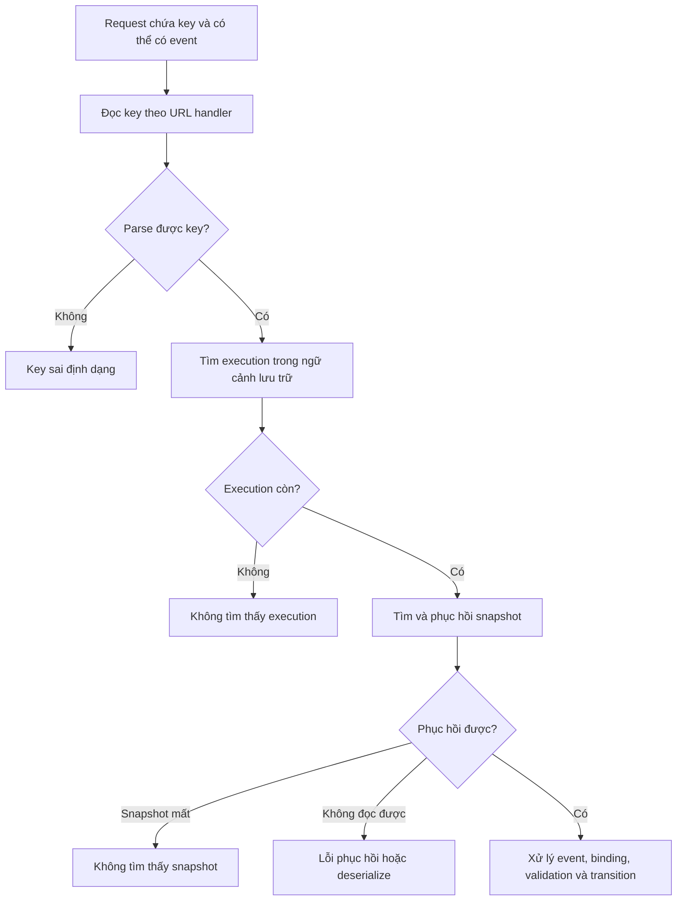

# Execution key không hợp lệ và snapshot không còn

Một người dùng đang ở bước xác nhận, bấm Back rồi gửi lại form và nhận lỗi. Người khác mở cùng URL sau khi đăng nhập lại cũng không tiếp tục được. Dù cả hai đều được mô tả là “execution key không hợp lệ”, nguyên nhân có thể nằm ở định dạng key, session, vòng đời execution hoặc snapshot đã bị loại bỏ.

Bài thuộc chương **Chẩn đoán lỗi** của module **SPRING_WEB_FLOW**. Bạn sẽ lần theo request từ Spring MVC đến repository, phân biệt các nhóm lỗi và thiết kế phục hồi có kiểm soát cho hành trình web nhiều bước, thay vì sửa key theo phỏng đoán hoặc mặc định mọi sự cố đều là hết phiên.

## 1. Mục tiêu chẩn đoán

Sau bài học, bạn có thể:

- Giải thích vì sao key đúng định dạng chưa chắc truy cập được execution.
- Phân biệt execution không tồn tại, snapshot bị mất và snapshot không đọc được.
- Xác định request đang khởi chạy flow mới hay tiếp tục flow cũ.
- Kiểm tra nguồn sinh URL/form, session, giới hạn repository và chính sách history.
- Chọn lớp xử lý lỗi phù hợp khi flow chưa thể được khôi phục.
- Viết kịch bản tái hiện và hồi quy cho request mang key cũ.

Nguyên tắc đầu tiên: **không sửa execution key bằng tay để làm request “chạy tiếp”**. Key là định danh do runtime cấp để truy cập trạng thái được lưu, không phải chỉ số màn hình mà ứng dụng có thể tùy ý tăng giảm.

## 2. Execution key tham chiếu tới điều gì?

[FlowExecutionRepository API](https://docs.spring.io/spring-webflow/docs/current/api/org/springframework/webflow/execution/repository/FlowExecutionRepository.html) mô tả repository chịu trách nhiệm lưu, phục hồi và xóa các execution. Khi lưu một execution, runtime dùng key để định danh trạng thái có thể phục hồi.

Với [CompositeFlowExecutionKey](https://docs.spring.io/spring-webflow/docs/current/api/org/springframework/webflow/execution/repository/support/CompositeFlowExecutionKey.html), key gồm phần định danh execution và phần định danh snapshot. Hình thức chuỗi là chi tiết của implementation; ứng dụng có repository hoặc URL handler tùy biến không nhất thiết dùng cùng biểu diễn.

Có thể hình dung:

```text
execution key
    ├── execution: hành trình logic đang được lưu
    └── snapshot: một điểm trạng thái của hành trình có thể phục hồi
```

Ví dụ URL `/checkout?execution=e7s3` chỉ minh họa một dạng thường gặp. Không dựa vào `e7` hoặc `s3` để tạo key tiếp theo, đoán số execution hoặc xác định người dùng nào sở hữu dữ liệu.

Phân biệt các định danh sau:

| Định danh | Vai trò | Không thay thế được |
| --- | --- | --- |
| Flow ID | Chọn definition, ví dụ `checkout` | Một lần thực thi cụ thể |
| Execution key | Tham chiếu trạng thái runtime cần phục hồi | Quyền truy cập đơn hàng hoặc mã đơn hàng |
| HTTP session ID | Liên kết client với phiên phía server theo cấu hình | Một execution duy nhất |
| State ID | Tên bước trong definition | Key để khôi phục execution |
| Business ID | Định danh đơn hàng, bản nháp hoặc yêu cầu nghiệp vụ | Toàn bộ trạng thái điều hướng của flow |

Một session có thể chứa nhiều execution. Một execution có thể có nhiều snapshot và đi qua flow gốc cùng các subflow. Nhầm các ranh giới này thường dẫn tới phục hồi sai dữ liệu.

## 3. Đường đi của một request tiếp tục flow



Sơ đồ mô tả các điểm phân biệt về mặt chẩn đoán, không khẳng định mọi implementation gọi từng phương thức theo đúng thứ tự chi tiết này. Cơ chế khóa và lớp bọc exception phụ thuộc repository, phiên bản và lớp tích hợp.

Điểm quan trọng là nhiều lỗi xảy ra **trước khi state hiện tại được phục hồi để xử lý event**. Thêm transition xử lý lỗi bên trong flow không tự giải quyết được trường hợp runtime chưa tìm thấy execution đó.

Nếu request đã vào được state và sau đó không có transition phù hợp cho event, đó là nhóm lỗi điều hướng khác. Đừng gộp mọi lỗi gửi form vào lỗi key.

## 4. Đọc exception theo nhóm nguyên nhân

| Dấu hiệu | Ý nghĩa trực tiếp | Hướng kiểm tra tiếp |
| --- | --- | --- |
| `BadlyFormattedFlowExecutionKeyException` | Chuỗi key không parse được theo repository | Giá trị thực nhận, encoding, template, JavaScript, proxy |
| `NoSuchFlowExecutionException` | Không tìm thấy execution được tham chiếu | Session, execution đã kết thúc, eviction, node xử lý |
| `SnapshotNotFoundException` | Không tìm thấy snapshot được tham chiếu | Lịch sử cũ, giới hạn snapshot, discard/invalidate |
| `FlowExecutionRestorationFailureException` | Không thể phục hồi execution | Đọc nguyên nhân bên trong; chưa đủ kết luận là hết phiên |
| `SnapshotUnmarshalException` | Không deserialize được trạng thái snapshot | Dữ liệu serialized, lớp/phiên bản và tính tương thích |

Các ý nghĩa trên có thể đối chiếu tại API chính thức: [BadlyFormattedFlowExecutionKeyException](https://docs.spring.io/spring-webflow/docs/current/api/org/springframework/webflow/execution/repository/BadlyFormattedFlowExecutionKeyException.html), [NoSuchFlowExecutionException](https://docs.spring.io/spring-webflow/docs/current/api/org/springframework/webflow/execution/repository/NoSuchFlowExecutionException.html), [SnapshotNotFoundException](https://docs.spring.io/spring-webflow/docs/current/api/org/springframework/webflow/execution/repository/snapshot/SnapshotNotFoundException.html), [FlowExecutionRestorationFailureException](https://docs.spring.io/spring-webflow/docs/current/api/org/springframework/webflow/execution/repository/FlowExecutionRestorationFailureException.html) và [SnapshotUnmarshalException](https://docs.spring.io/spring-webflow/docs/current/api/org/springframework/webflow/execution/repository/snapshot/SnapshotUnmarshalException.html).

Không chỉ đọc dòng đầu stack trace. Ví dụ cấu trúc nguyên nhân minh họa:

```text
FlowExecutionRestorationFailureException
    caused by SnapshotNotFoundException
```

Cấu trúc này hướng việc điều tra tới snapshot không còn, khác với một lỗi phục hồi có nguyên nhân deserialize. Tên lớp ngoài cùng giống nhau không làm hai sự cố có cùng cách sửa.

Đây không phải một cam kết rằng mọi repository luôn bọc exception theo cấu trúc trên. Ghi nhận lớp exception thực tế trong phiên bản đang chạy và kiểm tra cả chuỗi nguyên nhân.

## 5. Trường hợp A: key không parse được

Các nguồn gây lỗi điển hình:

- Template gửi nguyên chuỗi biểu thức như `${flowExecutionKey}` thay vì giá trị đã render.
- JavaScript ghi `undefined`, `null` dạng chuỗi hoặc một giá trị từ biến cũ vào URL/form.
- Đoạn ghép URL làm key chứa thêm dấu nháy, khoảng trắng hoặc ký tự của tham số kế tiếp.
- Query string bị encode/decode sai hoặc bị xử lý hai lần.
- Proxy, bộ rewrite URL hoặc mã frontend loại bỏ một phần giá trị.
- Request có nhiều tham số cùng tên và lớp đọc tham số chọn giá trị không như mong đợi.

### Cách khoanh vùng

Đối chiếu ba điểm, với dữ liệu đã được xử lý phù hợp khi ghi log:

```text
Giá trị runtime vừa cấp trong response/redirect
        ↓
Giá trị URL/form mà trình duyệt thực sự dùng
        ↓
Giá trị phía server đọc từ request trước khi parse
```

Nếu key đã sai trong HTML, kiểm tra nơi render hoặc tạo URL. Nếu HTML đúng nhưng request gửi sai, kiểm tra JavaScript và cách submit. Nếu request đến ứng dụng khác với dữ liệu client đã gửi, kiểm tra các lớp trung gian và cách đọc tham số.

Dùng công cụ Network của trình duyệt để xem request thật, bao gồm method, query, body và chuỗi redirect. Đừng chỉ nhìn thanh địa chỉ vì form có thể gửi dữ liệu khác trong body.

### Dùng URL do runtime cung cấp

Trong view tích hợp MVC có biến `flowExecutionUrl`, form có thể sử dụng URL đó thay vì tự ghép key:

```html
<form method="post" action="${flowExecutionUrl}">
    <input name="recipientName" />
    <button type="submit" name="_eventId_next" value="next">
        Tiếp tục
    </button>
</form>
```

Đây là đoạn minh họa cho view có xử lý biểu thức `${...}` và quy ước event tương ứng. View engine thực tế cần render/escape URL đúng cách; nếu dùng Spring Security, form còn phải đáp ứng cấu hình CSRF của ứng dụng.

Không sao chép action của form từ một trang cũ vào mọi màn hình. Sau mỗi response/redirect, frontend cần dùng thông tin hiện hành của chính execution đang hiển thị, không lấy key từ một biến “current execution” dùng chung cho nhiều tab.

## 6. Trường hợp B: key parse được nhưng execution không còn

Key đúng định dạng chỉ chứng minh có thể giải mã chuỗi, không chứng minh dữ liệu đích tồn tại trong ngữ cảnh hiện tại.

Các khả năng thường gặp:

| Tình huống | Bằng chứng nên tìm |
| --- | --- |
| Session hết hạn hoặc bị invalidate | Sự kiện hết phiên, mất phiên cũ hoặc thay đổi ngữ cảnh lưu trữ |
| Client không gửi cookie phiên phù hợp | Cookie path/domain, chính sách gửi cookie, URL rewrite nếu có |
| Người dùng mở URL ở phiên khác | Không cùng ngữ cảnh đã khởi chạy execution |
| Flow gốc đã kết thúc | Trace kết thúc và thao tác xóa execution tương ứng |
| Vượt giới hạn execution | Các lần khởi chạy mới trước thời điểm lỗi và cấu hình giới hạn |
| Request chuyển sang node không có trạng thái | Node ID thay đổi và cơ chế session/repository chưa đáp ứng |
| Restart hoặc deploy làm mất trạng thái đang lưu | Thời điểm triển khai trùng với lỗi, loại kho lưu trữ thực tế |

[DefaultFlowExecutionRepository](https://docs.spring.io/spring-webflow/docs/current/api/org/springframework/webflow/execution/repository/impl/DefaultFlowExecutionRepository.html) mô tả việc loại execution cùng các snapshot khi execution hoàn tất. Vì vậy, gửi lại URL của flow đã kết thúc có thể không tìm thấy execution dù session vẫn đang hoạt động.

### Tránh suy luận quá mức từ session ID

Session ID đổi là một tín hiệu, nhưng không phải bằng chứng tuyệt đối dữ liệu đã bị xóa: một số cấu hình xác thực có thể thay ID trong khi bảo toàn hoặc chuyển dữ liệu session. Ngược lại, thấy cùng giá trị cookie cũng không bảo đảm phía server vẫn giữ session đó.

Cần đối chiếu hành vi của kho session và sự kiện thực tế. Tương tự, sticky session có thể giữ request về cùng node nhưng không tự giải quyết việc node khởi động lại hoặc dữ liệu snapshot không còn tương thích.

Nếu chỉ có một flow gặp lỗi sau deploy, xem thêm tính tương thích dữ liệu của flow đó; không mặc định toàn bộ cụm đang mất session.

## 7. Trường hợp C: execution còn nhưng snapshot cũ đã mất

Một execution có thể tiếp tục hoạt động bằng key mới trong khi key của một điểm lịch sử cũ không dùng được nữa.

Ví dụ:

```text
K1: address
K2: review
K3: payment
K4: review sau khi sửa dữ liệu

Người dùng quay lại URL mang K1.
Execution có thể vẫn còn, nhưng snapshot được K1 tham chiếu đã bị loại.
```

Đừng tự sửa K1 thành K4 rồi gửi lại form của màn hình `address`. Dữ liệu và event từ trang cũ có thể không còn phù hợp với state được K4 khôi phục.

### Giới hạn lưu snapshot và execution

Ví dụ cấu hình minh họa:

```xml
<webflow:flow-executor id="flowExecutor" flow-registry="flowRegistry">
    <webflow:flow-execution-repository
            max-executions="5"
            max-execution-snapshots="20" />
</webflow:flow-executor>
```

Prefix `webflow` cần namespace `http://www.springframework.org/schema/webflow-config`. Đây là đoạn trích cấu hình, không phải toàn bộ Spring context.

Theo [Spring Web Flow Reference Guide](https://docs.spring.io/spring-webflow/docs/current/reference/index.html), `max-executions` giới hạn số execution theo session; khi vượt mức, execution cũ nhất bị loại. `max-execution-snapshots` giới hạn lịch sử của mỗi execution. Giá trị `0` tắt cơ chế tạo bản sao snapshot để hỗ trợ quay lại lịch sử; `-1` cho phép không giới hạn số snapshot theo tùy chọn này.

Không tăng vô hạn cả hai giới hạn để che lỗi. Cần đo số hành trình đồng thời, kích thước trạng thái và độ dài lịch sử mà sản phẩm thực sự muốn hỗ trợ. Tăng số snapshot không khôi phục execution đã bị xóa và không sửa key bị ghép sai.

### Chính sách history có thể chủ động loại snapshot

[History API](https://docs.spring.io/spring-webflow/docs/current/api/org/springframework/webflow/engine/History.html) có các chính sách bảo toàn lịch sử, bỏ lịch sử của view đang rời và vô hiệu hóa lịch sử trước đó. Ví dụ một transition:

```xml
<transition on="confirm" to="submitOrder" history="invalidate" />
```

Nếu cấu hình chủ động chặn quay về các bước trước, việc URL cũ không còn tiếp tục được có thể là hành vi mong muốn. Phần cần sửa lúc đó có thể là trải nghiệm phục hồi, không phải cơ chế snapshot.

Trình duyệt vẫn có thể hiện trang từ cache sau Back. Chỉ khi người dùng gửi request mới từ trang đó, lỗi truy cập trạng thái cũ mới lộ ra. Vì thế, tái hiện phải bao gồm cả bước gửi form hoặc tải lại thật sự.

## 8. Trường hợp D: snapshot có nhưng không phục hồi được

Nếu nguyên nhân liên quan deserialize, hãy tách khỏi nhóm “snapshot bị xóa”. Một bản dữ liệu tồn tại nhưng không đọc được cần hướng điều tra khác:

- Kiểu dữ liệu trong scope thay đổi sau triển khai.
- Lớp cần thiết không có trong classpath hoặc không tương thích với dữ liệu đã lưu.
- Dữ liệu snapshot hỏng hoặc không được ghi/đọc như kỳ vọng.
- Repository hoặc snapshot factory tùy biến có lỗi.

Các nhận định trên là giả thuyết chẩn đoán; cần xác nhận bằng nguyên nhân cụ thể, thời điểm deploy và cách lưu snapshot đang dùng.

Nếu không thể tạo snapshot vì object không đáp ứng serialization, lỗi có thể phát sinh ở **lúc lưu**, không phải lúc phục hồi. Hãy tìm cả lỗi trước khi response trả về để biết key mà client nhận có thực sự trỏ đến trạng thái đã lưu thành công hay không.

Với triển khai lưu snapshot bằng serialization, chỉ đưa dữ liệu phù hợp vào scope. Không giữ request, thread, connection hoặc resource đang mở trong form của hành trình. Tách dữ liệu bản nháp bền vững khỏi tài nguyên hạ tầng chỉ dùng trong một lượt xử lý.

## 9. Quy trình điều tra từ request đến repository

### Bước 1: xác định sự cố ở lần khởi chạy hay lần tiếp tục

Request khởi chạy thường chọn flow và truyền input; request tiếp tục mang tham chiếu execution. Hành vi cụ thể phụ thuộc URL handler.

Nếu một liên kết dự định bắt đầu flow mới lại mang key cũ, hãy sửa nguồn tạo liên kết. Không cần chỉnh repository để duy trì vĩnh viễn mọi key đã từng phát ra.

### Bước 2: giữ nguyên bằng chứng của request lỗi

Ghi nhận thời điểm, method, route, event nếu có, mã tương quan và nhóm lỗi. Khi cần phân biệt key, dùng reference ổn định trong phạm vi quan sát có kiểm soát thay vì đưa toàn bộ URL/cookie vào log phổ thông.

### Bước 3: phân loại exception và đọc nguyên nhân

Tách parse, mất execution, mất snapshot và không phục hồi được dữ liệu. Nếu chỉ có một exception bọc chung, tìm lớp nguyên nhân trước khi chọn cách xử lý.

### Bước 4: đối chiếu với vòng đời execution

Tìm lần bắt đầu, pause, cập nhật snapshot, kết thúc hoặc loại bỏ có thể quan sát được. Không thấy log không có nghĩa sự kiện không xảy ra; có thể hạ tầng chưa ghi nhận sự kiện đó.

### Bước 5: kiểm tra ngữ cảnh session và node

Đối chiếu session đang được client sử dụng, node xử lý, sự kiện xác thực/deploy và kho trạng thái. Một lỗi chỉ xuất hiện khi đổi node gợi ý vấn đề về truy cập trạng thái giữa các node, nhưng vẫn cần xác minh.

### Bước 6: kiểm tra policy và giới hạn

Xem `history`, giới hạn execution/snapshot và việc kết thúc flow. Chỉ điều chỉnh khi có bằng chứng policy không phù hợp với yêu cầu hành trình.

### Bước 7: kiểm tra kết quả nghiệp vụ trước khi cho thử lại

Không kết luận thanh toán chưa xảy ra chỉ vì không khôi phục được flow. Một request trước đó có thể đã ghi dữ liệu thành công rồi mất response hoặc không lưu được bước điều hướng tiếp theo.

Nếu cần thử lại, dùng định danh nghiệp vụ và quy tắc idempotency tương ứng để tránh chạy trùng lệnh. Execution key không phải khóa chống lặp tổng quát cho mọi hành động trong hệ thống.

## 10. Ghi log có ích cho việc khoanh vùng

Một bản ghi chẩn đoán minh họa:

```json
{
  "event": "flow_resume_failed",
  "requestId": "req-42",
  "flowId": "checkout",
  "method": "POST",
  "node": "node-b",
  "keyRef": "key-ref-83",
  "sessionRef": "session-ref-12",
  "failureKind": "SNAPSHOT_MISSING",
  "outerException": "FlowExecutionRestorationFailureException",
  "matchedCause": "SnapshotNotFoundException"
}
```

Các field và giá trị trên là quy ước quan sát do ứng dụng thiết kế, không phải log mặc định của framework. Chỉ ghi flow ID hoặc state ID nếu thực sự biết từ route/configuration hoặc quan sát runtime; khi chưa phục hồi được execution, không tự điền state phỏng đoán thành một sự thật.

Các chỉ số hữu ích gồm tỷ lệ lỗi resume theo nhóm nguyên nhân, flow ID, phiên bản triển khai và node. Không đưa execution key/session ID làm nhãn metric vì số giá trị có thể tăng rất lớn.

Có thể tăng mức log tạm thời cho phạm vi repository/executor phù hợp trong môi trường điều tra. Không bật TRACE toàn bộ ứng dụng rồi lưu mọi form và cookie để thay cho việc chọn tín hiệu cần thiết.

## 11. Ví dụ phân loại chuỗi nguyên nhân

Utility sau phục vụ phân loại vận hành. Nó ưu tiên nhận diện lỗi snapshot cụ thể bên trong một lỗi phục hồi chung và tránh lặp vô hạn nếu chuỗi cause có vòng.

```java
package example.checkout;

import java.util.Collections;
import java.util.IdentityHashMap;
import java.util.Set;

import org.springframework.webflow.execution.repository.BadlyFormattedFlowExecutionKeyException;
import org.springframework.webflow.execution.repository.FlowExecutionRestorationFailureException;
import org.springframework.webflow.execution.repository.NoSuchFlowExecutionException;
import org.springframework.webflow.execution.repository.snapshot.SnapshotNotFoundException;
import org.springframework.webflow.execution.repository.snapshot.SnapshotUnmarshalException;

public final class FlowResumeFailures {

    public enum Kind {
        MALFORMED_KEY,
        EXECUTION_MISSING,
        SNAPSHOT_MISSING,
        RESTORE_FAILED,
        OTHER
    }

    private FlowResumeFailures() {
    }

    public static Kind classify(Throwable failure) {
        Set<Throwable> visited = Collections.newSetFromMap(
                new IdentityHashMap<Throwable, Boolean>());
        boolean restoreFailure = false;

        for (Throwable current = failure;
             current != null && visited.add(current);
             current = current.getCause()) {

            if (current instanceof BadlyFormattedFlowExecutionKeyException) {
                return Kind.MALFORMED_KEY;
            }
            if (current instanceof SnapshotNotFoundException) {
                return Kind.SNAPSHOT_MISSING;
            }
            if (current instanceof NoSuchFlowExecutionException) {
                return Kind.EXECUTION_MISSING;
            }
            if (current instanceof FlowExecutionRestorationFailureException
                    || current instanceof SnapshotUnmarshalException) {
                restoreFailure = true;
            }
        }

        return restoreFailure ? Kind.RESTORE_FAILED : Kind.OTHER;
    }
}
```

Utility không xác định được vì sao execution bị xóa, cũng không chứng minh session đã hết hạn. Nhóm `EXECUTION_MISSING` vẫn cần dữ liệu vận hành để phân biệt hoàn tất bình thường, eviction, hết phiên hoặc mất trạng thái.

Ví dụ cũng không thay thế logging nguyên nhân của `RESTORE_FAILED`. Nếu ứng dụng cần phân loại sâu hơn, thêm nhóm deserialize hoặc lỗi kho dữ liệu theo nhu cầu thực tế và kiểm thử trên exception mà phiên bản đang dùng tạo ra.

## 12. Đặt xử lý phục hồi ở ranh giới tích hợp

Nếu lỗi xuất hiện trước khi flow được phục hồi, action, validator hoặc exception handler bên trong flow có thể chưa được chạy. Trong ứng dụng Servlet MVC, một điểm mở rộng phù hợp là flow handler, kết hợp với chính sách lỗi của tầng MVC và security đang triển khai.

Ví dụ handler dùng utility ở phần trước:

```java
package example.checkout;

import jakarta.servlet.http.HttpServletRequest;
import jakarta.servlet.http.HttpServletResponse;

import org.springframework.webflow.core.FlowException;
import org.springframework.webflow.mvc.servlet.AbstractFlowHandler;

public final class CheckoutFlowHandler extends AbstractFlowHandler {

    @Override
    public String getFlowId() {
        return "checkout";
    }

    @Override
    public String handleException(FlowException exception,
                                  HttpServletRequest request,
                                  HttpServletResponse response) {
        FlowResumeFailures.Kind kind = FlowResumeFailures.classify(exception);

        switch (kind) {
            case MALFORMED_KEY:
                return "contextRelative:/journey-invalid";
            case EXECUTION_MISSING:
            case SNAPSHOT_MISSING:
                return "contextRelative:/journey-unavailable";
            default:
                return null;
        }
    }
}
```

Đây là ví dụ với Jakarta Servlet; namespace Servlet của dự án phải khớp phiên bản Spring đang dùng. Handler còn cần được đăng ký vào cấu hình flow handler mapping, và ứng dụng phải cung cấp các trang đích.

Ví dụ chọn redirect cho trải nghiệm người dùng. Nó không tự trả mã HTTP `400` chỉ vì key sai. Nếu ứng dụng yêu cầu status cụ thể hoặc phản hồi Ajax/JSON riêng, phải triển khai và kiểm thử hợp đồng đó ở lớp tích hợp tương ứng.

`RESTORE_FAILED` được để lại cho đường xử lý lỗi kỹ thuật, thay vì mặc định chuyển mọi lỗi đọc dữ liệu thành “hết phiên”. Việc trả `null` ở đây nhường xử lý cho cơ chế tiếp theo của adapter; cần kiểm tra cấu hình resolver thực tế để biết phản hồi cuối cùng.

[FlowHandlerAdapter API](https://docs.spring.io/spring-webflow/docs/current/api/org/springframework/webflow/mvc/servlet/FlowHandlerAdapter.html) mô tả mặc định cố khởi chạy execution mới khi gặp `NoSuchFlowExecutionException` mà handler không xử lý. Vì vậy, việc thấy màn hình đầu chưa đủ kết luận application đã phục hồi đúng; có thể đơn giản là một execution mới vừa được khởi chạy.

Trang phục hồi nên giải thích rằng không thể tiếp tục hành trình hiện tại và cho lối đi phù hợp, như bắt đầu lại hoặc tra cứu kết quả đã lưu. Không chuyển tiếp nguyên POST cũ sang flow mới để tự chạy lại tác dụng phụ nghiệp vụ.

## 13. Những cách sửa dễ tạo lỗi mới

| Cách sửa vội | Vấn đề | Hướng xử lý đúng |
| --- | --- | --- |
| Tăng phần snapshot trong key | Có thể trỏ vào trạng thái không tồn tại hoặc không khớp form | Dùng key do response hiện hành cấp |
| Thay key cũ bằng key mới nhất của session | Session có thể có nhiều execution | Theo dõi đúng hành trình của trang hoặc yêu cầu bắt đầu lại |
| Bắt mọi `FlowException` rồi báo hết phiên | Che lỗi cấu hình, deserialize hoặc nghiệp vụ | Phân loại nguyên nhân và giữ đường lỗi kỹ thuật |
| Tăng vô hạn giới hạn repository | Tăng dữ liệu lưu mà không sửa nguồn request cũ | Đo nhu cầu và xác nhận nguyên nhân trước khi chỉnh |
| Cho form cũ submit vào flow mới | Event và dữ liệu có thể không hợp lệ ở state mới | Bắt đầu lại theo hợp đồng input rõ ràng |
| Retry vô điều kiện POST xác nhận | Có thể trùng đơn hoặc thanh toán | Đối chiếu kết quả và áp dụng idempotency nghiệp vụ |
| Chỉ tắt nút Back trên giao diện | URL/form cũ vẫn có thể được gửi | Bảo vệ ở runtime và cung cấp trải nghiệm phục hồi |
| Coi đăng nhập lại là khôi phục toàn bộ flow | Trạng thái flow cũ có thể đã mất | Phục hồi từ bản nháp bền vững nếu sản phẩm có thiết kế đó |

Một bản nháp lưu trong database có thể giúp người dùng tiếp tục công việc bằng **một execution mới**. Đó là thiết kế nghiệp vụ bổ sung, không phải việc tái tạo ngẫu nhiên một snapshot đã mất chỉ từ execution key.

## 14. Tái hiện từng nhóm lỗi có kiểm soát

### 14.1. Key sai định dạng

Khởi chạy flow bình thường, lưu response hợp lệ, rồi thay giá trị key bằng một chuỗi chắc chắn không được parser của repository đang dùng chấp nhận.

Kiểm tra request không vào action nghiệp vụ và đi tới phản hồi đã chọn cho key sai. Sau đó điều tra nguồn tạo request nếu lỗi này xuất hiện trong hành trình tự nhiên.

Đừng chỉ tự tạo exception trong unit test rồi coi như đã kiểm tra parsing thật. Test classifier và test đường HTTP có mục tiêu khác nhau.

### 14.2. Execution không còn

Khởi chạy flow, lưu URL/key, hoàn tất flow gốc rồi truy cập lại key cũ. Với repository có chính sách xóa sau kết thúc, kiểm tra phản hồi phục hồi và xác nhận không phát sinh lệnh nghiệp vụ thứ hai.

Tạo một ca riêng cho session bị invalidate và một ca cho vượt giới hạn execution. Ba ca có thể dẫn tới cùng thông báo người dùng, nhưng bằng chứng nguyên nhân phải khác nhau.

### 14.3. Snapshot không còn

Giảm giới hạn snapshot trong profile test, tạo đủ điểm lịch sử thực sự rồi truy cập snapshot cũ đã bị loại. Nếu execution vẫn còn, URL hiện hành phải tiếp tục được theo cấu hình.

Một ca khác đi qua transition `history="invalidate"` rồi thử URL trước mốc đó. Không dựa vào số click để đoán số snapshot; quan sát key và cơ chế repository của fixture.

### 14.4. Không đọc được snapshot

Dùng fixture hoặc fault injection trong môi trường test để tạo lỗi đọc/deserialize có kiểm soát. Kiểm tra rằng ứng dụng giữ tín hiệu lỗi kỹ thuật và không tự động phát lại lệnh cuối.

Không làm hỏng dữ liệu phiên thật chỉ để tái hiện bài tập. Mục tiêu là cô lập một giả thuyết và chứng minh hệ thống phản ứng đúng.

## 15. Kiểm thử classifier và đường phục hồi

Ví dụ JUnit Jupiter cho utility phân loại, độc lập với lớp test flow kế thừa `junit.framework.TestCase`:

```java
package example.checkout;

import static org.junit.jupiter.api.Assertions.assertEquals;

import org.junit.jupiter.api.Test;
import org.springframework.webflow.execution.FlowExecutionKey;
import org.springframework.webflow.execution.repository.BadlyFormattedFlowExecutionKeyException;
import org.springframework.webflow.execution.repository.FlowExecutionRestorationFailureException;
import org.springframework.webflow.execution.repository.snapshot.SnapshotNotFoundException;
import org.springframework.webflow.execution.repository.support.CompositeFlowExecutionKey;

class FlowResumeFailuresTest {

    @Test
    void malformedKeyHasItsOwnCategory() {
        Throwable failure = new BadlyFormattedFlowExecutionKeyException(
                "invalid-fixture", "repository-specific-format");

        assertEquals(FlowResumeFailures.Kind.MALFORMED_KEY,
                FlowResumeFailures.classify(failure));
    }

    @Test
    void missingSnapshotInsideRestoreFailureIsRecognized() {
        FlowExecutionKey key = new CompositeFlowExecutionKey(
                Long.valueOf(7L), Integer.valueOf(3));
        Throwable failure = new FlowExecutionRestorationFailureException(
                key, new SnapshotNotFoundException(Integer.valueOf(3)));

        assertEquals(FlowResumeFailures.Kind.SNAPSHOT_MISSING,
                FlowResumeFailures.classify(failure));
    }

    @Test
    void unrelatedFailureIsNotReportedAsExpiredFlow() {
        Throwable failure = new IllegalStateException("fixture failure");

        assertEquals(FlowResumeFailures.Kind.OTHER,
                FlowResumeFailures.classify(failure));
    }
}
```

Các test trên chỉ chứng minh logic phân loại các exception được đưa vào. Chúng không chứng minh repository thật bọc exception giống fixture hoặc handler đã được đăng ký đúng.

Bộ hồi quy tích hợp nên kiểm tra thêm:

| Tình huống | Assertion cốt lõi |
| --- | --- |
| Key parse sai qua HTTP | Phản hồi đúng chính sách, không gọi action nghiệp vụ |
| Key của execution đã hoàn tất | Phục hồi đúng, không tạo kết quả thứ hai |
| Cùng key ở session khác | Không truy cập được dữ liệu của phiên đã khởi chạy |
| Snapshot cũ bị loại | Có xử lý mất lịch sử; key hiện hành còn dùng được nếu execution còn |
| Lỗi deserialize được mô phỏng | Có tín hiệu kỹ thuật và không bị nhận nhầm là timeout |
| Người dùng chọn bắt đầu lại | Khởi chạy mới theo input hợp lệ, không replay POST cũ |
| Ajax nhận lỗi truy cập flow | Frontend thực sự hiển thị hoặc điều hướng tới trải nghiệm phục hồi |

Mã trong bài là ví dụ học tập, chưa được chạy trên repository của bạn. Khi triển khai, dùng dependency, URL mapping, cơ chế session và runner tương ứng với ứng dụng.

## 16. Tình huống tổng hợp

Ứng dụng báo lỗi khi một người dùng mở nhiều hành trình checkout rồi quay lại tab đầu. Đăng nhập vẫn còn, flow mới vẫn chạy được.

Một hướng điều tra hợp lý:

1. Xác nhận key của tab đầu parse được; không vội sửa template.
2. Đối chiếu session và node để loại trừ việc request sang ngữ cảnh lưu trữ khác.
3. Kiểm tra exception thực tế cho thấy mất execution hay chỉ mất snapshot.
4. Nếu mất execution, xem số hành trình đã khởi chạy và giới hạn execution của session.
5. Nếu chỉ mất snapshot, kiểm tra giới hạn lịch sử và transition đã đi qua.
6. Xác nhận tab đầu có tác dụng phụ nào đã được ghi trước khi cho người dùng bắt đầu lại.

Giả sử bằng chứng cho thấy vượt giới hạn execution, hướng sửa có thể gồm điều chỉnh giới hạn dựa trên nhu cầu thực tế, hạn chế khởi chạy ngoài ý muốn hoặc cải thiện thông báo khi hành trình cũ bị loại. Việc tăng số snapshot sẽ không sửa đúng nguyên nhân này.

Nếu bằng chứng chuyển sang lỗi deserialize sau triển khai, cần thay hướng điều tra sang tính tương thích trạng thái và chiến lược triển khai; không giữ kết luận ban đầu chỉ vì triệu chứng giao diện giống nhau.

## 17. Câu hỏi tự kiểm tra

**Key parse được có chứng minh execution tồn tại không?**

Không. Nó mới vượt qua kiểm tra định dạng; execution và snapshot còn phải được tìm và phục hồi trong ngữ cảnh hiện tại.

**`NoSuchFlowExecutionException` có luôn nghĩa là session hết hạn không?**

Không. Execution có thể đã hoàn tất, bị loại theo giới hạn hoặc không có trong ngữ cảnh lưu trữ đang xử lý request.

**Tại sao key hiện hành dùng được nhưng Back lại lỗi?**

Snapshot cũ có thể không còn hoặc lịch sử đã bị vô hiệu hóa, trong khi execution và trạng thái hiện hành vẫn hợp lệ.

**Vì sao thêm global transition trong XML chưa xử lý được mọi lỗi repository?**

Vì lỗi có thể phát sinh trước khi runtime phục hồi được flow để thực thi transition hay handler bên trong nó.

**Có thể dùng execution key để tiếp tục một đơn hàng đã lưu sau khi phiên mất không?**

Key không tự tái tạo trạng thái đã mất. Nếu sản phẩm cần tiếp tục từ bản nháp bền vững, phải có thiết kế tải dữ liệu nghiệp vụ và khởi chạy hành trình mới theo quyền truy cập hợp lệ.

## 18. Tài liệu đối chiếu

- [FlowExecutionRepository](https://docs.spring.io/spring-webflow/docs/current/api/org/springframework/webflow/execution/repository/FlowExecutionRepository.html): hợp đồng lưu và phục hồi execution.
- [CompositeFlowExecutionKey](https://docs.spring.io/spring-webflow/docs/current/api/org/springframework/webflow/execution/repository/support/CompositeFlowExecutionKey.html): execution và snapshot trong key tổng hợp.
- [DefaultFlowExecutionRepository](https://docs.spring.io/spring-webflow/docs/current/api/org/springframework/webflow/execution/repository/impl/DefaultFlowExecutionRepository.html): snapshot và vòng đời execution mặc định.
- [FlowHandlerAdapter](https://docs.spring.io/spring-webflow/docs/current/api/org/springframework/webflow/mvc/servlet/FlowHandlerAdapter.html): ranh giới tích hợp MVC và xử lý mặc định.
- [History](https://docs.spring.io/spring-webflow/docs/current/api/org/springframework/webflow/engine/History.html): chính sách lịch sử của view-state.
- [Spring Web Flow Reference Guide](https://docs.spring.io/spring-webflow/docs/current/reference/index.html): cấu hình repository và giới hạn trạng thái.

Các liên kết `current` theo tài liệu đang được công bố. Khi áp dụng, đối chiếu API, cấu trúc exception và hành vi repository với phiên bản Spring Web Flow mà ứng dụng thực sự sử dụng.