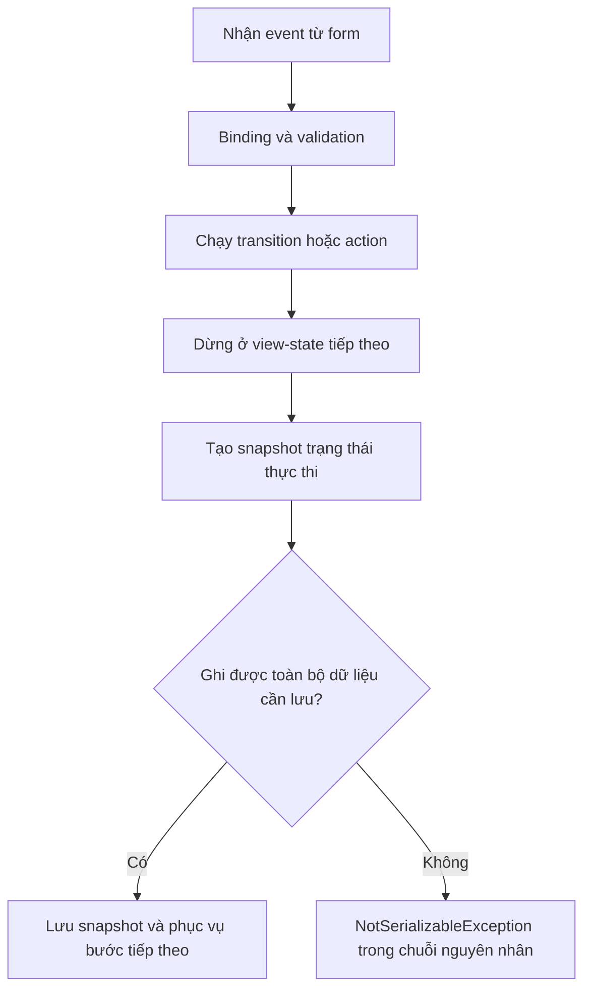

# NotSerializableException và đối tượng được giữ trong mô hình

## 1. Triệu chứng: xử lý xong nhưng không sang được bước tiếp theo

Một hành trình Spring Web Flow có thể đọc form, kiểm tra hợp lệ và gọi service thành công, nhưng trả lỗi khi chuẩn bị lưu trạng thái để phục vụ request tiếp theo. Trong chuỗi nguyên nhân có dòng tương tự:

```text
SnapshotCreationException: ...
Caused by: java.io.NotSerializableException: example.booking.PricingClient
```

Đây là minh họa rút gọn, không phải mẫu stack trace cố định cho mọi phiên bản. Tên `PricingClient` là manh mối về kiểu đối tượng mà quá trình serialization không thể ghi. Đối tượng đó có thể nằm sâu trong một thuộc tính của model, không nhất thiết được đặt trực tiếp vào scope dưới một key cùng tên.

Bài này thuộc chương **Chẩn đoán lỗi** của module **SPRING_WEB_FLOW**. Mục tiêu là tìm đường tham chiếu khiến một đối tượng bị giữ trong trạng thái của hành trình nhiều bước, sửa thiết kế model và kiểm tra khả năng tiếp tục flow sau khi trạng thái được phục hồi.

Các ví dụ Java dùng JDK 17. Phần minh họa nội bộ snapshot tham chiếu Spring Web Flow **3.0.1**; khi dùng phiên bản hoặc repository tùy chỉnh khác, cần đối chiếu cách lưu trạng thái thực tế của ứng dụng.

## 2. Lỗi thuộc bước lưu trạng thái, không nhất thiết thuộc action vừa chạy

Spring Web Flow phải duy trì thông tin về state hiện tại và dữ liệu của hành trình giữa các request. Với snapshot dựa trên Java serialization, framework chuyển trạng thái thực thi thành biểu diễn có thể lưu rồi phục hồi.



Sơ đồ mô tả một đường xử lý thường gặp, không cam kết thứ tự render/redirect/lưu của mọi cấu hình. Điểm cần giữ là lỗi serialization có thể xảy ra sau khi logic chuyển bước đã làm việc với model.

`SerializedFlowExecutionSnapshot` là triển khai snapshot dùng Java serialization. Trong mã nguồn 3.0.1, lỗi `NotSerializableException` được bọc thành `SnapshotCreationException`. Xem [SerializedFlowExecutionSnapshot](https://raw.githubusercontent.com/spring-projects/spring-webflow/v3.0.1/spring-webflow/src/main/java/org/springframework/webflow/execution/repository/snapshot/SerializedFlowExecutionSnapshot.java).

Hệ quả chẩn đoán: nhìn thấy state đích hoặc log “service hoàn tất” chưa chứng minh trạng thái mới đã được lưu thành công. Nếu action đã ghi dữ liệu nghiệp vụ trong một transaction riêng, lỗi lưu snapshot cũng không tự động chứng minh transaction đó đã rollback. Khi xử lý sự cố, phải kiểm tra kết quả ghi trước khi cho người dùng gửi lại hành động tạo đơn.

## 3. Serializable là yêu cầu của đồ thị đối tượng

Theo [Java Serialization Specification](https://docs.oracle.com/en/java/javase/17/docs/specs/serialization/serial-arch.html), quá trình ghi đi theo các tham chiếu của đối tượng để giữ các quan hệ trong đồ thị. Với cơ chế serialization mặc định, các field instance không phải `transient` tham gia biểu diễn được lưu; field `static` không thuộc trạng thái riêng của từng instance. Custom serialization có thể thay đổi những gì thực sự được ghi.

Ví dụ đường tham chiếu gây lỗi:

```text
flow execution
  └─ flow session đang hoạt động
      └─ flowScope["booking"]
          └─ BookingDraft
              └─ pricingClient
                  └─ PricingClient   ← không hỗ trợ serialization
```

Việc `BookingDraft implements Serializable` chỉ đánh dấu lớp gốc. Nó không tự biến các đối tượng mà field của lớp giữ thành serializable.

| Giá trị trong model | Điều cần kiểm tra |
| --- | --- |
| Một DTO | DTO và trạng thái được nó giữ có đáp ứng hợp đồng serialization không? |
| `List<GuestDraft>` | Kiểu collection thực tế và từng phần tử có ghi được không? |
| `Map<String, Object>` | Cả key, value và kiểu map thực tế có phù hợp không? |
| Một wrapper của kết quả truy vấn | Wrapper có giữ entity, proxy hoặc context không mong muốn không? |
| Callback hoặc inner class | Nó có giữ thêm đối tượng bên ngoài qua tham chiếu ngầm không? |

Theo [Serializable API](https://docs.oracle.com/en/java/javase/17/docs/api/java.base/java/io/Serializable.html), gặp đối tượng không hỗ trợ serialization khi duyệt đồ thị có thể dẫn tới `NotSerializableException`. Kiểm tra `root instanceof Serializable` vì thế chỉ là kiểm tra bề mặt.

Tham chiếu vòng không tự động gây lỗi: Java serialization có cơ chế giữ quan hệ tham chiếu. Vấn đề cần tìm là đối tượng không thể ghi, custom serialization từ chối ghi hoặc đồ thị quá lớn/không phù hợp với mục đích lưu trạng thái.

## 4. Scope nào có liên quan?

Với cơ chế mặc định được mô tả trong [Spring Web Flow Reference Guide](https://docs.spring.io/spring-webflow/docs/current/reference/), dữ liệu trong flow scope và view scope cần serializable; flash scope cũng có yêu cầu tương ứng. Conversation scope được lưu theo vòng đời hội thoại và thường cần serializable để đáp ứng việc lưu hoặc nhân bản phiên.

| Scope | Dữ liệu điển hình | Điểm chẩn đoán |
| --- | --- | --- |
| `flowScope` | Bản nháp dùng qua nhiều bước | Kiểm tra model và mọi đối tượng con được giữ |
| `viewScope` | Dữ liệu phục vụ view-state hiện tại | Sống qua nhiều request tại cùng view; không phải biến cục bộ Java |
| `flashScope` | Thông điệp hoặc dữ liệu ngắn hạn | Thời gian sống ngắn không bảo đảm tránh mọi đường serialization |
| `conversationScope` | Dữ liệu dùng chung giữa flow cha và các subflow | Kiểm tra cả đường lưu HTTP session và failover |
| `requestScope` | Dữ liệu chỉ cần trong lần xử lý hiện tại | Không giữ được qua request tiếp theo; xem có bị model khác tham chiếu lại không |

Một chi tiết quan trọng trong triển khai 3.0.1: `conversationScope` không được ghi như field thông thường trong snapshot của `FlowExecutionImpl`; nó được gắn lại trong quá trình phục hồi. Vì vậy, snapshot execution ghi được chưa chứng minh toàn bộ HTTP session ghi được. Xem [FlowExecutionImpl](https://raw.githubusercontent.com/spring-projects/spring-webflow/v3.0.1/spring-webflow/src/main/java/org/springframework/webflow/engine/impl/FlowExecutionImpl.java).

Tương tự, view scope là một phần dữ liệu scope của flow session trong triển khai này. Chỉ kiểm tra các key do ứng dụng đặt ở flow scope có thể bỏ sót dữ liệu đang nằm ở view scope. Xem [FlowSessionImpl](https://raw.githubusercontent.com/spring-projects/spring-webflow/v3.0.1/spring-webflow/src/main/java/org/springframework/webflow/engine/impl/FlowSessionImpl.java).

Không chuyển bừa một field sang session hoặc conversation scope để lỗi snapshot biến mất. Cách đó có thể chỉ dời lỗi sang lúc session được passivate, persist hoặc replicate, đồng thời làm dữ liệu sống lâu hơn dự định.

## 5. Ví dụ tối thiểu: model đã Serializable vẫn lỗi

Lớp dưới đây giữ cả dữ liệu và một client runtime:

```java
package example.booking;

import java.io.Serializable;

public class BadBookingDraft implements Serializable {
    private static final long serialVersionUID = 1L;

    private Long hotelId = 101L;
    private final PricingClient pricingClient = new PricingClient();

    public Long getHotelId() {
        return hotelId;
    }

    public void setHotelId(Long hotelId) {
        this.hotelId = hotelId;
    }

    public PricingClient getPricingClient() {
        return pricingClient;
    }

    public static class PricingClient {
        // Đại diện một client runtime; không implements Serializable.
    }
}
```

Nếu model này được tạo thành biến của flow:

```xml
<var name="booking" class="example.booking.BadBookingDraft"/>
```

thì field `pricingClient` sẽ được xét khi model được serialize theo cơ chế mặc định. `final` không loại field khỏi serialization. `private` cũng không loại field; việc có hay không có getter không quyết định dữ liệu được ghi theo cơ chế mặc định.

Một lỗi tương tự xuất hiện khi kết quả service được lưu trực tiếp:

```xml
<!-- Chỉ minh họa một cách giữ đối tượng runtime không phù hợp. -->
<evaluate expression="pricingService.openPricingSession()"
          result="flowScope.pricingSession"/>
```

Nếu kết quả là một phiên làm việc với tài nguyên đang mở, nó không phải dữ liệu bản nháp thích hợp để giữ qua các bước. Hãy lưu giá trị kết quả hoặc định danh có thể dùng để lấy lại dữ liệu, thay vì giữ phiên làm việc đó.

## 6. Quy trình tìm đúng tham chiếu gây lỗi

### 6.1. Xác định lúc phát sinh và chuỗi nguyên nhân

Ghi nhận flow ID, state trước/sau tương tác, event và loại repository đang dùng. Đọc toàn bộ cause chain để xác định lỗi ở thao tác ghi hay đọc trạng thái.

Thông điệp của `NotSerializableException` thường cho biết tên lớp liên quan. API cũng cho phép runtime hoặc chính lớp phát sinh exception này, nên không mặc định mọi trường hợp đều chỉ cần thêm interface. Tham khảo [NotSerializableException API](https://docs.oracle.com/en/java/javase/17/docs/api/java.base/java/io/NotSerializableException.html).

Đặt exception breakpoint cho `java.io.NotSerializableException` trong môi trường phát triển, tái hiện đúng thao tác và xem ngăn xếp gần chỗ ghi đối tượng. Nếu debugger cho phép, lần theo các field của model tới instance mang kiểu được báo lỗi.

### 6.2. Tìm nơi đối tượng được đưa vào trạng thái dài hơn request

Những vị trí thường cần xem trong mã của ứng dụng:

- `<var>` tạo model có field tham chiếu service hoặc tài nguyên runtime.
- `<evaluate result="flowScope...">` hoặc `result="viewScope..."` lưu nguyên kết quả service.
- Action gọi `getFlowScope().put(...)`, `getViewScope().put(...)` hoặc sửa collection trong model.
- Input/output mapping khi gọi subflow, đặc biệt khi truyền cả một wrapper thay vì các giá trị cần thiết.
- Logic `on-render` thêm dữ liệu phục vụ hiển thị nhưng giữ vào view scope.
- Validator hoặc listener đặt exception, callback hay context vào model để dùng lại sau.

Không chỉ tìm tên lớp trong YAML/XML. Một `Map<String, Object>` hoặc collection generic rộng có thể nhận kiểu runtime khác hẳn tên field.

### 6.3. Lập đường dẫn từ scope tới đối tượng

Viết đường tham chiếu cụ thể thay vì chỉ ghi “model bị lỗi”:

```text
viewScope["searchResult"]
  → SearchResult.items
  → ArrayList[2]
  → RoomView.priceProvider
  → PricingClient
```

Nếu loại bỏ tạm `priceProvider` trong fixture thì lỗi biến mất, đó là bằng chứng thu hẹp nguyên nhân. Chưa đủ để kết luận xóa field là cách sửa nghiệp vụ đúng: cần xác định dữ liệu nào người dùng cần tiếp tục thấy và thao tác nào phải được phục hồi.

Nếu nhiều scope cùng giữ một instance, xóa một key chưa cắt hết đường tới đối tượng. Phải kiểm tra các đường tham chiếu còn lại, kể cả từ flow cha trong khi subflow đang chạy.

### 6.4. Dùng thử ghi thực tế thay cho kiểm tra interface

Để thu hẹp lỗi, có thể serialize từng giá trị cấp cao của scope trong một fixture phát triển rồi báo tên key và kiểu nếu thất bại. Không biến thao tác đó thành bước chạy trên mọi request production: nó có thể tốn tài nguyên và kích hoạt custom `writeObject`.

Không tự viết bộ quét reflection toàn bộ đồ thị rồi coi kết quả là chân lý. `writeObject`, `writeReplace`, `Externalizable`, trường transient và các kiểu thư viện có thể làm đồ thị được ghi khác với đồ thị quan sát qua field thông thường. [Object Output Classes](https://docs.oracle.com/en/java/javase/17/docs/specs/serialization/output.html) mô tả các điểm tùy biến của đường ghi.

## 7. Sửa model theo hướng giữ dữ liệu cần tiếp tục hành trình

### 7.1. Đưa service về application context

Model nên chứa trạng thái người dùng đang chỉnh sửa và các giá trị cần giữ giữa các bước. Service và client runtime được gọi qua bean của ứng dụng:

```xml
<var name="booking" class="example.booking.BookingDraft"/>

<view-state id="enterDates" model="booking">
    <transition on="next" to="review"/>
</view-state>

<view-state id="review" model="booking">
    <on-render>
        <evaluate expression="pricingService.quote(booking)"
                  result="requestScope.quote"/>
    </on-render>
    <transition on="back" to="enterDates"/>
    <transition on="confirm" to="completed">
        <evaluate expression="bookingAction.confirm(booking, messageContext)"/>
    </transition>
</view-state>

<end-state id="completed"/>
```

Đây là đoạn trong flow XML, không phải toàn bộ cấu hình ứng dụng. `pricingService` và `bookingAction` là các bean do ứng dụng cung cấp. `quote` chỉ tính/đọc dữ liệu phục vụ render; không tạo đặt chỗ hay trừ tiền vì việc render có thể lặp lại.

Trong thiết kế minh họa, `requestScope.quote` chỉ phục vụ lượt render hiện tại. Khi confirm ở request khác, action phải tính/kiểm tra lại giá bằng dữ liệu máy chủ hoặc dùng một quote ID có chính sách hiệu lực rõ ràng. Không dựa vào việc biến request scope còn tồn tại để xác nhận giao dịch.

### 7.2. Model chứa định danh, giá trị và DTO con

```java
package example.booking;

import java.io.Serializable;
import java.time.LocalDate;
import java.util.ArrayList;
import java.util.List;

public class BookingDraft implements Serializable {
    private static final long serialVersionUID = 1L;

    private Long hotelId;
    private LocalDate checkIn;
    private LocalDate checkOut;
    private List<GuestDraft> guests = new ArrayList<>();

    public Long getHotelId() { return hotelId; }
    public void setHotelId(Long hotelId) { this.hotelId = hotelId; }

    public LocalDate getCheckIn() { return checkIn; }
    public void setCheckIn(LocalDate checkIn) { this.checkIn = checkIn; }

    public LocalDate getCheckOut() { return checkOut; }
    public void setCheckOut(LocalDate checkOut) { this.checkOut = checkOut; }

    public List<GuestDraft> getGuests() { return guests; }
    public void setGuests(List<GuestDraft> guests) {
        this.guests = new ArrayList<>(guests);
    }

    public static class GuestDraft implements Serializable {
        private static final long serialVersionUID = 1L;
        private String displayName;

        public String getDisplayName() { return displayName; }
        public void setDisplayName(String displayName) {
            this.displayName = displayName;
        }
    }
}
```

Ở đây, model không giữ `pricingService`, request, stream hoặc phiên ORM. Setter collection sao chép sang `ArrayList`, tránh giữ trực tiếp một collection view không biết rõ vòng đời. Việc sao chép container không tự sao chép sâu các phần tử: `GuestDraft` và mọi field thêm vào nó vẫn phải được xem xét.

`GuestDraft` là nested class `static`, nên không ngầm giữ một instance `BookingDraft` bên ngoài. Nếu dùng inner class không static hoặc anonymous class, hãy xem kỹ tham chiếu được capture trước khi đặt chúng vào model.

### 7.3. Định danh không thay thế kiểm tra quyền và dữ liệu mới nhất

Lưu `hotelId` thay cho entity giúp giảm đồ thị và tách khỏi persistence context. Khi dùng lại ID ở bước sau, service vẫn phải kiểm tra phòng/khách sạn còn tồn tại, người dùng có quyền thao tác và dữ liệu chưa thay đổi ngoài chính sách cho phép.

Nếu người dùng cần thấy một giá đã chốt, hãy lưu giá trị hoặc quote ID cùng thông tin hiệu lực/version cần thiết. Nếu chỉ cần giá tham khảo hiện tại, có thể tính lại khi render. Không coi mọi dữ liệu đều có thể tải lại mà vẫn giữ nguyên ý nghĩa của hành trình.

## 8. Khi nào dùng transient?

`transient` có nghĩa field bị bỏ qua bởi cơ chế serialization mặc định. Sau khi deserialize, field tham chiếu bị bỏ qua thường có giá trị mặc định là `null`; giá trị khởi tạo field của lớp serializable không tự chạy lại như một lần gọi constructor thông thường.

Ví dụ một cache thuần hiển thị có thể được dựng lại:

```java
private transient List<String> normalizedGuestNames;

public List<String> getNormalizedGuestNames() {
    if (normalizedGuestNames == null) {
        normalizedGuestNames = new ArrayList<>();
        for (GuestDraft guest : guests) {
            String name = guest.getDisplayName();
            normalizedGuestNames.add(name == null ? "" : name.trim());
        }
    }
    return normalizedGuestNames;
}
```

Đây là phần mở rộng vào `BookingDraft` để minh họa cache có thể tái tạo. Trong ứng dụng thật còn phải xóa cache khi danh sách hoặc tên khách thay đổi; nếu không, cache không đúng ngay cả trước khi serialization xảy ra.

Ngược lại, đánh dấu `transient` cho `hotelId`, danh sách khách hoặc lựa chọn người dùng chỉ để hết exception sẽ làm mất trạng thái nghiệp vụ. Đánh dấu một service field là transient cũng cần kế hoạch gắn lại dependency trước khi gọi; Java deserialization đơn thuần không tự thực hiện Spring autowiring.

Web Flow có cơ chế phục hồi tham chiếu cho biến được tạo/quản lý qua variable factory tương ứng. Ví dụ `BeanFactoryVariableValueFactory` dùng bean factory khi tạo và phục hồi tham chiếu. Điều này phải được đối chiếu với cách đối tượng được tạo và đường restore của flow, không áp dụng tự động cho mọi DTO lồng nhau hoặc kết quả của `new`. Xem [BeanFactoryVariableValueFactory 3.0.1](https://raw.githubusercontent.com/spring-projects/spring-webflow/v3.0.1/spring-webflow/src/main/java/org/springframework/webflow/engine/support/BeanFactoryVariableValueFactory.java).

Với model dữ liệu thông thường, gọi service từ action thường dễ theo dõi hơn giữ service bên trong model rồi phụ thuộc vào việc tái inject.

Cũng cần phân biệt:

- Từ khóa Java `transient` ảnh hưởng serialization mặc định.
- Annotation `jakarta.persistence.Transient` nói về mapping JPA, không tự loại field khỏi Java serialization.
- Annotation bỏ qua khi tạo JSON không tự thay đổi hành vi của `ObjectOutputStream`.
- `@Autowired` tự nó không phải chỉ thị bỏ qua field khi serialize.

Nếu lớp tự có `writeObject` hoặc triển khai `Externalizable`, kiểm tra mã ghi cụ thể: custom code vẫn có thể chủ động ghi một đối tượng vốn được đánh dấu transient trong cấu trúc field.

## 9. Những kiểu đối tượng thường bị giữ ngoài ý muốn

| Đối tượng | Vì sao dễ gây vấn đề | Dữ liệu nên giữ hoặc cách thay thế |
| --- | --- | --- |
| Service/client HTTP/DAO | Giữ connection pool, interceptor, cấu hình hoặc dependency runtime | Bean ở application context; model giữ đầu vào/kết quả cần thiết |
| `InputStream`, JDBC `Connection`, cursor | Tài nguyên đang mở không phải trạng thái hành trình có thể khôi phục bằng cách ghi field | Đọc trong phạm vi xử lý, lưu định danh hoặc dữ liệu đã tách rời |
| Request, response, context MVC/Web Flow | Tham chiếu môi trường của lần gọi hiện tại | Chỉ trích dữ liệu cần thiết; không giữ context trong model |
| File upload hoặc wrapper multipart | Có thể phụ thuộc file tạm và vòng đời request | Lưu file vào kho tạm có quản lý, giữ upload ID và metadata cần thiết |
| Entity hoặc proxy ORM | Đồ thị lớn, lazy association và trạng thái gắn persistence context | DTO hoặc ID; kiểm tra cụ thể khi phải dùng entity |
| `Stream`, `Iterator`, callback | Đại diện quá trình duyệt/hành vi, có thể capture tài nguyên khác | Materialize kết quả hữu hạn thành DTO hoặc collection phù hợp |
| Collection view, custom collection | Interface `List`/`Map` không bảo đảm kiểu runtime hỗ trợ serialization | Chọn container rõ hợp đồng, kiểm tra cả phần tử/key/value |
| `Optional<T>` trong field | Trong JDK 17, `Optional` không implements `Serializable` | Field nullable hoặc mô hình dữ liệu phù hợp; có thể trả Optional ở API method |
| Exception đặt vào flash/model | Có thể giữ cause hoặc field tùy biến ngoài dự kiến | Mã lỗi, tham số thông báo an toàn và correlation ID |

Hợp đồng của [Optional trong JDK 17](https://docs.oracle.com/en/java/javase/17/docs/api/java.base/java/util/Optional.html) không khai báo `Serializable`; bọc một DTO serializable bên trong Optional không làm container này serializable.

Không có quy tắc rằng mọi entity/proxy đều chắc chắn gây `NotSerializableException`. Một số kiểu có hỗ trợ serialization nhưng vẫn có vấn đề về kích thước, dữ liệu cũ hoặc truy cập lazy sau restore. Cần kiểm tra đồ thị thực tế và yêu cầu nghiệp vụ thay vì suy luận chỉ từ tên công nghệ.

Tương tự, một lambda được ép sang interface serializable vẫn có thể capture đối tượng không serializable. Cách sửa tốt thường là không lưu hành vi trong bản nháp; lưu các lựa chọn hoặc tham số để service thực hiện hành vi ở request sau.

## 10. Kiểm tra model bằng thao tác ghi và đọc thực tế

### 10.1. Helper nhỏ trong mã test

Helper sau dùng byte array trong bộ nhớ để kiểm tra mô hình của ví dụ. Nó không ghi file snapshot ra đĩa và không phải API để nhận dữ liệu serialize từ người dùng.

```java
package example.booking;

import java.io.ByteArrayInputStream;
import java.io.ByteArrayOutputStream;
import java.io.IOException;
import java.io.ObjectInputStream;
import java.io.ObjectOutputStream;

public final class SerializationProbe {
    private SerializationProbe() { }

    public static byte[] write(Object value) throws IOException {
        ByteArrayOutputStream bytes = new ByteArrayOutputStream();
        try (ObjectOutputStream out = new ObjectOutputStream(bytes)) {
            out.writeObject(value);
        }
        return bytes.toByteArray();
    }

    public static <T> T read(byte[] bytes, Class<T> expectedType)
            throws IOException, ClassNotFoundException {
        try (ObjectInputStream in = new ObjectInputStream(
                new ByteArrayInputStream(bytes))) {
            return expectedType.cast(in.readObject());
        }
    }
}
```

Tham số của `write` cố ý là `Object`: ta muốn thử khả năng ghi thực tế và nhận lỗi rõ ràng, thay vì chỉ chấp nhận những giá trị đã được ép kiểu `Serializable` trước khi kiểm tra.

### 10.2. Test lỗi tái hiện và test phục hồi dữ liệu

Ví dụ dưới dùng JUnit Jupiter; dự án thực hành cần có dependency test tương ứng. Hai lớp model là các lớp đã định nghĩa trong bài.

```java
package example.booking;

import java.io.NotSerializableException;
import java.time.LocalDate;
import org.junit.jupiter.api.Test;
import static org.junit.jupiter.api.Assertions.*;

class BookingDraftSerializationTest {
    @Test
    void rejectsRuntimeClientHeldByDraft() {
        NotSerializableException failure = assertThrows(
                NotSerializableException.class,
                () -> SerializationProbe.write(new BadBookingDraft()));

        assertEquals(BadBookingDraft.PricingClient.class.getName(),
                failure.getMessage());
    }

    @Test
    void preservesNestedGuestDataAfterRoundTrip() throws Exception {
        BookingDraft draft = new BookingDraft();
        draft.setHotelId(101L);
        draft.setCheckIn(LocalDate.of(2027, 4, 10));
        draft.setCheckOut(LocalDate.of(2027, 4, 12));

        BookingDraft.GuestDraft guest = new BookingDraft.GuestDraft();
        guest.setDisplayName("Nguyễn An");
        draft.getGuests().add(guest);

        byte[] bytes = SerializationProbe.write(draft);
        BookingDraft restored = SerializationProbe.read(
                bytes, BookingDraft.class);

        assertNotSame(draft, restored);
        assertEquals(draft.getHotelId(), restored.getHotelId());
        assertEquals(draft.getCheckIn(), restored.getCheckIn());
        assertEquals(draft.getCheckOut(), restored.getCheckOut());
        assertEquals(1, restored.getGuests().size());
        assertEquals("Nguyễn An", restored.getGuests().get(0).getDisplayName());
    }
}
```

Test thứ nhất minh họa model gốc đã Serializable vẫn thất bại ở client con. Test thứ hai chủ động đưa dữ liệu vào collection để kiểm tra phần tử lồng nhau. Chỉ serialize model rỗng sẽ không phát hiện field gây lỗi được thêm sau khi người dùng chọn dữ liệu.

Kiểm tra round trip cần khẳng định giá trị nghiệp vụ được giữ, không chỉ `bytes.length > 0`. Nếu đổi field quan trọng thành transient rồi test chỉ kiểm tra không còn exception, bản sửa sai có thể vẫn được chấp nhận.

Nếu có cache transient hoặc dependency cần gắn lại, bổ sung test gọi hành vi sử dụng chúng sau khi restore theo đúng cơ chế ứng dụng. Một test Java thuần chỉ chứng minh round trip Java, không chứng minh autowiring của Web Flow đã diễn ra.

## 11. Kiểm tra tại biên snapshot và repository

### 11.1. Chuyển state đúng chưa chắc đã kiểm tra serialization

Một test gọi `startFlow` và `resumeFlow` trên harness có thể chỉ chạy state machine trong bộ nhớ. Nếu không đưa execution qua bước lưu, test đó có thể thành công dù model làm snapshot thất bại trong ứng dụng thật.

Trong một lớp test đã kế thừa `AbstractXmlFlowExecutionTests` và đã đăng ký stub cho các bean mà flow gọi, có thể bổ sung phép thử tạo snapshot tại view-state đang dừng:

```java
// Import thêm vào file của lớp test flow:
import org.springframework.webflow.test.MockExternalContext;
import org.springframework.webflow.execution.repository.snapshot.SerializedFlowExecutionSnapshot;

public void testSnapshotCanBeWrittenAtReview() {
    startFlow(new MockExternalContext());

    MockExternalContext next = new MockExternalContext();
    next.setEventId("next");
    resumeFlow(next);
    assertCurrentStateEquals("review");

    new SerializedFlowExecutionSnapshot(getFlowExecution(), false);
}
```

Đây là phương thức bổ sung vào fixture đã dựng được flow, không phải một lớp test đầy đủ. Đặt hai import ở đầu file Java và đặt phương thức trong lớp test hiện có.

Constructor của [SerializedFlowExecutionSnapshot API 3.0.1](https://docs.spring.io/spring-webflow/docs/3.0.1/api/org/springframework/webflow/execution/repository/snapshot/SerializedFlowExecutionSnapshot.html) thực hiện việc tạo snapshot từ execution. Giá trị `false` chỉ tắt nén cho phép thử này; không tắt serialization.

Trước khi tạo snapshot, fixture nên đưa vào model các dữ liệu thực tế của bước review, gồm danh sách khách hoặc lựa chọn đã làm phát sinh lỗi. Phép thử trên không thay thế test validation và không tự kiểm tra HTTP session replication.

### 11.2. Kiểm tra phục hồi và request tiếp theo

Sau khi phép thử ghi thành công, cần kiểm tra ở tầng repository thực tế:

1. Bắt đầu flow và nhập đủ dữ liệu để tới bước từng lỗi.
2. Lưu execution qua repository của cấu hình cần kiểm chứng.
3. Lấy execution bằng key được trả về, đi qua đường restore của repository/factory.
4. Gửi event tiếp theo và kiểm tra state/outcome, dữ liệu người dùng cùng số lần gọi service quan trọng.
5. Nếu môi trường có lưu/nhân bản HTTP session, kiểm tra riêng đường đó, bao gồm conversation scope.

Không deserialize `FlowExecutionImpl` rồi giả định nó có thể `resume` ngay như đối tượng sống ban đầu. Các tham chiếu framework transient cần được gắn lại qua cơ chế phục hồi phù hợp. Đây là khác biệt giữa test round trip của DTO và test tiếp tục một flow execution.

### 11.3. Kiểm tra cả flow cha khi vào subflow

Khi subflow đang hoạt động, trạng thái của flow cha có thể vẫn được giữ trong execution. Việc đặt một DTO đúng ở flow con không loại bỏ một service bị giữ trong model cha.

Nên đặt điểm kiểm tra ở ba vị trí: trước khi gọi subflow, khi subflow đang dừng ở view-state và sau khi output được map về flow cha. Nếu output mapping đưa nguyên wrapper chứa context vào model cha, lỗi có thể chỉ xuất hiện ở vị trí thứ ba.

## 12. Những cách sửa chỉ che triệu chứng

| Cách làm | Vì sao chưa đủ | Cách xử lý cần có |
| --- | --- | --- |
| Chỉ thêm `implements Serializable` vào model gốc | Đối tượng con vẫn có thể không ghi được | Kiểm tra đồ thị và test với dữ liệu thật |
| Chỉ thêm `serialVersionUID` | Không cấp khả năng serialize cho dependency | Sửa dữ liệu được giữ và hợp đồng lớp |
| Đánh dấu mọi field transient | Có thể mất lựa chọn của người dùng sau restore | Chỉ bỏ qua dữ liệu tái tạo được, kiểm tra round trip |
| Chuyển service thành field static | Tạo dependency toàn cục và che sai ranh giới model/service | Dùng bean action/service của ứng dụng |
| Bọc giá trị trong một DTO hoặc map Serializable | Wrapper vẫn giữ đối tượng gây lỗi | Thay dữ liệu bên trong, không chỉ đổi vỏ |
| Chuyển từ flowScope sang conversationScope | Có thể dời lỗi sang lưu phiên/failover | Chọn scope theo vòng đời, vẫn bảo đảm hợp đồng lưu |
| Đưa mọi thứ vào requestScope | Request sau có thể mất dữ liệu cần thiết | Phân biệt dữ liệu bản nháp với dữ liệu chỉ phục vụ render |
| Chỉ tăng số snapshot được giữ | Không sửa được đối tượng không serializable | Cắt đường tham chiếu sai hoặc thiết kế lại state |
| Tắt nén snapshot | Nén xảy ra trên dữ liệu đã được ghi | Sửa lỗi serialization trước |
| Bắt lỗi rồi báo thành công | Trạng thái tiếp tục có thể chưa được lưu | Xử lý lỗi và phục hồi theo đường rõ ràng |

Trong `DefaultFlowExecutionRepository` 3.0.1, cấu hình số snapshot bằng không có thể làm thay đổi cách tạo bản sao snapshot. Đây là thay đổi hành vi repository, không phải cách sửa model bị giữ sai. Cần đánh giá riêng lịch sử quay lại, việc lưu phiên và khả năng phục hồi trước khi thay đổi. Xem [DefaultFlowExecutionRepository](https://raw.githubusercontent.com/spring-projects/spring-webflow/v3.0.1/spring-webflow/src/main/java/org/springframework/webflow/execution/repository/impl/DefaultFlowExecutionRepository.java).

Một lỗi quan sát được ít hơn sau khi đổi repository không chứng minh model đã đạt hợp đồng serialize. Giữ test model/snapshot nếu cấu hình triển khai còn phụ thuộc hợp đồng đó.

## 13. Phân biệt lỗi ghi, lỗi đọc và lỗi dữ liệu sau phục hồi

| Triệu chứng | Câu hỏi đầu tiên | Hướng điều tra |
| --- | --- | --- |
| `NotSerializableException` khi ghi | Đối tượng nào trong đồ thị không thể ghi? | Lần đường tham chiếu từ scope/model |
| `InvalidClassException` khi đọc snapshot cũ | Lớp và biểu diễn đã lưu còn tương thích không? | Kiểm tra phiên bản lớp, UID và điều kiện serialization |
| `ClassNotFoundException` khi đọc | Runtime có đúng lớp/classloader không? | Kiểm tra gói triển khai và đường classloader |
| Service field null sau restore | Dependency đã được bỏ qua nhưng chưa gắn lại? | Kiểm tra transient, cách tạo model và lifecycle restore |
| Entity đọc được nhưng truy cập association lỗi | Có phụ thuộc persistence context cũ không? | Tách DTO hoặc tải dữ liệu ở transaction phù hợp |
| Flow tiếp tục nhưng mất ngày hoặc khách đã nhập | Field nghiệp vụ có bị loại khỏi snapshot không? | Kiểm tra transient/custom serialization và assertion dữ liệu |

`serialVersionUID` hữu ích cho hợp đồng phiên bản lớp, nhưng giữ nguyên UID không tự bảo đảm mọi thay đổi schema dữ liệu đều tương thích về ý nghĩa. [InvalidClassException API](https://docs.oracle.com/en/java/javase/17/docs/api/java.base/java/io/InvalidClassException.html) mô tả các nguyên nhân lỗi lớp khi xử lý serialization, gồm trường hợp phiên bản serial không khớp.

Sau triển khai phiên bản mới, nếu quyết định không hỗ trợ snapshot cũ, ứng dụng cần chính sách hết hạn hoặc bắt đầu lại rõ ràng. Không hướng dẫn người dùng bấm gửi lại vô hạn, nhất là khi action trước đó có thể đã tạo tác động nghiệp vụ.

Khi log, nên giữ flow ID, state, event, lớp gây lỗi, key scope hoặc đường tham chiếu đã xác định và correlation ID. Không dump toàn bộ model hoặc byte snapshot để “xem nhanh”: dữ liệu đặt phòng có thể chứa thông tin cá nhân và dump lớn thường che mất manh mối chính.

## 14. Bài thực hành và tiêu chí hoàn tất

Đây là kế hoạch thực hành trong một ứng dụng Web Flow đã có cấu hình test phù hợp; các ví dụ trong tài liệu chưa được tuyên bố đã chạy trên ứng dụng của người học.

| Tình huống | Kết quả cần quan sát |
| --- | --- |
| Ghi `BadBookingDraft` bằng helper | Lỗi chỉ ra kiểu `BadBookingDraft.PricingClient` |
| Thay bằng `BookingDraft` chỉ giữ dữ liệu | Model ghi và đọc lại được |
| Điền khách vào danh sách trước round trip | Giữ đủ tên khách, ngày và hotel ID |
| Thêm phần tử chứa dependency runtime vào fixture thử nghiệm | Test thất bại dù model/container gốc có Serializable |
| Dùng cache transient có thể tái tạo | Sau restore, hành vi đọc cache vẫn cho dữ liệu đúng |
| Tạo snapshot ở từng view-state quan trọng | Không chỉ bước đầu mà cả bước đã thêm dữ liệu đều ghi được |
| Lưu rồi lấy execution qua repository thật | Event tiếp theo chạy được với dữ liệu còn nguyên |
| Đang ở subflow nhưng model cha bị giữ sai | Phát hiện lỗi từ đồ thị cha, không chỉ kiểm tra flow con |
| Kiểm tra lưu/khôi phục phiên nếu ứng dụng có yêu cầu | Conversation scope và dữ liệu phiên cũng đáp ứng hợp đồng |
| Tái hiện lỗi sau một action ghi nghiệp vụ | Xác định tác động đã xảy ra và kiểm soát việc gửi lại |

Một bản sửa được coi là đủ bằng chứng khi xác định được đường tham chiếu gây lỗi, loại bỏ hoặc thay thế đúng đối tượng, giữ nguyên dữ liệu nghiệp vụ cần thiết sau round trip và tiếp tục được hành trình qua đường restore thực tế. Chỉ biến thông báo lỗi thành im lặng hoặc chỉ làm model rỗng serialize được chưa đáp ứng mục tiêu đó.
