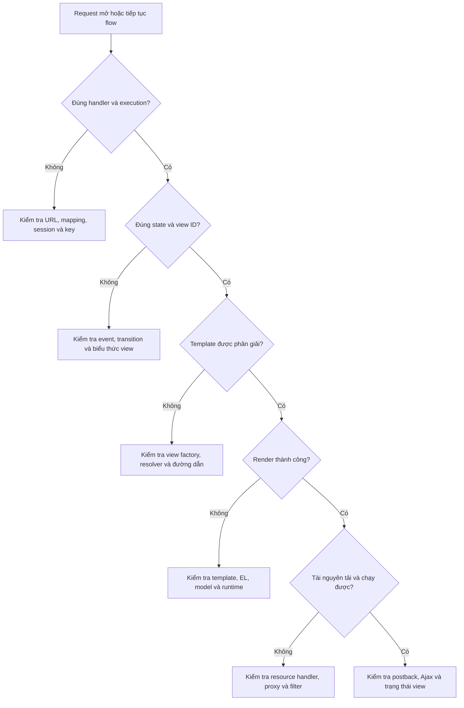

# Lỗi view, tài nguyên Faces và cấu hình ViewResolver

## 1. Mục tiêu và phạm vi

Flow đã đi tới state `enterDetails` nhưng người dùng thấy 404. Trang Faces hiển thị form nhưng nút Ajax không phản hồi. Controller MVC tìm được template, còn cùng tên view trong Web Flow lại thất bại. Những biểu hiện này có thể xuất phát từ các ranh giới khác nhau, dù đều được mô tả chung là “lỗi giao diện”.

Trong **SPRING_WEB_FLOW**, cần lần theo đường đi từ request tới flow, từ state tới view, rồi từ HTML tới các tài nguyên mà trình duyệt tải thêm. Sửa đúng ranh giới giúp giữ nguyên mô hình điều phối bằng state, event, transition và subflow, thay vì đưa thêm logic điều hướng rải rác vào controller để che lỗi.

Sau bài học, bạn có thể:

- Phân biệt lỗi chọn state, phân giải view, render template và tải tài nguyên.
- Nhận diện sự khác nhau giữa view theo đường dẫn tương đối của flow và logical view name qua resolver MVC.
- Nối đúng ViewResolver với cấu hình dựng flow, kiểm tra thứ tự và phạm vi context.
- Kiểm tra phần tích hợp Faces, resource handler và tài nguyên JavaScript/CSS.
- Thu thập bằng chứng tối thiểu, sửa có mục tiêu và xác minh cả request đầu lẫn request tiếp theo.

Các ví dụ lấy Spring Web Flow 3.0.x, Spring Framework 6 và Jakarta Faces 4 làm mốc. Chỉ áp dụng phần Faces nếu ứng dụng thực sự dùng Faces; một ứng dụng MVC với JSP hoặc template khác không cần thêm Faces để khắc phục lỗi view. Các đoạn cấu hình là ví dụ thực hành, không phải cấu hình đã được kiểm thử trên một ứng dụng cụ thể trong quá trình viết bài.

## 2. Tách bốn loại lỗi trước khi sửa

| Ranh giới | Câu hỏi | Dấu hiệu cần tìm |
|---|---|---|
| Routing và execution | Request có tới đúng flow và execution không? | Sai handler, không tìm thấy flow/execution, redirect về trang đầu |
| Lựa chọn và phân giải view | State yêu cầu view nào, cơ chế nào phân giải? | Logical name sai, prefix/suffix sai, view factory không phù hợp |
| Render template | Template đã được tìm thấy nhưng có dựng được giao diện không? | Lỗi parse, include, EL, model hoặc renderer |
| Tải tài nguyên client | HTML đã có nhưng script/CSS có tải và chạy không? | 404 resource, HTML thay cho JavaScript, lỗi console hoặc CSP |

Một 404 của request trang và một 404 của file JavaScript không phải cùng một lỗi. Một exception về thuộc tính model trong Facelets cũng không đồng nghĩa ViewResolver không tìm thấy template.



Tên state và tên view có thể khác nhau. Để chẩn đoán, ghi cả hai thay vì chỉ ghi “đang ở bước nhập liệu”. Với subflow, cũng cần xác định active flow hiện tại; view thuộc flow con không nhất thiết nằm cạnh XML của flow cha.

## 3. Thu thập bằng chứng tối thiểu

Trước khi thay cấu hình, ghi nhận một lần lỗi cụ thể:

```text
Mã tương quan request: req-view-17
Thao tác: mở flow registration rồi nhấn next
Flow ID: registration
Active state: enterDetails
View ID được yêu cầu: registration/details
Công nghệ dự kiến: JSP qua MVC ViewResolver
Request trang: GET /learning/spring/registration?execution=...
Kết quả trang: HTTP 500
Nguyên nhân liên quan: đường dẫn forward tới JSP không tồn tại
Tài nguyên lỗi riêng: chưa xác định
```

Đây là mẫu thông tin chẩn đoán do ứng dụng thu thập, không phải định dạng log mặc định của Spring Web Flow. Giá trị execution key trong báo cáo dùng chung cần được che nếu không cần thiết.

Bằng chứng hữu ích gồm URL thực tế, status, redirect chain, content type, handler xử lý, active flow/state, view ID và cause chain. Với Faces hoặc Ajax, thêm request tài nguyên đầu tiên bị lỗi và console của trình duyệt.

Đọc exception tới nguyên nhân có ý nghĩa đầu tiên, rồi đối chiếu với cấu hình. Không chỉ tìm một chuỗi lỗi trên Internet và sao chép bản sửa từ stack khác phiên bản hoặc khác công nghệ view.

## 4. Ba không gian đường dẫn thường bị nhầm

### 4.1. Flow-relative view

Giả sử flow nằm tại:

```text
/WEB-INF/flows/registration/registration-flow.xml
```

Với cơ chế MVC view mặc định theo tài nguyên của flow, view được tìm trong vùng làm việc của flow; suffix mặc định của `MvcViewFactoryCreator` là `.jsp`. Ví dụ cần đối chiếu:

```xml
<view-state id="enterDetails" view="details.jsp"/>
```

Template dự kiến trong cách đóng gói này:

```text
/WEB-INF/flows/registration/details.jsp
```

Không mặc định một bean resolver có prefix `/WEB-INF/views/` đã được áp dụng vào đường dẫn này. `MvcViewFactoryCreator` hỗ trợ cả cơ chế mặc định và việc ủy quyền cho resolver MVC; xem [Javadoc MvcViewFactoryCreator 3.0.0](https://docs.spring.io/spring-webflow/docs/3.0.0/api/org/springframework/webflow/mvc/builder/MvcViewFactoryCreator.html).

### 4.2. Logical view name qua resolver MVC

Nếu ứng dụng chủ động dùng resolver có:

```text
prefix = /WEB-INF/views/
suffix = .jsp
```

thì logical name:

```text
registration/details
```

được ánh xạ theo cấu hình mẫu thành:

```text
/WEB-INF/views/registration/details.jsp
```

Hai lỗi thường gặp khi dùng resolver thêm suffix:

| Giá trị đưa vào resolver | Kết quả có thể được tạo | Vấn đề |
|---|---|---|
| `registration/details.jsp` | `/WEB-INF/views/registration/details.jsp.jsp` | Thêm suffix hai lần |
| `/WEB-INF/views/registration/details` | `/WEB-INF/views//WEB-INF/views/registration/details.jsp` | Lặp prefix |

Bảng mô tả phép ghép của resolver mẫu, không phải mọi resolver hoặc mọi template engine đều xử lý giống nhau. Cần xác định view ID thực tế đã đi vào resolver nào.

### 4.3. Faces view ID và URL tài nguyên

Trong môi trường Faces đã được tích hợp đúng, một view-state có thể chỉ tới Facelets:

```xml
<view-state id="enterDetails" view="details.xhtml"/>
```

Tên `.xhtml` không tự bật Faces lifecycle. Nếu flow vẫn được dựng bằng view factory MVC/JSP không phù hợp, chỉ đổi suffix sang `.xhtml` chưa đủ để render component Faces.

Ngoài ra, URL của trang flow và URL của tài nguyên Faces là hai loại request khác nhau. Template `details.xhtml` không phải file JavaScript được phục vụ qua resource handler, và resource URL không phải logical view name để đưa vào JSP resolver.

## 5. Nối resolver MVC vào đúng cấu hình dựng flow

### 5.1. Triệu chứng: controller hoạt động, flow thất bại

Một `@Controller` có thể dùng resolver được DispatcherServlet phát hiện, còn registry của Web Flow đang dùng `FlowBuilderServices` khác. Vì vậy, “resolver bean đã có trong application context” chưa chứng minh flow đã được dựng bằng resolver đó.

Chuỗi cần kiểm tra:

```text
Flow registry đang được executor sử dụng
  → FlowBuilderServices của registry đó
  → MvcViewFactoryCreator
  → Danh sách ViewResolver thực tế
  → View được chọn và tài nguyên render
```

Đặc biệt chú ý khi có nhiều registry, nhiều servlet context hoặc cấu hình theo profile. Một bean cùng tên trong context khác chưa chắc là bean của request đang lỗi.

### 5.2. Ví dụ nối tường minh cho JSP

Ví dụ dưới đây minh họa phần dựng flow và phân giải JSP. Nó giả định các handler web, servlet container và JSP runtime đã được cấu hình ở phần còn lại của ứng dụng.

```xml
<beans xmlns="http://www.springframework.org/schema/beans"
       xmlns:xsi="http://www.w3.org/2001/XMLSchema-instance"
       xmlns:webflow="http://www.springframework.org/schema/webflow-config"
       xsi:schemaLocation="
         http://www.springframework.org/schema/beans
         https://www.springframework.org/schema/beans/spring-beans.xsd
         http://www.springframework.org/schema/webflow-config
         https://www.springframework.org/schema/webflow-config/spring-webflow-config.xsd">

    <bean id="flowJspResolver"
          class="org.springframework.web.servlet.view.InternalResourceViewResolver">
        <property name="prefix" value="/WEB-INF/views/"/>
        <property name="suffix" value=".jsp"/>
        <property name="order" value="2147483647"/>
    </bean>

    <bean id="mvcViewFactoryCreator"
          class="org.springframework.webflow.mvc.builder.MvcViewFactoryCreator">
        <property name="viewResolvers">
            <list>
                <ref bean="flowJspResolver"/>
            </list>
        </property>
    </bean>

    <webflow:flow-builder-services id="mvcFlowBuilderServices"
        view-factory-creator="mvcViewFactoryCreator"/>

    <webflow:flow-registry id="mvcFlowRegistry"
        flow-builder-services="mvcFlowBuilderServices">
        <webflow:flow-location id="registration"
            path="/WEB-INF/flows/registration/registration-flow.xml"/>
    </webflow:flow-registry>

    <webflow:flow-executor id="flowExecutor"
        flow-registry="mvcFlowRegistry"/>
</beans>
```

Trong flow của ví dụ này, dùng logical name phù hợp resolver:

```xml
<view-state id="enterDetails" view="registration/details"/>
```

`viewResolvers` là danh sách. Nếu có nhiều resolver, khai báo theo thứ tự muốn ủy quyền; không mặc định một danh sách tự gán bằng XML sẽ được sắp xếp lại giống cách DispatcherServlet phát hiện bean. Chữ ký và quy tắc thứ tự danh sách được mô tả trong [MvcViewFactoryCreator.setViewResolvers](https://docs.spring.io/spring-webflow/docs/3.0.1/api/org/springframework/webflow/mvc/builder/MvcViewFactoryCreator.html).

Cách nối resolver chỉ giải quyết ranh giới phân giải view. Nếu JSP không có trong artifact, thiếu JSP engine hoặc template có lỗi tag/EL, cần sửa vấn đề tương ứng sau khi view đã được chọn đúng.

## 6. Thứ tự resolver, phạm vi xử lý và context

### 6.1. Đặt resolver nhận rộng ở cuối

Một resolver trả `null` có thể nhường cơ hội cho resolver kế tiếp. Tuy nhiên, `InternalResourceViewResolver` thường tạo đối tượng view mà chưa xác nhận tài nguyên JSP thật sự tồn tại, nên cần đặt cuối chuỗi. Xem [Javadoc InternalResourceViewResolver của Spring Framework 6.0](https://docs.spring.io/spring-framework/docs/6.0.0/javadoc-api/org/springframework/web/servlet/view/InternalResourceViewResolver.html).

Ví dụ lỗi:

```text
1. JSP resolver nhận mọi view name
2. Resolver cho template HTML

View name: reports/summary
JSP resolver tạo view forward tới JSP không tồn tại.
Resolver HTML phía sau không có cơ hội xử lý.
```

Bản sửa cần xác định công nghệ nào sở hữu nhóm view nào, đặt thứ tự phù hợp và giới hạn phạm vi tên nếu resolver hỗ trợ. Không chỉ giảm `order` của mọi resolver xuống cùng một giá trị.

Không dùng điều kiện “resolveViewName trả về khác null” làm bằng chứng file tồn tại. Với JSP, cần render/forward trong môi trường servlet phù hợp để xác minh kết quả cuối.

### 6.2. Prefix đúng nhưng forward sai

Nếu view name trùng URL xử lý và không có ánh xạ tài nguyên phù hợp, forward có thể quay lại handler và gây vòng lặp hoặc lỗi circular view path. Hãy ghi đường dẫn đích của forward, thay vì chỉ nhìn tên logical view.

Đường dẫn dưới `/WEB-INF` thường được dùng cho template nội bộ. Gõ trực tiếp URL `/WEB-INF/...` trên trình duyệt rồi nhận 404 không chứng minh template không thể render qua server-side dispatch.

### 6.3. Context cha/con và profile

Kiểm tra các điểm sau bằng context thực tế của ứng dụng:

- Bean resolver có nằm trong context mà cấu hình flow truy cập được không?
- Có nhiều `FlowBuilderServices` và registry không; executor dùng registry nào?
- Profile triển khai có thay prefix, template location hoặc bean view factory không?
- Cấu hình Java/XML có bị nạp hai lần hoặc tạo hai adapter khác nhau không?

Không dựa vào tên file cấu hình để kết luận nó đã được load. Dùng log khởi tạo, thông tin bean tại runtime hoặc phép kiểm tra cấu hình trong môi trường test.

## 7. Lỗi riêng của tích hợp Faces

### 7.1. Các vai trò phải khớp nhau

Trong một cấu hình Faces/Web Flow, cần kiểm tra các vai trò thay vì sửa riêng một suffix:

| Vai trò | Cần xác nhận |
|---|---|
| Faces runtime | Implementation và API tương thích đã được khởi tạo |
| Dựng flow | Dùng dịch vụ dựng view phù hợp Faces |
| Vòng đời request | Có context Faces cho request flow và được giải phóng đúng |
| Adapter web | Xử lý flow và Ajax theo tích hợp Faces |
| Resource handling | Request JavaScript/CSS được chuyển tới Faces ResourceHandler |

`FlowFacesContextLifecycleListener` tạo context cho request flow và giải phóng sau khi xử lý; nó không phải resolver JSP. Xem [Javadoc FlowFacesContextLifecycleListener](https://docs.spring.io/spring-webflow/docs/3.0.0/api/org/springframework/faces/webflow/FlowFacesContextLifecycleListener.html).

Nếu gặp lỗi không có FacesContext, kiểm tra đường đi thực tế của request và cấu hình vòng đời. Không chữa bằng cách tự giữ FacesContext trong singleton hoặc tự tạo context chung cho nhiều request.

### 7.2. Phần cấu hình XML cần đối chiếu

Đoạn dưới là phần trích cho nhánh Faces, giả định namespace `faces`, `webflow` và bean namespace đã được khai báo. Dùng nó để đối chiếu một cấu hình Faces hiện có; không ghép nguyên các bean này vào ví dụ MVC/JSP ở mục 5 rồi để chúng tranh xử lý cùng flow.

```xml
<faces:flow-builder-services id="facesFlowBuilderServices"/>

<webflow:flow-registry id="facesFlowRegistry"
    flow-builder-services="facesFlowBuilderServices">
    <webflow:flow-location id="registration"
        path="/WEB-INF/flows/registration/registration-flow.xml"/>
</webflow:flow-registry>

<bean id="facesContextListener"
      class="org.springframework.faces.webflow.FlowFacesContextLifecycleListener"/>

<webflow:flow-executor id="facesFlowExecutor"
    flow-registry="facesFlowRegistry">
    <webflow:flow-execution-listeners>
        <webflow:listener ref="facesContextListener"/>
    </webflow:flow-execution-listeners>
</webflow:flow-executor>

<faces:resources/>

<bean class="org.springframework.faces.webflow.JsfFlowHandlerAdapter">
    <property name="flowExecutor" ref="facesFlowExecutor"/>
</bean>
```

Trong cấu hình XML tham chiếu của Spring Web Flow, `JsfFlowHandlerAdapter` là adapter dành cho nhánh Faces, còn `faces:resources` nối việc phục vụ tài nguyên. Phần khởi tạo FacesServlet vẫn cần được xử lý theo mô hình triển khai. Xem [Spring Web Flow 3.x: JSF Integration](https://docs.spring.io/spring-webflow/docs/3.0.x/reference/).

Nếu cấu hình bằng Java và dùng `AbstractFacesFlowConfiguration`, lớp nền đã cung cấp bean cho xử lý tài nguyên Faces. Hãy xác nhận cấu hình đó thực sự được nạp trước khi thêm một bộ mapping trùng lặp. Xem [Javadoc AbstractFacesFlowConfiguration](https://docs.spring.io/spring-webflow/docs/3.0.0/api/org/springframework/faces/config/AbstractFacesFlowConfiguration.html).

### 7.3. Nhầm phiên bản và namespace

Khi chuyển stack cũ sang Jakarta, đối chiếu đồng thời API, implementation, servlet container, tag namespace và thư viện component. Một JAR còn tham chiếu `javax.faces` trong stack dùng `jakarta.faces` có thể gây lỗi class loading trước khi template được render.

Đừng đưa thêm API JAR trùng lặp chỉ để làm biến mất một lỗi thiếu class mà chưa kiểm tra dependency graph. Cần biết thành phần nào được container cung cấp và thành phần nào do ứng dụng đóng gói.

Nếu trang có biểu thức EL không được xử lý hoặc markup component thô, kiểm tra view có đi qua đúng công nghệ render không, namespace có khớp runtime không và file có đang bị phục vụ như tài nguyên tĩnh không.

## 8. Chẩn đoán tài nguyên Faces

### 8.1. Bắt đầu từ URL được render thực tế

Mở Network của trình duyệt, lấy URL script/CSS từ HTML hoặc request đã phát sinh. Đối chiếu:

```text
URL công khai trên trình duyệt
  → reverse proxy, context path
  → servlet mapping
  → Spring HandlerMapping hoặc đường xử lý tài nguyên tương ứng
  → JsfResourceRequestHandler
  → Faces ResourceHandler
  → tài nguyên trong webapp hoặc JAR
```

`JsfResourceRequestHandler` ủy quyền cho Faces ResourceHandler để phục vụ tài nguyên webapp và classpath; xem [Javadoc JsfResourceRequestHandler](https://docs.spring.io/spring-webflow/docs/3.0.0/api/org/springframework/faces/webflow/JsfResourceRequestHandler.html).

Không tự đoán URL rồi hard-code tên thư viện, suffix hay tham số phiên bản. URL do runtime tạo có thể phụ thuộc servlet mapping và context path.

### 8.2. Đối chiếu library và vị trí đóng gói

Ví dụ Facelets dùng tài nguyên của ứng dụng:

```xml
<h:outputScript library="platform" name="booking.js" target="body"/>
```

Cách đóng gói minh họa:

```text
Trong webapp:
  /resources/platform/booking.js

Trong thư viện JAR:
  /META-INF/resources/platform/booking.js
```

Tag cần nằm trong trang Faces có namespace phù hợp và cấu trúc `h:head`/`h:body` phù hợp với vị trí render. `library` và `name` được dùng để tìm Resource rồi tạo URL; xem [VDL h:outputScript của Jakarta Faces 4.0](https://jakarta.ee/specifications/faces/4.0/vdldoc/h/outputScript.html).

Nếu tài nguyên dùng component library, kiểm tra JAR runtime thực tế có chứa nó. Tài nguyên có trong source tree hoặc dependency ở scope test chưa chứng minh nó có trong artifact triển khai.

### 8.3. Phân loại theo response

| Kết quả request tài nguyên | Khả năng cần kiểm tra | Bằng chứng quyết định |
|---|---|---|
| 404 | Mapping hoặc tài nguyên không tồn tại | Handler được chọn, resource name/library và artifact |
| 302/303 sang đăng nhập | Filter bảo mật chặn resource | Redirect chain và chính sách cho URL tài nguyên cần thiết |
| 200 nhưng `text/html` | Nhận trang login/error hoặc fallback | Những byte đầu body và URL response cuối |
| 403 | Chính sách truy cập hoặc chặn ở proxy | Log filter/proxy theo mã tương quan |
| 500 | Resource handler/runtime khởi tạo lỗi | Cause chain phía server |
| 200 đúng script nhưng không chạy | Lỗi JavaScript, CSP hoặc thứ tự phụ thuộc | Console và response header liên quan |
| 304 | Trình duyệt dùng cache theo điều kiện | Bản đã cache có đúng phiên bản và content không |

Dấu hiệu như `Unexpected token '<'` khi tải script thường gợi ý body bắt đầu bằng HTML, nhưng vẫn phải mở response để xác nhận. Đừng đổi MIME type thành JavaScript cho một trang HTML lỗi.

Nếu cần cho phép tài nguyên phục vụ trước đăng nhập, giới hạn đúng nhóm URL tài nguyên mà ứng dụng sử dụng. Không mở toàn bộ đường dẫn ứng dụng chỉ để làm một file script tải được.

### 8.4. Trường hợp proxy và context path

Ứng dụng chạy ở root trên máy phát triển nhưng dưới `/learning` ở môi trường triển khai có thể sinh URL khác. Một đường dẫn viết cứng `/resources/...` có thể bỏ mất context path hoặc không đi qua servlet mapping cần thiết.

So sánh URL được sinh trước và sau proxy, gồm scheme, host, tiền tố đường dẫn và query cần thiết. Chỉ điều chỉnh forwarded headers hoặc rewrite khi đã xác định lớp nào sinh hoặc đổi URL sai; không sửa đồng thời cả proxy lẫn template chỉ để thử vận may.

## 9. Phân biệt template thiếu với lỗi model và scope

Nếu template đã được tìm thấy nhưng render báo thuộc tính không tồn tại, kiểm tra:

- Tên biến trong flow và biểu thức trong template có khớp không?
- Biến được tạo trước khi vào view chưa?
- Getter/setter và kiểu dữ liệu có phù hợp với biểu thức/component không?
- Biến thuộc view scope đã bị hủy khi rời state hay thuộc flow scope cần giữ qua nhiều bước?
- View đang thuộc flow con có đang giả định được thấy mọi biến trong flow scope của flow cha không?

Ví dụ:

```xml
<var name="registrationForm" class="example.RegistrationForm"/>
```

Template minh họa:

```xml
<h:inputText value="#{registrationForm.email}"/>
```

Đoạn khai báo cần nằm trong flow có mô hình phù hợp, lớp model có thuộc tính `email` truy cập được. Nếu template dùng `#{form.email}` mà không có biến `form`, thêm resolver JSP mới sẽ không giải quyết lỗi EL đó.

Nếu view được chọn bằng biểu thức, ghi lại giá trị biểu thức tại request lỗi. Có thể biểu thức chỉ trả đường dẫn sai trong một nhánh quyền, một locale hoặc một outcome của subflow; tên file tồn tại ở nhánh khác không đủ để loại trừ lỗi.

## 10. Log và kiểm tra artifact có mục tiêu

### 10.1. Bật log đúng phạm vi

Nếu ứng dụng dùng cơ chế cấu hình logging kiểu Spring Boot, có thể tạm thời đối chiếu các nhóm log:

```properties
logging.level.org.springframework.webflow=DEBUG
logging.level.org.springframework.web.servlet=DEBUG
logging.level.org.springframework.faces=DEBUG
```

Đây là ví dụ cấu hình logging có điều kiện, không phải thuộc tính riêng của Spring Web Flow và không áp dụng nguyên văn cho mọi hệ thống log. Nếu cần chi tiết Faces implementation, chọn logger của implementation thực tế đang dùng.

Tìm các mốc: handler xử lý request, flow/state trước khi render, view ID, đường dẫn template hoặc forward, resource handler và exception gốc. Không mặc định DEBUG sẽ luôn in đủ mọi trường; có thể cần breakpoint hoặc quan sát bổ sung tại môi trường test.

Giữ thời gian bật log trong phạm vi chẩn đoán và lọc dữ liệu nhạy cảm khỏi artifact chia sẻ. Không đưa toàn bộ form, cookie hoặc ViewState vào log chỉ để tìm đường dẫn template.

### 10.2. Kiểm tra bản đóng gói thay vì chỉ source tree

Trong một dự án thử nghiệm đóng gói WAR, có thể kiểm tra nội dung bằng lệnh tương tự:

```powershell
jar tf .\build\libs\learning-web.war | rg 'WEB-INF/views|WEB-INF/flows|resources/platform|spring-faces|faces'
```

Tên artifact và thư mục build trong lệnh chỉ là ví dụ; dùng đường dẫn thực tế của ứng dụng. Lệnh này liệt kê artifact, chưa chứng minh resource sẽ được handler chọn đúng ở runtime.

Đối chiếu chữ hoa/thường, thư mục template, include và JAR component. Hệ thống phát triển trên Windows có thể che sai lệch tên file mà môi trường Linux hoặc cách đóng gói khác làm lộ ra.

Với JSP, kiểm tra cả khả năng hỗ trợ của kiểu đóng gói và servlet container đang dùng. Với template engine khác, kiểm tra template location và integration library phù hợp. Không sao chép template vào nhiều thư mục để “chỗ nào cũng có”, vì cách đó che việc chọn sai view resolver.

## 11. Ba tình huống chẩn đoán mẫu

### 11.1. Controller MVC render được, flow báo không tìm thấy view

**Bối cảnh:** Controller trả `registration/details` và hoạt động. Flow dùng cùng tên nhưng lỗi khi vào `enterDetails`.

**Bằng chứng cần thu:** registry của executor, `FlowBuilderServices`, view factory và đường dẫn mà flow thực sự yêu cầu.

**Giả thuyết:** Flow vẫn dùng cách tìm tài nguyên tương đối trong thư mục flow, chưa ủy quyền cho resolver của MVC.

**Cách sửa khi giả thuyết được xác nhận:** Nối resolver vào `MvcViewFactoryCreator`, nối factory vào builder services và registry đúng như kiến trúc dự kiến. Giữ logical view name nhất quán với prefix/suffix.

**Xác minh:** Khởi động flow qua HTTP, render được template đã đóng gói, gửi event đi bước tiếp theo rồi quay lại. Không dừng ở việc application context khởi tạo thành công.

### 11.2. Trang Faces hiện nhưng nút Ajax không hoạt động

**Bối cảnh:** HTML trang trả 200. Console báo lỗi script; request JavaScript có content type HTML.

**Bằng chứng cần thu:** URL script do runtime sinh, redirect chain, body đầu response và filter xử lý.

**Giả thuyết:** Request tài nguyên bị chuyển tới trang đăng nhập hoặc fallback HTML, không tới resource handler.

**Cách sửa khi được xác nhận:** Sửa mapping hoặc chính sách truy cập đúng nhóm resource; giữ nguyên luồng bảo vệ trang nghiệp vụ. Không thay JavaScript bằng bản chép tay từ phiên bản khác để né resource pipeline.

**Xác minh:** Tài nguyên tải với nội dung đúng, Ajax phát request, partial response hợp lệ, vùng đích thay đổi và thao tác lần hai vẫn thành công.

### 11.3. Chạy local được, triển khai lỗi template hoặc include

**Bối cảnh:** Máy phát triển tìm thấy `Details.xhtml`, nhưng cấu hình tham chiếu `details.xhtml`; artifact triển khai giữ tên khác chữ hoa/thường hoặc thiếu include.

**Bằng chứng cần thu:** Tên trong cấu hình, URL/resource location đã resolve và nội dung artifact đã triển khai.

**Giả thuyết:** Sai lệch đóng gói hoặc chữ hoa/thường, không phải lỗi transition.

**Cách sửa khi được xác nhận:** Chuẩn hóa tên và đường dẫn, sửa quy tắc đóng gói nếu cần, triển khai đúng artifact. Không thêm redirect qua controller chỉ vì flow đã tới đúng state nhưng template thiếu.

**Xác minh:** Kiểm tra chính artifact triển khai, gồm template chính, include và tài nguyên, rồi đi lại hành trình nhiều bước.

## 12. Xác minh sau sửa và ngăn tái diễn

| Phép kiểm tra | Chứng minh được | Giới hạn |
|---|---|---|
| Context khởi tạo | Bean và cấu hình cơ bản hợp lệ | Chưa render template |
| Gọi resolver | Tên view được resolver nhận | JSP View khác null chưa chứng minh tài nguyên tồn tại |
| Flow test không servlet | State/event đúng | Có thể dùng view giả hoặc không chạy renderer thật |
| HTTP integration | Routing, forward/render trong runtime web | Chưa chắc JavaScript hoạt động |
| Trình duyệt | Tài nguyên, DOM, Ajax và thao tác tiếp theo | Chỉ bao phủ kịch bản và môi trường đã chạy |
| Kiểm tra artifact | Tệp và dependency có được đóng gói | Chưa chứng minh mapping runtime đúng |

Sau một bản sửa, chạy lại đúng đường gây lỗi và một chuỗi tiếp tục flow: mở bước → nhập dữ liệu → gửi event → quay lại hoặc tiếp tục. Với Faces, kiểm tra tài nguyên tải thật, validation hiển thị được và postback tiếp theo không dùng trạng thái hỏng.

Nếu render lỗi sau một action đã có tác dụng phụ, không mặc định người dùng tải lại sẽ an toàn. Kiểm tra tác vụ đã commit chưa và thiết kế retry/chống trùng phù hợp; lỗi hiển thị không tự hoàn tác dữ liệu đã ghi.

Nếu thay đổi liên quan cache, phân biệt cache trình duyệt, proxy, resolver và flow definition. Xóa một cache có thể giúp kiểm chứng nhưng không thay cho việc triển khai đúng cấu hình. Không tắt mọi cache lâu dài như một bản sửa chung.

### Bài thực hành

Trong dự án thử nghiệm, tạo lần lượt một lỗi có chủ đích rồi khôi phục:

1. Thêm `.jsp` vào logical view name khi resolver đã thêm suffix; ghi đường dẫn sai và sửa đúng tên.
2. Ngắt liên kết registry với builder services dự kiến; chứng minh flow và controller không còn dùng cùng đường phân giải.
3. Đặt resolver JSP trước resolver chuyên biệt; quan sát resolver nào chiếm view name.
4. Nếu dùng Faces, làm sai `library` hoặc `name` của một resource; phân biệt lỗi thiếu tài nguyên với lỗi mapping.
5. Tạo một response HTML cho URL script trong môi trường test; xác định bằng content type và body.
6. Kiểm tra template và resource trong artifact trước khi chạy lại hành trình qua HTTP.

Tiêu chí hoàn thành là giải thích được request đã đi qua handler nào, state đã chọn view nào, cơ chế nào phân giải template, tài nguyên nào thất bại và bằng chứng nào cho thấy bản sửa có hiệu lực. Khi những ranh giới này rõ ràng, lỗi giao diện không còn bị sửa bằng những thay đổi điều hướng hoặc cấu hình không liên quan.