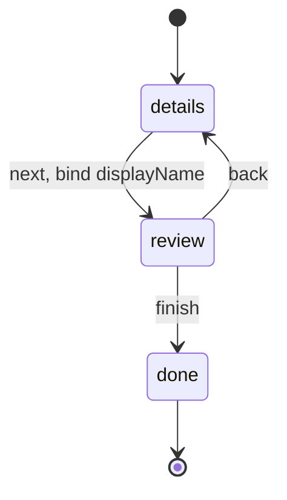

# Tái hiện lỗi bằng một flow nhỏ và chuỗi yêu cầu xác định

“Thỉnh thoảng quay lại bước trước thì mất dữ liệu” chưa phải một mô tả đủ để sửa lỗi. Cần biết execution nào đang chạy, request nào đã được gửi, event nào được nhận, dữ liệu có giá trị gì trước và sau transition, cùng điều kiện nào khiến lỗi xuất hiện.

Trong chương **Chẩn đoán lỗi** của module **SPRING_WEB_FLOW**, bài học này trình bày cách rút một lỗi trong hành trình web nhiều bước về flow nhỏ và chuỗi request có thể phát lại. Mục tiêu là xác định nguyên nhân trong state, event, transition, binding, scope hoặc tầng tích hợp Spring MVC bằng bằng chứng quan sát được.

Ví dụ xuyên suốt là dữ liệu tên người dùng biến mất khi bấm nút Quay lại từ màn hình xem trước. Các đoạn mã là bộ ví dụ để người học dựng trong dự án kiểm thử; chúng chưa phải kết quả chạy trên một ứng dụng cụ thể.

## 1. Viết lại triệu chứng thành một hợp đồng có thể kiểm tra

Một báo cáo có ích cần mô tả đầu vào, chuỗi thao tác và điểm khác nhau giữa mong đợi với thực tế.

| Thành phần | Ví dụ cụ thể |
| --- | --- |
| Trạng thái ban đầu | Session mới, chưa có execution của flow `repro` |
| Dữ liệu thử | `displayName=Lan` |
| Chuỗi thao tác | Mở flow → nhập tên → Next → Back |
| Mong đợi | Quay về `details`, tên vẫn là `Lan` |
| Hiện tượng cần tái hiện | Quay về `details`, tên trở thành chuỗi rỗng |
| Điểm kiểm chứng trung gian | Tại `review`, tên vẫn là `Lan` |
| Phạm vi | Bấm nút gửi event `back`, không phải nút Back của trình duyệt |

Điểm kiểm chứng trung gian rất quan trọng. Nếu tên đã rỗng tại `review`, cần điều tra từ binding hoặc bước chuyển `details -> review`. Nếu tên còn đúng tại `review` rồi mất sau event `back`, phạm vi điều tra hẹp hơn nhiều.

Phân biệt rõ các thao tác có vẻ giống nhau trên giao diện:

- Nút Quay lại trong form có thể phát event và chạy transition mới.
- Nút Back của trình duyệt có thể mở URL hoặc snapshot cũ.
- Refresh có thể render lại view hoặc phát lại một request, tùy redirect và cách trình duyệt xử lý.
- Mở URL không có execution key có thể bắt đầu một execution mới.

Không gom cả bốn thành một bước “quay lại”. Chúng có thể đi qua những đường xử lý khác nhau.

## 2. Chọn flow nhỏ nhất vẫn giữ được cơ chế gây lỗi

Một flow nhỏ phục vụ chẩn đoán cần giữ nguyên **điều kiện gây lỗi**, không chỉ giữ vài state có tên tương tự.

Với lỗi mất dữ liệu khi quay lại, có thể bắt đầu bằng:



Những gì giữ lại trong ví dụ:

- Một model có thể được lưu trong execution.
- Hai view-state và event `next`, `back`.
- Binding của trường `displayName`.
- Action bị nghi ngờ khi vào state.
- Spring MVC/Web Flow thực, session và redirect giữa request.

Những gì có thể tạm thay bằng thành phần đơn giản nếu lỗi vẫn còn:

- JSP/template phức tạp bằng view văn bản.
- Service tra cứu dữ liệu bằng stub trả kết quả cố định.
- Model nhiều thuộc tính bằng DTO chỉ chứa trường liên quan.
- Các nhánh điều hướng không đi qua trong kịch bản bằng một đường đi duy nhất.

Nếu lỗi biến mất sau khi bỏ một thành phần, hãy khôi phục thành phần đó và tiếp tục thu hẹp. Ví dụ, lỗi chỉ xuất hiện với validation thì phải giữ validator; lỗi chỉ xuất hiện với subflow thì phải giữ ranh giới input/output của subflow. Không loại bỏ cơ chế quan trọng rồi kết luận ứng dụng không có lỗi.

## 3. Cố định các điều kiện có thể làm kết quả thay đổi

Trước khi phát lại, ghi đủ thông tin để một người khác dựng được cùng điều kiện:

| Nhóm điều kiện | Thông tin cần cố định hoặc ghi nhận |
| --- | --- |
| Runtime | Java, Spring Framework, Spring Web Flow, Servlet API tương thích |
| Cấu hình | Profile, registry, executor, view resolver, redirect, giới hạn snapshot |
| Phiên | Session mới hay cũ; cùng hay khác session giữa các request |
| Người dùng | Principal, quyền và tenant nếu ảnh hưởng lỗi |
| Đầu vào | Tên tham số, giá trị, content type, event, locale và encoding |
| Dữ liệu ngoài | Fixture, bản nháp, phiên bản dữ liệu, kết quả service stub |
| Thời gian | Clock, timeout và thời điểm hết hạn nếu lỗi liên quan thời gian |
| Đồng thời | Số request, số node và thứ tự được điều khiển bằng barrier/latch |

Trong ví dụ chính, dùng dữ liệu giả `Lan`, một session mới, request không phải Ajax và các bước tuần tự. Không có database hoặc dịch vụ mạng, vì chúng không cần thiết để tái hiện việc action trong flow xóa dữ liệu.

Một chuỗi tuần tự xác định không chứng minh hành vi đồng thời. Nếu lỗi gốc là double-click hoặc race giữa hai tab, phải có biến thể kiểm thử điều khiển lịch cạnh tranh. Thay `sleep` bằng điểm đồng bộ rõ ràng khi cần buộc một request dừng trước một thao tác.

## 4. Dựng model và flow có lỗi có chủ đích

Cấu trúc minh họa:

```text
src/test/java/example/repro/
├── Draft.java
├── ReproWebConfig.java
└── ReproRequestSequenceTest.java

src/test/resources/flows/repro/
└── repro.xml
```

Các ví dụ Java sử dụng text block và record, phù hợp với Java 17 trở lên. Dự án cần các dependency Web Flow, Spring MVC, Spring Test, JUnit Jupiter và Servlet API tương thích với nhau. Đây là cấu trúc cho một bộ tái hiện độc lập, không phải yêu cầu sao chép toàn bộ ứng dụng production vào test.

### 4.1. DTO nhỏ, có getter/setter và hỗ trợ serialization

Nội dung `Draft.java`:

```java
package example.repro;

import java.io.Serializable;

public class Draft implements Serializable {
    private static final long serialVersionUID = 1L;

    private String displayName = "";

    public String getDisplayName() {
        return displayName;
    }

    public void setDisplayName(String displayName) {
        this.displayName = displayName;
    }
}
```

Đối tượng không giữ service, request hoặc tài nguyên đang mở. Nhờ vậy, việc theo dõi một thuộc tính qua các request dễ hơn và không bị nhiễu bởi object graph lớn.

### 4.2. Flow hai bước với action xóa dữ liệu khi vào lại details

Nội dung `flows/repro/repro.xml`:

```xml
<?xml version="1.0" encoding="UTF-8"?>
<flow xmlns="http://www.springframework.org/schema/webflow"
      xmlns:xsi="http://www.w3.org/2001/XMLSchema-instance"
      xsi:schemaLocation="http://www.springframework.org/schema/webflow
                          https://www.springframework.org/schema/webflow/spring-webflow.xsd"
      start-state="details">

    <var name="draft" class="example.repro.Draft"/>

    <view-state id="details" view="details" model="draft">
        <binder>
            <binding property="displayName"/>
        </binder>

        <on-entry>
            <!-- Lỗi có chủ đích: xóa tên mỗi lần đi vào details. -->
            <set name="flowScope.draft.displayName" value="''"/>
        </on-entry>

        <transition on="next" to="review" validate="false"/>
    </view-state>

    <view-state id="review" view="review" model="draft">
        <transition on="back" to="details" bind="false" validate="false"/>
        <transition on="finish" to="done" bind="false" validate="false"/>
    </view-state>

    <end-state id="done"/>
</flow>
```

`draft` được tạo ở cấp flow. Trong ví dụ, dữ liệu không bị chuyển sang `requestScope`; nguồn gây mất tên là lệnh `set` trong `on-entry`.

`validate="false"` ở nhánh `next` giúp cô lập binding khỏi validation. Nhánh `back` không nhận dữ liệu chỉnh sửa nên tắt binding. Nếu lỗi gốc liên quan validation hoặc binding khi quay lại, phải giữ các cơ chế đó thay vì áp dụng nguyên cấu hình cô lập này.

Thứ tự các phần tử như `binder`, `on-entry` và `transition` cần tuân thủ schema XML của Web Flow. Xem [schema ngôn ngữ flow của Spring Web Flow](https://raw.githubusercontent.com/spring-projects/spring-webflow/main/spring-webflow/src/main/resources/org/springframework/webflow/engine/model/builder/xml/spring-webflow.xsd).

## 5. Giữ tích hợp MVC, thay phần render bằng view dễ quan sát

Thay JSP bằng một view trả ba dòng văn bản:

```text
view=review
execution=<key thực tế>
displayName=Lan
```

View này giúp kiểm tra dữ liệu model đã đến tầng render mà không phụ thuộc HTML, JavaScript hoặc thư viện template. Nó chỉ dành cho bộ tái hiện với dữ liệu giả; không đưa execution key và dữ liệu form vào một trang chẩn đoán công khai.

Nội dung `ReproWebConfig.java`:

```java
package example.repro;

import java.util.List;
import org.springframework.beans.factory.annotation.Qualifier;
import org.springframework.context.ApplicationContext;
import org.springframework.context.annotation.Bean;
import org.springframework.context.annotation.Configuration;
import org.springframework.web.servlet.ViewResolver;
import org.springframework.web.servlet.config.annotation.EnableWebMvc;
import org.springframework.webflow.config.FlowBuilderServicesBuilder;
import org.springframework.webflow.config.FlowDefinitionRegistryBuilder;
import org.springframework.webflow.config.FlowExecutorBuilder;
import org.springframework.webflow.definition.registry.FlowDefinitionRegistry;
import org.springframework.webflow.engine.builder.support.FlowBuilderServices;
import org.springframework.webflow.executor.FlowExecutor;
import org.springframework.webflow.mvc.builder.MvcViewFactoryCreator;
import org.springframework.webflow.mvc.servlet.FlowHandlerAdapter;
import org.springframework.webflow.mvc.servlet.FlowHandlerMapping;

@Configuration
@EnableWebMvc
public class ReproWebConfig {

    @Bean
    public ViewResolver diagnosticViews() {
        return (viewName, locale) -> {
            if (!viewName.equals("details") && !viewName.equals("review")) {
                return null;
            }
            return (model, request, response) -> {
                Draft draft = (Draft) model.get("draft");
                Object executionKey = model.get("flowExecutionKey");

                response.setContentType("text/plain;charset=UTF-8");
                response.getWriter().printf(
                        "view=%s%nexecution=%s%ndisplayName=%s%n",
                        viewName, executionKey, draft.getDisplayName());
            };
        };
    }

    @Bean
    public FlowBuilderServices flowBuilderServices(
            @Qualifier("diagnosticViews") ViewResolver diagnosticViews) {
        MvcViewFactoryCreator views = new MvcViewFactoryCreator();
        views.setViewResolvers(List.of(diagnosticViews));
        views.setUseSpringBeanBinding(true);

        return new FlowBuilderServicesBuilder()
                .setViewFactoryCreator(views)
                .build();
    }

    @Bean
    public FlowDefinitionRegistry flowRegistry(
            ApplicationContext context, FlowBuilderServices services) {

        return new FlowDefinitionRegistryBuilder(context, services)
                .addFlowLocation("classpath:/flows/repro/repro.xml", "repro")
                .build();
    }

    @Bean
    public FlowExecutor flowExecutor(FlowDefinitionRegistry flowRegistry) {
        return new FlowExecutorBuilder(flowRegistry)
                .setAlwaysRedirectOnPause(true)
                .setMaxFlowExecutions(2)
                .setMaxFlowExecutionSnapshots(10)
                .build();
    }

    @Bean
    public FlowHandlerMapping flowHandlerMapping(FlowDefinitionRegistry registry) {
        FlowHandlerMapping mapping = new FlowHandlerMapping();
        mapping.setOrder(-1);
        mapping.setFlowRegistry(registry);
        return mapping;
    }

    @Bean
    public FlowHandlerAdapter flowHandlerAdapter(FlowExecutor flowExecutor) {
        FlowHandlerAdapter adapter = new FlowHandlerAdapter();
        adapter.setFlowExecutor(flowExecutor);
        return adapter;
    }
}
```

Các mối nối cần giữ đúng:

- Registry đăng ký XML dưới ID `repro`.
- Handler mapping chọn flow theo đường dẫn tương ứng với ID đã đăng ký.
- Adapter sử dụng executor đang giữ repository/execution của bộ tái hiện.
- Builder services sử dụng MVC view factory và view resolver chẩn đoán.

Các API cấu hình được mô tả trong [FlowDefinitionRegistryBuilder](https://docs.spring.io/spring-webflow/docs/current/api/org/springframework/webflow/config/FlowDefinitionRegistryBuilder.html), [FlowBuilderServicesBuilder](https://docs.spring.io/spring-webflow/docs/current/api/org/springframework/webflow/config/FlowBuilderServicesBuilder.html) và [FlowHandlerMapping](https://docs.spring.io/spring-webflow/docs/current/api/org/springframework/webflow/mvc/servlet/FlowHandlerMapping.html).

`MvcViewFactoryCreator` hỗ trợ chuỗi `ViewResolver` và lựa chọn Spring BeanWrapper cho binding. Đây là cách giữ xử lý Web Flow nhưng thay cơ chế hiển thị bằng view tối giản. Xem [API MvcViewFactoryCreator](https://docs.spring.io/spring-webflow/docs/current/api/org/springframework/webflow/mvc/builder/MvcViewFactoryCreator.html). View trả văn bản vẫn thực hiện vai trò render model của [Spring MVC View](https://docs.spring.io/spring-framework/docs/current/javadoc-api/org/springframework/web/servlet/View.html).

Cấu hình riêng này không nạp security filter, database hay mã JavaScript của ứng dụng. Chỉ dùng nó để thu hẹp một lỗi vẫn còn khi các thành phần đó không tham gia. Nếu triệu chứng là redirect đăng nhập, HTTP 403 hoặc lỗi trên giao diện thật, phải giữ thêm tầng liên quan trong biến thể tái hiện.

## 6. Đặc tả chuỗi request bằng biến, không chép cứng execution key

Với cấu hình redirect ở trên và một session mới `S`, chuỗi dự kiến là:

| Bước | Request | Dữ liệu gửi | Kết quả cần quan sát |
| --- | --- | --- | --- |
| R1 | `GET /repro` | Session `S`, chưa có execution | Redirect tới URL chứa key `K0` |
| R2 | `GET` URL từ R1 | Vẫn session `S` | View `details`, tên rỗng, key thực tế của view |
| R3 | `POST /repro` | Key của R2, `_eventId=next`, `displayName=Lan` | Redirect tới view tiếp theo |
| R4 | `GET` URL từ R3 | Vẫn session `S` | View `review`, tên là `Lan`, key của view |
| R5 | `POST /repro` | Key của R4, `_eventId=back` | Redirect về bước nhập |
| R6 | `GET` URL từ R5 | Vẫn session `S` | View `details`; bản lỗi trả tên rỗng |

`K0`, `K1` hay `K2` chỉ là ký hiệu để mô tả. Không kỳ vọng chuỗi key cụ thể hoặc số thứ tự snapshot cụ thể. Mỗi lần phát lại lấy URL và key từ response hiện tại.

Hai tên tham số cần phân biệt:

- `execution`: trong cấu hình URL mặc định, xác định execution cần tiếp tục.
- `_eventId`: xác định event gửi từ MVC view, chẳng hạn `next` hoặc `back`.

Web Flow cũng hỗ trợ kiểu tên nút như `_eventId_next`. Không cần gửi đồng thời hai kiểu trong cùng một request của bộ tái hiện. Nếu ứng dụng đã tùy biến URL handler hoặc tên event parameter, phải ghi nhận và dùng đúng cấu hình đó. Xem phần tích hợp MVC và phát event trong [Spring Web Flow Reference Guide](https://docs.spring.io/spring-webflow/docs/current/reference/).

Một chuỗi request xác định phải giữ các quan hệ: cùng session, key của đúng bước, event đúng tên và payload đúng giá trị. Nó không cần tạo lại nguyên văn mọi giá trị token do server sinh.

## 7. Tự động phát lại bằng MockMvc

Dùng `webAppContextSetup(...)` để đi qua context có cấu hình MVC/Web Flow. `standaloneSetup(...)` chỉ khởi tạo một controller không đủ để tự có handler mapping, adapter và executor ở ví dụ này. Xem [hướng dẫn cấu hình MockMvc](https://docs.spring.io/spring-framework/reference/testing/mockmvc/hamcrest/setup.html).

Nội dung `ReproRequestSequenceTest.java`:

```java
package example.repro;

import static org.junit.jupiter.api.Assertions.*;
import static org.springframework.test.web.servlet.request.MockMvcRequestBuilders.*;
import static org.springframework.test.web.servlet.result.MockMvcResultMatchers.*;

import java.io.StringReader;
import java.net.URI;
import java.nio.charset.StandardCharsets;
import java.util.Properties;
import org.junit.jupiter.api.BeforeEach;
import org.junit.jupiter.api.Test;
import org.springframework.beans.factory.annotation.Autowired;
import org.springframework.mock.web.MockHttpSession;
import org.springframework.test.context.junit.jupiter.web.SpringJUnitWebConfig;
import org.springframework.test.web.servlet.MockMvc;
import org.springframework.test.web.servlet.MvcResult;
import org.springframework.test.web.servlet.setup.MockMvcBuilders;
import org.springframework.web.context.WebApplicationContext;

@SpringJUnitWebConfig(ReproWebConfig.class)
class ReproRequestSequenceTest {

    @Autowired WebApplicationContext context;

    private MockMvc mvc;
    private MockHttpSession session;

    @BeforeEach
    void createFreshClient() {
        mvc = MockMvcBuilders.webAppContextSetup(context).build();
        session = new MockHttpSession(context.getServletContext());
    }

    @Test
    void displayNameSurvivesExplicitBackEvent() throws Exception {
        MvcResult launch = mvc.perform(get("/repro").session(session))
                .andExpect(status().is3xxRedirection())
                .andReturn();

        Rendered details = renderRedirect(launch, "details");
        assertEquals("", details.displayName());

        MvcResult next = mvc.perform(post("/repro")
                        .session(session)
                        .param("execution", details.executionKey())
                        .param("_eventId", "next")
                        .param("displayName", "Lan"))
                .andExpect(status().is3xxRedirection())
                .andReturn();

        Rendered review = renderRedirect(next, "review");
        assertEquals("Lan", review.displayName());

        MvcResult back = mvc.perform(post("/repro")
                        .session(session)
                        .param("execution", review.executionKey())
                        .param("_eventId", "back"))
                .andExpect(status().is3xxRedirection())
                .andReturn();

        Rendered returned = renderRedirect(back, "details");

        // Bản XML có lỗi dự kiến thất bại tại assertion này.
        assertEquals("Lan", returned.displayName());
    }

    private Rendered renderRedirect(MvcResult redirect, String expectedView)
            throws Exception {

        String target = redirect.getResponse().getRedirectedUrl();
        assertNotNull(target);
        URI uri = URI.create(target);
        assertEquals("/repro", uri.getPath());

        MvcResult rendered = mvc.perform(get(uri).session(session))
                .andExpect(status().isOk())
                .andReturn();

        Properties body = new Properties();
        body.load(new StringReader(rendered.getResponse()
                .getContentAsString(StandardCharsets.UTF_8)));

        assertEquals(expectedView, body.getProperty("view"));

        String key = body.getProperty("execution");
        assertNotNull(key);
        assertFalse(key.isBlank());
        assertNotEquals("null", key);

        String displayName = body.getProperty("displayName");
        assertNotNull(displayName);
        return new Rendered(key, displayName);
    }

    private record Rendered(String executionKey, String displayName) {}
}
```

Test giữ một `MockHttpSession` cho toàn bộ chuỗi và không hard-code execution key. View chẩn đoán nhận key từ model do tầng MVC của Web Flow cung cấp; có thể đối chiếu cách expose `flowExecutionKey` và `flowExecutionUrl` trong [mã nguồn AbstractMvcView](https://raw.githubusercontent.com/spring-projects/spring-webflow/main/spring-webflow/src/main/java/org/springframework/webflow/mvc/view/AbstractMvcView.java).

Helper chỉ theo một redirect dự kiến, đồng thời kiểm tra đường dẫn đích vẫn là `/repro`. Một redirect bất ngờ sang trang đăng nhập hoặc một chuỗi redirect lặp phải làm test thất bại sớm; không theo mọi redirect đến khi tình cờ nhận HTTP 200.

Với XML lỗi, assertion cuối dự kiến nhận chuỗi rỗng thay vì `Lan`. Giữ assertion theo hành vi đúng mong muốn để nó trở thành test hồi quy sau khi sửa, không đổi expected thành chuỗi rỗng để che triệu chứng.

## 8. Đọc bằng chứng trước khi kết luận nguyên nhân

Từ chuỗi trên, có thể lập bảng quan sát:

| Điểm quan sát | Giá trị trong kịch bản lỗi | Điều có thể suy ra |
| --- | --- | --- |
| R2, `details` ban đầu | Tên rỗng | Phù hợp fixture bắt đầu |
| R3, payload gửi | `displayName=Lan` | Client đã gửi đúng tên trường và giá trị |
| R4, `review` | Tên `Lan` | Binding và việc chuyển dữ liệu tới bước review đã hoạt động trong lần này |
| R5, event | `back`, đúng key của review | Đang thử transition quay lại, không thử snapshot cũ bằng browser Back |
| R6, `details` | Tên rỗng | Dữ liệu đổi trên đường quay lại hoặc khi vào/render details |

Bảng chưa chứng minh mọi yếu tố đều đúng trong mọi môi trường. Nó chỉ loại bớt một số giả thuyết trong lần tái hiện được kiểm soát. Chẳng hạn, thấy tên ở review không chứng minh cấu hình session replication của một cụm production luôn hoạt động.

Các giả thuyết tiếp theo cần có phép thử phân biệt:

| Giả thuyết | Phép thử có ích |
| --- | --- |
| Binding chưa nhận tên | Kiểm tra payload và model ở review trước khi quay lại |
| Mất session giữa các request | Xác minh session/cookie liên tục và khả năng tiếp tục execution |
| Vào lại details chạy action reset | Bỏ riêng lệnh reset, giữ nguyên các request khác |
| View chỉ hiển thị sai | So sánh model ở view văn bản với template thật |
| Khôi phục nhầm snapshot cũ | Ghi quan hệ key đang dùng; tách event back khỏi URL lịch sử |
| Service tải lại dữ liệu ghi đè form | Stub kết quả service và theo dõi đúng điểm gán vào model |

Đối với bản lỗi minh họa, `on-entry` là điểm trực tiếp gán chuỗi rỗng khi transition quay về `details`. Đây là hành vi khởi tạo được đặt sai vòng đời, không cần giả định binder hoặc session đã mất dữ liệu.

View-state có các hành động khi vào state và các render action. Render action có thể chạy trước khi view được render, kể cả các tình huống refresh phù hợp. Vì thế cũng cần kiểm tra `on-render` nếu triệu chứng gắn với refresh. Xem [API ViewState](https://docs.spring.io/spring-webflow/docs/current/api/org/springframework/webflow/engine/ViewState.html).

## 9. Kiểm chứng nguyên nhân bằng một thay đổi tối thiểu

Trong ví dụ, DTO đã khởi tạo `displayName` bằng chuỗi rỗng khi được tạo. Vì vậy, thử nghiệm sửa nhỏ nhất là bỏ phần reset khỏi `details`:

```xml
<view-state id="details" view="details" model="draft">
    <binder>
        <binding property="displayName"/>
    </binder>
    <transition on="next" to="review" validate="false"/>
</view-state>
```

Không đổi event, payload, session, số request hoặc assertion. Nếu cần một thao tác khởi tạo phức tạp chỉ chạy khi bắt đầu hành trình, cân nhắc đặt ở cấp flow hoặc một state khởi tạo được đi qua có chủ đích; tránh thực hiện lại mỗi lần vào màn hình nhập.

Một cách kiểm chứng quan hệ nhân quả trong bộ tái hiện:

1. Bản có reset: chuỗi cố định làm assertion giữ tên thất bại.
2. Bản bỏ reset: cùng chuỗi làm assertion giữ tên thành công.
3. Khôi phục riêng reset: cùng chuỗi lại cho thấy dữ liệu bị xóa.

Đây là quy trình thử nghiệm khi áp dụng bài học, không phải báo cáo các đoạn mã đã được chạy ở đây. Nếu kết quả không đổi, giả thuyết chưa được chứng minh; tiếp tục kiểm tra điểm ghi dữ liệu khác.

Sau khi sửa, chạy lại từ execution/session mới để không tiếp tục một execution còn dùng định nghĩa cũ hoặc lịch sử cũ. Nếu có cache/reload flow trong môi trường phát triển, ghi rõ cách nạp phiên bản XML mới.

Kiểm tra thêm ít nhất một vòng `details -> review -> details -> review` để bảo đảm dữ liệu còn giữ được và có thể chỉnh sửa tiếp. Sau đó mới đưa lại các thành phần đã giản lược, từng thành phần một, nhằm xác nhận bản sửa vẫn giải quyết triệu chứng gốc.

## 10. Quan sát vừa đủ và bảo toàn ranh giới lỗi

Một bản ghi chẩn đoán có cấu trúc có thể gồm:

```text
case=back-clears-name
step=R5
requestId=req-05
flowId=repro
stateBefore=review
event=back
executionAlias=K1
sessionAlias=S
expectedNextState=details
```

`executionAlias` và `sessionAlias` là ký hiệu của bộ tái hiện, không phải đề nghị log nguyên cookie hoặc token. Với dữ liệu thật, chỉ ghi trường cần thiết, che thông tin cá nhân và giới hạn phạm vi debug.

Những điểm quan sát thường hữu ích:

- Trước xử lý request: method, route, event, tên tham số và quan hệ session.
- Sau binding: giá trị trường liên quan và lỗi conversion/validation.
- Khi chuyển state: state trước/sau và action vừa chạy.
- Trước render: model cuối cùng mà view nhận.
- Khi có exception: lớp exception, cause và điểm đầu tiên liên quan tới ứng dụng.

Log không thay thế assertion. Một test cần thất bại tại điểm đầu tiên vi phạm hợp đồng, thay vì vẫn chạy tiếp rồi yêu cầu người đọc tìm lỗi trong hàng nghìn dòng debug.

Khi request chưa đến được flow vì mapping sai, authentication, CSRF hoặc filter, hãy tái hiện tại tầng request. Khi lỗi chỉ còn ở action/transition và không phụ thuộc MVC, có thể viết thêm flow execution test để rút ngắn vòng kiểm tra. Đừng đổi tầng kiểm thử đến mức bỏ qua chính nơi lỗi xảy ra.

## 11. Những biến thể cần giữ đúng cơ chế gốc

| Nhóm lỗi gốc | Điều cần giữ trong flow/chuỗi tối thiểu |
| --- | --- |
| Binding hoặc conversion | `model`, binder, converter và đúng raw request parameters |
| Validation | Validator, dữ liệu gây lỗi, event và nhánh ở lại view |
| Mất dữ liệu qua subflow | Input/output mapping, scope nguồn/đích và outcome của subflow |
| Flow inheritance | Model cha, ID đăng ký, phần tử được merge gây khác biệt |
| Execution hết hạn | Tuổi execution, session/repository và clock/chính sách TTL tương ứng |
| Browser Back | URL/key lịch sử thật và chính sách snapshot/history |
| Ghi lặp khi xác nhận | Service có transaction, dữ liệu đã commit và khóa nghiệp vụ |
| Lỗi đồng thời | Nhiều request/kết nối và điểm đồng bộ kiểm soát được |
| Lỗi sau triển khai phiên bản mới | Phiên bản definition/model trước và sau cùng execution cũ |
| Lỗi JavaScript hoặc partial rendering | View thật, request Ajax và hành vi client liên quan |

Trong biến thể có security, bảo đảm principal và CSRF hợp lệ nếu mục tiêu là đi tới logic flow. Nếu mục tiêu chính là lỗi security thì giữ nguyên request bị từ chối. Không dùng một HTTP 403 bất ngờ làm bằng chứng rằng flow đã xử lý event.

Trong biến thể có thời gian, một `Clock` cố định chỉ hữu ích cho thành phần thực sự dùng clock đó. Nếu session timeout vẫn do container hoặc kho bên ngoài quyết định, phải điều khiển hoặc ghi nhận nguồn thời gian tương ứng.

Trong biến thể có ghi dữ liệu, không phát lại vô hạn một request xác nhận có tác dụng phụ mà chưa có fixture cô lập và hợp đồng chống lặp. Kết quả cần quan sát bao gồm dữ liệu đã commit và cách phục hồi, không chỉ state cuối của flow.

## 12. Gói tái hiện và bài thực hành

Một gói tái hiện đủ dùng nên có:

- Phiên bản runtime/dependency và cách chạy đúng một test mục tiêu.
- Flow XML tối thiểu cùng các model cha/subflow vẫn cần thiết.
- DTO và service stub nhỏ, có dữ liệu giả xác định.
- Chuỗi request hoặc test tự động lấy token từ response.
- Trạng thái ban đầu, điểm mong đợi và điểm thực tế đầu tiên sai khác.
- Một thay đổi nhỏ dùng để kiểm chứng giả thuyết nguyên nhân.
- Phạm vi đã loại trừ và phạm vi còn cần kiểm tra trên ứng dụng thật.

### Bài thực hành

1. Dựng flow hai bước có action reset ở phần 4 và view chẩn đoán ở phần 5.
2. Phát lại sáu request với một session mới, ghi giá trị tên tại `details`, `review` và `details` lần hai.
3. Kiểm tra assertion cuối phản ánh hành vi cần bảo vệ, không phản ánh dữ liệu đã bị xóa.
4. Bỏ riêng action reset, nạp lại flow rồi phát lại cùng kịch bản.
5. Thử thêm một lần chỉnh tên thành `Mai`, đi tới review và quay lại để kiểm tra hành vi sau sửa.
6. Viết một biến thể riêng dùng nút Back của trình duyệt hoặc URL lịch sử; không trộn nó vào test event `back`.
7. Đưa lại template hoặc service thật theo từng bước nếu chúng có mặt trong lỗi ban đầu.

### Tiêu chí hoàn thành

- Một người khác có thể tái hiện mà không cần đoán thao tác hoặc sao chép token cũ.
- Chuỗi giữ đúng session, key, event và payload của từng bước.
- Có bằng chứng về điểm dữ liệu bắt đầu sai, thay vì chỉ ảnh chụp màn hình cuối.
- Flow nhỏ vẫn giữ cơ chế gây lỗi của ứng dụng gốc.
- Bản sửa được đánh giá với cùng assertion và chuỗi request.
- Phạm vi kết luận không vượt quá những tầng thực sự đã tham gia kiểm thử.

Một flow nhỏ và chuỗi request xác định biến triệu chứng mơ hồ thành một phép thử có đầu vào, trạng thái và kết quả rõ ràng. Từ đó có thể sửa đúng vòng đời dữ liệu hoặc điều hướng, giữ lại test hồi quy và kiểm tra lại hành trình đầy đủ mà không rải thêm logic xử lý tình huống vào controller.
