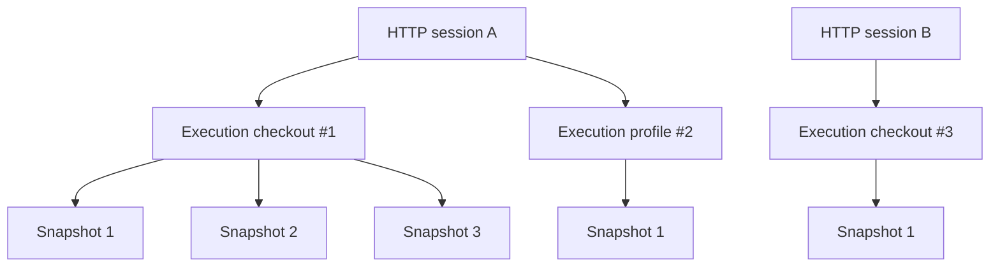

# Ước lượng bộ nhớ theo phiên, execution và số snapshot trong Spring Web Flow

## 1. Bài toán vận hành của một flow nhiều bước

Trong **Spring Web Flow (SWF)**, hành trình đặt hàng, đăng ký, khai báo hồ sơ hoặc đặt lịch thường gồm nhiều `view-state`. Người dùng nhập form, gửi `event`, framework thực hiện `transition`, gọi service rồi tạm dừng để chờ bước tiếp theo. Để có thể tiếp tục đúng bước, Web Flow phải giữ hoặc khôi phục được **flow execution** cùng trạng thái liên quan. Một số cấu hình repository còn lưu các **snapshot** giúp khôi phục những mốc của execution.

Nếu 100 người cùng truy cập, tải bộ nhớ có thể rất nhỏ. Nhưng khi có hàng nghìn người dùng, mỗi người mở nhiều tab và mỗi execution giữ nhiều snapshot chứa đối tượng nghiệp vụ lớn, bộ nhớ có thể tăng nhanh ngay cả khi số request/giây không thay đổi nhiều.

Ba câu hỏi quan trọng khi dự trù dung lượng:

1. Có bao nhiêu **HTTP session** đồng thời trên mỗi node, và bao nhiêu session thực sự có flow đang chạy?
2. Mỗi session có trung bình/đỉnh bao nhiêu **flow execution** còn được lưu?
3. Mỗi execution giữ bao nhiêu **snapshot**, kích thước dữ liệu thực tế của từng snapshot là bao nhiêu?

Bài này xây dựng mô hình ước lượng, chỉ ra cách thu thập số đo, cách chọn giới hạn an toàn và những điều cần theo dõi khi vận hành Spring Web Flow. Các con số minh họa là giả định, không phải thông số mặc định của framework.

## 2. Phân biệt session, flow execution và snapshot

### 2.1. HTTP session

**HTTP session** gắn với ngữ cảnh của một trình duyệt/người dùng trong một khoảng thời gian. Ứng dụng có thể lưu dữ liệu đăng nhập, tùy chọn giao diện, giỏ hàng và thuộc tính khác trong session. Với cấu hình repository thông dụng, những execution của Web Flow cũng được lưu hoặc tham chiếu thông qua session.

Một HTTP session có thể:

- Chưa khởi chạy flow nào.
- Chạy một flow rồi tạm dừng ở bước nhập thông tin.
- Có nhiều execution độc lập vì người dùng mở nhiều hành trình hoặc nhiều tab.
- Vẫn tồn tại sau khi flow đã kết thúc, do timeout của HTTP session khác vòng đời execution.

Vì vậy, **số session không đồng nghĩa với số execution**. Không nên giả định mỗi user chỉ có đúng một flow đang chạy.

### 2.2. Flow execution

Một **flow definition** là bản thiết kế state/event/transition. Một **flow execution** là một lần chạy của bản thiết kế ấy, với state hiện tại, execution context và dữ liệu trong các scope như `flowScope`, `viewScope`, `conversationScope`.

Khi người dùng nhập form từng bước, execution có thể giữ một đối tượng form và dữ liệu trung gian. Nếu cho vào `flowScope` cả danh sách hàng nghìn bản ghi, đối tượng Hibernate với quan hệ lớn hoặc nội dung file tải lên, execution có nguy cơ giữ đồ thị đối tượng lớn trong bộ nhớ. Lời gọi **subflow** thường là một phần của hành trình/execution hiện hành; không tự động đếm mỗi subflow như một HTTP session hay một execution độc lập.

### 2.3. Snapshot

**Snapshot** là một biểu diễn trạng thái của execution tại một thời điểm, dùng cho cơ chế khôi phục/resume tương ứng. Tùy phiên bản và implementation của execution repository, dữ liệu snapshot có thể được lưu dưới dạng tuần tự hóa, đối tượng hoặc cấu trúc nội bộ khác; có thể có một hoặc nhiều bản được giữ lại.

Các snapshot có thể giúp xử lý tương tác nhiều bước và một số tình huống Back/Refresh, nhưng **không nên mặc định** repository nào cũng giữ lịch sử đầy đủ hay mọi snapshot đều phục hồi được sau khi session hết hạn.



Trong sơ đồ, A có hai execution; checkout #1 có ba snapshot. Số snapshot được giữ lại **không nhất thiết bằng số lần người dùng bấm Next**: còn phụ thuộc cách repository ghi snapshot, trạng thái có redirect, chính sách retention và tính hợp lệ của các snapshot cũ.

| Đơn vị | Đại diện cho | Câu hỏi đo lường |
| --- | --- | --- |
| HTTP session | Ngữ cảnh người dùng được server duy trì | Bao nhiêu session còn sống trên node? |
| Flow execution | Một hành trình Web Flow đang chạy/được lưu | Bao nhiêu execution trên mỗi session? |
| Snapshot | Một mốc lưu trạng thái của execution | Mỗi execution giữ bao nhiêu snapshot? |
| Dữ liệu scope | Object graph tham gia vào trạng thái flow | Mỗi bản snapshot/object graph chiếm bao nhiêu byte thực tế? |
| Repository | Nơi lưu và cơ chế khôi phục execution | Dữ liệu nằm trong heap node, cache ngoài hay nơi khác? |

## 3. Mô hình ước lượng bộ nhớ

Nếu execution/snapshot được giữ trong **heap của node ứng dụng** (một cấu hình thường gặp khi dùng HTTP session cục bộ), có thể bắt đầu bằng công thức gần đúng:

```text
M_flow ≈ S × [B + E × (X + K × D)]
```

Trong đó:

- `S`: số **HTTP session đồng thời** có tính đến lưu trữ flow trên node ở thời điểm cần dự trù. Nếu đo tất cả session, `B` phải bao gồm session không có execution và `E` là số execution trung bình trên tất cả session đó.
- `B`: lượng bộ nhớ cơ sở bình quân cho mỗi session **không thuộc execution/snapshot** nhưng vẫn được tính vào ngân sách (thuộc tính session, metadata...).
- `E`: số **flow execution** còn lưu trung bình trên một session trong tập `S`.
- `X`: overhead bình quân cho một execution **ngoài dữ liệu đã tính trong các snapshot** (key, bản ghi quản lý, con trỏ, v.v.).
- `K`: số snapshot thực tế còn lưu trung bình trên mỗi execution.
- `D`: **bộ nhớ giữ lại tăng thêm trên heap** của một snapshot (retained footprint), sau khi xét cơ chế lưu/serialization và khả năng chia sẻ đối tượng.

Đây là **mô hình tuyến tính sơ bộ** để xác định yếu tố chi phối dung lượng. Không được cộng lại các đối tượng dùng chung hai lần nếu đã đo retained size theo đồ thị heap. Nếu repository giữ bản đang chạy ngoài snapshot, cần tính phần đó vào `X` hoặc thêm hạng mục riêng.

**Công thức cho ngân sách tổng của node** còn phải tính ứng dụng và JVM:

```text
Heap cần thiết cho tải đỉnh
    ≈ M_flow_peak
      + heap của application/cache độc lập với Web Flow
      + bộ nhớ tạm khi deserialize/bind/validate/render
      + biên dự phòng cho dao động và GC

Bộ nhớ tiến trình (RSS)
    ≠ JVM heap
    = heap đã commit + metaspace + thread stacks + direct buffers
      + native/JIT/GC và các phần khác (xấp xỉ)
```

Chỉ lấy `M_flow` rồi đặt bằng `-Xmx` là sai vì heap còn chứa toàn bộ phần còn lại của ứng dụng. Nếu sử dụng Redis, database hoặc kho session từ xa, phần dữ liệu lưu lâu dài nằm ngoài heap node, nhưng vẫn phát sinh **object tạm trong JVM, serialization, cache, network và dung lượng ở hệ thống lưu trữ ngoài**. Phải đổi mô hình theo nơi dữ liệu thực sự được giữ.

### 3.1. Vì sao kích thước snapshot khó xác định?

Không tồn tại một con số “mỗi snapshot của Spring Web Flow tốn N KB” dùng chung cho mọi ứng dụng. Ví dụ một `RegistrationForm` chứa 5 chuỗi ngắn khác xa một `OrderForm` mang 500 dòng hàng, ảnh base64 hoặc graph đối tượng có các quan hệ lazy-load.

Kích thước còn phụ thuộc vào:

1. Dữ liệu được giữ ở `flowScope`, `viewScope`, `conversationScope` và các biến liên quan.
2. Dạng snapshot: byte array đã serialize, object graph, các bản sao hoặc cấu trúc phụ trợ.
3. Serializer, cơ chế nén, overhead của Java object, mức độ trùng lặp và chia sẻ reference.
4. Số snapshot đồng thời còn giữ; snapshot cũ có thể chứa những phiên bản dữ liệu lớn hơn hiện tại.
5. Repository/cache/session replication có lưu thêm bản copy hay không.

Ví dụ, một file người dùng upload có dung lượng 2 MiB nếu bị nhét trực tiếp vào `flowScope` có thể kéo kích thước snapshot tăng mạnh. Với nhiều snapshot, tác động có thể rất lớn. Cách hợp lý hơn là đưa file vào lưu trữ phù hợp và chỉ giữ **file ID hoặc metadata tối thiểu** trong flow.

## 4. Ví dụ tính dung lượng bằng giả định có kiểm soát

Giả sử đội vận hành đo được tại giờ cao điểm trên **một node**:

| Tham số | Giá trị giả định | Ghi chú |
| --- | ---: | --- |
| `S` – session đồng thời | 2.000 | Những session có xét trong ngân sách |
| `B` – cơ sở mỗi session | 12 KiB | Không bao gồm execution và snapshot |
| `E` – execution/session | 1,4 | Trung bình; nhiều tab có thể làm tăng |
| `X` – metadata/execution | 16 KiB | Ngoài snapshot |
| `K` – snapshot/execution | 12 | Số còn lưu trung bình, không phải số transition |
| `D` – retained footprint/snapshot | 28 KiB | Giả định đo trong môi trường thử nghiệm |

Thay vào công thức:

```text
M_mỗi_session
  = 12 + 1,4 × (16 + 12 × 28)
  = 12 + 1,4 × 352
  = 504,8 KiB

M_flow
  = 2.000 × 504,8 KiB
  = 1.009.600 KiB
  ≈ 985,9 MiB
  ≈ 0,963 GiB
```

Nếu đặt biên lập kế hoạch **30% riêng cho phần ước lượng này**, ngân sách quy đổi là:

```text
M_flow_with_margin = 985,9 MiB × 1,30 ≈ 1.281,7 MiB ≈ 1,25 GiB
```

Đây chưa phải `-Xmx` hợp lý của JVM: còn phải cộng heap dành cho Spring container, web requests, caches, rendering, các đối tượng tạm và tính đến mục tiêu sử dụng heap/GC.

### 4.1. Khi giảm số snapshot

Giữ nguyên mọi giả định nhưng giảm **snapshot trung bình** từ `K = 12` xuống `K = 4`:

```text
M_mỗi_session
  = 12 + 1,4 × (16 + 4 × 28)
  = 12 + 1,4 × 128
  = 191,2 KiB

M_flow
  = 2.000 × 191,2 KiB
  = 382.400 KiB
  ≈ 373,4 MiB

Chênh lệch ≈ 985,9 - 373,4 = 612,5 MiB
```

Ví dụ cho thấy **snapshot retention** có thể chi phối bộ nhớ. Nhưng giảm snapshot đồng thời cũng có thể thay đổi khả năng Back/Refresh/resume những URL cũ. Do đó, phải kiểm thử hành vi người dùng trước khi giới hạn snapshot trong môi trường thật.

### 4.2. Khi số session tăng đột biến

Nếu mọi chỉ số trên giữ nguyên nhưng số session đồng thời tăng từ 2.000 lên 3.000, ước lượng cơ sở thành:

```text
3.000 × 504,8 KiB ≈ 1.479,0 MiB ≈ 1,44 GiB
```

Tải thực tế thường không tuyến tính hoàn toàn: spike có thể làm nhiều flow giữ state lâu hơn, bộ nhớ tạm tăng khi cùng deserialize nhiều execution, hoặc GC hoạt động dồn dập. Mô hình giúp dự trù ban đầu; **load test với lưu lượng và cách sử dụng giống sản xuất** mới xác nhận khả năng chịu tải.

## 5. Dự tính từ hành vi người dùng

Không nên chỉ lấy “số user đăng nhập” nhân với một execution. Nên phân tích cách người dùng thực sự tương tác:

- Tỷ lệ truy cập flow, tỷ lệ rời bỏ ở từng bước.
- Thời gian một execution nằm ở view-state chờ event.
- Số tab/flow đồng thời trong cùng một HTTP session.
- Số lần Back/Refresh hoặc giữ form lâu mới tiếp tục.
- Session timeout, lifetime execution và chính sách giới hạn repository.
- Các đợt tăng tải như khuyến mãi, mở đăng ký theo đợt hoặc deadline hồ sơ.

Ví dụ, nếu mỗi phút có 100 flow mới và thời gian một flow còn hoạt động trung bình là 15 phút, ở điều kiện ổn định có thể ước tính khoảng **1.500 execution đang hoạt động** bằng quan hệ thông lượng × thời gian tồn tại. Đây là ước lượng ở mức hành vi, chưa chuyển thành số HTTP session vì một session có thể có nhiều execution và flow đã xong có thể không còn được lưu.

Đối với sizing, cần lập **ít nhất hai kịch bản**:

| Kịch bản | Dữ liệu dùng | Mục tiêu |
| --- | --- | --- |
| Bình thường | Session trung bình, số tab phổ biến, snapshot bình thường | Hiểu chi phí vận hành thường xuyên |
| Giờ cao điểm | Session đồng thời đỉnh, nhiều flow đang chờ, snapshot tích lũy | Kiểm tra heap/GC trước khi quá tải |
| Tình huống xấu nhưng hợp lý | Chạy nhiều tab, flow dài, các form lớn, nhiều snapshot cũ | Kiểm tra giới hạn repository và hành vi phục hồi |

Nên dùng phân phối **p50/p95/p99** cho số execution/session, snapshot/execution và footprint/snapshot. Đừng dùng p95 của từng thành phần nhân với nhau để khẳng định đó là p95 tổng tải: các phân phối có tương quan, nên cách tốt hơn là đo tổng footprint/session trong các mẫu thực tế và kiểm thử kịch bản cực trị riêng.

## 6. Cấu hình giới hạn execution và snapshot

Spring Web Flow có cơ chế **flow execution repository**. Với cấu hình namespace XML của các phiên bản hỗ trợ, bạn có thể gặp dạng cấu hình như sau:

```xml
<webflow:flow-executor id="flowExecutor"
                       flow-registry="flowRegistry">
    <webflow:flow-execution-repository
        max-executions="5"
        max-execution-snapshots="10" />
</webflow:flow-executor>
```

Ý nghĩa thiết kế:

- `max-executions` giới hạn số execution có thể được giữ cho một ngữ cảnh repository/session theo cơ chế tương ứng.
- `max-execution-snapshots` giới hạn số snapshot được giữ cho một execution đối với repository có hỗ trợ lịch sử snapshot.

**Cần kiểm tra cú pháp namespace, mặc định, semantics cụ thể và hỗ trợ của implementation trong đúng phiên bản Spring Web Flow**. Đoạn XML là minh họa cho hai nút điều chỉnh vận hành, không phải cấu hình tối ưu bắt buộc. Khi dùng cấu hình Java hoặc custom repository, thuộc tính tương đương có thể được đặt theo cách khác.

### 6.1. Giới hạn không đồng nghĩa sử dụng thực tế

Nếu đặt `max-execution-snapshots="10"`, điều đó **không có nghĩa mọi execution luôn giữ 10 snapshot**. Execution mới có thể ít hơn; một số repository có thể chỉ giữ snapshot mới nhất hoặc có cách lưu khác. Trong công thức, `K` cần là **số còn lưu đã đo**, còn giá trị cấu hình là một giới hạn cần đưa vào test.

Tương tự, giới hạn `max-executions="5"` không có nghĩa mỗi session luôn có năm execution. Người dùng có thể chỉ mở một flow. Cũng cần nhớ behavior khi chạm giới hạn có thể gồm loại bỏ execution cũ tùy implementation; URL continuation của tab cũ có thể thất bại.

### 6.2. Các đánh đổi khi đặt giới hạn quá thấp

| Thay đổi | Lợi ích kỳ vọng | Tác động cần kiểm thử |
| --- | --- | --- |
| Giảm snapshot/execution | Giảm lịch sử trạng thái được giữ | Back/Refresh hoặc liên kết view cũ có thể không resume được |
| Giảm execution/session | Chặn việc giữ quá nhiều flow ở nhiều tab | Người dùng có thể mất execution của tab cũ |
| Giảm session timeout | Thu hồi dữ liệu của session không hoạt động nhanh hơn | Người nhập form dài bị hết phiên trước khi xong |
| Bỏ dữ liệu lớn khỏi `flowScope` | Giảm footprint của mọi snapshot chứa dữ liệu đó | Cần cách tải lại dữ liệu và xử lý khi nguồn thay đổi |
| Chọn repository/kho lưu khác | Dịch chuyển vị trí lưu trạng thái và mô hình scaling | Thêm serialization, network, latency, failure modes |

Tối ưu đúng cần cân bằng **trải nghiệm Back/Next, yêu cầu nghiệp vụ và ngân sách lưu trữ**. Không nên chỉ tăng timeout hoặc tăng snapshot limit để xử lý lỗi resume rồi bỏ qua tác động tới RAM.

## 7. Giảm dung lượng dữ liệu bên trong execution

Trong đa số flow dài, kích thước snapshot chịu ảnh hưởng mạnh từ việc ứng dụng đặt những đối tượng nào trong scope.

### 7.1. Giữ dữ liệu đủ dùng cho bước kế tiếp

Ví dụ không nên giữ cả danh sách lớn đã tải từ database trong `flowScope`:

```java
// Minh họa ý tưởng nghiệp vụ: không đưa toàn bộ graph lớn vào flow.
List<Product> catalog = productService.findAllWithDetails();
// Nếu catalog bị lưu vào flowScope, các snapshot có thể phình to.
```

Thay vào đó, giữ một định danh nhỏ:

```xml
<set name="flowScope.selectedProductId"
     value="requestParameters.productId" />
```

Sau khi xác thực và chuyển kiểu ID, service có thể tải lại thông tin sản phẩm ở bước cần dùng. Điều này chuyển một phần chi phí từ bộ nhớ sang truy vấn/caching; cần benchmark để biết lựa chọn phù hợp. Với dữ liệu quyết định giao dịch, service vẫn phải xác thực giá và trạng thái sản phẩm tại thời điểm xác nhận.

### 7.2. Phân biệt form model và đối tượng nghiệp vụ

Một `CheckoutForm` nhỏ chứa `addressId`, `deliveryOption` và `paymentMethodId` thường hợp lý hơn việc giữ trực tiếp một entity graph gồm customer, hàng hóa, địa chỉ, invoice và lịch sử giao dịch. Sử dụng DTO/form object chỉ chứa trường cần thiết cho hành trình.

Tránh lưu trong flow:

- Entity graph ORM lớn hoặc proxy chưa được khởi tạo đúng cách.
- Byte array ảnh/tài liệu upload hoặc nội dung base64.
- Kết quả truy vấn phân trang hàng nghìn đối tượng.
- Stream, connection, resource handle hoặc tham chiếu tới request/response.
- Những đối tượng chứa dữ liệu nhạy cảm không cần thiết cho bước kế tiếp.

Nếu repository serialize execution, đối tượng được giữ cần tương thích với cơ chế serialization thực tế. Việc đặt service, connection hoặc tài nguyên không serializable trong state có thể gây lỗi snapshot/resume.

### 7.3. Chọn scope theo vòng đời

| Scope/kiểu dữ liệu | Cách sử dụng phù hợp | Ảnh hưởng khi dùng quá mức |
| --- | --- | --- |
| `requestScope` | Dữ liệu dùng trong một request/event | Không giữ được cho bước dài hạn; ít rủi ro tích lũy lâu nếu lifecycle đúng |
| `viewScope` | Trạng thái của view-state hiện hành | Có thể góp phần vào snapshot của state hiện hành |
| `flowScope` | Dữ liệu cần xuyên suốt các state | Có thể xuất hiện trong nhiều snapshot của cùng execution |
| `conversationScope` | Dữ liệu chung cho conversation/flow liên quan | Có thể sống lâu hơn một flow con; cần quản lý rõ |
| Database/object storage | Bản nháp, tài liệu lớn, dữ liệu nghiệp vụ bền vững | Phải xử lý tải lại, nhất quán và quyền truy cập |

Việc đổi scope phải theo ngữ nghĩa nghiệp vụ: chuyển dữ liệu cần dùng ở state sau vào `requestScope` chỉ để giảm heap sẽ gây mất dữ liệu và lỗi flow. Nếu có **subflow**, hãy khai báo input/output tường minh để không giữ đối tượng lớn một cách vô tình.

## 8. Cách đo footprint trong môi trường thử nghiệm

Ước lượng tốt nhất phải dựa trên **số đo của chính ứng dụng**, repository và phiên bản JVM hiện có. Có thể triển khai một quy trình đo theo thứ tự:

1. Tạo baseline khi ứng dụng đã khởi động ổn định nhưng chưa có active Web Flow execution; đo heap used/committed, GC và bộ nhớ session nền.
2. Chạy kịch bản khởi tạo N session, mỗi session tạo một execution, dừng ở state đầu tiên; đo thay đổi sau khi JVM ổn định.
3. Cho các execution đi qua nhiều bước để thay đổi số snapshot; đồng thời ghi số snapshot thực tế repository đang giữ.
4. Cho một phần session mở hai hoặc ba flow song song; đo thay đổi execution/session và heap retained.
5. Thử form nhỏ, form lớn, input dài, Back/Refresh, timeout và flow end; quan sát bộ nhớ được giải phóng khi execution bị loại.
6. Lặp lại bằng workload có think time thực tế, peak traffic và phân phối payload giống sản xuất.

Lưu ý, **`Runtime.totalMemory() - Runtime.freeMemory()` chỉ cho biết heap đang được sử dụng ở một thời điểm**, không tự cho biết một snapshot tốn bao nhiêu. Có thể dùng Java Flight Recorder, heap profiler, heap dump và công cụ phân tích retained size để xác định những object graph do repository/session giữ. Thu thập heap dump ở môi trường có kiểm soát vì dump có thể chứa dữ liệu người dùng nhạy cảm.

### 8.1. Đo từ hai góc nhìn

**Góc nhìn logic của Web Flow**:

- Session đang sống, session có execution, execution/session.
- Snapshot/execution, số execution đã kết thúc nhưng chưa được giải phóng.
- Tuổi execution, thời gian chờ tại từng view-state, số resume thất bại.
- Kích thước biểu mẫu/đối tượng do ứng dụng chủ động đặt vào scope.

**Góc nhìn JVM/hạ tầng**:

- Heap used/committed/max; old generation occupancy, tốc độ allocation và tần suất/duration GC pause.
- Process RSS, memory limit container, CPU, thread count.
- Memory sử dụng bởi session store/cache từ xa và network traffic serialize/deserialize.
- p95/p99 latency của event resume, tỷ lệ timeout và lỗi load execution.

Nếu không có API trực tiếp để lấy số snapshot của repository, có thể đo qua instrumentation thích hợp hoặc phép thử tăng dần snapshot rồi phân tích heap. **Không sửa nội bộ Web Flow chỉ để đọc biến implementation** khi chưa kiểm tra tính tương thích/chi phí đo.

### 8.2. Đọc heap dump sao cho không đếm trùng

Giả sử heap dump cho thấy session A giữ một execution có 10 snapshot, mỗi snapshot chứa byte array lớn. Hãy kiểm tra xem 10 byte array có thực sự tồn tại độc lập hay chúng cùng trỏ tới một graph chung. Phân biệt:

- **Shallow size**: kích thước riêng của object.
- **Retained size**: lượng bộ nhớ có thể được giải phóng nếu object cùng các object chỉ reachable qua nó bị thu hồi.
- **Serialized payload size**: số byte khi serialize; không đồng nghĩa retained heap size vì có object wrappers, buffers, cache và bản copy tạm.

Nếu lấy size của mọi object rồi cộng cả parent và child graph, kết quả sẽ bị **double count**. Với sizing, ưu tiên tổng retained footprint do repository/session roots giữ và so sánh các kịch bản trên cùng điều kiện.

## 9. Vận hành khi chạy nhiều node và session store phân tán

Khi mở rộng từ một node sang nhiều node, số active session trên **mỗi node** và cơ chế lưu session quyết định nơi chịu tải:

### 9.1. Session cục bộ và sticky session

Nếu repository giữ execution trong HTTP session của một node và load balancer dùng sticky session, RAM tăng theo số session thực sự bám vào node đó. Khi phân phối lệch, **node nóng** có thể hết heap trước dù cụm còn dung lượng tổng.

Sticky session giúp giữ user ở node tương ứng nhưng không thay thế phương án dự phòng khi node chết. Cần kiểm thử điều gì xảy ra khi browser tiếp tục bằng execution URL cũ sau khi chuyển node hoặc session mất.

### 9.2. Session replication

Nếu nền tảng sao chép session sang nhiều node, một execution/snapshot có thể chiếm dung lượng tại **nhiều nơi**. Ví dụ replication factor bằng 2 có thể khiến chi phí lưu trữ trạng thái trên cụm lớn hơn mô hình một bản, ngoài ra còn có chi phí serialize, mạng và đồng bộ.

Không dùng phép nhân 2 một cách máy móc cho mọi cấu hình: replication có thể đồng bộ toàn bộ session, chỉ bản thay đổi hoặc lưu dữ liệu ở kho riêng. Cần dựa trên implementation thực tế.

### 9.3. Redis hoặc session store ngoài JVM

Với lưu trữ session bên ngoài, phần trạng thái lưu bền theo TTL nằm ở Redis/database, không nhất thiết giữ lâu trong heap node. Tuy nhiên mỗi lần resume có thể phải truyền payload qua mạng, deserialize, chạy action, tạo snapshot và serialize lại.

Các chỉ số cần theo dõi bổ sung gồm:

- Kích thước payload/session và bandwidth truyền dữ liệu.
- Hit/miss, memory use, eviction, TTL và độ trễ của session store.
- Chi phí CPU và allocation khi serialize/deserialize snapshot lớn.
- Khả năng khóa và xử lý hai event đồng thời trên cùng execution.
- Hành vi khi cache/session store lỗi, chậm hoặc bị failover.

Mô hình cho kho phân tán có thể viết lại thành:

```text
M_total_cluster_state
  ≈ M_persistent_session_store
    + Σ M_temporary_on_each_app_node
    + M_caches_and_replicas
```

Đánh giá cả **dung lượng** lẫn **độ trễ**: giảm heap node bằng việc đưa snapshot ra ngoài có thể làm tăng p99 latency nếu object graph quá lớn.

## 10. Chẩn đoán khi memory tăng hoặc GC bị áp lực

### 10.1. Nhận diện mẫu vấn đề

| Quan sát | Nguyên nhân cần kiểm tra | Hành động điều tra |
| --- | --- | --- |
| Heap tăng tỷ lệ với session đang sống | Session giữ nhiều execution hoặc dữ liệu `flowScope` lớn | Đo execution/session, retained size từ session roots |
| Heap tăng khi người dùng bấm Next/Back | Snapshot history tích lũy | Đo K trước/sau event; kiểm tra repository limit |
| Heap không giảm sau khi flow end | Execution/session chưa thu hồi, reference ngoài flow hoặc chỉ là heap committed chưa trả về OS | Xem retained objects sau GC phù hợp, trạng thái cleanup và session TTL |
| Session store tăng nhanh nhưng heap node ổn | Snapshot lưu ngoài JVM hoặc replication tăng | Đo serialized payload, TTL, replication |
| p99 latency tăng dù CPU nghiệp vụ thấp | Serialization/GC/repository I/O trên đường resume | Profiling allocations, GC và I/O từng event |
| Resume thất bại sau Back hoặc tab cũ | Snapshot/execution bị evict hoặc session hết hạn | Đối chiếu key, TTL, limit, multi-tab behavior |
| Spike memory lúc xác nhận | Nhiều request đồng thời deserialize và tạo bản copy tạm | Load test peak concurrency; quan sát allocation và live heap |

Đặc biệt cần phân biệt:

- **Memory leak**: object không còn cần thiết nhưng vẫn reachable do tham chiếu giữ lại ngoài vòng đời mong muốn.
- **Tải hợp lệ nhưng quá lớn**: session/execution/snapshot còn hợp lệ và framework vẫn giữ theo cấu hình; có thể giải quyết bằng giới hạn hoặc giảm dữ liệu.
- **Heap committed cao sau GC**: JVM có thể giữ heap đã commit để tái sử dụng; không có nghĩa tất cả bộ nhớ đó vẫn chứa object đang sống.

Không nên kết luận có leak chỉ vì RSS hoặc heap committed không giảm ngay sau khi một người dùng kết thúc flow.

### 10.2. Cảnh báo vận hành nên có

Thiết lập dashboard/cảnh báo dựa trên baseline đã đo, chẳng hạn:

1. Old-generation occupancy và tốc độ tăng live heap sau GC.
2. Session sống, execution đang lưu và snapshot/execution nếu có metric.
3. Thời gian GC pause, allocation rate và tỉ lệ event timeout/resume error.
4. p95/p99 latency của request đi vào Web Flow và thời gian xử lý service.
5. Memory/eviction/latency của session store nếu dùng dịch vụ ngoài.

Ngưỡng cảnh báo nên lấy từ khả năng chịu tải thực tế và mục tiêu SLO của hệ thống. Một ngưỡng như “heap dùng 80%” không đủ nếu workload có nhiều allocation tạm hoặc GC có hành vi khác nhau.

## 11. Quy trình tối ưu an toàn

Khi phát hiện Web Flow chiếm nhiều bộ nhớ, có thể xử lý theo trình tự:

1. **Định vị**: heap dump/metrics cho thấy bộ nhớ do session/repository giữ hay do service/cache khác? Tránh thay đổi snapshot khi nguyên nhân nằm ngoài Web Flow.
2. **Đo đối tượng lớn**: kiểm tra form model, `flowScope` và `conversationScope`; thay đồ thị lớn bằng ID, DTO nhỏ hoặc dữ liệu lưu bền nếu phù hợp.
3. **Đánh giá snapshot retention**: so sánh số snapshot đang giữ với nhu cầu Back/Refresh; thử giới hạn mới trong môi trường staging.
4. **Đánh giá số execution/session**: kiểm thử nhiều tab, hai flow song song, URL resume cũ khi execution bị evict.
5. **Kiểm tra timeout**: chọn timeout đủ cho thời gian hoàn thành form thực tế; cung cấp khả năng phục hồi qua bản nháp khi cần.
6. **Đo lại**: chạy cùng workload, so sánh memory/session, tốc độ GC, p99 latency, tỉ lệ resume lỗi và mức độ hoàn thành flow.
7. **Triển khai có quan sát**: rollout theo đợt, theo dõi metric và có phương án rollback cấu hình khi xuất hiện lỗi Back/Refresh hoặc mất execution.

Đặc biệt, nếu flow gọi service ghi dữ liệu khi event `confirm`, hãy bảo đảm nghiệp vụ chịu được retry/duplicate request. Việc giảm snapshot hoặc mất session có thể khiến người dùng khởi chạy lại hành trình, còn service phải tránh tạo đơn trùng bằng cơ chế phù hợp.

## 12. Bài tập thực hành

### Bài 1 — Tính bộ nhớ

Một node có 1.500 session, trung bình 1,2 execution/session. Mỗi execution giữ 8 snapshot, retained footprint mỗi snapshot 20 KiB; overhead/execution là 10 KiB và overhead/session là 8 KiB.

Áp dụng công thức:

```text
M = 1.500 × [8 + 1,2 × (10 + 8 × 20)] KiB
  = 1.500 × 212 KiB
  = 318.000 KiB
  ≈ 310,5 MiB
```

**Câu hỏi mở rộng:** nếu số snapshot trung bình tăng từ 8 lên 16, lượng bộ nhớ dự kiến tăng bao nhiêu? 

**Đáp án:** phần tăng mỗi execution = `(16 - 8) × 20 = 160 KiB`. Toàn node tăng `1.500 × 1,2 × 160 = 288.000 KiB ≈ 281,3 MiB`. Đây chỉ là phần chênh lệch trong mô hình, chưa tính temporary copies hoặc thay đổi GC.

### Bài 2 — Nhận diện lỗi thiết kế scope

Một flow đặt hàng lưu 400 đối tượng `Product` chi tiết trong `flowScope` để bước review hiển thị danh sách. Repository tạo nhiều snapshot khi khách hàng chuyển qua lại. Đội vận hành nhận thấy memory tăng theo số lần Back/Next.

Hãy nêu hai hướng cải thiện và đánh đổi:

- **Giữ ID/DTO nhỏ** trong flow, tải lại dữ liệu cần thiết ở bước review. Giảm snapshot footprint, đổi lại phát sinh read và yêu cầu xử lý dữ liệu thay đổi.
- **Giới hạn snapshot history** sau khi kiểm thử khả năng Back/Refresh. Giảm memory có thể làm các continuation URL cũ không còn hợp lệ.

### Bài 3 — Điều tra môi trường nhiều node

Hai node có tổng 4.000 session, nhưng sticky session phân phối 3.200 session lên node A và 800 lên node B. Cùng mô hình footprint/session, node nào có nguy cơ thiếu heap trước?

**Đáp án:** node A vì tải session không cân bằng; không được chia trung bình 2.000 session/node để dự trù. Cần đo phân phối thực tế và kiểm tra cơ chế session affinity/failover.

### Bài 4 — Kiểm thử giới hạn repository

Sau khi giảm `max-execution-snapshots`, người dùng báo một số tab cũ không tiếp tục được. Hãy xây dựng ca test gồm: mở flow, đi qua nhiều state, giữ URL của view cũ, quay lại URL đó, gửi event và quan sát kết quả.

**Tiêu chí đạt:** ứng dụng giải thích rõ khi execution/snapshot không còn tồn tại, cho phép khởi chạy lại hoặc phục hồi qua bản nháp đã xác thực, không làm mất dữ liệu nghiệp vụ đã commit và không tạo thao tác trùng ngoài ý muốn.

## 13. Tóm tắt kiến thức

- **HTTP session, flow execution và snapshot** có quan hệ một-nhiều tùy cấu hình; đếm riêng từng loại trước khi ước tính.
- Có thể dự trù sơ bộ bằng `M ≈ S × [B + E × (X + K × D)]` với số liệu đo từ ứng dụng thực tế.
- **Kích thước snapshot phụ thuộc dữ liệu trong scope và cách repository lưu trạng thái**. Serialized size, shallow size và retained heap size không thể thay thế cho nhau.
- Giới hạn `max-executions` và `max-execution-snapshots` có thể giảm footprint nhưng ảnh hưởng Back/Refresh, nhiều tab và khả năng resume.
- Memory sizing phải bao gồm ứng dụng, GC, bản sao tạm, session store và tải đỉnh; thử nghiệm với workload thật là bước xác nhận bắt buộc.
- Khi tối ưu, ưu tiên giảm object graph lớn trong flow, chọn scope đúng vòng đời, đo lại heap/latency và giữ cơ chế phục hồi an toàn cho hành trình nhiều bước.
