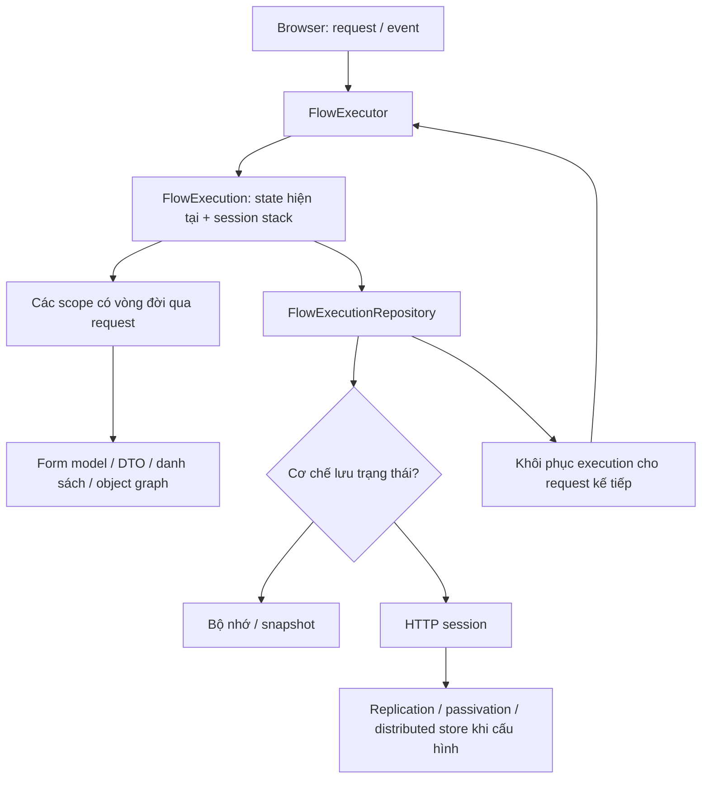

# Giảm kích thước model và chi phí tuần tự hóa

## 1. Bài toán hiệu năng đặc thù của Spring Web Flow

Trong **Spring Web Flow (SWF)**, một flow mô hình hóa hành trình nhiều bước bằng các `state`, `event` và `transition`. Người dùng có thể đi từ giỏ hàng sang xác nhận, thanh toán, quay lại sửa thông tin, rồi tiếp tục ở HTTP request khác. Muốn làm được điều này, engine phải giữ ngữ cảnh của **flow execution** giữa các lần tương tác.

Lợi thế đó kéo theo chi phí vận hành: trạng thái đang giữ có thể chứa form model, đối tượng trong `flowScope`, `viewScope`, `conversationScope`, dữ liệu phục vụ subflow và các snapshot cho cơ chế quay lại/khôi phục. Tùy **repository, cấu hình lưu trữ và hạ tầng HTTP session**, việc bảo toàn trạng thái có thể liên quan đến sao chép object graph, Java serialization, lưu session phân tán hoặc tải/ghi dữ liệu từ một kho bên ngoài.

Ví dụ: flow `checkout` đặt cả `Order` JPA cùng toàn bộ `lineItems`, `productImages`, `paymentHistory`, `auditEvents` vào `flowScope.order`. Mỗi lần người dùng chuyển bước có thể khiến engine phải giữ một đồ thị đối tượng lớn hơn rất nhiều so với thông tin cần để biết đang ở state nào, đã chọn cách giao hàng nào và cần xác nhận đơn hàng nào.

**Mục tiêu** là giữ đủ dữ liệu để tiếp tục hành trình và kiểm soát tính đúng đắn, đồng thời giảm đối tượng được giữ lại qua các request. Không nên tối ưu bằng cách xóa tùy tiện dữ liệu mà các transition, validation hoặc subflow còn cần.

## 2. Nhận diện phần nào thực sự làm phình trạng thái

Các dữ liệu sau thường tích lũy ngoài ý muốn:

- **Entity/aggregate lớn:** một object `Order` kéo theo quan hệ JPA, các collection và proxy lazy loading.
- **Danh sách hiển thị:** hàng trăm sản phẩm, kết quả tìm kiếm hoặc toàn bộ lịch sử thao tác được đưa vào `flowScope` dù chỉ cần để render một màn hình.
- **Bản sao trùng nhau:** cùng dữ liệu tồn tại ở form model, `flowScope`, `viewScope` và một DTO khác; cơ chế serialize có thể không chia sẻ dữ liệu theo cách ta mong đợi.
- **Tệp và dữ liệu nhị phân:** `byte[]`, ảnh, PDF, upload multipart hoặc nội dung export tạm được gắn vào object trong flow.
- **Đối tượng không thích hợp để lưu:** `EntityManager`, `Connection`, `InputStream`, service có dependency lớn, request/response, `MultipartFile`, thread-local state.
- **Dữ liệu cũ của bước trước:** kết quả tra cứu, danh sách tùy chọn và thông báo không còn cần sau khi rời view-state.

Một `String` mã đơn hàng thường nhỏ. Nhưng `Order` có liên kết tới khách hàng, ảnh, ghi chú và toàn bộ dòng sản phẩm sẽ làm việc lưu trữ và khôi phục execution tốn nhiều bộ nhớ hơn; trong trường hợp cần Java serialization, đồ thị đó còn có thể chứa đối tượng **không `Serializable`**.

### 2.1. Sơ đồ nơi trạng thái phát sinh



Sơ đồ là **mô hình khái niệm**. Không phải mọi hệ thống SWF đều serialize toàn bộ execution bằng Java serialization ở mỗi request. Mức độ sao chép, định dạng snapshot và cách lưu trạng thái phụ thuộc phiên bản, lựa chọn repository và cấu hình session.

## 3. Chọn scope theo thời gian thực sự cần dữ liệu

Chiến lược đầu tiên là **không giữ dữ liệu lâu hơn vòng đời sử dụng**.

| Vùng lưu trữ | Thời gian tồn tại theo ngữ nghĩa Web Flow | Dữ liệu phù hợp | Nguy cơ khi chứa object lớn |
|---|---|---|---|
| `requestScope` | Lượt request hiện tại | Danh sách lấy để render một lần, kết quả tính toán tạm | Chủ yếu tốn bộ nhớ trong request; không cần duy trì qua các bước |
| `flashScope` | Ngắn hạn, thường được dọn tại chu kỳ render view | Thông báo thành công/lỗi tạm | Dễ gây khó hiểu nếu dùng làm kho dữ liệu dài hạn |
| `viewScope` | Khi execution còn ở một `view-state` cụ thể | Form model, lựa chọn của màn hình hiện tại | Snapshot/view đang tạm dừng vẫn có thể mang dữ liệu này |
| `flowScope` | Trong `FlowSession` của flow hiện hành | ID đối tượng, lựa chọn nhiều bước, DTO nhỏ | Tồn tại qua nhiều state/request; rất dễ tích lũy |
| `conversationScope` | Trong conversation của flow execution, có thể được chia sẻ khi đi qua subflow | Ít metadata thực sự cần dùng xuyên flow cha/con | Dữ liệu lớn tồn tại lâu và có phạm vi rộng |
| HTTP session | Do Servlet container/session infrastructure quản lý | Xác thực và ngữ cảnh HTTP thật sự cần thiết | Có thể sống lâu hơn flow, tốn chi phí phân tán/replication |

**Quy tắc chọn scope:** dữ liệu chỉ để hiển thị thì ưu tiên nạp vào scope ngắn hạn hoặc dựng lại lúc render; dữ liệu làm cơ sở cho quyết định giữa nhiều bước thì giữ **dạng tóm tắt nhỏ** trong `flowScope`; dữ liệu chỉ cần trong một màn hình thì dùng `viewScope` khi phù hợp.

Không nên đưa toàn bộ danh sách hiển thị vào `conversationScope` chỉ vì cần truy cập bằng biểu thức từ nhiều nơi. Scope rộng hơn đồng nghĩa với nhiều khả năng giữ object lâu hơn dự kiến.

### 3.1. Trước và sau khi chọn scope hợp lý

Cách dễ gây phình trạng thái:

```xml
<on-start>
    <evaluate expression="catalogService.findAllProductsWithImages()"
              result="flowScope.products" />
    <evaluate expression="orderService.loadAggregate(orderId)"
              result="flowScope.order" />
</on-start>
```

Trong ví dụ này, danh sách sản phẩm và aggregate đơn hàng được giữ trong scope của flow dù chỉ hiển thị tại một hoặc hai bước.

Cách tinh gọn hơn:

```xml
<input name="orderId" type="long" required="true" />

<on-start>
    <evaluate expression="checkoutService.createDraft(orderId)"
              result="flowScope.checkoutDraft" />
</on-start>

<view-state id="review" model="checkoutDraft">
    <on-render>
        <evaluate expression="checkoutReadService.loadSummary(checkoutDraft.orderId)"
                  result="requestScope.orderSummary" />
    </on-render>
    <transition on="confirm" to="confirm" />
</view-state>
```

`checkoutDraft` chỉ lưu những dữ liệu người dùng có thể sửa hoặc lựa chọn cần được giữ qua nhiều bước; `orderSummary` chỉ phục vụ render. Khi browser quay lại màn hình, service đọc lại summary từ nguồn chuẩn.

Đổi lại, mỗi lần render có thể cần thêm truy vấn. Có thể giảm chi phí này bằng query tối ưu, caching với TTL thích hợp, hoặc chọn một DTO hiển thị nhỏ lưu trong `viewScope` nếu thật sự cần duy trì trong vòng đời view. Chỉ benchmark mới xác định phương án tốt hơn ở ứng dụng cụ thể.

## 4. Thiết kế form model nhỏ thay vì giữ entity JPA

### 4.1. Mẫu không nên duy trì xuyên toàn flow

```java
// Ví dụ minh họa mô hình dữ liệu nặng.
@Entity
public class Order {
    @OneToMany(mappedBy = "order")
    private List<OrderLine> lines;

    @OneToMany(mappedBy = "order")
    private List<PaymentAttempt> paymentAttempts;

    @ManyToOne
    private Customer customer;

    // Có thể còn nhiều liên kết khác.
}
```

Nếu đưa trực tiếp entity này vào `flowScope`, `viewScope` hoặc model của view-state, object graph có thể lớn, chứa Hibernate proxy, phụ thuộc persistence context hoặc vô tình làm lộ thông tin khi bind/render. Một getter bị gọi khi render cũng có thể kích hoạt lazy loading không dự kiến.

### 4.2. DTO chỉ giữ thứ cần cho state/transition

```java
package com.example.checkout.flow;

import java.io.Serializable;

public final class CheckoutDraft implements Serializable {

    private static final long serialVersionUID = 1L;

    private Long orderId;
    private String shippingMethodCode;
    private String voucherCode;
    private Long expectedVersion;

    public CheckoutDraft() {
    }

    public Long getOrderId() {
        return orderId;
    }

    public void setOrderId(Long orderId) {
        this.orderId = orderId;
    }

    public String getShippingMethodCode() {
        return shippingMethodCode;
    }

    public void setShippingMethodCode(String shippingMethodCode) {
        this.shippingMethodCode = shippingMethodCode;
    }

    public String getVoucherCode() {
        return voucherCode;
    }

    public void setVoucherCode(String voucherCode) {
        this.voucherCode = voucherCode;
    }

    public Long getExpectedVersion() {
        return expectedVersion;
    }

    public void setExpectedVersion(Long expectedVersion) {
        this.expectedVersion = expectedVersion;
    }
}
```

Đây là **một model nhỏ có khả năng Java serialization** cho các trường phổ biến trong checkout. Nó không giữ `Order`, ảnh, danh sách sản phẩm, `EntityManager` hoặc service. Các chuỗi người dùng nhập vẫn cần giới hạn độ dài và validation; `Serializable` không bảo đảm dữ liệu hợp lệ.

Một service có thể lấy entity mới theo `orderId` mỗi khi cần hành động nghiệp vụ:

```java
@Transactional
public CheckoutResult confirm(CheckoutDraft draft, UserPrincipal principal) {
    Order order = orderRepository.findById(draft.getOrderId())
            .orElseThrow(OrderNotFoundException::new);

    authorization.checkCanCheckout(principal, order);

    if (!order.getVersion().equals(draft.getExpectedVersion())) {
        throw new StaleCheckoutException();
    }

    order.selectShippingMethod(draft.getShippingMethodCode());
    order.applyVoucher(draft.getVoucherCode());

    return checkoutProcessor.confirmIdempotently(order, principal);
}
```

Các kiểu `CheckoutResult`, `UserPrincipal`, repository và exception trong ví dụ là abstraction của ứng dụng, không phải API sẵn có của SWF. Phần code minh họa chỗ nên đặt kiểm tra **quyền, tính mới của dữ liệu và tính idempotent**. Điều này quan trọng vì việc giảm model buộc flow tải lại entity ở thời điểm thực hiện hành động.

### 4.3. Giữ DTO có cấu trúc ổn định

- Sử dụng ID, enum/code, boolean, số lượng và những trường form thật sự cần phục hồi.
- Tránh giữ cả bản ghi cơ sở dữ liệu khi có thể tải lại bằng ID.
- Hạn chế collection; khi cần collection, cân nhắc chỉ giữ ID đã chọn và giới hạn số phần tử.
- Không tự ý thêm một field lớn vào DTO đang tồn tại qua nhiều request.
- Không đặt Spring service, lazy proxy, kết nối, stream hoặc buffer lớn vào model.
- Nếu có upload, lưu **mã tham chiếu tệp tạm** hoặc ID tài nguyên đã được quản lý, không lưu toàn bộ `byte[]` trong flow. Tệp tạm cần TTL, xác thực quyền và cleanup.

**Không biến client thành kho trạng thái tin cậy:** chỉ giữ một ID trong flow rồi đọc lại DB là tối ưu hợp lý; đưa toàn bộ draft vào hidden fields của HTML để “tiết kiệm session” sẽ khiến client có thể sửa dữ liệu nếu thiếu bảo vệ. Các hành động quan trọng vẫn phải xác thực dữ liệu server-side.

## 5. Vì sao serialization có thể gây trễ hoặc lỗi?

**Serialization** chuyển object graph thành dạng có thể sao chép/lưu. **Deserialization** xây lại object graph từ dạng lưu. Khi một repository/session infrastructure cần serialize execution, phần model lớn làm tăng:

1. **CPU** duyệt object graph, đọc/ghi trường và tạo byte stream.
2. **Bộ nhớ tạm** cho buffer, byte array và object trung gian; có thể tăng GC.
3. **Dung lượng lưu** của snapshot/session hoặc dữ liệu chuyển qua mạng nếu dùng shared store.
4. **Độ trễ** khi lưu execution sau một request và khôi phục trước request tiếp theo.
5. **Nguy cơ lỗi** khi một object trong graph không serializable hoặc dữ liệu đã thay đổi cấu trúc.

Các lỗi thường gặp gồm `java.io.NotSerializableException` khi dùng Java serialization, lỗi Hibernate lazy loading, `ClassCastException` hoặc `InvalidClassException` sau khi ứng dụng thay đổi class trong khi execution cũ vẫn tồn tại. Không phải mọi lỗi trong số này đều xảy ra ở mọi cấu hình; chúng xuất hiện khi code và storage path thực sự đi qua phần liên quan.

**Phân biệt ba khái niệm:**

| Khái niệm | Ý nghĩa | Lưu ý |
|---|---|---|
| Java `Serializable` | Class cho phép Java object serialization, với điều kiện toàn graph tương thích | Một field con không serializable vẫn có thể làm thất bại |
| Execution snapshot | Dữ liệu giúp repository bảo toàn/khôi phục trạng thái ở một mốc | Có thể dùng cách lưu và bản sao khác nhau tùy cấu hình SWF |
| HTTP session replication/passivation | Hạ tầng web lưu hoặc chuyển session | Không đồng nghĩa mọi SWF request đều serialize cùng số byte |

Vì vậy, "DTO đã implements `Serializable`" là bước phòng vệ, chưa đủ để tuyên bố execution đã an toàn với snapshot/repository của production. Cần **kiểm thử đường lưu/khôi phục thực tế**.

## 6. Ước lượng tác động bộ nhớ và snapshot

Để có trực giác, ký hiệu:

- `E` = số flow execution đang hoạt động đồng thời.
- `S` = kích thước trung bình **một bản trạng thái có thể lưu** (chỉ là ước lượng).
- `N` = số bản sao/snapshot được giữ đồng thời cho mỗi execution ở tình huống đang xét.

Nếu các bản sao độc lập và mỗi bản có kích thước xấp xỉ `S`, tổng dung lượng payload ước tính:

\[
M_{\text{payload}} \approx E \times S \times N
\]

Ví dụ giả định **1.000 execution**, mỗi bản trạng thái **300 KiB**, trung bình **3 bản lưu**, sẽ cần xấp xỉ **879 MiB** cho phần payload theo mô hình đơn giản này. Khi giảm trạng thái còn **30 KiB** mà giữ các giả định khác, con số tương ứng còn khoảng **88 MiB**.

Đây là **ước lượng minh họa**, không phải dự báo dung lượng heap hoặc Redis của một hệ thống cụ thể. Vùng nhớ heap chứa object references, overhead, metadata, GC và buffer tạm; snapshot có thể dùng chung reference, nén dữ liệu hoặc không tồn tại theo đúng hệ số `N`. Một số triển khai lưu trạng thái trực tiếp trong bộ nhớ; hệ thống khác tải/ghi session vào kho phân tán. Cần đo chính cấu hình đang sử dụng.

Không tối ưu chỉ dựa trên độ dài JSON của DTO: JSON payload, kích thước heap Java và byte stream của repository là **ba phép đo khác nhau**.

## 7. Các kỹ thuật giảm payload ở từng bước

### 7.1. Giữ dữ liệu nguồn trong kho nghiệp vụ

Thay vì:

```xml
<evaluate expression="orderService.loadOrderWithEverything(orderId)"
          result="flowScope.order" />
```

Ưu tiên:

```xml
<evaluate expression="checkoutService.createDraft(orderId)"
          result="flowScope.checkoutDraft" />
```

Khi hiển thị, truy vấn riêng thông tin cần cho màn hình. Khi xác nhận, dùng ID và version trong draft để tải lại object rồi thực hiện thao tác transaction. Điều này giảm serialized graph và làm rõ dữ liệu nào thuộc scope flow, dữ liệu nào thuộc cơ sở dữ liệu.

### 7.2. Không giữ toàn bộ danh sách để lọc/chọn ở client

Một flow chọn địa điểm nhận hàng có thể hiển thị 5.000 điểm giao dịch. Không nên lưu cả danh sách này trong `flowScope` rồi copy sang view-state. Dùng phân trang hoặc tìm kiếm server-side:

```text
flowScope.deliveryChoice = "STORE_135"   # một mã đã chọn

GET /delivery-locations?q=...&page=2
→ trả về một trang kết quả nhỏ, có phân quyền và giới hạn page size
```

Lưu giá trị đã chọn và các điều kiện cần khôi phục, chẳng hạn từ khóa hoặc trang hiện tại nếu UX cần. Tra cứu danh sách là read operation độc lập; nó không cần được gắn toàn bộ vào flow execution.

### 7.3. Quản lý vòng đời biến đã hết tác dụng

Nếu người dùng đã rời bước "chọn phương thức giao hàng", một kết quả báo giá tạm hoặc danh sách hãng vận chuyển cũ có thể không còn hữu ích. Đưa nó vào `requestScope`/`viewScope` khi phù hợp, hoặc xóa biến khỏi scope ở transition có chủ đích.

Ví dụ khi thực sự muốn loại một giá trị không còn cần ở các bước sau:

```xml
<transition on="continue" to="review">
    <evaluate expression="flowScope.remove('temporaryQuotes')" />
</transition>
```

Chỉ xóa sau khi chắc chắn transition và view tiếp theo không cần biến nữa. Với các form quay lại sửa dữ liệu, có thể cần giữ một draft nhỏ hoặc tái truy vấn thay vì xóa dữ liệu người dùng đã nhập.

### 7.4. Tối ưu dữ liệu đi qua subflow

Một flow cha `checkout` không cần chuyển toàn bộ `Order` sang `payment`. Hãy truyền các trường tối thiểu:

```xml
<subflow-state id="paymentStep" subflow="payment">
    <input name="orderId" value="flowScope.checkoutDraft.orderId" />
    <input name="expectedVersion" value="flowScope.checkoutDraft.expectedVersion" />

    <transition on="paid" to="success" />
    <transition on="cancelled" to="review" />
</subflow-state>
```

Flow con khai báo `<input name="orderId" type="long" required="true" />` và `<input name="expectedVersion" type="long" required="true" />`, sau đó tải lại thông tin cần thiết. Khi kết thúc, output chỉ nên chứa ID kết quả hoặc trạng thái đã xác minh. **Subflow có `FlowSession` riêng**, nên giữ cùng object graph nặng ở cả cha và con làm khó kiểm soát dữ liệu đang sống.

### 7.5. Tránh nhân bản cùng object qua các scope

Ví dụ dễ gây nhầm:

```xml
<evaluate expression="checkoutService.loadSummary(orderId)"
          result="flowScope.summary" />
<evaluate expression="flowScope.summary"
          result="viewScope.summary" />
```

Đây có thể là hai tham chiếu đến cùng object trong một runtime, nhưng khi snapshot/session serialization xảy ra, chi phí tùy vào cách serialize graph và vòng đời object. Vấn đề còn ở chỗ `flowScope.summary` vẫn tồn tại sau khi chuyển state.

Nếu summary chỉ phục vụ render, hãy đặt ở request scope, hoặc chỉ giữ một bản nhỏ trong view scope. Tránh tạo DTO lớn lặp lại chỉ để "tiện truy cập".

### 7.6. Giới hạn chuỗi, tập hợp và file upload

Đặt giới hạn kích thước cho form note, số item được chọn, trường text tự do và số file upload. Với upload, sau khi nhận dữ liệu, tạo một storage handle đã kiểm soát, ví dụ `attachmentId` hoặc `temporaryObjectKey`, rồi chỉ giữ handle trong draft. Quy trình cần giải phóng tệp tạm khi hết hạn, bị hủy hoặc hoàn tất.

## 8. Đo kích thước thực tế thay vì đoán

Một quy trình đo hữu ích có ba lớp: **model đơn lẻ**, **execution/snapshot** và **mức vận hành**.

### 8.1. Đo byte Java serialization của DTO ở môi trường kiểm thử

Hàm sau chỉ dùng Java standard library:

```java
package com.example.checkout.testutil;

import java.io.ByteArrayOutputStream;
import java.io.IOException;
import java.io.ObjectOutputStream;
import java.io.Serializable;

public final class SerializationSize {

    private SerializationSize() {
    }

    public static int bytes(Serializable value) throws IOException {
        ByteArrayOutputStream buffer = new ByteArrayOutputStream();
        try (ObjectOutputStream out = new ObjectOutputStream(buffer)) {
            out.writeObject(value);
        }
        return buffer.size();
    }
}
```

Có thể dùng với một fixture mô phỏng `CheckoutDraft` thực tế:

```java
CheckoutDraft draft = new CheckoutDraft();
draft.setOrderId(42L);
draft.setShippingMethodCode("STANDARD");
draft.setVoucherCode("WELCOME");
draft.setExpectedVersion(3L);

System.out.println("Draft serialized bytes = "
        + SerializationSize.bytes(draft));
```

Kết quả là **kích thước object stream của đúng DTO đó**, không phải kích thước toàn bộ `FlowExecution`, kích thước Java heap, hay số byte mà repository production sẽ ghi. Bài kiểm tra giúp so sánh trước/sau khi loại field và phát hiện sớm lỗi `NotSerializableException` do object con. Không tạo "fake DTO" quá đơn giản rồi coi đó là số liệu production.

### 8.2. Đo tại flow execution thật

Tạo kịch bản đi qua các state quan trọng (khởi chạy, nhập form, back/forward, vào subflow, kết thúc), rồi theo dõi theo mốc:

| Chỉ số | Vì sao hữu ích | Cách đọc |
|---|---|---|
| Dung lượng execution/snapshot/session khi lưu | Xác định payload thực | Dựa trên repository/session backend sử dụng |
| Thời gian lưu và khôi phục execution | Phản ánh chi phí tạo/phục hồi trạng thái | Xem p50, p95, p99 và lỗi, không chỉ trung bình |
| Heap usage, allocation rate và GC pause | Phát hiện pressure do graph và byte buffer | Kết hợp JFR, profiler hoặc metrics của JVM |
| Số execution/session đang hoạt động | Biến số khuếch đại tổng bộ nhớ | Phải quan sát peak và thời gian sống |
| Số snapshots/execution và tỷ lệ hết hạn | Cho biết chi phí lịch sử/quay lại | Dựa trên cấu hình repository |
| Thời gian query hydrate lại DTO | Đánh giá chi phí đổi storage lấy I/O | Theo dõi DB latency, cache hit, query count |
| Tỷ lệ lỗi continuation/stale execution | Đảm bảo tối ưu không phá UX | Kiểm thử quay lại, hai tab, hết hạn, retry |

Khi thu thập chỉ số, chỉ ghi metadata cần thiết như flow ID, state ID, loại lỗi và thời gian. Không log toàn bộ form hoặc object graph để đo kích thước: cách làm đó có thể tạo thêm chi phí và rò rỉ dữ liệu cá nhân.

### 8.3. Đo trong tình huống tải thật

Một bài kiểm thử nên có ít nhất hai nhóm:

- **Nhóm trước tối ưu:** form model/entity hiện tại, hành trình người dùng phổ biến, tải đồng thời tăng dần.
- **Nhóm sau tối ưu:** draft nhỏ, query theo view/action, cùng tỷ lệ thao tác, cùng cấu hình repository và cùng DB.

Đặt tải theo hành vi: một số execution tạm dừng lâu trong khi những execution khác liên tục chuyển state. Nếu chỉ bắn request liên tục mà không có người dùng "nghĩ" giữa các bước, phép đo dễ bỏ qua số execution cùng tồn tại trong bộ nhớ. So sánh tổng latency, CPU/GC, storage byte và số DB query để nhận ra chi phí đã chuyển từ đâu sang đâu.

## 9. Tinh chỉnh repository và lưu trữ execution

Giảm model thường tạo hiệu quả lớn hơn việc thay repository, nhưng những thiết lập lưu trữ vẫn cần xem xét.

### 9.1. Lịch sử snapshot và khả năng dùng nút Back

Một số cách triển khai FlowExecutionRepository lưu nhiều snapshot để người dùng có thể đi lại trong hành trình hoặc xử lý postback. Giữ nhiều snapshot thường tốn tài nguyên hơn, nhưng giảm quá mạnh có thể khiến một URL có execution key cũ không còn hoạt động như mong đợi.

Trong các cấu hình Spring Web Flow 2.x, có các tùy chọn liên quan số **execution** và **execution snapshot** cho repository (ví dụ `max-executions`, `max-execution-snapshots` tại cấu hình phù hợp). Tên option và nơi khai báo cụ thể cần đối chiếu XSD/tài liệu của phiên bản chạy thực tế.

**Không tự kết luận giảm snapshots là tối ưu miễn phí.** Hãy kiểm tra: browser Back, refresh, double submit, hai tab cùng flow, form quá hạn, xử lý concurrent requests và hành vi recovery đã thiết kế.

### 9.2. Khi chạy trên nhiều node

Nếu session/execution được lưu ở một node mà request tiếp theo tới node khác, hành trình có thể không còn state nếu thiếu cơ chế session affinity hoặc shared store phù hợp. Khi dùng session replication hoặc Redis/shared session, model lớn có thể làm tăng lưu lượng mạng và thời gian encode/decode.

Việc dùng shared store không tự sửa lỗi `Serializable` hoặc incompatibility giữa nhiều phiên bản class khi rolling deploy. Khi model thay đổi cấu trúc giữa lúc execution cũ còn tồn tại, cần test chính sách tương thích, hết hạn và khôi phục.

### 9.3. Khi thay đổi số execution đồng thời được giữ

TTL hoặc giới hạn số execution có thể giải phóng tài nguyên nhanh hơn, nhưng cần gắn với UX. Một hồ sơ nhiều bước kéo dài 40 phút có yêu cầu khác với một popup xác nhận trong vài giây. Cần giải thích thời hạn rõ ràng, cung cấp cách bắt đầu lại/phục hồi draft có chủ đích và tránh mất dữ liệu người dùng không cần thiết.

## 10. Những đánh đổi cần xử lý khi giảm model

| Kỹ thuật | Lợi ích chính | Đánh đổi cần kiểm soát |
|---|---|---|
| Giữ ID, trạng thái chọn và version | Đồ thị object nhỏ, ít phụ thuộc JPA | Truy vấn lại khi render/commit |
| DTO form gọn, `Serializable` | Giảm payload, dễ kiểm thử state | Cần mapping và validation rõ |
| `requestScope` cho dữ liệu hiển thị | Không duy trì qua nhiều bước | Có thể phải tính/tải lại |
| Pagination/search server-side | Tránh giữ hàng nghìn mục | Tốn request/query khi tìm kiếm |
| Giới hạn snapshots theo nhu cầu | Có thể giảm tổng chi phí lưu trạng thái | Tác động Back/refresh/history |
| Dùng cache cho dữ liệu read-only | Giảm query khi hydrate lại | TTL, invalidation, consistency |
| Lưu upload ngoài flow, giữ token | Tránh binary lớn trong session | Cần quản lý tuổi thọ và quyền truy cập |
| Xóa biến khi không còn dùng | Giảm object graph sống lâu | Có nguy cơ mất dữ liệu nếu người dùng quay lại |

Đừng áp dụng mọi kỹ thuật đồng loạt. Với flow nhỏ chỉ giữ vài chuỗi và ID, tối ưu hóa phức tạp có thể tạo thêm code và query mà hiệu quả không đáng kể. Ngược lại, flow giữ entity lớn, file binary hoặc hàng nghìn record là dấu hiệu nên đo và chỉnh trước.

### 10.1. Dữ liệu mới nhất hay dữ liệu người dùng đã xem?

Khi tải lại entity từ DB ở bước cuối, dữ liệu có thể đã thay đổi bởi người khác. Tối ưu state có thể làm vấn đề đồng thời bộc lộ rõ hơn:

1. Người dùng A mở flow tại phiên bản đơn hàng `v3`.
2. Người dùng B cập nhật đơn hàng thành `v4`.
3. Người dùng A xác nhận với draft mang `expectedVersion=3`.
4. Service phát hiện stale version và đưa ra nhánh refresh/review thay vì ghi đè.

Đây là lý do DTO nhỏ nên giữ version hoặc token chống stale phù hợp với chính sách nghiệp vụ, không chỉ giữ `orderId` rồi chấp nhận mọi thay đổi ngầm. Nếu flow yêu cầu snapshot nghiệp vụ bất biến theo thời điểm xác nhận, hãy lưu bản snapshot đó ở kho nghiệp vụ chuyên dụng thay vì vô tình nhúng toàn bộ aggregate trong flowScope.

### 10.2. Idempotency khi người dùng gửi lại request

Đôi khi refresh hoặc retry khiến một action có thể chạy lại. Khi bỏ state nặng, đừng mất `idempotencyKey`, mã request hoặc cờ nghiệp vụ cần để tránh thanh toán/ghi đơn lặp. Chỉ giữ mã khóa nhỏ trong flow, còn trạng thái commit và bảo đảm idempotent nên thuộc DB/service.

## 11. Lỗi thường gặp và cách chẩn đoán

**Trường hợp A — SerializationException sau khi thêm một field vào form model.** Kiểm tra field mới có chứa `InputStream`, Hibernate proxy, service hoặc object thiếu `Serializable` không. Một field `transient` có thể loại khỏi Java serialization, nhưng chỉ dùng khi dữ liệu đó có thể tạo lại an toàn; không làm `transient` bừa bãi để che lỗi.

**Trường hợp B — Heap tăng theo số người dùng tạm dừng ở view.** Kiểm tra `flowScope` và `viewScope` có đang giữ danh sách render, bộ nhớ đệm request, ảnh hoặc file. Đo số execution và tuổi đời snapshot, sau đó thay dữ liệu bằng DTO nhỏ hoặc query theo trang.

**Trường hợp C — Sau tối ưu, DB query tăng mạnh.** Có thể hệ thống nạp lại cùng summary mỗi lần render. Xem execution trace để biết render bị gọi nhiều lần do validation failure hay lỗi UI; cân nhắc cache read-only, batch query hoặc một DTO nhỏ sống trong `viewScope` vừa đủ.

**Trường hợp D — Flow vỡ khi người dùng dùng nút Back.** Kiểm tra repository snapshot, thời hạn execution, state còn hiệu lực và dữ liệu bị dọn khi transition. Giảm snapshot hoặc xóa biến quá sớm đều có thể làm quay lại thất bại.

**Trường hợp E — Lỗi chỉ xảy ra trên môi trường nhiều server.** So sánh cấu hình session store, serializer, version class, dependency và cơ chế route giữa các node. Máy local có thể giữ object trong RAM nên chưa kích hoạt đường serialize/replicate giống production.

**Trường hợp F — Subflow càng chạy càng nặng.** Kiểm tra liệu flow cha truyền một graph lớn cho mỗi flow con hoặc có nhiều bản sao ở `conversationScope` hay không. Chỉ truyền ID hoặc DTO nhỏ và giới hạn output khi quay lại cha.

## 12. Bài thực hành: tối ưu flow checkout

Giả sử flow hiện tại có:

```text
flowScope.order
  ├── customer (addressBook, preferences, ...)
  ├── lines[150] (product, images, categories, ...)
  ├── payments[30]
  └── history[500]

flowScope.shippingQuotes[500]
viewScope.orderCopy (bản sao để render)
```

Hãy thực hiện theo trình tự:

1. **Đo baseline.** Chạy flow qua `cart → shipping → review → payment` với dữ liệu đại diện. Ghi payload lưu trữ (nếu đo được từ repository), heap/GC, latency và DB queries.
2. **Xác định trường thiết yếu.** Flow phải nhớ `orderId`, `shippingMethodCode`, `voucherCode`, `expectedVersion` và dữ liệu form nào người dùng thực sự sửa.
3. **Tạo `CheckoutDraft` gọn.** Dùng `Serializable`, không giữ entity hay `List<OrderLine>`.
4. **Dời dữ liệu chỉ-hiển-thị.** Đọc lại bản tóm tắt ở `on-render` vào `requestScope`, phân trang danh sách địa điểm hoặc lịch sử nếu cần.
5. **Thay input subflow.** `payment` nhận ID + version, tự kiểm tra quyền và trạng thái ở service.
6. **Thử các đường quay lại.** Back, refresh, cancel, validation fail, concurrent update, hai tab, expired execution và retry.
7. **Đo lại cùng tải.** So sánh byte/state, thời gian save/restore, heap, GC, p95/p99 và số query. Giữ phương án tối ưu khi cả hiệu năng lẫn hành vi nghiệp vụ đạt yêu cầu.

Một kết quả đạt yêu cầu có thể là: thời gian lưu/khôi phục execution giảm, số byte/session giảm, nhưng các transition và kết quả xác nhận vẫn giống trước; service phát hiện stale data và không phát sinh double submit. Không yêu cầu mọi metric đều giảm cùng lúc, vì một phần chi phí có thể chuyển sang DB.

## 13. Checklist trước khi vận hành

- [ ] Flow chỉ giữ ID, lựa chọn và model thật sự cần qua nhiều request; danh sách lớn có cơ chế query riêng.
- [ ] `flowScope` và `conversationScope` không chứa entity graph, file, stream, service hoặc kết nối.
- [ ] Những object có thể bị serialize đã được kiểm thử bằng đường repository/session thực tế.
- [ ] `requestScope`, `viewScope`, `flashScope` được dùng đúng vòng đời; biến cũ được giải phóng hợp lý.
- [ ] Subflow chỉ nhận input tối thiểu và trả output cần thiết.
- [ ] Dữ liệu tải lại từ DB vẫn qua kiểm tra quyền, version, validation và idempotency.
- [ ] Đã đo payload thực tế, thời gian serialize/restore, GC, p95/p99 và số execution đồng thời.
- [ ] Đã kiểm tra browser Back, refresh, hai tab, lỗi validation, expired execution và recovery.
- [ ] Giới hạn snapshot/session store phù hợp hành trình và có hướng dẫn xử lý khi flow hết hạn.
- [ ] Không để ID cá nhân, token, dữ liệu form nhạy cảm trong metric labels hoặc log serialized graph.

## 14. Ghi nhớ

Giảm kích thước model trong Spring Web Flow bắt đầu bằng **thiết kế ranh giới dữ liệu**: thông tin nào là trạng thái điều hướng cần duy trì, thông tin nào là dữ liệu nghiệp vụ có thể truy vấn lại, và thông tin nào chỉ để render một lượt. DTO nhỏ, lựa chọn scope phù hợp và truyền ID qua subflow giúp kiểm soát object graph được giữ trong execution. Các quyết định về repository, snapshot và session phân tán chỉ nên tinh chỉnh dựa trên phép đo và yêu cầu Back/refresh của hành trình thật.

Quan trọng nhất: **giảm payload không đồng nghĩa làm mất tính đúng đắn**. Mọi giải pháp cần duy trì validation, authorization, kiểm tra stale version, khả năng phục hồi và tính idempotent khi người dùng đi qua nhiều state/event/transition.

### Tài liệu tham khảo

- [Spring Web Flow Reference Manual – Flow Execution / Repository](https://docs.spring.io/spring-webflow/docs/2.5.x/reference/html/) – khái niệm execution, conversation, snapshot, scope và cấu hình hệ thống.
- [Spring Web Flow API – FlowExecutionRepository](https://docs.spring.io/spring-webflow/docs/2.5.x/api/org/springframework/webflow/execution/repository/FlowExecutionRepository.html) – hợp đồng lưu/khôi phục flow execution.
- [Java Object Serialization Specification](https://docs.oracle.com/en/java/javase/17/docs/specs/serialization/) – object graph, `Serializable` và các điều kiện serialization.
- [Java Flight Recorder Documentation](https://docs.oracle.com/en/java/javase/17/jfapi/) – công cụ thu thập thông tin runtime hỗ trợ điều tra allocation và GC.
