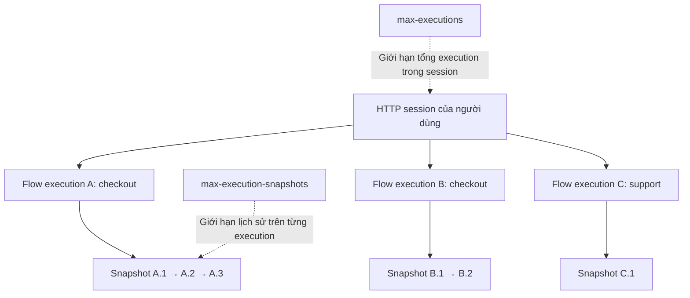
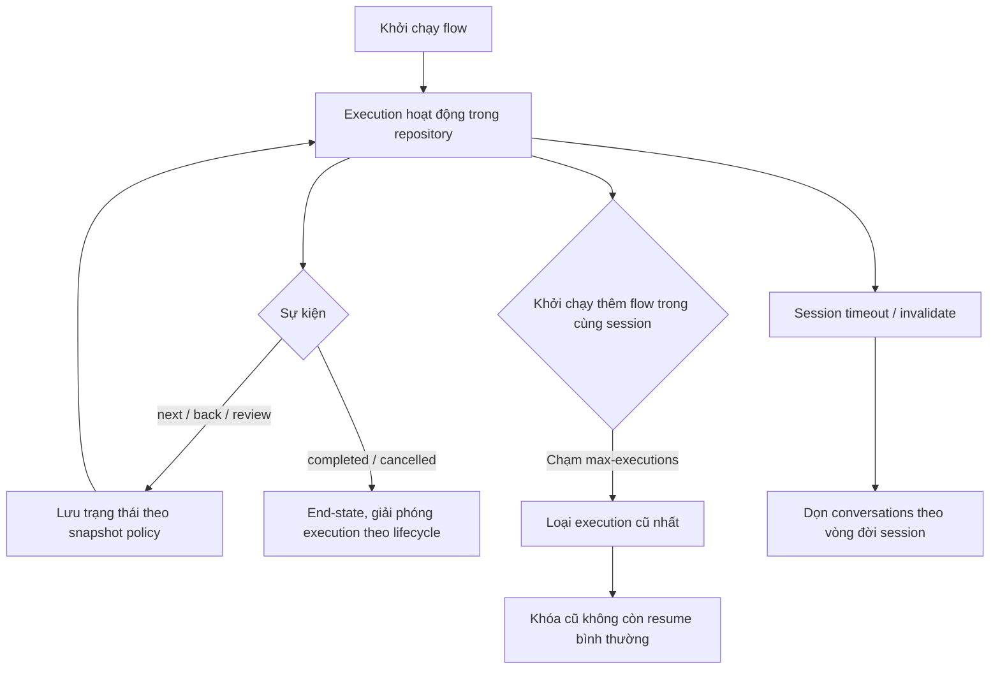

# Giới hạn số flow đang mở và lịch sử được giữ trong Spring Web Flow

## 1. Bối cảnh: vì sao một form nhiều bước có thể chiếm nhiều tài nguyên?

**Spring Web Flow (SWF)** mô hình hóa hành trình web bằng `state`, `event`, `transition` và `subflow`. Một lần chạy hành trình được gọi là **flow execution**. Khi người dùng đang ở `view-state` để điền form, Web Flow cần giữ trạng thái giữa các HTTP request: dữ liệu trong `flowScope`, trạng thái `viewScope`, thông tin điều hướng, cùng những đối tượng được ứng dụng đưa vào các scope.

Trong ứng dụng đặt lịch, người dùng có thể mở flow chọn dịch vụ ở một tab, flow thanh toán ở tab thứ hai, rồi quay lại tab đầu sau nhiều phút. Trong khi đó trình duyệt có thể giữ nhiều URL ứng với các phiên bản trạng thái trước đó để phục vụ nút **Back**. Nếu không quản lý giới hạn, dữ liệu retained trong session và repository có thể tăng, nhất là khi flow giữ DTO lớn, tài nguyên nặng hoặc lịch sử quá dài.

**Giới hạn số flow đang mở và lịch sử được giữ** là một quyết định về **hiệu năng và vận hành**, có tác động trực tiếp đến trải nghiệm người dùng, khả năng quay lại, sử dụng bộ nhớ và xử lý flow đã hết hạn.

### Mục tiêu học tập

Sau bài này, bạn có thể:

1. Phân biệt **HTTP session**, **conversation**, **flow execution**, **flow definition**, **flow execution key** và **snapshot lịch sử**.
2. Giải thích chính xác hai cấu hình `max-executions` và `max-execution-snapshots`: đơn vị giới hạn, hành vi khi vượt ngưỡng và ảnh hưởng tới browser history.
3. Cấu hình các giới hạn qua Spring Web Flow XML hoặc Java builder trên phiên bản đang sử dụng.
4. Lập ngân sách bộ nhớ có ý thức về số execution và snapshot; xác định trade-off giữa back-navigation và chi phí vận hành.
5. Kiểm thử nhiều tab, mở flow mới, Back/Refresh, session timeout, flow kết thúc và request đồng thời.
6. Xây dựng chỉ số giám sát và quy trình điều chỉnh ngưỡng khi tải người dùng thay đổi.

Phạm vi bài là **quản lý vòng đời execution và lịch sử**. Nó bổ trợ những phần kiến thức khác về form binding/validation, scope/session, Spring MVC integration, kiểm thử và phục hồi lỗi; không thay thế việc xử lý giao dịch hoặc bảo vệ dữ liệu nghiệp vụ.

## 2. Phân biệt các khái niệm dễ bị nhầm

| Khái niệm | Ý nghĩa trong SWF | Ví dụ |
|---|---|---|
| **Flow definition** | Bản thiết kế một hành trình: state, transition, action, subflow. | Definition `checkout` được khai báo trong XML. |
| **Flow execution** | Một instance đang chạy của definition, có dữ liệu và state riêng. | Người dùng bắt đầu `checkout` lúc 10:00 tạo execution A. |
| **Top-level flow** | Hành trình được khởi chạy từ bên ngoài. | Checkout do URL người dùng mở. |
| **Subflow** | Flow được gọi từ `subflow-state`, tham gia vào execution/conversation của luồng gọi. | Bước nhập địa chỉ được gọi từ checkout. |
| **HTTP session** | Phiên web được container quản lý, thường liên kết với cookie session. | Cùng browser session có thể mở nhiều execution. |
| **Conversation** | Đơn vị tương tác lâu hơn một request, được `ConversationManager` quản lý để giữ execution. | Conversation chứa dữ liệu và trạng thái của flow đang hoạt động. |
| **Flow execution key** | Khóa định danh trạng thái lưu trong repository, dùng để tiếp tục flow. | Khóa được đưa vào URL hành trình đang mở. |
| **Snapshot** | Bản lưu trạng thái tại một thời điểm của execution để có thể quay lại. | Bản trước khi chuyển từ `enterDetails` sang `review`. |

Một **flow definition** có thể có nhiều **flow execution** đồng thời. Khi định nghĩa con được gọi qua `subflow-state`, không nên mặc định coi đó là một lượt mở top-level flow mới và đếm như một tab độc lập. Tương tự, **tab** không đồng nghĩa **execution**: hai tab có thể cùng dùng một URL execution nếu người dùng duplicate tab hoặc copy URL.

Tài liệu SWF mô tả repository lưu các execution theo `FlowExecutionKey`, còn `ConversationManager` quản lý các conversation bên dưới. Hai cơ chế giới hạn liên quan đến **execution đang được giữ** và **snapshot bên trong từng execution**, không phải tổng số file XML hoặc tổng số request HTTP.



Sơ đồ mang tính khái niệm; số snapshot thực có thể khác do cách repository tạo và giữ snapshot ở phiên bản/cấu hình cụ thể.

## 3. Hai giới hạn cốt lõi

### 3.1. `max-executions`: số flow execution đang giữ trong một session

Trong phần *Tuning Flow Execution Persistence*, Spring Web Flow cho phép khai báo:

```xml
<webflow:flow-execution-repository max-executions="5" />
```

Theo tài liệu tham khảo SWF 3.0.x và 4.0.x:

- Đây là giới hạn **theo HTTP session người dùng**, không phải theo một flow definition.
- Giới hạn áp dụng qua **các instance của mọi flow definition** được quản lý bởi cấu hình repository/executor tương ứng.
- Khi vượt số execution cho phép, **execution cũ nhất sẽ bị loại khỏi quản lý** để nhường chỗ cho execution mới.
- Một request sử dụng khóa của execution đã bị loại có thể không được tiếp tục như trước.

**Ví dụ minh họa:** đặt `max-executions="3"`. Người dùng liên tiếp khởi chạy ba flow độc lập: checkout A, support B, checkout C. Sau đó khởi chạy checkout D. Với repository mặc định, hệ thống giữ lại ba execution gần hơn theo chính sách loại cũ nhất; A không còn có thể resume qua khóa cũ.

| Thao tác | Danh sách execution còn được giữ sau thao tác | Điều cần lưu ý |
|---|---|---|
| Mở checkout A | A | 1/3 execution. |
| Mở support B | A, B | 2/3 execution. |
| Mở checkout C | A, B, C | 3/3 execution. |
| Mở checkout D | B, C, D | A là execution cũ nhất và bị loại. |
| Quay lại tab A | Không bảo đảm tiếp tục A | Tùy cấu hình handler, request có thể nhận lỗi hoặc bị xử lý theo chính sách phục hồi. |

**Giới hạn này không phải quota theo flow ID.** Nếu ứng dụng muốn “mỗi người tối đa một checkout nhưng vẫn được mở nhiều support flow”, `max-executions` một mình không diễn đạt quy tắc đó. Cần thiết kế lifecycle và điều kiện nghiệp vụ riêng, đồng thời kiểm tra tác động tới conversation manager.

Cũng cần phân biệt **mở execution mới** với **gửi thêm event trong execution hiện có**. Người dùng nhấn Tiếp tục, quay lại trong flow hay refresh trang không mặc nhiên tạo thêm một execution mới; hãy quan sát URL execution và request thực tế trước khi giải thích vì sao hạn mức bị chạm.

### 3.2. `max-execution-snapshots`: số trạng thái lịch sử của một execution

Cấu hình thứ hai:

```xml
<webflow:flow-execution-repository max-execution-snapshots="30" />
```

Giới hạn này áp dụng **cho từng flow execution**, không phải tổng snapshot của tất cả người dùng.

- Giá trị dương, chẳng hạn `12`, giới hạn số snapshot lịch sử được repository giữ cho một execution.
- `0` **tắt việc tạo snapshot lịch sử**. Tài liệu SWF cảnh báo Back tới khóa snapshot chưa được lưu sẽ không hoạt động.
- `-1` **cho phép số snapshot không giới hạn** trong phạm vi repository này. Chỉ nên cân nhắc nếu có cơ chế kiểm soát thời gian sống và tài nguyên thật sự thích hợp.

Một execution có thể sinh nhiều snapshot khi các bước được xử lý và URL execution thay đổi. Giữ được snapshot cũ giúp **browser Back** quay về trạng thái đã lưu. Tuy nhiên, snapshot **không phải** lịch sử giao dịch, không phải log audit và không đảm bảo “undo” những hành động đã ghi vào database.

Ví dụ:

```text
Execution checkout A
  snapshot 1: enterItems
  snapshot 2: enterAddress
  snapshot 3: chooseDelivery
  snapshot 4: review
  snapshot 5: review sau chỉnh sửa
```

Nếu chỉ giữ tối đa ba snapshot, những khóa dẫn tới ảnh chụp trạng thái xa hơn có thể không dùng được. Việc snapshot nào bị loại và thời điểm lấy snapshot cần kiểm chứng trên repository/version thực tế; không được coi ví dụ trên là mô tả byte-for-byte của thuật toán.

### 3.3. So sánh hai thiết lập trong một bảng

| Thuộc tính | `max-executions` | `max-execution-snapshots` |
|---|---|---|
| Đơn vị áp dụng | Mỗi HTTP session | Mỗi flow execution |
| Quản lý cái gì? | Số execution/conversation đang được giữ | Số snapshot lịch sử của mỗi execution |
| Khi chạm ngưỡng | Loại execution cũ nhất để nhận execution mới | Lịch sử cũ có thể bị loại, không phục hồi được bằng khóa cũ |
| Ảnh hưởng chính | Nhiều flow đồng thời, nhiều tab, session memory | Nút Back, history, chi phí snapshot |
| Có thể đặt 0? | Cần kiểm tra hợp đồng builder/repository từng phiên bản; không dùng 0 như cấu hình “hủy mọi flow” | Có: 0 tắt snapshot lịch sử |
| Có thể đặt -1? | `SessionBindingConversationManager` có `maxConversations=-1`, nhưng cần đối chiếu cơ chế thiết lập XML/builder; không áp dụng máy móc | Có: -1 không giới hạn snapshot |
| Khả năng thay thế session timeout? | Không | Không |

Tài liệu API của `SessionBindingConversationManager` SWF 3.0.1 ghi **mặc định `maxConversations=5`**; `DefaultFlowExecutionRepository` ghi **mặc định 30 snapshot**. Đây là các giá trị mặc định được công bố cho những implementation/version đó, **không phải cam kết mọi repository tùy chỉnh hoặc mọi phiên bản tương lai luôn dùng như vậy**. Trong hệ thống cần kiểm soát chặt, khai báo ngưỡng tường minh và xác minh instance lúc chạy.

## 4. Cấu hình bằng XML và Java

### 4.1. XML trong Spring application context

Ví dụ hệ thống đặt lịch có thể chạy song song bốn execution và giữ 12 snapshot cho mỗi execution:

```xml
<!-- Đặt trong file cấu hình Spring có namespace webflow hợp lệ -->
<webflow:flow-executor id="flowExecutor"
                       flow-registry="flowRegistry">

    <webflow:flow-execution-repository
        max-executions="4"
        max-execution-snapshots="12" />

</webflow:flow-executor>
```

Các con số `4` và `12` là **ví dụ để học**, không phải khuyến nghị sẵn cho production. XML phải nằm trong **Spring application context** có `webflow` namespace và `flowRegistry` tương ứng; không đặt `<webflow:flow-executor>` bên trong flow definition có root `<flow>`.

Đừng nhầm giới hạn với các cấu hình khác:

- `session-timeout` do servlet container điều khiển vòng đời HTTP session.
- `<view-state>`, `<transition>` điều khiển hành vi chuyển state.
- `redirect-in-same-state` điều khiển redirect khi render lại cùng state, không phải hạn mức snapshot.
- `max-executions` và `max-execution-snapshots` thuộc **flow execution repository**.

Việc thay số trong XML chưa chắc được server áp dụng nếu ứng dụng có nhiều Spring context, nhiều flow executor hoặc một executor tùy chỉnh. Luôn xác minh **bean thực sự xử lý request flow**.

### 4.2. Java configuration qua `FlowExecutorBuilder`

Tài liệu SWF minh họa hai thiết lập tương đương trong Java:

```java
@Bean
public FlowExecutor flowExecutor() {
    return getFlowExecutorBuilder(flowRegistry())
            .setMaxFlowExecutions(4)
            .setMaxFlowExecutionSnapshots(12)
            .build();
}
```

Đây là **mảnh cấu hình** theo mẫu class kế thừa `AbstractFlowConfiguration` của SWF, nơi `getFlowExecutorBuilder(...)` và `flowRegistry()` tồn tại. Nếu dự án không kế thừa class cấu hình đó, cần tạo builder/bean bằng API phù hợp thay vì chép nguyên phương thức rồi kỳ vọng tự compile.

Điều quan trọng là hai dòng:

```java
.setMaxFlowExecutions(4)
.setMaxFlowExecutionSnapshots(12)
```

Chúng tác động tới **repository được builder tạo cho executor đó**, không tự thiết lập giới hạn cho một executor khác trong ứng dụng. Khi kiểm tra nâng cấp từ SWF 2.5 lên 3/4, hãy đối chiếu signatures theo version thật và nạp application context để phát hiện bean cấu hình thừa, bị ghi đè hoặc không được sử dụng.

### 4.3. Kết nối với `SessionBindingConversationManager`

Ở implementation mặc định dựa trên session, `SessionBindingConversationManager` chịu trách nhiệm quản lý các conversation. API của nó có `setMaxConversations(int)` và giải thích rằng khi vượt ngưỡng, conversation cũ nhất sẽ kết thúc; giá trị `-1` bỏ giới hạn ở manager đó.

Điều này giúp hiểu nội bộ của giới hạn executions, nhưng **không nên tự khởi tạo một conversation manager mới rồi giả định executor đã dùng nó**. Khi xây repository/executor tùy chỉnh, cần kiểm tra đúng wiring giữa `FlowExecutor`, `FlowExecutionRepository` và `ConversationManager`.

Ví dụ kiểm tra logic khái niệm:

```text
FlowExecutor
   └── FlowExecutionRepository
         ├── snapshot policy (max-execution-snapshots)
         └── ConversationManager
               └── session conversation policy (max conversations)
```

**Cảnh báo về tên gọi:** hạn mức repository trong tài liệu là `max-executions`, còn thuộc tính của `SessionBindingConversationManager` là `maxConversations`. Hai khái niệm liên quan trong implementation session mặc định, nhưng không nên coi là đồng nghĩa tuyệt đối trong mọi repository tùy chỉnh.

## 5. Cân bằng trải nghiệm Back/Refresh và chi phí lịch sử

### 5.1. Khi snapshot bằng 0

Theo reference guide, đặt:

```xml
<webflow:flow-execution-repository
    max-executions="3"
    max-execution-snapshots="0" />
```

sẽ tắt tạo snapshot history. Một người dùng đã chuyển từ `step1` sang `step2` có thể bấm Back để quay tới URL chứa **khóa lịch sử cũ**. Nếu repository không giữ snapshot mà khóa đó trỏ tới, hệ thống không thể khôi phục trạng thái tương ứng. Tùy adapter và `FlowHandler`, ứng dụng có thể báo lỗi, chuyển trang hoặc khởi chạy lại flow; không được hứa rằng nút Back sẽ hoạt động bình thường.

Đây là lựa chọn có thể hợp lý với wizard ngắn có nút **Quay lại** được thiết kế **bằng transition** và không yêu cầu dựa vào history của trình duyệt. Tuy nhiên, cần kiểm thử riêng hành vi Back, Refresh và người dùng mở nhiều tab, vì hành vi của trình duyệt vẫn tồn tại dù ứng dụng không giữ snapshot.

**Không đồng nhất transition `on="back"` với nút Back của trình duyệt.** Nút trong form phát một event mới trong execution; browser Back có thể yêu cầu URL cũ chứa một execution key cũ. Hai thao tác tác động khác nhau đến repository.

### 5.2. Khi snapshot quá thấp

Giả sử quy trình checkout có tám bước và cho phép quay lại nhiều bước. Nếu chỉ giữ `max-execution-snapshots="2"`, người dùng có thể không quay lại được một trang cách đây ba hoặc bốn lần render. Một snapshot có thể được tạo khi flow vào lại cùng state hoặc khi tương tác thêm; vì vậy **số bước XML không phải số snapshot**.

Hành vi sai thường chỉ xuất hiện khi:

- Form validation lỗi khiến cùng một view render lại.
- Ajax hoặc sự kiện cập nhật cùng state tạo thêm lượt xử lý.
- Người dùng quay qua lại nhiều lần.
- Người dùng dùng Back/Forward của trình duyệt.
- Người dùng giữ tab cũ trong khi tab khác đã thay đổi execution.

Phải đo chính xác **số snapshot phát sinh trên đường đi thực tế** trước khi chọn giới hạn.

### 5.3. Khi snapshot không giới hạn

Với `max-execution-snapshots="-1"`, repository không áp một ngưỡng số lượng snapshot cho từng execution. Nếu session tồn tại dài và flow có nhiều lần tương tác, memory/cost snapshot có thể tăng theo thời gian.

Những hậu quả cần điều tra:

- Heap tăng, garbage collection nặng hơn.
- Serialized session/snapshot lớn, dẫn đến latency khi encode/decode hoặc replicate.
- Session store phân tán dùng nhiều dung lượng/bandwidth hơn.
- Một execution ở tab bỏ quên có thể vẫn giữ những object lớn trong nhiều snapshot.
- Thao tác deploy/restart hoặc failover trở nên khó hơn khi session phải khôi phục object của version khác.

**Không dùng `-1` như cách “sửa nhanh nút Back” khi chưa đo tài nguyên và chưa xác định thời gian sống của session.** Nên đánh giá có cần browser history đầy đủ hay chỉ cần các transition nghiệp vụ để quay về state trước.

## 6. Vấn đề đặc biệt: nhiều tab và một HTTP session

Một người dùng có thể mở các tab sau trong cùng session:

```text
Tab 1: /checkout             -> khởi chạy checkout execution A
Tab 2: /support/new          -> khởi chạy support execution B
Tab 3: /checkout             -> khởi chạy checkout execution C
Tab 4: copy URL của Tab 1    -> có thể tiếp tục execution A
```

Số tab ở đây là bốn, nhưng số **execution** có thể chỉ là ba. Tab 4 dùng cùng execution A nên hai tab có khả năng tác động vào cùng `flowScope`, `viewScope` hoặc snapshot history, tùy URL và event mà chúng gửi.

| Hiện tượng | Nguyên nhân cần nghĩ tới | Cần kiểm tra |
|---|---|---|
| Mở tab mới khiến tab lâu nhất không hoạt động | Chạm `max-executions` và execution cũ bị loại | Số execution mới thực sự được launch trong session |
| Duplicate tab rồi nhập khác nhau | Hai tab có thể cùng execution | Execution key, event order, locking, model state |
| Back hoạt động ở tab 2 nhưng không ở tab 1 | Snapshot cũ ở tab 1 đã bị loại | Key/snapshot history và giới hạn snapshot |
| Flow A kết thúc, tab B vẫn mở | B có thể là execution riêng hoặc cùng execution | Cách khởi chạy, URL và end-state |
| Nhiều request POST gần nhau gây lỗi | Cạnh tranh lock hoặc state thay đổi giữa request | Conversation lock, timeout, trace theo execution |

Cần phân biệt ít nhất hai kiểu “nhiều tab” trong test:

1. **Independent launches:** mỗi tab truy cập URL bắt đầu flow, sinh execution riêng. Trường hợp này kiểm tra `max-executions`.
2. **Shared execution URL:** hai tab cùng resume một execution. Trường hợp này kiểm tra **đồng bộ trạng thái, snapshot, lock và bảo vệ nghiệp vụ**; hạn mức số execution không giải quyết xung đột dữ liệu giữa chúng.

Nếu có hành động ghi như `confirmPayment` hoặc `submitOrder`, phải xử lý **idempotency** tại service/database để tránh ghi lặp. Snapshot history không phải transaction rollback và không đảm bảo chống double-submit.

## 7. Giới hạn không thay thế lifecycle và việc dọn dữ liệu

Giới hạn cấu hình là **ngưỡng**, không phải cơ chế dọn sạch mọi đối tượng khi người dùng không còn nhìn trang.

Vòng đời cần quan sát:



Các trường hợp khác nhau:

- **End-state:** flow đi tới điểm kết thúc hợp lệ; service nghiệp vụ có thể lưu kết quả. SWF giải phóng execution theo lifecycle của repository.
- **Cancel:** nên có transition rõ ràng đến một kết thúc có ý nghĩa và xử lý cleanup khi cần. Đừng chỉ đóng tab rồi kỳ vọng action hủy giao dịch được gọi.
- **Session timeout/logout:** servlet container hoặc security layer kết thúc phiên; conversation lưu trong session cũng hết. Cần xác định timeout thực tế, nhất là với form có thời gian nhập lâu.
- **Eviction do vượt ngưỡng:** một execution bị loại để dành chỗ cho execution mới. Đây là **quyết định lưu trạng thái**, không đảm bảo business compensation hoặc `on-end` action sẽ chạy theo đường thông thường.
- **Server restart/failover:** nếu session/repository không được bảo toàn hoặc dữ liệu không deserialise được, flow có thể mất dù chưa đạt hạn mức.

Đặc biệt, **đừng đặt logic bắt buộc phải chạy** (hoàn tiền, giải phóng booking, gửi event nghiệp vụ) chỉ trong xử lý “người dùng sẽ nhấn Hủy”. Người dùng có thể đóng tab, hết hạn session hoặc bị eviction; các tài nguyên có giá trị phải có **TTL, transaction hoặc cơ chế cleanup phía service** phù hợp.

### 7.1. Scope và khả năng serialize

Trong mặc định session-backed implementation, dữ liệu retained ở `flowScope`, `viewScope` và `conversationScope` có thể góp phần vào kích thước snapshot/session. Đối tượng được giữ dài hạn nên có kích thước hợp lý và khả năng serialize nếu repository/snapshot/session store yêu cầu.

Tránh lưu trực tiếp:

- Kết quả truy vấn rất lớn hoặc cả object graph Hibernate với quan hệ lazy không cần thiết.
- InputStream, open connection, EntityManager hoặc các tài nguyên runtime không serializable trong scope dài hạn.
- Ảnh, file upload nguyên khối hoặc binary payload lớn.
- Dữ liệu nhạy cảm không cần cho các bước tiếp theo.

Thường nên giữ ID/reference và DTO vừa đủ cho form, rồi tải lại dữ liệu khi cần qua service. Nếu view cần danh sách 100.000 sản phẩm, lưu toàn danh sách ở `flowScope` sẽ khiến chi phí retained tăng mà không giúp chuyển state rõ ràng hơn.

## 8. Suy luận về chi phí bộ nhớ: mô hình ước tính

Đặt:

- `U` = số session người dùng hoạt động đồng thời.
- `E` = số execution tối đa được giữ trung bình hoặc theo cấu hình trên mỗi session.
- `H` = số snapshot được giữ trung bình hoặc theo cấu hình trên mỗi execution.
- `B` = chi phí retained **tăng thêm trung bình** của một snapshot, sau khi đã tính kiểu snapshot và object-sharing của repository.
- `C` = chi phí cơ sở của mỗi conversation/execution (không bao gồm snapshot).

Một mô hình tham khảo đơn giản:

```math
M_{\text{retained}} \approx U \times E \times (C + H \times B)
```

Đây là **mô hình ngân sách**, không phải công thức được Spring Web Flow cam kết. Chi phí thật phụ thuộc:

- Có serialization/copy snapshot hay không, và cách snapshot factory tạo bản lưu.
- Đối tượng được chia sẻ hay bị sao chép.
- Kích thước `flowScope`, `viewScope`, graph model và thông báo validation.
- Session replication, cache phân tán, độ nén và classloader.
- Phần overhead của container/JVM, GC, session metadata và ứng dụng khác.

Ví dụ nếu `U=2.000` session, giới hạn `E=4` và `H=12` thì trần **số vị trí snapshot theo phép nhân đơn giản** là `2.000 × 4 × 12 = 96.000` vị trí, trước khi tính số thực sự được tạo, loại snapshot, end-state và session timeout. Không có nghĩa JVM đang giữ 96.000 bản sao đầy đủ hoặc mỗi snapshot có kích thước bằng nhau; **phải đo**.

Tác động:

| Điều chỉnh | Xu hướng tài nguyên | Tác động trải nghiệm |
|---|---|---|
| Tăng `max-executions` | Có thể giữ nhiều execution/DTO/conversation hơn trong mỗi session | Ít bị mất flow khi nhiều hành trình được mở đồng thời |
| Giảm `max-executions` | Giảm trần số execution đồng thời | Tab cũ dễ hết hiệu lực sau khi mở thêm flow |
| Tăng `max-execution-snapshots` | Có thể giữ nhiều lịch sử hơn cho mỗi execution | Back tới các trạng thái cũ có khả năng hoạt động lâu hơn |
| Giảm `max-execution-snapshots` | Có thể giảm footprint/serialization chi phí snapshot | Browser Back xa dễ dùng key đã bị loại |
| Đặt snapshot = 0 | Giảm đáng kể chi phí copy snapshot history | Browser Back dựa trên execution keys cũ không được hỗ trợ |
| Tăng HTTP session timeout | Các execution bỏ dở sống lâu hơn | Người nhập form chậm ít bị timeout nhưng retained memory cao hơn |

Giảm ngưỡng không phải thay thế việc đo bộ nhớ. Nếu một `flowScope` giữ file 20 MB, chỉ một execution cũng có thể quá nặng.

## 9. Chọn giá trị cấu hình bằng dữ liệu thực tế

Không có một ngưỡng đúng cho mọi ứng dụng. Nhu cầu của biểu mẫu tra cứu 2 bước khác với checkout 10 bước có validation, Ajax và nhiều lần quay lại.

### 9.1. Ba profile minh họa

| Profile | Ví dụ max-executions | Ví dụ max-execution-snapshots | Ràng buộc UX cần kiểm tra |
|---|---:|---:|---|
| Hành trình độc quyền trong session | 1 | 0 | Chỉ một execution; browser Back qua key cũ có thể không hoạt động |
| Wizard ngắn, cho phép vài tác vụ song song | 3 | 8 | Có thể giữ vài execution; Back quá xa có thể không hoạt động |
| Hệ thống cần lịch sử tương đối rộng | 5 | 30 | Dùng nhiều bộ nhớ hơn, phải đo khi tải tăng |

Các giá trị chỉ để **so sánh trade-off**. Để đưa vào production, nhóm phải có mô hình người dùng, yêu cầu Back/Forward, số lần postback/validation trung bình, kích thước session, số session đồng thời và SLO của ứng dụng.

### 9.2. Quy trình chọn ngưỡng

1. **Đo hành vi:** số execution độc lập/session, số tab, thời lượng flow, tần suất Back, số postback per flow, số snapshot đạt cực đại.
2. **Ghi baseline:** heap after GC, session retained bytes, GC pause, p95/p99 latency của resume/postback và tỷ lệ execution key cũ.
3. **Phân loại trải nghiệm:** cần browser Back thực sự hay có nút quay lại dạng transition? Có hành trình bắt buộc nhiều tab không?
4. **Chọn cặp ngưỡng thử nghiệm:** ví dụ từ `5/30` kiểm thử `3/12` trên staging; không đánh giá chỉ bằng tiết kiệm byte.
5. **Chạy regression:** happy path, validation, cancel, back/forward, multi-tab, session timeout, load và business idempotency.
6. **Thử tải:** lượng session tương tự thực tế, trạng thái dài, subflow, Ajax, rồi so sánh footprint và lỗi.
7. **Theo dõi sau triển khai:** quan sát tỷ lệ expiration/eviction và phản hồi người dùng; nếu có regression, dùng phương án rollback cấu hình đã chuẩn bị.

Một flow có 5 state có thể phát sinh nhiều hơn 5 snapshot do back/forward, lỗi validation, render lại hoặc các xử lý cùng state. **Đừng đặt H bằng số state trong XML.**

## 10. Kiểm thử hạn mức theo kịch bản thực tế

### 10.1. Ca test giới hạn execution trên mỗi session

Đặt ngưỡng ví dụ `max-executions=2`, rồi mô phỏng:

1. Khởi chạy flow booking A trong HTTP session S, lưu execution key A.
2. Khởi chạy flow support B trong **cùng session S**, lưu key B.
3. Khởi chạy flow booking C trong **cùng session S**, lưu key C.
4. Thử resume A bằng key đã lưu; ghi kết quả chính xác (lỗi, redirect/restart hay trang phục hồi).
5. Resume B, C; xác nhận những execution còn hợp lệ vẫn giữ model riêng.
6. Lặp lại với **session S2 mới** để xác nhận ngưỡng không gộp hai người dùng.

Điểm then chốt: mỗi lần **khởi chạy mới** phải là một top-level execution thực sự, không phải POST trong flow A. Bài kiểm thử cần giữ cookie session S qua các request. Ngoài ra, nếu ứng dụng có nhiều flow executor/repository, phải xác định chúng có dùng cùng conversation manager/session container hay không.

### 10.2. Ca test snapshot history

Đặt `max-execution-snapshots=3`:

1. Khởi chạy một execution, ghi key trả về sau khi render bước đầu.
2. Đi qua các bước rồi quay lại/sửa dữ liệu nhiều lần để tạo đủ lịch sử.
3. Tại mỗi lần render, lưu **execution key thực nhận** (không tự đoán key).
4. Kiểm tra Back một bước khi key còn trong lịch sử.
5. Kiểm tra Back tới key cũ vượt khả năng retention, ghi hành vi ứng dụng.
6. Lặp với `max-execution-snapshots=0`; xác minh chính sách xử lý Back cũ.
7. Kiểm tra Ajax/validation re-render để thấy tác động tới số snapshot trong phiên bản đang dùng.

Đừng giả định mỗi POST tạo đúng một snapshot. Cần phân tích log/trace hoặc repository state của **bản SWF thực tế**, vì thời điểm lưu snapshot có thể phụ thuộc redirect và loại request.

### 10.3. Ma trận kiểm thử

| Ca | Điều kiện | Kết quả mong đợi cần chứng minh |
|---|---|---|
| E01 | Launch N flow khác nhau trong cùng session, N = max | Các execution còn được giữ, model độc lập nếu launch riêng |
| E02 | Launch flow thứ N+1 | Execution cũ nhất bị loại theo repository mặc định |
| E03 | Launch ở session khác | Không bị tính vào quota của session đầu |
| E04 | Duplicate tab với cùng URL execution | Quan sát cùng execution, xử lý xung đột và state đúng |
| E05 | End-state `completed` | Execution kết thúc, dữ liệu được dọn theo lifecycle |
| E06 | Cancel từ form sai dữ liệu | Hủy thực sự kết thúc flow, không bị validation ngăn |
| H01 | Back trong vùng snapshot còn lưu | Khôi phục state cũ theo thiết kế |
| H02 | Back tới snapshot bị loại | Hành vi lỗi/phục hồi dự kiến, không ghi nghiệp vụ trùng |
| H03 | snapshot=0 | Browser history tới key cũ không thể khôi phục như trước |
| H04 | Validation error rồi retry | Form, thông báo và snapshot không làm mất dữ liệu ngoài dự kiến |
| O01 | Session hết hạn rồi POST cũ | Khôi phục hợp lý, thông báo rõ, không lộ thông tin |
| O02 | Hai POST đồng thời trên một execution | Lock và state nhất quán, không double-submit |
| O03 | Failover/rolling deployment | Session/flow recovery theo chính sách đã công bố |
| P01 | Load tăng số session đồng thời | Heap/GC, serialization latency, p95/p99 được đo |

**Lưu ý về servlet handler:** tài liệu Spring MVC integration mô tả `FlowHandler` mặc định có thể xử lý `NoSuchFlowExecutionException` bằng cách khởi chạy lại flow, trong khi lỗi khác có thể được đẩy lên infrastructure xử lý exception. Vì vậy **không nên assert một mã HTTP cố định** cho mọi stale key nếu chưa biết adapter, handler và custom exception resolver đang dùng. Bài test phải mô tả hành vi đã được sản phẩm lựa chọn.

### 10.4. Ví dụ pseudocode cho bài test web

```text
session = newHttpSession()

keyA = launch("/booking", session)
keyB = launch("/support", session)

assertActive(keyA, session)
assertActive(keyB, session)

keyC = launch("/booking", session)  # max-executions = 2

assertCanResume(keyB, session)
assertCanResume(keyC, session)

response = attemptResume(keyA, session)
assertFollowsConfiguredRecoveryPolicy(response)
assertNoDuplicateBusinessWrite()
```

Đây là pseudocode để hình dung trình tự. Trong test tích hợp SWF/Spring MVC, dùng test client phù hợp, lấy URL/key từ response HTML/redirect và truyền cùng session; không tự nối chuỗi `e1s1` cố định để giả lập key trong mọi version.

## 11. Giám sát và vận hành khi nâng/giảm hạn mức

### 11.1. Những chỉ số nên có

| Chỉ số | Tại sao cần | Nguồn đo khả dĩ |
|---|---|---|
| Active flow executions/session | Hiểu bao nhiêu execution người dùng thường giữ | Listener/repository instrumentation hoặc thống kê tầng ứng dụng |
| Snapshot count/execution | Biết H thực tế so với ngưỡng | Instrumentation repository/test hỗ trợ |
| Số execution bị loại do hạn mức | Xem giảm E có làm mất form thường xuyên không | Custom metrics/logs quanh repository/conversation manager |
| Stale execution key / recovery | Đo hậu quả người dùng Back/tab cũ | Exception/handler metrics, logs |
| Session size/retained bytes | Ước lượng footprint | Session store, kiểm thử serialization/heap profiling |
| p95/p99 resume/postback latency | Phát hiện serialize/restore hoặc lock chậm | Tracing và HTTP metrics |
| Heap after GC / GC pause | Phát hiện áp lực bộ nhớ | JVM metrics/JFR |
| Session timeout/logout/failover | Định vị mất flow vì nguyên nhân ngoài quota | Container/security/deployment metrics |
| Double-submit/retry nghiệp vụ | Đảm bảo lỗi lịch sử không tạo ghi lặp | Service/database idempotency metrics |

**Không được mặc định rằng SWF xuất sẵn mọi metric trên.** Phần lớn cần instrumentation của ứng dụng, listener, tracing hoặc JVM/container. Khi thêm metric, tránh đặt `flowExecutionKey`, session ID, user ID hoặc nội dung form làm **label** vì dễ tạo high cardinality và rò rỉ dữ liệu. Ưu tiên thống kê tổng hợp theo flow type, environment và error category.

### 11.2. Khi nào cần điều chỉnh ngưỡng?

Ví dụ cảnh báo vận hành:

- **Tăng stale key sau thay đổi cấu hình:** kiểm tra execution cap và snapshot cap; phân biệt với session timeout hoặc rolling deploy.
- **Heap/GC tăng theo số người dùng:** đo kích thước scope và snapshot; cân nhắc giảm H, giảm E hoặc làm nhỏ model.
- **Người dùng nói “Back làm mất dữ liệu”:** tái hiện với browser history, lưu execution key từng bước, kiểm tra snapshot retention, không vội tăng H vô giới hạn.
- **Nhiều tab bị rơi về trang đầu:** xác minh đã launch bao nhiêu execution trên cùng session và chính sách eviction.
- **App thỉnh thoảng đứng khi gửi POST:** kiểm tra contention trên conversation lock, serialization cost và downstream service; không mặc định snapshot cap là nguyên nhân duy nhất.
- **Staging bình thường nhưng production lỗi:** kiểm tra sticky session/session replication, repository configuration, load balancer và phiên bản runtime.

### 11.3. Runbook xử lý sự cố mất flow

Một quy trình ngắn:

1. Xác định thời gian, flow ID, route, state và loại event liên quan; không thu thập dữ liệu form nhạy cảm không cần thiết.
2. Kiểm tra lỗi cụ thể: `NoSuchFlowExecutionException`, conversation hết hạn, khóa snapshot cũ, lock timeout, security/session expiration.
3. Đối chiếu số execution và snapshot thực tế so với hai giới hạn cấu hình trên **executor đang chạy**.
4. Phân biệt eviction do quota, lỗi Back/history, timeout và deployment/failover.
5. Kiểm tra người dùng đang sử dụng nhiều tab hay nhiều execution độc lập.
6. Xác minh service không ghi giao dịch lặp trước khi khởi chạy lại flow.
7. Cung cấp thông điệp phục hồi rõ: yêu cầu bắt đầu lại, giữ bản nháp đã lưu nếu có hoặc cho phép tiếp tục theo cơ chế sản phẩm.
8. Nếu thay ngưỡng, thử lại trên staging với session dài, Back và load; chuẩn bị rollback cấu hình.

Trong UI, không nên hiển thị raw execution key, stack trace hoặc nội dung conversation nội bộ. Hãy diễn đạt lỗi ở mức người dùng hiểu và chỉ dẫn bước phục hồi phù hợp.

## 12. Những ngộ nhận thường gặp

**Ngộ nhận 1 — “max-executions là số flow definition có thể khai báo.”** Sai. Đây là giới hạn execution đang chạy trong session/repository, không phải giới hạn số file XML hoặc loại flow.

**Ngộ nhận 2 — “Mở bốn tab chắc chắn là bốn execution.”** Không luôn đúng. Duplicate tab có thể dùng cùng execution URL; phải kiểm tra key và việc khởi chạy mới.

**Ngộ nhận 3 — “max-execution-snapshots=0 nghĩa là không thể tiếp tục flow.”** Không chính xác. Cấu hình này tắt snapshot history; flow vẫn được thiết kế để tiếp tục qua các request hiện hành. Vấn đề là các khóa lịch sử cũ của browser Back không được giữ để restore.

**Ngộ nhận 4 — “Tăng snapshot sẽ đảm bảo Back hoàn tác giao dịch.”** Sai. Snapshot là dữ liệu flow, không phải cơ chế rollback database hoặc idempotency.

**Ngộ nhận 5 — “Limit 5/30 luôn là cấu hình tối ưu.”** Đây là giá trị thường xuất hiện trong tài liệu/API mặc định, không phải kết quả sizing của mọi ứng dụng. Cần đo theo người dùng, thời lượng flow và tài nguyên.

**Ngộ nhận 6 — “Một khi session còn sống thì mọi tab cũ đều hợp lệ.”** Không. Execution hoặc snapshot có thể bị loại trước khi session timeout.

**Ngộ nhận 7 — “Người dùng đóng tab thì server chắc chắn biết và chạy on-end.”** Browser không bảo đảm gửi event kết thúc, nên nghiệp vụ cần có chính sách TTL/cleanup riêng.

**Ngộ nhận 8 — “Tăng max-executions là cách chữa double-submit.”** Không. Nhiều POST trên cùng execution và thao tác ghi lặp là vấn đề đồng bộ/idempotency.

## 13. Bài tập thực hành

### Bối cảnh

Ứng dụng `booking-portal` có các flow `chooseTrip`, `booking` và `payment`. Người dùng thường mở đồng thời một hoặc hai hành trình, một số người mở ba hoặc bốn tab. Trong flow booking có 7 state và nút **Quay lại** của ứng dụng, ngoài browser Back. Hệ thống dùng Spring MVC với SWF và lưu session theo cấu hình container.

Nhiệm vụ là đánh giá hai phương án:

- **Phương án A:** `max-executions=2`, `max-execution-snapshots=0`.
- **Phương án B:** `max-executions=5`, `max-execution-snapshots=20`.

### Yêu cầu

1. Dựng diagram minh họa session có `booking A`, `chooseTrip B`, `payment C`. Với mỗi phương án, giải thích execution nào có thể bị loại khi launch C.
2. Giải thích khác biệt giữa event `back` trong flow và browser Back sau ba lần chuyển state, đặc biệt với snapshot=0.
3. Viết XML khai báo mỗi phương án bằng `<webflow:flow-execution-repository>`.
4. Đề xuất năm test: launch N+1, Back tới key cũ, validation error, duplicate tab, session timeout.
5. Thiết kế cách đo retained memory và p95 latency dưới tải đồng thời; tránh xem mỗi snapshot như một bản sao có kích thước cố định nếu chưa đo.
6. Đề xuất thông báo cho người dùng khi execution cũ không còn và cách giữ bản nháp trong service nếu dữ liệu có giá trị.
7. Phân tích khi nào nên dùng một cấu hình trung gian, ví dụ `3/8`, thay cho hai phương án cực đoan.

### Câu hỏi mở rộng

- Vì sao việc thêm `subflow-state` không nhất thiết tạo thêm một execution độc lập trong session?
- Trong một ứng dụng có nhiều `FlowExecutor`, cần kiểm tra những bean nào trước khi kết luận cấu hình mới đã được áp dụng?
- Nếu người dùng report “mất form” sau một rolling deployment, tại sao cần kiểm tra replication/classloader/session compatibility trước khi tăng `max-executions`?
- Nếu tăng H giúp Back hoạt động nhưng GC pause vượt SLO, bạn ưu tiên làm nhỏ scope, đổi cấu trúc điều hướng hay giữ snapshot vô giới hạn? Hãy đưa ra lý do và kế hoạch đo.

## 14. Checklist trước khi đưa cấu hình lên production

| Câu hỏi | Bằng chứng mong đợi |
|---|---|
| Đã biết version SWF và repository implementation? | Dependency tree, bean/runtime inspection |
| Đã kiểm tra FlowExecutor nào xử lý các flow mục tiêu? | Flow registry, handler mapping và bean wiring |
| Đã chọn giới hạn cho execution/session? | Có lý do UX và dữ liệu multi-tab |
| Đã chọn số snapshot/execution? | Đã đo history thực và nhu cầu browser Back |
| Đã kiểm thử browser Back khác event back? | Có test cùng URL/key thực nhận |
| Đã kiểm tra launch N+1 và stale key? | Có expected behavior và chính sách phục hồi |
| Đã test session timeout/logout/failover? | Có kịch bản phù hợp môi trường |
| Đã xác minh idempotency nghiệp vụ? | Có test double-submit, không ghi lặp |
| Đã đo session size, heap/GC và p95/p99? | Có baseline trước/sau |
| Đã giám sát lỗi liên quan execution? | Có metric/log phân loại, không lộ key/PII |
| Đã chuẩn bị rollback cấu hình? | Có kế hoạch và test regressions cơ bản |

## 15. Ghi nhớ và tài liệu tham khảo

Để kiểm soát số flow đang mở trong Spring Web Flow, trước hết phân biệt **execution trong một HTTP session** với **snapshot lịch sử của từng execution**. Thiết lập `max-executions` quyết định bao nhiêu execution có thể được giữ đồng thời theo chính sách repository; khi vượt giới hạn, execution cũ nhất bị loại. Thiết lập `max-execution-snapshots` quyết định độ sâu lịch sử: `0` tắt snapshot, `-1` cho phép không giới hạn, còn số dương đặt ngưỡng theo từng execution.

Một ngưỡng tốt bảo vệ tài nguyên mà vẫn đáp ứng kỳ vọng của người dùng đối với nhiều tab và nút Back. Hãy chọn nó bằng **đo lường**, kiểm thử stale key và browser history, quản lý session/flow lifecycle, giữ model gọn nhẹ và đảm bảo thao tác ghi nghiệp vụ có idempotency. Đây là phần thiết yếu của vận hành một ứng dụng web nhiều bước ổn định.

### Tài liệu chính thức

1. [Spring Web Flow 3.0.x Reference Guide — Tuning Flow Execution Persistence](https://docs.spring.io/spring-webflow/docs/3.0.x/reference/#_tuning_flow_execution_persistence) — cấu hình `max-executions`, `max-execution-snapshots`, 0 và -1.
2. [Spring Web Flow 4.0.x Reference Guide — Tuning Flow Execution Persistence](https://docs.spring.io/spring-webflow/docs/4.0.x/reference/#_tuning_flow_execution_persistence) — cùng các thiết lập trên dòng 4.x.
3. [SessionBindingConversationManager API (SWF 3.0.1)](https://docs.spring.io/spring-webflow/docs/3.0.1/api/org/springframework/webflow/conversation/impl/SessionBindingConversationManager.html) — giới hạn conversation/session, eviction và default 5.
4. [DefaultFlowExecutionRepository API (SWF 3.0.1)](https://docs.spring.io/spring-webflow/docs/3.0.1/api/org/springframework/webflow/execution/repository/impl/DefaultFlowExecutionRepository.html) — snapshots/execution, snapshot factory và default 30.
5. [FlowExecutionRepository API (SWF 3.0.1)](https://docs.spring.io/spring-webflow/docs/3.0.1/api/org/springframework/webflow/execution/repository/FlowExecutionRepository.html) — lưu, phục hồi, khóa và xóa flow executions.
6. [Spring Web Flow 4.0.x Reference — Spring MVC Integration](https://docs.spring.io/spring-webflow/docs/4.0.x/reference/#_spring_mvc_integration) — cách request/FlowHandler xử lý execution và tình huống expired/unknown execution.
