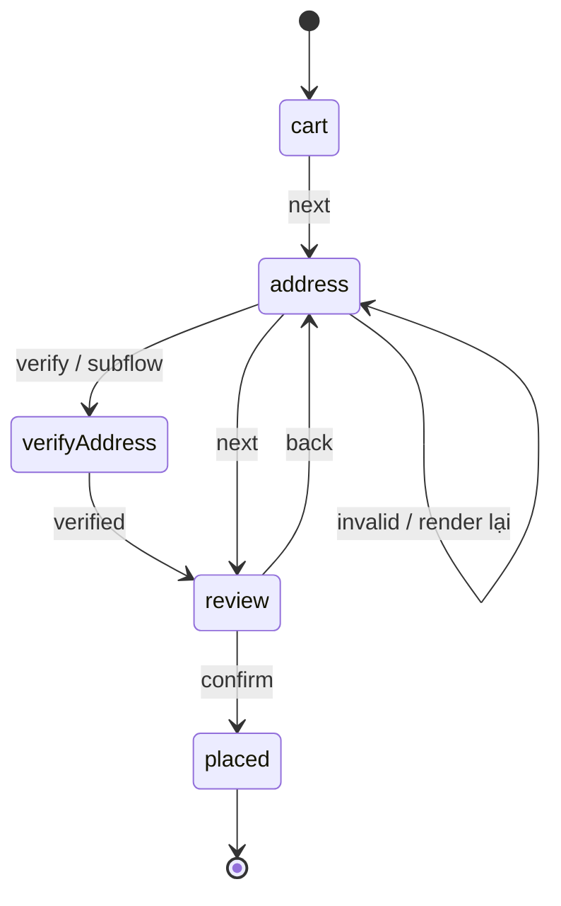
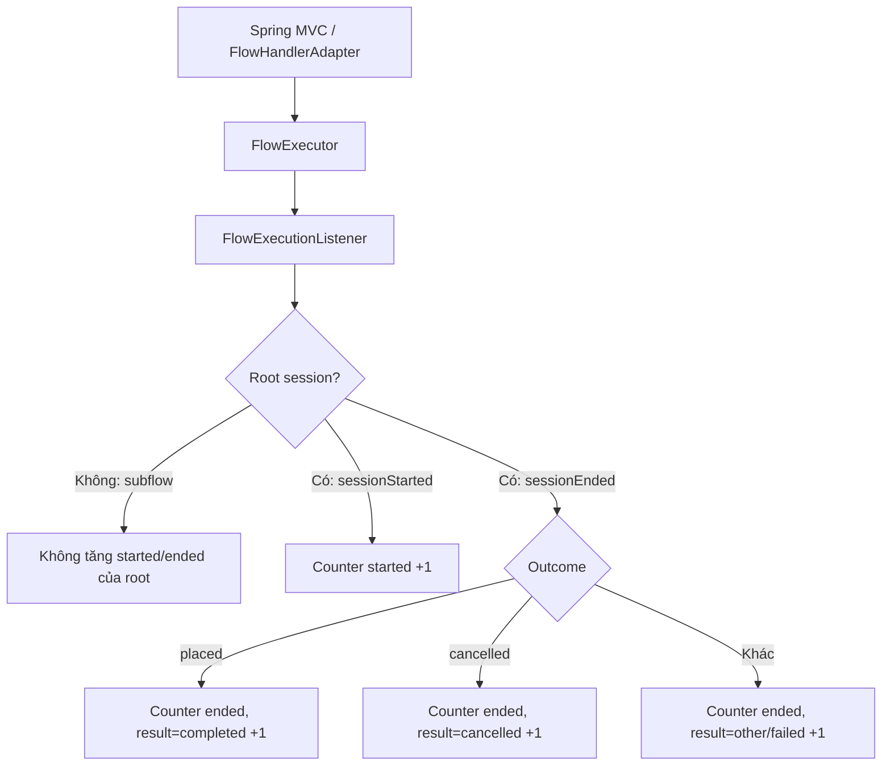

# Theo dõi số lần khởi chạy, hoàn thành, hủy và hết hạn

## 1. Vì sao phải đo vòng đời của flow?

Trong **Spring Web Flow**, một người dùng có thể đi qua nhiều `view-state`, phát `event` để kích hoạt `transition`, gọi `subflow` và cuối cùng hoàn thành hoặc hủy hành trình. Ví dụ quy trình `checkout` gồm **nhập địa chỉ → xem lại → xác nhận**. Nhìn số lượng HTTP 200 hoặc số lượt truy cập URL `/checkout` chưa cho biết có bao nhiêu người **thực sự hoàn thành** đơn hàng.

Với chương **Hiệu năng và vận hành**, chúng ta cần đo các sự kiện theo **vòng đời một flow execution**, thay vì chỉ theo từng HTTP request. Bốn số liệu cốt lõi là:

- **Khởi chạy:** bao nhiêu execution mới đã được tạo thành công.
- **Hoàn thành:** bao nhiêu execution kết thúc qua outcome nghiệp vụ được định nghĩa là thành công.
- **Hủy:** bao nhiêu execution kết thúc qua outcome nghiệp vụ được định nghĩa là hủy.
- **Hết hạn:** bao nhiêu execution mất khả năng tiếp tục vì thời hạn/lưu trữ, hoặc bao nhiêu lần người dùng *gặp* execution key không còn tồn tại.

Trong thực tế, số liệu “hết hạn” cần được diễn giải rất cẩn thận: **một execution hết hạn không nhất thiết phát sinh một callback kết thúc flow**. Nếu người dùng đóng tab và không quay lại, Web Flow có thể không nhận thêm request nào để thông báo cho listener. Ngoài ra, lỗi “không tìm thấy execution” không chứng minh chắc chắn nguyên nhân là timeout; key sai, phiên không còn hoặc snapshot bị loại cũng có thể gây ra lỗi tương tự.

**Mục tiêu:** thiết lập cách đo nhất quán, có thể kiểm thử và dùng trong dashboard, đồng thời không làm lộ thông tin người dùng hay tạo chi phí lớn cho ứng dụng.

## 2. Phân biệt định nghĩa flow, execution, session và request

Một định nghĩa flow có ID `checkout` có thể được hàng nghìn người khởi chạy. Mỗi lần chạy cụ thể là một **flow execution**; execution có thể chứa nhiều **flow session** khi gọi subflow. Mỗi session có nhiều lượt HTTP request để khởi chạy, hiển thị view, submit form, kiểm tra validation hoặc chuyển state.

| Đơn vị | Ví dụ | Có nên dùng làm “một lượt khởi chạy”? |
| --- | --- | --- |
| Flow definition | `checkout` trong `FlowDefinitionRegistry` | Không, một definition phục vụ nhiều người |
| Root flow execution | Một lần bắt đầu checkout | **Có**, một lượt khởi chạy |
| Flow session của subflow | `verifyAddress` được checkout gọi | Không cộng như một checkout mới |
| HTTP request | POST `_eventId_review` hoặc GET tài nguyên | Không, một execution có nhiều request |
| Render view | Màn hình nhập địa chỉ render lại sau validation | Không, có thể render nhiều lần ở cùng state |
| Flow end-state | `placed` hoặc `cancelled` | Thường là sự kiện kết thúc của root execution |
| Execution key/snapshot | Khóa do Web Flow sinh để resume | Không, khóa có thể thay đổi theo snapshot |

### Một ví dụ dễ đếm sai

Một người dùng đi qua hành trình:



Người dùng có thể tạo **nhiều request, nhiều view render và một subflow**, nhưng khi xét root execution `checkout`, đó vẫn là **1 khởi chạy, 1 hoàn thành, 0 hủy**. Nếu đếm mọi lần vào state `cart` hoặc mọi lần có callback `sessionStarted` mà không lọc subflow, dashboard sẽ phóng đại lưu lượng.

## 3. Định nghĩa chính xác bốn sự kiện cần theo dõi

Không nên bắt đầu bằng code ghi metric rồi mới đặt tên outcome. Hãy định nghĩa **hợp đồng đo lường** trước.

| Tên logic | Điểm phát sinh đề xuất | Ý nghĩa | Trường hợp không tính |
| --- | --- | --- | --- |
| `started` | Root flow session bắt đầu thành công | Một root execution mới | Render lại, resume, gọi subflow |
| `completed` | Root flow kết thúc với outcome được ánh xạ là thành công | Người dùng tới end-state nghiệp vụ thành công | Chỉ bấm nút Confirm nhưng transaction thất bại |
| `cancelled` | Root flow kết thúc với outcome được ánh xạ là hủy | Người dùng hoặc hệ thống đi đến nhánh hủy có chủ đích | Đóng tab không báo hủy; timeout |
| `expired_confirmed` | Cơ chế repository/TTL có bằng chứng một root execution hết hạn | Một execution đã bị dọn do chính sách hết hạn | Resume key sai chưa được xác minh |
| `resume_missing` | Server nhận request resume nhưng không tìm được execution/snapshot | Một **lần gặp lỗi** tiếp tục flow, chỉ là tín hiệu liên quan hết hạn | Không suy ra ngay một execution bị hết hạn |

Người học có thể đặt tên ngoài hệ thống theo bốn nhóm nghiệp vụ, nhưng khi vận hành cần **tách số execution hết hạn có bằng chứng khỏi số lượt resume thất bại**. Hai người gửi lại cùng một URL cũ nhiều lần có thể làm `resume_missing` tăng nhiều lần trong khi chỉ liên quan một execution.

### “Hoàn thành” không thể suy ra từ tên event

Ví dụ event `confirm` chỉ thể hiện người dùng yêu cầu xác nhận. Flow có thể kiểm tra validation, kiểm tra tồn kho và thực hiện transaction trước khi tới `<end-state id="placed"/>`. Vì vậy **chỉ tăng bộ đếm completed khi flow thực sự kết thúc ở outcome `placed`**, không tăng khi nhận `_eventId_confirm`.

Tương tự, event `back` không phải cancel; và HTTP status `302` không có nghĩa là flow thành công. Outcome phải được ánh xạ dựa trên **flow definition của từng hành trình**.

## 4. Điểm gắn quan sát: FlowExecutionListener

Spring Web Flow cung cấp `org.springframework.webflow.execution.listener.FlowExecutionListener` và lớp tiện ích `FlowExecutionListenerAdapter` để quan sát vòng đời flow mà không đưa code đo metric vào mỗi `view-state` hay controller.

Các callback liên quan:

| Callback | Khi nào hữu ích | Cẩn trọng |
| --- | --- | --- |
| `sessionStarted(context, session)` | Đếm lần khởi động của flow session | Subflow cũng có session; lọc root |
| `sessionEnded(context, session, outcome, output)` | Đếm outcome kết thúc | Chỉ phân loại đúng outcome của root |
| `eventSignaled(context, event)` | Phân tích event trong hành trình | Event không có nghĩa transition thành công |
| `stateEntered(context, state, previousState)` | Quan sát state người dùng thật sự tới | Không dùng số lượt vào state làm số lượt launch |
| `exceptionThrown(context, exception)` | Thu thập loại lỗi runtime | Không giả định exception là timeout |
| `requestSubmitted(context)` / `requestProcessed(context)` | Theo dõi số request của flow | Một execution có nhiều request |

`FlowExecutionListenerAdapter` cho phép override các method cần thiết, còn phần còn lại giữ hành vi mặc định. Các callback chạy trong quá trình xử lý flow, vì vậy listener nên **nhẹ, không blocking**: cập nhật counter và trả về, không gọi API quan sát từ xa đồng bộ cho từng event.



**Phân loại root:** `FlowSession` cung cấp mối quan hệ parent; một session không có parent là root, còn subflow có parent. Nếu dự án cần ghi metric riêng cho subflow, tạo một metric **khác** như `webflow.subflow.started` thay vì cộng vào số root execution.

## 5. Thực hành: ghi metrics với Micrometer

`Micrometer` cung cấp `MeterRegistry` và `Counter`. Khi dùng Spring Boot Actuator, ứng dụng có thể xuất metrics sang Prometheus hoặc hệ thống quan sát khác; một ứng dụng Spring MVC truyền thống cũng có thể tự cấu hình `MeterRegistry` phù hợp.

Ví dụ tiếp theo giả định đã có dependency `io.micrometer:micrometer-core` và một bean `MeterRegistry`. Dự án muốn theo dõi flow `checkout` với các end-state:

```xml
<end-state id="placed"/>
<end-state id="cancelled"/>
<end-state id="failed"/>
```

Đây là **đoạn trích** bên trong một định nghĩa `<flow>`, không phải file XML đứng độc lập. Tên end-state mang ý nghĩa nghiệp vụ do chính nhóm dự án quyết định.

### 5.1. Listener đếm root execution và outcome

```java
package com.example.observability;

import io.micrometer.core.instrument.Counter;
import io.micrometer.core.instrument.MeterRegistry;
import org.springframework.binding.collection.MutableAttributeMap;
import org.springframework.webflow.execution.FlowSession;
import org.springframework.webflow.execution.RequestContext;
import org.springframework.webflow.execution.listener.FlowExecutionListenerAdapter;

public final class WebFlowMetricsListener
        extends FlowExecutionListenerAdapter {

    private final MeterRegistry registry;

    public WebFlowMetricsListener(MeterRegistry registry) {
        this.registry = registry;
    }

    @Override
    public void sessionStarted(
            RequestContext context, FlowSession session) {
        if (session.getParent() != null) {
            return; // Subflow; không đếm một root launch mới.
        }

        String flowId = session.getDefinition().getId();
        Counter.builder("webflow.execution.started")
                .description("Số root flow execution đã khởi chạy")
                .tag("flow", flowId)
                .register(registry)
                .increment();
    }

    @Override
    public void sessionEnded(
            RequestContext context,
            FlowSession session,
            String outcome,
            MutableAttributeMap<?> output) {
        if (session.getParent() != null) {
            return; // Không cộng outcome của subflow vào root.
        }

        String flowId = session.getDefinition().getId();
        String result = classifyResult(flowId, outcome);

        Counter.builder("webflow.execution.ended")
                .description("Số root execution kết thúc theo kết quả")
                .tag("flow", flowId)
                .tag("result", result)
                .register(registry)
                .increment();
    }

    private static String classifyResult(String flowId, String outcome) {
        if ("checkout".equals(flowId)) {
            if ("placed".equals(outcome)) {
                return "completed";
            }
            if ("cancelled".equals(outcome)) {
                return "cancelled";
            }
            if ("failed".equals(outcome)) {
                return "failed";
            }
        }
        // Không tự coi mọi end-state khác là thành công.
        return "other";
    }
}
```

Trong ứng dụng thực tế, `classifyResult` nên dựa trên **bảng ánh xạ outcome của từng flow**, được quản lý cùng định nghĩa flow và có test. Nếu flow `registration` dùng `registered` thay vì `placed`, phải ánh xạ `registered → completed` rõ ràng; không suy đoán mọi ID chứa từ “done” đều thành công.

`sessionEnded(...)` ghi nhận các kết thúc mà listener được gọi. Nó **không mặc định nhận callback khi HTTP session bị hết hạn trong lúc người dùng đang đóng trình duyệt**, nên chưa giải quyết số liệu `expired_confirmed`.

### 5.2. Đăng ký listener trên FlowExecutor

Một bean Spring đứng riêng không tự kích hoạt listener; phải nối listener vào `FlowExecutorBuilder`:

```java
package com.example.config;

import com.example.observability.WebFlowMetricsListener;
import io.micrometer.core.instrument.MeterRegistry;
import org.springframework.context.annotation.Bean;
import org.springframework.context.annotation.Configuration;
import org.springframework.webflow.config.AbstractFlowConfiguration;
import org.springframework.webflow.definition.registry.FlowDefinitionRegistry;
import org.springframework.webflow.executor.FlowExecutor;

@Configuration
public class MetricsWebFlowConfig extends AbstractFlowConfiguration {

    @Bean
    public WebFlowMetricsListener webFlowMetricsListener(
            MeterRegistry meterRegistry) {
        return new WebFlowMetricsListener(meterRegistry);
    }

    @Bean
    public FlowExecutor flowExecutor(
            FlowDefinitionRegistry flowRegistry,
            WebFlowMetricsListener webFlowMetricsListener) {
        return getFlowExecutorBuilder(flowRegistry)
                .addFlowExecutionListener(webFlowMetricsListener)
                .build();
    }
}
```

Ví dụ giả định `flowRegistry` đã được tạo từ các XML definitions, và Spring MVC đã khai báo `FlowHandlerMapping`/`FlowHandlerAdapter`. Nếu ứng dụng đã có `@Bean flowExecutor(...)`, **chỉnh cấu hình bean hiện hữu** để đăng ký listener thay vì tạo thêm executor thứ hai.

Bạn cũng có thể đăng ký nhiều listener để đo metrics, log điều tra lỗi hoặc quản lý persistence; đảm bảo mọi listener có phụ thuộc đúng và không làm tăng thời gian xử lý request quá mức.

## 6. Thời điểm hủy: phải map từ end-state chứ không đếm click

Một flow có thể có nhiều cách hủy:

```xml
<view-state id="review" view="checkout/review">
    <transition on="back" to="cart" validate="false"/>
    <transition on="cancel" to="cancelled" bind="false"/>
    <transition on="confirm" to="saveOrder"/>
</view-state>

<end-state id="cancelled"/>
```

Đây là trích đoạn logic minh họa. Trong code nghiệp vụ, `saveOrder` cần được định nghĩa và thành công mới chuyển đến `placed`.

Với mô hình trên:

- **Click Cancel** chỉ là một event. Nếu transition không tồn tại, validation/chặn quyền khiến event không được xử lý hoặc exception xảy ra, execution có thể chưa kết thúc; lúc đó **không được tăng** `cancelled`.
- **Vào end-state `cancelled`** là một kết thúc có chủ đích. Listener nhận `sessionEnded(...)` rồi tăng bộ đếm `ended{result="cancelled"}` cho root session.
- Người dùng **đóng tab**, mất mạng hoặc hết session mà không bấm Cancel **không thuộc nhóm cancelled**. Những execution ấy có thể tồn tại đến khi repository dọn dẹp hoặc bị phát hiện không thể resume.

Đối với flow có các end-state như `userCancelled`, `cancelPayment` và `sessionAborted`, nhóm phát triển phải thống nhất outcome nào nghĩa là hủy **do chủ đích của người dùng**, outcome nào nghĩa là lỗi/hệ thống dừng, tránh ép tất cả vào một nhãn “cancelled” thiếu ý nghĩa.

## 7. Theo dõi hết hạn: “execution hết hạn” khác “resume không tìm thấy”

### 7.1. Vì sao FlowExecutionListener không đủ?

Một execution có thể không tới end-state trong các tình huống:

1. Người dùng đóng trình duyệt và không quay lại.
2. HTTP session bị timeout trên server.
3. Repository chỉ giữ một số lượng execution hoặc snapshot nhất định và loại bỏ bản cũ.
4. Ứng dụng restart hoặc node không giữ được session/repository.
5. Request cố resume với execution key bị sửa, không hợp lệ hoặc không thuộc session hiện tại.

Không nên cho rằng `sessionEnded(...)` được gọi với outcome `expired` trong mọi tình huống trên. Khi phiên hết hạn mà **không có request nào**, Web Flow có thể không có cơ hội chạy callback lifecycle cho execution cũ.

Hai câu hỏi vận hành khác nhau:

| Câu hỏi | Metric phù hợp | Cách thu thập |
| --- | --- | --- |
| “Có bao nhiêu lần người dùng gặp một execution không thể tiếp tục?” | `webflow.resume.missing` | Quan sát request resume lỗi hoặc hook exception phù hợp |
| “Có bao nhiêu root execution thực sự hết hạn?” | `webflow.execution.expired.confirmed` | Cần theo dõi lifecycle ở repository/session store hoặc trạng thái vận hành bền vững |

**Nhãn `expired_confirmed` chỉ nên dùng khi có bằng chứng loại bỏ do TTL**, không tự động từ exception `NoSuchFlowExecutionException`. Nếu không có cơ chế đó, dashboard nên ghi rõ “resume missing” hoặc “estimated expired”, không tuyên bố đo chính xác số lần hết hạn.

### 7.2. Ví dụ đếm lần resume thất bại ở ranh giới HTTP

Khi tích hợp Spring MVC, một flow cụ thể có thể dùng `AbstractFlowHandler` để xử lý exception tại ranh giới HTTP. Với dự án Spring Web Flow 3.x sử dụng Jakarta Servlet, ví dụ:

```java
package com.example.checkout.web;

import io.micrometer.core.instrument.MeterRegistry;
import jakarta.servlet.http.HttpServletRequest;
import jakarta.servlet.http.HttpServletResponse;
import org.springframework.webflow.core.FlowException;
import org.springframework.webflow.execution.repository.NoSuchFlowExecutionException;
import org.springframework.webflow.mvc.servlet.AbstractFlowHandler;

public final class CheckoutFlowHandler extends AbstractFlowHandler {

    private final MeterRegistry metrics;

    public CheckoutFlowHandler(MeterRegistry metrics) {
        this.metrics = metrics;
    }

    @Override
    public String getFlowId() {
        return "checkout";
    }

    @Override
    public String handleException(
            FlowException exception,
            HttpServletRequest request,
            HttpServletResponse response) {
        if (exception instanceof NoSuchFlowExecutionException) {
            metrics.counter(
                    "webflow.resume.missing", "flow", "checkout")
                    .increment();
            return "contextRelative:/checkout/expired";
        }

        return null; // Các lỗi khác để hạ tầng xử lý.
    }
}
```

Khai báo bean có tên trùng flow ID:

```java
@Bean(name = "checkout")
public CheckoutFlowHandler checkoutFlowHandler(
        MeterRegistry registry) {
    return new CheckoutFlowHandler(registry);
}
```

**Lưu ý triển khai:** Đây là một điểm quan sát **nếu exception đi qua hook custom handler**. Một cấu hình Web Flow khác có thể tự khởi động lại flow, xử lý exception ở adapter, MVC resolver, filter hoặc tầng repository trước khi hook này được gọi. Hãy kiểm tra bằng request có execution key không tồn tại và quan sát metric thực tế trong bản Web Flow đang dùng. Không nhân đôi số đếm nếu cũng ghi cùng lỗi ở `@ControllerAdvice` hoặc filter.

Ngay cả khi hook được gọi đúng, một người dùng gửi lại URL hết hiệu lực mười lần có thể tăng metric lên mười, **không có nghĩa mười execution đã hết hạn**.

### 7.3. Muốn biết số execution thực sự bị hết hạn?

Để báo cáo chính xác hơn, xây dựng một lớp **quan sát trạng thái execution** riêng với mỗi root execution có một ID ổn định do ứng dụng cấp, độc lập với key snapshot của Web Flow:

```text
run_id            UUID nội bộ, không đưa vào label metrics
flow_id           checkout / registration / ...
started_at        mốc khởi chạy
last_activity_at  mốc request gần nhất được xử lý
terminal_status   ACTIVE | COMPLETED | CANCELLED | FAILED | EXPIRED
ended_at          thời điểm kết thúc, nếu có
expires_at        mốc hết hạn dự kiến theo chính sách thực tế
```

Thuật toán ở mức thiết kế:

```text
Khi root session bắt đầu:
    sinh run_id; ghi ACTIVE với started_at
    tăng started đúng một lần

Khi một request của execution được xử lý:
    cập nhật last_activity_at nếu run vẫn ACTIVE

Khi root session kết thúc bằng outcome:
    UPDATE run SET terminal_status = COMPLETED/CANCELLED/FAILED
    WHERE run_id = ? AND terminal_status = 'ACTIVE'
    nếu update được 1 dòng:
        tăng metric terminal tương ứng

Khi repository/TTL xác nhận một execution đã bị loại do hết hạn:
    UPDATE run SET terminal_status = EXPIRED
    WHERE run_id = ? AND terminal_status = 'ACTIVE'
    nếu update được 1 dòng:
        tăng expired_confirmed
```

Đây là **pseudocode kiến trúc**, không phải API repository sẵn có của Spring Web Flow. Điều kiện `WHERE terminal_status = 'ACTIVE'` thể hiện **idempotency**: một execution chỉ được chuyển từ active sang một trạng thái kết thúc, tránh tăng cả `cancelled` và `expired` trong race condition.

Các yêu cầu cần xem xét:

- Đừng giả định chính sách HTTP session timeout giống chính sách lưu snapshot của Web Flow; cần xác nhận TTL tại nơi lưu thực tế.
- Nếu chỉ dựa vào `last_activity_at + timeout`, đây là **ước lượng** cho việc hết hạn. Cơ chế repository/store mới là nơi có bằng chứng eviction; có thể cần job reconciliation để đánh dấu trạng thái không còn tồn tại.
- Việc ghi trạng thái vào database/queue tạo thêm chi phí và cần chính sách lưu trữ, dọn dẹp, bảo mật thông tin. Với một hệ thống nhỏ, số liệu `resume_missing` cùng retention và session metrics có thể đã đủ.
- Nếu metric và bảng trạng thái ghi bởi hai hệ thống độc lập, có thể gặp sự cố một bên thành công, bên kia thất bại. Cần idempotency và quy trình đối chiếu/replay, không giả định phép đếm là chính xác tuyệt đối.

## 8. Đặt tên metric, label và hạn chế cardinality

Để vận hành ổn định, thống nhất tên metric và các label **hữu hạn**:

| Metric Micrometer | Metric Prometheus thường xuất ra | Label được phép | Ý nghĩa |
| --- | --- | --- | --- |
| `webflow.execution.started` | `webflow_execution_started_total` | `flow` | Root execution bắt đầu |
| `webflow.execution.ended` | `webflow_execution_ended_total` | `flow`, `result` | Root execution kết thúc có callback |
| `webflow.resume.missing` | `webflow_resume_missing_total` | `flow` | Số lượt resume không tìm thấy execution |
| `webflow.execution.expired.confirmed` | `webflow_execution_expired_confirmed_total` | `flow` | Số execution có bằng chứng hết hạn, nếu đã triển khai |

Đặt `result` thành một tập nhỏ, ví dụ `completed`, `cancelled`, `failed`, `other`. `flow` nên lấy từ tập ID đã đăng ký, ví dụ `checkout`, `signup`, `onboarding`; không dùng giá trị do request tự gửi một cách tùy ý.

**Không bao giờ thêm các giá trị sau làm label của Counter:** `executionKey`, HTTP session ID, user ID, email, order ID, booking ID, token, trace ID hoặc chuỗi URL chứa query. Những giá trị này có cardinality cao, tiêu tốn bộ nhớ và có thể rò rỉ dữ liệu nhạy cảm. ID tương quan có thể lưu trong log có kiểm soát và thời gian lưu hợp lý, nhưng metric chỉ nên có các chiều tổng hợp có giới hạn.

Với ứng dụng có hàng trăm flow động, ngay cả label `flow` cũng cần giới hạn hoặc gom nhóm theo module. Khi outcome ID chưa được map, dùng `result="other"` để cảnh báo bổ sung cấu hình thay vì gắn outcome tùy ý vào label không kiểm soát.

## 9. Dashboard: nhìn tỷ lệ chuyển đổi và lỗi theo thời gian

Một dashboard cơ bản cần có:

1. Tổng số root executions bắt đầu theo flow trong 5 phút, 1 giờ và 24 giờ.
2. Số kết thúc theo `result`: `completed`, `cancelled`, `failed` và `other`.
3. Số lượt resume không tìm thấy execution (và số hết hạn xác nhận nếu có).
4. Số execution còn active nếu hệ thống có dữ liệu run state đáng tin cậy.
5. Chỉ số HTTP liên quan: số lỗi 4xx/5xx, latency của endpoint flow, session timeout, error của persistence layer và mức dùng bộ nhớ.

### 9.1. PromQL minh họa

Các truy vấn sau giả định Micrometer xuất metrics theo tên Prometheus thông thường:

```promql
# Số khởi chạy trong 1 giờ, chia theo flow.
sum by (flow) (
  increase(webflow_execution_started_total[1h])
)
```

```promql
# Số kết thúc trong 1 giờ, chia theo flow và result.
sum by (flow, result) (
  increase(webflow_execution_ended_total[1h])
)
```

```promql
# Tốc độ request resume không tìm thấy execution (mỗi giây).
sum by (flow) (
  rate(webflow_resume_missing_total[5m])
)
```

```promql
# Số execution hết hạn có bằng chứng trong 24 giờ.
# Chỉ xuất hiện khi đã triển khai metric expired.confirmed.
sum by (flow) (
  increase(webflow_execution_expired_confirmed_total[24h])
)
```

### 9.2. Có thể tính completion rate bằng completed / started không?

**Có thể dùng làm chỉ báo sơ bộ**, nhưng **không nên coi là tỷ lệ chuyển đổi chính xác nếu cùng một cửa sổ thời gian**. Một flow khởi chạy lúc 23:55 có thể hoàn thành sau 00:05; numerator và denominator của cửa sổ giờ/ngày sẽ không cùng nhóm executions.

| Cách tính | Phù hợp khi | Hạn chế |
| --- | --- | --- |
| `completed trong 1h / started trong 1h` | Giám sát xu hướng nhanh khi hành trình ngắn, lưu lượng ổn định | Lệch do hoàn thành ở cửa sổ khác |
| `completed trong cohort starts ngày D / starts ngày D` | Phân tích conversion chính xác hơn | Cần run ID/cohort và thời gian quan sát đủ dài |
| `ended trong 1h / started trong 1h` | Quan sát các kết thúc chung trong hệ thống | Không thể giải thích thiếu các execution còn active |

Nếu muốn **tỷ lệ hoàn thành chính xác**, hãy phân nhóm execution theo `started_at` và theo dõi outcome của chính nhóm đó sau một khoảng quan sát xác định. Báo cáo nên công bố rõ cửa sổ cohort, ví dụ “các flow bắt đầu ngày 01/11, quan sát outcome đến hết ngày 08/11”.

### 9.3. Số execution đang active có tính bằng phép trừ?

Công thức trực giác:

```text
active ≈ started
         - completed
         - cancelled
         - failed
         - expired
         - các end-state khác
```

chỉ đúng khi **cùng phạm vi thời gian, cùng root execution**, không bỏ sót callback, không đếm trùng và đã xác định tất cả terminal statuses. Số Counter độc lập có thể bị mất khi process crash hoặc còn những execution bị bỏ dở chưa phát sinh sự kiện hết hạn; vì vậy phép trừ có thể âm hoặc phình theo thời gian.

Với dashboard production, nên lấy `active` từ **bảng trạng thái execution** hoặc repository có thể truy vấn/đối chiếu, thay vì suy tuyệt đối từ counters thuần.

## 10. Đo thời gian: tách request latency và thời gian hoàn thành flow

Đếm số lần không đủ cho bài toán hiệu năng. Hai kiểu thời gian phổ biến:

| Chỉ số | Bắt đầu → kết thúc | Nó đo điều gì? |
| --- | --- | --- |
| HTTP latency | Nhận request → trả response | Hiệu năng server, binding, validation, query, rendering |
| Flow elapsed duration | Root execution launch → terminal outcome | Thời gian người dùng đi hết hành trình, **bao gồm cả lúc họ suy nghĩ** |

Nếu flow mất 10 phút vì người dùng đọc thông tin nhưng từng HTTP request chỉ 100 ms, hai chỉ số không mâu thuẫn. `Timer` đo request latency hoặc duration theo yêu cầu; không gộp chúng vào cùng một biểu đồ mà không ghi rõ định nghĩa.

Đối với duration toàn flow, có thể lưu `startedAt` ổn định trên execution hoặc bảng theo dõi và ghi duration khi outcome kết thúc. Tránh giữ đối tượng `Timer.Sample` không tương thích serialization qua session; giữ timestamp và tính chênh lệch khi cần thường đơn giản hơn. Flow không tới end-state tạo dữ liệu **censored**: đừng âm thầm loại bỏ mà vẫn tuyên bố thống kê “thời gian hoàn thành trung bình của mọi người dùng”.

Khi phân tích nút thắt, ưu tiên đo **p95/p99 latency** trên action/HTTP request, số lượng session đang hoạt động, memory/snapshot và lỗi kết nối DB trước khi tối ưu các transition XML vốn không tốn nhiều CPU.

## 11. Cảnh báo vận hành và cách diễn giải

Một số tín hiệu đáng theo dõi:

| Tín hiệu | Nguyên nhân khả dĩ | Hành động xác minh |
| --- | --- | --- |
| `started` giảm bất thường | Không có người vào flow, lỗi routing, deploy hoặc client | So sánh traffic ngoài Web Flow và tỷ lệ 4xx/5xx |
| `completed` giảm trong khi started ổn định | Validation khó hơn, lỗi dịch vụ nghiệp vụ, đường chuyển hỏng | So sánh `failed`, lỗi service và state-level telemetry |
| `cancelled` tăng | UI khó hiểu, thay đổi giá/chính sách, bước mới gây bỏ cuộc | Phân tích cohort và vị trí hủy, không mặc định kết luận lỗi kỹ thuật |
| `resume_missing` tăng | Session timeout, snapshot eviction, URL cũ, load balancer, double submit | Kiểm tra cookie, sticky session/store, repository config và retry |
| `expired_confirmed` tăng | TTL quá ngắn hoặc người dùng chờ lâu | So sánh duration cohort, TTL và retention thực tế |
| Số execution active tăng không giảm | Người dùng bỏ dở, cleanup không chạy hoặc đo thiếu | Xác minh TTL, storage, scheduler/reconciliation |
| Latency request tăng | DB chậm, binding/validation nặng, số entity trong session lớn | Xem tracing, p95/p99 và memory |
| `ended{result="other"}` tăng | Thay đổi outcome ID mà chưa update ánh xạ | So sánh XML flow và bảng classifyResult |

Không đặt ngưỡng cảnh báo tùy ý cho mọi hệ thống. Cần lấy **baseline** và mô hình lưu lượng theo giờ/ngày, sau đó chọn tiêu chí theo sản phẩm (ví dụ một tỷ lệ hoàn thành giảm mạnh cùng lúc tỷ lệ lỗi service tăng). Với metrics có traffic thấp, dùng cửa sổ dài hơn để tránh nhiễu.

### Điều tra một đợt resume_missing tăng đột biến

Quy trình đề xuất:

1. Xác định flow và khoảng thời gian bị ảnh hưởng; so sánh với deploy, restart hoặc thay đổi timeout.
2. Kiểm tra request URL, cookie và cấu hình `FlowHandlerAdapter`/`FlowExecutor` (không đưa key phiên vào metrics).
3. Kiểm tra chính sách số execution/snapshot trong repository; yêu cầu Back/Refresh có thể dùng key cũ.
4. Kiểm tra load balancer, session replication/store hoặc sticky routing khi chạy nhiều node.
5. Xác minh có pattern retry/double submit từ JavaScript, bookmark execution URL hoặc proxy cache không phù hợp.
6. Thử kịch bản hết hạn thật và key sai một cách có chủ đích để phân biệt hai nguyên nhân.
7. Nếu cần đo chính xác số hết hạn, kiểm tra dữ liệu TTL/reconciliation thay vì suy luận từ số lỗi resume.

## 12. Kiểm thử instrumentation và tránh đếm trùng

Một bộ đo lường đáng tin phải có **test hành vi** giống như flow. Có thể dùng `SimpleMeterRegistry` của Micrometer để xác nhận counters mà không cần Prometheus thật.

Ví dụ JUnit 5 + Mockito cho listener ở mục 5 (cần `spring-webflow`, `micrometer-core`, `junit-jupiter` và `mockito-core` trong test classpath):

```java
import static org.junit.jupiter.api.Assertions.assertEquals;
import static org.mockito.Mockito.mock;
import static org.mockito.Mockito.when;

import io.micrometer.core.instrument.simple.SimpleMeterRegistry;
import org.junit.jupiter.api.Test;
import org.springframework.binding.collection.LocalAttributeMap;
import org.springframework.webflow.definition.FlowDefinition;
import org.springframework.webflow.execution.FlowSession;

class WebFlowMetricsListenerTest {

    @Test
    void countsRootStartAndCompletedOutcome() {
        SimpleMeterRegistry metrics = new SimpleMeterRegistry();
        WebFlowMetricsListener listener =
                new WebFlowMetricsListener(metrics);

        FlowDefinition definition = mock(FlowDefinition.class);
        when(definition.getId()).thenReturn("checkout");

        FlowSession root = mock(FlowSession.class);
        when(root.getParent()).thenReturn(null);
        when(root.getDefinition()).thenReturn(definition);

        listener.sessionStarted(null, root);
        listener.sessionEnded(
                null, root, "placed", new LocalAttributeMap<>());

        assertEquals(1.0,
                metrics.get("webflow.execution.started")
                       .tag("flow", "checkout")
                       .counter().count());

        assertEquals(1.0,
                metrics.get("webflow.execution.ended")
                       .tag("flow", "checkout")
                       .tag("result", "completed")
                       .counter().count());
    }
}
```

Ví dụ test này kiểm tra logic Counter của listener, **không chứng minh executor đã đăng ký listener**. Cần một test tích hợp chạy flow XML thật để khẳng định listener được gọi đúng.

### Kịch bản tích hợp quan trọng

| Kịch bản | Kỳ vọng ở metrics |
| --- | --- |
| Mở `GET /checkout` để launch execution mới | `started +1` |
| Render lại cùng view-state sau validation lỗi | Không tăng `started` |
| Nút Back rồi Forward trong cùng execution | Không tăng `started` |
| Subflow `verifyAddress` được tạo và kết thúc | Không tăng `started/ended` của root `checkout` |
| Flow đến end-state `placed` | `ended{completed} +1` |
| Flow đến end-state `cancelled` | `ended{cancelled} +1` |
| Event `confirm` gây lỗi transaction, flow chưa kết thúc | Không tăng `ended{completed}` |
| Session hết hạn trong lúc trình duyệt đóng | Có thể **không** có `sessionEnded`; xác minh bằng TTL/store |
| Người dùng gửi 3 lần một URL execution không còn | `resume_missing +3` nếu cả ba request chạm hook; không tự tăng expired 3 lần |
| Process restart giữa flow | Counter pipeline và trạng thái durable phải được đối chiếu, không mặc định terminal outcome |

Nếu hệ thống dùng nhiều node, gửi một flow qua node A rồi resume trên node B để kiểm tra cấu hình lưu execution và số đếm; listener cần đăng ký nhất quán cho tất cả executor.

## 13. Logging, tracing và bảo mật dữ liệu

Metrics trả lời “bao nhiêu”; **log và trace** giúp trả lời “vì sao”. Bạn có thể gắn correlation ID an toàn cho request hoặc root execution để tìm chuỗi sự kiện launch → resume → end; tuy nhiên cần lưu ý:

- **Không đưa flow execution key, session ID, access token hoặc thông tin form vào metrics labels.**
- Không log toàn bộ `flowScope`/`conversationScope`; chúng có thể chứa email, địa chỉ, dữ liệu tài chính và thông tin xác thực.
- Nếu cần audit, dùng run ID do ứng dụng sinh, áp dụng retention và quyền truy cập phù hợp.
- Tránh ghi event `confirm` như bằng chứng giao dịch đã commit: phải đối chiếu outcome, transaction và kết quả dịch vụ.
- Nếu thực hiện sampling trace, giữ counter độc lập; một số trace bị sample bỏ không đồng nghĩa một số flow không xảy ra.
- Với hệ thống đa vùng/multi-node, thống nhất timestamp UTC và nguồn dữ liệu khi phân tích cohort; metrics counter cộng dồn cần xử lý restart của process.

**Quan sát không được làm thay đổi hành vi flow.** Một hệ thống metrics mất kết nối không nên khiến người dùng không thể hoàn thành checkout. Dùng registry in-memory/async export thích hợp và xem xét giới hạn chi phí instrumentation.

## 14. Bài tập vận dụng

Ứng dụng có hai flow: `signup` với outcomes `registered`, `cancelled` và `checkout` với outcomes `placed`, `cancelled`, `failed`. Yêu cầu:

1. Tạo `WebFlowMetricsListener` gắn vào `FlowExecutor`, đếm root `sessionStarted` và `sessionEnded`.
2. Viết ánh xạ outcome: `signup.registered → completed`; `checkout.placed → completed`; outcome `cancelled → cancelled`; `checkout.failed → failed`; các outcome khác về `other`.
3. Xác nhận subflow `verifyEmail` của signup **không** bị đếm như root flow mới.
4. Đăng ký một cơ chế phát hiện `resume_missing` tại ranh giới MVC và trang hướng dẫn người dùng bắt đầu lại khi execution key không còn.
5. Thiết kế phương án lưu trạng thái `ACTIVE/COMPLETED/CANCELLED/FAILED/EXPIRED` bằng run ID ổn định nếu bài toán cần số liệu hết hạn chính xác; chống chuyển trạng thái lặp.
6. Dùng `SimpleMeterRegistry` viết test đếm thành công, hủy và không đếm lại khi render view; thêm test HTTP cho session timeout.
7. Vẽ dashboard thể hiện started, ended theo result, resume_missing và nếu có, expired_confirmed. Giải thích vì sao tỷ lệ completed/started trong cùng một phút có thể sai lệch.

**Tiêu chí đạt:** phân biệt được lần chạy của root flow với request/subflow; completed/cancelled phản ánh **outcome cuối cùng**; dữ liệu hết hạn có định nghĩa rõ ràng; nhãn metric không chứa định danh cá nhân; và việc đo đạc không làm thay đổi transaction, validation hay luồng phục hồi của ứng dụng.

## 15. Ghi nhớ

- Đếm **root execution**, không đếm số request, view render, event hoặc subflow để suy ra lượt khởi chạy.
- `FlowExecutionListenerAdapter.sessionStarted(...)` và `sessionEnded(...)` là điểm gắn thích hợp để theo dõi root launch và các **kết thúc có callback**.
- **Hoàn thành/hủy** phải phân loại từ **outcome của end-state**, không phải từ tên event `confirm` hoặc `cancel` do client gửi.
- **Timeout hoặc repository eviction không nhất thiết phát `sessionEnded(...)`**; `NoSuchFlowExecutionException` là tín hiệu resume không thành công, **không chứng minh** một execution hết hạn theo TTL.
- Nếu cần đếm expired chính xác, phải có dữ liệu lifecycle/repository hoặc trạng thái durable và xử lý idempotency; không tăng `expired` mỗi lần người dùng retry một URL cũ.
- Dùng `Micrometer Counter` với label hữu hạn (`flow`, `result`), giám sát conversion theo cohort, theo dõi latency và đặt ngưỡng cảnh báo dựa trên baseline.
- Tránh labels có execution key, session/user ID hoặc dữ liệu biểu mẫu; không để metric export làm chậm hay làm hỏng flow.

### Tài liệu tham khảo

- [Spring Web Flow – Reference Guide](https://docs.spring.io/spring-webflow/docs/3.0.x/reference/): flow execution, lifecycle, repository, session và Spring MVC integration.
- [FlowExecutionListenerAdapter Javadoc](https://docs.spring.io/spring-webflow/docs/current/api/org/springframework/webflow/execution/listener/FlowExecutionListenerAdapter.html): callback session start/end, event, state và exception.
- [FlowSession Javadoc](https://docs.spring.io/spring-webflow/docs/current/api/org/springframework/webflow/execution/FlowSession.html): flow definition, parent session và scope.
- [Spring Web Flow – NoSuchFlowExecutionException Javadoc](https://docs.spring.io/spring-webflow/docs/current/api/org/springframework/webflow/execution/repository/NoSuchFlowExecutionException.html): lỗi execution không tìm thấy khi resume.
- [Micrometer – Counters](https://docs.micrometer.io/micrometer/reference/concepts/counters.html): cách dùng `Counter` và các lưu ý về rate.
- [Prometheus – Query Functions](https://prometheus.io/docs/prometheus/latest/querying/functions/): `rate(...)`, `increase(...)` và cách xây dashboard từ counters.
