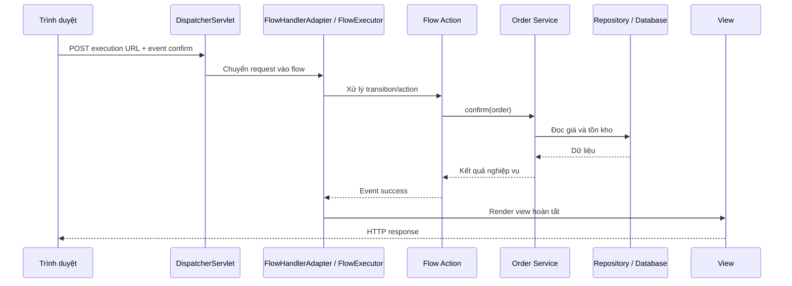

# Đo thời gian hành động, truy vấn dữ liệu và hiển thị view

## 1. Vì sao cần tách thời gian theo từng công đoạn?

Trong **Spring Web Flow**, một hành trình như đặt hàng hoặc đăng ký tài khoản đi qua nhiều **state**, **event**, **transition** và có thể gọi **subflow**. Khi người dùng bấm nút, request đi qua Spring MVC, Web Flow xử lý event, chạy action/service, truy vấn database, binding và validation dữ liệu, rồi render view trả về trình duyệt.

Nếu chỉ đo thời gian toàn request, ta biết người dùng phải đợi bao lâu nhưng chưa biết phần nào gây chậm. Một request mất 1,8 giây có thể do:

- Action gọi dịch vụ bên ngoài mất 1,2 giây.
- Truy vấn database mất 400 ms.
- Render JSP hoặc template mất 150 ms.
- Phần còn lại dành cho routing, binding, validation, điều phối flow và các công việc khác.

Để tìm đúng nút thắt, cần quan sát ít nhất ba nhóm:

1. **Action/service:** thời gian thực thi một hành động nghiệp vụ hoặc một operation được flow gọi.
2. **Data/query:** thời gian lấy dữ liệu qua repository, JDBC hoặc ORM; số lần truy vấn và các dấu hiệu query lặp.
3. **View rendering:** thời gian Web Flow dựng view trước khi response được gửi.

Ba phép đo này có thể nằm bên trong cùng một request. Không cộng máy móc tất cả các số đo để ra request latency: các khoảng thời gian có thể lồng nhau, chạy tuần tự hoặc bao gồm phần việc của nhau. Hãy xác định rõ **đoạn code nào được tính vào từng Timer**.

## 2. Nhìn toàn bộ đường đi của một request

Giả sử flow đặt hàng có state `review`. Người dùng bấm `confirm`, Web Flow gọi action lưu đơn, service truy vấn giá và tồn kho, sau đó render trang hoàn tất:



Các khoảng đo nên được đặt như sau:

| Vị trí | Công cụ/điểm gắn | Câu hỏi được trả lời |
| --- | --- | --- |
| Toàn request | Servlet Filter hoặc MVC HandlerInterceptor | Người dùng chờ response bao lâu? |
| Flow lifecycle | `FlowExecutionListener` | State/event/transition nào được thực thi? |
| Action/service | `Micrometer Timer` quanh method hoặc action | Operation nghiệp vụ nào chậm? |
| Database | Timer quanh repository hoặc instrumentation DataSource/ORM | Query/data access mất bao lâu và xảy ra bao nhiêu lần? |
| View | Callback `viewRendering` / `viewRendered` | Web Flow mất bao lâu để dựng view? |
| Trình duyệt | Real User Monitoring (RUM) | Người dùng thực sự thấy nội dung và tương tác được sau bao lâu? |

**Request latency không phải flow duration.** Một flow có thể kéo dài 15 phút vì người dùng đọc và nhập dữ liệu, trong khi từng request chỉ mất 200 ms. Bài này tập trung vào thời gian xử lý server ở từng công đoạn; thời gian người dùng đi hết cả flow là một chỉ số khác.

## 3. Chọn đồng hồ và đơn vị đo đúng

Trong Java, dùng `System.nanoTime()` để đo khoảng thời gian:

```java
long startedAt = System.nanoTime();
try {
    performWork();
} finally {
    long elapsedNanos = System.nanoTime() - startedAt;
    // Ghi nhận elapsedNanos vào Timer.
}
```

`nanoTime()` là đồng hồ đơn điệu phù hợp để đo duration; không dùng `System.currentTimeMillis()` để tính khoảng thời gian vì đồng hồ hệ thống có thể được điều chỉnh. Nếu cần ghi thời điểm bắt đầu/kết thúc để đối chiếu log, dùng `Instant.now()` riêng; không dùng nó thay cho đồng hồ đo duration.

Micrometer `Timer` lưu số lần đo và tổng thời gian, đồng thời có thể xuất histogram/percentile histogram theo cấu hình. Thay vì chỉ nhìn giá trị trung bình, hãy quan sát:

- **Count:** số lần operation được gọi.
- **Total time:** tổng thời gian tiêu thụ trong khoảng quan sát.
- **Mean:** thời gian trung bình, hữu ích để xem xu hướng nhưng dễ che giấu request chậm.
- **p95/p99:** thời gian mà 95%/99% mẫu không vượt quá; hữu ích để tìm tail latency.
- **Max:** mẫu lớn nhất trong cửa sổ/khởi động hiện tại tùy registry và backend; không dùng riêng nó làm SLO.

Ví dụ:

```text
catalog.search.duration
  count = 2,400
  mean  = 84 ms
  p95   = 210 ms
  p99   = 780 ms
```

Mean 84 ms có vẻ tốt, nhưng p99 780 ms cho thấy một nhóm nhỏ người dùng vẫn phải chờ gần một giây. Vì vậy cần theo dõi phân phối và tách operation có đặc tính khác nhau.

## 4. Đo thời gian action và service bằng Micrometer Timer

### 4.1. Đo ở ranh giới operation nghiệp vụ

Một action trong flow thường gọi service để kiểm tra dữ liệu, tính toán hoặc lưu thay đổi. Điểm đo ổn định thường là **method service có tên nghiệp vụ rõ ràng**, vì cùng service có thể được gọi từ flow khác, MVC controller hoặc job.

Ví dụ service tìm kiếm sản phẩm:

```java
package com.example.catalog;

import java.util.List;

import io.micrometer.core.instrument.MeterRegistry;
import io.micrometer.core.instrument.Timer;
import org.springframework.stereotype.Service;

@Service
public class CatalogService {

    private final ProductRepository repository;
    private final Timer searchTimer;

    public CatalogService(
            ProductRepository repository,
            MeterRegistry meterRegistry) {
        this.repository = repository;
        this.searchTimer = Timer.builder("catalog.search.duration")
                .description("Thời gian tìm kiếm sản phẩm")
                .publishPercentileHistogram()
                .tag("operation", "search")
                .register(meterRegistry);
    }

    public List<ProductSummary> search(SearchCriteria criteria) {
        return searchTimer.record(() -> repository.search(criteria));
    }
}
```

`Timer.record(Supplier<T>)` đo thời gian thực thi supplier và trả lại kết quả. Nếu method ném exception, thời gian vẫn được ghi nhận trước khi exception truyền ra; đây là hành vi hữu ích để phát hiện operation chậm đồng thời thất bại. Nếu muốn phân biệt thành công/thất bại, có thể dùng hai metric hoặc một tag kết quả với **tập giá trị hữu hạn** và bảo đảm cả hai nhánh đều ghi nhận.

### 4.2. Dùng Timer.Sample khi cần ghi nhận trong finally

Khi cần bao quanh nhiều lệnh, có thể dùng `Timer.Sample`:

```java
public OrderResult confirm(OrderCommand command) {
    Timer.Sample sample = Timer.start(meterRegistry);
    String result = "success";

    try {
        return orderRepository.confirm(command);
    } catch (RuntimeException ex) {
        result = "error";
        throw ex;
    } finally {
        sample.stop(Timer.builder("order.confirm.duration")
                .tag("result", result)
                .register(meterRegistry));
    }
}
```

Trong ứng dụng thật, khai báo sẵn Timer cho các nhãn kết quả hữu hạn để tránh tạo meter liên tục; ví dụ có thể đăng ký hai Timer `result=success` và `result=error` khi khởi tạo service. Không đưa message exception, SQL, order ID hoặc user ID vào tag.

### 4.3. Đo ở FlowExecutionListener khi cần quan sát transition

`FlowExecutionListenerAdapter` cung cấp callback `transitionExecuting(...)` và `transitionExecuted(...)`. Chúng hữu ích để biết transition nào được thực thi và mất bao lâu ở mức điều phối flow. Tuy nhiên, một transition có thể bao gồm action, validation và logic khác; Timer này **không thay thế** Timer riêng ở service.

Có thể dùng listener để ghi nhận event/state và bổ sung thời gian tổng quát của transition. Nếu cần đo một action cụ thể, đo ngay ở action/service đó để tránh gắn nhãn theo tên state rồi nhầm lẫn thời gian.

Không nên giữ một `Timer.Sample` trong `flowScope` rồi dừng ở request sau. Một flow execution có thể resume trên thread khác và cách nhau nhiều phút; Timer như vậy sẽ đo cả thời gian người dùng suy nghĩ thay vì thời gian server xử lý action.

## 5. Đo truy vấn dữ liệu: repository, JDBC và ORM

### 5.1. Đo ở ranh giới repository

Đo quanh repository method cho biết một use case truy cập dữ liệu mất bao lâu:

```java
public List<ProductSummary> search(SearchCriteria criteria) {
    Timer.Sample sample = Timer.start(meterRegistry);
    try {
        return productRepository.search(criteria);
    } finally {
        sample.stop(repositorySearchTimer);
    }
}
```

Ưu điểm là metric mang ý nghĩa nghiệp vụ, ví dụ `catalog.search.repository`. Hạn chế: thời gian method có thể bao gồm mapping entity/DTO, xử lý lazy loading, nhiều câu SQL hoặc logic Java; nó không nhất thiết bằng thời gian thực thi một câu SQL tại database.

### 5.2. Đo ở tầng JDBC/DataSource

Nếu cần biết **SQL round-trip** mất bao lâu, đặt instrumentation tại DataSource/JDBC hoặc dùng thư viện proxy/telemetry tương thích với driver. Phép đo nên bao quanh thời gian thực thi statement và lấy kết quả; tránh tự viết wrapper không xử lý đầy đủ `PreparedStatement`, batch, connection lifecycle và exception.

Một số lựa chọn:

- DataSource proxy để ghi thời gian từng statement và số lần gọi.
- APM agent hoặc tracing JDBC để tạo span database.
- Instrumentation của connection pool để theo dõi số connection đang dùng, thời gian chờ lấy connection và số connection tối đa.
- Metrics/slow query log của chính database để xác định execution plan, lock wait và I/O.

**Pool metrics không phải query latency.** Ví dụ `jdbc.connections.active` cho biết số connection đang hoạt động, còn thời gian chờ lấy connection là một chỉ số khác. Một pool bị cạn có thể làm repository method chậm dù bản thân SQL nhanh.

### 5.3. Quan sát Hibernate/JPA

Với Hibernate, có thể dùng statistics hoặc instrumentation tương thích để xem số query, cache hit/miss, flush và các chỉ số ORM. Bật thống kê toàn diện trong môi trường phát triển/staging để chẩn đoán; cân nhắc overhead trước khi bật ở production với lưu lượng cao.

Để phân tích một repository method chậm, hãy tách:

1. Thời gian chờ connection.
2. Thời gian database thực thi câu SQL.
3. Thời gian truyền dữ liệu từ database.
4. Thời gian ORM hydrate entity và quản lý persistence context.
5. Thời gian mapping entity sang DTO và xử lý sau truy vấn.

Không kết luận “database chậm” chỉ từ một Timer quanh repository method. Nếu SQL mất 20 ms nhưng method mất 600 ms, vấn đề có thể nằm ở lazy loading, N+1 query, mapping hoặc chờ connection.

### 5.4. Phát hiện N+1 query và truy vấn lặp

Giả sử màn hình danh sách đơn hàng render 30 dòng. Nếu mỗi dòng truy cập quan hệ `customer` và `items` theo lazy loading, một request có thể tạo hàng chục câu SQL.

| Dấu hiệu | Khả năng | Hướng điều tra |
| --- | --- | --- |
| Repository method có count query tăng theo số bản ghi | N+1 query | Dùng fetch join/entity graph hoặc truy vấn DTO phù hợp |
| SQL từng câu nhanh nhưng tổng method chậm | Quá nhiều round-trip | Đếm query/request và xem trace |
| Query cùng tham số lặp nhiều lần | Service gọi lặp hoặc view truy cập property gây lazy load | Xem call tree và mapping view model |
| Chỉ trang đầu chậm, trang sau nhanh | Cache hoặc tải dữ liệu khởi tạo | So sánh cold/warm path, không dựa vào một mẫu |
| p99 tăng cùng connection pool pending | Pool contention hoặc DB saturation | Đối chiếu pool wait, active connections và DB load |

Ưu tiên sửa nguyên nhân gốc: giảm số query, chọn dữ liệu cần thiết, phân trang và tránh truy cập entity lazy trong view. Tăng kích thước connection pool không tự sửa N+1 query; đôi khi còn làm database quá tải hơn.

## 6. Đo thời gian render view của Spring Web Flow

Spring Web Flow cung cấp callback trong `FlowExecutionListener` để quan sát lifecycle của view:

- `viewRendering(RequestContext, View)` được gọi trước khi view được render.
- `viewRendered(RequestContext, View)` được gọi sau khi Web Flow render view.

Đây là điểm gắn phù hợp để đo **thời gian render ở tầng Web Flow**. Nó không đo thời gian trình duyệt tải font, JavaScript, ảnh hoặc vẽ pixel; cũng không nhất thiết bao gồm toàn bộ thời gian response được truyền qua mạng.

### 6.1. Listener đo duration render

Ví dụ sau dùng Spring Web Flow 3.x và Micrometer:

```java
package com.example.observability;

import java.util.concurrent.TimeUnit;

import io.micrometer.core.instrument.MeterRegistry;
import io.micrometer.core.instrument.Timer;
import org.springframework.webflow.execution.RequestContext;
import org.springframework.webflow.execution.View;
import org.springframework.webflow.execution.listener.FlowExecutionListenerAdapter;

public final class ViewTimingListener
        extends FlowExecutionListenerAdapter {

    private static final String START_KEY =
            ViewTimingListener.class.getName() + ".startedAt";

    private final MeterRegistry registry;

    public ViewTimingListener(MeterRegistry registry) {
        this.registry = registry;
    }

    @Override
    public void viewRendering(RequestContext context, View view) {
        context.getRequestScope().put(START_KEY, System.nanoTime());
    }

    @Override
    public void viewRendered(RequestContext context, View view) {
        Object value = context.getRequestScope().get(START_KEY);
        if (!(value instanceof Long)) {
            return;
        }

        long elapsed = System.nanoTime() - (Long) value;

        Timer.builder("webflow.view.render.duration")
                .description("Thời gian Web Flow render view")
                .publishPercentileHistogram()
                .tag("flow", context.getActiveFlow().getId())
                .register(registry)
                .record(elapsed, TimeUnit.NANOSECONDS);
    }
}
```

Đoạn code dùng một khóa riêng trong `requestScope` vì hai callback chạy trong cùng request xử lý view. Nếu ứng dụng có cơ chế render lồng nhau hoặc một request có thể gọi nhiều cặp callback view, hãy dùng stack/tập timestamp trong request scope thay vì một giá trị đơn. Request scope kết thúc sau lượt xử lý nên timestamp không bị giữ qua lần resume tiếp theo.

`context.getActiveFlow().getId()` gắn metric với flow đang hoạt động tại thời điểm render. Nếu muốn phân biệt root flow với subflow, phải xác định rõ mục đích: metric ở active flow có thể mang ID subflow; metric root cần đi theo parent session. Không cộng nhầm hai cách phân loại vào cùng một dashboard.

### 6.2. Đăng ký listener với FlowExecutor

Chỉ tạo bean listener chưa đủ; cần đăng ký nó vào executor:

```java
@Configuration
public class WebFlowMetricsConfig extends AbstractFlowConfiguration {

    @Bean
    public ViewTimingListener viewTimingListener(
            MeterRegistry meterRegistry) {
        return new ViewTimingListener(meterRegistry);
    }

    @Bean
    public FlowExecutor flowExecutor(
            FlowDefinitionRegistry flowRegistry,
            ViewTimingListener viewTimingListener) {
        return getFlowExecutorBuilder(flowRegistry)
                .addFlowExecutionListener(viewTimingListener)
                .build();
    }
}
```

Ví dụ giả định `flowRegistry` đã được cấu hình và ứng dụng có `MeterRegistry`. Nếu dự án đã có `FlowExecutor` bean, hãy bổ sung listener vào builder của executor hiện tại; không tạo thêm một executor thứ hai chỉ để đo render.

### 6.3. View timing không phải response timing

`viewRendered` đo đoạn xử lý render của Web Flow. Một số công việc vẫn nằm ngoài khoảng đo:

- Filter, security filter hoặc servlet wrapper chạy trước/sau handler.
- Nén response, flush buffer và truyền dữ liệu qua socket.
- Tốc độ mạng và thời gian trình duyệt tải tài nguyên.
- JavaScript thực thi, layout, paint và thời điểm người dùng có thể tương tác.

Để đo thời gian response ở server, dùng Servlet Filter hoặc MVC HandlerInterceptor. Để đo trải nghiệm thực của người dùng, dùng browser RUM/Web Vitals. Không dùng Timer render để tuyên bố LCP hoặc thời gian tải trang của trình duyệt.

## 7. Đo tổng thời gian request để đối chiếu

Một `HandlerInterceptor` có thể đo khoảng thời gian MVC xử lý handler flow:

```java
package com.example.observability;

import java.util.concurrent.TimeUnit;

import io.micrometer.core.instrument.MeterRegistry;
import io.micrometer.core.instrument.Timer;
import jakarta.servlet.http.HttpServletRequest;
import jakarta.servlet.http.HttpServletResponse;
import org.springframework.web.servlet.HandlerInterceptor;

public class FlowRequestTimingInterceptor implements HandlerInterceptor {

    private static final String START_KEY =
            FlowRequestTimingInterceptor.class.getName() + ".startedAt";

    private final MeterRegistry registry;

    public FlowRequestTimingInterceptor(MeterRegistry registry) {
        this.registry = registry;
    }

    @Override
    public boolean preHandle(
            HttpServletRequest request,
            HttpServletResponse response,
            Object handler) {
        request.setAttribute(START_KEY, System.nanoTime());
        return true;
    }

    @Override
    public void afterCompletion(
            HttpServletRequest request,
            HttpServletResponse response,
            Object handler,
            Exception exception) {
        Object value = request.getAttribute(START_KEY);
        if (!(value instanceof Long)) {
            return;
        }

        long elapsed = System.nanoTime() - (Long) value;
        String result = exception == null ? "success" : "error";

        Timer.builder("webflow.http.request.duration")
                .tag("result", result)
                .register(registry)
                .record(elapsed, TimeUnit.NANOSECONDS);
    }
}
```

Đây là ví dụ cho Spring MVC dùng Jakarta Servlet. Nếu dự án dùng Spring Framework 5/Web Flow 2.x, đổi import Servlet sang `javax.servlet.*` theo dependency đang dùng.

Interceptor cần được đăng ký vào MVC config. Phạm vi đo của nó là thời gian handler được MVC gọi; nó có thể bao gồm xử lý flow và render view, nhưng không nhất thiết bao gồm toàn bộ filter chain hoặc thời gian truyền response. Nếu cần đo request từ trước security filter đến sau khi response được commit, dùng Servlet Filter đặt đúng vị trí trong filter chain.

## 8. Đọc ba nhóm số đo cùng nhau

Giả sử dashboard cho thấy:

<text color="secondary" size="sm">Ví dụ minh họa, không phải số liệu benchmark.</text>

| Chỉ số | p50 | p95 | p99 |
| --- | ---: | ---: | ---: |
| Request flow | 420 ms | 1.600 ms | 2.800 ms |
| Action `order.confirm` | 180 ms | 950 ms | 1.700 ms |
| Repository `order.load` | 70 ms | 620 ms | 1.100 ms |
| View render | 95 ms | 210 ms | 350 ms |

Diễn giải:

- View render khá ổn định; chưa có dấu hiệu là nút thắt chính.
- Action có p95 cao; cần xem trace bên trong action, service bên ngoài và repository.
- Repository có p95 tăng mạnh; cần xem query count, SQL latency, pool wait và ORM mapping.
- Request p95 lớn hơn các số đo trên vì còn các công đoạn khác như security, binding, validation, flow execution và response preparation.

Không trừ p95 của các Timer để tìm phần “còn lại”. Các percentile là phân vị độc lập, có thể đến từ những request khác nhau; tổng p95 không bằng tổng các p95 thành phần. Muốn phân rã một request cụ thể, dùng distributed trace/span có cùng trace ID và quan hệ parent-child.

### Bảng quyết định nhanh

| Quan sát | Bước tiếp theo |
| --- | --- |
| Request chậm, action chậm, query nhanh | Xem service bên ngoài, CPU, validation và logic Java |
| Request chậm, repository chậm, SQL nhanh | Xem ORM, lazy loading, mapping và connection pool |
| Request chậm, view render chậm | Xem JSP/taglib, template, dữ liệu view và vòng lặp render |
| Request chậm, cả ba nhóm đều nhanh | Đo security/filter, binding, serialization, network và các đoạn chưa instrument |
| Chỉ p99 tăng, mean ổn định | Tìm tail latency, lock, GC pause, pool wait hoặc downstream timeout |
| Count query tăng theo số dòng hiển thị | Kiểm tra N+1 query và lazy loading trong view |

## 9. Tránh đo sai và tạo overhead

### 9.1. Không dùng tag có cardinality cao

Metric label phải là tập giá trị nhỏ, ổn định:

**Nên dùng:**

- `flow`: `checkout`, `signup`, `searchCatalog`.
- `operation`: `order.confirm`, `catalog.search`, `address.verify`.
- `result`: `success`, `error`, `cancelled`.
- `view`: các ID view tĩnh, nếu số lượng nhỏ và đã được kiểm soát.

**Không dùng:**

- execution key, session ID, user ID, email, order ID, booking ID.
- URL đầy đủ có query string hoặc path động.
- SQL nguyên văn, tham số SQL, exception message.
- Tên state/view do người dùng cung cấp.

Cardinality tăng làm tăng bộ nhớ, kích thước registry và chi phí backend metrics. Dữ liệu định danh cần cho điều tra nên đặt trong log/trace có kiểm soát, không đặt trong metric labels.

### 9.2. Đừng đo cùng một operation ở quá nhiều tầng rồi cộng lại

Ví dụ một lần gọi `orderRepository.save()` có thể nằm bên trong `orderService.confirm()`, và cả hai đều có Timer. Đây là hai khoảng đo lồng nhau:

```text
order.confirm.duration
└── order.repository.save.duration
```

Nếu cộng hai tổng thời gian, bạn đếm phần save hai lần. Hãy dùng metric cấp cao để theo dõi use case và metric cấp thấp để tìm nguyên nhân; không cộng chúng thành tổng server time.

### 9.3. Tránh log từng query trong production nếu không cần

SQL log đầy đủ có thể tạo I/O lớn, tăng chi phí xử lý và lộ giá trị parameter. Ưu tiên metrics tổng hợp, trace sampling và slow query log có ngưỡng. Khi cần điều tra, bật chi tiết trong thời gian giới hạn, bảo vệ quyền truy cập và tắt sau khi hoàn tất.

### 9.4. Không để instrumentation làm hỏng nghiệp vụ

- Timer phải có overhead thấp và không gọi hệ thống từ xa đồng bộ trong callback.
- Nếu metrics backend tạm lỗi, request nghiệp vụ vẫn phải xử lý được.
- Không ném exception từ listener chỉ vì registry không sẵn sàng.
- Không lưu timestamp hoặc Timer.Sample xuyên qua nhiều request của flow.
- Không giữ ThreadLocal sau khi request kết thúc.
- Không gọi truy vấn bổ sung chỉ để tạo metric; instrumentation phải quan sát công việc đang có.

## 10. Kết hợp logs và tracing để tìm request chậm

Metrics cho biết xu hướng tổng hợp; logs/traces giúp xác định **một request cụ thể**. Với distributed tracing, một trace có thể chứa:

```text
HTTP POST /checkout (server span)
├── FlowExecutor.resume
├── order.confirm (service span)
│   ├── inventory.check
│   │   └── SELECT inventory ...
│   └── orderRepository.save
│       └── INSERT orders ...
└── View render checkout/complete
```

Mô hình này giúp phân biệt thời gian tự thân và thời gian chờ downstream. Tuy nhiên, không phải mọi phiên bản Web Flow đều tự tạo span cho từng callback. Nếu cần span riêng cho flow action hoặc view, instrument ở service/listener và truyền trace context đúng qua request; không tự giả định execution tồn tại trên cùng thread giữa các request.

Một log chẩn đoán hữu ích có thể gồm:

- Correlation/trace ID do hệ thống quan sát sinh.
- Flow ID và state ID tĩnh.
- Tên operation đã chuẩn hóa.
- Duration, result và loại exception.
- Thời điểm UTC để đối chiếu với database/app logs.

Không log execution key hoặc toàn bộ `flowScope`. Nếu cần liên kết các request thuộc cùng một flow, dùng run ID nội bộ được bảo vệ, không đưa ID này thành metric label và không xem nó là khóa xác thực.

## 11. Quy trình điều tra khi p95/p99 tăng

Khi dashboard cảnh báo request flow vượt ngưỡng:

1. **Xác định phạm vi:** flow nào, endpoint nào, khoảng thời gian nào và thay đổi deploy nào xảy ra trước đó.
2. **Xem request latency:** so sánh p50/p95/p99, tỷ lệ lỗi và số request.
3. **Đối chiếu action Timer:** tìm operation có p95 tăng, kiểm tra trace và downstream.
4. **Đối chiếu repository/query:** xem query count, SQL duration, pool wait, DB CPU/lock và ORM mapping.
5. **Đối chiếu view Timer:** kiểm tra template, taglib, vòng lặp, số lượng item và lazy loading trong quá trình render.
6. **Kiểm tra runtime:** CPU, heap, GC, thread pool, connection pool, network và lỗi timeout.
7. **Tạo kịch bản tái hiện:** dùng dữ liệu đại diện và tải gần thực tế; đo trước/sau cùng điều kiện.
8. **Xác minh tác động:** latency giảm mà kết quả nghiệp vụ, validation, transaction và xử lý lỗi vẫn đúng.

Không tối ưu chỉ dựa vào một request mẫu. Dùng baseline theo giờ/ngày và xem cả phân phối. Nếu view chậm do 1000 dòng dữ liệu, việc thay template engine có thể không giải quyết gốc rễ; phân trang hoặc giảm dữ liệu render thường hiệu quả hơn.

## 12. Kiểm thử instrumentation

Kiểm thử giúp bảo đảm metrics được ghi khi operation thành công và khi exception xảy ra. Với Micrometer, `SimpleMeterRegistry` phù hợp cho unit test mà không cần Prometheus server.

Ví dụ kiểm tra service Timer:

```java
import static org.junit.jupiter.api.Assertions.assertEquals;

import io.micrometer.core.instrument.simple.SimpleMeterRegistry;
import org.junit.jupiter.api.Test;

class CatalogServiceMetricsTest {

    @Test
    void recordsSearchInvocation() {
        SimpleMeterRegistry registry = new SimpleMeterRegistry();
        ProductRepository repository = criteria -> List.of();
        CatalogService service = new CatalogService(repository, registry);

        service.search(new SearchCriteria());

        assertEquals(1.0,
                registry.get("catalog.search.duration")
                        .tag("operation", "search")
                        .timer()
                        .count());
    }
}
```

Đây là ví dụ rút gọn; trong dự án thật, tạo repository stub phù hợp interface và import đầy đủ `List`/`SearchCriteria`. Ngoài unit test, nên có các kiểm thử sau:

| Kiểm thử | Điều cần xác nhận |
| --- | --- |
| Action thành công | Timer count tăng một lần, result đúng |
| Action ném exception | Duration vẫn được ghi, lỗi vẫn được truyền ra |
| Repository có nhiều query | Query count và duration khớp instrumentation được chọn |
| View render bình thường | Cặp callback ghi một mẫu view duration |
| Render phát sinh exception | Exception được quan sát; không để timestamp tồn tại sang request khác |
| Subflow render | Metric được gắn flow/subflow theo chính sách đã chọn |
| Hai request đồng thời | Không chia sẻ timestamp qua ThreadLocal hoặc field mutable |
| Metrics registry không sẵn sàng | Nghiệp vụ không bị thay đổi hoặc thất bại do instrumentation |

Test listener cần khởi tạo flow execution hoặc mock callback phù hợp với API đang dùng; test Timer riêng lẻ không chứng minh listener đã được đăng ký vào `FlowExecutor`. Một integration test nên khởi chạy flow XML, render một view và xác nhận metric thực sự xuất hiện.

## 13. Bài tập vận dụng

Một flow `checkout` có các bước `cart → address → review → complete`. Người dùng phản ánh màn hình review đôi lúc tải rất chậm. Hãy thiết kế đo lường:

1. Đo tổng HTTP request bằng MVC interceptor hoặc filter.
2. Đo service `checkout.calculateTotal` và `checkout.confirm` bằng Micrometer Timer.
3. Đo repository đọc sản phẩm, tồn kho và lưu đơn; nếu cần, bổ sung JDBC/DataSource tracing để biết thời gian SQL thực.
4. Đăng ký `FlowExecutionListenerAdapter` và đo khoảng `viewRendering` đến `viewRendered` cho view review.
5. Tạo dashboard hiển thị count, mean, p95 và p99 theo operation/flow.
6. Dùng trace để xác định một request review chậm là do N+1 query, connection pool wait hay template render.
7. Kiểm tra metrics labels không có order ID, user ID, execution key hoặc SQL parameter.
8. Viết unit test với `SimpleMeterRegistry` và integration test xác nhận listener được gắn vào executor.

**Tiêu chí đạt:** phân biệt được request latency, service/action duration, SQL/query duration và view render duration; giải thích được các khoảng đo lồng nhau; xác định nút thắt từ trace thay vì cộng các percentile; và instrumentation không làm thay đổi hành vi flow.

## 14. Ghi nhớ

- Đo riêng **action/service**, **repository/database** và **view rendering** để xác định đúng công đoạn gây chậm.
- Dùng `System.nanoTime()` hoặc `Micrometer Timer` để đo duration; dùng percentile p95/p99 cùng count, không chỉ nhìn mean.
- `FlowExecutionListenerAdapter` có callback `viewRendering`/`viewRendered` để đo thời gian render trong Web Flow; callback không đo browser paint hoặc toàn bộ network.
- Đo service ở ranh giới operation; đo SQL ở DataSource/JDBC/ORM khi cần phân tích sâu hơn.
- `FlowExecutionListener` quan sát lifecycle; Timer cho một action cụ thể nên đặt tại action/service đó.
- Không giữ `Timer.Sample` hoặc timestamp qua nhiều request trong flow; mỗi request có thể chạy trên thread khác.
- Không dùng execution key, session ID, user ID, order ID, SQL hoặc exception message làm metric tag.
- Metrics cho xu hướng, traces/logs cho request cụ thể; không cộng các Timer lồng nhau hoặc cộng p95 của các tầng.
- Kiểm tra cả connection pool, N+1 query, ORM mapping, template và runtime trước khi quyết định tối ưu.

### Tài liệu tham khảo

- [Spring Web Flow Reference Guide](https://docs.spring.io/spring-webflow/docs/3.0.x/reference/): flow execution lifecycle, listeners, views và Spring MVC integration.
- [FlowExecutionListenerAdapter Javadoc](https://docs.spring.io/spring-webflow/docs/current/api/org/springframework/webflow/execution/listener/FlowExecutionListenerAdapter.html): callback cho transition, state, view rendering và session.
- [Micrometer – Timers](https://docs.micrometer.io/micrometer/reference/concepts/timers.html): Timer, count, total time, histogram và percentile.
- [Micrometer – MeterRegistry](https://docs.micrometer.io/micrometer/reference/concepts/registry.html): đăng ký và quản lý meter.
- [Spring Framework – JDBC](https://docs.spring.io/spring-framework/reference/data-access/jdbc.html): truy cập dữ liệu và tích hợp JDBC.
- [Hibernate ORM – Statistics](https://docs.jboss.org/hibernate/orm/current/userguide/html_single/Hibernate_User_Guide.html#statistics): thống kê hoạt động ORM để hỗ trợ điều tra truy vấn.
