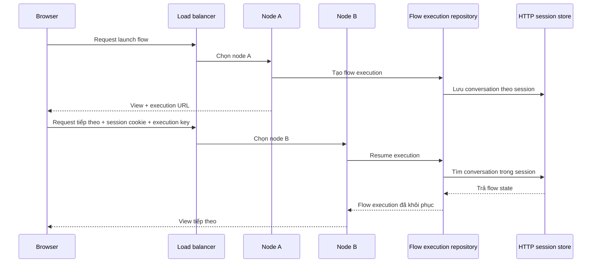
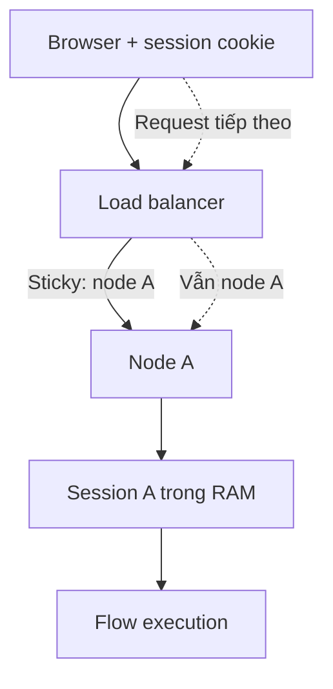
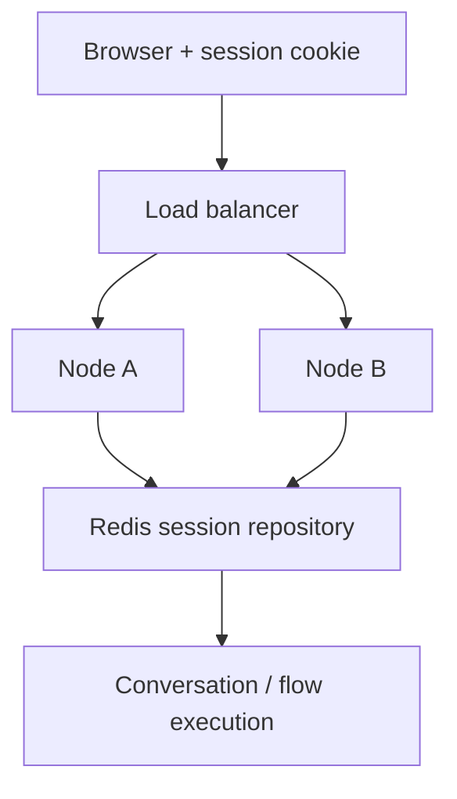

# HTTP session, cân bằng tải và lựa chọn gắn phiên

## 1. Vì sao Web Flow cần được tính đến khi triển khai nhiều node?

Spring Web Flow (SWF) giữ ngữ cảnh của một hành trình qua nhiều HTTP request. Ví dụ, người dùng bắt đầu đặt phòng trên node A, nhập thông tin, chờ vài phút rồi gửi event tiếp theo. Request sau có thể được load balancer chuyển tới node B.

Để node B tiếp tục đúng hành trình, hệ thống phải tìm lại được **flow execution** mà trình duyệt đã khởi chạy. Trong cấu hình mặc định, Web Flow dùng conversation manager lưu conversation trong HTTP session. Vì vậy, cách ứng dụng lưu session và cách load balancer định tuyến request ảnh hưởng trực tiếp tới khả năng resume flow.

Một triển khai chỉ chạy một máy chủ thường không bộc lộ vấn đề này. Khi thêm nhiều instance để tăng tải hoặc chịu lỗi, cần trả lời:

- Flow execution đang nằm trong bộ nhớ của node hay trong một kho dùng chung?
- Request tiếp theo có thể đến node khác không?
- Nếu node đang giữ session bị dừng, người dùng có tiếp tục được không?
- Dữ liệu trong flow scope có serialize được để replication/lưu trữ không?
- Hai request đồng thời có thể cập nhật cùng một execution từ hai node không?
- Session hết hạn thì flow và dữ liệu bản nháp được xử lý thế nào?

**Mục tiêu bài học:** hiểu mối quan hệ giữa HTTP session, flow execution repository và load balancer; lựa chọn session affinity, session replication hoặc shared session store; cấu hình giới hạn execution/snapshot; và kiểm thử hành vi khi chuyển node, mất node hoặc session hết hạn.

## 2. Phân biệt HTTP session, flow execution và execution repository

Ba khái niệm này liên quan với nhau nhưng không đồng nghĩa:

| Thành phần | Vai trò | Ví dụ |
| --- | --- | --- |
| HTTP session | Phiên phía server gắn với một session ID do trình duyệt gửi qua cookie | Đăng nhập, thuộc tính phiên, dữ liệu dùng chung trong phiên |
| Flow execution | Một lần chạy cụ thể của flow definition, có state hiện tại và dữ liệu theo scope | Wizard đặt phòng đang ở state `review` |
| Flow execution repository | Cơ chế lưu, khôi phục và xóa các flow execution đang pause | Tra execution key để resume flow |

Khi một flow vào `view-state`, nó pause và chờ event tiếp theo. Khi trình duyệt gửi request với execution key, `FlowExecutor` resume execution tương ứng. Repository chịu trách nhiệm tìm và khôi phục trạng thái đó.



Sơ đồ mô tả trường hợp hai node cùng truy cập được kho session. Nếu session chỉ nằm trong RAM của node A, node B không thể tự khôi phục conversation chỉ nhờ execution key.

### 2.1. Repository mặc định lưu dữ liệu ở đâu?

Trong cấu hình mặc định của Spring Web Flow, `SessionBindingConversationManager` lưu conversation trong session attribute map. Repository dùng conversation manager để quản lý các execution được gắn với conversation đó.

Điều này có nghĩa:

- Session cookie giúp server tìm đúng HTTP session.
- Conversation manager tìm conversation tương ứng trong session.
- Flow execution repository tìm execution/snapshot theo execution key.
- Flow executor khôi phục execution rồi xử lý event.

`FlowExecutionRepository` là một abstraction. Ứng dụng có thể thay conversation manager hoặc triển khai repository/storage riêng. Vì vậy, đừng suy luận rằng mọi cấu hình Web Flow đều lưu execution trong cùng một loại kho; hãy kiểm tra implementation đang được dùng.

### 2.2. Execution key không phải session ID

Một URL của flow có thể chứa tham số execution, ví dụ:

```text
/booking?execution=e1s2
```

`e1s2` chỉ là giá trị minh họa. Nó định danh execution hoặc snapshot mà Web Flow cần resume. Session cookie lại định danh HTTP session. Hai giá trị có vai trò khác nhau.

Execution key không phải:

- Bằng chứng người dùng đã đăng nhập.
- Booking ID hoặc business record ID.
- Quyền truy cập vào dữ liệu nghiệp vụ.
- Một token để lưu bookmark vô thời hạn.

Service vẫn phải xác thực và kiểm tra quyền sở hữu dữ liệu ở mỗi thao tác nhạy cảm. Không coi việc request có execution key hợp lệ là đủ để cho phép xem hoặc sửa hồ sơ.

## 3. Session affinity (sticky session) là gì?

**Session affinity**, còn gọi là **sticky session**, là cách cấu hình load balancer để các request tiếp theo từ cùng một phiên trình duyệt được chuyển về cùng một application node trong thời gian node đó còn hoạt động.

Ví dụ:

```text
Browser A
   |
   | session cookie
   v
Load balancer
   |
   +---- request 1 ----> Node A
   +---- request 2 ----> Node A
   +---- request 3 ----> Node A

Browser B
   |
   v
Load balancer
   |
   +---- request 1 ----> Node B
   +---- request 2 ----> Node B
```

Nếu HTTP session và conversation chỉ tồn tại trong bộ nhớ của node A, việc giữ request của Browser A trên node A giúp Web Flow tìm được flow execution.

Load balancer thường duy trì affinity bằng cookie do load balancer hoặc application server tạo. Một số hệ thống có thể dùng địa chỉ IP, nhưng IP affinity dễ thay đổi khi người dùng chuyển mạng, dùng proxy hoặc đi qua NAT. Cookie-based affinity thường xác định phiên ổn định hơn.

### 3.1. Sticky session giải quyết điều gì?

Sticky session hữu ích khi:

- Ứng dụng lưu `HttpSession` trong RAM của từng node.
- Flow execution mặc định được lưu qua session-bound conversation manager.
- Chưa có session replication hoặc shared session store.
- Muốn tránh việc request kế tiếp tới một node không có session của người dùng.

Sticky session giảm nhu cầu chuyển session giữa các node cho những request bình thường. Nó cũng giúp các request cùng phiên dùng lại cache cục bộ trên một node.

### 3.2. Sticky session không tự cung cấp failover

Nếu node A bị dừng, session trong RAM của A cũng mất. Load balancer có thể chuyển request tiếp theo sang node B, nhưng B không có dữ liệu flow execution cũ.

| Tình huống | Chỉ dùng sticky session + session RAM |
| --- | --- |
| Request tiếp theo khi node A còn hoạt động | Thường tiếp tục được |
| Node A bị restart | Session cũ có thể mất |
| Node A bị loại khỏi cluster | Request có thể sang node khác nhưng flow cũ không được khôi phục |
| Scale out thêm node | Cần cấu hình affinity để tránh request đi tới node không có session |
| Bảo trì node đang có người dùng | Có thể làm gián đoạn flow đang chạy |

**Affinity giữ request ở node đang giữ session; nó không sao lưu session và không phục hồi dữ liệu khi node hỏng.**

## 4. Ba cách lưu session khi chạy nhiều node

Có ba mô hình thường gặp. Có thể kết hợp session affinity với replication hoặc shared store để đạt cả locality và khả năng failover.

### 4.1. Session cục bộ trên từng node

```text
Node A: RAM
  └── HttpSession A
       └── Flow conversations

Node B: RAM
  └── HttpSession B
       └── Flow conversations
```

Load balancer cần giữ affinity để request của một session quay lại đúng node.

**Ưu điểm**

- Cấu hình đơn giản.
- Không cần truy cập session store ngoài ở mỗi request.
- Độ trễ đọc/ghi session thấp.

**Giới hạn**

- Node hỏng có thể làm mất session và flow execution.
- Scale in hoặc deploy node cần tính đến người dùng đang hoạt động.
- Không thể tùy ý chuyển request sang node khác.
- Dữ liệu session không tự đồng bộ giữa các node.

Mô hình này phù hợp với môi trường phát triển, ứng dụng nhỏ chạy một node hoặc hệ thống chấp nhận người dùng phải khởi động lại hành trình khi node mất.

### 4.2. Replication session giữa application server

Một số servlet container/application server hỗ trợ sao chép HTTP session giữa các node:

```text
Node A <------ replication ------> Node B
   |                                  |
   +--------- shared session ---------+
```

Khi session được replicate thành công, node B có thể khôi phục session nếu load balancer chuyển request sang B.

Cần chú ý:

- Session attributes phải đáp ứng yêu cầu serialization của container.
- Cấu hình replication có thể đồng bộ hoặc bất đồng bộ tùy sản phẩm.
- Replication tạo thêm lưu lượng mạng và chi phí serialize/deserialize.
- Nếu replication bất đồng bộ, cập nhật mới nhất có thể chưa đến node dự phòng khi node nguồn hỏng.
- Mọi node phải có class tương thích để deserialize dữ liệu.

Replication giúp tăng khả năng tiếp tục sau lỗi node, nhưng cần kiểm thử đúng container, phiên bản và chế độ replication. Đừng giả định chỉ bật cluster là mọi flow execution tự động an toàn.

### 4.3. Shared session store với Spring Session

Spring Session thay thế implementation `HttpSession` bằng implementation lưu session trong một repository dùng chung, chẳng hạn Redis hoặc JDBC.

```text
             +----------------+
Browser ---->| Load balancer  |
             +-------+--------+
                     |
             +-------+-------+
             |               |
          Node A           Node B
             |               |
             +-------+-------+
                     |
             +-------v-------+
             | Spring Session|
             | Redis / JDBC  |
             +---------------+
```

Mỗi node đọc và ghi cùng một session theo session ID. Nếu request được chuyển từ node A sang B, node B có thể lấy session từ shared store thay vì tìm trong RAM của A.

**Ưu điểm**

- Không cần phụ thuộc tuyệt đối vào một node để đọc session.
- Có thể scale out và scale in dễ hơn.
- Session có thể còn sau khi một application node restart, miễn kho session vẫn hoạt động và session chưa hết hạn.
- Không phụ thuộc giải pháp replication riêng của servlet container.

**Chi phí và điều kiện**

- Mỗi request có thao tác session có thể phát sinh I/O tới Redis/JDBC.
- Session phải serialize/deserialize được theo serializer đã cấu hình.
- Kho session cần HA, monitoring, backup và kiểm soát TTL.
- Redis/JDBC trở thành dependency quan trọng của mọi request cần session.
- Shared store không tự chia sẻ cache cục bộ, singleton state trong RAM hoặc dữ liệu nghiệp vụ chưa ghi database.

Spring Session tích hợp trong suốt với `HttpSession`; ứng dụng vẫn có thể dùng Web Flow với session abstraction thông thường. Khi dùng cấu hình mặc định của Web Flow, conversation được lưu trong session nên shared session store cũng giúp các node truy cập cùng conversation.

## 5. So sánh sticky session, replication và shared store

| Tiêu chí | Sticky + RAM cục bộ | Container replication | Spring Session Redis/JDBC |
| --- | --- | --- | --- |
| Request có thể đi tới node bất kỳ | Không, nếu cần giữ session | Có sau khi replication hoàn tất | Có, nếu tất cả node dùng cùng repository |
| Chịu lỗi một node | Thấp | Phụ thuộc replication | Tốt hơn nếu store còn hoạt động |
| Độ trễ session | Thấp | Có chi phí replication | Có chi phí truy cập store |
| Serialization | Có thể chưa cần khi session không rời node | Cần theo yêu cầu container | Cần theo serializer/repository |
| Scale out/in | Phải chú ý affinity và session trên node bị loại | Phụ thuộc cluster | Linh hoạt hơn |
| Vận hành | Đơn giản | Phụ thuộc application server | Cần vận hành Redis/JDBC |
| Phù hợp | Một node hoặc hệ thống chấp nhận mất session | Cluster dùng container hỗ trợ replication | Nhiều instance cần session dùng chung |

### 5.1. Có nên vẫn bật sticky session khi đã dùng Redis?

Có thể. Shared session store cho phép request tới node bất kỳ, còn sticky session vẫn có thể giúp:

- Tận dụng cache cục bộ.
- Giảm thay đổi node giữa các request liên tiếp.
- Giảm một số tình huống hai request cùng phiên chạy trên các node khác nhau.

Tuy nhiên, affinity lúc này là tối ưu định tuyến, không phải điều kiện duy nhất để đọc session. Nếu node đang phục vụ hỏng, load balancer cần có khả năng bỏ affinity cũ và chuyển request sang node khỏe.

Đừng dựa vào sticky session để che giấu lỗi cấu hình shared store. Hãy kiểm thử trực tiếp request resume từ node khác.

## 6. Cấu hình giới hạn execution và history snapshot

Một người dùng có thể mở nhiều flow execution trong cùng HTTP session: nhiều tab, nhiều lần đặt phòng hoặc nhiều wizard. Mỗi execution có thể lưu state và history snapshot. Nếu không giới hạn, session có thể tăng kích thước và tiêu tốn bộ nhớ/kho session.

Spring Web Flow cho phép giới hạn số execution và số snapshot:

```xml
<webflow:flow-executor id="flowExecutor"
                       flow-registry="flowRegistry">
    <webflow:flow-execution-repository
        max-executions="5"
        max-execution-snapshots="30" />
</webflow:flow-executor>
```

Ý nghĩa:

- `max-executions`: số flow execution tối đa trên mỗi user session, tính trên mọi flow definition. Khi vượt giới hạn, execution cũ nhất bị loại bỏ.
- `max-execution-snapshots`: số history snapshot tối đa cho mỗi flow execution.

### 6.1. Chọn max-executions

Nếu đặt giới hạn quá thấp:

- Người dùng mở nhiều tab có thể làm execution cũ bị loại.
- Một tab còn mở nhưng execution key đã hết hiệu lực.
- Người dùng quay lại tab cũ có thể phải khởi động lại flow.

Nếu đặt quá cao:

- Một session có thể giữ nhiều execution không còn được dùng.
- Kích thước session tăng.
- Chi phí serialization, replication hoặc ghi Redis/JDBC tăng.

Hãy đo số wizard đồng thời thực tế. Nếu ứng dụng chỉ có một flow ngắn, giới hạn nhỏ có thể hợp lý. Nếu người dùng làm việc với nhiều hồ sơ song song, cần giới hạn phù hợp với hành vi đó.

### 6.2. Chọn max-execution-snapshots

History snapshot hỗ trợ browser Back bằng cách khôi phục trạng thái trước đó.

| Giá trị | Ý nghĩa |
| --- | --- |
| `0` | Tắt snapshot history |
| Số dương, ví dụ `30` | Giữ tối đa số snapshot đó cho mỗi execution |
| `-1` | Không giới hạn số snapshot |

Nếu đặt `0`, browser Back có thể dùng execution key trỏ tới snapshot không được lưu và không thể khôi phục trạng thái như mong muốn. Nếu đặt `-1`, session có thể phình lớn trong flow có nhiều bước/event.

Đặt giới hạn dựa trên nhu cầu Back/Refresh và đo kích thước thực tế. Không bật unlimited chỉ để tránh phải thiết kế chính sách retention.

### 6.3. max-executions khác maxConversations

`SessionBindingConversationManager` cũng có thuộc tính `maxConversations` để giới hạn số conversation đồng thời trong một session. Mặc định là 5; khi vượt giới hạn, conversation cũ nhất bị kết thúc.

Hai giới hạn phục vụ các tầng khác nhau:

- `max-executions` giới hạn flow execution theo cấu hình repository/executor.
- `maxConversations` giới hạn conversation do conversation manager quản lý.

Khi điều chỉnh cả hai, hãy đảm bảo chúng không khiến hành vi nhiều tab khó đoán. Nếu ứng dụng có nhiều flow executor trong cùng web application, mỗi session binding conversation manager cần một `sessionKey` riêng để tránh đụng thuộc tính session.

## 7. Cấu hình Spring Session với Redis

Spring Session cung cấp `HttpSession` backed bởi Redis. Cấu hình sau minh họa cách bật Redis session trong ứng dụng Servlet:

```java
@Configuration
@EnableRedisHttpSession(
    maxInactiveIntervalInSeconds = 1800,
    redisNamespace = "myapp:spring-session"
)
public class HttpSessionConfig {

    // Cung cấp RedisConnectionFactory từ cấu hình hạ tầng.
    // Cấu hình endpoint, authentication, TLS, timeout và pool
    // theo môi trường triển khai.
}
```

Với ứng dụng Servlet không dùng Spring Boot, đăng ký `springSessionRepositoryFilter` cho toàn bộ request, trước filter hoặc thành phần đầu tiên truy cập `HttpSession`. Có thể dùng `AbstractHttpSessionApplicationInitializer` để đăng ký filter:

```java
public class SessionInitializer
        extends AbstractHttpSessionApplicationInitializer {

    public SessionInitializer() {
        super(HttpSessionConfig.class);
    }
}
```

Nếu dùng Spring Boot, dependency Spring Session Redis và auto-configuration có thể đăng ký filter tương ứng. Tên dependency và property cấu hình cần theo đúng phiên bản Spring Boot/Spring Session đang sử dụng.

### 7.1. Filter phải chạy đúng thứ tự

Spring Session thay implementation `HttpSession` thông qua servlet filter `springSessionRepositoryFilter`. Filter phải chạy trước những filter hoặc thành phần đọc/ghi session, bao gồm phần tích hợp Spring Security.

Nếu filter chạy quá muộn, một thành phần có thể tạo hoặc truy cập session container-native trước khi Spring Session thay thế nó. Khi đó, cùng request có thể dùng sai session implementation.

Kiểm tra:

- Filter được đăng ký cho toàn bộ URL cần dùng session.
- Filter chạy trước Spring Security và các filter truy cập session.
- Không có cấu hình thứ hai tạo session repository khác nhau cho cùng ứng dụng.
- Tất cả node dùng cùng Redis namespace và cấu hình serializer.

### 7.2. Spring Session không thay đổi cách flow gọi session

Flow definition vẫn dùng scope bình thường:

```xml
<flow xmlns="http://www.springframework.org/schema/webflow">
    <var name="bookingDraft"
         class="com.example.booking.BookingDraft" />

    <view-state id="editBooking" view="booking/edit">
        <transition on="continue" to="review" />
    </view-state>

    <view-state id="review" view="booking/review">
        <transition on="confirm" to="completed" />
    </view-state>

    <end-state id="completed" />
</flow>
```

Flow executor và conversation manager tiếp tục làm việc với `HttpSession` abstraction. Spring Session đảm nhiệm việc lưu session attributes vào Redis. Không cần thay mọi flow variable thành Redis API.

### 7.3. Lựa chọn Redis hay JDBC

| Tiêu chí | Redis | JDBC |
| --- | --- | --- |
| Đặc điểm | Kho key-value trong bộ nhớ, truy cập nhanh | Lưu session trong bảng quan hệ |
| Phù hợp | Session có tần suất đọc/ghi cao và cần độ trễ thấp | Hạ tầng database sẵn có, muốn quản lý session trong DB |
| Tài nguyên cần theo dõi | Memory, eviction, replication, latency, connection | Connection pool, index, lock, query latency, table growth |
| Expiration | TTL/expiration của Redis repository | Cleanup/expiration theo repository và job tương ứng |
| Rủi ro vận hành | Redis unavailable hoặc eviction nhầm session đang hoạt động | Session table lớn, truy vấn/cleanup tạo tải DB |

Chọn theo đặc tính tải và năng lực vận hành. Redis không tự động tốt hơn trong mọi hệ thống; JDBC cũng không nên dùng chung database nghiệp vụ mà không đo tải và giới hạn kết nối.

## 8. Serialization và thiết kế dữ liệu trong flow scope

Khi dùng session replication hoặc Spring Session với serializer, dữ liệu trong session phải có thể lưu và khôi phục. Với implementation scope mặc định của Web Flow, các object trong `flowScope`, `viewScope` và `flashScope` cần đáp ứng yêu cầu serializable. `conversationScope` được lưu trong HTTP session và cũng nên serializable để phù hợp replication.

### 8.1. Nên lưu gì trong scope?

Ưu tiên:

- ID của booking/hồ sơ.
- DTO nhỏ chỉ chứa field cần thiết cho các bước.
- Tiêu chí tìm kiếm, bộ lọc, trang hiện tại.
- Kết quả lựa chọn gọn nhẹ, có thể tải lại từ service.
- Các giá trị trạng thái cần thiết để điều phối flow.

Ví dụ:

```java
public class BookingDraft implements Serializable {

    private static final long serialVersionUID = 1L;

    private Long bookingId;
    private LocalDate checkIn;
    private LocalDate checkOut;
    private int guestCount;

    // getters and setters
}
```

Lưu `bookingId` và các field cần cho form thường dễ serialize, dễ version hóa và ít tốn dung lượng hơn một entity graph lớn.

### 8.2. Tránh lưu object không phù hợp

Không nên giữ trong flow/session:

- `HttpServletRequest`, `HttpServletResponse`, `InputStream` hoặc stream đang mở.
- File upload bytes lớn.
- Hibernate `Session`, JPA `EntityManager` hoặc connection không được thiết kế để serialize.
- Entity graph có quan hệ lazy phức tạp.
- Object chứa thread, executor, socket hoặc resource hệ điều hành.
- Cache dữ liệu lớn có thể tải lại từ database/service.

Một object không serialize được có thể khiến request lưu session thất bại hoặc làm mất khả năng resume sau khi chuyển node.

### 8.3. Không đưa toàn bộ kết quả truy vấn vào flowScope

Ví dụ không tốt:

```xml
<on-render>
    <evaluate expression="hotelService.findAllHotels()"
              result="flowScope.allHotels" />
</on-render>
```

Nếu danh sách có hàng chục nghìn khách sạn, mỗi session có thể giữ một bản sao lớn. Khi nhiều session cùng hoạt động, RAM/Redis tăng nhanh.

Nên giữ tiêu chí và trang hiện tại, sau đó truy vấn phân trang:

```xml
<on-render>
    <evaluate expression="hotelService.search(criteria, pageRequest)"
              result="viewScope.hotelPage" />
</on-render>
```

Chỉ lưu những dữ liệu cần thiết cho hành trình. Kết quả lớn nên được truy vấn theo trang hoặc cache ở tầng chuyên biệt.

### 8.4. Serializer và rolling deployment

Khi deploy phiên bản mới trong lúc người dùng vẫn có flow execution cũ, session store có thể chứa object được serialize bởi class của phiên bản trước.

Nếu class đổi cấu trúc hoặc không tương thích, node mới có thể không deserialize được session cũ. Giảm rủi ro bằng cách:

- Giữ DTO trong session nhỏ và có cấu trúc ổn định.
- Quản lý `serialVersionUID` khi dùng Java serialization.
- Có kế hoạch version hóa dữ liệu draft.
- Triển khai thay đổi tương thích ngược trong thời gian rolling deployment.
- Có chính sách hết hạn/restart flow khi không thể khôi phục dữ liệu cũ.

Không coi session serialization là hợp đồng lưu trữ nghiệp vụ lâu dài. Dữ liệu cần tồn tại qua nhiều phiên bản ứng dụng nên nằm trong database với schema migration rõ ràng.

## 9. Session timeout và vòng đời flow execution

Với repository mặc định dựa trên HTTP session, flow execution phụ thuộc vào session. Khi session hết hạn hoặc bị invalidation, conversation có thể bị xóa; execution key cũ không còn đủ để khôi phục flow.

Các nguyên nhân thường gặp:

- Người dùng không hoạt động lâu hơn session timeout.
- Người dùng đăng xuất và session bị invalidation.
- Session store xóa dữ liệu do TTL hoặc chính sách eviction.
- Quản trị viên xóa session.
- Session replication không hoàn tất trước khi node hỏng.

### 9.1. Session timeout không phải flow timeout riêng

| Chính sách | Điều khiển |
| --- | --- |
| HTTP session max inactive interval | Bao lâu session không được truy cập thì hết hạn |
| Spring Session maxInactiveInterval | TTL inactivity của session trong repository |
| `max-executions` | Số flow execution tối đa trên mỗi session |
| `max-execution-snapshots` | Số snapshot history tối đa trong một execution |
| `maxConversations` | Số conversation đồng thời mà conversation manager giữ trong session |

Hãy đồng bộ timeout giữa load balancer, servlet container, Spring Session và proxy. Nếu proxy xóa cookie sớm hoặc Redis TTL ngắn hơn thời gian người dùng cần, flow có thể bị gián đoạn dù ứng dụng vẫn đang chạy.

### 9.2. Xử lý execution đã hết hạn

Khi request gửi execution key cũ, Web Flow có thể không tìm thấy flow execution. Spring MVC `FlowHandlerAdapter` mặc định có thể khởi động lại flow khi gặp `NoSuchFlowExecutionException`, tùy tình huống và handler.

Ứng dụng nên xác định trải nghiệm phù hợp:

- Hiển thị thông báo phiên làm việc đã hết hạn.
- Đưa người dùng tới trang bắt đầu lại.
- Nếu có draft bền vững trong database, tải draft và khởi tạo flow execution mới.
- Không giả định dữ liệu chưa commit trong flow scope vẫn còn.

### 9.3. Flow dài ngày cần draft bền vững

Spring Session Redis giúp chia sẻ và duy trì HTTP session qua nhiều node trong thời gian TTL. Nó không tự biến flow execution thành một quy trình nghiệp vụ lưu bền vững vô thời hạn.

Nếu người dùng cần lưu và tiếp tục hồ sơ sau nhiều giờ/ngày hoặc sau khi đăng xuất:

1. Lưu dữ liệu bản nháp vào database.
2. Tạo `draftId` ổn định và kiểm tra quyền truy cập theo người dùng.
3. Flow chỉ giữ `draftId` và dữ liệu tạm cần thiết.
4. Khi người dùng quay lại, tải draft từ database và khởi tạo flow execution mới.
5. Dùng version/optimistic locking để phát hiện bản nháp đã thay đổi.

Tài liệu Web Flow cũng khuyến nghị durable store cho flow state khi cần lưu và khởi động lại tiến trình trong thời gian dài. Session-based storage phù hợp khi không cần khả năng save/restart dài hạn; session hết hạn trước khi commit có thể làm mất các thay đổi chưa lưu.

## 10. Đồng thời: nhiều request cùng một flow execution

Một người dùng có thể tạo hai request gần như cùng lúc:

- Bấm nút Continue hai lần.
- Mở cùng một execution URL ở hai tab.
- Refresh trang trong khi request trước chưa hoàn tất.
- Browser Back gửi một snapshot cũ trong lúc request mới đang xử lý.
- JavaScript gửi Ajax và form submit cùng lúc.

Flow execution repository có cơ chế lock để tránh nhiều request đồng thời thao tác không kiểm soát trên cùng execution. Tuy nhiên, cần hiểu phạm vi lock trong cấu hình đang chạy.

### 10.1. Lock trong conversation manager

`SessionBindingConversationManager` lưu conversation trong session và cung cấp lock timeout. Mặc định lock timeout là 30 giây. API của Web Flow cũng có `FlowExecutionRepository.getLock()` để lấy lock tương ứng với execution key.

Web Flow cung cấp `JdkConcurrentConversationLock`, dựa trên `ReentrantLock` của Java và đồng bộ trong JVM. Khi triển khai nhiều node, không nên mặc định rằng một lock cục bộ sẽ trở thành distributed lock chỉ vì session được lưu trong Redis; hãy xác minh lock implementation mà conversation manager thực tế đang dùng.

Nếu cùng một conversation có thể được xử lý đồng thời trên hai JVM:

- Dùng sticky affinity để các request của cùng session/conversation được xử lý trên cùng node khi có thể; hoặc
- Cung cấp cơ chế lock phân tán/custom conversation manager phù hợp với kho dùng chung; và
- Kiểm thử request đồng thời trên hai node thực tế.

Shared session store giải quyết việc các node đọc được cùng session. Nó không tự giải quyết mọi race condition khi hai request cùng cập nhật một flow execution.

### 10.2. Lock timeout

Nếu một request giữ lock quá lâu, request khác có thể phải chờ. Khi vượt lock timeout, Web Flow có thể phát sinh lỗi lock timeout/interruption.

Giảm nguy cơ bằng cách:

- Tránh gọi service chậm hoặc xử lý file lớn trong transition đang giữ execution lock.
- Không gọi API bên ngoài đồng bộ trong thời gian dài nếu có thể xử lý bất đồng bộ.
- Giữ transaction database ngắn.
- Thiết kế event confirm có idempotency.
- Đo lock wait time và số lock timeout.

### 10.3. Chống xác nhận trùng ở tầng nghiệp vụ

Flow lock không thay thế idempotency ở database/service. Ví dụ, người dùng gửi event Confirm hai lần hoặc refresh sau khi request đã tạo booking.

Service cần có bảo vệ riêng:

- Idempotency key hoặc mã yêu cầu duy nhất.
- Unique constraint cho thao tác không được tạo trùng.
- Kiểm tra trạng thái booking trước khi cập nhật.
- Transaction và optimistic locking.

Không để việc chống double-click chỉ phụ thuộc vào JavaScript vô hiệu hóa nút.

## 11. Cân bằng tải và session affinity trong thực tế

### 11.1. Kịch bản sticky session, session RAM



Khi node A khỏe, flow có thể tiếp tục. Khi node A hỏng, session RAM mất và người dùng cần khởi động lại flow hoặc khôi phục từ draft database nếu ứng dụng có lưu.

### 11.2. Kịch bản shared Redis session



Request có thể đến node A hoặc B vì cả hai truy cập cùng session repository. Khi A bị loại khỏi cluster, B vẫn có thể resume execution nếu:

- Session còn tồn tại trong Redis.
- Dữ liệu session serialize/deserialize được.
- B chạy phiên bản flow definition tương thích.
- Redis và kết nối của B hoạt động.
- Cơ chế concurrency/lock phù hợp với cách request được phân phối.

### 11.3. Health check và draining

Khi triển khai hoặc bảo trì:

1. Đánh dấu node không nhận request mới.
2. Cho request đang chạy hoàn tất trong giới hạn thời gian.
3. Nếu session cục bộ, cần drain đủ lâu hoặc chấp nhận người dùng trên node đó bị buộc khởi động lại.
4. Nếu session dùng chung, xác nhận các session write đã hoàn tất trước khi dừng node.
5. Kiểm thử flow đang pause có thể resume trên node còn lại.

Sticky session có thể làm một node nhận nhiều người dùng hơn node khác. Theo dõi phân bố request/session trên từng node để tránh một node quá tải trong khi node khác còn rảnh.

## 12. Bảo mật session và flow execution

Session và execution key mang ngữ cảnh người dùng nên cần bảo vệ như dữ liệu nhạy cảm.

### 12.1. Cookie session

Cookie session nên được cấu hình theo chính sách bảo mật của ứng dụng:

- `Secure`: chỉ gửi qua HTTPS.
- `HttpOnly`: JavaScript không đọc trực tiếp cookie.
- `SameSite`: chọn `Lax`, `Strict` hoặc `None` theo luồng điều hướng và tích hợp cross-site; `None` yêu cầu `Secure` trên trình duyệt hiện đại.
- TLS cho toàn bộ đường truyền giữa browser, load balancer và ứng dụng; bảo vệ kết nối tới Redis/JDBC.

Đừng tự đưa serialized flow state hoặc dữ liệu nghiệp vụ vào cookie. Cookie chỉ nên mang session identifier theo cơ chế của session repository.

### 12.2. Session fixation và logout

Sau khi xác thực, ứng dụng cần áp dụng session fixation protection phù hợp với Spring Security/container để session ID cũ không tiếp tục được dùng sau đăng nhập.

Khi logout:

- Invalidate session theo chính sách.
- Xóa hoặc kết thúc các flow execution liên quan.
- Không để người dùng tiếp tục flow bằng cookie cũ.
- Đảm bảo shared session store nhận được thao tác xóa/invalidation.

### 12.3. CSRF và authorization

Execution key không thay thế CSRF token hoặc authorization. Với form POST:

- Bật CSRF protection theo cấu hình Spring Security.
- Kiểm tra quyền truy cập hồ sơ ở service.
- Không tin ID trong flow scope nếu nó bắt nguồn từ request mà chưa kiểm tra.
- Không ghi session cookie, CSRF token hoặc thông tin bí mật vào log.

Nếu execution key xuất hiện trong URL, tránh đưa URL đó vào analytics/referrer/log công khai không cần thiết.

## 13. Theo dõi hiệu năng và vận hành

Khi dùng session-based flow execution, kích thước session và tần suất cập nhật có ảnh hưởng rõ đến hiệu năng.

### 13.1. Các chỉ số nên theo dõi

| Nhóm | Chỉ số |
| --- | --- |
| HTTP session | Số session đang hoạt động, số session tạo/hết hạn, kích thước session trung bình và p95 |
| Web Flow | Số execution/conversation đang hoạt động, số execution bị loại do giới hạn, số snapshot mỗi execution |
| Redis/JDBC | Latency đọc/ghi, throughput, timeout, lỗi kết nối, memory/connection pool, eviction hoặc table growth |
| Load balancer | Request theo node, tỷ lệ affinity, số lần failover, node bị unhealthy/drain |
| Đồng thời | Lock wait time, lock timeout, request cùng execution, duplicate confirm |
| Flow errors | NoSuchFlowExecutionException, NoSuchConversationException, snapshot not found, serialization failure |
| Ứng dụng | Request latency p50/p95/p99, CPU, heap, GC, lỗi service và transaction |

Có thể gắn `FlowExecutionListener` để đo lifecycle của flow và ghi nhận state/outcome. Không ghi raw session ID, cookie hoặc toàn bộ flow scope.

### 13.2. Đo kích thước session

Nếu mỗi flow execution giữ DTO lớn và nhiều snapshot, session có thể tăng kích thước đáng kể. Khi dùng Redis, mỗi lần lưu session có thể phát sinh serialization và I/O; khi dùng replication, dữ liệu lớn làm tăng lưu lượng giữa node.

Theo dõi:

- Kích thước session p50/p95/p99.
- Số execution trên mỗi session.
- Số snapshot trung bình và tối đa.
- Số lần ghi session trên mỗi request.
- Thời gian serialize/deserialize.
- Redis memory và eviction.

Nếu kích thước tăng, rà soát các object trong `flowScope`, `viewScope`, `flashScope` và `conversationScope`; thay entity graph/danh sách lớn bằng ID và DTO gọn.

### 13.3. Không tăng timeout chỉ để tránh lỗi flow

Tăng session timeout có thể giảm số flow bị hết hạn khi người dùng đọc lâu, nhưng đồng thời giữ session và dữ liệu lâu hơn. Hãy chọn timeout theo thời gian thao tác thực tế, quy định bảo mật và năng lực kho session.

Nếu nghiệp vụ cần tiếp tục sau nhiều ngày, lưu draft bền vững thay vì tăng session timeout lên mức rất dài.

## 14. Kiểm thử triển khai nhiều node

Một test chỉ chạy trên một embedded server không đủ xác nhận session affinity hoặc shared session store. Cần kiểm thử với ít nhất hai application instance và load balancer/test router.

### 14.1. Ma trận kiểm thử

| Ca thử | Cách thực hiện | Kết quả mong đợi |
| --- | --- | --- |
| Sticky session | Launch trên A, gửi request tiếp theo qua LB | Request được chuyển lại A |
| Shared session | Launch trên A, resume trực tiếp trên B bằng cùng session cookie | B khôi phục đúng flow execution |
| Node A restart với RAM cục bộ | Launch trên A, dừng A rồi resume | Flow cũ không còn; ứng dụng hướng dẫn bắt đầu lại/khôi phục draft |
| Node A restart với Redis | Launch trên A, dừng A, resume trên B | Flow tiếp tục nếu session còn hạn và state tương thích |
| Session timeout | Chờ quá TTL rồi gửi execution key cũ | Xử lý hết hạn rõ ràng, không báo thành công giả |
| Redis unavailable | Tạm ngắt session store rồi gửi request | Lỗi được quan sát và xử lý; không tạo execution mới ngoài ý muốn |
| Serialization | Lưu các DTO/scope object thực tế rồi đọc từ node khác | Không có serialization/deserialization failure |
| Nhiều tab | Mở nhiều flow trong cùng session vượt giới hạn | Execution cũ bị xử lý theo giới hạn đã cấu hình |
| Browser Back | Đi qua nhiều state rồi Back | Khôi phục snapshot trong giới hạn retention |
| Snapshot bị tắt | Cấu hình `max-execution-snapshots="0"`, rồi Back | Hành vi không hỗ trợ snapshot được nhận diện |
| Concurrent request | Gửi hai event cùng execution gần đồng thời | Lock/concurrency policy ngăn cập nhật hỏng |
| Double confirm | Gửi confirm hai lần | Chỉ tạo một booking nhờ idempotency/constraint |
| Rolling deployment | Launch flow ở phiên bản cũ, resume sau khi node mới nhận request | Dữ liệu cũ tương thích hoặc được xử lý bằng thông báo/restart có kiểm soát |

### 14.2. Kiểm thử shared session qua hai node

Kịch bản cơ bản:

1. Khởi chạy node A và node B cùng phiên bản ứng dụng.
2. Dùng browser/test client tạo session mới và lưu cookie.
3. Gửi request launch flow tới node A.
4. Lấy continuation URL/execution key từ response.
5. Gửi request tiếp theo trực tiếp tới node B với cùng cookie và execution key.
6. Xác nhận node B khôi phục đúng state và dữ liệu form.
7. Hoàn tất flow trên B, rồi đọc dữ liệu nghiệp vụ từ database.

Test này chứng minh session dùng chung thật sự hoạt động. Không chỉ kiểm tra rằng cả A và B đều kết nối được Redis.

### 14.3. Kiểm thử failover và draft

Nếu yêu cầu nghiệp vụ là không mất dữ liệu đã nhập khi node chết, hãy kiểm thử hai thời điểm:

- Trước khi session write được lưu vào shared store.
- Sau khi session write hoàn tất và response đã được gửi về browser.

Không thể mặc định request đang xử lý dở sẽ được khôi phục nguyên trạng sau khi process chết. Với dữ liệu quan trọng, hãy ghi draft hoặc checkpoint nghiệp vụ vào database theo transaction riêng, thay vì chỉ dựa vào session.

## 15. Lỗi thường gặp và cách khắc phục

| Hiện tượng | Nguyên nhân có thể | Hướng xử lý |
| --- | --- | --- |
| Request đầu chạy được, request sau báo không tìm thấy execution | Request bị chuyển sang node không có session | Bật affinity hoặc dùng session replication/shared store |
| Sticky session đang chạy nhưng node hỏng thì mất flow | Session chỉ nằm trong RAM của node | Dùng replication/shared store hoặc chấp nhận restart và lưu draft database |
| Redis có session nhưng flow không resume | Serializer lỗi, session key/namespace khác, execution đã hết hạn hoặc flow version không tương thích | Kiểm tra session ID, TTL, serializer, namespace và version |
| Node B không thấy thay đổi mới nhất | Replication bất đồng bộ hoặc session write chưa flush | Kiểm tra replication/flush mode và thứ tự filter |
| Session tăng kích thước nhanh | Quá nhiều execution/snapshot hoặc lưu object lớn | Giới hạn execution/snapshot, giữ ID/DTO gọn |
| Browser Back báo snapshot không tồn tại | Snapshot bị tắt hoặc đã bị loại | Điều chỉnh `max-execution-snapshots` theo UX |
| Người dùng bị đưa về đầu flow khi session hết hạn | Execution key không còn hợp lệ và handler khởi động flow mới | Hiển thị thông báo hết hạn; khôi phục từ draft nếu có |
| Cùng event chạy hai lần | Double click, retry hoặc request đồng thời | Idempotency, unique constraint và kiểm soát lock |
| Hai node cập nhật cùng execution gây race | Lock mặc định không phải distributed lock | Sticky affinity cho cùng conversation hoặc triển khai distributed lock |
| Redis/JDBC trở thành điểm nghẽn | Session payload lớn hoặc ghi session quá thường xuyên | Đo latency, giảm payload, tối ưu store và connection pool |
| Serialization failure khi deploy | Session chứa class không tương thích giữa phiên bản | Dùng DTO ổn định, version hóa dữ liệu và kế hoạch rolling deployment |
| Logout nhưng flow cũ còn truy cập được | Session invalidation chưa áp dụng cho shared store hoặc flow key bị xử lý sai | Kiểm tra logout/invalidation và authorization ở service |

### 15.1. Quy trình chẩn đoán

1. Xác định request launch và request resume đi qua node nào.
2. Kiểm tra cookie session có được gửi đầy đủ không.
3. Xác định session store thực tế là RAM, container replication hay Spring Session.
4. Kiểm tra node nhận request có đọc được cùng session ID không.
5. Kiểm tra session còn TTL và conversation còn tồn tại không.
6. Kiểm tra execution key có trỏ tới snapshot còn được giữ không.
7. Kiểm tra serialization/deserialization và phiên bản flow definition.
8. Kiểm tra lock wait, lock timeout và request đồng thời.
9. Kiểm tra dữ liệu nghiệp vụ đã commit/draft trong database chưa.

Không chỉ nhìn HTTP status. Hãy đối chiếu node ID, session repository, flow ID, state ID và correlation ID trong log.

## 16. Bài tập thực hành

### Bài 1 — Chọn session affinity

Ứng dụng có hai node, mỗi node lưu `HttpSession` trong RAM. Load balancer phân phối request round-robin.

**Câu hỏi:** tại sao flow có thể hoạt động ở request đầu nhưng lỗi ở request sau?

**Đáp án:** request sau có thể tới node khác không có conversation/flow execution của session đó. Cần session affinity hoặc một cơ chế chia sẻ/replicate session.

### Bài 2 — Sticky session có bảo vệ khi node chết không?

Load balancer luôn đưa Browser A về node A. Node A bị crash.

**Đáp án:** không. Sticky session chỉ giữ định tuyến khi node còn hoạt động; session RAM mất theo process. Muốn failover cần replication/shared store hoặc draft bền vững.

### Bài 3 — Redis có làm flow durable vô thời hạn không?

Ứng dụng dùng Spring Session Redis với TTL 30 phút. Người dùng quay lại sau ba ngày.

**Đáp án:** không. Session có thể đã hết hạn và execution bị xóa. Nếu cần tiếp tục sau nhiều ngày, lưu draft/state nghiệp vụ trong database hoặc một durable workflow store.

### Bài 4 — Vì sao không lưu toàn bộ entity graph?

Flow lưu một entity booking có nhiều lazy collection và proxy trong `flowScope`, sau đó session được serialize sang Redis.

**Đáp án:** entity graph có thể lớn, khó serialize, phụ thuộc persistence context và phiên bản class. Nên lưu ID/DTO gọn, tải lại entity qua service khi cần.

### Bài 5 — Chọn max-execution-snapshots

Ứng dụng muốn hỗ trợ browser Back nhưng chỉ cần quay lại khoảng 10 bước gần nhất.

**Gợi ý:** đặt một giới hạn hữu hạn như `max-execution-snapshots="10"` sau khi kiểm thử UX. Tránh `-1` nếu chưa đo kích thước session.

### Bài 6 — Hai request cùng một execution

Người dùng mở cùng continuation URL ở hai tab, cả hai gửi event gần như đồng thời và có thể được định tuyến tới hai node.

**Câu hỏi:** Redis shared session có đủ để đảm bảo không race không?

**Đáp án:** không tự động. Shared store cho phép cả hai node đọc session; cần bảo đảm lock/concurrency policy có hiệu lực giữa các node. Sticky affinity có thể giúp giữ cùng conversation trên một JVM; nếu cần xử lý phân tán thực sự, cần distributed lock hoặc cơ chế version/idempotency ở tầng nghiệp vụ.

### Bài 7 — Triển khai phiên bản mới

Node A chạy phiên bản ứng dụng cũ, node B chạy phiên bản mới. Session trong Redis chứa DTO flow của phiên bản cũ.

**Gợi ý:** dùng DTO tương thích ngược hoặc version hóa dữ liệu. Nếu flow definition/class đã thay đổi không tương thích, cần drain execution cũ hoặc thông báo người dùng khởi động lại từ draft đã lưu bền vững.

## 17. Tiêu chí hoàn thành

- [ ] Phân biệt HTTP session, flow execution, execution key và flow execution repository.
- [ ] Giải thích được cách `SessionBindingConversationManager` lưu conversation trong HTTP session.
- [ ] Phân biệt session affinity với session replication và shared session store.
- [ ] Hiểu sticky session không tự bảo vệ session khi node bị crash.
- [ ] Biết Spring Session Redis/JDBC thay implementation `HttpSession` như thế nào.
- [ ] Cấu hình được `max-executions` và `max-execution-snapshots`.
- [ ] Hiểu giới hạn `maxConversations` và lock timeout của conversation manager.
- [ ] Chọn object serializable, nhỏ gọn để lưu trong flow/session scope.
- [ ] Phân biệt session TTL với yêu cầu lưu draft/workflow dài hạn.
- [ ] Kiểm thử resume từ node khác, failover, timeout, serialization và request đồng thời.
- [ ] Có metrics cho session size, execution count, snapshot, Redis/JDBC latency và lock timeout.

## 18. Ghi nhớ

- Với cấu hình mặc định, Web Flow lưu conversation trong HTTP session qua `SessionBindingConversationManager`; flow execution repository dùng conversation manager để lưu/khôi phục execution.
- **Sticky session** giữ request của cùng browser session trên một node. Nó giúp session RAM hoạt động nhưng không phục hồi dữ liệu khi node hỏng.
- **Session replication** và **shared session store** cho phép node khác truy cập session; Spring Session có thể dùng Redis hoặc JDBC để thay implementation `HttpSession`.
- Shared session store không tự giải quyết distributed locking, cache cục bộ hoặc tính bền vững của dữ liệu nghiệp vụ.
- `max-executions` giới hạn execution trên mỗi user session; `max-execution-snapshots` giới hạn history snapshot trong mỗi execution. Snapshot hỗ trợ browser Back.
- `SessionBindingConversationManager.maxConversations` giới hạn conversation đồng thời; mặc định là 5. Lock timeout mặc định là 30 giây.
- Dữ liệu trong flow/session scope cần đáp ứng serialization của implementation. Ưu tiên ID và DTO nhỏ; tránh entity graph, stream, file bytes và resource không serialize được.
- Session hết hạn có thể làm mất flow execution chưa commit. Muốn tiếp tục sau nhiều ngày, hãy lưu draft/state nghiệp vụ vào database hoặc durable store.
- Kiểm thử nhiều node bằng cùng session cookie và execution key; kiểm tra failover, rolling deployment, request đồng thời và idempotency.

## Tài liệu tham khảo

- [Spring Web Flow 3.0 Reference Guide — Variable Scopes](https://docs.spring.io/spring-webflow/docs/3.0.0/reference/index.html)
- [Spring Web Flow 3.0 Reference Guide — Tuning Flow Execution Persistence](https://docs.spring.io/spring-webflow/docs/3.0.0/reference/index.html#flow-execution-repository)
- [Spring Web Flow 3.0.1 API — FlowExecutionRepository](https://docs.spring.io/spring-webflow/docs/3.0.1/api/org/springframework/webflow/execution/repository/FlowExecutionRepository.html)
- [Spring Web Flow 3.0.1 API — SessionBindingConversationManager](https://docs.spring.io/spring-webflow/docs/3.0.1/api/org/springframework/webflow/conversation/impl/SessionBindingConversationManager.html)
- [Spring Web Flow 3.0.0 API — JdkConcurrentConversationLock](https://docs.spring.io/spring-webflow/docs/3.0.0/api/org/springframework/webflow/conversation/impl/JdkConcurrentConversationLock.html)
- [Spring Session Reference — HttpSession Integration](https://docs.spring.io/spring-session/reference/http-session.html)
- [Spring Session Reference — Redis Configuration](https://docs.spring.io/spring-session/reference/configuration/redis.html)
