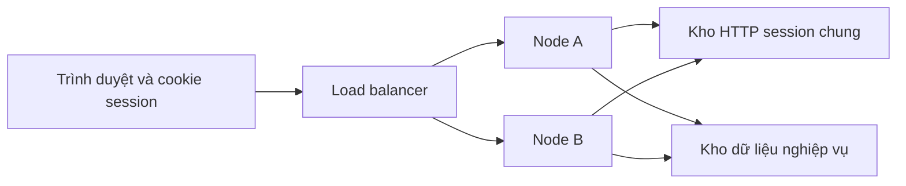

# Sao chép hoặc lưu session tập trung và yêu cầu tương thích dữ liệu

Một flow đặt hàng chạy ổn trên một JVM chưa chắc tiếp tục được khi request sau chuyển sang node khác. Dữ liệu còn nằm trên node cũ, snapshot không đọc được ở bản ứng dụng mới hoặc hai node cùng ghi đè session đều có thể làm người dùng mất hành trình đang thực hiện.

Bài thuộc chương **Hiệu năng và vận hành** của module **SPRING_WEB_FLOW**. Trọng tâm là lựa chọn cách lưu session cho hành trình nhiều bước, nhận diện dữ liệu cần tương thích và kiểm thử việc tiếp tục flow khi failover, triển khai từng phần hoặc rollback.

## 1. Mục tiêu và các khái niệm cần tách biệt

Sau bài học, bạn có thể:

- So sánh sticky session, sao chép session giữa node và kho session tập trung.
- Phân biệt serialization snapshot của Web Flow với serialization thuộc tính HTTP session.
- Thiết kế DTO trong scope để có thể lưu, đọc và nâng phiên bản có kiểm soát.
- Nhận diện rủi ro ghi đè session và giới hạn của khóa cục bộ.
- Lập ma trận kiểm thử tương thích giữa các bản ứng dụng.
- Ước lượng chi phí lưu trữ, truyền dữ liệu và phục hồi execution.

Ba câu hỏi khác nhau phải được trả lời:

| Câu hỏi | Ý nghĩa |
| --- | --- |
| Node B có truy cập được trạng thái mà A đã lưu không? | Khả năng chia sẻ dữ liệu và độ mới của dữ liệu |
| B có đọc và hiểu được trạng thái đó không? | Tương thích định dạng, lớp dữ liệu và flow definition |
| A và B có thể cập nhật trạng thái mà không làm mất thay đổi không? | Điều phối đồng thời và quy tắc ghi |

Có một kho Redis dùng chung mới trả lời được một phần câu hỏi đầu. Nó không tự chứng minh hai câu hỏi còn lại.

## 2. Web Flow lưu gì trong session?

Với cơ chế thông dụng dựa trên [SessionBindingConversationManager](https://docs.spring.io/spring-webflow/docs/current/api/org/springframework/webflow/conversation/impl/SessionBindingConversationManager.html), các conversation được lưu qua thuộc tính session. [ConversationContainer](https://docs.spring.io/spring-webflow/docs/current/api/org/springframework/webflow/conversation/impl/ConversationContainer.html) là container nội bộ chứa những conversation đó và có vòng đời gắn với session.

Tùy repository và snapshot factory, trạng thái liên quan có thể gồm:

- Các execution đang hoạt động và nhóm snapshot của chúng.
- Dữ liệu form trong flow scope hoặc view scope cần giữ qua request.
- Dữ liệu conversation scope dùng chung giữa flow gốc và subflow.
- Thuộc tính khác của ứng dụng hoặc hạ tầng xác thực trong cùng HTTP session.

Không đồng nhất toàn bộ HTTP session với một flow execution. Một người dùng có thể mở nhiều hành trình trong cùng session; dung lượng và nguy cơ tranh chấp phải tính cho tổng các hành trình đó.

Flow definition cũng không phải một bản sao đầy đủ nằm trong mọi snapshot. [FlowExecutionStateRestorer API](https://docs.spring.io/spring-webflow/docs/current/api/org/springframework/webflow/execution/repository/support/FlowExecutionStateRestorer.html) cho thấy việc phục hồi còn cần definition và bộ tìm definition của subflow. Node nhận request phải có cấu hình và tài nguyên tương ứng, không chỉ có byte dữ liệu.

Nếu dự án dùng repository tùy biến, cần kiểm tra vị trí lưu và hợp đồng phục hồi của implementation đó trước khi áp dụng kết luận về session.

## 3. So sánh ba cách vận hành

| Cách tổ chức | Trạng thái chính nằm ở đâu? | Điểm thuận lợi | Điều phải giải quyết |
| --- | --- | --- | --- |
| Sticky session, dữ liệu cục bộ | Heap của node đang phục vụ | Ít truyền trạng thái giữa node trong đường đi bình thường | Node mất thì hành trình có thể mất; khó đổi node cho phiên đang chạy |
| Sao chép session | Node chính và một hoặc nhiều bản sao theo container/giải pháp | Có thể tiếp tục trên bản sao khi failover | Độ trễ sao chép, kích thước dữ liệu, tương thích và đồng thời |
| Session tập trung | Kho dùng chung như Redis hoặc JDBC qua hạ tầng session | Các node có thể đọc cùng một nguồn trạng thái | I/O, serialization, khả dụng của kho, chính sách ghi và tranh chấp |

Đây là so sánh kiến trúc, không phải cam kết mọi container sao chép đồng bộ hoặc mọi kho tập trung có cùng tính nhất quán. Phải biết khi nào một thay đổi được coi là đã lưu thành công và node khác đọc từ đâu.

Sticky session có thể dùng cùng replication hoặc kho tập trung để giảm một số lần chuyển node. Nó không thay thế kiểm thử failover và không tự làm khóa Java thành khóa phân tán.

### Luồng xử lý với session tập trung



Kho session phục vụ việc tiếp tục hội thoại. Kho nghiệp vụ phục vụ đơn hàng, thanh toán và bản nháp bền vững. Hai vai trò có thể dùng công nghệ tương tự, nhưng vòng đời và hợp đồng dữ liệu khác nhau.

## 4. Có thể có hai lớp serialization

Đây là điểm dễ bỏ sót khi chuyển từ một node sang lưu session tập trung:

```text
DTO trong scope
    ↓ serialization của snapshot factory, nếu cấu hình dùng nó
Snapshot của Web Flow
    ↓ nằm trong cấu trúc conversation/session
Thuộc tính HTTP session
    ↓ serializer của cơ chế replication hoặc session repository
Byte lưu trong bản sao hoặc kho tập trung
```

[SerializedFlowExecutionSnapshotFactory](https://docs.spring.io/spring-webflow/docs/current/api/org/springframework/webflow/execution/repository/snapshot/SerializedFlowExecutionSnapshotFactory.html) tạo snapshot bằng Java serialization và có tùy chọn nén. Trong khi đó, hạ tầng HTTP session có serializer riêng cho các thuộc tính mà nó lưu.

Hệ quả thực tế:

- Đổi serializer session sang JSON không tự đổi định dạng byte bên trong snapshot Web Flow.
- DTO đơn lẻ chuyển được sang JSON chưa chứng minh conversation container, snapshot và thuộc tính xác thực đều chuyển được.
- Snapshot serialize thành công chưa chứng minh lớp lưu session đã ghi dữ liệu đó thành công.
- Node B cần đọc được cả cấu trúc session bên ngoài và trạng thái flow bên trong.

[Redis Configurations của Spring Session](https://docs.spring.io/spring-session/reference/configuration/redis.html) mô tả tùy biến serializer của session và việc dùng namespace để tách dữ liệu. Khi thay serializer, phải kiểm thử toàn bộ đồ thị thuộc tính thực tế, gồm cả các kiểu nội bộ framework; không chỉ thử một DTO ứng dụng.

Một lần đổi serializer hoặc định dạng nén là thay đổi hợp đồng dữ liệu đang lưu. Các node dùng chung dữ liệu phải có chính sách đọc tương thích, chuyển đổi hoặc tách miền session rõ ràng.

## 5. Thiết kế dữ liệu trong scope để chuyển node được

| Nên giữ trong trạng thái hội thoại | Nên tải lại hoặc quản lý ngoài scope |
| --- | --- |
| ID bản nháp, ID giỏ hàng, lựa chọn của người dùng | Connection, stream, thread, executor |
| DTO form có đồ thị dữ liệu nhỏ và rõ | Service bean, repository bean, resource đang mở |
| Giá trị văn bản, số, thời điểm theo hợp đồng | Request/response hoặc context của một lượt gọi |
| Danh sách ID hoặc bản tóm tắt cần thiết | Đồ thị entity lớn, proxy/lazy association chưa kiểm soát |

Với Java serialization, `implements Serializable` trên object gốc không đủ nếu đồ thị còn chứa object không hỗ trợ serialization. [Serializable API](https://docs.oracle.com/en/java/javase/21/docs/api/java.base/java/io/Serializable.html) mô tả việc duyệt đồ thị và lỗi khi gặp object không thể serialize.

Giữ ID rồi tải lại dữ liệu giúp giảm kích thước snapshot, nhưng phải xác định dữ liệu nào cần phản ánh thời điểm hiện tại và dữ liệu nào cần giữ theo bản chụp người dùng đã xác nhận. Ví dụ, tải lại giá sản phẩm mới nhất có thể thay đổi báo giá; đây là quyết định nghiệp vụ, không chỉ là tối ưu dung lượng.

### DTO minh họa

```java
package example.checkout;

import java.io.Serializable;
import java.util.ArrayList;
import java.util.List;

public final class CheckoutDraft implements Serializable {
    private static final long serialVersionUID = 1L;

    private int schemaVersion = 1;
    private String draftId;
    private String recipientName;
    private List<String> selectedItemIds = new ArrayList<String>();

    public int getSchemaVersion() {
        return schemaVersion;
    }

    public String getDraftId() {
        return draftId;
    }

    public void setDraftId(String draftId) {
        this.draftId = draftId;
    }

    public String getRecipientName() {
        return recipientName;
    }

    public void setRecipientName(String recipientName) {
        this.recipientName = recipientName;
    }

    public List<String> getSelectedItemIds() {
        return selectedItemIds;
    }

    public void setSelectedItemIds(List<String> selectedItemIds) {
        this.selectedItemIds = new ArrayList<String>(selectedItemIds);
    }
}
```

DTO này minh họa dữ liệu nhỏ, không giữ service hay connection. Nó vẫn mutable để phục vụ form binding, nên không tự an toàn nếu được chia sẻ đồng thời. Setter cũng giả định danh sách đầu vào khác null; validation và quy tắc chuẩn hóa cần được định nghĩa trong ứng dụng thật.

`schemaVersion` diễn đạt phiên bản cấu trúc theo quy ước ứng dụng. Nó không tự nâng cấp snapshot và không thay thế versioning của toàn bộ flow/runtime.

## 6. Tương thích dữ liệu không chỉ là giữ serialVersionUID

Tách ít nhất ba lớp tương thích:

| Lớp | Câu hỏi cần trả lời |
| --- | --- |
| Định dạng và kiểu | Node mới có đọc được byte do node cũ ghi không? |
| Ý nghĩa dữ liệu | Giá trị đọc được còn thỏa quy tắc nghiệp vụ không? |
| Hành vi flow | State, event, subflow và expression còn phù hợp với dữ liệu đã lưu không? |

`serialVersionUID` là một phần cơ chế tương thích Java serialization. Giữ nguyên UID không bảo đảm ý nghĩa dữ liệu không đổi, và đổi UID không phải một chiến lược migrate.

Ví dụ các thay đổi cần phân tích:

- Thêm trường tùy chọn: dữ liệu cũ có thể thiếu giá trị mà mã mới mong đợi.
- Đổi trường số tiền sang cách biểu diễn hoặc đơn vị khác: byte có thể đọc được nhưng ý nghĩa sai.
- Đổi tên package hoặc đổi kiểu field: có thể làm quá trình đọc không còn tương thích.
- Thêm một giá trị enum mà bản cũ không hiểu: đường rollback cần được thử riêng.

[Java Serialization Specification, phần Versioning](https://docs.oracle.com/en/java/javase/21/docs/specs/serialization/version.html) nêu trách nhiệm giữ hợp đồng giữa các phiên bản và phân biệt thay đổi tương thích/không tương thích. Đọc được object chưa đủ để kết luận một hành trình đang chạy sẽ xử lý đúng.

### Trường mới và giá trị mặc định

Giả sử bản mới thêm `deliveryMethod` và muốn mặc định là `STANDARD`. Không mặc định một field initializer luôn chạy để cung cấp giá trị cho dữ liệu Java serialization cũ. Cần có bước chuẩn hóa hoặc cơ chế đọc tương thích phù hợp.

Ví dụ logic chuẩn hóa theo hợp đồng ứng dụng:

```java
public String resolveDeliveryMethod(String storedValue) {
    return storedValue == null ? "STANDARD" : storedValue;
}
```

Quy tắc này chỉ đúng nếu `STANDARD` thật sự là ý nghĩa hợp lệ cho dữ liệu cũ. Với tiền tệ hoặc trạng thái thanh toán, suy đoán một giá trị mặc định có thể gây lỗi nghiệp vụ; cần nguồn dữ liệu và quy tắc chuyển đổi rõ ràng.

Thay đổi `schemaVersion` cũng phải có quy tắc đọc bản cũ. Nếu trường version chưa tồn tại trong dữ liệu lịch sử, bộ đọc phải xử lý trường hợp vắng mặt theo hợp đồng đã chọn thay vì nhận ngẫu nhiên một giá trị là hợp lệ.

## 7. Flow definition và dependency cũng phải tương thích

Một snapshot có thể chứa trạng thái tại `reviewOrder`, nhưng bản mới đã đổi hoặc xóa state đó. DTO vẫn đọc được chưa chắc đủ để execution tiếp tục.

Các thay đổi cần đưa vào đánh giá triển khai:

- Đổi flow ID hoặc đường đăng ký definition trong registry.
- Đổi tên state đang có execution dừng lại.
- Đổi subflow ID, input/output hoặc outcome của subflow.
- Đổi tên biến trong scope mà expression ở bước tiếp theo sử dụng.
- Đổi service, converter hoặc validator mà flow cần khi tiếp tục.
- Đổi dependency Spring Web Flow/Spring Framework ảnh hưởng dữ liệu hoặc cơ chế phục hồi.

Những mục trên là ranh giới tương thích cần kiểm thử, không phải kết luận rằng mọi thay đổi đều chắc chắn làm hỏng mọi snapshot. Mức ảnh hưởng phụ thuộc đường đi và implementation đang sử dụng.

Một cách giảm rủi ro là duy trì definition cũ cho execution đang chạy và đưa hành trình mới vào definition đã được version hóa theo cơ chế định tuyến của ứng dụng. Tuy nhiên, cách này vẫn phải giữ tương thích của session container, serializer và các dependency chung; chỉ đổi tên flow không cô lập được mọi lớp dữ liệu.

Nếu không duy trì được tương thích, sản phẩm phải chọn chiến lược cho người dùng tiếp tục từ bản nháp bền vững hoặc bắt đầu lại có thông báo. Không coi snapshot nội bộ của framework là định dạng lưu trữ lâu dài có thể tự nâng cấp qua mọi phiên bản.

## 8. Đọc lại cùng object và phát hiện thay đổi session

Trong một JVM dùng session cục bộ, sửa object lồng trong session có thể lập tức nhìn thấy ở request sau vì vẫn đang dùng cùng object trong bộ nhớ. Kho session ngoài JVM thường có quá trình đọc–sửa–ghi và cơ chế xác định thay đổi riêng.

Ví dụ tổng quát:

```java
CheckoutDraft draft = (CheckoutDraft) session.getAttribute("checkoutDraft");
draft.setRecipientName("An Nguyễn");
```

Đoạn mã chỉ thể hiện việc đổi object. Có được lưu lại hay không phụ thuộc cơ chế session và cách tích hợp phát hiện thay đổi.

Với thuộc tính **do ứng dụng trực tiếp quản lý**, cách cập nhật có thể là:

```java
CheckoutDraft draft = (CheckoutDraft) session.getAttribute("checkoutDraft");
draft.setRecipientName("An Nguyễn");
session.setAttribute("checkoutDraft", draft);
```

Không áp dụng máy móc bằng cách tự sửa hoặc set lại các container nội bộ Web Flow. Với dữ liệu nằm trong flow scope, kiểm tra đường lưu của Web Flow kết hợp session repository thực tế, rồi dùng API mở rộng được hỗ trợ nếu cần điều chỉnh.

### SaveMode và FlushMode là hai việc khác nhau

[SaveMode API](https://docs.spring.io/spring-session/reference/3.5/api/java/org/springframework/session/SaveMode.html) mô tả cách theo dõi thuộc tính cần lưu: theo thao tác set, bổ sung những thuộc tính đã get hoặc lưu mọi thuộc tính. [FlushMode API](https://docs.spring.io/spring-session/docs/current/api/org/springframework/session/FlushMode.html) mô tả thời điểm ghi, như khi save hoặc sớm nhất có thể.

Câu hỏi kiểm thử tương ứng là:

```text
Thay đổi đã được đánh dấu để lưu chưa?
        ↓
Đến thời điểm nào thao tác lưu thật sự xảy ra?
        ↓
Sau đó node khác có đọc được thay đổi đúng không?
```

Bật chế độ ghi sớm không tự phát hiện mọi thay đổi object lồng. Lưu mọi thuộc tính cũng có thể làm tăng ghi đè giữa các request đồng thời; không dùng nó như một cách sửa chung mà không kiểm tra.

## 9. Ví dụ cấu hình session tập trung cần được hiểu trong ngữ cảnh

Một cấu hình minh họa cho Spring Session Redis bằng annotation:

```java
package example.config;

import org.springframework.context.annotation.Configuration;
import org.springframework.session.FlushMode;
import org.springframework.session.SaveMode;
import org.springframework.session.data.redis.config.annotation.web.http.EnableRedisIndexedHttpSession;

@Configuration
@EnableRedisIndexedHttpSession(
        redisNamespace = "learning:swf:sessions",
        maxInactiveIntervalInSeconds = 1800,
        flushMode = FlushMode.ON_SAVE,
        saveMode = SaveMode.ON_SET_ATTRIBUTE)
public class HttpSessionConfig {
}
```

Đây không phải cấu hình hoàn chỉnh. Ứng dụng còn cần dependency, Redis connection factory và cơ chế tích hợp filter phù hợp. Nếu dự án đã dùng auto-configuration, chọn một đường cấu hình nhất quán thay vì bật chồng nhiều session repository.

Các thuộc tính annotation được mô tả trong [EnableRedisIndexedHttpSession API](https://docs.spring.io/spring-session/docs/current/api/org/springframework/session/data/redis/config/annotation/web/http/EnableRedisIndexedHttpSession.html). Các giá trị trong ví dụ chỉ minh họa nơi cấu hình, không chứng minh tổ hợp save mode và Web Flow của một dự án cụ thể đã hoạt động đúng.

Tất cả node định chia sẻ session cần thống nhất kho, namespace, serializer và các cấu hình truy cập liên quan. Dùng chung cookie nhưng khác namespace có thể khiến request tới node mới trông giống mất session. Ngược lại, dùng chung namespace cho hai bản không đọc được dữ liệu của nhau có thể gây lỗi deserialize hoặc thay đổi sai dữ liệu.

Đổi namespace theo phiên bản chỉ cô lập được dữ liệu theo chiến lược đã thiết kế; người dùng còn cần được định tuyến đến đúng nhóm phiên bản. Không có cơ chế định tuyến đó, họ có thể liên tục rơi vào phiên mới mỗi khi đổi node.

## 10. Session tập trung không cung cấp khóa phân tán cho flow

Giả sử hai request cùng session đến A và B:

```text
A đọc session ở phiên bản dữ liệu X.
B đọc session ở phiên bản dữ liệu X.
A cập nhật execution thứ nhất và lưu session.
B cập nhật execution thứ hai từ bản đã đọc, rồi lưu thuộc tính chung.
```

Tùy cấu trúc lưu và chính sách ghi, thay đổi của A có thể bị ghi đè dù hai request đang thao tác hai execution khác nhau. Ghi theo từng thuộc tính có thể giảm phạm vi cập nhật, nhưng một thuộc tính chứa cả container conversation vẫn là đơn vị dữ liệu cần xem xét.

[JdkConcurrentConversationLock](https://docs.spring.io/spring-webflow/docs/current/api/org/springframework/webflow/conversation/impl/JdkConcurrentConversationLock.html) dựa trên `ReentrantLock`. Từ cơ chế đó, không thể suy ra hai bản object đã được đọc độc lập trong hai JVM chia sẻ một khóa phân tán.

Cần xác định chiến lược điều phối theo hệ thống thực tế, chẳng hạn:

- Định tuyến các request đang hoạt động của session về cùng chủ sở hữu, kèm chính sách failover rõ ràng.
- Dùng repository hoặc cơ chế đồng thời được thiết kế cho việc chia sẻ trạng thái giữa node.
- Áp dụng kiểm tra version/khóa phù hợp tại đơn vị dữ liệu cần bảo vệ.

Nếu có lease hoặc khóa phân tán, phải xét cả việc lease hết hạn trong khi xử lý chưa xong, thao tác ghi của chủ sở hữu cũ và tiến trình chết. Thêm một lock Redis đơn giản không tự bảo đảm mọi request đã được điều phối đúng.

Riêng thanh toán hoặc tạo đơn cần ràng buộc và idempotency ở tầng nghiệp vụ. Khóa session không thay thế các bảo đảm đó.

## 11. Triển khai từng phần và rollback cần tương thích hai chiều

Trong thời gian rolling deployment, A có thể chạy bản cũ và B chạy bản mới. Một session có thể được ghi bởi cả hai.

| Bên ghi | Bên đọc | Mục tiêu kiểm thử |
| --- | --- | --- |
| V1 | V1 | Hành vi nền của bản đang chạy |
| V1 | V2 | Bản mới đọc và tiếp tục dữ liệu cũ |
| V2 | V2 | Bản mới xử lý dữ liệu do chính nó tạo |
| V2 | V1 | Dữ liệu sau khi bản mới ghi còn dùng được nếu quay lại bản cũ |

Chỉ kiểm tra V1 → V2 chưa đủ cho rollback. Sau khi V2 ghi một enum mới, thay ý nghĩa field hoặc cập nhật cấu trúc snapshot, V1 có thể không tiếp tục được nữa.

Các chiến lược thường cần cân nhắc:

| Chiến lược | Khi phù hợp | Điều kiện đi kèm |
| --- | --- | --- |
| Chia sẻ session với tương thích hai chiều | Cần chuyển request giữa các bản trong rollout | Chứng minh ma trận đọc–ghi và hợp đồng flow |
| Giữ phiên cũ trên nhóm V1, phiên mới vào V2 | Muốn drain hành trình cũ trước khi tắt bản cũ | Định tuyến, thời hạn drain và xử lý node cũ hỏng |
| Tách namespace/nhóm phiên bản | Định dạng không thể dùng chung | Định tuyến cả vòng đời session và trải nghiệm chuyển đổi |
| Chủ động kết thúc phiên flow và bắt đầu lại | Không hỗ trợ tiếp tục trạng thái cũ | Thông báo rõ, giữ kết quả nghiệp vụ và bản nháp cần thiết |

Drain kết nối HTTP chưa đủ: flow có thể pause nhiều phút giữa hai request. Chính sách drain phải xét hành trình chưa hoàn tất, không chỉ số request đang xử lý tại một thời điểm.

Rollback binary cũng chưa đủ nếu dữ liệu session đã chuyển sang dạng mà binary cũ không đọc được. Cần quyết định trước có thể quay lui dữ liệu hay phải phục hồi bằng một đường nghiệp vụ khác.

## 12. Kiểm thử failover đúng cách

Một test chỉ truy cập `/health` của node B không chứng minh B tiếp tục được execution tạo ở A. Kịch bản cần giữ cùng ngữ cảnh session và đi qua trạng thái đã lưu.

```text
1. Chạy A và B với cùng cấu hình kho/session cần kiểm thử.
2. Buộc client khởi chạy flow trên A.
3. Đi đến review, lưu form và dừng ở một view-state.
4. Xác nhận thay đổi đã được lưu theo hợp đồng của hạ tầng.
5. Chuyển request tiếp theo sang B, giữ cookie và key của client.
6. Gửi event hợp lệ từ màn hình đang mở.
7. Kiểm tra state, dữ liệu form, validation và output cuối.
8. Xác nhận không có thêm tác dụng phụ nghiệp vụ ngoài hợp đồng.
```

Cần có bằng chứng request sau thực sự tới B, chẳng hạn dấu vết node trong telemetry kiểm thử. Dùng direct URL khác hostname một cách tùy tiện có thể làm cookie không được gửi và biến test failover thành test phiên mới.

Tách các điểm sự cố:

- A dừng sau khi trạng thái đã được lưu và response đã tới client.
- A dừng giữa lúc xử lý request trước khi lưu trạng thái mới.
- A đã ghi nghiệp vụ nhưng chưa hoàn tất lưu session hoặc gửi response.

Ba tình huống có mức độ mất dữ liệu và khả năng gửi lại khác nhau. Session store và transaction nghiệp vụ không mặc nhiên tham gia cùng một giao dịch nguyên tử.

Với replication bất đồng bộ, một bản sao có thể chưa có snapshot mới nhất khi failover. Hợp đồng khôi phục phải dựa trên mức nhất quán của cơ chế đã chọn; chỉ thấy “có bản sao” chưa đủ.

## 13. Kiểm thử tương thích qua hai bản build

Một test serialize rồi deserialize DTO bằng cùng classpath chủ yếu kiểm tra đồ thị hiện tại có lưu được không. Nó chưa kiểm tra dữ liệu do bản trước tạo ra.

Quy trình phù hợp hơn:

```text
Build V1 tạo dữ liệu fixture bằng cấu hình serializer/snapshot thật.
        ↓
Build V2 đọc fixture, kiểm tra dữ liệu và tiếp tục flow.
        ↓
V2 xử lý một bước rồi ghi lại trạng thái.
        ↓
V1 đọc dữ liệu đã được V2 ghi, nếu rollback là yêu cầu.
```

Không nạp hai bản lớp cùng tên vào cùng classpath rồi cho rằng đã thử hai phiên bản độc lập. Có thể dùng hai tiến trình hoặc hai container với artifact tương ứng và hạ tầng test kiểm soát dữ liệu trao đổi.

Fixture cần bao phủ các điểm dừng quan trọng:

- Form còn thiếu trường hoặc có lỗi validation.
- View-state chứa DTO đã binding đầy đủ.
- Flow cha đang gọi subflow và dữ liệu conversation scope.
- Bước trước thao tác ghi cuối cùng.
- Nhiều execution trong cùng session.
- Snapshot lịch sử nếu sản phẩm cho phép Back.

Kiểm tra cả dữ liệu, hành vi và kết quả nghiệp vụ. Chỉ assert “không ném exception khi đọc” có thể bỏ sót việc trường mới mang giá trị không hợp lệ hoặc flow chuyển sang state khác với hợp đồng.

Khi đổi phiên bản framework, test bằng snapshot và session thật của phiên bản cũ là cần thiết nếu mục tiêu là tiếp tục phiên đang chạy. Test DTO riêng không bao phủ các lớp nội bộ của framework.

## 14. Ước lượng chi phí lưu và truyền session

Một mô hình gần đúng cho dung lượng payload logic:

```text
M ≈ S × [B + E × N × P]

S: số session còn được giữ
B: dữ liệu nền và phần conversation ngoài snapshot của mỗi session
E: số execution trung bình mỗi session
N: số snapshot trung bình được giữ cho mỗi execution
P: kích thước serialized trung bình mỗi snapshot
```

Mô hình này cố ý đơn giản, chưa tính đầy đủ metadata của kho, index, heap object, buffer, nén và các bản sao. Không nhân bản conversation scope vào mọi snapshot theo giả định nếu implementation thực tế lưu phần đó riêng.

Ví dụ giả định:

```text
S = 12.000 session
B = 8 KiB
E = 2 execution/session
N = 6 snapshot/execution
P = 24 KiB/snapshot

M ≈ 12.000 × (8 + 2 × 6 × 24) KiB
  = 3.552.000 KiB
  ≈ 3,39 GiB payload logic
```

Nếu lưu tổng cộng ba bản sao của payload này, riêng phần payload xấp xỉ 10,16 GiB, trước overhead. Đây là phép tính minh họa từ giả định, không phải benchmark của Spring Web Flow.

Băng thông ghi còn phụ thuộc đơn vị cập nhật. Nếu mỗi lần ghi lại toàn bộ thuộc tính chứa container lớn, payload thay đổi có thể lớn hơn nhiều so với một field form vừa sửa. Delta ở cấp thuộc tính session không nhất thiết là delta của từng field trong DTO hoặc từng snapshot.

Các số đo cần thu:

| Số đo | Dùng để quyết định |
| --- | --- |
| Kích thước session và snapshot theo p50/p95/p99 | Form hoặc hành trình nào làm trạng thái phình to |
| Thời gian serialize/deserialize | Chi phí CPU khi pause và resume |
| Độ trễ đọc/ghi kho session | Đóng góp I/O vào thời gian phản hồi |
| Tần suất ghi và byte truyền | Áp lực mạng và kho trạng thái |
| Số execution/snapshot đang giữ | Chính sách giới hạn và lịch sử |
| Tỷ lệ lỗi phục hồi theo node/bản ứng dụng | Failover và tương thích triển khai |

Đo cả hành trình có dữ liệu lớn và nhiều tab. Số trung bình thấp có thể che một nhóm session rất lớn gây tail latency hoặc áp lực bộ nhớ.

## 15. Tối ưu theo nguyên nhân đã đo

| Quan sát | Hướng cải thiện cần kiểm chứng |
| --- | --- |
| Snapshot lớn do danh sách entity | Giữ ID/bản tóm tắt, phân trang hoặc tải lại theo hợp đồng dữ liệu |
| Nhiều snapshot không cần thiết | Điều chỉnh giới hạn và history theo trải nghiệm Back mong muốn |
| Serialize tốn CPU | Giảm đồ thị dữ liệu, đo cấu hình nén và tần suất snapshot |
| I/O session cao | Kiểm tra đơn vị ghi, save/flush mode và truy cập session không cần thiết |
| Đổi node bị mất cập nhật | Kiểm tra lưu thay đổi, điều phối đồng thời và đơn vị ghi |
| Deploy mới làm restore lỗi | Kiểm tra lớp dữ liệu, serializer, definition và dependency |

Nén có thể giảm byte lưu/truyền nhưng tăng CPU; không có giá trị tối ưu chung cho mọi flow. Giảm số snapshot cũng có thể giảm khả năng quay lại lịch sử, nên phải có test hành vi đi kèm.

Tăng timeout không sửa deserialize lỗi, tăng pool kết nối không giảm kích thước session và thêm sticky session không chứng minh tính đúng khi failover. Chọn thay đổi gắn với bằng chứng đo được.

## 16. Khi kho session không khả dụng hoặc dữ liệu mất

Phân biệt ít nhất ba trạng thái vận hành:

- Session thực sự hết hạn hoặc execution đã bị loại theo vòng đời.
- Kho session tạm thời không truy cập được.
- Dữ liệu tồn tại nhưng không đọc được do không tương thích.

Không gom tất cả thành “phiên hết hạn” trong telemetry. Người dùng có thể nhận một trải nghiệm phục hồi đơn giản, nhưng đội vận hành cần giữ được nguyên nhân kỹ thuật.

Không âm thầm chuyển request sang một session cục bộ mới rồi gửi lại thao tác xác nhận cũ. Làm vậy có thể tạo một hành trình khác và làm mất khả năng đối chiếu lệnh đã chạy.

Khi flow không phục hồi được, trước hết đối chiếu kết quả nghiệp vụ theo mã yêu cầu ổn định. Nếu đã tạo đơn, hướng người dùng tới kết quả đã lưu; nếu có bản nháp bền vững, có thể khởi chạy execution mới từ bản nháp theo chính sách sản phẩm.

Kho session có replication hoặc backup vẫn không nên là nơi duy nhất lưu đơn hàng đã xác nhận. Session có TTL và có thể bị thu hồi theo vòng đời; dữ liệu nghiệp vụ cần hợp đồng lưu bền vững riêng.

## 17. Bài thực hành và tiêu chí hoàn thành

Với một flow có form, validation và subflow:

1. Vẽ nơi lưu session, conversation, snapshot và bản nháp nghiệp vụ của hệ thống.
2. Liệt kê serializer ở từng lớp và phiên bản dependency trên mỗi node.
3. Đo kích thước trạng thái tại ba bước có dữ liệu khác nhau.
4. Thực hiện A → B sau khi lưu form và xác nhận dữ liệu được giữ đúng.
5. Chạy đồng thời hai request cùng session trên hai node, kiểm tra mất cập nhật.
6. Kiểm tra V1 → V2 và V2 → V1 nếu yêu cầu hỗ trợ rollback.
7. Mô phỏng kho session tạm thời không khả dụng và kiểm tra phục hồi không làm lặp lệnh.

Hoàn thành khi có bằng chứng về tiếp tục hành trình, tương thích dữ liệu, hành vi đồng thời và kết quả nghiệp vụ; không chỉ có bằng chứng rằng Redis chứa một key session.

## 18. Câu hỏi tự kiểm tra

**Dùng Redis có làm mọi node tiếp tục flow được ngay không?**

Không. Cần trạng thái được lưu đúng, serializer và definition tương thích, cùng cơ chế điều phối phù hợp.

**Đổi serializer session sang JSON có loại bỏ Java serialization của snapshot không?**

Không tự động. Snapshot factory và serializer session có thể là hai lớp độc lập.

**Giữ nguyên serialVersionUID có đủ cho rolling deployment không?**

Không. Còn hợp đồng dữ liệu, state/subflow, dependency và chiều ghi từ bản mới về bản cũ.

**Test DTO round-trip trong cùng JVM chứng minh được gì?**

Nó kiểm tra một phần đồ thị dữ liệu và cấu hình hiện tại. Nó chưa chứng minh tính tương thích giữa hai build hoặc tiếp tục execution thật trên node khác.

**Vì sao hai execution khác nhau vẫn có thể làm mất cập nhật session?**

Nếu chúng cùng cập nhật một thuộc tính container được đọc–sửa–ghi độc lập, lần ghi sau có thể mang dữ liệu cũ của phần mà request kia đã thay đổi.

## 19. Tài liệu đối chiếu

- [SessionBindingConversationManager](https://docs.spring.io/spring-webflow/docs/current/api/org/springframework/webflow/conversation/impl/SessionBindingConversationManager.html): conversation gắn với session.
- [SerializedFlowExecutionSnapshotFactory](https://docs.spring.io/spring-webflow/docs/current/api/org/springframework/webflow/execution/repository/snapshot/SerializedFlowExecutionSnapshotFactory.html): Java serialization và nén snapshot.
- [FlowExecutionStateRestorer](https://docs.spring.io/spring-webflow/docs/current/api/org/springframework/webflow/execution/repository/support/FlowExecutionStateRestorer.html): dữ liệu và definition cần khi phục hồi.
- [Spring Session — Redis Configurations](https://docs.spring.io/spring-session/reference/configuration/redis.html): serializer và namespace của session.
- [Spring Session — API Documentation](https://docs.spring.io/spring-session/reference/api.html): trách nhiệm của session repository.
- [Java Serialization Specification — Versioning](https://docs.oracle.com/en/java/javase/21/docs/specs/serialization/version.html): tương thích dữ liệu serialized giữa các phiên bản.

Các ví dụ là nội dung học tập và chưa được chạy trên repository của bạn. Liên kết `current` và tài liệu không khóa phiên bản có thể thay đổi; đối chiếu đúng Spring Web Flow, Spring Session, Servlet API và JDK đang dùng trước khi áp dụng cấu hình.