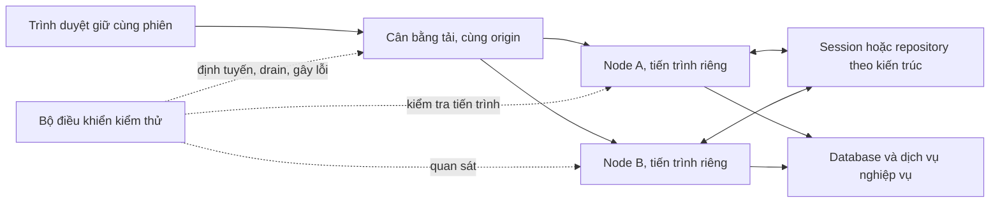

# Kiểm tra khả năng khôi phục execution khi chuyển máy chủ

## 1. Mục tiêu và ý nghĩa của việc khôi phục

Người dùng đang ở bước xem lại hồ sơ trên máy chủ A. A bị dừng hoặc được rút khỏi cụm để triển khai phiên bản mới. Request tiếp theo được máy chủ B tiếp nhận. Câu hỏi cần kiểm chứng là: B có tiếp tục đúng execution đang chạy, với đúng state và dữ liệu đã được ứng dụng xác nhận, hay chỉ mở lại một flow mới?

Trong **SPRING_WEB_FLOW**, một hành trình nhiều bước có trạng thái điều phối riêng: state hiện tại, dữ liệu form, các flow session cha/con và thông tin cần để tiếp tục xử lý event. Có dữ liệu nghiệp vụ trong database chưa đồng nghĩa đã có đủ trạng thái để khôi phục execution đó.

Sau bài học, bạn có thể:

- Xác định những dữ liệu và thành phần phải tồn tại ngoài bộ nhớ node cũ.
- Phân biệt sticky session, sao chép phiên, lưu phiên dùng chung và lưu trạng thái nghiệp vụ.
- Thiết kế phép thử A → B có bằng chứng execution thực sự được khôi phục.
- Kiểm tra serialization, scope, subflow, tương thích phiên bản và lỗi giữa chừng.
- Đo thời gian phục hồi, mức mất trạng thái và chi phí lưu snapshot.
- Nhận diện giới hạn của khóa trong một JVM và kiểm tra tác dụng phụ khi retry hoặc chạy đồng thời.

Bài dùng API Spring Web Flow 3.0.0 làm mốc tham chiếu. Kiến trúc lưu session/repository là lựa chọn của ứng dụng; các ví dụ không mặc định dự án đã có Redis, replication hoặc repository phân tán. Không có thao tác dừng máy chủ, thay cân bằng tải hay kiểm thử cụm thật được thực hiện trong quá trình soạn bài.

## 2. Hợp đồng khôi phục cần nói rõ điều gì?

Trước khi thiết kế test, viết hợp đồng phục hồi cho hành trình. Ví dụ:

```text
Flow: application
Checkpoint cần bảo vệ: reviewApplication
Dữ liệu: draftId, title, draftVersion, operationId
Tình huống: node A mất sau khi response xem lại đã hoàn tất
Request tiếp theo: confirm, được xử lý trên B
Kết quả: tiếp tục cùng cuộc hội thoại, không chạy lại khởi tạo root flow
Tác dụng phụ: một hồ sơ được xác nhận đúng một lần theo khóa nghiệp vụ
Nếu không thể khôi phục: có thông báo và đường phục hồi được quy định
```

Hợp đồng còn cần xác định:

| Thành phần | Điều phải làm rõ |
|---|---|
| Phạm vi lỗi | Dừng node có kiểm soát, crash, mất mạng hay mất kho session |
| Trạng thái được bảo vệ | Những bước và dữ liệu nào đã được xác nhận sẽ còn sau chuyển node |
| Thời gian phục hồi | Đo từ mốc nào tới mốc nào, giới hạn chấp nhận là bao nhiêu |
| Mất trạng thái cho phép | Có được mất thay đổi đã nhận response thành công không? |
| Tương thích phiên bản | Chỉ cùng bản build hay cả cặp phiên bản trong rolling deployment |
| Đồng thời | A và B có thể cùng xử lý execution trong một khoảng thời gian không? |
| Phản hồi không khôi phục được | Khởi động lại, nạp draft từ database hay yêu cầu đăng nhập lại |

Nếu yêu cầu là “khôi phục execution cũ”, việc tự khởi động flow mới rồi nạp lại draft chỉ là một cơ chế phục hồi khác. Nó có thể đáp ứng sản phẩm khi được thiết kế rõ, nhưng không được dùng làm bằng chứng rằng execution ban đầu đã được khôi phục.

## 3. Những gì phải đi theo execution

### 3.1. Execution key chỉ là một phần của đường tra cứu

`FlowExecutionRepository` lưu và khôi phục execution theo key; key không tự chứa đủ mọi dữ liệu để node khác tiếp tục xử lý trong mọi kiến trúc. Node B phải truy cập được nơi lưu trạng thái mà key tham chiếu. Xem [Javadoc FlowExecutionRepository 3.0.0](https://docs.spring.io/spring-webflow/docs/3.0.0/api/org/springframework/webflow/execution/repository/FlowExecutionRepository.html).

Không tự phân tích định dạng key rồi dùng một phần chuỗi làm định danh nghiệp vụ. Đối với kiểm thử, coi key là giá trị do framework tạo và để request tiếp theo gửi lại theo cơ chế của view/adapter đang dùng.

### 3.2. Các lớp trạng thái

| Lớp trạng thái | Ví dụ | Điều phải kiểm tra trên B |
|---|---|---|
| HTTP session và danh tính | Session handle, principal, CSRF context | Request còn được nối đúng người dùng và phiên |
| Conversation/repository | Conversation container, nhóm snapshot, conversation scope | Tìm được cuộc hội thoại và checkpoint cần thiết |
| Flow execution | State, flow scope, view scope cần giữ, stack subflow | Đọc và tiếp tục được hành trình đang chạy |
| Định nghĩa và dịch vụ | Flow XML, state ID, action bean, listener | Có bản tương thích để dựng lại phần runtime |
| Dữ liệu nghiệp vụ | Draft, operation ID, trạng thái đã commit | Không tạo trùng và không mất tính nhất quán |
| Tài nguyên ngoài snapshot | Tệp tải lên, file tạm, dữ liệu ở node cục bộ | Có thể truy cập từ B hoặc có cách dựng lại |

`SessionBindingConversationManager` lưu các conversation trong session attribute map. Nếu dùng cách quản lý này, khả năng chuyển node phụ thuộc cả việc session đó được chia sẻ hoặc sao chép như thế nào. Xem [Javadoc SessionBindingConversationManager](https://docs.spring.io/spring-webflow/docs/3.0.0/api/org/springframework/webflow/conversation/impl/SessionBindingConversationManager.html).

### 3.3. Khôi phục không dừng ở deserialize

Với snapshot dùng Java serialization, dữ liệu đã đọc lại còn cần được nối với định nghĩa flow và các thành phần runtime. `FlowExecutionImplFactory.restoreFlowExecution()` nhận định nghĩa flow, key, conversation scope và bộ định vị subflow để khôi phục phần transient. Conversation scope thường không nằm trong phần serialized execution vì có thể được chia sẻ giữa nhiều bản snapshot của cùng cuộc hội thoại. Xem [Javadoc FlowExecutionImplFactory](https://docs.spring.io/spring-webflow/docs/3.0.0/api/org/springframework/webflow/engine/impl/FlowExecutionImplFactory.html).

Vì vậy, một test gọi `ObjectInputStream.readObject()` thành công chưa chứng minh B đã có execution sẵn sàng nhận event. Cần đi qua cơ chế khôi phục thực tế của repository/executor.

## 4. Đánh giá kiến trúc trước khi kiểm thử

| Kiến trúc | Khi A còn sống | Khi A mất | Kết luận cần kiểm chứng |
|---|---|---|---|
| Session cục bộ, không affinity | Request có thể sang node không có state | Có thể mất execution | Chưa có cơ chế bảo toàn state giữa node |
| Session cục bộ, sticky session | Người dùng thường quay lại A | B có thể không có state | Affinity chưa phải khả năng khôi phục |
| Session replication | B có thể nhận bản sao session | Phụ thuộc độ mới và tính đầy đủ của bản sao | Kiểm tra replication và dữ liệu đã xác nhận |
| Session store dùng chung | Các node có thể đọc cùng session logic | Phụ thuộc kho, serializer và cách lưu cập nhật | Kiểm tra integration và cạnh tranh giữa node |
| Repository tùy chỉnh dùng chung | Trạng thái flow có thể nằm ngoài session | Phụ thuộc triển khai repository | Kiểm tra cả danh tính, conversation và khóa |
| Database chỉ lưu draft | Nạp lại nghiệp vụ được | Có thể phải dựng flow mới | Không mặc định là khôi phục execution cũ |

Sử dụng Spring Session là một phương án tích hợp session, không phải một cờ bật clustering cho mọi cấu hình Web Flow. Ví dụ, tài liệu Spring Session Redis mô tả cơ chế serialization session và namespace riêng của nó; ứng dụng vẫn phải kiểm tra tương thích với object graph lưu trong session. Xem [Spring Session 3.2: Redis Configurations](https://docs.spring.io/spring-session/reference/3.2/configuration/redis.html).

Không yêu cầu mọi hệ thống phải dùng cùng một sản phẩm lưu phiên. Mục tiêu là chứng minh đường đi trạng thái của kiến trúc đã chọn, gồm cả lúc một node không còn bộ nhớ cục bộ.

## 5. Chuẩn bị dữ liệu có thể khôi phục

### 5.1. Giữ model nhỏ và có nghĩa nghiệp vụ

Ví dụ model đơn giản:

```java
package example.webflow;

import java.io.Serial;
import java.io.Serializable;

public final class ApplicationDraft implements Serializable {
    @Serial
    private static final long serialVersionUID = 1L;

    private String draftId;
    private String title;
    private long draftVersion;
    private String operationId;

    public String getDraftId() { return draftId; }
    public void setDraftId(String value) { draftId = value; }

    public String getTitle() { return title; }
    public void setTitle(String value) { title = value; }

    public long getDraftVersion() { return draftVersion; }
    public void setDraftVersion(long value) { draftVersion = value; }

    public String getOperationId() { return operationId; }
    public void setOperationId(String value) { operationId = value; }
}
```

Khai báo biến trong flow có thể dùng:

```xml
<var name="applicationDraft" class="example.webflow.ApplicationDraft"/>
```

Model chứa dữ liệu cần cho hành trình, không giữ connection, request HTTP, thread, stream hoặc service client. Với một model có trường phức tạp, phải kiểm tra cả object graph được tham chiếu; lớp ngoài implements `Serializable` không tự làm mọi phần bên trong tuần tự hóa được.

### 5.2. Kiểm tra từng scope

Với cơ chế mặc định được tài liệu mô tả, dữ liệu trong flow/view/flash scope cần có khả năng serialization tương ứng; conversation scope cũng phải được xem xét khi session được sao chép. Xem [Spring Web Flow: Variable Scopes](https://docs.spring.io/spring-webflow/docs/3.0.x/reference/).

Một bộ dữ liệu thử nên có:

- Một giá trị vừa sửa trong form đã được server xác nhận.
- Một định danh draft ổn định và version của draft.
- Dữ liệu view cần tồn tại khi execution đang pause tại view-state.
- Một thuộc tính conversation được flow cha và subflow cùng dùng.
- Một operation ID dùng cho tác vụ cuối cùng.

Request scope chỉ sống theo request; không dùng dữ liệu ở đó để yêu cầu B tự có lại trong request mới. File tải lên hoặc đường dẫn tạm ở ổ đĩa A cần một chính sách riêng, chẳng hạn lưu ra kho dùng chung và chỉ giữ định danh phù hợp trong model.

Đánh dấu một trường `transient` có thể làm serialization hết lỗi nhưng dữ liệu đó sẽ không tự tồn tại sau khôi phục. Chỉ dùng khi đã có đường dựng lại phù hợp và test chứng minh nó hoạt động. Không giả định mọi trường transient sẽ được autowire lại trong mọi loại object.

### 5.3. Có thể có hai lớp serialization

Một snapshot execution có thể đã được Java-serialize thành dữ liệu bên trong một session attribute; sau đó session store lại serialize attribute đó theo cơ chế khác. Đổi serializer của session sang JSON không mặc nhiên thay đổi cách snapshot Web Flow bên trong được tạo.

`SerializedFlowExecutionSnapshotFactory` tạo snapshot bằng Java serialization và có bước restore riêng. Xem [Javadoc SerializedFlowExecutionSnapshotFactory 3.0.0](https://docs.spring.io/spring-webflow/docs/3.0.0/api/org/springframework/webflow/execution/repository/snapshot/SerializedFlowExecutionSnapshotFactory.html).

Khi lỗi deserialize xuất hiện, xác định nó xảy ra ở lớp session, snapshot hay dữ liệu nghiệp vụ được tải lại. Không đổi serializer hàng loạt trước khi biết lớp nào thất bại.

## 6. Môi trường kiểm thử A → B



Điều kiện chuẩn bị:

1. A và B là hai tiến trình độc lập; không chia sẻ một static map hoặc heap của test runner.
2. Các node chạy cùng bản build trong phép thử cơ sở và có cấu hình tương thích.
3. Trình duyệt truy cập qua một origin công khai ổn định, giữ cookie và cơ chế postback thực tế.
4. Có cách quan sát node xử lý request, bản build và mã tương quan.
5. Có cách buộc request sang B và chứng minh A đã bị rút khỏi đường phục vụ.
6. Có dữ liệu thử tách biệt để đối chiếu draft, operation ID và tác dụng phụ.

Có thể quan sát node bằng log hoặc một response header được môi trường kiểm thử thêm vào. Không cần đưa tên node, execution key hoặc state nội bộ lên màn hình sản phẩm.

Không đổi URL trình duyệt từ host A sang host B một cách tùy tiện: cookie domain, path, TLS và CSRF có thể thay đổi, khiến test đo sai vấn đề. Nếu cố ý kiểm tra truy cập trực tiếp node, phải bảo toàn ngữ cảnh HTTP tương đương và ghi rõ giới hạn của phép thử đó.

## 7. Phép thử cơ sở: khôi phục execution đang pause

### 7.1. Checkpoint nghiệp vụ

Ví dụ hành trình:

```text
enterApplicationDetails
  next → reviewApplication
reviewApplication
  edit → enterApplicationDetails
  confirm → confirmApplication → done
```

Dữ liệu thử:

```text
draftId = draft-failover-17
title = Hồ sơ kiểm tra chuyển node
draftVersion = 7
operationId = confirm-draft-failover-17
```

Đây là giá trị minh họa. Một bộ test chạy song song phải tạo ID riêng cho từng lần chạy, không dùng chung bản ghi cố định.

### 7.2. Trình tự thực hiện

1. Định tuyến phiên thử sang A, mở flow mới và xác nhận request khởi tạo được A xử lý.
2. Nhập dữ liệu, gửi `next`, nhận trang xem lại và xác nhận dữ liệu hiển thị đúng.
3. Ghi checkpoint từ phía server: cuộc hội thoại logic, active flow/state, version dữ liệu và số lần khởi tạo root flow.
4. Với phép thử “đã lưu ổn định”, chờ điều kiện kho đã ghi bản checkpoint cần thiết bằng tín hiệu quan sát có timeout.
5. Rút A khỏi đường phục vụ hoặc dừng A theo kịch bản; xác nhận request tiếp theo chỉ tới B.
6. Giữ cùng browser context và view hiện có, gửi một event của execution đang pause, chẳng hạn `edit`.
7. Xác nhận B tiếp tục đúng cuộc hội thoại và đưa về bước nhập với dữ liệu/version mong đợi.
8. Sửa thêm dữ liệu, gửi `next` lần nữa và kiểm tra checkpoint mới được B lưu.
9. Kết thúc hành trình và đối chiếu tác dụng phụ nghiệp vụ.

Bước 8 quan trọng: đọc được một checkpoint trên B chưa chứng minh B ghi được lần cập nhật tiếp theo. Với session store có cơ chế phát hiện thay đổi, phải kiểm tra cả sửa thuộc tính lồng nhau và việc cập nhật đó thực sự tới nơi lưu dùng chung.

### 7.3. Assertion để tránh kết quả dương giả

| Assertion | Vì sao cần? |
|---|---|
| Request trước lỗi do A xử lý, request sau do B xử lý | Loại trừ test chưa thực sự chuyển node |
| Cùng cuộc hội thoại logic | Loại trừ flow mới được khởi tạo âm thầm |
| Không tăng số lần khởi tạo root ngoài dự kiến | Phát hiện fallback restart |
| State nguồn và transition sau resume đúng | Chứng minh tiếp tục đúng điểm |
| Draft ID, giá trị và version đúng | Phát hiện bản session/snapshot cũ |
| Subflow stack đúng nếu đang trong flow con | Phát hiện chỉ root flow được bảo toàn |
| B lưu được thay đổi mới | Phát hiện integration chỉ đọc được state |
| Dịch vụ/dữ liệu không bị thực hiện trùng | Kiểm tra an toàn nghiệp vụ khi tiếp tục |

Không chỉ so sánh nguyên chuỗi execution key trước và sau mọi thao tác. Framework có thể sinh key mới theo checkpoint; điều cần chứng minh là request nối đúng cuộc hội thoại và lịch sử trạng thái theo hợp đồng, không phải key luôn giữ nguyên.

## 8. Tự động hóa phép thử bằng harness hạ tầng

Bộ điều khiển hạ tầng nên tách khỏi logic nghiệp vụ. Đoạn sau là **mã giả**, tên hàm mô tả các khả năng mà bộ test phải cung cấp; đây không phải API có sẵn của Spring Web Flow, Playwright hay một dịch vụ cluster.

```text
test restore_paused_execution_on_another_node:
    cluster.routeTestSessionTo(A)
    browser.openFlow("application")
    browser.fillDraft(uniqueDraftId, title, version)
    browser.signal("next")
    browser.expectView("reviewApplication")

    checkpoint = diagnostics.observeCurrentConversation()
    assert checkpoint.servedBy == A
    assert checkpoint.state == "reviewApplication"
    assert checkpoint.draftVersion == expectedVersion
    assert checkpoint.rootStartCount == 1

    storage.awaitCheckpointVisible(checkpoint, timeout)
    cluster.stopNode(A)
    cluster.awaitNodeUnavailable(A, timeout)
    cluster.routeTestSessionTo(B)

    browser.signal("edit")
    browser.expectView("enterApplicationDetails")

    restored = diagnostics.observeCurrentConversation()
    assert restored.servedBy == B
    assert restored.conversation == checkpoint.conversation
    assert restored.rootStartCount == 1
    assert restored.draftVersion == checkpoint.draftVersion
    assert browser.currentTitle() == title

    browser.changeTitle(updatedTitle)
    browser.signal("next")
    storage.awaitUpdatedDraftVersion(timeout)
    assert diagnostics.latestTitle() == updatedTitle
```

Khi triển khai harness, xác định tín hiệu nào chứng minh checkpoint đã nhìn thấy ở B: đọc bản ghi được lưu, version được replication xác nhận hoặc một phép quan sát tương đương. Chỉ đợi một số giây cố định không tạo ra bằng chứng về tính bền vững.

Harness cần có timeout hữu hạn và cleanup theo chính lần chạy. Nếu bước resume thất bại, giữ trace và log đủ để phân loại lỗi rồi mới giải phóng dữ liệu thử; không tự khởi động flow mới để làm test đi tiếp như thể khôi phục đã thành công.

## 9. Tách chuyển node ổn định khỏi crash ngay sau response

Một phép thử luôn chờ replication xong trước khi gây lỗi chỉ chứng minh trường hợp checkpoint đã ổn định. Nó có thể che mất cửa sổ mất dữ liệu của hệ thống.

Cần ít nhất các trường hợp riêng:

| Kịch bản | Điểm gây lỗi | Câu hỏi |
|---|---|---|
| Chuyển có kiểm soát | Sau khi checkpoint được xác nhận đã lưu | B có khôi phục được dữ liệu ổn định không? |
| Crash sau response | Ngay sau response mà người dùng đã nhận | Có mất thay đổi vừa được xác nhận không? |
| Crash khi đang lưu | Giữa cập nhật execution và hoàn tất lưu session | Kho có trạng thái thiếu hoặc cũ không? |
| Crash sau commit nghiệp vụ | Đã commit nhưng phản hồi chưa tới client | Retry có tạo trùng không? |
| Mất node khi ở subflow | Flow con đang pause | Stack cha/con và input/output có còn đúng không? |
| Mất kho session | Kho không truy cập được | Ứng dụng suy giảm và phục hồi theo chính sách nào? |

Trong kịch bản crash sau response, không thêm bước chờ đồng bộ trước lỗi chỉ để làm kết quả ổn định. Ghi nhận tính ngẫu nhiên của cửa sổ race và chạy số lần phù hợp với mục tiêu kiểm thử, nhưng không thay thế việc hiểu cơ chế ghi của hạ tầng bằng thử đi thử lại.

Drain cũng cần được mô tả chính xác. Hoàn tất request đang chạy trên A chưa có nghĩa mọi flow đã kết thúc, vì người dùng có thể dừng ở view-state nhiều phút. Khả năng tiếp tục các flow đó vẫn cần cơ chế bảo toàn trạng thái hoặc chính sách duy trì phiên cũ tới khi chúng hết hạn/kết thúc.

## 10. Serialization và tương thích phiên bản

### 10.1. Kiểm thử từ lớp nhỏ tới cụm thật

Ba lớp kiểm tra bổ sung cho nhau:

1. Kiểm tra model và object graph với dữ liệu đại diện để phát hiện tham chiếu không serialize được.
2. Kiểm tra repository thực tế: tạo execution, pause, lưu, khôi phục và resume.
3. Kiểm tra hai tiến trình với session/repository, định tuyến và serializer thật của môi trường mục tiêu.

Test lớp đầu nhanh nhưng không thay cho lớp sau. Test trong cùng JVM có thể dùng chung bean, classloader, static cache hoặc lock mà B trong một tiến trình khác không có.

### 10.2. Rolling deployment cần ma trận phiên bản

| Node tạo checkpoint | Node khôi phục | Điều cần chứng minh |
|---|---|---|
| v1 | v1 | Khôi phục cơ sở cùng bản build |
| v1 | v2 | Phiên mới đọc được state phiên cũ nếu hợp đồng cho phép |
| v2 | v1 | Khả năng rollback hoặc định tuyến ngược nếu có trong kế hoạch |
| v1/v2 | Kho lưu chung | Namespace, serializer và dạng dữ liệu còn tương thích |

Các thay đổi cần chú ý gồm đổi tên class model, field, serial form, state ID, flow ID, subflow ID, biểu thức và action bean. Cùng một `serialVersionUID` không bảo đảm ý nghĩa nghiệp vụ còn tương thích; deserialize thành công vẫn có thể tạo dữ liệu mặc định sai hoặc state không còn trong định nghĩa flow mới.

Nếu không bảo đảm tương thích giữa hai phiên bản, cần một chính sách rõ: giữ session cũ trên nhóm node cũ, drain theo vòng đời hội thoại, phân phiên bản flow hoặc khởi động lại có hướng dẫn theo yêu cầu sản phẩm. Khi tách namespace hoặc cụm phiên, phải bảo đảm routing hiểu phiên đó thuộc đâu; tách kho một mình có thể làm node mới không tìm thấy session.

### 10.3. Bean và listener sau khôi phục

Trên B, action/service cần hoạt động bằng cấu hình và tài nguyên của B. Không mang theo connection hay client sống của A trong model. Đối với listener, kiểm tra hành vi sau resume: quyền, quan sát và các tài nguyên được thiết lập lại theo cấu hình, thay vì chỉ kiểm tra biến form còn nguyên.

Nếu sử dụng Faces, còn cần kiểm tra trạng thái view và postback theo cơ chế lưu view của runtime. Nếu có Ajax, request tiếp theo trên B phải được xử lý và render đúng, không chỉ một GET đầy trang thành công.

## 11. Khóa cục bộ và cạnh tranh giữa hai node

Session dùng chung không tự biến mọi khóa trong ứng dụng thành khóa phân tán. `JdkConcurrentConversationLock` dựa trên `ReentrantLock`, nên đó là cơ chế khóa trong phạm vi JVM chứa đối tượng khóa; xem [Javadoc JdkConcurrentConversationLock](https://docs.spring.io/spring-webflow/docs/3.0.0/api/org/springframework/webflow/conversation/impl/JdkConcurrentConversationLock.html).

Nếu A và B cùng đọc hai bản session logic rồi xử lý một execution, cần kiểm tra kiến trúc có thực sự điều phối các request đó không. Việc serialize một đối tượng lock không làm hai JVM cùng chia sẻ một cơ chế khóa đang hoạt động.

Phép thử cạnh tranh nên điều khiển hai request tới cùng điểm bằng barrier hoặc latch của môi trường test:

```text
A nhận confirm của draft D, operation O.
B cũng nhận confirm của draft D, operation O.
Cho hai request tiếp tục tại điểm đã chọn.
Đối chiếu:
  - số hồ sơ được ghi;
  - trạng thái/version cuối;
  - kết quả mỗi request;
  - số thông báo hoặc giao dịch ngoài được tạo.
```

Khóa repository, nếu có, và tính không tạo trùng của tác vụ nghiệp vụ là hai lớp bảo vệ khác nhau. Với tác vụ quan trọng, đặt quy tắc chống trùng tại ranh giới dữ liệu/dịch vụ phù hợp, chẳng hạn operation ID có ràng buộc duy nhất hoặc kiểm tra version theo thiết kế.

Không kết luận “chỉ có một request thành công” nếu request còn lại timeout nhưng đã ghi dữ liệu. Phải đối chiếu dữ liệu bền vững và kết quả của hệ thống ngoài.

## 12. Mất execution và khôi phục nghiệp vụ an toàn

Nếu snapshot hết hạn, bị loại khỏi giới hạn lưu hoặc phiên không còn hợp lệ, B có thể không tìm thấy execution dù hạ tầng chuyển node hoạt động đúng. Đây là kịch bản khác với “B không đọc được session còn hiệu lực”.

`DefaultFlowExecutionRepository` hỗ trợ snapshot và các giới hạn lưu; cấu hình tắt tạo bản sao snapshot cũng làm giả định về lịch sử thay đổi. Xem [Javadoc DefaultFlowExecutionRepository](https://docs.spring.io/spring-webflow/docs/3.0.0/api/org/springframework/webflow/execution/repository/impl/DefaultFlowExecutionRepository.html).

Ví dụ cấu hình giới hạn, không phải bật replication:

```xml
<webflow:flow-executor id="flowExecutor" flow-registry="flowRegistry">
    <webflow:flow-execution-repository
        max-executions="5"
        max-execution-snapshots="10"/>
</webflow:flow-executor>
```

Các số là ví dụ để kiểm thử hành vi giới hạn. Chúng không khẳng định phù hợp tải hoặc hành vi back của mọi ứng dụng.

Khi không khôi phục được, xác minh ứng dụng:

- Nhận diện đúng lỗi và đưa ra kết quả đã được thiết kế.
- Không lấy một draft khác của người dùng hoặc của execution khác để tiếp tục nhầm.
- Không âm thầm lặp tác vụ đã commit trước đó.
- Có thể nạp lại draft bền vững nếu sản phẩm cho phép, với quyền truy cập được kiểm tra lại.
- Phân biệt rõ việc bắt đầu lại hành trình với việc tiếp tục execution gốc.

Nếu A commit thành công rồi mất phản hồi, không dùng snapshot cũ để suy rằng nghiệp vụ chưa xảy ra. Retry phải kiểm tra kết quả theo khóa nghiệp vụ ổn định; flow scope không phải nguồn duy nhất quyết định dữ liệu nào đã commit.

## 13. Đo khả năng phục hồi và chi phí vận hành

### 13.1. Các chỉ số cần tách biệt

| Chỉ số | Cách hiểu |
|---|---|
| Thời gian chuyển phục vụ | Từ mốc gây lỗi tới request hợp lệ đầu tiên được B phục vụ |
| Độ trễ restore | Thời gian đọc và dựng lại execution trên node nhận |
| Độ trễ request đầu sau chuyển | Bao gồm routing, restore, action và render |
| Mức mất trạng thái | Version/nội dung đã xác nhận trước lỗi so với sau restore |
| Tỷ lệ tiếp tục đúng | Số lần resume đúng execution và dữ liệu trên tổng lần chuyển thuộc phạm vi |
| Tỷ lệ restart/fallback | Số lần phải mở lại flow thay vì restore execution |
| Chi phí lưu | Kích thước session/snapshot, thời gian serialize và lưu kho |
| Tác dụng phụ trùng | Số thao tác nghiệp vụ bị thực hiện lặp sau lỗi/retry |

Nếu dùng thuật ngữ RTO và RPO, định nghĩa rõ phạm vi đo là trạng thái cuộc hội thoại hay dữ liệu nghiệp vụ. RPO của database bằng không không tự chứng minh thay đổi form vừa được server xác nhận vẫn còn sau mất node.

Đo cả request đầu trên B và các request tiếp theo. B có thể chịu thêm chi phí khởi tạo cache/template hoặc kết nối, trong khi restore chỉ là một phần tổng độ trễ.

### 13.2. Ước lượng dung lượng

Một mô hình gần đúng cho phần snapshot:

```text
Dung lượng snapshot logic
  ≈ số phiên đang hoạt động
    × số execution trung bình mỗi phiên
    × số snapshot được giữ trung bình mỗi execution
    × kích thước snapshot trung bình
```

Sau đó tính thêm conversation scope, metadata, object graph khác của session, index, overhead serializer và hệ số sao chép của kho. Đây là ước lượng dung lượng, không phải công thức chính xác cho mọi repository; một số phần có thể được chia sẻ hoặc được mã hóa khác nhau.

Đo với form nhỏ, form lớn, danh sách kết quả, subflow và tệp đính kèm theo chính sách thật. Không chỉ đo một DTO có hai trường rồi ngoại suy cho mọi hành trình.

### 13.3. Quan sát mà không làm phình hệ thống metrics

Log chẩn đoán có thể chứa mã tương quan đã được bảo vệ, node, bản build, flow/state và loại lỗi restore. Metrics nên dùng nhãn có số lượng giá trị kiểm soát được, chẳng hạn flow và loại kết quả; tránh dùng raw session ID, execution key hoặc draft ID làm nhãn cho mọi request.

Báo cáo thử nghiệm cần ghi topology, bản build, serializer, cấu hình lưu, điểm gây lỗi, checkpoint/version, node trước/sau và tác dụng phụ. Không kết luận đạt chỉ bằng một screenshot trang trên B.

## 14. Bảng chẩn đoán thất bại

| Dấu hiệu | Hướng kiểm tra |
|---|---|
| B mở lại flow từ đầu | Có fallback restart, thiếu conversation hoặc session không được nối đúng |
| B không tìm thấy key | Kho lưu, namespace, TTL, giới hạn execution/snapshot, cookie và routing |
| B thấy dữ liệu cũ | Độ trễ replication, thời điểm flush, phát hiện thay đổi attribute, ghi đè cạnh tranh |
| Deserialize lỗi | Classpath, phiên bản model, serializer hoặc graph không tương thích |
| Đọc được nhưng resume lỗi | Định nghĩa state/subflow, action bean và phần transient chưa khôi phục đúng |
| Root đúng nhưng subflow mất | Stack session, registry flow con và conversation scope |
| Chỉ cùng phiên bản mới chạy | Tương thích rolling deployment chưa đạt |
| A → B được nhưng B → A lỗi | Cấu hình hai node lệch hoặc lưu thay đổi trên B chưa đúng |
| Hai request tạo trùng dữ liệu | Khóa chỉ có hiệu lực cục bộ hoặc thiếu bảo vệ nghiệp vụ |
| Lần đầu ổn, sau tải lớn lỗi | Dung lượng session, TTL, eviction, băng thông và độ trễ kho |
| Cookie giữ nguyên nhưng sai người dùng | Sai cách gắn phiên/danh tính hoặc dữ liệu dùng chung ngoài scope |

Cookie không bắt buộc giữ nguyên từng byte trong mọi kiến trúc: cơ chế bảo mật có thể xoay session ID. Assertion đúng là cùng danh tính và cuộc hội thoại theo cơ chế hợp lệ, không phải ép runtime không được xoay ID.

## 15. Bài thực hành và tiêu chí hoàn thành

Thực hiện trong môi trường thử nghiệm có hai node độc lập:

1. Tạo hành trình có ít nhất hai view-state, một model có version và một operation ID.
2. Chứng minh trường hợp sticky session với state chỉ nằm trên A chưa bảo đảm restore khi A mất.
3. Thiết lập hoặc dùng cơ chế bảo toàn session/repository của môi trường, rồi chạy phép thử checkpoint ổn định A → B.
4. Kiểm tra B ghi thay đổi mới, sau đó thử chuyển tiếp B → A hoặc tới một tiến trình mới.
5. Chạy kịch bản đang pause trong subflow và kịch bản có Ajax/Faces nếu ứng dụng dùng.
6. Chạy crash ngay sau response, tách khỏi phép thử đã chờ checkpoint ổn định.
7. Kiểm thử commit thành công nhưng mất phản hồi và xác nhận retry không tạo trùng.
8. Nếu có rolling deployment, chạy từng chiều phiên bản mà kế hoạch vận hành cho phép.

Tiêu chí chấp nhận:

- Có bằng chứng request đã chuyển sang tiến trình khác, không chỉ đổi tên node trong test.
- Execution được tiếp tục đúng hoặc fallback được báo cáo đúng loại; không trộn hai kết quả.
- State, dữ liệu đã xác nhận, version và stack subflow được kiểm tra theo phạm vi.
- Session/repository và phần runtime cần thiết được khôi phục qua đường thực tế.
- Có kiểm tra lần ghi tiếp theo trên node mới.
- Có kiểm tra cạnh tranh hoặc ghi rõ phần đó chưa được bao phủ.
- Tác dụng phụ nghiệp vụ không bị nhân đôi trong những kịch bản đã cam kết.
- Báo cáo nêu rõ topology, phiên bản, điểm gây lỗi và giới hạn thời gian/mất trạng thái đã kiểm chứng.

Khả năng chuyển máy chủ của một flow là kết quả phối hợp giữa trạng thái hội thoại, kho lưu, định tuyến, phiên bản ứng dụng và quy tắc nghiệp vụ. Chỉ khi node mới tiếp tục đúng hành trình và giữ đúng những gì người dùng đã được xác nhận, phép thử mới chứng minh được khả năng phục hồi execution theo hợp đồng đã đặt ra.