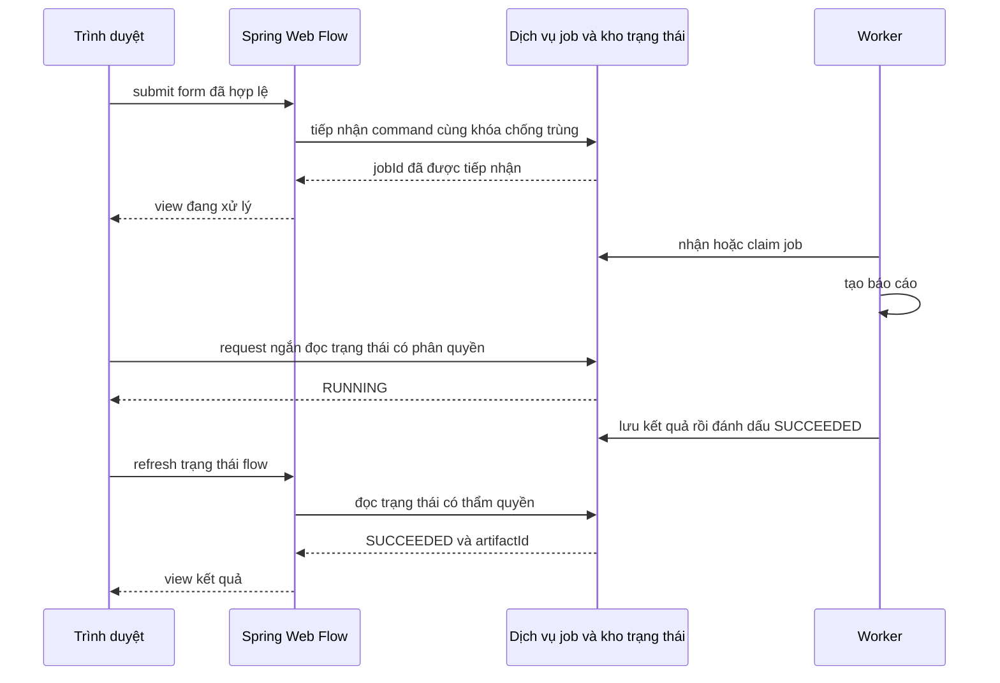
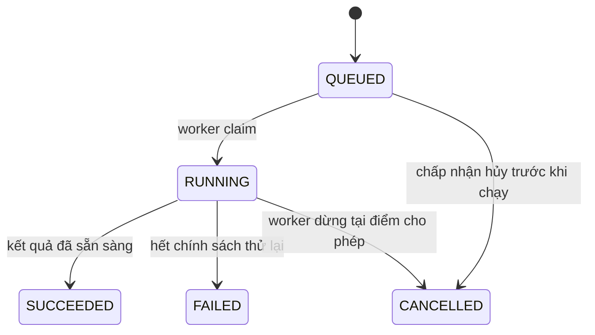

# Tách tác vụ lâu chạy khỏi thời gian xử lý một yêu cầu

## 1. Vấn đề không chỉ là người dùng phải chờ

Trong một hành trình Spring Web Flow, người dùng chọn khoảng ngày, xác nhận bộ lọc rồi yêu cầu tạo báo cáo đặt phòng. Nếu action tạo báo cáo mất vài phút và chạy ngay trong request xác nhận, toàn bộ request phải chờ đến khi xử lý xong.

Trong thời gian đó, ứng dụng có thể giữ thread phục vụ HTTP, tài nguyên kết nối và khóa bảo vệ flow execution. Khi người dùng bấm lại hoặc có nhiều yêu cầu tương tự, hệ thống vừa tăng thời gian phản hồi vừa khó phân biệt công việc đang chạy với yêu cầu bị gửi trùng.

Bài này thuộc chương **Hiệu năng và vận hành** của module **SPRING_WEB_FLOW**. Mục tiêu là tách vòng đời tác vụ khỏi một lần tương tác web: request ngắn nhận yêu cầu, tác vụ nền thực hiện công việc, các request sau đọc trạng thái và tiếp tục flow.

Ví dụ dùng mô hình tạo báo cáo. Các đoạn Java minh họa JDK 17 và các API Spring phổ biến; nhận xét về khóa và request context dựa trên Spring Web Flow **3.0.1**. Mã là các phần ghép nối kiến trúc, không phải ứng dụng hoàn chỉnh với database, broker và template đã triển khai.

## 2. Vì sao action lâu chạy làm flow khó vận hành?

Trong triển khai `FlowExecutorImpl` 3.0.1, đường resume lấy khóa repository trước khi đọc execution, gọi `resume` rồi lưu hoặc xóa execution; khóa được nhả trong `finally`. Vì thế, nếu action chạy lâu trong lần resume, thời gian nằm trong vùng bảo vệ cũng có thể kéo dài. Xem [FlowExecutorImpl](https://raw.githubusercontent.com/spring-projects/spring-webflow/v3.0.1/spring-webflow/src/main/java/org/springframework/webflow/executor/FlowExecutorImpl.java).

Phạm vi và cách phối hợp khóa còn phụ thuộc repository/conversation manager; không suy ra mọi ứng dụng đều có cùng mức khóa hoặc cùng hành vi giữa các node. Điều cần đo là thời gian xử lý thực tế và thời gian chờ khóa của cấu hình đang dùng.

Những cách sau vẫn buộc request chờ tác vụ:

```java
// Vẫn chờ kết quả ngay trong action.
Report result = reportService.buildReport(command);

// Đã đưa sang thread khác nhưng lại chờ nó xong trong request hiện tại.
Report resultFromFuture = reportExecutor.submit(
        () -> reportService.buildReport(command)).get();
```

Tương tự, gọi `join()`, `Thread.sleep()` trong vòng lặp kiểm tra hoặc đợi latch trong action chỉ đổi hình thức chờ. Tăng HTTP timeout có thể giảm số lần bị ngắt giữa chừng, nhưng không làm request ngắn hơn hoặc giảm tải công việc.

### Ước lượng đơn giản để nhận ra rủi ro

Giả sử có 6 yêu cầu tạo báo cáo mỗi giây và mỗi báo cáo mất trung bình 20 giây. Trong trạng thái ổn định, số công việc đang được xử lý/chờ phản hồi có thể ở cỡ:

```text
6 yêu cầu/giây × 20 giây = 120 yêu cầu đang tồn tại
```

Đây là ước lượng minh họa từ tốc độ đến và thời gian trung bình, không phải kích thước thread pool được khuyến nghị. Sau khi tách nền, 120 công việc không tự biến mất; chúng được quản lý ở tầng job/worker thay vì buộc 120 request tương ứng chờ hoàn tất.

## 3. Mô hình tiếp nhận, thực thi và quan sát kết quả



Một hệ thống có thể dùng polling ngay qua flow hoặc một endpoint Spring MVC riêng. Sơ đồ kết hợp endpoint chỉ đọc để cập nhật giao diện và event flow để điều hướng. Worker không tự sửa `flowScope` hoặc giữ một HTTP request mở đến khi làm xong.

### Hai vòng đời tách biệt

| Vòng đời flow | Vòng đời job |
| --- | --- |
| Gắn với hành trình và phiên tương tác | Gắn với công việc đã được tiếp nhận |
| Có thể hết hạn hoặc bị người dùng rời bỏ | Có thể tiếp tục nếu chính sách cho phép |
| Giữ form, `jobId` và trạng thái phục vụ hiển thị | Giữ command, chủ sở hữu, trạng thái, lần thử và kết quả |
| Chuyển state khi xử lý event trong request | Thay đổi khi worker claim, chạy và kết thúc |

Không dùng execution key của flow làm định danh bền vững duy nhất cho job. Execution key phục vụ việc tiếp tục flow; job cần ID và chính sách tra cứu riêng.

## 4. Hợp đồng cần chốt trước khi viết worker

Với ví dụ tạo báo cáo, một job có thể đi qua các trạng thái:



Đây là mô hình đề xuất cho ứng dụng, không phải tập state dựng sẵn của Spring Web Flow. Nếu có retry, trạng thái nội bộ có thể thêm `RETRY_WAIT` hoặc lần thử riêng. Không đưa trạng thái FAILED ra giao diện như kết thúc cuối cùng khi hệ thống vẫn đang tự retry.

Các thuộc tính tối thiểu thường cần có:

| Dữ liệu | Mục đích |
| --- | --- |
| `jobId` | Định danh công việc |
| `ownerId` và tenant nếu có | Kiểm soát ai được đọc, hủy và lấy kết quả |
| Loại job và command đã chụp | Xác định công việc cần làm, không phụ thuộc form đang bị sửa |
| Khóa chống trùng và dấu vết payload | Nhận diện việc gửi lại cùng một ý định |
| Trạng thái, version, timestamps | Cập nhật có điều kiện, điều tra và đo thời gian |
| Attempt, lease/heartbeat nếu cần | Phát hiện worker chết và kiểm soát việc xử lý lại |
| `artifactId` hoặc mã lỗi ổn định | Trả kết quả/giải thích thất bại mà không giữ exception trong flow |

Chỉ trả “đã tiếp nhận” khi hệ thống đã đạt mức cam kết mà sản phẩm định nghĩa. Với job cần sống qua restart, lời cam kết đó thường đòi hỏi trạng thái hoặc thông điệp đã được lưu bền vững, không chỉ có một `Runnable` trong RAM.

## 5. Một lớp nối giữa flow và dịch vụ job

### 5.1. Command là dữ liệu bất biến

Không truyền nguyên model mutable đang nằm trong flow sang worker. Chụp dữ liệu thành command, tách các lựa chọn cần thiết khỏi request context và các tài nguyên đang mở.

Ví dụ hợp đồng Java; mỗi kiểu public đặt trong file riêng khi triển khai:

```java
package example.reports;

import java.io.Serializable;
import java.time.LocalDate;

public record ReportCommand(Long hotelId, LocalDate fromDate,
                            LocalDate toDate) implements Serializable {
}
```

```java
package example.reports;

public enum JobState {
    QUEUED, RUNNING, SUCCEEDED, FAILED, CANCELLED
}
```

```java
package example.reports;

import java.io.Serializable;
import java.util.UUID;

public record JobSnapshot(UUID jobId, JobState state,
                          String artifactId, String failureCode)
        implements Serializable {
}
```

```java
package example.reports;

import java.util.UUID;

public interface ReportJobs {
    UUID submit(ReportCommand command, String ownerId,
                String idempotencyKey);

    JobSnapshot findOwned(UUID jobId, String ownerId);
}
```

`submit` ở đây có hợp đồng: xác thực command/quyền, tiếp nhận công việc nhanh, chống trùng theo owner và khóa, trả lại cùng job khi cùng ý định được gửi lại. Nó không chờ tạo báo cáo. `findOwned` phải kiểm tra quyền sở hữu trên máy chủ, không chỉ tìm theo UUID.

Nếu command có collection, record chỉ làm tham chiếu field bất biến; vẫn cần sao chép và kiểm soát phần tử để tránh worker đọc dữ liệu đã bị thay đổi.

### 5.2. Action chỉ tiếp nhận hoặc đọc trạng thái

Đoạn dưới giả định ứng dụng có `ReportForm` với `toCommand()`, bean service `ReportJobs`, và hai exception nghiệp vụ `JobCapacityExceededException`, `JobNotVisibleException`. Form được bind và validate ở bước edit; `toCommand()` tạo một command mới. Các kiểu và kho job này là thành phần ứng dụng cần triển khai, không phải API của Web Flow.

```java
package example.reports;

import java.util.UUID;
import org.springframework.binding.message.MessageBuilder;
import org.springframework.webflow.execution.RequestContext;

public final class ReportJobActions {
    private final ReportJobs jobs;

    public ReportJobActions(ReportJobs jobs) {
        this.jobs = jobs;
    }

    public String submit(ReportForm form, String ownerId,
                         RequestContext context) {
        String key = (String) context.getFlowScope().get("submissionKey");
        try {
            UUID jobId = jobs.submit(form.toCommand(), ownerId, key);
            context.getFlowScope().put("jobId", jobId.toString());
            return "accepted";
        } catch (JobCapacityExceededException ex) {
            context.getMessageContext().addMessage(new MessageBuilder()
                    .error()
                    .code("report.capacity.exceeded")
                    .defaultText("Hệ thống đang bận, vui lòng thử lại sau")
                    .build());
            return "busy";
        }
    }

    public String check(String jobId, String ownerId,
                        RequestContext context) {
        final JobSnapshot snapshot;
        try {
            snapshot = jobs.findOwned(UUID.fromString(jobId), ownerId);
        } catch (JobNotVisibleException ex) {
            return "missing";
        }
        context.getFlowScope().put("jobStatus", snapshot);

        return switch (snapshot.state()) {
            case QUEUED, RUNNING -> "pending";
            case SUCCEEDED -> "ready";
            case FAILED -> "failed";
            case CANCELLED -> "cancelled";
        };
    }
}
```

`RequestContext` chỉ được dùng trong lời gọi action hiện tại để ghi ID/trạng thái và thông điệp. Nó không được truyền xuống `jobs.submit` hay capture trong tác vụ nền. Các field được đưa vào flow đều là dữ liệu nhỏ, không phải `Future`, executor hoặc đối tượng worker.

Trong Spring Web Flow 3.0.1, [RequestContextHolder](https://raw.githubusercontent.com/spring-projects/spring-webflow/v3.0.1/spring-webflow/src/main/java/org/springframework/webflow/execution/RequestContextHolder.java) gắn context với thread hiện tại và không kế thừa nó sang thread con. Dù tự truyền được một tham chiếu Java, việc đó vẫn không tạo ra quyền sửa execution an toàn ngoài request.

`busy` trong hợp đồng này nghĩa là công việc chưa được tiếp nhận. Nếu submit thất bại ở mức mạng và chưa biết server đã commit hay chưa, cần tra cứu/gửi lại bằng cùng khóa chống trùng; không đổi sang khóa mới rồi mặc định job cũ chưa tồn tại.

## 6. Mô hình hóa trang chờ bằng state và event

Flow dưới dùng các bean/model của ứng dụng đã nêu. Giả định có tích hợp Spring MVC, đăng nhập, view resolver, Bean Validation provider và cấu hình validator thích hợp. `currentUser.name` phải là định danh chủ thể phù hợp với chính sách tài khoản của ứng dụng; hệ thống nhiều tenant cần truyền/xác định thêm tenant phía máy chủ.

```xml
<flow xmlns="http://www.springframework.org/schema/webflow"
      xmlns:xsi="http://www.w3.org/2001/XMLSchema-instance"
      xsi:schemaLocation="
        http://www.springframework.org/schema/webflow
        https://www.springframework.org/schema/webflow/spring-webflow.xsd">

    <var name="reportForm" class="example.reports.ReportForm"/>

    <on-start>
        <set name="flowScope.submissionKey"
             value="T(java.util.UUID).randomUUID().toString()"/>
    </on-start>

    <view-state id="edit" model="reportForm">
        <binder>
            <binding property="hotelId"/>
            <binding property="fromDate"/>
            <binding property="toDate"/>
        </binder>
        <transition on="submit" to="submitJob"/>
    </view-state>

    <action-state id="submitJob">
        <evaluate expression="reportJobActions.submit(
                    reportForm, currentUser.name, flowRequestContext)"/>
        <transition on="accepted" to="waiting"/>
        <transition on="busy" to="edit"/>
    </action-state>

    <view-state id="waiting">
        <transition on="refresh" to="checkJob"
                    bind="false" validate="false"/>
        <transition on="leave" to="detached"
                    bind="false" validate="false"/>
    </view-state>

    <action-state id="checkJob">
        <evaluate expression="reportJobActions.check(
                    flowScope.jobId, currentUser.name, flowRequestContext)"/>
        <transition on="pending" to="waiting"/>
        <transition on="ready" to="result"/>
        <transition on="failed" to="failed"/>
        <transition on="cancelled" to="cancelled"/>
        <transition on="missing" to="unavailable"/>
    </action-state>

    <view-state id="result">
        <transition on="finish" to="finished"/>
    </view-state>

    <view-state id="failed">
        <transition on="leave" to="detached"/>
    </view-state>

    <end-state id="finished"/>
    <end-state id="detached"/>
    <end-state id="cancelled"/>
    <end-state id="unavailable"/>
</flow>
```

Flow chỉ chờ tương tác tiếp theo tại `waiting`; không có thread Java chạy vòng lặp để giữ nó ở đó. Khi worker đổi trạng thái job, flow không tự nhảy state. Một request mới gửi event `refresh`, action đọc trạng thái có thẩm quyền rồi quyết định transition.

`leave` nghĩa là rời hành trình web và có thể quay lại tra cứu job qua chức năng khác. Nó không gửi yêu cầu hủy công việc. Nếu giao diện cần nút hủy, phải thêm lệnh hủy riêng và phản ánh rằng worker có thể chỉ dừng ở điểm kiểm tra tiếp theo.

Không tạo job trong `on-render`: render lặp lại, refresh hoặc quay lại bằng lịch sử có thể phát sinh nhiều công việc. `on-render` có thể đọc trạng thái nhanh để hiển thị nếu cần, nhưng việc tiếp nhận công việc phải có event và hợp đồng chống trùng rõ ràng.

Khi job đã SUCCEEDED, view kết quả dùng `artifactId` qua một endpoint tải có phân quyền. Đừng giữ toàn bộ file báo cáo trong flow scope; số lượng snapshot và nhiều phiên đồng thời sẽ nhân chi phí bộ nhớ.

## 7. Chọn cơ chế chạy nền theo yêu cầu tồn tại của công việc

| Cách thực thi | Phù hợp khi | Giới hạn cần chấp nhận |
| --- | --- | --- |
| Executor trong tiến trình web | Công việc ngắn vừa phải, có thể tái tạo hoặc có cơ chế khôi phục riêng | Queue RAM không tự sống qua restart; cạnh tranh tài nguyên với web |
| Job được lưu DB và worker claim | Cần theo dõi bền vững, điều phối bằng trạng thái lưu trữ | Phải xử lý claim, lease, retry và truy vấn hiệu quả |
| Broker/hàng đợi bền vững và worker riêng | Cần tách khả năng mở rộng và chịu tải | Phải xử lý giao hàng lặp, ack và tính nhất quán với DB |
| Nền tảng batch/workflow phù hợp | Công việc nhiều bước, checkpoint, khối lượng lớn | Có thêm mô hình vận hành và chi phí tích hợp |

Spring cung cấp `TaskExecutor` để trừu tượng hóa việc thực thi tác vụ; giao diện này không cam kết mọi implementation đều bất đồng bộ. Ví dụ một executor đồng bộ vẫn chạy task ngay trên thread gọi. Tham khảo [Task Execution and Scheduling](https://docs.spring.io/spring-framework/reference/integration/scheduling.html).

Không cần dựng broker chỉ vì một lời gọi mất thêm vài trăm mili giây. Quyết định dựa trên thời gian xử lý, khả năng tái tạo, yêu cầu sống qua restart và mức tải, thay vì chỉ dựa vào tên annotation “async”.

### Cấu hình pool có giới hạn cho trường hợp chạy trong tiến trình

```java
package example.reports;

import java.util.concurrent.ThreadPoolExecutor;
import org.springframework.context.annotation.Bean;
import org.springframework.context.annotation.Configuration;
import org.springframework.scheduling.concurrent.ThreadPoolTaskExecutor;

@Configuration
public class ReportExecutorConfig {
    @Bean
    public ThreadPoolTaskExecutor reportExecutor() {
        ThreadPoolTaskExecutor executor = new ThreadPoolTaskExecutor();
        executor.setThreadNamePrefix("report-worker-");
        executor.setCorePoolSize(4);
        executor.setMaxPoolSize(4);
        executor.setQueueCapacity(40);
        executor.setRejectedExecutionHandler(
                new ThreadPoolExecutor.AbortPolicy());
        return executor;
    }
}
```

Các số 4 và 40 chỉ minh họa pool cố định và queue hữu hạn, không phải cấu hình tối ưu chung. Bean được Spring quản lý vòng đời; cấu hình này chỉ tạo executor, chưa tạo kho job bền vững hay worker khôi phục công việc sau restart.

[ThreadPoolTaskExecutor](https://docs.spring.io/spring-framework/docs/current/javadoc-api/org/springframework/scheduling/concurrent/ThreadPoolTaskExecutor.html) cho phép cấu hình pool/queue và có cơ chế báo task bị từ chối. Ở lớp tiếp nhận, phải chuyển tình huống hết khả năng nhận thành phản hồi nghiệp vụ thích hợp hoặc chính sách xếp hàng bền vững.

Nếu dùng `CallerRunsPolicy` trong đường submit từ HTTP, task bị từ chối có thể chạy ngay trên thread gọi, làm request trở lại lâu như trước. Các quy tắc queue và rejection được mô tả trong [ThreadPoolExecutor JDK 17](https://docs.oracle.com/en/java/javase/17/docs/api/java.base/java/util/concurrent/ThreadPoolExecutor.html). Chọn policy phải phù hợp với cam kết thời gian tiếp nhận.

Queue quá lớn có thể chỉ che thiếu năng lực bằng việc cho người dùng chờ lâu hơn. Pool quá lớn có thể chuyển nghẽn sang DB, bộ nhớ hoặc dịch vụ bên ngoài. Cần đo cả hệ thống trước khi tăng một con số.

## 8. @Async và Servlet async giải quyết những phần nào?

### 8.1. @Async không phải kho job

`@Async` có thể chuyển lời gọi qua executor khi được cấu hình và gọi đúng qua proxy Spring. Gọi nội bộ cùng một instance trong chế độ proxy thông thường không đi qua interceptor async. Nếu dùng annotation này, nên tách bean tiếp nhận và bean thực thi hoặc chọn cấu trúc gọi đã được kiểm chứng.

Các kiểu trả về của [Async API](https://docs.spring.io/spring-framework/docs/current/javadoc-api/org/springframework/scheduling/annotation/Async.html) có thể là `void`, `Future` hoặc `CompletableFuture` phù hợp. Đó là handle theo dõi thực thi trong tiến trình, không tự cung cấp lịch sử job, phân quyền, hàng đợi bền vững hay khôi phục sau restart.

Trong action flow, đừng lưu `CompletableFuture` vào flow scope rồi đợi lần render sau đọc kết quả. Cách đó gắn trạng thái phiên với đối tượng runtime và không giải quyết việc khôi phục job khi node chết. Lưu `jobId` và đọc trạng thái qua dịch vụ job sẽ có hợp đồng rõ hơn.

Nếu async method trả `void`, lỗi worker cũng không thể được đưa ngược về request đã kết thúc như lỗi validation đồng bộ. Worker cần lưu trạng thái lỗi và ứng dụng cần quan sát được exception qua cơ chế xử lý/log thích hợp.

### 8.2. Servlet async vẫn có một response đang chờ

Spring MVC hỗ trợ `Callable`, `DeferredResult` và `WebAsyncTask` cho xử lý request bất đồng bộ. Thread xử lý ban đầu có thể được giải phóng trong khi response còn mở để hoàn tất sau. Xem [Asynchronous Requests](https://docs.spring.io/spring-framework/reference/web/webmvc/mvc-ann-async.html).

Điều này khác với mô hình job trong bài: request tiếp nhận đã kết thúc, công việc có định danh riêng, và người dùng dùng request khác để đọc kết quả. Servlet async có thể phù hợp cho một kết quả trong giới hạn thời gian chờ cho phép; nó không tự làm công việc sống qua restart hoặc làm phiên flow tồn tại mãi.

Không suy ra action của Web Flow có đầy đủ cơ chế return-value handling như một phương thức `@Controller` MVC chỉ vì cả hai được đặt trong cùng ứng dụng. Hãy tích hợp qua các điểm mở rộng được hỗ trợ và kiểm tra hành vi thực tế.

## 9. Tiếp nhận bền vững và chống gửi trùng

### 9.1. Job ID và khóa chống trùng có nhiệm vụ khác nhau

`jobId` nhận diện công việc đã được tạo. Khóa chống trùng nhận diện cùng một ý định gửi yêu cầu trước cả khi trình duyệt biết job ID.

Trong flow ví dụ, `submissionKey` được tạo một lần khi bắt đầu hành trình. Gửi lại sau timeout hoặc quay lại một snapshot cũ cần dùng lại khóa đó nếu vẫn là cùng command. Tầng tiếp nhận có thể dùng unique constraint theo `(owner, jobType, idempotencyKey)` và kiểm tra thêm dấu vết payload:

- Cùng khóa, cùng payload: trả lại job đã tiếp nhận.
- Cùng khóa, payload khác: từ chối hoặc yêu cầu một ý định mới rõ ràng; không âm thầm trả kết quả của bộ lọc cũ.
- Người dùng chủ động tạo báo cáo khác: tạo khóa mới cho lần yêu cầu đó.

Khóa trong flow không tự bảo vệ các flow mới được mở ở tab khác. Nếu nghiệp vụ cần chống trùng xuyên nhiều hành trình, phải định nghĩa phạm vi chống trùng tại dịch vụ nghiệp vụ, không chỉ dựa vào một biến của phiên web.

Nút submit bị vô hiệu hóa sau khi bấm giúp trải nghiệm tốt hơn nhưng không thay thế unique constraint hoặc cơ chế đồng bộ của tầng tiếp nhận.

### 9.2. Tránh khoảng trống giữa ghi DB và gửi việc

Giả sử request ghi bản ghi QUEUED vào DB rồi gửi message. Nếu process chết sau commit và trước lúc gửi, job có thể nằm mãi ở QUEUED. Làm ngược lại, gửi message trước khi commit, có thể khiến worker nhận job chưa tồn tại hoặc đã rollback.

Hai thiết kế thường dùng:

1. Ghi job vào DB; worker định kỳ claim trực tiếp các job hợp lệ từ DB bằng thao tác có điều kiện.
2. Ghi job và outbox trong cùng transaction; một dispatcher đọc outbox, gửi message và xử lý việc gửi lại theo hợp đồng đã chọn.

Với outbox, dispatcher vẫn có thể gửi message hơn một lần nếu chết ở thời điểm chưa ghi nhận đã gửi. Worker phải nhận diện job/lần thực thi và chống tạo tác động trùng. Outbox không đồng nghĩa với mọi side effect chỉ xảy ra một lần trong mọi hệ thống bên ngoài.

`@TransactionalEventListener` có thể gắn xử lý với phase transaction, mặc định là sau commit. Tuy nhiên, một listener trong tiến trình không tự trở thành kho thông điệp có khả năng phát lại sau crash. Tham khảo [Transaction-bound Events](https://docs.spring.io/spring-framework/reference/data-access/transaction/event.html).

### 9.3. Worker có transaction và vòng đời riêng

Worker phải mở transaction phù hợp cho phần claim hoặc cập nhật của nó. Transaction thread-bound của request không tự truyền sang thread mới; điều này được nêu trong [Transactional API](https://docs.spring.io/spring-framework/docs/current/javadoc-api/org/springframework/transaction/annotation/Transactional.html).

Không giữ một DB transaction hoặc persistence context mở trong toàn bộ thời gian tạo file vài phút chỉ để báo cáo có trạng thái RUNNING. Hãy thiết kế các đoạn cập nhật ngắn, xử lý dữ liệu theo lô hoặc snapshot/version nghiệp vụ nếu cần tính nhất quán.

Một vòng xử lý worker ở mức hợp đồng có thể là:

```text
claim(jobId) với cập nhật trạng thái/version có điều kiện
→ đọc command đã lưu và kiểm tra điều kiện thực thi
→ tạo báo cáo với timeout của dependency
→ lưu artifact vào kho kết quả
→ cập nhật SUCCEEDED cùng artifactId nếu vẫn sở hữu lần claim
→ ack message nếu có
```

Đánh dấu SUCCEEDED sau khi artifact sẵn sàng để đọc. Nếu worker chết giữa các bước, hệ thống cần phát hiện job treo và đối soát artifact mồ côi hoặc lần xử lý đang dang dở.

Nếu dùng lease, việc lease hết hạn không chứng minh worker cũ đã dừng. Cần version/fencing hoặc điều kiện cập nhật phù hợp để worker cũ không ghi đè kết quả mới. Đối với side effect bên ngoài DB, cần khóa chống trùng/hợp đồng tương ứng với hệ thống đích.

## 10. Polling mà không tạo thêm điểm nghẽn

### 10.1. Endpoint trạng thái chỉ đọc

Một controller MVC bên cạnh flow có thể cho trang chờ đọc trạng thái:

```java
package example.reports;

import java.security.Principal;
import java.util.UUID;
import org.springframework.http.CacheControl;
import org.springframework.http.ResponseEntity;
import org.springframework.web.bind.annotation.GetMapping;
import org.springframework.web.bind.annotation.PathVariable;
import org.springframework.web.bind.annotation.RequestMapping;
import org.springframework.web.bind.annotation.RestController;

@RestController
@RequestMapping("/report-jobs")
public final class ReportJobStatusController {
    private final ReportJobs jobs;

    public ReportJobStatusController(ReportJobs jobs) {
        this.jobs = jobs;
    }

    @GetMapping("/{jobId}")
    public ResponseEntity<JobSnapshot> status(@PathVariable UUID jobId,
                                               Principal principal) {
        JobSnapshot snapshot = jobs.findOwned(jobId, principal.getName());
        return ResponseEntity.ok()
                .cacheControl(CacheControl.noStore())
                .body(snapshot);
    }
}
```

Giả định cấu hình bảo mật buộc đăng nhập cho endpoint, nên `principal` phải có trước khi gọi controller. Ứng dụng cần ánh xạ lỗi không thấy/không được phép theo chính sách của nó và chỉ trả metadata được phép công khai. UUID khó đoán không thay thế kiểm tra quyền sở hữu.

Endpoint này không gọi `submit`, không sửa flow execution và không trả nội dung file lớn. `artifactId` chỉ là tham chiếu; endpoint tải kết quả phải kiểm tra quyền riêng.

Khi endpoint báo trạng thái kết thúc, trình duyệt gửi event `refresh` tới flow execution URL hiện tại. Flow đọc lại trạng thái qua `ReportJobs`; không tin trực tiếp một tham số client như `success=true` để đi tới result.

### 10.2. Giãn khoảng kiểm tra và tránh request chồng nhau

Ví dụ chính sách giao diện: kiểm tra sau 2 giây, sau đó tăng lên 5 giây và tối đa 10 giây, có jitter nhỏ để tránh mọi trang gửi cùng nhịp. Các con số chỉ là điểm bắt đầu để đo, không phải mặc định của Web Flow.

Mỗi trang chỉ nên có một lượt kiểm tra đang chờ. Dùng cách lên lịch lần tiếp theo sau khi lượt trước hoàn tất giúp tránh `setInterval` tạo nhiều request chồng nhau khi server chậm.

Khi tab ẩn, có thể giảm nhịp; khi người dùng rời trang hoặc job đã kết thúc thì dừng polling. Với lỗi tạm thời, hiển thị “chưa đọc được trạng thái” và backoff, không tự đổi job thành FAILED.

Ước lượng tải đọc:

```text
4.000 trang đang theo dõi / 5 giây mỗi lượt ≈ 800 request trạng thái/giây
```

Đây là tải đọc dù worker có thể chỉ có vài chục job chạy. Cần truy vấn trạng thái nhẹ, index thích hợp và tránh đọc toàn bộ command/artifact mỗi lượt.

Nếu gửi mọi lượt poll như event flow, mỗi lượt có thể đi qua khóa và snapshot của execution. Endpoint chỉ đọc tách tải quan sát ra khỏi việc điều hướng; khi vẫn chọn polling qua flow, cần đo chi phí đó và dùng execution URL/key mới nhất sau mỗi response.

SSE hoặc WebSocket có thể giảm polling trong một số tình huống, nhưng thông báo đẩy chỉ là tín hiệu để cập nhật. Sau mất kết nối, ứng dụng vẫn cần nguồn trạng thái có thẩm quyền và cách đồng bộ lại.

## 11. Timeout, retry, hủy và phiên hết hạn

### 11.1. Tách các loại timeout

| Loại giới hạn | Khi hết hạn | Ý nghĩa đối với công việc |
| --- | --- | --- |
| Timeout request tiếp nhận | Client chưa biết có được tiếp nhận không | Cần tra cứu/gửi lại cùng khóa chống trùng |
| Timeout request đọc trạng thái | Chưa lấy được trạng thái lần này | Job có thể vẫn chạy bình thường |
| Deadline của job | Công việc vượt giới hạn nghiệp vụ | Cần chính sách dừng, đánh dấu và đối soát |
| Timeout của dependency | Một lời gọi DB/HTTP/file store quá lâu | Phân loại retry và kết quả chưa biết |
| Lease/heartbeat timeout | Không thấy worker gia hạn quyền claim | Có thể cần nhận lại; worker cũ chưa chắc đã dừng |
| Hết hạn phiên/flow execution | Không còn tiếp tục được hành trình cũ | Job có thể vẫn tồn tại và có thể tra cứu bằng quyền phù hợp |

Không dùng một số timeout duy nhất cho tất cả. Timeout HTTP cũng không chứng minh thao tác bên ngoài đã bị hủy, nhất là khi bên nhận vẫn tiếp tục sau khi kết nối bị đóng.

### 11.2. Retry có ngân sách và phân loại lỗi

Lỗi tạm thời có thể được thử lại theo backoff và số lần tối đa. Lỗi dữ liệu, không có quyền hoặc yêu cầu không còn hợp lệ thường cần phản hồi khác, không tự retry liên tục.

Retry worker và retry request tiếp nhận là hai việc khác nhau. Gửi lại cùng submission key nên tìm đúng job; retry attempt của job phải tuân theo hợp đồng claim và side effect. Chọn “thử lại” trên giao diện sau thất bại cần xác định đó là chạy lại cùng job hay tạo một yêu cầu mới.

Không tạo job mới chỉ vì một lượt polling thất bại. Không coi việc người dùng bấm back rồi submit lại là bằng chứng họ muốn tạo thêm một công việc độc lập.

### 11.3. Hủy là một yêu cầu có thể cần phối hợp

Với job đang QUEUED, hệ thống có thể hủy trước khi claim bằng cập nhật có điều kiện. Với job đang RUNNING, worker thường phải kiểm tra cờ hủy ở điểm phù hợp và dọn tài nguyên trước khi xác nhận CANCELLED.

Đóng tab, kết thúc flow hoặc hủy một `Future` không tự hoàn tác công việc đã ghi ở hệ thống khác. Nếu sản phẩm cần bồi hoàn, hãy thiết kế thao tác bù ở tầng nghiệp vụ. Cũng cần chốt cách xử lý race giữa “hủy” và “hoàn tất”.

### 11.4. Theo dõi lại sau khi flow hết hạn

Job đã được lưu bền vững nên có thể được tra cứu qua trang công việc của tài khoản hoặc đường dẫn có kiểm tra quyền. Nếu cần mở flow mới để xem kết quả, flow mới nhận job ID như dữ liệu đầu vào rồi đọc lại trạng thái; không cố khôi phục request context đã hết hạn.

Quyền xem job và thời gian giữ artifact có thể khác thời gian sống của HTTP session. Giao diện cần phân biệt “hết phiên”, “không có quyền”, “job không còn được lưu” và “artifact đã hết hạn” theo chính sách phù hợp.

## 12. Đo hiệu quả và đặt giới hạn tài nguyên

### 12.1. Đo từng đoạn thời gian

```text
T_tiếp_nhận = lúc trả jobId - lúc request đến
T_xếp_hàng  = lúc worker bắt đầu - lúc job được tiếp nhận
T_thực_thi  = lúc kết thúc - lúc worker bắt đầu
T_toàn_bộ   = lúc kết quả sẵn sàng - lúc job được tiếp nhận
```

Cần đo p50/p95/p99 cho đoạn quan trọng, tỷ lệ từ chối và tỷ lệ lỗi. Request tiếp nhận nhanh nhưng queue tăng không ngừng là hệ thống đang dời thời gian chờ, chưa giải quyết thiếu năng lực.

Những số liệu thường hữu ích:

- Số job queued/running, tuổi job cũ nhất và thời gian chờ queue.
- Số worker hoạt động, queue depth, rejection và throughput hoàn tất.
- Thời gian từng dependency, mức dùng DB pool, CPU, heap và I/O.
- Số retry, job treo, lease hết hạn, job thất bại và kết quả chưa đối soát.
- Lưu lượng polling, độ trễ endpoint trạng thái và tỷ lệ yêu cầu tiếp tục flow bị chờ khóa.

Job ID và correlation ID hữu ích trong log/tracing; không dùng từng job ID làm nhãn metric vì số lượng giá trị sẽ tăng theo công việc. Log không cần chứa toàn bộ command hoặc dữ liệu nhạy cảm trong báo cáo.

### 12.2. Tính năng lực dựa trên công việc thực

Nếu có `C` worker slot, mỗi job mất trung bình `S` giây và không có giới hạn khác, throughput lý tưởng cỡ `C / S` job mỗi giây. Đây chỉ là ước lượng để kiểm tra tính hợp lý; CPU, DB, giới hạn API ngoài và phân bố thời gian có thể làm năng lực thực thấp hơn.

Với 4 slot và 20 giây/job, ước lượng là 0,2 job/giây. Nếu nhận bền vững 6 job/giây như ví dụ đầu, queue sẽ tăng rất nhanh trừ khi tăng năng lực, tối ưu công việc hoặc giảm lượng nhận. Tách nền không cho phép nhận vô hạn.

Đặt quota theo người dùng/tenant, giới hạn kích thước báo cáo và tổng số job đang tồn tại khi nghiệp vụ cần. Nếu task nền dùng chung DB pool với web, phải để đủ khả năng phục vụ request ngắn; tăng worker mà không xét DB pool có thể làm cả trang trạng thái chậm theo.

### 12.3. Shutdown và dọn dữ liệu là phần của thiết kế

Khi triển khai phiên bản mới, ngừng nhận/claim thêm theo chính sách, cho công việc đang chạy thời gian kết thúc hợp lý và dùng lease/queue để công việc chưa hoàn tất được tiếp nhận lại an toàn. Graceful shutdown không bảo đảm mọi báo cáo dài sẽ xong trước khi tiến trình bị dừng.

Cần retention cho job, outbox, file tạm và artifact. Chỉ xóa khi đáp ứng chính sách nghiệp vụ và không làm mất công việc đang chạy hoặc kết quả người dùng còn được quyền lấy. Theo dõi file mồ côi do worker chết trước khi cập nhật kết quả.

## 13. Kiểm thử mà không phụ thuộc vào sleep

Test flow có thể dùng `ReportJobs` giả lập: submit trả ngay một UUID, còn trạng thái được fixture điều khiển từ QUEUED tới RUNNING rồi SUCCEEDED. Điều này kiểm tra được điều hướng mà không cần thật sự tạo file lớn.

| Kịch bản | Điều cần khẳng định |
| --- | --- |
| Submit hợp lệ | Action trả nhanh sau khi được tiếp nhận; flow dừng ở waiting và giữ job ID |
| QUEUED hoặc RUNNING | Refresh vẫn về waiting, không gọi submit lần nữa |
| SUCCEEDED | Chỉ trạng thái đọc từ service mới đưa flow tới result |
| FAILED hoặc CANCELLED | Đi theo nhánh tương ứng, không ngụ ý tạo lại công việc |
| Gửi lại cùng khóa và payload | Trả cùng job; không tạo thêm bản ghi nghiệp vụ |
| Cùng khóa nhưng đổi bộ lọc | Từ chối/giải quyết theo chính sách, không trả nhầm kết quả |
| Hàng đợi hoặc quota đầy | Phản hồi bận rõ ràng; không báo đã nhận một job chưa tồn tại |
| Tài khoản khác đọc job ID | Không lấy được trạng thái/kết quả của chủ sở hữu khác |
| Phiên flow hết hạn khi worker đang chạy | Job vẫn theo đúng chính sách; người dùng có đường theo dõi lại |
| Worker chết sau tạo artifact, trước SUCCEEDED | Cơ chế đối soát/retry không tạo tác động sai hoặc báo kết quả chưa sẵn sàng |
| Hai worker cùng nhận thông báo | Claim và điều kiện cập nhật bảo vệ kết quả theo hợp đồng |
| Mất response submit sau commit | Gửi lại cùng khóa tìm được job đã tiếp nhận |

Ở mức unit/flow test, điều khiển trạng thái bằng stub, latch hoặc executor dành cho test thay vì `Thread.sleep(10000)`. Với latch/future trong test, luôn có timeout hữu hạn để test không treo; việc chờ trong test khác với việc giữ request production chờ tác vụ.

Kiểm thử tích hợp cần đi qua database/queue thực tế của cấu hình cần kiểm chứng để xác minh commit, claim và phục hồi. Kiểm thử tải phải đo cả tiếp nhận, thời gian hoàn tất và polling; chỉ đo action submit có thể bỏ sót việc queue bị dồn mãi.

Các tình huống trên là kế hoạch kiểm chứng cho người học; tài liệu này không tuyên bố đã chạy các kiểm thử trên một ứng dụng triển khai sẵn.

## 14. Bài thực hành

1. Chọn một action tạo báo cáo đang chạy đồng bộ và ghi nhận thời gian request, thời gian service cùng dữ liệu đang giữ trong flow.
2. Thiết kế command, job ID, owner, khóa chống trùng và trạng thái kết thúc theo hợp đồng rõ ràng.
3. Thay action lâu chạy bằng lời gọi tiếp nhận ngắn; flow giữ job ID và vào waiting.
4. Cho worker xử lý command độc lập rồi ghi kết quả vào kho job/artifact.
5. Bổ sung endpoint trạng thái hoặc event refresh có kiểm tra quyền; dừng polling khi không còn cần.
6. Tái hiện gửi lại submit, queue đầy, worker chết và flow hết hạn; ghi lại điều kiện phục hồi của mỗi tình huống.
7. So sánh thời gian tiếp nhận, thời gian hoàn tất và tải tài nguyên trước/sau; điều chỉnh giới hạn theo dữ liệu đo.

Kết quả cần đạt là một hành trình web tiếp tục được bằng các request ngắn, trong khi công việc có vòng đời và khả năng quan sát riêng. Người dùng biết yêu cầu đã được tiếp nhận hay chưa, có thể xem lại kết quả, và không tạo thêm công việc chỉ vì phải thử lại một lần tương tác web.
