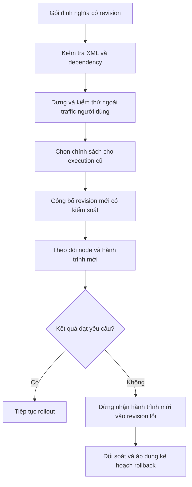

# Cấu hình phát triển, tải lại định nghĩa và chính sách khi vận hành

Trong môi trường phát triển, sửa một transition rồi kiểm tra ngay trên trình duyệt giúp rút ngắn vòng lặp học Spring Web Flow. Trong môi trường vận hành, cùng một thay đổi có thể khiến người đang ở bước xác nhận không tiếp tục được, dù một hành trình mới vẫn chạy tốt.

Bài thuộc chương **Hiệu năng và vận hành** của module **SPRING_WEB_FLOW**. Mục tiêu là cấu hình chế độ phát triển đúng chỗ, hiểu cơ chế tải lại định nghĩa flow và xây dựng chính sách triển khai cho các hành trình nhiều bước có state, event, subflow, dữ liệu trong scope và phiên thực thi đang tồn tại.

Các ví dụ API lấy **Spring Web Flow 3.0.1** làm mốc cụ thể. Những phần về triển khai, định tuyến phiên và quan sát hệ thống là chính sách thiết kế được đề xuất cho ứng dụng; chúng không phải các tính năng tự động có được chỉ bằng việc bật một cờ của Web Flow.

## 1. Phân biệt bốn loại thay đổi

Trước khi bật hot reload, cần xác định thứ gì cần được cập nhật:

| Thay đổi | Thành phần liên quan | Điều không nên mặc định suy ra |
| --- | --- | --- |
| Sửa XML định nghĩa state/transition | Flow model, flow builder và registry | Mọi execution đang chạy đều được chuyển đổi an toàn |
| Sửa template hoặc nội dung thông báo | View resolver, template engine, message source | Bật development của flow sẽ vô hiệu hóa mọi cache giao diện |
| Sửa Java service, validator hoặc DTO | Classloader, bean/application context, quy trình build/deploy | Tải lại XML sẽ nạp lại mọi lớp Java |
| Đổi giới hạn phiên, repository hoặc routing | Flow executor, nơi lưu session và hạ tầng | Tải lại định nghĩa sẽ đồng bộ hoặc di chuyển session giữa node |

**Flow definition** là mô hình có thể dùng lại để tạo các lần thực thi. **Flow execution** là một lần người dùng đang thực hiện hành trình, với state và dữ liệu riêng. Tải lại định nghĩa không đồng nghĩa tải lại trang, làm sạch scope hay chuyển đổi execution cũ thành cấu trúc mới.

Ví dụ, đổi tên một state từ `review` thành `confirmDetails` là thay đổi cấu trúc điều khiển. Thay một đoạn văn trên trang review thường là thay đổi trình bày. Cả hai đều có thể nhìn giống nhau trên màn hình, nhưng rủi ro đối với phiên đang chạy khác nhau.

## 2. Cấu hình development tại FlowBuilderServices

Web Flow cung cấp cấu hình development cho bộ dịch vụ dựng flow. Với Java builder, phương thức là `setDevelopmentMode(boolean)`; mặc định giá trị là `false`. [API FlowBuilderServicesBuilder 3.0.1](https://docs.spring.io/spring-webflow/docs/3.0.1/api/org/springframework/webflow/config/FlowBuilderServicesBuilder.html)

Cấu hình cần được nối theo đúng chuỗi:

```text
Cấu hình môi trường
    -> FlowBuilderServices
    -> FlowDefinitionRegistry
    -> FlowExecutor
    -> Hạ tầng tích hợp Spring MVC
```

Tạo một bean services mới nhưng để registry sử dụng bean khác sẽ không mang lại hành vi mong đợi.

### Ví dụ Java với chính sách chỉ bật tại local

Cờ `app.webflow.development` dưới đây là tên cấu hình **do ứng dụng tự quy định**. Nó không phải property tiêu chuẩn mà mọi ứng dụng Spring hoặc Spring Boot tự hiểu là cấu hình Web Flow.

```java
package example.webflow;

import org.springframework.context.annotation.Bean;
import org.springframework.context.annotation.Configuration;
import org.springframework.core.env.Environment;
import org.springframework.webflow.config.AbstractFlowConfiguration;
import org.springframework.webflow.definition.registry.FlowDefinitionRegistry;
import org.springframework.webflow.engine.builder.support.FlowBuilderServices;
import org.springframework.webflow.executor.FlowExecutor;

@Configuration
public class WebFlowConfiguration extends AbstractFlowConfiguration {

    @Bean
    public FlowBuilderServices flowBuilderServices(Environment environment) {
        boolean development = environment.getProperty(
                "app.webflow.development", Boolean.class, false);
        String[] activeProfiles = environment.getActiveProfiles();
        boolean localOnly = activeProfiles.length == 1
                && "local".equals(activeProfiles[0]);

        if (development && !localOnly) {
            throw new IllegalStateException(
                    "Web Flow development chỉ được bật khi profile duy nhất là local");
        }

        return getFlowBuilderServicesBuilder()
                .setDevelopmentMode(development)
                .build();
    }

    @Bean
    public FlowDefinitionRegistry flowRegistry(FlowBuilderServices services) {
        return getFlowDefinitionRegistryBuilder(services)
                .addFlowLocation(
                        "classpath:/flows/booking/booking-flow.xml", "booking")
                .addFlowLocation(
                        "classpath:/flows/address/address-flow.xml", "address")
                .build();
    }

    @Bean
    public FlowExecutor flowExecutor(FlowDefinitionRegistry registry) {
        return getFlowExecutorBuilder(registry).build();
    }
}
```

Hai flow id được đăng ký tường minh để tránh phụ thuộc quy ước suy id từ đường dẫn. `FlowDefinitionRegistryBuilder` hỗ trợ kết nối services và đăng ký resource cùng id. [API FlowDefinitionRegistryBuilder](https://docs.spring.io/spring-webflow/docs/3.0.1/api/org/springframework/webflow/config/FlowDefinitionRegistryBuilder.html)

Đoạn trên minh họa phần cấu hình Web Flow; ứng dụng vẫn cần `DispatcherServlet`, handler mapping/adapter, view technology và các dependency phù hợp. Nếu dự án đã có conversion service, validator hoặc `ViewFactoryCreator` riêng, giữ các cấu hình đó trong cùng bộ services.

Quy tắc “profile duy nhất là local” là lựa chọn của ví dụ để từ chối cả trường hợp trộn `local` với `prod`. Nhóm có thể thiết kế tập môi trường được phép khác, nhưng phải diễn đạt và kiểm tra rõ điều kiện đó.

Ví dụ giá trị đưa vào Spring `Environment` khi chạy local:

```properties
spring.profiles.active=local
app.webflow.development=true
```

Trong production:

```properties
spring.profiles.active=prod
app.webflow.development=false
```

Các dòng trên là nội dung cấu hình minh họa, không tự xác định cơ chế nạp file. Với Spring thuần, ứng dụng phải nạp property source thích hợp hoặc cung cấp system properties; với một nền tảng cấu hình khác, dùng cơ chế nạp của nền tảng đó. Không chỉ tạo một file `.properties` bất kỳ rồi giả định nó đã được đọc.

### XML và tên phương thức trực tiếp trên services

Nếu dùng XML namespace `webflow-config`, phần fragment tương ứng là:

```xml
<webflow:flow-builder-services id="flowBuilderServices" development="true"/>

<webflow:flow-registry id="flowRegistry"
                       flow-builder-services="flowBuilderServices">
    <webflow:flow-location path="/WEB-INF/flows/booking/booking-flow.xml"
                           id="booking"/>
</webflow:flow-registry>
```

Fragment giả định namespace/schema đã được khai báo ở file cấu hình đầy đủ. Khi tạo `FlowBuilderServices` trực tiếp thay vì qua builder, tên setter là `setDevelopment(true)`. Tài liệu cũng mô tả development mode cho thay đổi định nghĩa và tài nguyên phụ thuộc như message bundle. [Tài liệu system setup](https://docs.spring.io/spring-webflow/docs/2.5.1.RELEASE/reference/html/system-setup.html)

Không dùng đồng thời các biến thể Java/XML chỉ để bật cùng một dịch vụ. Đặc biệt, đoạn XML bật `true` không tự có guard profile của ví dụ Java; ứng dụng dùng XML phải thực hiện chính sách môi trường tương ứng của nó.

## 3. Hiểu đúng thời điểm phát hiện và tải lại

Trong triển khai `DefaultFlowHolder` của mốc 3.0.1, việc lấy định nghĩa có thể dựng flow lần đầu. Với định nghĩa đã có, holder kiểm tra development mode và việc resource thay đổi trước khi dựng lại. Các phương thức lấy/refresh của holder này được đồng bộ hóa trong cùng object. [Mã nguồn DefaultFlowHolder](https://raw.githubusercontent.com/spring-projects/spring-webflow/v3.0.1/spring-webflow/src/main/java/org/springframework/webflow/engine/builder/DefaultFlowHolder.java)

Mô hình khái niệm:

```text
Lấy một flow definition
    Nếu chưa dựng: dựng định nghĩa
    Nếu đã dựng và đang development:
        Kiểm tra resource mà builder theo dõi
        Nếu có thay đổi: dựng lại định nghĩa
    Trả định nghĩa cho bên gọi
```

Điều này dẫn đến ba hệ quả thực hành:

- Không coi development mode là một file watcher nền bảo đảm cập nhật ngay sau mỗi lần lưu trong IDE.
- Request hoặc lần lookup kích hoạt việc dựng lại có thể chịu thêm độ trễ.
- Một holder an toàn với nhiều thread trong cùng JVM không đồng nghĩa cả cụm node được đổi phiên bản nguyên tử.

### Tệp source có thể khác resource mà ứng dụng đang đọc

Giả sử bạn sửa:

```text
src/main/resources/flows/booking/booking-flow.xml
```

Nhưng ứng dụng đang chạy đọc một bản được copy vào thư mục output của build. Nếu IDE chưa copy resource mới, Web Flow vẫn thấy bản cũ. Với artifact đóng gói, việc sửa một file ngoài source tree càng không bảo đảm resource bên trong JAR/WAR đã đổi.

Khi reload không xuất hiện, hãy xác nhận đường dẫn resource runtime trước khi tăng log hoặc restart liên tục.

Trong `XmlFlowModelBuilder` 3.0.1, phát hiện thay đổi XML có liên quan tới timestamp của resource; nếu không lấy được timestamp, không nên kỳ vọng builder phát hiện mọi lần sửa. [Mã nguồn XmlFlowModelBuilder](https://raw.githubusercontent.com/spring-projects/spring-webflow/v3.0.1/spring-webflow/src/main/java/org/springframework/webflow/engine/model/builder/xml/XmlFlowModelBuilder.java)

### Sửa flow đã đăng ký khác với thêm flow mới

Theo triển khai builder registry được dùng ở đây, các resource khớp pattern được đăng ký khi dựng registry. Bật development không có nghĩa thư mục luôn được quét lại để tự đăng ký mọi flow mới tạo sau đó. [Mã nguồn FlowDefinitionRegistryBuilder](https://raw.githubusercontent.com/spring-projects/spring-webflow/v3.0.1/spring-webflow/src/main/java/org/springframework/webflow/config/FlowDefinitionRegistryBuilder.java)

Nếu thêm flow hoặc đổi quy tắc suy id, kiểm tra lại danh sách đăng ký và quy trình khởi tạo registry. Nếu sửa một subflow, kiểm tra cả đường gọi tới subflow đó thay vì chỉ mở flow cha rồi quan sát trang đầu.

### Refresh tường minh là một SPI, không phải endpoint quản trị mặc định

`FlowDefinitionHolder` có phương thức `refresh()` và có thể ném lỗi xây dựng định nghĩa. [API FlowDefinitionHolder](https://docs.spring.io/spring-webflow/docs/3.0.1/api/org/springframework/webflow/definition/registry/FlowDefinitionHolder.html)

Tuy nhiên, interface `FlowDefinitionRegistry` ở phiên bản này không cung cấp một lệnh tổng quát `registry.refreshAll()` hoặc endpoint HTTP reload sẵn có. Không tự suy ra các API như vậy từ việc holder hỗ trợ refresh. [Mã nguồn FlowDefinitionRegistry](https://raw.githubusercontent.com/spring-projects/spring-webflow/v3.0.1/spring-webflow/src/main/java/org/springframework/webflow/definition/registry/FlowDefinitionRegistry.java)

Nếu ứng dụng xây dựng cơ chế quản trị riêng, đó là một phần thiết kế cần có hợp đồng cập nhật, phân quyền và chính sách execution cũ. Không gọi `refresh()` trên đường xử lý mọi request để thay thế cơ chế triển khai.

## 4. Thực hành reload trong môi trường local

Một bài thực hành ngắn nên dùng thay đổi không gọi service có tác dụng phụ, chẳng hạn thêm metadata nhận diện bản định nghĩa:

```xml
<flow xmlns="http://www.springframework.org/schema/webflow"
      xmlns:xsi="http://www.w3.org/2001/XMLSchema-instance"
      xsi:schemaLocation="http://www.springframework.org/schema/webflow
        https://www.springframework.org/schema/webflow/spring-webflow.xsd">
    <attribute name="revision" value="local-r1"/>

    <view-state id="details">
        <transition on="next" to="review"/>
    </view-state>

    <view-state id="review">
        <transition on="confirm" to="completed"/>
    </view-state>

    <end-state id="completed"/>
</flow>
```

Đây là định nghĩa flow tối giản; công nghệ view được ứng dụng cấu hình riêng. Metadata `revision` là nhãn tự quy định, không phải tính năng versioning tự động của Web Flow.

Các bước thực hành:

1. Khởi động local với development bật và xác nhận registry dùng đúng services.
2. Lấy định nghĩa `booking` và đọc attribute `revision` để biết runtime đang dùng `local-r1`.
3. Đổi attribute thành `local-r2`, bảo đảm resource runtime được cập nhật.
4. Thực hiện lần lookup hoặc mở hành trình mới theo cách ứng dụng dùng registry.
5. Xác nhận revision mới và đi qua transition đã quan tâm.
6. Thử một lỗi XML trong local, quan sát lỗi xây dựng, sửa lại và xác nhận phục hồi.

Có thể đọc metadata trong mã chẩn đoán nội bộ:

```java
Object revision = flowRegistry.getFlowDefinition("booking")
        .getAttributes().get("revision");
```

Không cần đưa màn hình debug hoặc revision nội bộ vào hành trình của người dùng. Log/chẩn đoán phục vụ người phát triển là đủ.

Sau đó lặp lại với một execution đã dừng ở `review` trước lúc sửa. So sánh hành vi của execution cũ với hành trình mới, đặc biệt khi đổi state id, event hoặc model. Mục tiêu là nhận diện giới hạn của reload, không mặc định yêu cầu mọi thay đổi đều tương thích.

## 5. Tại sao reload có thể ảnh hưởng execution đang chạy?

Một người dùng mở trang review ở bản R1. Trong lúc họ suy nghĩ, hệ thống chuyển sang R2:

```text
R1: details -> review -> completed
R2: details -> confirmDetails -> completed
```

Execution cũ vẫn có thể chứa state id `review`, dữ liệu model và thông tin subflow theo R1. Khi phục hồi execution từ nơi lưu, runtime cần gắn lại các tham chiếu định nghĩa/state.

Trong `FlowExecutionImplFactory` 3.0.1, bước restore lấy state của root và subflow theo state id đã lưu từ các định nghĩa được cung cấp/tra cứu. Vì vậy, xóa hoặc đổi tên state có thể khiến execution cũ không được phục hồi như trước. [Mã nguồn FlowExecutionImplFactory](https://raw.githubusercontent.com/spring-projects/spring-webflow/v3.0.1/spring-webflow/src/main/java/org/springframework/webflow/engine/impl/FlowExecutionImplFactory.java)

Đây là suy luận về rủi ro tương thích từ cơ chế phục hồi, không phải khẳng định mọi repository và mọi request đều chọn R2 theo cùng một cách. Repository, locator và chiến lược triển khai quyết định định nghĩa nào được cấp cho restore.

| Loại thay đổi | Ví dụ rủi ro đối với execution R1 |
| --- | --- |
| Đổi/xóa state id | State đã lưu không còn tồn tại |
| Đổi event mà form phát | Trang R1 gửi `confirm`, R2 chỉ xử lý `submit` |
| Đổi kiểu hoặc cấu trúc DTO | Không deserialize được hoặc thiếu dữ liệu mà action mới yêu cầu |
| Đổi tên input/output subflow | Cha và con không còn thống nhất hợp đồng |
| Thay validator hoặc binder | Dữ liệu cũ không đáp ứng điều kiện xử lý mới |
| Đổi service/bean hoặc template | Định nghĩa vẫn dựng được nhưng bước thực thi/render bị lỗi |

Giữ nguyên state id cũng chưa đủ để chứng minh tương thích: action của state đó có thể đã đòi một thuộc tính không có trong scope cũ. Giữ nguyên `serialVersionUID` cũng không tự giải quyết thay đổi ý nghĩa dữ liệu.

Hot reload không tự cung cấp migration cho `flowScope`, `conversationScope` hoặc trạng thái subflow. Nếu cần tiếp tục execution cũ trên bản mới, ứng dụng phải có chính sách tương thích được kiểm thử bằng dữ liệu thực sự tạo từ bản cũ.

## 6. Chọn chính sách cho từng môi trường và từng loại phát hành

Một chính sách mặc định phù hợp cho nhiều ứng dụng là cho phép reload ở local và dùng artifact bất biến trong production. Cần ghi rõ các ngoại lệ thay vì để việc sửa file trực tiếp trở thành cách triển khai thường xuyên.

| Môi trường | Development | Định nghĩa flow | Mục đích |
| --- | --- | --- | --- |
| Local | Có thể bật | Resource có thể sửa và xác định được bản runtime | Rút ngắn vòng lặp phát triển |
| CI kiểm thử thông thường | Tắt | Artifact cố định | Chứng minh cùng một đầu vào chạy trên cùng định nghĩa |
| CI chuyên kiểm tra reload | Bật có chủ đích | Fixture thay đổi có kiểm soát | Kiểm tra riêng cơ chế reload và xử lý lỗi |
| Staging diễn tập release | Tắt, giống production | Đúng artifact dự kiến phát hành | Kiểm tra deploy và resume execution qua phiên bản |
| Production | Tắt theo chính sách mặc định | Artifact có revision xác định | Giữ hành vi có thể tái lập và rollback |

Tắt development chỉ tắt hành vi kiểm tra thay đổi tương ứng; nó không tự ngăn mã ứng dụng gọi API quản trị riêng hoặc thay thế registry. Tính bất biến còn phụ thuộc cách đóng gói và triển khai.

### Cách A: phát hành tương thích và tiếp tục execution cũ

Có thể dùng khi đã chứng minh R2 đọc và xử lý được trạng thái tạo từ R1. Cần kiểm tra cả state, event, scope, DTO, subflow và lớp persistence.

Ví dụ, thay thông báo hướng dẫn có thể có phạm vi nhỏ hơn việc thêm một trường bắt buộc ngay trước bước confirm. Tuy nhiên, vẫn phải xác minh template mới đọc được model cũ và người dùng hiểu đúng thông tin được xác nhận.

### Cách B: cho execution cũ hoàn tất trên bản cũ

Giữ nhóm node hoặc định nghĩa phục vụ R1 cho các hành trình đã bắt đầu, còn hành trình mới đi vào R2. Chính sách phải xử lý hai đường khác nhau:

- **Admission:** có cho bắt đầu một root flow mới trên R1 nữa hay không?
- **Resume:** request tiếp tục của execution R1 sẽ được đưa đến runtime nào còn đọc được nó?

Chỉ loại node R1 khỏi load balancer có thể làm mất cả đường resume. Muốn drain hành trình, cần giữ định tuyến phù hợp cho phiên cũ trong thời gian đã cam kết, đồng thời ngừng cấp hành trình mới cho nhóm cũ.

Graceful shutdown chờ các HTTP request đang xử lý không đồng nghĩa chờ một người dùng hoàn thành form trong nhiều phút. Phải xác định riêng thời gian giữ execution, tiêu chí dừng phục vụ bản cũ và cách giải quyết những hành trình vượt giới hạn.

Sticky session có thể giúp định tuyến về node cũ khi node còn sống. Nó không thay thế session storage, failover, tương thích serializer hoặc kế hoạch khi node đó bị mất.

### Cách C: duy trì các flow id có phiên bản

Ứng dụng có thể đăng ký các tên như:

```text
booking-v1 -> address-v1
booking-v2 -> address-v2
```

Root flow cũ gọi subflow cũ tường minh; root mới gọi subflow mới. Điểm vào cho người dùng mới chọn phiên bản hiện hành theo chính sách của ứng dụng.

Không chỉ đổi root thành `booking-v2` nhưng vẫn để nó và `booking-v1` cùng gọi một `address` có hợp đồng thay đổi tùy thời điểm. Cần kiểm soát toàn bộ đồ thị phụ thuộc liên quan.

Flow id có phiên bản không tự đóng gói độc lập mọi Java class, service hay schema database. Hai bản cùng chạy vẫn phải dùng được những tài nguyên chung của chúng. Cũng cần kiểm soát việc bắt đầu trực tiếp flow id cũ nếu sản phẩm không còn cho phép tạo hành trình mới ở bản đó.

### Cách D: kết thúc khả năng tiếp tục và cho bắt đầu lại có kiểm soát

Với thay đổi không tương thích và hành trình ngắn, có thể chọn ngừng tiếp tục execution cũ, hiển thị thông tin phù hợp và tạo hành trình mới. Đây là quyết định sản phẩm/vận hành, cần xác định phần dữ liệu nào có thể khôi phục từ draft bền vững và phần nào phải nhập lại.

Không tự gửi lại một event xác nhận của execution cũ vào flow mới. Nếu thao tác lần trước có thể đã ghi nhận thanh toán hoặc đặt chỗ, phải đối soát kết quả nghiệp vụ trước khi cho thử lại.

## 7. Dựng trước các định nghĩa quan trọng trước khi nhận traffic

Đăng ký resource không đồng nghĩa mọi định nghĩa đã được dựng và mọi đường thực thi đều hoạt động. Một lỗi có thể chỉ xuất hiện ở lần đầu người dùng chạm vào flow ít được dùng.

Có thể buộc lookup các flow quan trọng trong giai đoạn khởi động production và kiểm tra cờ hiệu lực của từng định nghĩa. `FlowDefinition.inDevelopment()` cho biết định nghĩa đang ở chế độ development hay không. [API FlowDefinition](https://docs.spring.io/spring-webflow/docs/3.0.1/api/org/springframework/webflow/definition/FlowDefinition.html)

Ví dụ cấu hình bổ sung, dùng cùng registry ở mục 2:

```java
package example.webflow;

import org.springframework.beans.factory.SmartInitializingSingleton;
import org.springframework.context.annotation.Bean;
import org.springframework.context.annotation.Configuration;
import org.springframework.context.annotation.Profile;
import org.springframework.webflow.definition.FlowDefinition;
import org.springframework.webflow.definition.registry.FlowDefinitionRegistry;

@Configuration
@Profile("prod")
public class ProductionFlowVerification {

    @Bean
    public SmartInitializingSingleton verifyRequiredFlowDefinitions(
            FlowDefinitionRegistry registry) {
        return () -> {
            for (String flowId : new String[] {"booking", "address"}) {
                FlowDefinition definition = registry.getFlowDefinition(flowId);
                if (definition.inDevelopment()) {
                    throw new IllegalStateException(
                            "Flow không được chạy development tại production: "
                                    + flowId);
                }
            }
        };
    }
}
```

`SmartInitializingSingleton` cung cấp callback sau giai đoạn tạo các singleton thông thường. Bean kiểm tra này cần được đăng ký và khởi tạo bình thường, không đặt lazy khiến nó chỉ chạy sau khi ứng dụng đã phục vụ người dùng. [API SmartInitializingSingleton](https://docs.spring.io/spring-framework/docs/6.0.23/javadoc-api/org/springframework/beans/factory/SmartInitializingSingleton.html)

Danh sách `booking`, `address` là hợp đồng của ví dụ. Ứng dụng thực tế phải xác định các root flow và subflow bắt buộc, kể cả flow được chọn động không thể biết chỉ từ trang đầu.

Giới hạn của bước này:

- Nó giúp phát hiện lỗi dựng các định nghĩa được liệt kê và cờ development không đúng.
- Nó không chạy mọi transition, không render mọi template và không xác minh đủ dữ liệu input cho mọi nhánh.
- Nó không chứng minh R2 phục hồi được snapshot R1.
- Nó không chứng minh service bên ngoài hoặc database luôn sẵn sàng sau thời điểm kiểm tra.

Kết hợp bước dựng trước với test chức năng và readiness phù hợp. Không để liveness probe liên tục khởi tạo hành trình hoặc dựng lại định nghĩa; điều đó có thể tạo tác dụng phụ và làm tải hệ thống khó giải thích.

## 8. Hiệu năng: đo riêng lookup, kiểm tra thay đổi và dựng lại

Một mô hình đơn giản để suy nghĩ về độ trễ lấy định nghĩa:

```text
Thời gian lookup
    = chi phí lấy định nghĩa đã có
    + chi phí kiểm tra resource nếu đường development thực hiện kiểm tra
    + chi phí dựng lại nếu cần dựng mới hoặc refresh
    + thời gian chờ các tác vụ đang tranh chấp tài nguyên liên quan
```

Đây là mô hình phân tích, không phải công thức đo cố định cho mọi ứng dụng. Chi phí phụ thuộc số định nghĩa, số dependency, loại resource, I/O, parser, việc tạo context của flow và mức đồng thời.

Cần so sánh tối thiểu ba nhóm request:

| Nhóm | Câu hỏi đo lường |
| --- | --- |
| Lookup sau khi đã dựng và không thay đổi | Đường ổn định tốn bao nhiêu thời gian? |
| Lần đầu dùng một flow | Chi phí dựng có tạo đỉnh độ trễ không? |
| Request sau thay đổi tại local | Kiểm tra và dựng lại ảnh hưởng request nào? |

Không suy ra “development luôn làm chậm X%” nếu chưa có phép đo trên cấu hình cụ thể. Nếu p99 tăng sau release, cần phân biệt thời gian dựng flow với thời gian service, database, khóa execution hoặc render template.

Các chỉ số có thể thiết kế cho ứng dụng:

| Tín hiệu | Ý nghĩa vận hành |
| --- | --- |
| Thời gian dựng định nghĩa theo flow/release | Phát hiện flow dựng quá chậm hoặc bị dựng lại ngoài ý muốn |
| Số lỗi xây dựng/lookup định nghĩa | Phát hiện resource thiếu, XML hoặc dependency không hợp lệ |
| Số lỗi phục hồi/deserialize execution | Phát hiện khả năng không tương thích hoặc vấn đề session/repository |
| Số hành trình bắt đầu, hoàn tất, hủy và hết hạn | Đánh giá ảnh hưởng người dùng và kế hoạch drain |
| Tuổi và số execution còn cần phục vụ | Quyết định khi nào có thể dừng hỗ trợ bản cũ |
| Revision ứng dụng và cấu hình development hiệu lực | Liên hệ triệu chứng với rollout cụ thể |

Đây là đề xuất instrumentation, không phải danh sách metric có sẵn mặc định của Web Flow. Khi gắn nhãn, ưu tiên flow id và release có số lượng được kiểm soát. Không dùng execution key hoặc user id làm nhãn metric vì chúng tạo quá nhiều giá trị và có thể làm lộ thông tin phiên.

Metric đếm session cũng không tự động bằng số hành trình chưa kết thúc: một HTTP session có thể có nhiều execution; một số execution có thể bị loại do giới hạn lưu trữ. Phải định nghĩa rõ cách đo và giới hạn của số liệu dùng cho quyết định vận hành.

## 9. Nếu bắt buộc phải cập nhật định nghĩa khi runtime đang chạy

Một số hệ thống có yêu cầu cập nhật ngoài chu kỳ deploy thông thường. Khi đó, cần một cơ chế do ứng dụng thiết kế; development mode không tự giải quyết quy trình vận hành.

Một thiết kế có thể đánh giá theo chuỗi:



Các quyết định phải làm rõ:

1. Gói định nghĩa được định danh bằng revision/digest nào, và đi cùng Java code/schema nào?
2. Node lấy gói đó ở đâu, xác nhận đã dựng đúng bản bằng cách nào?
3. Ai có quyền cập nhật và thao tác được ghi nhận ra sao?
4. Request mới được chuyển sang revision mới lúc nào?
5. Execution cũ tiếp tục dùng định nghĩa nào và trong bao lâu?
6. Nếu một node cập nhật thất bại, routing và trạng thái rollout sẽ xử lý thế nào?
7. Điều kiện rollback có bao gồm execution đã được tạo dưới bản mới hay không?

Nếu định nghĩa đặt ở tài nguyên có thể sửa, tránh công bố một tệp đang ghi dở hoặc một tập dependency nửa cũ nửa mới. Cách công bố nguyên tử phải phù hợp storage thực tế. Đổi tên nguyên tử một file trên một máy cũng không tự làm cả cụm dùng chung một phiên bản tại cùng thời điểm.

Không cam kết “nếu XML mới lỗi thì mọi request tự tiếp tục bản cũ” chỉ vì một biến holder có thể còn giữ tham chiếu cũ. Cần kiểm thử lỗi dựng, dependency phụ và đường lookup sau lỗi trong cơ chế cập nhật cụ thể. Một chính sách giữ bản tốt gần nhất phải là hành vi được thiết kế và chứng minh.

Đừng thêm một endpoint reload công khai chỉ để thao tác tiện hơn. Một cơ chế quản trị thực tế phải nằm trong phạm vi được phân quyền và có thông tin revision, kết quả cùng khả năng điều tra; nó không thuộc luồng điều hướng của người dùng cuối.

## 10. Rollback phải tính cả session, dữ liệu và subflow

Khôi phục artifact R1 sau khi R2 gặp lỗi không tự đưa mọi người dùng về trạng thái R1. Có thể đã tồn tại:

- Execution R1 vẫn đang chờ người dùng.
- Execution R2 với state hoặc DTO mới.
- Dữ liệu nghiệp vụ do action R2 đã ghi.
- Một subflow được bắt đầu ở bản khác với root nếu chính sách định nghĩa không nhất quán.

Vì vậy, kế hoạch rollback cần xử lý cả chiều đọc R1 bởi R2 lẫn chiều đọc R2 bởi R1 nếu dự kiến quay về bản cũ. Nếu không hỗ trợ chiều ngược, phải có cách phục vụ riêng hoặc kết thúc có kiểm soát những execution R2 đã tạo.

Repository phục hồi execution cần liên hệ lại với định nghĩa và trạng thái runtime; không nên coi bản snapshot là một ứng dụng hoàn chỉnh độc lập với mã đang triển khai. [Hợp đồng FlowExecutionStateRestorer](https://raw.githubusercontent.com/spring-projects/spring-webflow/v3.0.1/spring-webflow/src/main/java/org/springframework/webflow/execution/repository/support/FlowExecutionStateRestorer.java)

Ví dụ, nếu R2 thêm dữ liệu yêu cầu một cột database mới, rollback Java code có thể vẫn cần giữ cột đó trong giai đoạn chuyển tiếp. Chính sách schema tương thích phải được thiết kế cùng release; không dùng việc tắt development mode để thay thế quyết định này.

Đối với action có tác dụng phụ, xác định kết quả theo định danh nghiệp vụ bền vững. Execution key là thông tin tiếp tục hành trình, không nên trở thành cơ chế duy nhất để chống tạo trùng đơn hoặc chống thực hiện thanh toán hai lần.

## 11. Runbook khi người dùng không tiếp tục được sau thay đổi

Đầu tiên phân loại lỗi thay vì restart tất cả node ngay:

| Nhóm lỗi | Bằng chứng cần đối chiếu | Hướng xử lý |
| --- | --- | --- |
| Không tìm thấy flow id | Registry hiệu lực, revision, đường đăng ký | Sửa deployment/registration và routing |
| Lỗi dựng định nghĩa | XML/runtime resource, dependency, stack trace | Ngừng mở rộng rollout; phục hồi artifact đã kiểm chứng |
| Không tìm thấy state khi restore | State id đã lưu và định nghĩa được dùng | Áp dụng chính sách tương thích/version hoặc phục hồi có kiểm soát |
| Không deserialize được model | Phiên bản DTO/classloader và dữ liệu đã lưu | Kiểm tra tương thích serializer; không sửa ngẫu nhiên UID để bỏ lỗi |
| Trang cũ phát event không còn hỗ trợ | Form đang mở, event và phiên bản flow | Giữ tương thích event hoặc hướng dẫn bắt đầu lại theo chính sách |
| Không tìm thấy execution | Session, repository, timeout/eviction và route | Phân biệt hết hạn dự kiến với mất phiên do deploy |
| Resume được nhưng action lỗi | Scope, dữ liệu bắt buộc và service | Điều tra hợp đồng dữ liệu, không chỉ cấu hình reload |

Một trình tự xử lý có thể áp dụng:

1. Xác định flow id, state hoặc bước người dùng đang thấy, revision node và thời điểm release.
2. So sánh lỗi của hành trình mới với hành trình đã bắt đầu trước release.
3. Dừng đưa hành trình mới vào revision lỗi nếu rollout đang gây ảnh hưởng.
4. Kiểm tra kết quả nghiệp vụ đã được tạo hay chưa trước khi khuyến nghị thử lại.
5. Chọn tiếp tục trên bản phù hợp, đọc lại draft bền vững hoặc bắt đầu lại theo chính sách đã công bố.
6. Theo dõi tỷ lệ phục hồi, lỗi tiếp diễn và kết quả trùng sau xử lý.

Log chẩn đoán nên có flow id, revision, node và correlation id. Tránh đưa toàn bộ form, cookie hoặc execution URL vào thông báo lỗi cho người dùng. Thông điệp phục hồi cần nói rõ bước tiếp theo có thể thực hiện, nhưng không được hứa rằng dữ liệu đã được lưu nếu chưa đối soát.

Không phát lại tự động event `confirm` sau một lỗi timeout không rõ kết quả. Bước xác nhận có thể đã thành công ở service dù browser chưa nhận phản hồi.

## 12. Kiểm thử chính sách trước khi đưa vào vận hành

Một test reload local và một test deploy qua phiên bản trả lời hai câu hỏi khác nhau. Cần có expectation riêng cho từng nhóm:

| Kịch bản | Kết quả mong đợi cần định nghĩa trước |
| --- | --- |
| Local bật development và sửa resource runtime | Lookup/hành trình mới nhìn thấy thay đổi theo cơ chế đã chọn |
| Local sửa source nhưng chưa copy resource | Chẩn đoán được runtime vẫn dùng bản cũ |
| Production vô tình bật development | Cấu hình bị từ chối hoặc kiểm tra hiệu lực phát hiện trước khi nhận traffic |
| Thiếu một subflow quan trọng | Khởi động/test chức năng phát hiện, không chờ người dùng gặp |
| Dựng một định nghĩa mới bị lỗi | Rollout/cập nhật báo lỗi rõ, không âm thầm công bố thành công |
| Execution R1 ở review, runtime chuyển R2 | Tiếp tục, phục vụ R1 riêng hoặc bắt đầu lại đúng chính sách |
| Execution R1 đang ở subflow | Root/subflow và dữ liệu input/output vẫn nhất quán |
| Định tuyến request resume sang node khác | Đọc được phiên theo thiết kế hoặc phục hồi đúng thông điệp |
| Rollback sau khi đã tạo execution R2 | Những execution R2 được xử lý theo kế hoạch đã kiểm chứng |
| Timeout ở bước xác nhận | Đối soát được kết quả, không tạo tác dụng phụ trùng |

Để kiểm tra tương thích thật, tạo execution bằng **artifact R1**, lưu nó bằng cấu hình repository/session sử dụng thực tế, rồi tiếp tục bằng cấu hình được chọn cho R2. Tạo lại một map “giống dữ liệu cũ” ngay trong test của R2 có ích cho unit test nhưng chưa chứng minh được khả năng deserialize và restore từ R1.

Kịch bản trình duyệt cũng cần giữ trang R1 đang mở trong lúc đổi bản, vì trang đó có thể chứa event, hidden field và execution URL cũ. Một test chỉ bắt đầu flow mới sau deploy sẽ không phát hiện lớp lỗi này.

Bài thực hành đề xuất: bật development chỉ ở local, dùng attribute revision để quan sát định nghĩa runtime, rồi mô phỏng việc đổi tên state khi một execution đang dừng ở đó. Sau khi nhận diện lỗi, chọn một trong các chính sách ở mục 6 và viết expectation cụ thể cho hành trình mới, hành trình cũ, subflow và rollback. Kết quả cần đạt là biết chính xác khi nào hệ thống tải lại định nghĩa và hệ thống sẽ đối xử ra sao với người dùng đang đi dở hành trình.