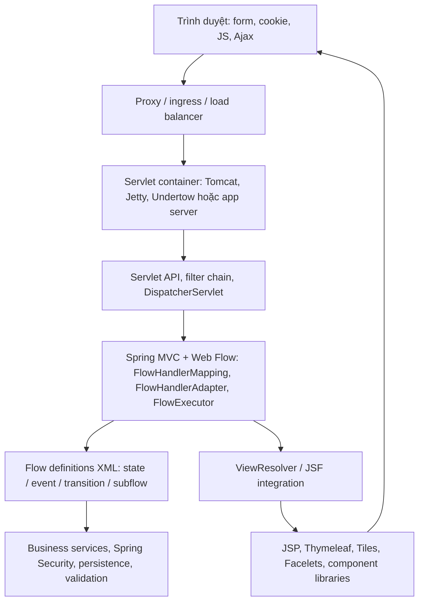
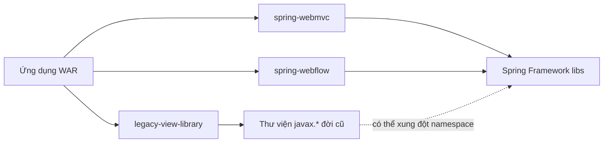

# Kiểm kê phiên bản framework, container và công nghệ view khi nâng cấp ứng dụng Spring Web Flow cũ

## 1. Vì sao bước kiểm kê quyết định thành công của việc nâng cấp?

Trong **Spring Web Flow (SWF)**, một hành trình web nhiều bước được điều khiển bằng **state, event, transition và subflow**. Ứng dụng có thể giữ form qua nhiều request bằng `flowScope`, bind và validate model tại `view-state`, render giao diện qua Spring MVC hoặc JSF, rồi xử lý phục hồi khi execution hết hạn. Các chức năng đó phụ thuộc đồng thời vào **phiên bản thư viện**, **môi trường Servlet** và **công nghệ view**.

Đây là khó khăn cốt lõi của việc nâng cấp hệ thống cũ: chỉ tăng phiên bản `spring-webflow` trong file build sẽ không bảo đảm ứng dụng chạy được. Chẳng hạn một WAR dùng Web Flow đời 2.x, Spring Framework 5, `javax.servlet.*`, Tomcat 9 và JSP/Tiles có thể không chạy khi chuyển sang môi trường Spring Framework 6/Jakarta nếu chưa kiểm tra các phần liên quan. Một ứng dụng JSF cũng có thêm các phụ thuộc phiên bản JSF, tích hợp Spring Faces, component library và vòng đời render.

**Kiểm kê (inventory) có mục tiêu tạo ảnh chụp chính xác về hệ thống hiện tại, trước khi quyết định mục tiêu nâng cấp.** Bài thuộc chương **Nâng cấp ứng dụng cũ**, hướng dẫn lập danh mục và chứng cứ kỹ thuật cho ba nhóm quan trọng:

1. **Framework:** Java, Spring Web Flow, Spring Framework/MVC, Spring Security, Spring Boot (nếu có), các module phụ trợ.
2. **Container:** Servlet API, Tomcat/Jetty/Undertow hoặc application server khác, cách đóng gói WAR/JAR, phiên bản Java thực chạy và cấu hình triển khai.
3. **View:** JSP/JSTL, Tiles, Thymeleaf, FreeMarker, JSF/Facelets và các component/Ajax library có mặt trong từng flow.

Đầu ra không phải một dự đoán “có vẻ đang dùng Spring 5”, mà là **bảng có version cụ thể, nguồn chứng cứ, vị trí triển khai, độ tin cậy và mức rủi ro tương thích**. Chỉ sau đó nhóm mới chọn được lộ trình nâng cấp, quy mô sửa đổi và bộ test cần thiết.

### Kết quả học tập

Sau bài học, bạn có thể:

- Phân biệt phiên bản **khai báo khi build**, phiên bản **được giải quyết trong dependency graph**, phiên bản **đóng gói** và phiên bản **thực sự chạy**.
- Thu thập thông tin Web Flow, Spring MVC, Servlet container, JDK, build tool, công nghệ view và những tích hợp có nguy cơ phá vỡ tương thích.
- Đọc dependency tree/BOM và đối chiếu với WAR hoặc runtime để phát hiện phiên bản trùng, dependency chuyển tiếp hoặc môi trường khác nhau.
- Lập **compatibility matrix** từ tài liệu của nhà cung cấp và ghi rõ tình trạng hỗ trợ, thay vì tự suy diễn dựa trên số version.
- Ưu tiên thử nghiệm migration theo bằng chứng và xác định tiêu chí hoàn tất bước kiểm kê.

## 2. Hệ thống Spring Web Flow gồm những tầng nào?



Vì có nhiều tầng, một lỗi upgrade có thể xuất hiện ở nơi khác với phần vừa sửa. Ví dụ:

- Đổi Tomcat 9 sang Tomcat 10.1 làm thay đổi **namespace Servlet từ `javax.servlet` sang `jakarta.servlet`**, ảnh hưởng cả filter, listener, tag library và thư viện liên quan.
- Đổi Spring Framework 5 lên 6 thay đổi baseline Java/Jakarta và một số tích hợp view; ứng dụng cũ dùng Tiles cần đánh giá hướng thay thế.
- Giữ cùng Flow XML nhưng đổi `ViewResolver` hoặc phiên bản Thymeleaf có thể làm sai đường dẫn view, tên model attribute hoặc fragment Ajax.
- Thay phiên bản JSF mà không kiểm kê Spring Faces và component library có thể làm hỏng lifecycle, conversion và validation dù flow definition vẫn parse thành công.
- Chạy WAR trong container khác với container dùng khi kiểm thử có thể gây lỗi triển khai, session hoặc redirect.

Bản kiểm kê phải bao phủ **cả dependency graph lẫn môi trường vận hành**. Những thứ “có trong `pom.xml`” chưa chắc là những thứ được load khi ứng dụng hoạt động.

## 3. Những bản baseline quan trọng cần biết trước khi so sánh

Bảng sau ghi **yêu cầu được tài liệu dự án/công nghệ công bố**, giúp người học nhìn thấy vùng chuyển đổi lớn. Đây không phải một ma trận khẳng định mọi tổ hợp đều tương thích; khả năng chạy còn phụ thuộc cụ thể vào phiên bản phụ, component library, Java, server và cấu hình dự án.

| Dòng công nghệ | Baseline hoặc yêu cầu nổi bật | Ý nghĩa khi kiểm kê |
|---|---|---|
| **Spring Web Flow 2.5** | Được phát triển để tích hợp Spring Framework 5; tài liệu 2.5 nêu Java 8+, Servlet 3.1 và JSF 2.2+ nếu dùng JSF. | Nhận diện thế hệ `javax.*` và các phụ thuộc view cũ. |
| **Spring Web Flow 3.0.x** | Reference guide 3.0.2 nêu Java 17+, Spring Framework 6.0+; hệ Jakarta EE; nếu dùng JSF, tài liệu yêu cầu JSF 4.0+. | Bước nâng cấp cần kiểm tra đồng thời Java, Spring 6 và `jakarta.*`. |
| **Spring Web Flow 4.0.x** | Reference guide 4.0.1 nêu Java 17+, **Spring Framework 7.0 baseline**, **Servlet 6.1**; nếu dùng JSF, **JSF 4.1+**. | Không chọn Web Flow 4 chỉ vì nó là dòng mới khi runtime/container chưa đạt baseline. |
| **Apache Tomcat 9.0.x** | Servlet 4.0, JSP 2.3, hệ `javax.servlet.*`. | Thường là nơi chạy những WAR đời Java EE. |
| **Apache Tomcat 10.1.x** | Jakarta Servlet 6.0, Jakarta Pages (JSP) 3.1. | Đòi hỏi đánh giá namespace Jakarta cho application và dependencies. |
| **Apache Tomcat 11.0.x** | Jakarta Servlet 6.1, Jakarta Pages 4.0; Java 17+. | Một lựa chọn container phù hợp để nghiên cứu khi nhắm tới baseline Servlet 6.1. |

**Lưu ý:** “Spring Web Flow 3.0.x hỗ trợ Spring Framework 6.0+” là mô tả baseline trên tài liệu. Nó **không** cho phép kết luận tự động rằng mọi phiên bản Spring Framework mới hơn đều tương thích với mọi bản vá Web Flow 3. Luôn đối chiếu release notes, dependency management, API và bài kiểm thử tương ứng.

Mục tiêu nâng cấp phải chọn theo **tập hợp khả thi** của toàn stack. Nếu ứng dụng bắt buộc giữ Java 8 hoặc một JSF component library chưa tương thích Jakarta, không thể chỉ thay Web Flow 3/4 rồi kỳ vọng toàn bộ stack hoạt động.

Tham chiếu chính thức:

- [Spring Web Flow 2.5 — What's New](https://docs.spring.io/spring-webflow/docs/2.5.1.RELEASE/reference/html/whatsnew.html).
- [Spring Web Flow 3.0.x — Reference Guide](https://docs.spring.io/spring-webflow/docs/3.0.x/reference/).
- [Spring Web Flow 4.0.x — Reference Guide](https://docs.spring.io/spring-webflow/docs/4.0.x/reference/).
- [Apache Tomcat — Which Version](https://tomcat.apache.org/whichversion).
- [Spring Framework 6 — Upgrade Guide](https://github.com/spring-projects/spring-framework/wiki/Upgrading-to-Spring-Framework-6.x).

## 4. Kiểm kê theo bốn lớp bằng chứng

Không nên ghi mỗi cột `version` đơn lẻ. Với mỗi thành phần, hãy trả lời bốn câu hỏi:

| Lớp bằng chứng | Ví dụ | Ý nghĩa |
|---|---|---|
| **Declared** — cấu hình khai báo | `pom.xml` ghi `spring-webflow:2.5.1.RELEASE`; BOM quản lý `spring-core`. | Phản ánh chủ đích của dự án, nhưng chưa chắc phiên bản cuối cùng. |
| **Resolved** — dependency được chọn | Maven dependency tree cho thấy `spring-webmvc:5.x`; Gradle resolution chỉ ra xung đột phiên bản. | Cho biết bản build thực sự chọn thư viện nào. |
| **Packaged** — nội dung artifact | WAR chứa `WEB-INF/lib/spring-webflow-...jar`; server không nhận jar `provided` trong WAR. | Cho biết thứ gì sẽ được bàn giao tới runtime. |
| **Running** — ở môi trường vận hành | `java -version` của service, startup log Tomcat, container image digest, class thực được load. | Chứng minh ứng dụng đang chạy với cái gì; đây là nguồn then chốt khi chẩn đoán lỗi production. |

Ví dụ Maven khai báo `spring-webmvc` phiên bản 5 trong parent POM, nhưng WAR đưa thư viện khác vào `WEB-INF/lib` hoặc server dùng shared classloader chứa jar cũ. Nếu chỉ đọc `pom.xml`, bảng kiểm kê sẽ sai.

**Quy ước độ tin cậy nên dùng:**

- **Verified:** có log/runtime hoặc binary artifact thực tế, ghi ngày và environment rõ.
- **Resolved:** có bản build lock/dependency tree tái lập được nhưng chưa xác minh runtime.
- **Declared:** mới quan sát cấu hình khai báo.
- **Unknown:** chưa thu được chứng cứ; phải ghi là chưa biết, không tự điền theo suy luận.

Một ứng dụng có nhiều environment phải ghi riêng **local, CI, staging và production** vì có thể triển khai WAR giống nhau nhưng chạy bằng Java hoặc container khác.

## 5. Kiểm kê framework và dependency graph

### 5.1. Cần ghi những gì?

Tối thiểu hãy thu thập:

1. **JDK:** version, vendor, build, architecture, biến môi trường/cấu hình chỉ định JDK cho build và runtime.
2. **Build tool:** Maven/Gradle version, Maven Wrapper/Gradle Wrapper, plugin compiler, WAR/Boot plugin, dependency management/BOM.
3. **Web framework:** `spring-webflow`; `spring-binding`/`spring-faces` nếu có; Spring Framework core, beans, context, web, webmvc, expression; Spring Boot nếu dùng.
4. **Security:** `spring-security-web`, `spring-security-config`, filter chain, phương thức bảo vệ URL/flow.
5. **Validation & binding:** Bean Validation API, Hibernate Validator hoặc provider khác, custom `Converter`, `Formatter`, custom `Validator`.
6. **Persistence:** Hibernate/JPA, transaction manager, driver DB, `HibernateFlowExecutionListener` hoặc quản lý entity/persistence context gắn với flow.
7. **View dependencies:** JSP/JSTL, Tiles, Thymeleaf, JSF implementation, PrimeFaces hoặc component library, Spring Faces, JS/Ajax bundles.
8. **Custom integration:** class kế thừa `FlowHandlerAdapter`/`FlowExecutor`, custom `FlowExecutionRepository`, listener, exception handler, expression parser, legacy `FormAction`.

Lưu tên artifact **đầy đủ**. Thư viện có cùng tên hiển thị nhưng khác groupId hoặc servlet namespace có thể không thay thế được cho nhau.

### 5.2. Nếu dự án dùng Maven

Các lệnh sau thực hiện tại **thư mục dự án cần kiểm kê** và chỉ là ví dụ dành cho người học, không phải thao tác đã được chạy trên module bài viết:

```bash
# Kiểm tra công cụ và Java dùng để build
java -version
mvn -version

# Tạo effective POM để xem parent, profile, BOM và version cuối cùng
mvn help:effective-pom -Doutput=effective-pom.xml

# Toàn bộ graph, gồm dependency chuyển tiếp và scope
mvn dependency:tree -Dverbose -DoutputFile=dependency-tree.txt

# Thu gọn theo họ thư viện khi phân tích (tùy phiên bản Maven plugin)
mvn dependency:tree -Dincludes=org.springframework:*,org.springframework.webflow:*
```

**Cách đọc:** `effective-pom.xml` phản ánh cấu hình Maven được tổng hợp theo profile đang kích hoạt; `dependency-tree.txt` cho thấy đồ thị resolution. Nếu dự án dùng profile `prod`, cần lặp lại bằng đúng profile đó. Các file xuất ra từ lệnh trong ví dụ phải lưu ở thư mục chứng cứ của dự án kiểm kê thực tế; riêng phạm vi bài học này không sinh file bổ sung.

Tìm các từ khóa liên quan trong output:

```text
org.springframework.webflow:spring-webflow
org.springframework.webflow:spring-faces
org.springframework:spring-webmvc
org.springframework:spring-core
org.springframework.security:spring-security-web
jakarta.servlet:jakarta.servlet-api
javax.servlet:javax.servlet-api
org.thymeleaf:thymeleaf-spring5 / thymeleaf-spring6
org.apache.tiles:tiles-*
```

Những tên như `thymeleaf-spring5` hoặc `thymeleaf-spring6` là dấu hiệu tích hợp với dòng Spring tương ứng, nhưng vẫn phải xác minh version và khả năng tương thích thực tế. Tập hợp hai họ `javax.servlet` và `jakarta.servlet` trong graph cần được điều tra để tránh thư viện cũ lọt vào runtime.

### 5.3. Nếu dự án dùng Gradle

```bash
# Ưu tiên wrapper vì đã gắn với dự án
./gradlew --version

# Đồ thị dependency của runtime application
./gradlew dependencies --configuration runtimeClasspath

# Giải thích ai kéo Spring Web MVC vào graph
./gradlew dependencyInsight --dependency spring-webmvc --configuration runtimeClasspath

# Kiểm tra chính xác dependency Web Flow được chọn
./gradlew dependencyInsight --dependency spring-webflow --configuration runtimeClasspath
```

Trên Windows PowerShell thường gọi `.\gradlew.bat` thay cho `./gradlew`. Nếu dự án sử dụng cấu hình khác `runtimeClasspath`, ví dụ WAR/Boot plugin có configuration riêng, phải chỉ định configuration thực sự tham gia packaging. Với application server cung cấp thư viện theo scope `provided`, hãy kiểm tra thêm lớp classpath của server.

Đối với cả Maven lẫn Gradle, luôn ghi **profile/variant**, commit nguồn, lockfile, version BOM và thời điểm chạy lệnh. Dependency graph của lần build này có thể khác lần build khác khi dùng version range hoặc dynamic version.

### 5.4. Đừng bỏ qua dependency chuyển tiếp và jar xung đột



Tình huống ví dụ: POM khai báo `spring-webflow` đúng phiên bản, nhưng một library giao diện cũ kéo `javax.servlet-api` hoặc phần tích hợp Spring 5 vào WAR dự định chạy Jakarta. Bản kê khai cần chỉ ra **nguồn kéo dependency**, scope, khả năng loại bỏ/thay thế và mức độ kiểm thử cần thiết.

Không tự động xóa mọi dependency có chữ `javax`: những gói không chuyển namespace trong cùng đợt hoặc chỉ phục vụ tool/build có thể không liên quan. Cần đối chiếu **API bị dùng khi runtime** và tài liệu migration của từng thư viện.

## 6. Kiểm kê Servlet container, Java runtime và cách đóng gói

### 6.1. Xác định mô hình triển khai

Có ít nhất ba mẫu thường gặp:

| Mô hình | Ví dụ | Nơi cần tìm version |
|---|---|---|
| **WAR triển khai lên server ngoài** | WAR vào Tomcat cài sẵn | Server ở staging/production quyết định Servlet API, classloader, cấu hình session và version Java thực chạy. |
| **Executable JAR với embedded server** | Spring Boot JAR | BOM/starter và nội dung JAR quyết định phần lớn container; runtime vẫn phụ thuộc JDK/image/deployment. |
| **WAR trên application server doanh nghiệp** | WildFly, WebSphere/Liberty, Payara… | Cần cả version server, Jakarta EE profile, server-provided modules và policy classloading. |

**Không đồng nhất “Tomcat của máy developer” với Tomcat đang phục vụ production.** Một WAR có thể được kiểm thử trên embedded server ở CI nhưng đưa lên external Tomcat với API và classpath khác.

### 6.2. Checklist môi trường thực chạy

Ghi tối thiểu các mục sau:

- Tên, version và bản vá container; Java vendor, major version và build thực chạy.
- Loại đóng gói, context path, base image/tag **và digest** nếu triển khai container.
- Servlet API, JSP/Jakarta Pages, EL, JSF runtime (nếu có) do server cung cấp.
- Cấu hình `web.xml`, Servlet initializer, `DispatcherServlet` mapping, `FacesServlet` mapping khi dùng JSF.
- Filter chain, session cookie, session timeout, session replication/sticky session, proxy headers.
- Đường dẫn reverse proxy và redirect URL, HTTPS termination, tên miền và các quy tắc rewrite.
- Cấu hình thư viện dùng chung của server, module classloader và runtime dependency thực load.
- Cách reload/rolling deployment và ảnh hưởng tới flow execution đang mở.

Một hướng thu thập thường gặp:

```bash
# Java hiện tại của shell (chưa chắc là Java của service)
java -version

# Với Apache Tomcat cài trực tiếp: từ thư mục CATALINA_HOME/bin
./version.sh
# Trên Windows dùng version.bat hoặc catalina.bat version
```

Với Docker/Kubernetes, phải lấy version từ **image digest**, startup log, command/process và biến môi trường của container thật. Không suy luận container version chỉ từ một tag như `latest`, vì tag có thể thay đổi. Với server ngoài Tomcat, dùng command/console do nhà sản xuất hỗ trợ.

Nếu chỉ có quyền truy cập WAR và source, ghi container version là **Unknown** cho tới khi lấy được thông tin từ đội vận hành. Không nên ghi đại phiên bản từ môi trường phát triển.

### 6.3. Namespace Servlet: bước phân loại quan trọng

Ví dụ class Filter đời Java EE:

```java
import javax.servlet.Filter;
import javax.servlet.ServletRequest;
import javax.servlet.ServletResponse;
```

Ví dụ tương ứng ở dòng Jakarta EE hiện đại:

```java
import jakarta.servlet.Filter;
import jakarta.servlet.ServletRequest;
import jakarta.servlet.ServletResponse;
```

Đây là **hai kiểu Java khác nhau ở mức binary**, không phải đổi tên gói hiển thị. Nếu một library được compile với `javax.servlet.Filter` nhưng container mong `jakarta.servlet.Filter`, có thể gặp `ClassNotFoundException`, `NoClassDefFoundError` hoặc lỗi type incompatibility.

Khi kiểm kê, tìm namespace tại **mã nguồn, dependency graph và binary**. Có thể phải thay servlet filter, listener, JSP/JSTL library, Bean Validation API, JSF API, JPA và các thư viện khác tương ứng. Công cụ tự chuyển `javax → jakarta` có thể hỗ trợ một phần, nhưng không chứng minh được tương thích hành vi của từng integration.

### 6.4. Container và flow execution

Web Flow thường lưu dữ liệu execution qua các request. Vì vậy nâng cấp container còn liên quan tới:

- Cookie/URL session tracking, timeout, session fixation protection.
- Cơ chế bảo toàn trạng thái trong session và yêu cầu serializable.
- Các node trong cluster có dùng chung session storage hay sticky routing.
- Flow execution key, khả năng resume khi người dùng refresh/back/mở nhiều tab.
- Deploy phiên bản mới khi phiên làm việc cũ còn lưu object/class của phiên bản trước.

Bảng inventory cần ghi chính sách vận hành thực tế. Không mặc định rằng serialized flow/session từ phiên bản cũ có thể deserialise sau khi nâng cấp library; hãy lập test cụ thể hoặc chủ động thiết kế chính sách hết hạn/khởi chạy lại flow một cách an toàn.

## 7. Kiểm kê công nghệ view theo từng flow

### 7.1. Những dấu hiệu cần tìm

| View technology | Dấu hiệu trong dự án | Rủi ro cần xác minh khi nâng cấp |
|---|---|---|
| **JSP / JSTL / Spring form tags** | `*.jsp`, `<%@ taglib ... %>`, `InternalResourceViewResolver`, `<form:form>` | Servlet/JSP/JSTL API phù hợp namespace, vị trí JSP, form binding, EL và taglib. |
| **Apache Tiles** | `tiles.xml`, `TilesViewResolver`, `AjaxTilesView`, `tiles-*.jar` | Spring Framework 6 bỏ tích hợp Tiles trước đây; cần xem hướng thay thế layout. |
| **Thymeleaf** | `*.html`, `ThymeleafViewResolver`, `SpringTemplateEngine`, `thymeleaf-spring*` | Module tích hợp đúng dòng Spring, expression/fragment và cách xử lý form/Ajax. |
| **JSF / Facelets** | `*.xhtml`, `h:form`, `f:ajax`, `FacesServlet`, `spring-faces` | JSF version, Spring Faces, lifecycle, state saving, component library và namespace Jakarta. |
| **FreeMarker hoặc view engine khác** | `*.ftl`, view resolver cụ thể | Mức hỗ trợ trong Spring mục tiêu, API và các extension tự viết. |
| **Front-end JS/Ajax cũ** | `Spring.js`, Dojo, jQuery plugin, HTML fragment renderer | Event submission, fragment ID, CSRF token và khả năng hoạt động trên browser mới. |

Tài liệu chuyển đổi Spring Framework 6 nêu việc loại bỏ một số tích hợp Servlet cũ, bao gồm **Tiles** và **FreeMarker JSP support** (khác với regular FreeMarker template views). Vì vậy cần nhận diện chính xác công nghệ hiện tại: không thể coi mọi ứng dụng FreeMarker đều bị loại bỏ như nhau.

### 7.2. Ghi view technology **cho từng state**, không chỉ toàn ứng dụng

Một ứng dụng có thể dùng JSP cho form, Thymeleaf cho màn xác nhận và JSF cho một flow khác. Những tín hiệu quan trọng nằm ở:

```xml
<flow xmlns="http://www.springframework.org/schema/webflow">
    <view-state id="enterBookingDetails" view="booking/form" />
    <view-state id="reviewBooking" view="booking/review" />
</flow>
```

Các tên `view` ở đây chưa cho biết file vật lý. Phải xem **view resolver chain** và cấu hình suffix/prefix. Ví dụ cùng `view="booking/form"` có thể được resolver ánh xạ tới `/WEB-INF/jsp/booking/form.jsp` hoặc template Thymeleaf, tùy cấu hình.

Với view dựa trên flow relative path, cần ghi **đường dẫn flow definition** và cấu hình resolver vì nó ảnh hưởng tìm template. Với JSF, kiểm tra thêm lifecycle, `FacesServlet`, `JsfFlowHandlerAdapter`, `FlowFacesContextLifecycleListener` và các nguồn JSF resource được phục vụ.

**Mẫu bảng theo flow:**

| Flow ID | State | View logical ID | Template thực tế | Resolver/integration | Ajax/JSF specifics |
|---|---|---|---|---|---|
| `checkout` | `enterDetails` | `checkout/form` | `/WEB-INF/jsp/checkout/form.jsp` | `InternalResourceViewResolver` | Spring form tags |
| `checkout` | `review` | `checkout/review` | `templates/checkout/review.html` | `ThymeleafViewResolver` | fragment `orderSummary` |
| `support` | `enterRequest` | `support/request` | `/WEB-INF/views/support/request.xhtml` | JSF + Spring Faces | `h:form`, `f:ajax` |

*Đây là dữ liệu giả định để minh họa cấu trúc bảng, không phải kết quả khảo sát một dự án thực tế.*

### 7.3. Các thông tin view bắt buộc phải ghi

Cho từng công nghệ/flow, ghi rõ:

1. Module và version của renderer và integration (ví dụ JSF API/implementation, Spring Faces, `thymeleaf-spring6`).
2. Đường dẫn template, tên `ViewResolver`, thứ tự resolver, prefix/suffix và context path.
3. Quy tắc submit event: `_eventId_next`, `_eventId`, JSF action outcome hoặc thư viện JS tự sinh request.
4. Cách truyền `flowExecutionUrl`, hidden execution key và CSRF token qua form.
5. Cơ chế bind/validate: Spring binding/formatter hay JSF lifecycle; các converter và validator tùy biến.
6. Fragment/Ajax: target element ID, template fragment, JavaScript libraries, resource handler.
7. Phụ thuộc layout: Tiles definitions, JSP includes, Thymeleaf layouts, Facelets template inheritance.
8. Khả năng tương thích encoding, locale, date/number formatter và các thông báo lỗi.

Cùng lúc đó, lập số lượng màn hình theo công nghệ để dự đoán chi phí sửa đổi: ví dụ **18 JSP, 12 Tiles definitions, 5 Facelets pages**. Con số chỉ đáng tin khi đã phân loại *view được flow thực sự sử dụng*, không chỉ đếm mọi file trong repository.

## 8. Cấu hình Web Flow phải được đưa vào inventory

Version framework là cần thiết nhưng chưa đủ. Một dự án có thể dùng extension hoặc cơ chế deprecated ở layer flow.

### 8.1. Các điểm mở rộng thường gặp

| Thành phần | Những gì cần lưu lại |
|---|---|
| `FlowExecutor` | Số snapshot/execution được giữ; cấu hình repository và conversation manager; listener. |
| `FlowDefinitionRegistry` | Flow ID, path/pattern, registry hierarchy, builder services. |
| `FlowHandlerMapping`, `FlowHandlerAdapter` | Mapping URL, thứ tự handler, forwarding/redirect conventions. |
| `FlowBuilderServices` | Expression parser, conversion service, validator, view factory creator. |
| `FlowExecutionListener` | Security, Hibernate/JPA, audit, exception handling; class tự viết. |
| `view-state model` và `binder` | Field allowlist, required flags, conversion, validation hints. |
| `subflow-state` | Input/output mapping, outcome mapping và phạm vi dữ liệu. |
| `exception-handler` | Exception type, fallback state, cách thông báo và retry. |
| Spring Security integration | Filter chain, method security, CSRF, URL/flow security rules. |

Ví dụ đoạn cấu hình có thể bắt gặp:

```xml
<webflow:flow-executor id="flowExecutor">
    <webflow:flow-execution-listeners>
        <webflow:listener ref="securityFlowExecutionListener" />
    </webflow:flow-execution-listeners>
</webflow:flow-executor>

<webflow:flow-registry id="flowRegistry"
                       flow-builder-services="flowBuilderServices">
    <webflow:flow-location-pattern value="/WEB-INF/flows/**/*-flow.xml" />
</webflow:flow-registry>
```

Đây là đoạn minh họa: khi khảo sát phải kiểm tra `securityFlowExecutionListener` thực sự là bean nào, version thư viện tương ứng, và semantics của cấu hình đang dùng. Một thuộc tính XML vẫn parse được không đồng nghĩa mọi custom class hoặc resolver đều hoạt động như trước.

### 8.2. Phân biệt binding của Spring MVC và JSF

Với Web Flow tích hợp Spring MVC, việc bind model của `view-state` thường qua data binding do Web Flow điều phối, liên kết tên input với property và validator được cấu hình. Nếu dùng JSF/Facelets, **JSF lifecycle** xử lý component values, conversion và validation; đường đi không hoàn toàn tương đồng.

Do đó, bảng inventory cần có cột **“Form lifecycle owner”**:

- `Web Flow + Spring MVC`.
- `JSF lifecycle + Spring Faces/Web Flow integration`.
- `Custom component/Ajax layer` có bước trung gian riêng.

Không có cột này, nhóm dễ nâng cấp converter/validator sai layer và chỉ phát hiện khi người dùng nhập ngày, số hoặc dữ liệu có lỗi.

## 9. Mẫu inventory hoàn chỉnh

### 9.1. Cấu trúc bảng khuyến nghị

Dùng một bảng cho **mỗi ứng dụng và môi trường** (hoặc một spreadsheet có cột environment). Cấu trúc mẫu:

| Cột | Ý nghĩa |
|---|---|
| `Application / Environment` | Tên app, prod/staging/CI và môi trường kiểm kê. |
| `Category` | JDK, build tool, SWF, Spring, container, view, security, persistence, custom plugin… |
| `Component` | Tên sản phẩm hoặc Maven/Gradle artifact. |
| `Declared version` | Version trong cấu hình build (có thể trống). |
| `Resolved version` | Version cuối cùng được dependency resolution chọn. |
| `Packaged / Running version` | Version trong artifact và lúc chạy, ghi rõ cái nào đã chứng minh. |
| `Namespace / API` | `javax.*`, `jakarta.*`, Servlet/JSF/EL API version. |
| `Evidence` | Log, dependency tree, image digest, path/version file, người xác minh. |
| `Confidence` | `Verified`, `Resolved`, `Declared`, `Unknown`. |
| `Compatibility / Risk` | Mức tương thích với target, vấn đề cần điều tra. |
| `Owner / Action` | Nhóm chịu trách nhiệm, bước kiểm tra tiếp theo. |

### 9.2. Ví dụ đã điền cho một ứng dụng giả định

Giả sử nhóm sở hữu `booking-portal` dạng WAR, đang phục vụ trên môi trường staging. Bảng dưới đây là **ví dụ học tập**, tuyệt đối không phải kết quả kiểm kê ứng dụng của người đọc:

| Nhóm | Thành phần và version hiện tại | Bằng chứng giả định | Nhận định |
|---|---|---|---|
| Java | Temurin JDK 8u382 | Startup log staging | Chưa đạt baseline SWF 3/4. |
| Build | Maven 3.6.3, WAR plugin | `mvn -version` và effective POM | Cần xác minh plugin phù hợp JDK mục tiêu. |
| Web Flow | `spring-webflow:2.5.1.RELEASE` | Dependency tree và WAR | Cần khảo sát Java EE/Jakarta transition. |
| Spring Framework | `spring-webmvc:5.3.x` | Dependency tree | Dùng baseline Spring 5. |
| Server | Tomcat 9.0.x | Startup log | Servlet 4.0, `javax.servlet.*`. |
| View | JSP + Tiles 3 | ViewResolver và runtime | Tiles cần phương án thay thế với Spring 6. |
| Security | Spring Security 5.x | Dependency graph và filter config | Cần xác minh cấu hình nâng cấp và CSRF. |
| Validation | `javax.validation` + provider cũ | Import/classpath | Cần kiểm tra namespace và provider Jakarta. |

Từ bảng, có thể suy ra **vấn đề cần xác minh**, nhưng chưa được kết luận ngay là “chỉ cần nâng JDK, Tomcat và Web Flow là xong”. Còn phải khảo sát view, custom extension, SQL/persistence, session, conversion, authorization và test cho flow đang chạy.

### 9.3. Ghi nhận một thành phần cụ thể với đầy đủ chứng cứ

```yaml
# Bản ghi MINH HỌA của một đợt kiểm kê, không phải metadata bài học.
application: booking-portal
environment: staging
component: org.springframework.webflow:spring-webflow
declaredVersion: 2.5.1.RELEASE
resolvedVersion: 2.5.1.RELEASE
packagedVersion: 2.5.1.RELEASE
runningVersion: unknown
namespace: javax-era
evidence:
  - "mvn dependency:tree trong build staging"
  - "WEB-INF/lib trong WAR được triển khai"
confidence: Resolved
risk: "Chưa đánh giá tương thích Jakarta và các custom extension"
action: "Đối chiếu startup classpath trước khi chốt baseline"
```

Cần phân biệt chuỗi `unknown` ở `runningVersion` với version `2.5.1.RELEASE` có bằng chứng từ build. Số version có vẻ trùng nhau ở declared/resolved/packaged vẫn chưa chứng minh được runtime nếu server dùng shared library hoặc một image khác.

## 10. Phương pháp kiểm tra artifact và runtime

### 10.1. Kiểm tra WAR/JAR được đóng gói

Một ứng dụng WAR truyền thống thường có thư viện ở `WEB-INF/lib` và class ở `WEB-INF/classes`. Với ứng dụng Spring Boot executable JAR, cấu trúc có thể đặt dependency tại `BOOT-INF/lib`. Cách kiểm tra phụ thuộc loại artifact:

```bash
# Xem nội dung WAR/JAR, lọc theo thư viện cần kiểm kê
jar tf booking.war
jar tf booking.jar

# Ví dụ xem MANIFEST khi cần thông tin build
unzip -p booking.war META-INF/MANIFEST.MF
```

`unzip` là công cụ tùy hệ điều hành; trên Windows có thể dùng công cụ ZIP phù hợp hoặc API build. Đừng nhầm tên filename `spring-core-5.3.x.jar` với class thực sự được container chọn nếu shared classloader override thứ tự tải class.

Ngoài thư viện, cần kiểm kê:

- `WEB-INF/web.xml` hoặc Servlet initializer.
- Spring application context XML và Java configuration.
- Các flow definition `*-flow.xml`, resource bundle, converter/validator bean.
- Template thực tế và các file layout/fragments đi kèm.
- Profile, system property, environment variable tác động tới configuration.

### 10.2. So sánh startup log với artifact

Ở staging/production, đối chiếu:

- Build SHA/version của artifact đã deploy.
- Java runtime của process; tránh lấy `java -version` của shell rồi coi là version của service.
- Container startup banner và API level; đối chiếu image digest.
- Có nạp `FlowDefinitionRegistry`, `FlowExecutor` và `ViewResolver` thành công không.
- Có `NoClassDefFoundError`, `ClassCastException`, `NoSuchMethodError` hoặc lỗi `BeanCreationException` không.
- Có cảnh báo duplicate class, missing view, invalid namespace XML hoặc outdated library không.

Nếu không thể truy cập production, cần ghi rõ giới hạn: chỉ có chứng cứ ở staging. Không “làm tròn” version hay áp dụng dữ liệu staging cho production.

## 11. Phát hiện xung đột và chọn thứ tự điều tra

### 11.1. Những dấu hiệu phải gắn cờ

| Dấu hiệu | Nguyên nhân cần kiểm tra | Hành động bước đầu |
|---|---|---|
| `spring-webflow 2.x` cùng Spring Framework 6 | Có thể vượt ra ngoài baseline tích hợp được tài liệu bảo đảm. | Xác minh compatibility support; lên kế hoạch nâng Web Flow cùng Spring. |
| WAR chứa cả `javax.servlet-api` và `jakarta.servlet-api` | Lẫn dependency từ hai thế hệ namespace. | Tìm nguồn kéo vào, phân biệt compile/runtime scope. |
| Tomcat 9 nhưng app đã chuyển filter sang `jakarta.servlet.*` | Servlet namespace không phù hợp container. | Chọn container/API phù hợp mục tiêu. |
| SWF 4 nhưng server không có Servlet 6.1 | Không đạt baseline của Web Flow 4.0. | Đánh giá container mới hoặc chọn target khác. |
| JSP + Tiles với Spring Framework 6 | Tích hợp Tiles cũ không còn trong Spring 6. | Khảo sát layout replacement và effort migration. |
| JSF đời cũ + Spring Faces mới | JSF API/lifecycle/component version chưa tương thích. | Kiểm tra JSF baseline và ecosystem library. |
| Nhiều bản Spring Framework jar | Rủi ro thiếu method hoặc classloader load sai phiên bản. | Xem dependency tree và WAR/server classpath. |
| Server dùng Java khác CI | Runtime chạy bytecode hoặc API không tương thích. | Đọc Java của process và compiler target. |
| Dependency có version `+` hoặc `LATEST` | Build không tái lập được. | Cố định version/lockfile và ghi release baseline. |
| ViewResolver fallback không rõ | Trả sai template khi nhiều công nghệ view cùng hoạt động. | Ghi thứ tự resolver, test logical view ID. |

Không phải bất kỳ cờ nào cũng khẳng định hệ thống đã lỗi. Chúng là **nghi vấn có chứng cứ** cần giải quyết trước khi chốt lộ trình.

### 11.2. Ưu tiên theo tác động

Để không sa đà liệt kê hàng trăm JAR ít liên quan, dùng quy tắc:

1. **Critical:** Không thể khởi động hoặc không đạt baseline (Java, Spring, Web Flow, Servlet API/container, namespace).
2. **High:** Giao diện/form, security, JSF/Tiles/Ajax, converter, session persistence không tương thích.
3. **Medium:** Các dependency nghiệp vụ/integration có phương án thay thế nhưng cần regression test.
4. **Low:** Thư viện phụ không liên quan đến flow hoặc có chứng cứ không được dùng ở runtime.

Ưu tiên này chỉ là **khung phân loại**; một dependency được gọi ở bước thanh toán/phê duyệt có thể là Critical cho ứng dụng cụ thể, dù về mặt kỹ thuật nó là một helper nhỏ.

## 12. Từ inventory sang compatibility matrix

Sau khi xác nhận version hiện tại, bạn có thể tạo ma trận phục vụ quyết định nâng cấp. Chẳng hạn nhóm đang cân nhắc hai target:

| Điều kiện | Target A: Web Flow 3.0.x | Target B: Web Flow 4.0.x |
|---|---|---|
| Java baseline | Java 17+ | Java 17+ |
| Spring Framework baseline | 6.0+ theo tài liệu 3.0.x | Spring Framework 7.0 |
| Servlet baseline | Phải tương thích với stack Spring/Jakarta được chọn | Servlet 6.1 theo reference 4.0.x |
| Một container ứng viên | Tomcat 10.1 có Servlet 6.0; vẫn phải đối chiếu toàn stack | Tomcat 11 có Servlet 6.1; vẫn phải đối chiếu toàn stack |
| Nếu đang dùng JSF | JSF 4.0+ theo reference 3.0.x | JSF 4.1+ theo reference 4.0.x |
| Nếu đang dùng Tiles 3 | Cần thay thế tích hợp Tiles của Spring Framework 6 | Cần thay thế tích hợp Tiles cũ và kiểm tra view layer trên Spring 7 |
| Trọng tâm kiểm thử | Javax→Jakarta, MVC, form, views, session | Tất cả hạng mục liên quan, thêm baseline Spring 7/Servlet 6.1 |

Đây là **ma trận sàng lọc ban đầu**, không phải chỉ dẫn chốt version production. Nhóm cần kiểm tra release notes cụ thể của từng phiên bản, trạng thái hỗ trợ/bản vá bảo mật và ecosystem library.

Không nên đổi đồng thời mọi thứ trong một lần mà thiếu đường đo. Một lộ trình kỹ thuật thường gồm:

1. **Baseline:** tạo inventory và test luồng hiện tại (happy path, validation error, back/cancel, session timeout).
2. **Chốt target stack:** chọn phiên bản Java, Spring, Web Flow, container, security và view cùng hỗ trợ nhau.
3. **Tạo thử nghiệm tối thiểu:** deploy một flow nhỏ trên stack mục tiêu, chạy form postback và redirect.
4. **Phân loại thay đổi:** dependency/API, web.xml/filter, view/layout, JSF, persistence/session và custom extension.
5. **Nâng từng nhóm có kiểm chứng:** giữ được test cho hành vi cơ bản, ghi lại kết quả, xử lý failure do version mismatch.
6. **Chạy thử staging:** kiểm tra hành trình nhiều bước, người dùng đồng thời, lỗi/khôi phục, CSRF, quyền và deploy/rollback.

Bài học này dừng ở việc tạo **đầu vào xác thực cho quyết định nâng cấp**. Phần triển khai migration và refactor cần kế hoạch/tài liệu tiếp theo cho từng stack.

## 13. Bài thực hành: kiểm kê một ứng dụng Web Flow đời cũ

### Bối cảnh

Bạn nhận bàn giao một ứng dụng đăng ký dịch vụ có các flow:

- `register`: nhập thông tin → xác thực → hoàn tất.
- `booking`: chọn lịch → điền form → review → confirm.
- `support`: gửi yêu cầu → xem kết quả.

Ứng dụng được mô tả miệng là “Spring cũ”, chạy WAR. Đội vận hành muốn chuyển lên dòng Spring hiện đại, nhưng chưa biết production dùng JDK, Tomcat và JSF/Thymeleaf nào.

### Nhiệm vụ

**Phần A — Thu thập:**

1. Đọc cấu hình build và profile thực tế; lấy version Java, Spring Web Flow, Spring MVC, Spring Security, Servlet API và view dependencies.
2. Lấy dependency tree theo profile production và đánh dấu jar trùng/khác namespace.
3. Mở WAR thực tế để đối chiếu `WEB-INF/lib` và file XML/Java config.
4. Lấy runtime Java/container từ startup log hoặc quản trị viên; nếu không có, ghi `Unknown` và nêu người cần xác minh.
5. Tìm từng `view-state` rồi ánh xạ logical view ID → view template → resolver; phân loại JSP, Tiles, Thymeleaf, JSF.
6. Ghi các flow-specific integration như `FlowExecutionListener`, JSF adapter, converter/validator và session/repository config.

**Phần B — Phân tích:**

- Lập inventory theo template ở mục 9, mỗi dòng có ít nhất một bằng chứng hoặc trạng thái `Unknown`.
- Lập compatibility matrix với ít nhất hai target khả thi.
- Chọn ba thử nghiệm ưu tiên: **khởi động ứng dụng**, **POST form + validation**, **render view/fragment**.
- Ghi rõ mọi giả định cần xác minh trước khi nâng cấp.

**Phần C — Giải thích kết quả:**

Hãy giải thích vì sao một báo cáo chỉ có ba dòng “Spring 5, Tomcat 9, JSP” không đủ để ra quyết định. Đề cập ít nhất dependency graph, Java runtime, Web Flow/Spring MVC integration, view resolver, namespace, session và security.

### Tiêu chí hoàn thành

Bài thực hành đạt yêu cầu khi có một bảng kiểm kê:

- Phản ánh đúng **môi trường** đang khảo sát; không trộn production với staging.
- Phân biệt được **declared, resolved, packaged, running**.
- Có **flow-to-view mapping** cho các hành trình quan trọng.
- Chỉ ra điểm không tương thích đã có bằng chứng và những điểm chưa xác định.
- Gắn **nguồn, người chịu trách nhiệm, hành động tiếp theo** cho từng khoảng trống.
- Cung cấp được danh sách ca kiểm thử đầu tiên và dependency quyết định target stack.

## 14. Checklist ngắn trước khi chốt phạm vi nâng cấp

| Câu hỏi | Trạng thái cần đạt |
|---|---|
| Build được tái lập từ commit/profile đã ghi nhận? | Có bằng chứng build tool, JDK và dependency resolution. |
| Phiên bản Web Flow/Spring/MVC/Security được xác minh? | Ít nhất từ resolved graph + packaged artifact. |
| Runtime Java và container đã được xác minh? | Có process/startup log hoặc chứng cứ vận hành tương đương. |
| Servlet/JSP/JSF API và namespace rõ ràng? | Biết lớp nào do app hoặc container cung cấp. |
| Mỗi view-state có công nghệ render rõ ràng? | Có logical view ID, resolver và template. |
| Tiles/JSF/Ajax/legacy integration đã được ghi? | Có version, số nơi dùng và cảnh báo tương thích. |
| Custom Web Flow extension và converter đã được liệt kê? | Có owner và điểm cần kiểm thử. |
| Có đối chiếu artifact với production không? | Nếu chưa có, ghi rõ khoảng trống và mức độ tin cậy. |
| Có ma trận target và thứ tự thử nghiệm? | Có điều kiện tiên quyết, không chọn theo số version cao nhất. |

**Thông điệp quan trọng:** Kiểm kê nâng cấp Spring Web Flow là kiểm kê **một hệ thống web đang hoạt động**, không chỉ là danh sách dependency của Maven/Gradle. Phiên bản framework, Servlet container và công nghệ view liên kết trực tiếp tới cách flow nhận event, bind form, validate, giữ execution và render state. Bảng kiểm kê có chứng cứ giúp chuyển một dự án legacy từ tình trạng “không biết đang chạy cái gì” sang một lộ trình nâng cấp có thể kiểm thử và đánh giá rủi ro.

## 15. Tài liệu tham khảo chính thức

1. [Spring Web Flow 2.5.1 Reference Guide](https://docs.spring.io/spring-webflow/docs/2.5.1.RELEASE/reference/html/) — yêu cầu và tích hợp framework/view của dòng cũ.
2. [Spring Web Flow 3.0.x Reference Guide](https://docs.spring.io/spring-webflow/docs/3.0.x/reference/) — baseline Java/Spring, JSF integration và cấu hình flow.
3. [Spring Web Flow 4.0.x Reference Guide](https://docs.spring.io/spring-webflow/docs/4.0.x/reference/) — baseline Spring 7, Servlet 6.1 và JSF 4.1.
4. [Spring Framework 6.x Upgrade Guide](https://github.com/spring-projects/spring-framework/wiki/Upgrading-to-Spring-Framework-6.x) — thay đổi Jakarta, view integrations và các APIs cần rà soát.
5. [Apache Tomcat — Which Version](https://tomcat.apache.org/whichversion) — đối chiếu các phiên bản Tomcat với Servlet/Pages/EL và Java.
6. [Apache Tomcat 11 Migration Guide](https://tomcat.apache.org/migration-11.0.html) — chênh lệch khi chuyển lên Servlet 6.1/Java 17.
7. [Spring Boot 3.0 Migration Guide](https://github.com/spring-projects/spring-boot/wiki/Spring-Boot-3.0-Migration-Guide) — tham khảo nếu ứng dụng dùng Boot, BOM, starter và embedded server.
