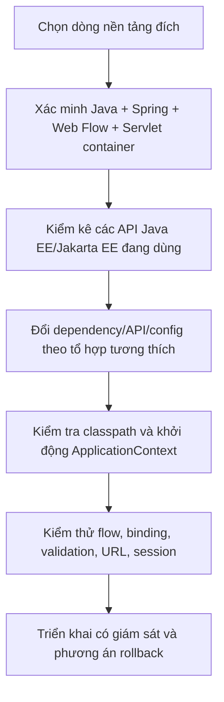
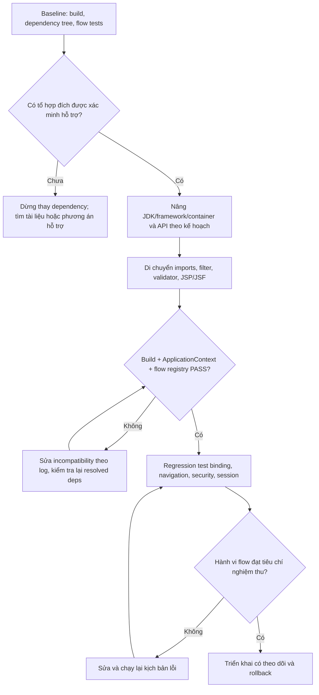

# Di chuyển namespace javax sang Jakarta theo hệ sinh thái

Khi nâng cấp một ứng dụng **Spring Web Flow** (module `SPRING_WEB_FLOW`) đã hoạt động lâu năm, thay đổi từ `javax.*` sang `jakarta.*` thường là một trong những công việc có tác động rộng nhất. Ứng dụng có thể đang kết hợp **Spring MVC**, flow XML, `FlowExecutor`, biểu mẫu nhiều bước, validation, bảo mật, session, JSF và thư viện triển khai Servlet. Nếu chỉ sửa các câu `import` trong mã Java, hệ thống có thể biên dịch một phần nhưng thất bại khi khởi động hoặc khi người dùng gửi sự kiện để tiếp tục flow.

Bài thuộc chương **Nâng cấp ứng dụng cũ** này hướng dẫn nhận diện đúng phần Jakarta EE cần chuyển, dựng ma trận tương thích, di chuyển theo từng lớp phụ thuộc, kiểm chứng form binding và điều hướng nhiều bước, rồi lên kế hoạch triển khai/rollback. Các số phiên bản cụ thể phải được chốt bằng release notes và tài liệu của **dòng đích thực tế**; bài sử dụng tên phiên bản minh họa khi chưa có dữ liệu dự án.

## 1. Hiểu bản chất của việc đổi namespace

Từ **Jakarta EE 9**, nhiều API doanh nghiệp trước đây mang namespace `javax.*` chuyển sang `jakarta.*`. Đây là thay đổi về **tên package và kiểu Java**, ảnh hưởng đến chữ ký method, bytecode, dependency, cấu hình và runtime. Hai class có tên ngắn giống nhau nhưng nằm trong hai package khác nhau **không phải cùng một kiểu**:

```java
// Dòng Servlet cũ:
javax.servlet.http.HttpServletRequest

// Dòng Jakarta Servlet:
jakarta.servlet.http.HttpServletRequest
```

Một method nhận `javax.servlet.http.HttpServletRequest` không tự động thay thế được method nhận `jakarta.servlet.http.HttpServletRequest`. Vì vậy, không thể chỉ thay import ở application rồi giữ một thư viện tích hợp đã biên dịch cho dòng Servlet cũ.



Mục tiêu cuối cùng là **một tổ hợp thư viện và container đồng nhất**, trong đó các phần giao tiếp với Jakarta EE sử dụng kiểu tương thích và Spring Web Flow được xác nhận hỗ trợ nền tảng đó.

## 2. Không phải mọi package javax đều đổi sang jakarta

Sai lầm phổ biến nhất là chạy tìm kiếm/thay thế `javax.` thành `jakarta.` trên toàn bộ repository. Chỉ một số API thuộc hệ Jakarta EE được đổi tên. Nhiều API Java SE vẫn giữ namespace `javax`.

| Nhóm API | Package cũ | Package trong dòng Jakarta tương ứng |
| --- | --- | --- |
| Servlet | `javax.servlet.*` | `jakarta.servlet.*` |
| Servlet/JSP | `javax.servlet.jsp.*` | `jakarta.servlet.jsp.*` |
| Bean Validation | `javax.validation.*` | `jakarta.validation.*` |
| Persistence (JPA) | `javax.persistence.*` | `jakarta.persistence.*` |
| Faces/JSF | `javax.faces.*` | `jakarta.faces.*` |
| Expression Language | `javax.el.*` | `jakarta.el.*` |
| Jakarta CDI/Inject | `javax.inject.*` | `jakarta.inject.*` |
| Jakarta Transactions | `javax.transaction.*` | `jakarta.transaction.*` |
| Một số Common Annotations | `javax.annotation.*` | `jakarta.annotation.*` |
| XML Binding (JAXB) | `javax.xml.bind.*` | `jakarta.xml.bind.*` |
| JSON Processing | `javax.json.*` | `jakarta.json.*` |

Đây là **bản đồ package để khảo sát**. Bạn chỉ chuyển nhóm được ứng dụng sử dụng và đã xác minh phiên bản đích hỗ trợ; đôi khi cần đổi cả artifact, API triển khai, annotation và cấu hình ngoài Java.

Các package `javax` vẫn thường thuộc Java SE và **phải giữ nguyên**:

| Package | Ví dụ | Vì sao không thay máy móc? |
| --- | --- | --- |
| `javax.sql.*` | `javax.sql.DataSource` | API JDBC thuộc Java SE |
| `javax.crypto.*` | `javax.crypto.Cipher` | API mật mã Java SE |
| `javax.naming.*` | `javax.naming.InitialContext` | API JNDI Java SE |
| `javax.net.*` | `javax.net.ssl.SSLContext` | API mạng/TLS Java SE |
| `javax.xml.parsers.*` | `DocumentBuilderFactory` | API xử lý XML Java SE |
| `javax.xml.namespace.*` | `QName` | API XML Java SE |
| `javax.annotation.processing.*` | `AbstractProcessor` | API xử lý annotation của JDK |

Có những tên gần nhau nhưng thuộc hai nhóm khác nhau: `javax.annotation.PostConstruct` của Java EE/Jakarta Annotations cần được đánh giá để chuyển, trong khi `javax.annotation.processing.Processor` của compiler vẫn giữ nguyên. Cần dựa vào **loại API và artifact sở hữu**, không chỉ dựa vào tiền tố tên.

## 3. Cổng tương thích: quyết định có thể nâng hay chưa

Với Spring Web Flow, việc chuyển sang Jakarta là quyết định ở **toàn bộ web stack**, bởi request HTTP đi qua container, Spring MVC, `FlowHandlerMapping`, `FlowHandlerAdapter` và `FlowExecutor`. Trước khi thay dependency, lập ma trận:

| Thành phần | Câu hỏi bắt buộc | Bằng chứng cần có |
| --- | --- | --- |
| Spring Web Flow | Bản Web Flow đích có hỗ trợ dòng Spring Framework và Servlet Jakarta đang chọn không? | Release notes, tài liệu tương thích, artifact và API của đúng bản đích |
| Spring Framework | Dòng Spring dự kiến yêu cầu Java và Jakarta EE API nào? | System requirements và migration guide của Spring |
| Spring Boot (nếu dùng) | BOM/managed dependencies chọn tổ hợp nào? | Dependency management và release notes của dòng Boot |
| Servlet container | Container dùng `javax.servlet` hay `jakarta.servlet`? Phiên bản spec có khớp không? | Tài liệu container và bản triển khai thật |
| Spring Security | Bộ lọc, CSRF, authorization và flow security tích hợp bằng API nào? | Tài liệu migration/version tương ứng |
| Validation | API, implementation và converter có cùng hệ Jakarta không? | Dependency tree, Bean Validation implementation, bài test |
| JPA/Hibernate | Entity/transaction/ORM dùng namespace nào? | Tài liệu ORM/framework và kiểm thử persistence |
| JSF/Jakarta Faces | Bản Faces và adapter Web Flow có chạy cùng nền tảng không? | Tài liệu Faces, Web Flow integration và thử nghiệm thực tế |
| JVM/session | JDK/runtime, serializable state và thiết lập nhiều node có tương thích không? | Kết quả build, deploy, session test và chính sách upgrade |

Ví dụ nền tảng **Spring Framework 6 / Spring Boot 3** thuộc thế hệ sử dụng Jakarta EE API; tuy nhiên, điều này **không tự chứng minh** mọi phiên bản Spring Web Flow hoặc mọi plugin JSF của ứng dụng chạy được trên nền tảng ấy. Phải tìm **bản Web Flow có hỗ trợ chính thức hoặc bằng chứng tương thích được kiểm chứng**; nếu không có, cần hoãn việc đổi namespace ở production, giữ stack được hỗ trợ hoặc đánh giá phương án thay thế.

Một tổ hợp “biên dịch được khi ép version” vẫn có thể gặp lỗi liên kết binary, resolver hoặc session trong runtime. Khả năng tương thích cần được xác nhận ở cả **API, classpath và luồng nghiệp vụ**.

## 4. Kiểm kê nguồn và dependency trước khi sửa

Đầu tiên, ghi lại trạng thái hiện tại: version JDK, Spring Framework/Boot, Spring Web Flow, các starter, servlet container, thư viện security/validation/JSF/JPA và cách deploy (WAR, ứng dụng nhúng, nhiều node). Không suy ra tất cả từ `pom.xml` hoặc `build.gradle` vì dependency transitive/BOM có thể chọn bản khác.

Có thể tìm code đang sử dụng nhóm `javax` liên quan bằng lệnh `rg`:

```bash
rg -n 'javax\.(servlet|validation|persistence|faces|el|inject|transaction|annotation|xml\.bind)' src
```

Kết quả chỉ là **danh sách ứng viên**. Ví dụ `javax.annotation.processing` là Java SE và không thuộc phạm vi đổi tên.

Với Maven:

```bash
mvn dependency:tree
```

Với Gradle, trong dự án có cấu hình `runtimeClasspath`:

```bash
./gradlew dependencies --configuration runtimeClasspath
./gradlew dependencyInsight --dependency spring-webflow --configuration runtimeClasspath
```

Ở Windows, dùng wrapper `gradlew.bat` phù hợp. Các lệnh là ví dụ kiểm kê để người học tự chạy khi làm nâng cấp; bản thân bài không yêu cầu chạy chúng trên module nội dung.

Ngoài mã nguồn, cần kiểm tra:

- Các JAR đã biên dịch của bộ lọc, interceptor, authentication provider, view resolver, component JSF hoặc extension Web Flow tự viết.
- JSP, TLD/tag library, `web.xml`, XML Spring/flow, cấu hình persistence, Hibernate và validation.
- Thư viện transitively cung cấp cả `javax.servlet-api` lẫn `jakarta.servlet-api` hoặc các integration chỉ hỗ trợ một dòng.
- Runtime thực tế có cung cấp servlet/JSP/EL API hay ứng dụng tự đóng gói.
- Dữ liệu session đã được serialize hoặc chia sẻ qua Redis/database nếu flow có cơ chế lưu execution.

**Không chỉ tìm source import.** Một thư viện JAR không có mã nguồn trong repository vẫn có thể phụ thuộc vào kiểu `javax.servlet.Filter` và gây lỗi khi deploy sang container Jakarta.

## 5. Lập bảng đổi dependency có kiểm soát

Khi đã chọn được tổ hợp phiên bản hỗ trợ Jakarta, đối chiếu các dependency với hệ mới. Ví dụ định danh thường gặp:

| API/thành phần | Nhóm cũ thường gặp | Nhóm Jakarta cần kiểm tra |
| --- | --- | --- |
| Servlet API | `javax.servlet:javax.servlet-api` | `jakarta.servlet:jakarta.servlet-api` |
| Validation API | `javax.validation:validation-api` | `jakarta.validation:jakarta.validation-api` |
| Persistence API | `javax.persistence:javax.persistence-api` | `jakarta.persistence:jakarta.persistence-api` |
| Annotation API | `javax.annotation:javax.annotation-api` | `jakarta.annotation:jakarta.annotation-api` |
| Faces API | Artifact JSF cũ theo `javax.faces` | Jakarta Faces API/implementation của nền tảng đích |
| JAXB API | `javax.xml.bind:jaxb-api` | `jakarta.xml.bind:jakarta.xml.bind-api` |

**Tên artifact đúng và version cần xác nhận trên repository/tài liệu đích**, đặc biệt với JSF implementation, validation provider, JPA và JSP/tag library. Đổi API JAR mà để implementation cũ không tương thích có thể dẫn tới lỗi khi runtime nạp lớp.

Một ví dụ Maven cho ứng dụng WAR chạy trên container **đã được xác minh cung cấp Jakarta Servlet API**:

```xml
<dependency>
    <groupId>jakarta.servlet</groupId>
    <artifactId>jakarta.servlet-api</artifactId>
    <version>TARGET_SERVLET_API_VERSION</version>
    <scope>provided</scope>
</dependency>
```

`TARGET_SERVLET_API_VERSION` là placeholder. Nếu chạy Spring Boot với dependency management, không tự ý khai báo version Servlet API bên ngoài BOM khi chưa có lý do kỹ thuật rõ ràng. Nếu dùng container nhúng, cách đóng gói khác WAR triển khai lên container ngoài; `provided` có thể không phù hợp.

Đối với Web Flow, artifact thường được khai báo theo `org.springframework.webflow:spring-webflow`; **không được tự đoán** rằng một version mới tùy ý tương thích Jakarta. Phiên bản đích phải đến từ tài liệu chính thức và thử nghiệm của chính tổ hợp đang triển khai.

## 6. Chuyển Java code: imports, chữ ký method và extension

Mã ứng dụng giao tiếp trực tiếp với Servlet API cần đổi cả imports và đảm bảo lớp cha/interface cùng thế hệ Jakarta.

Ví dụ một `HandlerInterceptor` cho Spring MVC:

**Trước khi nâng, trên stack dùng Servlet `javax`:**

```java
import javax.servlet.http.HttpServletRequest;
import javax.servlet.http.HttpServletResponse;
import org.springframework.web.servlet.HandlerInterceptor;

public class FlowRequestInterceptor implements HandlerInterceptor {
    @Override
    public boolean preHandle(HttpServletRequest request,
                             HttpServletResponse response,
                             Object handler) {
        return true;
    }
}
```

**Sau khi chọn stack Spring MVC tương thích Jakarta:**

```java
import jakarta.servlet.http.HttpServletRequest;
import jakarta.servlet.http.HttpServletResponse;
import org.springframework.web.servlet.HandlerInterceptor;

public class FlowRequestInterceptor implements HandlerInterceptor {
    @Override
    public boolean preHandle(HttpServletRequest request,
                             HttpServletResponse response,
                             Object handler) {
        return true;
    }
}
```

Phần logic có thể giống nhau, nhưng method override ở bản đích dựa trên **kiểu `jakarta.servlet`**. Đổi import trong ứng dụng cũ khi Spring MVC vẫn định nghĩa method bằng `javax.servlet` sẽ khiến `@Override` không khớp hoặc gây lỗi khác. Ngược lại, một filter JAR biên dịch cho `javax.servlet.Filter` không trở thành Jakarta Filter chỉ nhờ một import trong code gọi.

Các nơi cần kiểm tra kỹ:

- Servlet `Filter`, `ServletContextListener`, request/session wrapper và class triển khai `HttpServlet`.
- Interceptor hoặc adapter liên quan `FlowHandlerAdapter` và MVC request/response.
- Validator, JPA entity, listener, exception handler và dependency injection annotations.
- Custom JSF component, phase listener, converter và navigation integration.
- Thư viện có API trả về hoặc nhận `javax.*` trong public method.

Các gói nội bộ của Web Flow như `org.springframework.webflow.*` và nhiều interface do Spring định nghĩa **không tự đổi tên** thành `jakarta.spring.*`. Chỉ cập nhật code theo API được công bố ở **phiên bản tương ứng**, không đổi tên package tùy ý.

## 7. Flow XML và Spring XML không phải nơi thay toàn bộ javax

Spring Web Flow mô hình hóa state, event, transition và subflow bằng XML. Phần XML định nghĩa flow sử dụng **namespace schema của Spring Web Flow**, không phải namespace Java package:

```xml
<?xml version="1.0" encoding="UTF-8"?>
<flow xmlns="http://www.springframework.org/schema/webflow"
      xmlns:xsi="http://www.w3.org/2001/XMLSchema-instance"
      xsi:schemaLocation="
          http://www.springframework.org/schema/webflow
          http://www.springframework.org/schema/webflow/spring-webflow-2.0.xsd">

    <view-state id="shipping" view="checkout/shipping">
        <transition on="continue" to="review" />
    </view-state>

    <view-state id="review" view="checkout/review">
        <transition on="confirm" to="done" />
    </view-state>

    <end-state id="done" />
</flow>
```

**Không thay** `http://www.springframework.org/schema/webflow` thành một URL tưởng tượng có chữ `jakarta`. Tên namespace và schema cần kiểm tra với tài liệu Web Flow đích; việc nâng Servlet API không tự thay đổi cấu trúc XML flow.

Những chỗ trong XML có thể thực sự cần cập nhật là:

1. **Tên lớp Java** trong `class`, `bean` hoặc các expression nếu ứng dụng dùng class chuyển sang API khác.
2. Bean factory, adapter, listener và extension point bị thay/loại bỏ giữa các bản Spring/Web Flow.
3. Cấu hình MVC, Security và view resolver khi dòng framework đích dùng cơ chế mới.
4. `web.xml`, schema Jakarta Servlet và listener/filter được container đọc nếu ứng dụng dùng deployment descriptor.
5. Các schema của **persistence/validation/JSF** nếu thư viện đích yêu cầu.

Không đổi đồng loạt các URL `www.springframework.org/schema/...` hoặc định danh của Spring tags chỉ vì chúng chứa chữ “java” hoặc “spring”. Chúng là namespace/configuration contract riêng.

## 8. Di chuyển biểu mẫu, validation và dữ liệu scope

Flow nhiều bước phụ thuộc vào vòng đời của model và cơ chế binding. Đổi sang Jakarta có thể ảnh hưởng đến **Bean Validation** và thư viện giao diện, dù khái niệm `flowScope`, `viewScope`, event và transition vẫn là mô hình của Web Flow.

### 8.1. Bean Validation

Ví dụ khai báo constraint:

**Trước:**

```java
import javax.validation.constraints.NotBlank;
import javax.validation.constraints.Positive;

public class ShippingForm {
    @NotBlank
    private String recipient;

    @Positive
    private Integer packageCount;

    // Getter/setter
}
```

**Sau, nếu dòng validation đích hỗ trợ Jakarta:**

```java
import jakarta.validation.constraints.NotBlank;
import jakarta.validation.constraints.Positive;

public class ShippingForm {
    @NotBlank
    private String recipient;

    @Positive
    private Integer packageCount;

    // Getter/setter
}
```

Phải nâng **cả Validation API và implementation tương thích**, rồi xác nhận validator đang được Web Flow gọi khi submit form. Chỉ đổi annotation package chưa chứng minh validation tự động chạy; cần kiểm thử input sai, thông báo lỗi và transition bị chặn đúng cách.

### 8.2. JSP, tag library và Jakarta Tags

Nếu giao diện dùng JSP/JSTL, ngoài Servlet cần kiểm tra phiên bản **Jakarta Server Pages / Jakarta Tags**. Với Jakarta Tags 3.0, namespace taglib JSTL core thường dùng:

```jsp
<%@ taglib prefix="c" uri="jakarta.tags.core" %>
```

Trong ứng dụng JSP cũ, bạn có thể gặp URI:

```jsp
<%@ taglib prefix="c" uri="http://java.sun.com/jsp/jstl/core" %>
```

Cách chuyển chính xác phụ thuộc bản JSP/Jakarta Tags và implementation đã chọn; cần kiểm tra tag library/JAR/container cùng nhau. Spring form taglib như `http://www.springframework.org/tags/form` là **URI riêng của Spring**, không được tự động viết lại thành `jakarta.tags.form`.

Ví dụ form tiếp tục flow vẫn cần URL và event phù hợp:

```jsp
<form method="post" action="${flowExecutionUrl}">
    <input name="recipient" />
    <button type="submit" name="_eventId_continue" value="1">
        Tiếp tục
    </button>
</form>
```

`flowExecutionUrl` phải đến từ view Web Flow đang render. Sau nâng cấp, kiểm tra URL có `execution`, request đến đúng flow execution và binder gán `recipient` vào model. Khi đổi JSP runtime, một form có HTML đúng vẫn có thể không render nếu TLD/tag library không tương thích.

### 8.3. Flow scope không phải Jakarta namespace

`flowScope`, `viewScope`, `conversationScope` và `requestScope` là các khái niệm scope của Web Flow. **Không đổi tên chúng** thành `jakarta.flowScope` hoặc biến tương tự. Điều cần kiểm thử là **cách runtime lưu/khôi phục dữ liệu**, đặc biệt khi application context, session manager và repository thay đổi.

Nếu người dùng đang ở state `shipping` với execution key `e1s1` rồi chuyển sang `review`, cần xác nhận model được giữ theo chính sách trước đó, giá trị typed/validated còn nguyên và không bị dùng chung giữa hai execution.

## 9. JSF/Jakarta Faces: xem như một nhánh tích hợp riêng

Một số ứng dụng Spring Web Flow cũ dùng JSF để render nhiều bước. Trường hợp này, migration liên quan không chỉ Servlet mà còn cả **Faces**, **Expression Language**, tag library, view technology, component library và adapter Web Flow/JSF.

Ví dụ package Java của JSF thay đổi theo dòng Jakarta Faces:

```java
// Trên API JSF cũ:
import javax.faces.context.FacesContext;

// Trên API Jakarta Faces tương ứng:
import jakarta.faces.context.FacesContext;
```

Nhưng một custom JSF component biên dịch cho dòng cũ có thể vẫn tham chiếu `javax.faces.*` trong bytecode. Nếu JSF library, component library và Web Flow integration không đồng bộ, kết quả có thể là lỗi nạp class, lỗi EL, không restore được view hoặc không xử lý action.

Trình tự cần thực hiện khi có JSF:

1. Chốt dòng Jakarta Faces, Servlet/JSP/EL, JDK và container được hỗ trợ.
2. Xác nhận **Spring Web Flow JSF integration của bản đích** tương thích với bộ đó.
3. Cập nhật component/tag library và custom converter/validator theo tài liệu của chúng.
4. Kiểm thử view state, action event, navigation/subflow, postback, view restoration và session timeout.
5. Nếu không tìm được tổ hợp được hỗ trợ, ghi rõ blocker tương thích và giữ phương án triển khai hiện tại trong khi đánh giá nâng cấp.

Không nên coi việc Java class import được `jakarta.faces.*` là bằng chứng rằng bridge Web Flow/JSF đã hoạt động.

## 10. Security, Filter và Session cần được nâng cùng hệ

Spring Security thường dùng filter chain. Một filter cũ triển khai `javax.servlet.Filter` không thể được đăng ký như filter Jakarta trong runtime mới nếu không có phiên bản tương thích. Khi chuyển stack:

- Đọc migration guide của **Spring Security** đích, cập nhật cấu hình filter chain, authentication/authorization và cơ chế CSRF theo API thực tế.
- Bảo vệ request POST gửi `_eventId` trong Web Flow. **Execution key không thay thế CSRF token** và không chứng minh quyền truy cập đơn hàng.
- Xác nhận các state hoặc action nhạy cảm tiếp tục kiểm tra quyền người dùng ở backend.
- Kiểm tra session fixation, timeout, logout và điều hướng khi người dùng quay lại một URL chứa `execution` sau khi session mất.
- Nếu dùng reverse proxy/load balancer hoặc nhiều instance, xác minh session affinity hoặc shared session theo kiến trúc thật.

**Rủi ro khi rolling upgrade:** một flow execution cũ có thể nằm trong HTTP session hoặc repository chứa object đã serialize từ thư viện/phiên bản cũ. Khi request sau đó rơi vào node Jakarta mới, hệ thống có thể không đọc được kiểu class, snapshot hoặc session đã lưu. Namespace `javax`/`jakarta` là một thay đổi có thể khiến dữ liệu serialized không tương thích.

Không hứa rằng người dùng có thể tiếp tục flow đang mở xuyên qua quá trình chuyển stack. Với quy trình quan trọng, cân nhắc **drain session/flow đang chạy**, thông báo thời gian chuyển đổi, lưu draft nghiệp vụ độc lập khi cần và chỉ đưa người dùng mới vào stack đích khi đã xác minh.

## 11. Phát hiện lỗi do trộn javax/jakarta

Bảng sau liên hệ triệu chứng với nguyên nhân khả dĩ:

| Triệu chứng | Điểm cần điều tra | Ví dụ hành động |
| --- | --- | --- |
| `ClassNotFoundException: javax.servlet...` trên runtime Jakarta | Thư viện cũ vẫn phụ thuộc Servlet `javax` | Xác định JAR gọi class đó, nâng hoặc thay bằng bản Jakarta |
| `NoClassDefFoundError: jakarta.servlet...` | Runtime/container không cung cấp Jakarta Servlet API tương ứng | Kiểm tra container, scope và classpath |
| `ClassCastException` giữa filter/listener | Interface `javax` và `jakarta` khác nhau | Cập nhật toàn bộ chain tương ứng |
| `NoSuchMethodError` | Các module được build với binary API khác nhau | Kiểm tra version resolved và dependency mediation |
| `BeanCreationException` của MVC/Flow registry | Bean/adapter hoặc dependency không tương thích | Đọc chuỗi `Caused by` và phần config liên quan |
| Form không hiển thị validation | API/implementation hoặc validator wiring khác nhau | Kiểm tra annotation, provider và callback validation của flow |
| Lỗi JSP/TLD/JSF view | Runtime trang, taglib/component library chưa đồng bộ | Đối chiếu JSP/Jakarta Tags/Faces/EL theo dòng đích |
| `NoSuchFlowExecutionException` khi chuyển bước | Session/repository/execution cũ mất hoặc không restore được | Kiểm tra session, key, node nhận request và thời điểm nâng cấp |

Cần nhớ rằng **một dependency tree có cả `javax.*` và `jakarta.*` chưa tự chứng minh lỗi**: có những API Java SE hợp lệ vẫn mang `javax`. Hãy nhận diện chính xác **loại API đang được nạp** và nơi một interface giữa hai thế hệ bị trộn.

Khi đọc log, hãy lần từ exception bao ngoài xuống `Caused by` sâu nhất; kiểm tra class name đầy đủ, JAR cung cấp class và bản runtime. Không chỉ xóa một JAR dựa trên tiền tố package rồi hy vọng lỗi biến mất.

## 12. Một chiến lược nâng cấp theo các cổng kiểm chứng

Có thể dùng các cổng sau để triển khai từng bước có kiểm soát:



**Cổng 1 — Compatibility:** mỗi thư viện sở hữu Servlet/MVC/Web Flow/validation/JSF có phiên bản đích rõ ràng, được hỗ trợ trong cùng nền tảng. Nếu chưa biết bản Web Flow nào chạy với Jakarta, cổng này chưa đạt.

**Cổng 2 — Build/classpath:** compile và chạy được app bằng resolved dependencies của runtime; không có API duplicate gây lỗi liên kết. Bản WAR/JAR đã đóng gói phải có cấu trúc phù hợp container.

**Cổng 3 — Web Flow startup:** ứng dụng khởi tạo được registry, `FlowExecutor` và MVC integration; XML được parse và các flow ID đều tìm thấy.

**Cổng 4 — Hành vi:** kiểm thử hành trình nhiều bước, event, binding/validation, view rendering, subflow, transaction, security và session.

**Cổng 5 — Triển khai:** đã có phương án xử lý flow đang mở, giám sát lỗi và quay lại artifact cũ. Nếu kèm thay đổi schema database, cần một kế hoạch dữ liệu tương thích/khôi phục riêng; rollback binary không tự rollback dữ liệu.

## 13. Ma trận test cho Spring Web Flow sau chuyển Jakarta

Giả sử hệ thống có flow `checkout` gồm `cart → shipping → review → completed`. Bộ kiểm thử cần vượt quá bước “trang chủ trả HTTP 200”.

| Kịch bản | Đầu vào / thao tác | Kết quả cần xác nhận |
| --- | --- | --- |
| Khởi tạo flow | GET URL bắt đầu checkout | Flow được đăng ký và mở ở `cart` |
| Event tiếp tục | Submit `_eventId_continue` tới `flowExecutionUrl` | Tiếp tục đúng execution, chuyển state theo transition |
| Binding hợp lệ | Gửi tên/ngày/số lượng hợp lệ | Model có kiểu dữ liệu đúng và giữ dữ liệu qua các state |
| Binding sai | Gửi giá trị không chuyển được kiểu | Giữ form, hiển thị lỗi, không ghi đơn hàng |
| Validation | Bỏ trống trường required hoặc giá trị nghiệp vụ sai | Không vượt qua bước khi chưa hợp lệ |
| Back/Refresh | Quay lại view trước, refresh ở giữa flow | Hoạt động theo chính sách snapshot/repository đã chọn |
| Session timeout | Dùng lại URL có execution key sau timeout | Hiển thị đường khôi phục an toàn, không tạo giao dịch ngoài ý muốn |
| Nhiều tab | Mở hai flow độc lập, nhập hai bộ dữ liệu | Không lẫn flowScope/session model |
| Security | Người không đủ quyền gửi POST/event | Bị từ chối theo chính sách security, CSRF vẫn hoạt động |
| JSF nếu dùng | Postback, converter và view restoration | Màn hình JSF tiếp tục điều hướng đúng |
| Lưu dữ liệu | Xác nhận đơn hàng, thử gửi lại request | Không tạo đơn trùng; transaction và kết quả nhất quán |
| Nhiều node | Chuyển node theo chiến lược session thực tế | Flow có thể tiếp tục hoặc được xử lý fallback đúng chính sách |

Cần kiểm thử cả **view layer và backend**. Ví dụ form có thể render bình thường nhưng Bean Validation provider chưa được khởi tạo; chỉ khi gửi dữ liệu sai mới phát hiện luồng đã bỏ qua validation.

## 14. Ví dụ hồ sơ migration để review

Ghi lại quyết định trong một tài liệu ngắn giúp tránh những thay đổi namespace khó truy nguyên:

```text
Chủ đề: Chuyển ứng dụng Spring Web Flow từ javax sang Jakarta

Nguồn hiện tại:
  Spring Web Flow: [version resolved]
  Spring Framework/Boot: [version resolved]
  Java, Servlet container: [version thực tế]
  Security, Validation, JPA, JSF: [liệt kê loại đang dùng]

Đích được xác minh:
  Java + Framework + Boot (nếu có): [version]
  Web Flow: [version hỗ trợ stack đích]
  Jakarta Servlet/container: [version]
  Các tích hợp bổ trợ: [version]
  Release notes/migration guides: [URL + ngày tra cứu]

Các nhóm mã cần sửa:
  - Servlet filter/interceptor
  - Bean Validation/API/provider
  - JPA/transaction (nếu dùng)
  - JSP/Jakarta Tags hoặc JSF/Jakarta Faces
  - XML/config/API tích hợp theo tài liệu đích

Bằng chứng:
  - Dependency tree: PASS/FAIL
  - Compile + ApplicationContext: PASS/FAIL
  - Registry/FlowExecutor/MVC mapping: PASS/FAIL
  - Binding/validation/navigation/subflow: PASS/FAIL
  - Security/session/multi-node: PASS/FAIL

Chiến lược rollout: [drain phiên/blue-green/cách khác]
Rollback: [artifact, config, dữ liệu và điều kiện kích hoạt]
Vấn đề chưa xác minh: [ghi rõ hoặc không có]
Quyết định: [cho phép / cần bổ sung / tạm chặn]
```

Đặc biệt, cần ghi rõ liệu **execution/session snapshot của stack cũ có được chuyển tiếp hay phải kết thúc**. Việc không kiểm tra dữ liệu đang sống có thể khiến nâng cấp trông thành công ở smoke test nhưng tạo lỗi cho người dùng đã mở form từ trước.

## 15. Bài thực hành: tìm nguyên nhân nâng cấp hỏng

Một ứng dụng có cấu hình sau:

- Mã nguồn vừa được sửa từ `javax.servlet.http.HttpServletRequest` sang `jakarta.servlet.http.HttpServletRequest`.
- Runtime dùng container hỗ trợ Jakarta Servlet.
- Dự án vẫn đóng gói một JAR filter của bên thứ ba được build theo `javax.servlet.Filter`.
- Form thanh toán vẫn dùng Spring Web Flow, có `flowScope` và gửi `_eventId_continue`.

Sau deploy, ứng dụng gặp lỗi khi đăng ký filter; team đề xuất thêm cả `javax.servlet-api` vào WAR để “cho đủ class”.

**Câu hỏi:**

1. Vì sao thêm API `javax.servlet` chưa giải quyết được khả năng tương thích?
2. Cần thay đổi gì ở filter và các dependency liên quan?
3. Có được phép kết luận Spring Web Flow đích chạy tốt vì đã sửa xong filter không?
4. Liệt kê bốn test flow quan trọng sau khi ứng dụng khởi động.
5. Nếu session đang dùng chứa serialized flow execution từ phiên bản cũ, cần cân nhắc điều gì khi rollout?

**Gợi ý lời giải:**

1. `javax.servlet.Filter` và `jakarta.servlet.Filter` là hai interface khác nhau. Thêm JAR API cũ chỉ có thể cho JVM nạp được class, không biến filter cũ thành đối tượng tương thích với filter chain Jakarta.
2. Cần bản filter đã build cho Jakarta (hoặc thay thư viện), đồng thời kiểm tra security chain, servlet API/container và các dependency transitively liên quan.
3. Chưa. Vẫn phải xác nhận **phiên bản Spring Web Flow, Spring MVC, validation và view integration** được hỗ trợ trên stack đích, rồi kiểm thử thực tế.
4. Thử mở `checkout`, submit event và binding đúng model, gửi input sai để xem validation, và dùng Back/Refresh/session timeout để kiểm chứng resume/recovery; bổ sung security/JSF nếu ứng dụng có dùng.
5. Không giả định session/snapshot có thể deserialize hoặc tiếp tục giữa hai hệ API. Cần chiến lược drain/fallback, đo tác động tới người dùng và rollback phù hợp trước khi chuyển lưu lượng.

**Điểm cần nhớ:** Di chuyển `javax` sang `jakarta` là **nâng cả hệ sinh thái API/runtime**, không chỉ đổi import Java. Với Spring Web Flow, quyết định đúng bắt đầu từ tổ hợp phiên bản được xác minh hỗ trợ, tiếp đến là chuyển các integration thực sự dùng và kiểm thử toàn bộ vòng đời của một flow: khởi tạo, bind/validate, event/transition, tiếp tục qua execution key, bảo mật và phục hồi khi session lỗi.
