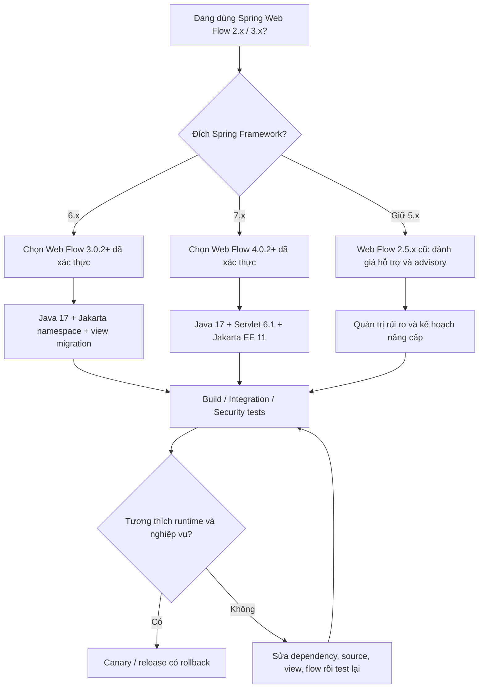

# Đối chiếu Web Flow 2.x, 3.x, 4.x với Spring Framework khi nâng cấp ứng dụng cũ

Một ứng dụng Spring MVC dùng Spring Web Flow từ nhiều năm trước có thể vẫn chạy tốt với các wizard đăng ký, đặt hàng hoặc phê duyệt. Nhưng khi nâng cấp Spring Framework, Spring Boot, Java hoặc máy chủ servlet, không thể chỉ thay version `spring-webflow` rồi kỳ vọng tất cả flow cũ hoạt động như trước. Những thay đổi về **Java baseline**, **`javax.*` → `jakarta.*`**, **Servlet API**, **Spring Security**, **JSF**, **view technology** và **cơ chế bảo mật binding** có thể khiến ứng dụng không biên dịch, không khởi động hoặc gặp lỗi chỉ khi resume một execution.

Bài học thuộc chương **Nâng cấp ứng dụng cũ** của module `SPRING_WEB_FLOW`. Mục tiêu là **đối chiếu ba thế hệ Spring Web Flow 2.x, 3.x và 4.x với ba thế hệ Spring Framework tương ứng**, sau đó xây dựng lộ trình nâng cấp có thể kiểm chứng. Spring Web Flow vẫn tổ chức hành trình nhiều bước bằng state, event, transition, subflow, form binding và các scope, nhưng **tính tương thích của runtime phải được quyết định theo toàn bộ stack**, không chỉ theo syntax của flow XML.

> **Mốc tra cứu: 25/11/2026.** Theo các nguồn chính thức được liệt kê cuối bài, nhánh 3.x có bản phát hành công khai `3.0.2` (10/06/2026); nhánh 4.x có `4.0.2` (19/11/2026) trong danh sách GitHub Releases. Những số version này là **mốc tại thời điểm biên soạn**, không phải hằng số cho mọi lần nâng cấp sau này. Cần xác minh release notes, advisory và chính sách hỗ trợ trước khi chọn version thực tế.

Sau bài học, bạn có thể:

- Phân biệt **version của Spring Web Flow** và **version của Spring Framework/Spring Boot**.
- Đọc bảng đối chiếu Web Flow **2.5.x ↔ Framework 5**, **3.0.x ↔ Framework 6**, **4.0.x ↔ Framework 7** cùng yêu cầu Java/Servlet/Jakarta.
- Xác định các lớp ứng dụng cũ bị ảnh hưởng: dependency, namespace Java, JSP/JSF, Tiles, validation, Spring Security, MVC và flow repository.
- Lập kế hoạch nâng cấp theo giai đoạn với tiêu chí **build, test, smoke test, security và rollback**.
- Phát hiện và xử lý các lỗi thường gặp khi framework đã đổi major nhưng XML flow trông vẫn “đúng”.
- Phân tích hai vấn đề bảo mật Web Flow được công bố tháng 06/2026 và lựa chọn bản vá phù hợp.

## 1. Phải xác định đúng "hai trục version"

**Spring Web Flow** là thư viện tích hợp với **Spring Web MVC** để điều phối hành trình có trạng thái qua nhiều request. **Spring Framework** cung cấp hạ tầng IoC, MVC, validation, conversion và transaction. **Spring Boot** (nếu ứng dụng sử dụng) cung cấp dependency management, cấu hình mặc định và runtime. Đây là các sản phẩm có **lịch phát hành khác nhau**.

Ví dụ một dependency Maven:

```xml
<dependency>
    <groupId>org.springframework.webflow</groupId>
    <artifactId>spring-webflow</artifactId>
    <version>3.0.2</version>
</dependency>
```

Đoạn trên chọn **Spring Web Flow 3.0.2**, không có nghĩa ứng dụng đang sử dụng **Spring Framework 3.0.2**. Phiên bản thực tế của `spring-core`, `spring-webmvc` và các module khác vẫn do BOM, dependency management hoặc cấu hình build quyết định.

Phân biệt:

| Khái niệm | Đối tượng | Không nên suy ra |
| --- | --- | --- |
| `spring-webflow:3.0.2` | Phiên bản thư viện Web Flow | Không phải Spring Framework 3.0 |
| `spring-webmvc:6.x` | Phiên bản module MVC thuộc Spring Framework | Không chứng minh Web Flow 2.x chạy tương thích |
| Spring Boot `3.x` | BOM và nền tảng ứng dụng Spring Boot | Không tự đảm bảo mọi module ngoài hệ sinh thái Boot đã được nâng cấp |
| Java 17 | JDK biên dịch và chạy | Không tự thay `javax.servlet` bằng `jakarta.servlet` |
| Servlet 6.1 | API/ràng buộc container web | Không thể suy ra container cũ đã hỗ trợ |

**Nguyên tắc đầu tiên:** chốt một **bộ version tương thích** gồm Spring Web Flow, Spring Framework, Spring Security, Servlet container, Java, JSF và view libraries; không chỉ nâng một JAR riêng lẻ.

## 2. Bảng đối chiếu Web Flow 2.x, 3.x, 4.x

Bảng sau tập trung vào các dòng phổ biến khi nâng cấp. Trong nhánh 2.x, **Web Flow 2.5.x** là đại diện gắn với Spring Framework 5; các nhánh 2.0–2.4 còn cũ hơn và cần xem lại yêu cầu tương ứng chứ không nên áp dụng máy móc yêu cầu của 2.5.

| Tiêu chí | Web Flow **2.5.x** | Web Flow **3.0.x** | Web Flow **4.0.x** |
| --- | --- | --- | --- |
| Thế hệ Spring Framework mục tiêu | **5.x** | **6.x** | **7.x** |
| Mốc JDK tối thiểu theo tài liệu dòng này | **Java 8+** | **Java 17+** | **Java 17+** |
| Servlet API | Thế hệ **`javax.servlet`**, 2.5 đặt baseline **Servlet 3.1** | Thế hệ **`jakarta.servlet`**, phù hợp Spring 6/Jakarta EE | **Servlet 6.1**, phù hợp Spring 7/Jakarta EE 11 |
| Nền tảng Jakarta | Java EE / namespace `javax.*` cho các API EE liên quan | Chuyển sang **Jakarta EE**; Spring 6 sử dụng namespace `jakarta.*` | **Jakarta EE 11** |
| JSF/Faces nếu ứng dụng dùng tích hợp Faces | **JSF 2.2+** (namespace `javax.faces`) | **Jakarta Faces 4.0+** | **Jakarta Faces 4.1+** |
| Spring Security cần rà soát | Thế hệ phù hợp Framework 5 | Thế hệ phù hợp Framework 6 | Thế hệ phù hợp Framework 7 |
| Phạm vi nâng cấp lớn nhất | Chạy trên stack Java 8/Framework 5 cũ | **Java 17 + javax→jakarta**, view/dependencies | **Framework 7 + Servlet 6.1 + Jakarta EE 11** |
| Bản công khai đã được xác nhận tại mốc biên soạn | `2.5.1.RELEASE` (bản cũ, có advisory) | `3.0.2` | `4.0.2` |

Các mốc nền tảng xuất phát từ tài liệu chính thức:

- [Web Flow 2.5.1: yêu cầu Java 8, Spring 5](https://docs.spring.io/spring-webflow/docs/2.5.1.RELEASE/reference/html/introduction.html) và [What's New 2.5: Servlet 3.1, JSF 2.2, các thay đổi module](https://docs.spring.io/spring-webflow/docs/2.5.0.RELEASE/reference/html/whatsnew.html).
- [Web Flow 3.0.2 Reference: Java 17, Spring Framework 6.0+](https://docs.spring.io/spring-webflow/docs/3.0.2/reference/) và [công bố Web Flow 3.0.0](https://spring.io/blog/2023/07/13/spring-web-flow-3-0-0-released/).
- [Web Flow 4.0.1 Reference: Java 17, Spring Framework 7.0, Servlet 6.1](https://docs.spring.io/spring-webflow/docs/4.0.1/reference/) và [danh sách release 4.0.2](https://github.com/spring-projects/spring-webflow/releases).

### Cách đọc đúng bảng

- **Đây là các nhóm nền tảng mục tiêu, không phải cam kết mọi bản patch đều tương thích với mọi bản patch của Framework.** Cần dùng release notes, dependency tree, API thật và integration tests.
- Tài liệu Web Flow 2.5 từng nêu **Spring 5.0 trở lên** tại thời điểm phát hành. Không hiểu câu này là bằng chứng Web Flow 2.5 **đương nhiên tương thích với Spring Framework 6/7**; rào cản `javax`/`jakarta` giữa các major là rất thực tế.
- Tài liệu 3.0.2 nói **Spring Framework 6.0 hoặc cao hơn** nhưng điều này không thay thế việc đối chiếu baseline cụ thể của 4.x khi chọn Spring 7. Để nâng ứng dụng lên Spring Framework 7, **ưu tiên dòng Web Flow 4.x** được xây dựng cho nền tảng đó.
- Đối với Spring Boot, mapping thường là **Boot 2.x → Spring Framework 5**, **Boot 3.x → Framework 6**, **Boot 4.x → Framework 7**. Nhưng dependency Web Flow có thể được khai báo riêng; vẫn phải kiểm tra BOM và dependencies thực tế.

## 3. Sự thay đổi quan trọng nhất khi đi từ 2.x lên 3.x

Web Flow **3.0.0** được phát hành để hỗ trợ thế hệ **Spring Framework 6**, Java 17 và Jakarta EE. Với ứng dụng cũ, đây thường là đoạn nâng cấp khó nhất vì thay đổi không chỉ nằm trong logic flow.

### 3.1. Đổi namespace Java EE sang Jakarta EE

Các API Java EE được Jakarta EE chuyển sang namespace `jakarta.*`. Một ứng dụng Web Flow 2.5 dùng Spring MVC/JSF có thể có các import sau:

```java
// Ví dụ từ stack cũ Web Flow 2.5 / Framework 5:
import javax.servlet.http.HttpServletRequest;
import javax.validation.constraints.NotBlank;
import javax.persistence.Entity;
import javax.faces.context.FacesContext;
```

Trong hệ sinh thái Framework 6/Jakarta, các phần tương ứng thường thành:

```java
// Ví dụ sau khi chuyển sang stack Jakarta:
import jakarta.servlet.http.HttpServletRequest;
import jakarta.validation.constraints.NotBlank;
import jakarta.persistence.Entity;
import jakarta.faces.context.FacesContext;
```

**Không thay thế mù quáng toàn bộ chuỗi `javax.` trong mã nguồn.** Các package thuộc Java SE như `javax.crypto`, `javax.net`, `javax.management` không tự động chuyển sang `jakarta.*`. Chỉ migrate những API Jakarta EE thuộc phạm vi thật sự đang dùng.

Kiểm tra thêm:

- Servlet filters, listeners, custom `HttpServletRequestWrapper`, upload/multipart.
- Annotation Bean Validation và provider tương thích.
- JPA entity, Hibernate và các `AttributeConverter`.
- JSF listener, converter, validator, tag libraries và view `.xhtml`.
- Các thư viện Servlet/JSP/EL cũ còn kéo theo `javax.*` từ transitive dependencies.

### 3.2. Không phải XML namespace Web Flow cũng đổi sang `jakarta`

**XML namespace để định nghĩa Spring Web Flow** và **Java package của các API EE** là hai vấn đề khác nhau. Flow XML tiếp tục dùng namespace Spring tương ứng, ví dụ:

```xml
<flow xmlns="http://www.springframework.org/schema/webflow"
      xmlns:xsi="http://www.w3.org/2001/XMLSchema-instance"
      xsi:schemaLocation="
          http://www.springframework.org/schema/webflow
          http://www.springframework.org/schema/webflow/spring-webflow-2.0.xsd">
    <view-state id="details" view="orders/details">
        <transition on="next" to="review" />
    </view-state>
    <view-state id="review" view="orders/review" />
</flow>
```

Đoạn trên minh họa **một cấu trúc flow** sử dụng namespace của Spring; schema URL cần được xác nhận theo cấu hình/version cụ thể. Không đổi `http://www.springframework.org/schema/webflow` thành một namespace `jakarta` tự bịa. Các flow XML có thể giữ phần lớn cấu trúc state/transition trong khi mã Java và dependencies xung quanh phải đổi đáng kể.

### 3.3. Rà soát Tiles và cách render view

Spring Web Flow 3.0.0 được công bố cùng ghi chú: **Tiles không được chuyển sang Jakarta EE** trong các sample được nâng cấp; mẫu `booking-mvc` chuyển sang **Thymeleaf Layouts**. Với ứng dụng cũ dùng Tiles:

- Xác định mọi `TilesViewResolver`, layout definitions và template phụ thuộc Tiles.
- Chọn giải pháp view/layout có bản tương thích với Spring Framework 6/Jakarta (ví dụ Thymeleaf và layout dialect phù hợp).
- Giữ các **logical view ID** của flow nếu có thể, đồng thời đổi tầng ánh xạ view, giảm số thay đổi trong flow XML.
- Kiểm thử lại form field, error messages, execution URL, CSRF và redirect sau POST.

Đừng coi “flow XML parse được” là ứng dụng đã nâng cấp thành công nếu view resolver cũ không còn khởi tạo được.

### 3.4. JSF/Faces: kiểm tra cả phiên bản và integration

Tài liệu ghi rõ:

- Web Flow **2.5**: JSF **2.2+** (nền `javax.faces`).
- Web Flow **3.0**: Jakarta Faces/JSF **4.0+**.
- Web Flow **4.0**: Jakarta Faces/JSF **4.1+**.

Nếu dùng `spring-faces`, cần nâng **cùng dòng Web Flow mục tiêu**, kiểm tra `FacesServlet`, `JsfFlowHandlerAdapter`, JSF component library, `FacesContext`, AJAX và multipart. Không thể kết luận JSF đã tương thích chỉ từ việc update `spring-webflow` core khi toàn bộ giao diện vẫn chạy Faces đời cũ.

Nếu dự án dùng MVC + JSP/Thymeleaf thuần, **không cần tự thêm `spring-faces`** chỉ vì Spring Web Flow có tính năng tích hợp JSF.

## 4. Đi từ Web Flow 3.x lên 4.x: nâng cả baseline Framework 7

Web Flow 4.0.x được xây dựng cho nền tảng **Spring Framework 7.0**, **Java 17+**, **Servlet 6.1**. Theo tài liệu tham khảo dòng 4.0, tích hợp JSF yêu cầu **Faces 4.1+**. Bản Web Flow **4.0.2** được liệt kê trong GitHub Releases ngày **19/11/2026**, với nâng cấp dependency tới **Spring Framework 7.0.11** và **Spring Security 7.0.9**, cùng một cải tiến ở kiểm tra `ExpressionParser`.

**Điều cần hiểu:** việc 4.0.2 khai báo hoặc nâng dependency của nó không có nghĩa bất kỳ ứng dụng có Spring 7 đều chạy được chỉ cần thay một con số. Hãy xem chính sách quản lý BOM, dependency alignment và bộ API có sẵn trong container.

Các hạng mục thường phải rà soát:

| Hạng mục | Tình huống từ 3.x → 4.x | Cách kiểm tra |
| --- | --- | --- |
| Spring Framework | 6.x → 7.x | API deprecated/removed, MVC, expression/binding, lifecycle |
| Spring Security | Nhánh tương thích Framework 7 | Filter chain, cấu hình authentication/authorization, `SecurityFlowExecutionListener` |
| Servlet container | **Servlet 6.1** | Máy chủ/app server hoặc embedded container hỗ trợ đầy đủ API mới |
| Jakarta EE | Chuyển sang baseline **Jakarta EE 11** | Dependencies Servlet/JSP/EL/Validation/Persistence, dependency tree |
| JSF | Faces 4.0 → **4.1+** nếu có dùng | JSF implementation, component libraries và integration |
| Spring Boot (nếu có) | Thường Boot 3.x → Boot 4.x | BOM, starter, servlet runtime, cấu hình/điểm mở rộng |
| Test infrastructure | Bộ test/mock đời cũ | Test runner, Spring Test, security tests và cách launch/resume flow |

Một container chỉ hỗ trợ Servlet API đời cũ **không đáp ứng** baseline Web Flow 4.0. Đặc biệt lưu ý các ứng dụng đóng gói WAR triển khai lên application server do đội khác quản lý: nâng dependency trong WAR không tự nâng Servlet API do server cung cấp.

Spring Boot 4 cũng có hướng dẫn migration riêng và dựa trên Jakarta EE 11/Servlet 6.1. Dự án cần kiểm tra môi trường thực tế thay vì suy ra tính tương thích chỉ từ JDK 17.

## 5. Chọn đường nâng cấp theo trạng thái ứng dụng

Không có một lộ trình bắt buộc cho mọi hệ thống. Có thể phân loại:

| Hiện trạng | Đích hợp lý | Điều kiện trước khi chuyển |
| --- | --- | --- |
| Web Flow 2.5 + Framework 5, cần tiếp tục ổn định ngắn hạn | Xác minh bản vá/hỗ trợ bảo mật còn khả dụng; lập kế hoạch thoát dòng cũ | Có phương án xử lý advisory và ngày kết thúc hỗ trợ |
| Web Flow 2.5 + Framework 5, muốn lên Spring Boot 3 | Web Flow **3.0.2** + Framework **6.x**, Java 17 và Jakarta | Đã xử lý `javax→jakarta`, Tiles/JSF/dependency compatibility |
| Web Flow 3.0.0/3.0.1 + Framework 6 | **3.0.2** hoặc bản vá 3.x mới hơn nếu được xác thực | Test regressions; xử lý các CVE đã công bố |
| Web Flow 3.x + Framework 6, muốn lên Spring Boot 4/Framework 7 | Web Flow **4.0.2** hoặc bản 4.x mới hơn đã được xác thực | Servlet 6.1, EE 11, Faces 4.1 khi cần |
| Web Flow 2.x, mục tiêu cuối là Framework 7 | Có thể dùng **3.x/Framework 6 làm checkpoint** trước 4.x/Framework 7 | Mỗi checkpoint build/test độc lập, không triển khai release trung gian nếu không cần |

**Checkpoint không bắt buộc là bản triển khai production.** Với hệ thống rất cũ, đi qua một nhánh tương thích 3.x trong môi trường thử nghiệm giúp tách lỗi “Java/Jakarta” khỏi lỗi “Framework 7/Servlet 6.1”. Nhưng nếu ứng dụng nhỏ và có đủ test, có thể nâng trực tiếp từ stack 2.x lên 4.x bằng một nhánh code riêng; khi đó lượng thay đổi phải xử lý cùng lúc lớn hơn.

### Sơ đồ quyết định phiên bản



Trong sơ đồ, dấu `+` sau version nghĩa là **bản vá cao hơn cùng nhánh nếu đã được xác thực ở thời điểm nâng cấp**, không phải lời khẳng định mọi số phiên bản cao hơn đều tồn tại hoặc tương thích vô điều kiện.

## 6. Kiểm kê trước nâng cấp: đừng bắt đầu bằng thay dependency

Điều tra theo **mã nguồn và hành vi thực tế của ứng dụng**, không dựa vào tên file hoặc một câu mô tả dự án cũ.

### 6.1. Lập danh sách version nền tảng

Ghi nhận ít nhất:

- Java compiler/runtime và phiên bản đang deploy thực tế.
- Spring Framework (`spring-core`, `spring-context`, `spring-webmvc`), Spring Boot nếu có.
- Spring Web Flow (`spring-webflow`, `spring-binding`, `spring-faces`, `spring-js-resources` nếu có).
- Spring Security, Spring Data/JPA, Hibernate, Bean Validation, JSF, Servlet API.
- View stack: JSP, Thymeleaf, Tiles, Facelets, jQuery/Dojo, AJAX/fragment.
- Container: Tomcat/Jetty/app server; loại package `jar` hoặc `war`.
- Cơ chế session, flow execution repository, clustering, serialization/snapshots và cách xử lý timeout.

Với Maven có thể tham khảo:

```bash
./mvnw -DskipTests dependency:tree
./mvnw -DskipTests help:effective-pom
```

Với Gradle có thể tham khảo:

```bash
./gradlew dependencies --configuration runtimeClasspath
./gradlew dependencyInsight --dependency spring-webflow --configuration runtimeClasspath
```

Đây là **lệnh mẫu để người học tự chạy tại dự án của họ**; bài học không chạy build và không suy ra trạng thái dependency của một repository cụ thể. Đọc cả direct dependencies lẫn các JAR kéo theo tự động: một thư viện cũ có thể giữ `javax.servlet-api` hoặc bản `spring-webmvc` không tương thích.

### 6.2. Kiểm kê các điểm tích hợp Web Flow

```text
FlowRegistry / flow definitions
  ├─ XML state, transitions, subflows, input/output
  ├─ <binder>, validator, converters, expression parser
  └─ security rules: <secured>

Spring MVC
  ├─ FlowHandlerMapping + FlowHandlerAdapter
  ├─ ViewResolver (JSP, Thymeleaf, Tiles...)
  ├─ Resource mapping, multipart, CSRF
  └─ URL launch/resume, redirect

Runtime
  ├─ FlowExecutor + FlowExecutionRepository
  ├─ Session/snapshot/serialization, timeout
  ├─ SecurityFlowExecutionListener
  └─ Spring service, transaction, JPA/JSF integration
```

Khi kiểm kê, đừng quên **code sử dụng lớp nội bộ hoặc extension point** của Web Flow. API SPI, expression parser, converter, listener và cấu hình security có thể đòi hỏi thay đổi dù các flow XML đơn giản vẫn parse được.

## 7. Quy trình nâng cấp an toàn qua sáu checkpoint

### Checkpoint 1 — Chốt nền tảng và bản vá

Chọn một tập version: Web Flow 3.0.2/Framework 6 hoặc Web Flow 4.0.2/Framework 7 theo nhu cầu. Rà soát release notes, advisory, Maven dependencies, Java/Servlet/JSF. Không chọn version đã biết có lỗi bảo mật nếu có bản đã sửa và phù hợp.

### Checkpoint 2 — Nâng Java/container trước theo nhánh riêng

Với đích Web Flow 3.x/4.x, bảo đảm JDK 17+ và công cụ build/test chạy được. Nếu đích 4.x, chọn runtime Servlet 6.1. Phân biệt Java compiler version với Java runtime ở máy chủ triển khai; chỉ việc CI build thành công trên JDK 17 chưa chứng minh server cũng đang chạy JDK đó.

### Checkpoint 3 — Chuyển API và thư viện giao diện

Đối với bước 2.x → 3.x, chuyển các API Java EE sang `jakarta.*`, nâng JSF/Validation/JPA/Servlet libraries tương ứng, thay Tiles hoặc view library chưa tương thích. Sửa compiler errors và dependency conflicts trước khi chạy flow.

### Checkpoint 4 — Nâng cấu hình Spring MVC, Web Flow và Security

Xác nhận các bean `FlowRegistry`, `FlowExecutor`, `FlowHandlerMapping`, `FlowHandlerAdapter`, `SecurityFlowExecutionListener` tồn tại và được nối đúng trong context. Kiểm tra các class custom, namespace, bean scopes, converter/validator và cách view resolver hoạt động.

### Checkpoint 5 — Kiểm thử theo hành trình thật

Chạy lần lượt một flow đơn giản, wizard nhiều bước, validation lỗi, subflow, Back/Refresh, cùng execution ở hai tab, hết hạn phiên, bảo mật, idempotency khi submit. Kiểm tra cả response HTTP và dữ liệu database; nhiều lỗi chỉ xuất hiện khi người dùng resume execution.

### Checkpoint 6 — Release có rollback

Triển khai canary hoặc môi trường staging giống production, đo số lỗi `FlowExecution` không khôi phục, lỗi binding, 403/CSRF, session timeout, thao tác ghi trùng. Cần đường rollback code **và** kế hoạch tương thích schema dữ liệu; không mặc định một execution serialized từ bản cũ có thể resume được dưới bản mới.

### Quy tắc về execution đang hoạt động khi rolling deployment

Khi Web Flow thay major, thay đổi class, scope object hoặc cơ chế serialization có thể làm các execution **đã lưu từ node/version cũ** không thể được khôi phục trong code mới. Trong hệ thống cluster:

1. Quyết định rõ có yêu cầu giữ wizard đang mở qua deployment hay không.
2. Nếu không thể bảo đảm compatibility, thiết kế **drain session**, chuyển hướng bắt đầu lại hoặc dùng **draft đã lưu** để phục hồi.
3. Kiểm tra session affinity, shared execution repository, serialization và phiên bản object.
4. Không coi user nhìn thấy trang từ browser cache là bằng chứng execution còn hợp lệ.

Đây là một **rủi ro triển khai**, không phải lời khẳng định mọi bản Web Flow không thể khôi phục execution giữa các phiên bản. Kết quả phụ thuộc repository, object graph và chiến lược deploy thật.

## 8. Ví dụ migration dependency và những điểm không nên copy máy móc

### 8.1. Maven với target Web Flow 3.x

```xml
<!-- Ví dụ: đích Spring Framework 6 / Java 17 / Jakarta -->
<dependency>
    <groupId>org.springframework.webflow</groupId>
    <artifactId>spring-webflow</artifactId>
    <version>3.0.2</version>
</dependency>
```

Nếu ứng dụng dùng JSF/Faces, bổ sung `spring-faces` **cùng phiên bản tương thích** theo tài liệu tương ứng và dùng Jakarta Faces 4.0+. Đừng thêm Faces cho dự án chỉ dùng Spring MVC/JSP.

### 8.2. Maven với target Web Flow 4.x

```xml
<!-- Ví dụ: đích Spring Framework 7 / Servlet 6.1 / Jakarta EE 11 -->
<dependency>
    <groupId>org.springframework.webflow</groupId>
    <artifactId>spring-webflow</artifactId>
    <version>4.0.2</version>
</dependency>
```

**Đây là ví dụ phần phụ thuộc Web Flow**, không phải POM hoàn chỉnh. Trong ứng dụng Spring Boot, dependency management có thể quyết định version các thư viện Spring và Servlet. Ở ứng dụng Spring Framework thuần, cần chủ động align bộ dependencies. Không đặt đồng thời `spring-webflow:3.x` và `spring-webflow:4.x` vào cùng classpath để “tăng khả năng tương thích”.

### 8.3. XML flow thường đổi ít hơn Java configuration

Các phần tử quen thuộc như `<view-state>`, `<action-state>`, `<transition>`, `<subflow-state>`, `<input>` và `<output>` vẫn là những khái niệm nền tảng. Vì vậy:

- **Không cần viết lại mọi flow XML thành Spring MVC controller** nếu mục tiêu vẫn là vận hành wizard nhiều bước.
- Nhưng phải kiểm thử expression evaluation, binding, validator, converter, exception handling, form model, `on-render` và AJAX.
- Với các flow có `view="...` trỏ tới Tiles/JSF cũ, lỗi có thể nằm ở tầng view dù transition còn nguyên.
- Khi chuyển runtime, kiểm tra stateful session/repository, redirect, URL tiếp tục execution và CSRF.

Một flow XML hợp lệ ở mức cú pháp **không chứng minh** tương thích toàn bộ khi chạy trên Spring Framework 6/7.

## 9. Hai vấn đề bảo mật đã được công bố năm 2026

Ngày **10/06/2026**, Spring công bố **Spring Web Flow 3.0.2** và **4.0.1** để sửa hai lỗ hổng. Đây là lý do thực tế để ưu tiên nhánh đã có bản vá thay vì chỉ chạy được chức năng.

| Advisory | Tác động/điều kiện chính | Các bản công khai đã sửa theo advisory |
| --- | --- | --- |
| **CVE-2026-40985** — Data Binding với Unified EL Parser | Ứng dụng cấu hình `WebFlowELExpressionParser`/`ELExpressionParser`, không bật `useSpringBinding=true`, và view-state không khai báo allowlist `<binding>`; có nguy cơ biểu thức Unified EL độc hại | **3.0.2**, **4.0.1** trở lên trong nhánh tương ứng |
| **CVE-2026-40986** — JS RemotingHandler render response không phải HTML như HTML | Liên quan `spring-js-resources` và Spring-Dojo.js dùng cho AJAX, có thể dẫn tới scripting khi response lỗi phản chiếu dữ liệu | **3.0.2**, **4.0.1** trở lên trong nhánh tương ứng |

Các bản bị ảnh hưởng theo advisory gồm Web Flow `2.5.1.RELEASE` trở về trước, `3.0.0`–`3.0.1` và `4.0.0`. Bản **2.5.2** được liệt kê là bản sửa cho **khách hàng Enterprise Support**, **không phải bản OSS công khai** tương đương `3.0.2`/`4.0.1`. Vì vậy, không đề xuất người dùng Maven Central đơn giản chọn `2.5.2` mà không kiểm tra kênh phân phối và quyền hỗ trợ.

Nguồn kiểm chứng:

- [CVE-2026-40985 — Spring Security Advisory](https://spring.io/security/cve-2026-40985/).
- [CVE-2026-40986 — Spring Security Advisory](https://spring.io/security/cve-2026-40986/).
- [Thông báo phát hành Web Flow 3.0.2 và 4.0.1](https://spring.io/blog/2026/06/10/spring-webflow-4-0-1-and-3-0-2-available-now/).

**Bài học bảo mật:** không đủ nếu chỉ nói “chúng tôi đã nâng Spring Framework”. Phải rà soát **version thật của Web Flow**, các module tùy chọn như `spring-js-resources`, expression parser và cách bind input. Dù đã nâng bản vá, vẫn nên dùng form DTO, `<binder><binding ... /></binder>` tường minh, validation, CSRF và object-level authorization ở service như các lớp phòng vệ bổ sung.

## 10. Checklist tương thích ứng dụng cũ theo tầng

| Tầng | Câu hỏi kiểm tra | Bằng chứng đạt |
| --- | --- | --- |
| **Build** | Có xung đột `spring-*`, Servlet/Validation/JPA/JSF, Jackson, Hibernate? | Dependency tree sạch, build từ nguồn hoàn tất |
| **Java** | Source/target JDK và runtime có đáp ứng baseline? | CI và server cùng chạy JDK được chọn |
| **Namespace** | Có package EE `javax.*` còn sót trong code/transitives? | Compile/test với Jakarta libraries, không `ClassNotFoundException` |
| **Servlet** | Container có hỗ trợ API mục tiêu? | Deploy WAR/JAR thành công trên container đúng baseline |
| **MVC** | `FlowHandlerMapping`/`FlowHandlerAdapter`, resource URL hoạt động? | Launch và resume execution được qua HTTP |
| **Flow XML** | Định nghĩa state, transition, subflow, input/output còn được parse và thực thi? | Flow tests theo nhánh thành công, hủy, lỗi |
| **View** | JSP/Thymeleaf/JSF/Facelets, Tiles thay thế, layout, forms? | Render, binding/validation, CSRF và AJAX hoạt động |
| **Binding/EL** | Converter/validator, EL parser và binder allowlist phù hợp? | Input hợp lệ qua; input độc hại và over-posting bị từ chối |
| **Security** | Authentication, `<secured>` listener, method security, quyền tài nguyên? | Test 401/403/redirect và database không bị thay đổi khi denied |
| **Persistence** | Transaction, JPA, optimistic locking, unique constraints? | Commit/rollback, không ghi trùng khi submit lặp |
| **Execution state** | Session, snapshot, serialization và timeout hoạt động? | Resume, Back/Refresh, hai tab, failover/redeploy theo mục tiêu |
| **Operations** | Có metrics, correlation ID, rollback và khả năng tái hiện sự cố? | Runbook, dashboard, kế hoạch canary/rollback đã thử |

Đừng kết thúc migration chỉ vì ba đường đi “Trang chủ → Bước 1 → Thành công” đã chạy. Với Web Flow, lỗi thường ẩn trong **quay lại, refresh, validation, subflow, session và các thao tác đồng thời**.

## 11. Ma trận kiểm thử hành trình sau nâng cấp

Xét flow `checkout` gồm `contact → shipping → review → placeOrder → completed`, trong đó `shipping` có subflow chọn địa chỉ.

| Kịch bản | Trước khi nâng cấp cần ghi nhận | Sau nâng cấp phải kiểm tra |
| --- | --- | --- |
| **Launch** | URL đầu vào, input bắt buộc, state đầu | Cùng hành vi hoặc thay đổi được chấp thuận; không tạo dữ liệu nghiệp vụ ngoài ý muốn |
| **Next** | Event và model được bind | Event vẫn chọn đúng transition, giá trị form còn nguyên |
| **Back** | Form có được giữ không | Không mất form do scope/entry action thay đổi |
| **Cancel** | Có bỏ qua validation không | Hủy khi form lỗi vẫn kết thúc hoặc quay lại đúng quy tắc |
| **Validation** | Lỗi được hiển thị thế nào | Bean Validation/provider tương thích, không chấp nhận input sai |
| **Nested form** | Property `address.city`, converter | Binder xử lý object lồng nhau/allowlist đúng |
| **Subflow** | Input/output/outcome | Flow cha tạm dừng, con hoạt động, pop rồi resume đúng state |
| **PRG/Refresh** | POST có redirect không | Refresh không tự lặp hành động lưu |
| **Double submit** | Có khóa chống trùng không | Idempotency/unique constraint vẫn bảo vệ dù người dùng POST hai lần |
| **Two tabs** | Hai execution có tách biệt không | Scope/execution không trộn nhau, xử lý key cũ |
| **Session timeout** | Trang lỗi và cách bắt đầu lại | Recovery rõ ràng, không dùng dữ liệu đã lỗi thời |
| **Security** | Quyền flow/state/transition và service | Không bỏ qua authorization khi gửi event thủ công |
| **AJAX/JSF** | Fragment, JSF lifecycle, error response | Không lỗi JS/EL, trạng thái client và server đồng bộ |
| **Transaction** | Dữ liệu ở DB trước/sau | Đúng commit/rollback, optimistic locking và consistency |

### Tách các loại test

1. **Unit test service:** nghiệp vụ, authorization, validation, idempotency; không phụ thuộc Web Flow UI.
2. **Flow test:** `AbstractXmlFlowExecutionTests` hoặc test harness tương thích phiên bản để launch/signal event và kiểm tra active state/scope.
3. **MVC/Web Flow integration test:** URL launch/resume, cookies, execution key, POST, redirect, form binding/CSRF và exception handling.
4. **End-to-end browser test:** Back/Forward/Refresh, nhiều tab, validation error, AJAX/JSF, timeout và trải nghiệm thật.
5. **Database integration test:** transaction, concurrent update, unique constraint và kết quả khi submit lặp.

Tên API test và cách thiết lập cụ thể phụ thuộc phiên bản Web Flow/Spring Test; không copy code test dùng internal class từ 2.5 vào 4.0 mà chưa kiểm tra dependency/test API hiện hành.

## 12. Các lỗi nâng cấp thường gặp và cách khoanh vùng

| Biểu hiện | Gốc rễ cần nghi ngờ | Việc nên làm |
| --- | --- | --- |
| `ClassNotFoundException: javax.servlet...` | Thư viện cũ dùng Java EE trên runtime Jakarta | Tìm dependency kéo `javax.servlet`, nâng/thay thư viện đó |
| `NoClassDefFoundError: jakarta.servlet...` | Runtime/container chưa hỗ trợ Jakarta Servlet cần thiết | Nâng container đúng baseline, không trộn API servlet |
| `NoSuchMethodError` của Spring | Dependency bị lệch major/patch | Xem dependency tree, BOM và bản biên dịch thực tế |
| Flow registry không load | XML schema/configuration bean không còn đúng | Đọc root cause, kiểm tra registry và integration config |
| Trang chuyển state nhưng không render | Tiles/JSF/ViewResolver không tương thích | Sửa view technology, resolver và resource mapping |
| Form validation không chạy hoặc lỗi provider | `javax.validation`/Jakarta Validation lệch | Đồng bộ annotation, provider, validator configuration |
| `<secured>` không chặn event | Listener hoặc SecurityContext cấu hình thiếu | Kiểm tra `SecurityFlowExecutionListener`, filter và integration test |
| AJAX lỗi HTML/error rendering | Client JS cũ hoặc module `spring-js-resources` | Đối chiếu advisory, sửa JS stack, kiểm tra content type/error |
| Back/Refresh làm mất wizard | Repository, snapshot, serializer, redirect | Test URL execution, scope, session timeout và serialization |
| Deploy xanh nhưng resume lỗi sau rollout | Execution đã lưu không tương thích phiên bản mới | Drain/khôi phục draft, chiến lược rolling deploy phù hợp |
| Duplicate record sau nâng cấp | PRG/event/transaction hoặc idempotency không đủ | Kiểm tra service transaction và unique/idempotency key |

Khi gặp lỗi, phân loại **compile → dependency → startup → launch → resume → business commit**. Lỗi xảy ra ở bước nào giúp thu hẹp đối tượng cần kiểm tra, tránh sửa hàng loạt flow XML trong khi nguyên nhân là JAR hoặc Servlet container.

## 13. Bài tập thực hành: lập kế hoạch nâng cấp một wizard cũ

Giả sử có ứng dụng chạy Java 8, Spring Framework 5.x, Spring Web Flow `2.5.1.RELEASE`, Spring Security đời cũ, view bằng JSP + Tiles, database qua JPA. Ứng dụng dùng flow `loanApplication`: nhập người vay → nhập thu nhập → chọn gói vay → xác nhận; có subflow kiểm tra danh tính.

Hãy thực hiện các nhiệm vụ:

1. **Chọn đích:** nếu muốn Spring Framework 6, xác định Web Flow 3.0.2 làm baseline thử nghiệm; nếu muốn Framework 7, xác định Web Flow 4.0.2 và môi trường Servlet 6.1.
2. **Lập bảng dependency:** liệt kê Java, MVC, Security, Web Flow modules, Servlet, JPA, Validation, Tiles và các thư viện UI.
3. **Lập danh sách thay đổi mã:** tìm các import `javax.servlet`, `javax.validation`, `javax.persistence`; chỉ chuyển những API thuộc Jakarta EE.
4. **Thiết kế lại view:** thay Tiles bằng view/layout tương thích, giữ logical view IDs nếu thích hợp; kiểm tra execution URL và CSRF.
5. **Giữ ngữ nghĩa flow:** trong flow cha có subflow kiểm tra danh tính, xác nhận cha vẫn tạm dừng khi con active, rồi nhận đúng outcome và output.
6. **Bảo vệ form:** chọn allowlist `<binding>` cho thu nhập và thông tin người vay, không bind `approvedAmount`, `isManagerApproved`, `ownerId`.
7. **Bảo vệ giao dịch:** chỉ khi người dùng xác nhận mới gọi service ghi, kiểm tra quyền, trạng thái bản ghi, optimistic locking và chống submit trùng.
8. **Kiểm thử browser:** F5 ở view-state, Back/Forward, validation lỗi, hai tab độc lập, một key ở hai tab và execution timeout.
9. **Đánh giá bảo mật:** đối chiếu version Web Flow với CVE-2026-40985/40986 và đánh giá điều kiện ảnh hưởng của parser/JS resources.
10. **Viết kế hoạch rollback:** xác định xử lý các execution đang mở trong thời điểm release, cách khôi phục draft và dữ liệu đã commit.

**Câu hỏi tự đánh giá:**

- Vì sao `spring-webflow:3.0.2` không có nghĩa ứng dụng sử dụng Spring Framework 3.0.2?
- Khi đi từ Web Flow 2.5 sang 3.0, điểm đứt gãy nền tảng lớn nhất là gì?
- Web Flow 4.0 yêu cầu Servlet baseline nào? Java tối thiểu bao nhiêu?
- Vì sao Spring Framework 6/7 không tự đảm bảo thư viện JSF/Tiles cũ vẫn dùng được?
- Một flow XML còn parse được có chứng minh form binding và view rendering đều chạy đúng không?
- Hai CVE công bố tháng 06/2026 có các điều kiện ảnh hưởng khác nhau như thế nào?
- Nếu một node mới không deserialize được execution cũ trong cluster, nên xử lý thế nào?
- Tại sao một migration phải kiểm thử Refresh, Back, hai tab và double submit chứ không chỉ happy path?

## 14. Nguồn đối chiếu và cách giữ kiến thức cập nhật

Khi nâng cấp, ưu tiên tài liệu chính thức của **đúng version** và ngày xuất bản. Các nguồn sử dụng để xây dựng bài này:

1. [Spring Web Flow 2.5.1 Reference Guide](https://docs.spring.io/spring-webflow/docs/2.5.1.RELEASE/reference/htmlsingle/) — yêu cầu nền tảng, cấu hình và tích hợp cũ.
2. [Spring Web Flow 3.0.2 Reference Guide](https://docs.spring.io/spring-webflow/docs/3.0.2/reference/) — Java 17, Framework 6 và tích hợp Jakarta.
3. [Spring Web Flow 4.0.1 Reference Guide](https://docs.spring.io/spring-webflow/docs/4.0.1/reference/) — baseline Framework 7, Servlet 6.1, Faces 4.1.
4. [Spring Web Flow GitHub Releases](https://github.com/spring-projects/spring-webflow/releases) — kiểm tra bản 4.0.2 và các bản phát hành mới tại thời điểm nâng cấp.
5. [Spring Web Flow 3.0.0 Released](https://spring.io/blog/2023/07/13/spring-web-flow-3-0-0-released/) — giải thích động lực migration Framework 6/Jakarta và thay Tiles.
6. [Spring Web Flow 3.0.2 / 4.0.1 Released](https://spring.io/blog/2026/06/10/spring-webflow-4-0-1-and-3-0-2-available-now/) và hai security advisory nêu ở mục 9.
7. [Spring Boot 4.0 Migration Guide](https://github.com/spring-projects/spring-boot/wiki/Spring-Boot-4.0-Migration-Guide) — cho ứng dụng cũng nâng Boot/Framework 7.

Nếu trang giới thiệu dự án, reference guide và GitHub Releases hiển thị version khác nhau, hãy **đối chiếu ngày cập nhật và mục đích của từng nguồn**. Ví dụ reference guide của `4.0.1` vẫn hữu ích cho baseline 4.0, nhưng release `4.0.2` ngày 19/11/2026 được liệt kê riêng trong GitHub Releases. Với yêu cầu production, cần đối chiếu thêm artifact thực tế, changelog bản vá và advisory tại ngày triển khai.

## Ghi nhớ

Khi nâng cấp Spring Web Flow, không có chuyện “Web Flow 2.x, 3.x, 4.x chỉ khác một con số”. **Web Flow 2.5.x** gắn với **Spring Framework 5, Java 8 và hệ API `javax`**; **Web Flow 3.0.x** hướng tới **Framework 6, Java 17, Jakarta**; **Web Flow 4.0.x** hướng tới **Framework 7, Java 17, Servlet 6.1 và Jakarta EE 11**. Một kế hoạch đáng tin cậy phải đồng bộ dependency và container, migrate Java EE → Jakarta khi cần, thay view library không tương thích, giữ đúng flow semantics, xử lý advisory và kiểm thử các hành vi đặc thù của stateful web app. **Đúng phiên bản chỉ là điều kiện bắt đầu; đúng hành vi và an toàn khi chạy mới là tiêu chuẩn hoàn thành nâng cấp.**
