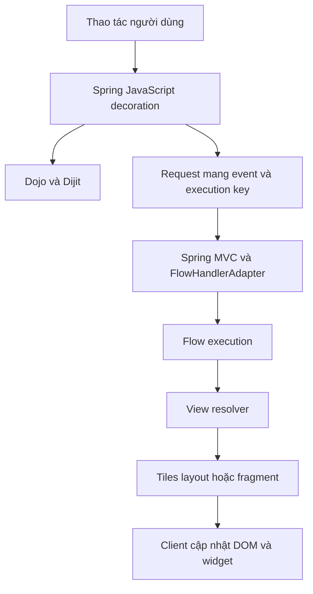

# Đánh giá Spring JavaScript, Dojo và tích hợp Tiles trong mã cũ

Một ứng dụng Spring Web Flow cũ có thể dùng Spring JavaScript để gửi event qua Ajax, Dojo để tạo widget và Tiles để ghép layout hoặc render từng fragment. Khi nâng cấp, các lớp này thường gắn với nhau qua những hợp đồng không thể nhìn thấy chỉ từ file dependency.

Bài thuộc chương **Nâng cấp ứng dụng cũ** của module **SPRING_WEB_FLOW**. Mục tiêu là đánh giá đúng phần giao diện và tích hợp trước khi thay thế, đồng thời bảo toàn hành trình nhiều bước được mô hình hóa bằng state, event, transition, subflow, binding và validation.

## 1. Mục tiêu và phạm vi đánh giá

Sau bài học, bạn có thể:

- Phân biệt vai trò của Spring JavaScript, Dojo/Dijit và Apache Tiles.
- Xác định mã và tài nguyên nào thật sự được ứng dụng sử dụng.
- Nhận diện hợp đồng Ajax gồm request, fragment, redirect và khởi tạo widget.
- Đánh giá ảnh hưởng của việc chuyển sang Spring Framework 6/Jakarta đối với Tiles.
- Chọn lộ trình giữ tạm, thay từng phần hoặc chuyển sang render toàn trang.
- Thiết kế kiểm thử hồi quy để tránh mất event, sai binding hoặc lặp tác dụng phụ.

Đây là bài đánh giá và lập phương án nâng cấp. Các đoạn cấu hình legacy dùng để nhận diện hệ thống cũ; không nên được hiểu là khuyến nghị đưa lại chúng vào một ứng dụng mới.

## 2. Ba thành phần đảm nhiệm ba vai trò khác nhau

| Thành phần | Vai trò thường gặp trong ứng dụng cũ | Dấu hiệu nhận diện |
| --- | --- | --- |
| Spring JavaScript | Decoration, validation phía client, gửi Ajax và xử lý response | `Spring.js`, `Spring-Dojo.js`, `Spring.addDecoration(...)` |
| Dojo Toolkit/Dijit | Widget, parser, event, định dạng và tương tác UI | `dojo`, `dijit`, `dojox`, `data-dojo-type`, theme như `tundra` |
| Apache Tiles | Ghép layout/template phía server, có thể tham gia render fragment | Tiles definitions, taglib Tiles, configurer và view resolver |
| Spring Web Flow | Quản lý execution, state, event, scope và điều hướng | Flow XML, executor, registry, flow handler |

Spring JavaScript không phải tên khác của Spring Web Flow. Dojo không phải bộ điều hướng flow, còn Tiles không lưu trạng thái execution.



Sơ đồ thể hiện một cách tích hợp legacy phổ biến. Ứng dụng cụ thể có thể dùng Dojo trực tiếp, không dùng Ajax hoặc dùng Tiles chỉ để ghép layout. Phải xác định đường chạy thực tế trước khi ước lượng phạm vi thay đổi.

## 3. Các mốc phiên bản cần đọc đúng

| Mốc | Thông tin có ý nghĩa cho đánh giá |
| --- | --- |
| Spring Web Flow 2.4 | Spring.js và tài nguyên Spring JavaScript được đánh dấu deprecated |
| Spring Web Flow 2.5 | Module `spring-js` không còn tách riêng; các lớp Java liên quan được chuyển package vào `spring-webflow`, còn `spring-js-resources` là tùy chọn |
| Spring Framework 6.0 | Tích hợp Tiles trong Spring MVC bị loại bỏ; nền tảng chuyển sang Jakarta EE |
| Spring Web Flow 3.0 | Hướng tới tương thích Spring Framework 6/Jakarta; sample `booking-mvc` chuyển khỏi Tiles |

Nguồn cho hai mốc đầu là [What's New của Spring Web Flow 2.5](https://docs.spring.io/spring-webflow/docs/2.5.0.RELEASE/reference/html/whatsnew.html). [Release notes Spring Framework 6.0](https://github.com/spring-projects/spring-framework/wiki/Spring-Framework-6.0-Release-Notes) xác nhận việc bỏ tích hợp Tiles và thay đổi baseline. [Thông báo phát hành Spring Web Flow 3.0](https://spring.io/blog/2023/07/13/spring-web-flow-3-0-0-released/) giải thích sample chuyển sang Thymeleaf Layouts vì Tiles chưa chuyển sang Jakarta EE.

Apache ghi nhận Tiles nghỉ hưu tháng 12/2018 và hoàn tất chuyển vào Attic tháng 11/2019 tại [Apache Attic — Tiles](https://attic.apache.org/projects/tiles.html). Vì vậy, cần đánh giá cả khả năng tương thích và khả năng duy trì, thay vì chỉ tìm một JAR mới để giữ nguyên toàn bộ cấu hình cũ.

Những mốc trên không có nghĩa mọi class hoặc file JavaScript đều biến mất ở cùng một bản. Cần đối chiếu artifact, package và API của **phiên bản đích đã chọn**. Một ví dụ còn xuất hiện trong tài liệu lịch sử không chứng minh tích hợp đó dùng được trên runtime mới.

Đối với Dojo, xác định chính xác ứng dụng dùng Dojo Toolkit 1.x, một custom build hay một nhánh khác. Không thay trực tiếp bằng một thư viện mang tên Dojo khác rồi coi đó là nâng patch tương thích.

## 4. Kiểm kê theo nguồn, cấu hình, tài nguyên và đường chạy

Một danh sách dependency chưa đủ vì thư viện có thể được chép trực tiếp vào webapp, đóng gói trong JAR hoặc tải từ máy chủ khác.

### 4.1. Dấu vết cần tìm

| Nhóm | Từ khóa hoặc vị trí cần kiểm tra |
| --- | --- |
| Dependency | `spring-js`, `spring-js-resources`, `tiles`, Dojo đóng gói nội bộ |
| JavaScript/JSP | `Spring.addDecoration`, `AjaxEventDecoration`, `ValidateAllDecoration`, `dojo.require`, `require`, `dijit` |
| Markup | `dojoType`, `data-dojo-type`, ID của form/nút và vùng fragment |
| MVC config | View resolver, view factory creator, Ajax handler, resource mapping |
| Tiles | Definitions XML, kế thừa layout, `put-attribute`, taglib `tiles` |
| Flow XML | View ID, `render fragments`, `popup`, transition và event liên quan |
| Resource | `Spring.js`, `Spring-Dojo.js`, Dojo build, theme, localization bundle |

Các lệnh sau là ví dụ để thực hiện trong repository ứng dụng được nâng cấp:

```powershell
rg -n -g '*.jsp' -g '*.jspx' -g '*.html' -g '*.js' 'Spring\.addDecoration|AjaxEventDecoration|ValidateAllDecoration|Spring-Dojo|dijit|dojoType|data-dojo-type' src
rg -n -g '*.xml' -g '*.java' -g '*.gradle' -g '*.kts' 'spring-js|AjaxTiles|TilesConfigurer|tiles3|tiles-definitions|fragments=|popup=' .
rg --files -g '*Spring*.js' -g '*dojo*' -g '*tiles*.xml' -g '*tundra*'
```

Kết quả tìm kiếm là đầu mối, không phải bằng chứng đã sử dụng. Đoạn mã trong comment, file vendor không được tải hoặc cấu hình đã bị vô hiệu hóa cần được phân biệt với đường chạy thật.

Các lệnh trong bài chỉ minh họa phương pháp kiểm kê; bài học không giả định đã chạy tìm kiếm hoặc phân tích một ứng dụng cụ thể của bạn.

### 4.2. Xác nhận tại runtime

Mở một hành trình đại diện và ghi nhận:

1. Những file JavaScript/CSS thực sự được tải và URL của chúng.
2. Widget nào được tạo, bằng parser hay decoration thủ công.
3. Request nào là submit bình thường, request nào là Ajax.
4. Event, form data, execution key và CSRF được gửi như thế nào.
5. Response là toàn trang, fragment hay tín hiệu điều hướng.
6. Cấu hình view thực sự giải quyết tên view đó.

Kiểm tra cả artifact đóng gói, không chỉ cây mã nguồn. Một bản Dojo cũ có thể nằm trong WAR từ bước build hoặc dependency bắc cầu dù không thấy trong thư mục JavaScript chính.

## 5. Đọc Spring JavaScript như một hợp đồng tích hợp

Đoạn legacy minh họa:

```javascript
Spring.addDecoration(new Spring.ElementDecoration({
    elementId: 'guestName',
    widgetType: 'dijit.form.ValidationTextBox',
    widgetAttrs: { required: true }
}));

Spring.addDecoration(new Spring.AjaxEventDecoration({
    elementId: 'nextButton',
    event: 'onclick',
    formId: 'reservationForm',
    params: { _eventId: 'next', fragments: 'messages,body' }
}));
```

Đoạn này cho thấy nhiều việc xảy ra cùng lúc:

- Nâng một DOM node thành widget có vòng đời riêng.
- Gắn handler lên nút.
- Gửi dữ liệu form và event của flow.
- Yêu cầu xử lý response theo hợp đồng fragment đang dùng.

[Spring JavaScript Quick Reference 2.5.x](https://docs.spring.io/spring-webflow/docs/2.5.x/reference/html/spring-js.html) mô tả decoration và coi `spring-js-resources` là module legacy tùy chọn phục vụ tương thích. Khi đánh giá, cần xác định từng decoration đang cung cấp hành vi nào để biết việc bỏ nó làm mất chức năng gì.

Không thay toàn bộ đoạn Ajax bằng `fetch(form.action)` rồi giả định tương đương. Lệnh mặc định đó có thể dùng GET, không gửi body, không gửi event và không xử lý redirect/fragment theo giao thức cũ.

Ngay cả khi tự gửi POST, còn phải xác nhận:

| Phần hợp đồng | Điều cần bảo toàn hoặc chủ động thay đổi |
| --- | --- |
| Event | `next`, `back`, `cancel`, `confirm` được gửi đúng một lần |
| Payload | Field đang hiển thị, hidden field và dữ liệu widget được serialize đúng |
| Execution | URL/key thuộc chính màn hình và execution hiện tại |
| Validation | Client hỗ trợ trải nghiệm; server vẫn có kiểm tra phù hợp |
| Response | Phân biệt fragment với toàn trang, điều hướng và lỗi |
| Vòng đời DOM | Widget cũ được dọn, widget mới được khởi tạo đúng |

## 6. Đánh giá Dojo/Dijit ở mức hành vi

Dojo legacy không chỉ tạo vẻ ngoài cho input. Một widget có thể thay cách đọc giá trị, định dạng, tạo hidden field, validate và chặn submit.

[Tài liệu Dijit form của Dojo Toolkit 1.10](https://dojotoolkit.org/reference-guide/1.10/dijit/form.html) trình bày các widget form, validation và mapped form control. Điều đó gợi ý cần đối chiếu cả giá trị hiển thị lẫn dữ liệu gửi trên mạng khi thay widget.

### Các trường hợp dễ lệch dữ liệu

| Widget/hành vi cũ | Câu hỏi khi thay thế |
| --- | --- |
| Date widget | Gửi ngày theo định dạng nào, có phụ thuộc locale hoặc timezone không? |
| Number/currency widget | Dấu phân cách và giá trị canonical gửi lên server có thay đổi không? |
| ComboBox/FilteringSelect | Gửi nhãn đang thấy hay ID của lựa chọn? Có cho nhập tự do không? |
| Checkbox/radio | Trạng thái không chọn được biểu diễn thế nào trong request? |
| Form widget | Submit có bị chặn không? Field HTML thuần có được đưa vào tập giá trị không? |
| Validation widget | Khi nào hiện lỗi, focus vào đâu và có gọi server khi invalid không? |

Ví dụ người dùng thấy `1.250.000` chưa chứng minh server nhận đúng số tiền. Sau nâng cấp, browser có thể gửi chuỗi hiển thị thay cho giá trị chuẩn mà widget cũ từng cung cấp.

### Vòng đời khi thay fragment

Nếu một vùng DOM chứa widget bị thay bằng HTML mới, phải biết:

1. Handler và widget cũ có được dọn không?
2. Node mới đã có ID trùng với widget còn đăng ký không?
3. Parser/decoration mới chạy một lần hay nhiều lần?
4. Một lần click có tạo cả Ajax request lẫn submit thường không?
5. Focus và thông báo lỗi có còn truy cập được bằng bàn phím không?

Các triệu chứng như click lần thứ hai mới chạy, duplicate ID, gửi hai request hoặc widget biến mất sau validation thường nằm ở vòng đời client, không nhất thiết do flow transition.

Không nâng đồng thời Dojo custom build và thay mọi decoration nếu chưa có đường đi đại diện được kiểm thử. Với mã vendor đã chỉnh sửa, cần so với bản gốc tương ứng để nhận diện hành vi mà ứng dụng phụ thuộc.

## 7. Tiles có thể vừa là layout engine vừa là fragment engine

Định nghĩa legacy minh họa:

```xml
<definition name="reservation/review" extends="baseLayout">
    <put-attribute name="body"
                   value="/WEB-INF/jsp/reservation/review.jsp" />
    <put-attribute name="messages"
                   value="/WEB-INF/jsp/common/messages.jsp" />
</definition>
```

Một ứng dụng chỉ dùng Tiles cho layout có thể cần thay header, body và footer bằng cơ chế composition khác. Ứng dụng dùng Tiles cho Ajax còn có hợp đồng render các thuộc tính như `body` hoặc `messages` riêng lẻ.

Không mặc định `fragments="messages"` có nghĩa “tìm DOM node có ID messages và trả nó”. Tên đó có thể được view implementation giải quyết qua thuộc tính Tiles hoặc một quy tắc tùy biến. Cần kiểm tra response thật và cấu hình renderer.

Trong flow XML có thể gặp:

```xml
<view-state id="review" view="reservation/review" model="reservationForm">
    <transition on="refreshQuote">
        <evaluate expression="quoteService.refresh(reservationForm)" />
        <render fragments="messages,body" />
    </transition>
    <transition on="next" to="payment" />
</view-state>
```

Đây là đoạn nhận diện kiểu tích hợp cũ. Tên view, service và fragment do ứng dụng định nghĩa; `render` chỉ nêu yêu cầu render, còn khả năng thực hiện phụ thuộc view stack.

Nếu thay Tiles bằng template khác mà bỏ qua fragment, full-page GET có thể vẫn đẹp nhưng các request Ajax validation hoặc cập nhật báo giá lại trả response không đúng cấu trúc.

### Những thứ cần lập bản đồ

- View ID của flow → view resolver đang nhận → Tiles definition.
- Definition → layout cha → template và các thuộc tính.
- Fragment được client/flow yêu cầu → vùng HTML được trả.
- Preparer hoặc mã tùy biến → dữ liệu thêm vào model khi render.
- Các quy tắc locale, wildcard và kế thừa nếu ứng dụng sử dụng.

Đặc biệt kiểm tra preparer có tác dụng phụ. Nếu đang tạo dữ liệu nghiệp vụ trong lúc render, Refresh hoặc render fragment có thể gọi lại; đây là rủi ro cần sửa và kiểm thử riêng.

## 8. Bước sang Spring 6/Jakarta là thay đổi ranh giới runtime

Khi mục tiêu là Spring Framework 6, việc mất tích hợp Tiles không chỉ là thay một tên class trong XML. Các lớp tích hợp Servlet cũ còn có thể phụ thuộc namespace Java EE, trong khi runtime mới dùng Jakarta.

Không thêm đồng thời JAR Spring MVC cũ chỉ để tìm lại `TilesConfigurer` hoặc view class đã bị loại. Cách đó có thể tạo classpath không nhất quán và lỗi runtime ở những phần khác.

Việc chuyển `javax.servlet` sang `jakarta.servlet` trong mã ứng dụng cũng không tự chuyển mọi thư viện phụ thuộc hoặc taglib của chúng. Cần xét bộ dependency, container và view engine như một tổ hợp tương thích.

Thông báo Web Flow 3.0 nêu sample chuyển sang Thymeleaf Layouts là một ví dụ tham khảo. Điều đó không bắt buộc mọi ứng dụng phải chọn cùng template engine; cần chọn giải pháp đáp ứng layout, binding, message và fragment thực tế của hệ thống.

Nếu phiên bản đích thuộc một thế hệ khác, đọc release notes riêng của thế hệ đó. Không lấy baseline của Web Flow 3.0 làm cam kết cho mọi bản mới hơn.

## 9. Ba hướng xử lý theo mức phụ thuộc

| Hướng | Khi có thể phù hợp | Công việc cần làm rõ |
| --- | --- | --- |
| Giữ tạm trong runtime hiện tại | Chưa thể thay toàn bộ, có thời hạn và kế hoạch cụ thể | Đóng băng phạm vi, kiểm kê version, test hành vi và lộ trình thoát |
| Render toàn trang trước | Ajax không phải yêu cầu cốt lõi của bước đang chuyển | Giữ event/key/binding, thay layout, kiểm tra redirect và trải nghiệm |
| Thay từng widget/fragment | Cần giữ tương tác cục bộ hoặc flow dài | Định nghĩa lại giao thức request/response và vòng đời client |

Giữ tạm không giải quyết việc thư viện không tương thích với runtime đích. Nếu mục tiêu yêu cầu bỏ Tiles, cần thay hoặc cô lập phần đó bằng một ranh giới triển khai được thiết kế rõ ràng.

Render toàn trang có thể là bước trung gian hữu ích cho một số màn hình vì giảm số hợp đồng phải chuyển cùng lúc. Tuy nhiên, các tính năng như modal, autocomplete hoặc cập nhật nhanh có thể cần giải pháp thay thế riêng; phải đánh giá tác động với người dùng.

Thay view và JavaScript cũng không buộc chuyển logic điều hướng từ flow sang controller hoặc viết lại toàn bộ thành SPA. State, event, scope và subflow có thể tiếp tục làm mô hình hành trình nếu vẫn phù hợp với ứng dụng.

## 10. Ví dụ giảm phụ thuộc Ajax ở một màn hình

Giả sử transition `next` của màn hình nhập thông tin không cần partial rendering. Có thể chuyển nút đó về submit toàn trang trước, với view stack mới đã được cấu hình.

JSP minh họa dùng Spring form tag library:

```jsp
<%@ taglib prefix="form" uri="http://www.springframework.org/tags/form" %>

<form:form id="reservationForm"
           modelAttribute="reservationForm"
           method="post"
           action="${flowExecutionUrl}">
    <label for="guestName">Tên khách</label>
    <form:input id="guestName" path="guestName" />
    <form:errors path="guestName" />

    <button type="submit" name="_eventId_next" value="next">
        Tiếp tục
    </button>
    <button type="submit" name="_eventId_cancel" value="cancel">
        Hủy
    </button>
</form:form>
```

Các điều kiện đi kèm:

- Model đúng là form của execution hiện tại.
- `flowExecutionUrl` được view engine render đúng và URL vẫn hợp lệ sau redirect.
- Server có converter/validator và binding phù hợp.
- Form đáp ứng cấu hình CSRF/xác thực đang dùng.
- Decoration cũ trên form/nút này đã được gỡ, tránh gửi cả Ajax lẫn submit thường.
- Layout mới render được trang và message khi server trả lỗi validation.

Bài không giả định JSP là đích bắt buộc. Ví dụ chỉ làm rõ hợp đồng HTML form; nếu chọn Thymeleaf, FreeMarker hoặc giải pháp khác, phải giữ các giá trị gửi lên và kết quả binding tương ứng.

Sau bước chuyển, flow XML vẫn có thể dùng transition `next` và `cancel`. Hành vi bind/validate khi hủy cần được quy định trong flow; thay nút không tự quyết định có chạy validation hay không.

## 11. Nếu tiếp tục Ajax, hãy định nghĩa hợp đồng mới tường minh

Trước khi viết client mới, ghi thành bảng:

| Thành phần | Ví dụ hợp đồng cần thống nhất |
| --- | --- |
| Địa chỉ request | URL hiện hành của execution, không dùng key cũ từ biến toàn cục |
| Method và dữ liệu | POST form URL-encoded hoặc multipart theo loại form |
| Event | Quy tắc gửi `next`, `cancel`, `refreshQuote` |
| Phân loại request | Header/parameter nào khiến server nhận diện Ajax |
| Response thành công | Fragment có cấu trúc cụ thể hoặc chỉ thị chuyển trang |
| Validation | Field error, global message và dữ liệu nhập giữ lại |
| Session mất hoặc đăng nhập lại | Chuyển màn hình/phản hồi được client hiểu đúng |
| Lỗi kỹ thuật | Không chèn nguyên trang lỗi vào vùng form như một fragment hợp lệ |

Không mặc định một request `fetch` được Ajax handler cũ nhận diện chỉ vì nó là JavaScript. Cũng không mặc định client mới tự hiểu các header hoặc quy ước redirect mà Spring JavaScript cũ từng xử lý.

Một redirect được HTTP client tự theo chưa chắc làm thanh địa chỉ trình duyệt thay đổi. Nếu kết quả theo redirect là trang đăng nhập, client có thể vô tình chèn trang đó vào một fragment. Phải có test riêng cho hết session và mất xác thực.

Nếu toàn bộ form bị thay, URL/key và token cần được cập nhật đồng bộ. Nếu chỉ thay message nhưng server đã cấp thông tin execution mới, phần form còn lại vẫn phải có dữ liệu đủ mới để tiếp tục. Đừng chỉ kiểm tra vùng message trông đúng.

Các view implementation và Ajax handler thay đổi theo phiên bản. Kiểm tra API/thực thi của phiên bản đích; tránh sao chép nguyên tên class từ một hướng dẫn Tiles lịch sử.

## 12. Tài nguyên tĩnh và cache cũng là một phần của nâng cấp

Khi bỏ một JAR tài nguyên, kiểm tra tất cả nguồn tải:

- Đường dẫn JS/CSS trong layout và JSP include.
- Resource mapping và servlet cũ phục vụ tài nguyên từ classpath.
- Dojo custom build, module bổ sung và localization bundle.
- Theme, font, ảnh nền và quy tắc CSS dựa trên DOM widget cũ.
- CDN, reverse proxy hoặc cache của trình duyệt còn giữ bundle trước.

Không coi HTTP `200` của một file `.js` là bằng chứng nó là JavaScript hợp lệ: cấu hình sai có thể trả trang đăng nhập hoặc fallback HTML. Kiểm tra content type, nội dung và lỗi parser trong console.

Một màn hình dùng JavaScript mới nhưng layout/cache vẫn tải adapter cũ có thể đăng ký handler hai lần. Dùng version hoặc fingerprint tài nguyên theo chiến lược build để các file đi cùng nhau, rồi kiểm tra nâng cấp từ một tab đã mở trước deployment.

Nếu rollback giao diện, phải xét server mới có còn hiểu request của bundle cũ không. Đổi bundle và đổi giao thức Ajax cần có kế hoạch tương thích hoặc chuyển phiên rõ ràng.

## 13. Kiểm thử hồi quy theo hợp đồng

Test flow definition vẫn quan trọng nhưng không thể nhìn thấy lỗi Dojo parser, fragment không đúng cấu trúc hoặc hai handler cùng gửi request. Cần kết hợp test engine, MVC và trình duyệt.

| Nhóm | Kịch bản cần có | Assertion quan trọng |
| --- | --- | --- |
| Form thường | Nhập hợp lệ rồi next | Event đúng, model đúng, state tiếp theo đúng |
| Validation | Bỏ trường bắt buộc hoặc nhập sai định dạng | Server giữ ở bước phù hợp, lỗi và dữ liệu nhập được render |
| Ngày/số/locale | Các định dạng ứng dụng hỗ trợ | Giá trị bind đúng ý nghĩa, không chỉ hiển thị đúng |
| Event | Next, Back trong flow, Cancel, Confirm | Mỗi thao tác gửi đúng event và đúng số request |
| Fragment | Cập nhật báo giá/message nhiều lần | Không trùng widget/ID, form vẫn gửi tiếp được |
| Điều hướng | Ajax dẫn sang state/view khác | URL/key và giao diện theo hợp đồng mới |
| Session | Hết phiên khi form đang mở | Client đến đúng màn hình phục hồi/đăng nhập |
| Back/Refresh | Quay lại hoặc tải lại sau submit | Không mất dữ liệu ngoài chính sách, không lặp lệnh ghi |
| Nhiều tab | Hai execution trong cùng session | Không dùng chung key hoặc form ngoài ý muốn |
| Kết thúc | Flow trả outcome/output | Đúng kết quả và redirect cuối |

### Kiểm tra tác dụng phụ

Một lần click tạo hai HTTP request có thể chưa gây hai đơn trong fixture nhỏ nhưng vẫn là lỗi cần xử lý. Ngược lại, chỉ nhìn thấy một request cũng chưa chứng minh thanh toán không bị retry bên trong.

Dùng stub/probe nghiệp vụ gắn với mã dữ liệu riêng của test để kiểm tra số kết quả bền vững. Với thao tác cuối hành trình, xác nhận outcome/output của flow và bản ghi nghiệp vụ theo trách nhiệm của từng tầng.

### Kiểm tra khả năng sử dụng

Sau khi thay widget, kiểm tra bàn phím, focus khi validation, label, thông báo lỗi và khả năng dùng trên thiết bị mục tiêu. So sánh ảnh chụp chỉ phát hiện một phần khác biệt; không chứng minh form gửi đúng giá trị hoặc người dùng có thể hoàn tất hành trình.

## 14. Lộ trình thực hiện trên một hành trình đại diện

### Giai đoạn 1: lập bản đồ hiện trạng

Chọn flow có đủ nhập liệu, validation, ít nhất một cập nhật fragment và một điểm kết thúc. Ghi dependency thực tế, file được tải, view resolver, Tiles definition và request/response của từng bước.

Kết quả cần có là sơ đồ phụ thuộc và bảng hợp đồng, không chỉ danh sách JAR.

### Giai đoạn 2: tạo bằng chứng hành vi trước thay đổi

Có test engine cho transition/outcome và test trình duyệt cho form, fragment, session mất. Các test cần mô tả hành vi sản phẩm muốn giữ; không ràng buộc mọi cấu trúc DOM legacy nếu chính cấu trúc đó là thứ sẽ thay.

### Giai đoạn 3: tách các trách nhiệm

Đưa tác dụng phụ nghiệp vụ ra khỏi render/preparer nếu đang đặt sai chỗ. Làm rõ validation ở server, event mapping và dữ liệu scope. Việc này giúp thay client/view mà vẫn có ranh giới kiểm thử rõ.

### Giai đoạn 4: thay một phần có thể đánh giá

Có thể thay layout trước hoặc chuyển một màn hình sang submit toàn trang trước, tùy khả năng tách của hệ thống. Nếu chuyển sang Spring 6, đường render sau thay đổi phải không còn phụ thuộc tích hợp Tiles đã bị loại.

### Giai đoạn 5: thay widget hoặc giao thức Ajax

Chuyển từng loại input và từng tương tác, kiểm tra payload thực tế sau mỗi nhóm. Khi bỏ adapter cũ, chắc chắn client mới đã xử lý điều hướng, validation và session mất theo hợp đồng.

### Giai đoạn 6: gỡ phần dư và vận hành

Chỉ xóa dependency/resource khi đã xác nhận không còn đường chạy phụ thuộc. Kiểm tra artifact, cache và màn hình ít dùng, rồi theo dõi lỗi JavaScript, binding và phục hồi execution khi triển khai.

Mỗi giai đoạn cần có kết quả cụ thể có thể review và rollback phù hợp. Không giả định rollback giao diện đồng nghĩa có thể đọc lại mọi session/snapshot sau khi đã đổi runtime hoặc cấu trúc dữ liệu.

## 15. Ví dụ đánh giá một màn hình đặt chỗ

Hiện trạng giả định:

```text
Flow reservation dừng tại review.
Tiles ghép baseLayout + body + messages.
Spring.AjaxEventDecoration gửi refreshQuote.
Dojo quản lý ngày đến và mã loại phòng.
Response chỉ thay messages và body.
Next đưa flow sang payment.
```

Một báo cáo đánh giá có thể ghi:

| Phụ thuộc | Chức năng đang cung cấp | Phương án và điều kiện xác nhận |
| --- | --- | --- |
| DateTextBox | Chọn ngày, chuẩn hóa giá trị gửi | Thay input theo hợp đồng ngày của server; test locale và ngày biên |
| FilteringSelect | Hiển thị tên phòng, gửi mã phòng | Duy trì phân biệt nhãn/ID; test lựa chọn không hợp lệ |
| AjaxEventDecoration | Gửi refreshQuote và ghép response | Tạm chuyển refreshQuote sang toàn trang hoặc triển khai giao thức fragment mới |
| Tiles layout | Header/body/messages dùng chung | Chuyển composition; kiểm tra mọi view logic liên quan |
| Fragment renderer | Render riêng message/body | Bỏ phụ thuộc hoặc xây renderer tương ứng; không chỉ đổi đuôi template |
| Flow XML | Điều hướng và binding | Giữ hợp đồng event/model/outcome; sửa phần render cần thiết |

Giả sử mục tiêu trước mắt là lên runtime Jakarta, layout và renderer phụ thuộc Tiles là rào cản cần xử lý. Giữ lại một số widget Dojo dưới dạng tài nguyên độc lập có thể là quyết định chuyển tiếp nếu đã xác nhận tương thích trình duyệt và hợp đồng request; không suy ra điều đó giữ nguyên được tích hợp Tiles phía server.

Nếu yêu cầu sản phẩm cho phép tải lại toàn trang khi tính báo giá, có thể giảm phạm vi Ajax trong đợt đầu. Nếu cập nhật tại chỗ là yêu cầu bắt buộc, phải dành công việc riêng cho fragment và vòng đời widget mới.

## 16. Những kết luận dễ sai

**“Không dùng class Java của spring-js thì có thể xóa hết Spring.js.”**

Chưa đủ. JSP hoặc bundle vẫn có thể gọi API client, hoặc đang phụ thuộc adapter để xử lý Ajax/redirect.

**“Tiles chỉ làm layout, đổi template là xong.”**

Có thể sai nếu fragment rendering, definition inheritance hoặc preparer đang tham gia vào request của flow.

**“Dojo chỉ cần thay CSS để giao diện giống trước.”**

Sai với widget có chuyển đổi giá trị, hidden field, validation và vòng đời riêng.

**“Server validation đã có nên bỏ client validation không ảnh hưởng gì.”**

Tính đúng có thể được bảo vệ, nhưng trải nghiệm, thời điểm gửi request và cách hiển thị lỗi vẫn thay đổi. Cần đánh giá và kiểm thử theo yêu cầu sản phẩm.

**“Nâng Web Flow thì phải bỏ mô hình flow.”**

Không. Cần đánh giá các lớp đã lỗi thời và tính tương thích, trong khi mô hình state/event/subflow có thể tiếp tục được giữ nếu vẫn đáp ứng hành trình.

## 17. Bài thực hành và tiêu chí hoàn thành

Chọn một flow legacy có Spring JavaScript hoặc Tiles:

1. Lập bảng tách Spring JS, Dojo/Dijit, view resolver, Tiles và flow engine.
2. Ghi một request/response thành công, một validation lỗi và một tình huống session mất.
3. Đối chiếu dependency thực tế với baseline và API của phiên bản đích.
4. Lập bản đồ toàn bộ fragment mà màn hình sử dụng.
5. Chọn một tương tác để chuyển, nêu rõ hợp đồng giữ lại và thay đổi có chủ đích.
6. Viết test kiểm tra event, binding, validation, điều hướng và tác dụng phụ.
7. Định nghĩa điều kiện gỡ dependency/resource cũ và hành vi khi tab cũ gặp server mới.

Hoàn thành khi đánh giá chỉ rõ thành phần nào đang cung cấp hành vi nào, rào cản nâng cấp nằm ở đâu và bằng chứng nào xác nhận phương án thay thế không làm hỏng hành trình.

## 18. Tài liệu đối chiếu

- [Spring Web Flow 2.5 — What's New](https://docs.spring.io/spring-webflow/docs/2.5.0.RELEASE/reference/html/whatsnew.html): deprecation và thay đổi module Spring JavaScript.
- [Spring JavaScript Quick Reference 2.5.x](https://docs.spring.io/spring-webflow/docs/2.5.x/reference/html/spring-js.html): nhận diện decoration, widget và tài nguyên legacy.
- [Spring Web Flow 2.5.x — Spring MVC Integration](https://docs.spring.io/spring-webflow/docs/2.5.x/reference/html/spring-mvc.html): mapping, view resolution và flow handler của hệ thống cũ.
- [Spring Framework 6.0 Release Notes](https://github.com/spring-projects/spring-framework/wiki/Spring-Framework-6.0-Release-Notes): Jakarta baseline và tích hợp Tiles bị loại bỏ.
- [Spring Web Flow 3.0 Released](https://spring.io/blog/2023/07/13/spring-web-flow-3-0-0-released/): bối cảnh nâng cấp Jakarta và thay Tiles trong sample.
- [Apache Attic — Tiles](https://attic.apache.org/projects/tiles.html): trạng thái nghỉ hưu của dự án.
- [Dojo Toolkit 1.10 — Dijit Form](https://dojotoolkit.org/reference-guide/1.10/dijit/form.html): hành vi widget form, validation và giá trị gửi.

Các ví dụ là nội dung học tập và chưa được chạy trên một ứng dụng cụ thể của bạn. Khi áp dụng, khóa phiên bản nguồn/đích và kiểm tra artifact thực tế; tài liệu cũ có ích để hiểu hệ thống cũ nhưng không thay thế API và release notes của phiên bản đích.