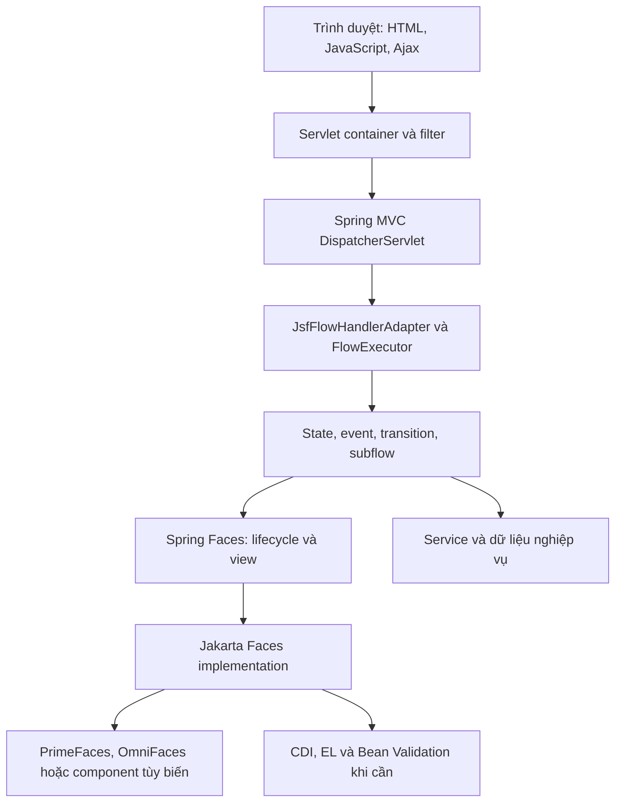

# Nâng cấp Jakarta Faces và thư viện thành phần liên quan

Nâng cấp giao diện Faces trong một ứng dụng Spring Web Flow không chỉ là đổi dependency JSF. Faces implementation, Servlet container, CDI, Expression Language, thư viện component và lớp tích hợp Spring Faces cùng tham gia vào một request. Một trang mở được lần đầu vẫn có thể hỏng khi postback, validate, chuyển state hoặc gửi Ajax.

Trong chương **Nâng cấp ứng dụng cũ** của module **SPRING_WEB_FLOW**, bài học này trình bày cách chọn bộ phiên bản tương thích, chuyển mã và cấu hình sang Jakarta, rồi kiểm tra lại hành trình nhiều bước. Mục tiêu là giữ điều hướng trong state, event, transition và subflow, đồng thời bảo toàn binding, validation, scope và đường phục hồi khi phiên cũ không còn tương thích.

## 1. Xác định những lớp phải nâng cấp cùng nhau

Một ứng dụng có thể dùng Faces như thư viện component, còn Spring Web Flow điều phối hành trình qua Spring MVC. Vì vậy, cần nhìn toàn bộ đường request:



Trước khi sửa, phân biệt bốn nhóm tài nguyên:

| Nhóm | Ví dụ cần kiểm kê |
| --- | --- |
| Runtime | JDK, container, Servlet, EL, CDI, Bean Validation |
| Framework điều phối | Spring Framework, `spring-webflow`, `spring-faces` |
| Giao diện | Faces API/implementation, XHTML, component library, theme, JavaScript |
| Trạng thái đang tồn tại | HTTP session, Faces view state, execution và snapshot Web Flow |

Đừng coi một bản build không có lỗi compile là bằng chứng toàn bộ nhóm đã tương thích. Component tùy biến hoặc JAR bên thứ ba có thể chỉ được nạp lúc render, restore view hoặc xử lý event.

## 2. Chọn đích theo một ma trận tương thích có nguồn

Tên Jakarta Faces không đủ để kết luận package Java đang dùng. Faces 2.3 thuộc thế hệ Jakarta EE 8 nhưng vẫn ở hệ `javax.*`; thay đổi sang `jakarta.faces.*` xuất hiện ở Faces 3.0. Xem [Jakarta Server Faces 3.0](https://jakarta.ee/specifications/faces/3.0/).

Các mốc cần phân biệt:

| Mốc Faces | Điểm ảnh hưởng khi nâng cấp |
| --- | --- |
| Faces 3.0 | Chuyển namespace Java từ `javax.faces` sang `jakarta.faces` |
| Faces 4.0 | Bỏ native managed beans, hỗ trợ JSP và một số API cũ; dùng URN Facelets mới |
| Faces 4.1 | Thuộc Jakarta EE 11, yêu cầu Java SE 17 trở lên |

Các thay đổi của Faces 4.0 được liệt kê trong [trang đặc tả Faces 4.0](https://jakarta.ee/specifications/faces/4.0/); mức Java tối thiểu của Faces 4.1 nằm trong [trang đặc tả Faces 4.1](https://jakarta.ee/specifications/faces/4.1/).

Phía Spring Web Flow cũng có baseline riêng:

| Dòng Web Flow | Yêu cầu được tài liệu nêu | Hệ quả với tích hợp Faces |
| --- | --- | --- |
| Web Flow 3.0 | Java 17+, Spring Framework 6.0+ | Tích hợp yêu cầu Faces 4.0+ |
| Web Flow 4.0 | Java 17+, Spring Framework 7.0, Servlet 6.1 | Tích hợp yêu cầu Faces 4.1+ |

Đối chiếu với [hướng dẫn Web Flow 3.0](https://docs.spring.io/spring-webflow/docs/3.0.x/reference/) và [hướng dẫn Web Flow 4.0](https://docs.spring.io/spring-webflow/docs/current/reference/). Dấu `+` mô tả mức tối thiểu trong tài liệu, không chứng minh mọi tổ hợp phiên bản tương lai đã được kiểm thử cùng nhau.

Một đích nâng cấp phải chốt cả patch version và nguồn cung cấp runtime. Ví dụ, chọn Web Flow 3.0/Faces 4.0 trên nền Jakarta EE 10 là một phạm vi khác với Web Flow 4.0/Faces 4.1 trên nền Servlet 6.1. Không ghép Web Flow 4.0 với một runtime chỉ cung cấp Faces 4.0 rồi kỳ vọng chỉ sửa import là đủ.

Đặc tả Faces 4.1 dựa trên Servlet 6.1, EL 6.0, CDI 4.1 và Bean Validation 3.1. Đây là các lớp cần đối chiếu nếu tự lắp runtime trên servlet container, thay vì dùng server cung cấp sẵn nền Jakarta tương ứng. Xem [các công nghệ liên quan trong đặc tả Faces 4.1](https://jakarta.ee/specifications/faces/4.1/jakarta-faces-4.1.html).

## 3. Kiểm kê dependency và quyền sở hữu runtime

Lập danh sách phiên bản thực sự được resolve và được đóng gói, không chỉ các dependency khai báo trực tiếp.

Những điểm cần kiểm tra:

- `spring-webflow` và `spring-faces` dùng cùng bản phát hành thích hợp.
- Chỉ một Faces implementation được chọn trong classloader ứng dụng: Mojarra hoặc MyFaces theo đích đã kiểm chứng.
- Không có JAR component còn tham chiếu `javax.faces.*` trong runtime Jakarta.
- Không đóng gói thêm một bản Faces/CDI/EL cạnh bản server đang cung cấp ngoài chủ đích.
- Thư viện extension, theme và component tùy biến được nâng cùng dòng tương thích.
- Không còn artifact cũ được chép thủ công trong `WEB-INF/lib` nhưng không xuất hiện trong dependency tree.

Các lệnh minh họa khi áp dụng trong dự án Maven:

```text
mvn dependency:tree
mvn help:effective-pom
jar tf application.war
```

Đây là hướng dẫn kiểm kê, không phải bằng chứng các lệnh đã được chạy cho một ứng dụng cụ thể. Nếu dự án dùng công cụ khác, cần lấy báo cáo tương đương về dependency đã resolve và nội dung artifact cuối.

### 3.1. Server cung cấp sẵn hay ứng dụng tự đóng gói?

| Cách triển khai | Câu hỏi cần trả lời |
| --- | --- |
| Jakarta EE server cung cấp Faces/CDI/EL | Phiên bản server cung cấp có khớp đích không? API nào dùng scope `provided`? |
| Servlet container với runtime do ứng dụng bổ sung | Đã có implementation Faces, CDI và EL cần thiết chưa? Ai khởi tạo chúng? |
| Ứng dụng chủ động thay implementation của server | Có cơ chế chính thức để tắt hoặc cô lập module server không? |

Chỉ thêm `jakarta.faces-api` không tạo ra một Faces runtime hoàn chỉnh. Ngược lại, thêm cả hai implementation cũng không làm tăng khả năng tương thích; nó có thể tạo factory, service provider hoặc class trùng nhau.

Không thêm JAR JSF cũ chỉ để làm biến mất `ClassNotFoundException: javax.faces...` trong ứng dụng Jakarta. Exception đó thường là dấu hiệu một dependency chưa được chuyển sang đúng thế hệ.

### 3.2. Ví dụ chọn đúng biến thể component

Một số dòng PrimeFaces xuất bản riêng artifact Jakarta thông qua classifier. Ví dụ khai báo sau chỉ phù hợp với phiên bản thực sự có biến thể đó:

```xml
<dependency>
    <groupId>org.primefaces</groupId>
    <artifactId>primefaces</artifactId>
    <version>${primefaces.version}</version>
    <classifier>jakarta</classifier>
</dependency>
```

POM của bản PrimeFaces 15.0.0 có cấu hình tạo artifact với classifier `jakarta`. Đây là ví dụ cụ thể về cách đóng gói, không phải khuyến nghị chọn bản đó cho mọi dự án hoặc khẳng định mọi dòng PrimeFaces đều dùng cùng quy ước. Xem [POM PrimeFaces 15.0.0](https://github.com/primefaces/primefaces/blob/15.0.0/primefaces/pom.xml).

## 4. Chuyển namespace có chọn lọc: Java, descriptor và Facelets

Có nhiều loại namespace khác nhau; chúng không được chuyển bằng một thao tác thay chuỗi toàn cục.

| Loại | Ví dụ chuyển đổi |
| --- | --- |
| Package Java EE đã chuyển | `javax.faces.context.FacesContext` → `jakarta.faces.context.FacesContext` |
| Servlet API | `javax.servlet.*` → `jakarta.servlet.*` khi chuyển sang runtime Jakarta tương ứng |
| Validation API | `javax.validation.*` → `jakarta.validation.*` |
| Inject/CDI | Các import tương ứng chuyển sang `jakarta.inject.*`, `jakarta.enterprise.*` |
| Descriptor Jakarta EE | XML namespace/schema phải phù hợp với version descriptor |
| Tag library Faces | Ví dụ `jakarta.faces.html`, `jakarta.faces.core`, `jakarta.faces.facelets` |
| Tag library bên thứ ba | Theo tài liệu của thư viện, không suy từ package Java |

Các package thuộc Java SE như `javax.sql.DataSource`, `javax.naming.*`, `javax.crypto.*` hoặc `javax.xml.parsers.*` không được đổi sang một tên `jakarta` tự suy ra.

Ngoài import trong source, kiểm tra tên lớp nằm trong XML, reflection, service provider, annotation, custom renderer, converter, validator và listener. Một lớp đã compile từ trước không đổi tham chiếu nhị phân chỉ vì source của ứng dụng đã đổi import.

### 4.1. Descriptor phải có namespace và version đồng nhất

Ví dụ tối thiểu cho `faces-config.xml` ở đích Faces 4.0:

```xml
<?xml version="1.0" encoding="UTF-8"?>
<faces-config xmlns="https://jakarta.ee/xml/ns/jakartaee"
              xmlns:xsi="http://www.w3.org/2001/XMLSchema-instance"
              xsi:schemaLocation="https://jakarta.ee/xml/ns/jakartaee
                                  https://jakarta.ee/xml/ns/jakartaee/web-facesconfig_4_0.xsd"
              version="4.0">
</faces-config>
```

Đây chỉ là phần khung namespace. Khi sửa file thật, giữ các đăng ký application, factory, converter, validator và resource handler vẫn cần thiết. Không thay toàn bộ cấu hình cũ bằng file rỗng.

Chọn schema đúng cho đích đã chốt; không đổi riêng `version` rồi để namespace hoặc schema của thế hệ khác. Các descriptor của thư viện và CDI cũng cần được xem xét theo runtime tương ứng.

### 4.2. Namespace tag không phải địa chỉ tải thư viện

Một trang Facelets cho Faces 4 có thể dùng:

```xml
<html xmlns="http://www.w3.org/1999/xhtml"
      xmlns:h="jakarta.faces.html"
      xmlns:f="jakarta.faces.core"
      xmlns:ui="jakarta.faces.facelets"
      xmlns:p="http://primefaces.org/ui">
</html>
```

Namespace `p` phải được component library đã chọn hỗ trợ. Không tự đổi nó thành `jakarta.primefaces` hoặc suy rằng mọi namespace cũ phải bị thay giống package Java.

Với Faces 4.0, các URI tag library Faces cũ vẫn được hỗ trợ theo hướng dẫn chuyển đổi Jakarta EE 10, dù nên chuyển sang URN mới khi phù hợp. Vì vậy, chỉ thấy URI cũ trong XHTML chưa đủ để kết luận nó là nguyên nhân lỗi. Xem [hướng dẫn Faces 4.0 trong Jakarta EE 10](https://jakarta.ee/news/developer-guide-for-jakarta-ee-10-and-microprofile-6.0/).

## 5. Chuyển bean và scope mà không tạo hai chủ sở hữu

Faces 4.0 bỏ native managed beans. Một lớp dùng `javax.faces.bean.ManagedBean` không thể được sửa đơn giản thành `jakarta.faces.bean.ManagedBean` rồi tiếp tục dùng như cũ.

Trước khi chuyển, phân loại từng đối tượng:

| Đối tượng hiện tại | Chủ sở hữu sau nâng cấp cần xác định |
| --- | --- |
| Bean trang JSF độc lập | Có thể chuyển sang CDI nếu phù hợp và có CDI runtime |
| Service nghiệp vụ của Spring | Tiếp tục do Spring quản lý, giữ transaction và dependency injection |
| DTO được `<var>` của Web Flow tạo | Tiếp tục thuộc flow, không tự gắn thêm `@Named` hoặc `@Component` |
| Dữ liệu dùng qua các state/subflow | Giữ scope và mapping của Web Flow theo hợp đồng hành trình |
| Converter/validator có injection | Chọn cơ chế quản lý được Faces/CDI hoặc tích hợp hiện tại hỗ trợ |

### 5.1. Ví dụ bean trang độc lập dùng CDI

```java
import java.io.Serializable;
import jakarta.faces.view.ViewScoped;
import jakarta.inject.Named;

@Named("legacyPage")
@ViewScoped
public class LegacyPage implements Serializable {
    private static final long serialVersionUID = 1L;

    private String filter = "";

    public String getFilter() {
        return filter;
    }

    public void setFilter(String filter) {
        this.filter = filter;
    }
}
```

Ví dụ áp dụng cho bean trang do CDI quản lý. `jakarta.faces.view.ViewScoped` là scope CDI có yêu cầu về serialization và khả năng proxy của bean; nó không phải Web Flow `viewScope`. Xem [API ViewScoped](https://jakarta.ee/specifications/faces/4.1/apidocs/jakarta.faces/jakarta/faces/view/ViewScoped.html).

`@Named` không tự biến service Spring thành bean CDI. Nếu một bean CDI cần gọi service Spring, phải có cơ chế tích hợp được cấu hình và kiểm thử; không đổi `@Autowired` thành `@Inject` rồi giả định mọi dependency sẽ tự nối.

### 5.2. DTO của flow nên giữ cách tạo rõ ràng

```xml
<var name="registrationForm" class="example.RegistrationForm"/>
```

Nếu XHTML đang resolve `registrationForm` từ flow, việc thêm một bean CDI cùng tên có thể tạo hai instance với hai vòng đời khác nhau. Triệu chứng thường là view hiển thị dữ liệu từ một instance trong khi action đọc instance khác.

Tương tự, `jakarta.faces.flow.FlowScoped` của Faces không phải `flowScope` của Spring Web Flow. Chuyển annotation theo tên gần giống không bảo toàn các transition, input/output của subflow hoặc thời điểm dọn dữ liệu.

Nếu ứng dụng sử dụng `SpringBeanFacesELResolver` để tra service Spring từ Faces, kiểm tra nó trong cấu hình hiện tại và context chứa service. Resolver đó giải quyết việc tra bean Spring, không cung cấp toàn bộ CDI runtime. Xem [tích hợp JSF của Spring Framework](https://docs.spring.io/spring-framework/reference/6.2/web/integration.html).

## 6. Giữ đúng lớp tích hợp Faces với Spring Web Flow

### 6.1. Khởi tạo FacesServlet, nhưng giữ đường request của flow

Với tích hợp Web Flow/Faces, FacesServlet cần được khởi tạo để Faces runtime bootstrap. Tuy nhiên, request của flow thường đi qua Spring `DispatcherServlet`; không đổi tất cả form action sang URL trực tiếp của FacesServlet.

Phần cấu hình servlet minh họa trong `web.xml` Jakarta:

```xml
<servlet>
    <servlet-name>Faces Servlet</servlet-name>
    <servlet-class>jakarta.faces.webapp.FacesServlet</servlet-class>
    <load-on-startup>1</load-on-startup>
</servlet>

<servlet-mapping>
    <servlet-name>Faces Servlet</servlet-name>
    <url-pattern>*.faces</url-pattern>
</servlet-mapping>
```

Đây là trích đoạn, không phải `web.xml` đầy đủ. Giữ mapping và cấu hình DispatcherServlet của ứng dụng. Kiểm tra filter của component library: filter chỉ gắn với tên FacesServlet có thể không chạy trên request thực tế đi qua DispatcherServlet.

### 6.2. Dùng thành phần tích hợp chuyên biệt

Các điểm cần giữ sau khi đổi dependency:

- Flow builder services dành cho Faces, thay vì cấu hình MVC view factory thông thường.
- `FlowFacesContextLifecycleListener` cho vòng đời FacesContext của request Web Flow.
- `JsfFlowHandlerAdapter` cho cách nhận diện Ajax theo Faces.
- Handler phục vụ resource Faces/component qua mapping phù hợp.

`FlowFacesContextLifecycleListener` tạo FacesContext khi request được gửi vào và giải phóng sau xử lý. `JsfFlowHandlerAdapter` thay Ajax handler mặc định bằng handler dành cho JSF. Xem [API lifecycle listener](https://docs.spring.io/spring-webflow/docs/current/api/org/springframework/faces/webflow/FlowFacesContextLifecycleListener.html) và [API JsfFlowHandlerAdapter](https://docs.spring.io/spring-webflow/docs/current/api/org/springframework/faces/webflow/JsfFlowHandlerAdapter.html).

Ví dụ cấu hình Java cho phần tích hợp flow; context MVC và bootstrap servlet vẫn phải được cung cấp bởi ứng dụng:

```java
import org.springframework.context.annotation.Bean;
import org.springframework.context.annotation.Configuration;
import org.springframework.faces.config.AbstractFacesFlowConfiguration;
import org.springframework.faces.webflow.FlowFacesContextLifecycleListener;
import org.springframework.faces.webflow.JsfFlowHandlerAdapter;
import org.springframework.webflow.definition.registry.FlowDefinitionRegistry;
import org.springframework.webflow.executor.FlowExecutor;
import org.springframework.webflow.mvc.servlet.FlowHandlerMapping;

@Configuration
public class FacesFlowConfig extends AbstractFacesFlowConfiguration {

    @Bean
    public FlowDefinitionRegistry flowRegistry() {
        return getFlowDefinitionRegistryBuilder()
                .setBasePath("/WEB-INF/flows")
                .addFlowLocationPattern("**/*-flow.xml")
                .build();
    }

    @Bean
    public FlowExecutor flowExecutor() {
        return getFlowExecutorBuilder(flowRegistry())
                .addFlowExecutionListener(new FlowFacesContextLifecycleListener())
                .build();
    }

    @Bean
    public FlowHandlerMapping flowHandlerMapping() {
        FlowHandlerMapping mapping = new FlowHandlerMapping();
        mapping.setOrder(-1);
        mapping.setFlowRegistry(flowRegistry());
        return mapping;
    }

    @Bean
    public JsfFlowHandlerAdapter flowHandlerAdapter() {
        JsfFlowHandlerAdapter adapter = new JsfFlowHandlerAdapter();
        adapter.setFlowExecutor(flowExecutor());
        return adapter;
    }
}
```

`AbstractFacesFlowConfiguration` cung cấp builder dành cho tích hợp Faces và các bean xử lý resource tương ứng. Không đăng ký trùng các handler resource nếu cấu hình đang dùng đã cung cấp chúng. Xem [API AbstractFacesFlowConfiguration](https://docs.spring.io/spring-webflow/docs/current/api/org/springframework/faces/config/AbstractFacesFlowConfiguration.html).

Form của flow phải post về URL chứa execution key thích hợp. `FlowViewHandler` tham gia cung cấp action URL này cho form JSF. Nếu render được nhưng submit làm mở flow mới hoặc đi vào trang JSF độc lập, kiểm tra form action và chuỗi tích hợp trước khi sửa transition. Xem [API FlowViewHandler](https://docs.spring.io/spring-webflow/docs/current/api/org/springframework/faces/webflow/FlowViewHandler.html).

## 7. Nâng thư viện component theo từng nhóm thay đổi

Đổi sang JAR Jakarta chỉ giải quyết một lớp tương thích nhị phân. API component, renderer, JavaScript và CSS vẫn có thể thay đổi độc lập.

Lập danh sách component thực sự dùng:

| Nhóm | Những điểm cần kiểm tra khi nâng |
| --- | --- |
| Input/converter | Kiểu value, conversion, thông báo lỗi, thuộc tính bị đổi tên |
| Data table/tree | Selection, lazy model, row key, sort/filter và trạng thái phân trang |
| Ajax/dialog | Phạm vi process/update, widget API, dynamic content và form chứa component |
| Upload/download | Multipart handling, filter, Servlet mapping, API file và validation |
| Theme/CSS | Tên theme, cấu trúc DOM, icon và selector tùy biến |
| Component tự viết | Base class, renderer, taglib, resource dependency và JavaScript |

Đọc migration guide của từng major version đi qua, không chỉ release note của đích cuối.

Ví dụ trong hướng dẫn PrimeFaces 14 → 15: hỗ trợ Apache Commons FileUpload cũ bị bỏ; một số thuộc tính validation file chuyển sang `p:validateFile`; theme và cấu trúc phần tử paginator cũng có thay đổi. Đây là thay đổi hành vi cần sửa và kiểm tra, không phải lỗi có thể xử lý bằng thêm dependency thiếu. Xem [migration guide PrimeFaces 15](https://github.com/primefaces/primefaces/blob/15.0.0/docs/migrationguide/15_0_0.md).

Nếu dùng OmniFaces, cũng phải chọn theo runtime. OmniFaces 4.x công bố mức tối thiểu Java 11/Faces 3.0/CDI 3.0, còn 5.x chuyển mức tối thiểu sang Java 17/Faces 4.1/Servlet 6.1/CDI 4.1. Đây không phải lý do tự động chọn cùng major cho mọi dự án. Xem [yêu cầu tối thiểu của OmniFaces](https://omnifaces.org/).

OmniFaces 5.0 còn thay đổi namespace tag và loại bỏ các API đã deprecated trong dòng trước. Nếu nâng thư viện tiện ích cùng lúc với Faces, tách các thay đổi này trong danh sách sửa để không nhầm lỗi taglib với lỗi Web Flow. Xem [thay đổi OmniFaces 5.0](https://showcase.omnifaces.org/whatsnew).

Nếu thư viện component cũ không có bản Jakarta tương thích, lựa chọn cần được cụ thể hóa: thay component, thay thư viện ở các trang liên quan, hoặc duy trì ứng dụng cũ trong runtime tách biệt trong thời gian chuyển đổi. Trộn JAR `javax` vào classloader Jakarta không tạo ra một cầu nối tương thích.

## 8. Dùng một màn hình flow nhỏ làm mốc kiểm tra

Chọn một flow có ít nhất hai bước, một input có validation, một nút chuyển state và một request Ajax. Nó cần đủ để bộc lộ lỗi vòng đời, thay vì chỉ kiểm tra trang tĩnh.

### 8.1. Form thuộc flow

```java
package example;

import java.io.Serializable;
import jakarta.validation.constraints.NotBlank;

public class RegistrationForm implements Serializable {
    private static final long serialVersionUID = 1L;

    private String displayName;

    @NotBlank
    public String getDisplayName() {
        return displayName;
    }

    public void setDisplayName(String displayName) {
        this.displayName = displayName;
    }
}
```

DTO không có `@Named` hoặc `@Component`; nó được flow tạo. Bean Validation cần provider và tích hợp phù hợp trong runtime đích, không chỉ có annotation API trên classpath.

### 8.2. Định nghĩa flow

```xml
<?xml version="1.0" encoding="UTF-8"?>
<flow xmlns="http://www.springframework.org/schema/webflow"
      xmlns:xsi="http://www.w3.org/2001/XMLSchema-instance"
      xsi:schemaLocation="http://www.springframework.org/schema/webflow
                          https://www.springframework.org/schema/webflow/spring-webflow.xsd"
      start-state="details">

    <var name="registrationForm" class="example.RegistrationForm"/>

    <view-state id="details" view="details.xhtml">
        <transition on="next" to="review"/>
    </view-state>

    <view-state id="review" view="review.xhtml">
        <transition on="back" to="details"/>
        <transition on="confirm" to="done"/>
    </view-state>

    <end-state id="done"/>
</flow>
```

Ví dụ chỉ kiểm tra giao diện và điều hướng; chưa ghi dữ liệu nghiệp vụ khi confirm. Với flow thật, giữ action service và kiểm thử transaction/idempotency riêng.

### 8.3. Trang nhập dùng Faces và PrimeFaces

```xml
<!DOCTYPE html>
<html xmlns="http://www.w3.org/1999/xhtml"
      xmlns:h="jakarta.faces.html"
      xmlns:p="http://primefaces.org/ui">
<h:head>
    <title>Kiểm tra nâng cấp Faces</title>
</h:head>
<h:body>
    <h:form id="registration">
        <p:messages id="messages"/>
        <p:outputLabel for="displayName" value="Tên hiển thị"/>
        <p:inputText id="displayName"
                     value="#{registrationForm.displayName}"
                     required="true"/>
        <p:commandButton id="next"
                         value="Tiếp tục"
                         action="next"
                         process="@form"
                         update="@form"/>
    </h:form>
</h:body>
</html>
```

Trang review tối thiểu có thể dùng command không Ajax để phân biệt đường submit toàn trang:

```xml
<!DOCTYPE html>
<html xmlns="http://www.w3.org/1999/xhtml"
      xmlns:h="jakarta.faces.html">
<h:head><title>Xem lại</title></h:head>
<h:body>
    <h:form id="review">
        <h:outputText value="#{registrationForm.displayName}"/>
        <h:commandButton id="back" value="Quay lại" action="back"/>
        <h:commandButton id="confirm" value="Xác nhận" action="confirm"/>
    </h:form>
</h:body>
</html>
```

`action="next"`, `back` và `confirm` là các outcome để lớp tích hợp chuyển thành event của flow. Không thêm navigation rule Faces trùng tên chỉ để làm màn hình tiếp theo xuất hiện; cần kiểm tra flow thực sự chuyển đúng state.

## 9. Chẩn đoán postback, Ajax và resource sau nâng cấp

Một lần GET đầu tiên chưa đi qua toàn bộ vòng đời của Faces. Thực hiện cả submit sai dữ liệu, submit đúng, quay lại, Ajax và kết thúc flow.

### 9.1. Phân biệt các loại trạng thái

| Thành phần | Vai trò |
| --- | --- |
| Faces view state | Khôi phục component tree và trạng thái của view |
| Web Flow execution key | Tiếp tục đúng execution/snapshot của hành trình |
| HTTP session/cookie | Gắn request với phiên ở server |
| CSRF token | Kiểm tra yêu cầu theo cơ chế bảo vệ ứng dụng |

Các giá trị này không thay thế nhau. Không chép cố định token từ bản cũ vào test mới; lấy chúng từ response/form hiện tại và giữ cùng session khi phát lại.

### 9.2. Với Ajax, kiểm tra cả response và dữ liệu

Nếu bấm Next nhưng không thấy chuyển màn hình, kiểm tra:

1. JavaScript component có tải thành công và không có lỗi trên console không?
2. Form action có đi qua đúng DispatcherServlet và mang execution key không?
3. Request có submit đúng input, source component, view state và thông tin partial request không?
4. Phạm vi `process` có chứa input cần cập nhật model không?
5. Response có đúng dạng partial response/redirect mà client Faces mong đợi không?
6. Có lỗi validation khiến action không được thực hiện không?
7. Vùng `update` có tồn tại với client ID thực tế sau thay đổi component tree không?

`update="@form"` chỉ quyết định phần được render lại; nó không có nghĩa mọi input đã được process. `immediate="true"` cũng không phải cách sửa tổng quát cho nút không chạy, vì nó thay đổi thời điểm xử lý và có thể bỏ qua bước cập nhật model mà hành trình cần.

### 9.3. Với resource, HTTP 200 chưa đủ

Kiểm tra URL resource mà trang thực tế sinh ra, library name, query string và đường mapping sau reverse proxy. Một request JavaScript nhận HTTP 200 nhưng body là trang đăng nhập vẫn là lỗi.

Tránh nạp đồng thời JavaScript Faces/component từ JAR mới và một bản cũ được chép thủ công hoặc cache lâu ở CDN. CSS cũ cũng có thể khiến component đúng dữ liệu nhưng sai bố cục, vùng bấm hoặc khả năng thao tác bằng bàn phím.

## 10. Xây dựng bộ kiểm thử hồi quy theo hợp đồng hành trình

Chia kiểm thử theo tầng để biết lỗi xuất hiện ở đâu:

| Tầng | Bằng chứng cần có |
| --- | --- |
| Dependency và đóng gói | Đúng namespace, đúng biến thể component, không trùng implementation |
| Bootstrap | Faces/CDI/EL và Spring context khởi tạo theo runtime đã chọn |
| Flow execution | State, event, transition, subflow và input/output vẫn đúng |
| Faces lifecycle | Restore view, decode, conversion, validation và cập nhật model đúng |
| Trình duyệt/component | Ajax, widget, resource, dialog, upload và CSS hoạt động |
| Service | Kết quả commit và chống ghi lặp vẫn đáp ứng hợp đồng |

Flow execution test có mock view không chứng minh renderer, JavaScript hay restore view thật đã hoạt động. Cần thêm kiểm thử trên runtime có Faces được bootstrap và một số kịch bản trình duyệt đại diện.

Chuỗi kiểm thử cho flow nhỏ ở phần 8:

```text
S1. Mở details bằng session mới, lấy form và token từ response.
S2. Gửi tên rỗng qua command Ajax.
    Mong đợi: còn details, có thông báo validation, không sang review.
S3. Nhập tên hợp lệ, gửi Next với dữ liệu/token hiện tại.
    Mong đợi: flow ở review, tên đúng, không lỗi JavaScript/partial response.
S4. Bấm Back bằng command toàn trang.
    Mong đợi: về details, model giữ tên đúng.
S5. Chỉnh tên, gửi Next rồi Confirm.
    Mong đợi: kết thúc đúng outcome và chỉ có tác dụng phụ được thiết kế.
S6. Mở lại URL hoặc tab cũ.
    Mong đợi: phản hồi theo chính sách execution/view hết hạn, không xác nhận lặp.
```

Mở rộng theo component thật đang dùng: sort/filter bảng lazy, selection, converter tùy biến, upload, dialog động và composite component. Nếu có subflow, kiểm tra dữ liệu cha trước khi gọi, input của con và output khi con kết thúc.

Với rolling deployment, thêm kịch bản tạo view/execution trên bản cũ rồi gửi request sau chuyển phiên bản. Chỉ đánh dấu hỗ trợ tiếp tục phiên cũ khi đã có bằng chứng cho đúng đường triển khai đó.

## 11. Triển khai và phục hồi khi view/session cũ không tương thích

Faces view state và snapshot Web Flow có thể chứa trạng thái gắn với lớp Java, component tree, renderer hoặc định nghĩa flow của bản cũ. Đổi package từ `javax` sang `jakarta`, thay component hoặc đổi model có thể làm trạng thái đó không khôi phục được.

Không coi việc giữ nguyên session cookie hoặc `serialVersionUID` là bằng chứng tương thích. Cũng không bắt mọi lỗi restore rồi tự động phát lại event xác nhận, vì nghiệp vụ có thể đã commit trước khi lỗi response xuất hiện.

Chọn chính sách triển khai cụ thể:

| Chính sách | Điều kiện và hành vi cần làm rõ |
| --- | --- |
| Để execution cũ hoàn tất trên cụm cũ | Ngừng nhận hành trình mới ở cụm cũ, định tuyến nhất quán và có thời hạn kết thúc |
| Bắt đầu execution mới trên cụm mới | Lưu bản nháp bền vững, kiểm tra quyền khi mở lại, thông báo rõ cho người dùng |
| Tiếp tục trực tiếp trạng thái cũ | Chỉ dùng khi đã có kiểm thử và thiết kế tương thích cho Faces state, model và execution |

Khi hai cụm dùng runtime không tương thích, cần cô lập không gian session/snapshot phù hợp. Sticky session đơn thuần không bảo đảm một node mới sẽ đọc được object cũ nếu kho dùng chung vẫn chứa trạng thái của bản trước.

Kế hoạch quay lui cũng phải xét trạng thái do bản mới tạo ra. Trả binary về bản cũ không có nghĩa bản cũ đọc được view hoặc session mới. Chuẩn bị cách tra kết quả nghiệp vụ, phục hồi từ bản nháp và dọn trạng thái tạm theo chính sách đã chọn.

## 12. Chẩn đoán nhanh và bài thực hành nâng cấp

| Triệu chứng | Điểm kiểm tra trước |
| --- | --- |
| `ClassNotFoundException` có `javax.faces` | Component/custom JAR cũ hoặc dependency bắc cầu sai thế hệ |
| `NoSuchMethodError` trong Faces/component | API và implementation lệch phiên bản, JAR trùng hoặc extension chưa tương thích |
| Bean không resolve hoặc dữ liệu tách đôi | Chủ sở hữu Spring/CDI/Web Flow, tên bean và EL resolver |
| Không có CDI provider/context cần thiết | Runtime và cách bootstrap CDI, không chỉ annotation/import |
| Unknown tag hoặc attribute | Namespace taglib, phiên bản component, thuộc tính đã bị bỏ |
| Render được nhưng postback mở flow mới | Form action, execution key, adapter và wrapper tích hợp |
| Ajax nhận HTML đầy đủ hoặc trang login | Adapter, filter/security, mapping và partial request/response |
| View expired sau triển khai | Trạng thái phiên cũ, định tuyến và chính sách tương thích |
| Upload hỏng sau đổi component | API upload, multipart handling, filter và validation file theo migration guide |
| Giao diện sai dù server không báo lỗi | Theme, resource cache, DOM/CSS selector và JavaScript tùy biến |

### Bài thực hành

Giả sử ứng dụng cũ có một flow đăng ký dùng JSF, PrimeFaces, service Spring và một trang độc lập dùng native managed bean:

1. Chọn đích Web Flow/Faces/runtime, ghi rõ phiên bản và nguồn cung cấp từng API/implementation.
2. Lập dependency inventory, xác định biến thể Jakarta của component và JAR tùy biến phải sửa.
3. Chuyển import/descriptor có chọn lọc; giữ các package Java SE không đổi.
4. Chuyển bean trang độc lập sang mô hình quản lý phù hợp; giữ DTO của flow do Web Flow tạo.
5. Kiểm tra FacesServlet bootstrap, Faces builder services, listener, adapter và resource handling.
6. Dựng flow nhỏ ở phần 8, kiểm tra validation, Ajax, postback và dữ liệu khi quay lại.
7. Đưa lại từng component phức tạp và sửa theo migration guide của chính dòng phiên bản đó.
8. Thử đường phiên cũ sau triển khai, đường phục hồi và đường quay lui đã chọn.

### Tiêu chí hoàn thành

- Bộ phiên bản có căn cứ từ tài liệu của Web Flow, Faces, runtime và component library.
- Artifact triển khai không chứa các bản runtime/namespace xung đột ngoài chủ đích.
- Mỗi model hoặc bean có chủ sở hữu và scope rõ ràng.
- Binding, validation, postback, Ajax và subflow có bằng chứng kiểm thử trên đường thật cần bảo vệ.
- Flow vẫn điều phối bằng state, event và transition; không thêm navigation cạnh tranh để che lỗi tích hợp.
- Phiên cũ được tiếp tục hoặc kết thúc/phục hồi theo chính sách đã kiểm chứng.

Nâng cấp hoàn tất khi người dùng đi trọn hành trình trên runtime mới, dữ liệu và tác dụng phụ vẫn đúng, còn trạng thái không thể phục hồi được xử lý rõ ràng. Việc đổi namespace và dependency là bước mở đầu; hợp đồng giữa Faces, component library và Spring Web Flow mới quyết định ứng dụng có hoạt động đúng sau chuyển đổi hay không.
