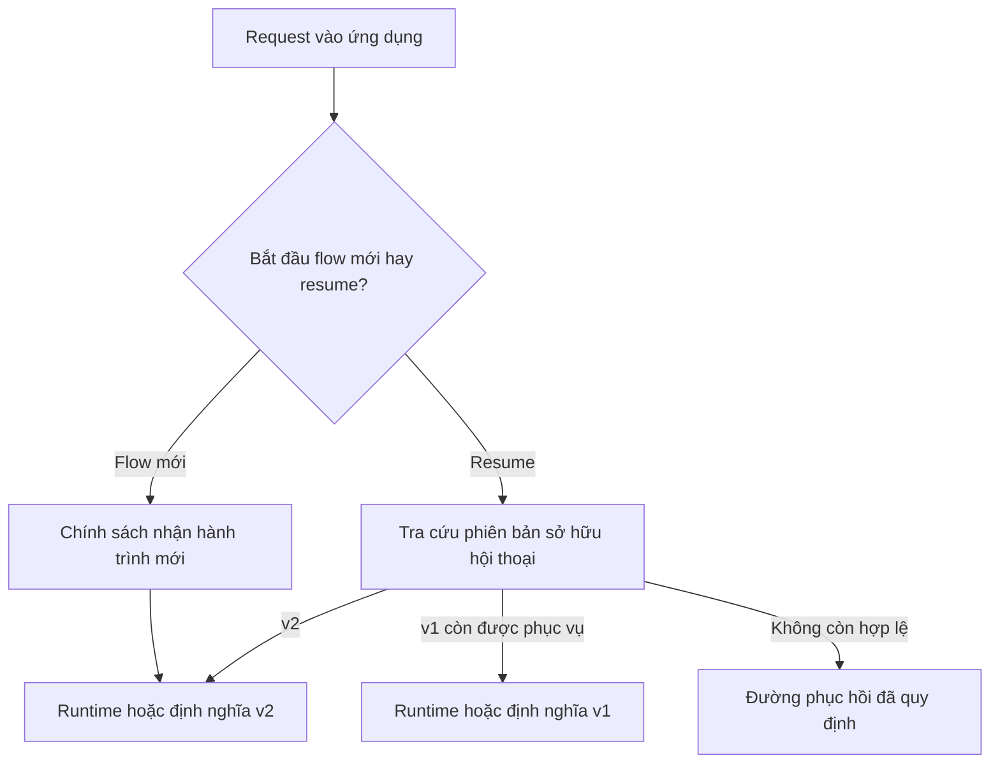

# Xử lý session cùng snapshot đang tồn tại trong lúc nâng cấp

## 1. Mục tiêu và vấn đề cần giải quyết

Một ứng dụng Spring Web Flow không chỉ có request đang chạy tại thời điểm triển khai. Người dùng có thể đang dừng ở bước nhập liệu, giữ một tab xem lại hồ sơ hoặc chuẩn bị gửi event vào một subflow. Session và snapshot của những execution đó có thể được tạo bằng phiên bản ứng dụng cũ, rồi được phiên bản mới đọc ở request tiếp theo.

Thay file JAR và khởi động thành công chưa chứng minh các hành trình đang dang dở vẫn tiếp tục đúng. Phiên bản mới có thể deserialize model được nhưng không còn state cũ; có thể tìm được state nhưng thiếu dữ liệu validation mới; hoặc có thể khởi động lại flow âm thầm khiến tác vụ đã thực hiện bị lặp.

Trong **SPRING_WEB_FLOW**, bài này tập trung vào việc quyết định và kiểm chứng số phận của session, conversation và snapshot đã tồn tại khi nâng cấp ứng dụng cũ. Mục tiêu là giữ đúng điều hướng, dữ liệu và tác dụng phụ nghiệp vụ trong giai đoạn chuyển phiên bản.

Sau bài học, bạn có thể:

- Lập bản đồ những trạng thái đang tồn tại và phần nào chịu ảnh hưởng bởi bản nâng cấp.
- Phân biệt tương thích serialization với tương thích state, validation và hợp đồng nghiệp vụ.
- Chọn chiến lược tiếp tục execution, duy trì phiên bản cũ, chuyển draft hoặc kết thúc có kiểm soát.
- Định tuyến request mới và request resume trong thời gian hai phiên bản cùng tồn tại.
- Kiểm thử snapshot lịch sử, subflow, nhiều tab, postback và rollback.
- Lập quy trình ngừng phiên bản cũ và thu hồi trạng thái đúng phạm vi.

Ví dụ API lấy Spring Web Flow 3.0.0 làm mốc. Ký hiệu `v1`, `v2` trong các tình huống là phiên bản **ứng dụng**, không mặc định là major version của framework. Bài không thực hiện triển khai, migration dữ liệu hoặc xóa session thật.

## 2. Phân biệt các loại trạng thái đang tồn tại

| Loại trạng thái | Nội dung điển hình | Khi nâng cấp cần quyết định |
|---|---|---|
| HTTP session | Danh tính, CSRF context, tùy chọn và thuộc tính ứng dụng | Có tiếp tục đọc bằng runtime mới được không? |
| Conversation | Nhóm dữ liệu dùng cho một hành trình, liên hệ với repository | Ai được tiếp tục quản lý cuộc hội thoại này? |
| Execution hiện hành | Active state, flow scope, stack flow cha/con | Chạy tiếp bằng định nghĩa và dịch vụ nào? |
| Snapshot lịch sử | Trạng thái ở những checkpoint trước | Browser back hoặc tab cũ sẽ xử lý ra sao? |
| Trạng thái view | Dữ liệu component, view scope, Faces ViewState nếu có | Postback từ trang đã mở trước nâng cấp có còn hợp lệ? |
| Draft nghiệp vụ bền vững | Hồ sơ chưa hoàn tất trong database | Có thể chuyển sang mô hình mới bằng dữ liệu này không? |
| Tác vụ đã commit | Hồ sơ đã gửi, thanh toán, email, thông điệp | Làm sao ngăn phát lại khi retry hoặc rollback? |

Một session có thể chứa nhiều execution độc lập. Xóa cả session để xử lý một flow không tương thích có thể đồng thời làm người dùng mất đăng nhập và các hành trình khác. Ngược lại, giữ session không bảo đảm mọi snapshot trong session đều tương thích với phiên bản mới.

`SessionBindingConversationManager` lưu conversation trong session attribute map. Khi có nhiều manager cho các executor độc lập trong cùng ứng dụng, tài liệu yêu cầu session key của chúng khác nhau. Xem [Javadoc SessionBindingConversationManager](https://docs.spring.io/spring-webflow/docs/3.0.0/api/org/springframework/webflow/conversation/impl/SessionBindingConversationManager.html).

Điều này cho thấy cần phân biệt session chung với không gian lưu conversation của từng executor. Chỉ đổi tên bean Spring không tự tạo sự cô lập dữ liệu giữa hai manager.

## 3. Vì sao snapshot cũ có thể không chạy được với bản mới?

### 3.1. Snapshot cần định nghĩa flow tương thích

Execution được khôi phục phải được nối lại với định nghĩa flow và các thành phần runtime. `FlowExecutionImplFactory.restoreFlowExecution()` nhận định nghĩa root flow, key, conversation scope và bộ định vị subflow; những phần đó không thể được thay bằng giả định “snapshot đã mang sẵn toàn bộ ứng dụng cũ”. Xem [Javadoc FlowExecutionImplFactory](https://docs.spring.io/spring-webflow/docs/3.0.0/api/org/springframework/webflow/engine/impl/FlowExecutionImplFactory.html).

Nếu v1 có state `reviewApplication` nhưng v2 đổi thành `reviewAndConsent`, một execution cũ vẫn đang trỏ tới state v1 có thể không khôi phục được theo định nghĩa mới. Giữ nguyên file model chưa giải quyết vấn đề này.

### 3.2. Cùng tên state vẫn có thể khác ý nghĩa

Giả sử cả hai bản đều có state `reviewApplication`, nhưng:

```text
v1: người dùng đã nhập tên và địa chỉ.
v2: trước bước này phải có email liên hệ đã xác minh.
```

Khôi phục snapshot v1 trực tiếp vào state cùng tên của v2 có thể bỏ qua yêu cầu mới. Đây là lỗi hợp đồng nghiệp vụ dù không có exception kỹ thuật.

Cần kiểm tra thêm event, transition, validator, input/output của subflow, giá trị model và các quyền được đánh giá ở những bước liên quan. Không coi việc giữ nguyên state ID là đủ để bảo đảm tương thích.

### 3.3. Tương thích Java serialization chỉ là một lớp

Theo đặc tả Java serialization, thêm field có thể được xử lý bằng giá trị mặc định khi đọc stream cũ; đổi kiểu field không được tự động chuyển đổi tùy ý. Xem [Java 17: Versioning of Serializable Objects](https://docs.oracle.com/en/java/javase/17/docs/specs/serialization/version.html).

Ví dụ một field email mới có thể là `null` khi đọc dữ liệu cũ. Việc đặt initializer trong mã nguồn không phải bằng chứng rằng dữ liệu v1 sau deserialize sẽ có đúng giá trị nghiệp vụ mới. Một `serialVersionUID` không đổi cũng không tự tạo email, chấp nhận điều khoản hoặc cập nhật ý nghĩa của state.

| Thay đổi | Rủi ro cần kiểm tra |
|---|---|
| Thêm field bắt buộc | Snapshot cũ không có giá trị |
| Đổi tên/package class | Không tìm được class cũ hoặc không còn dạng dữ liệu tương ứng |
| Đổi kiểu dữ liệu | Stream cũ không khớp định nghĩa mới |
| Xóa state hoặc subflow ID | Execution cũ không tìm được điểm tiếp tục |
| Đổi validator | Snapshot cũ có thể chưa đáp ứng invariant mới |
| Đổi action/service | Event cũ có thể gây tác dụng phụ khác |
| Đổi Faces/component library | ViewState hoặc component tree cũ có thể không dùng được |
| Đổi serializer/session store | Phiên cũ có thể không đọc được ngay ở lớp session |

Không giữ nguyên UID bằng mọi giá chỉ để bỏ qua lỗi không tương thích. Cần chứng minh cả dạng dữ liệu lẫn ý nghĩa hành vi.

## 4. Kiểm kê trước khi chọn chiến lược

Với từng nhóm flow quan trọng, lập bảng:

```text
Flow nghiệp vụ: application
Bản ứng dụng tạo execution: v1
Các checkpoint tồn tại: enterDetails, reviewApplication, verify-address
Nơi lưu: session/repository của môi trường hiện tại
Dữ liệu model: class và schema version liên quan
Tác vụ không được lặp: confirmApplication
Snapshot lịch sử: có sử dụng cho browser back
Thời gian hành trình: có thể dài hơn một request nhiều lần
Bản nâng cấp: thêm bước contactDetails và thay model
Chiến lược dự kiến: duy trì v1 cho execution cũ; v2 cho hành trình mới
```

Đây là mẫu kiểm kê, không phải cấu hình tự động của framework. Có thể thu thập bằng metrics/log metadata và cấu hình deployment; không cần deserialize mọi session production chỉ để đếm flow.

Những câu hỏi cần trả lời:

- Có bao nhiêu execution đang hoạt động theo phiên bản và flow?
- Có người dùng đang pause trong subflow không?
- Có thay đổi package `javax`/`jakarta`, framework hoặc implementation Faces không?
- Snapshot có chứa model, proxy hoặc đối tượng của thư viện bên thứ ba không?
- Cần rollback về runtime cũ sau khi runtime mới đã ghi lại session không?
- Draft có được lưu bền vững đủ để bắt đầu một flow mới hay chỉ còn trong session?
- Thời hạn duy trì v1 và chính sách khi quá hạn là gì?

Session timeout theo thời gian không hoạt động không bảo đảm cụm v1 sẽ tự hết người dùng trong một thời hạn cố định: mỗi lần tương tác có thể kéo dài phiên. Nếu cần một hạn chót tuyệt đối cho hội thoại cũ, phải thiết kế cơ chế và thông báo tương ứng.

## 5. Bốn chiến lược xử lý

| Chiến lược | Thích hợp khi | Điều phải chứng minh |
|---|---|---|
| Tiếp tục snapshot cũ trên v2 | Thay đổi được kiểm soát và có tương thích đã thử nghiệm | Đọc, resume, ghi mới và rollback theo phạm vi |
| Duy trì runtime v1 cho execution cũ | Không muốn hoặc không thể bảo đảm tương thích trực tiếp | Routing, năng lực vận hành v1 và tiêu chí ngừng |
| Chuyển draft sang flow mới | Có dữ liệu nghiệp vụ chuẩn hóa và quy tắc chuyển rõ | Không bỏ bước mới, không tạo trùng, không mất dữ liệu |
| Kết thúc có kiểm soát | Hành trình có thể làm lại hoặc không có đường chuyển an toàn | Thông báo, lưu draft nếu có và giới hạn ảnh hưởng |

Có thể chọn chiến lược khác nhau cho từng flow. Một bước tìm kiếm ngắn và một hành trình xác nhận hồ sơ dài không nhất thiết cần cùng chính sách.

Không chọn chiến lược dựa vào việc bản build mới khởi động thành công. Cần dựa vào trạng thái đang tồn tại và cam kết đối với người dùng.

## 6. Tiếp tục execution cũ trên phiên bản mới

### 6.1. Hợp đồng cần kiểm thử theo cả chiều đọc và ghi

Phép thử tối thiểu:

```text
1. Chạy v1, bắt đầu flow và pause tại checkpoint đại diện.
2. Lưu session/snapshot qua cơ chế thật.
3. Chạy v2 trong tiến trình độc lập và gửi request resume bằng phiên hiện có.
4. Xác nhận cùng cuộc hội thoại, dữ liệu và state hợp lệ.
5. Thực hiện một event để v2 ghi checkpoint mới.
6. Nếu kế hoạch có rollback, cho v1 đọc trạng thái vừa được v2 ghi.
```

Bước 5–6 thường phát hiện vấn đề bị bỏ sót: v2 đọc được v1, nhưng sau một lần tương tác v2 ghi dạng mới mà v1 không còn đọc được. “Tương thích ngược” và “quay lại bản cũ sau khi đã ghi” phải được kiểm tra thành hai yêu cầu cụ thể.

Một runtime cũ cũng có thể đọc rồi ghi lại dữ liệu mà bỏ mất field mới nó không hiểu. Vì vậy, kiểm tra round-trip cần đối chiếu dữ liệu quan trọng sau chuỗi v1 → v2 → v1 → v2, nếu chuỗi đó nằm trong mô hình triển khai.

### 6.2. Bao phủ snapshot lịch sử

Đừng chỉ kiểm tra snapshot mới nhất. Người dùng có thể dùng Back, tab đã mở từ trước hoặc gửi form từ một checkpoint cũ hơn.

`DefaultFlowExecutionRepository` quản lý các snapshot của execution và hỗ trợ vô hiệu hóa execution khi hoàn tất. Xem [Javadoc DefaultFlowExecutionRepository](https://docs.spring.io/spring-webflow/docs/3.0.0/api/org/springframework/webflow/execution/repository/impl/DefaultFlowExecutionRepository.html).

Với bản nâng cấp, cần xác định:

- Snapshot lịch sử còn được phép tiếp tục theo định nghĩa cũ hay mới?
- Một bước mới bắt buộc có thể bị bỏ qua khi trở về snapshot cũ không?
- Sau khi execution kết thúc, key cũ có được xử lý như kết quả hết hiệu lực không?
- Có cơ chế nào vô tình đưa snapshot đã kết thúc trở lại sau khi phục hồi từ bản sao không?

Không chỉnh byte snapshot hoặc thay chuỗi state ID trong dữ liệu opaque. Nếu phải chuyển trạng thái, hãy xây dựng cơ chế chuyển có hợp đồng và kiểm thử riêng.

## 7. Duy trì v1 và v2 song song

### 7.1. Phân biệt khởi tạo với resume



Thông tin định tuyến phải có sẵn **trước** khi đi vào lớp cần deserialize dữ liệu không tương thích. Đặt `applicationVersion` bên trong một object session mà v2 không thể đọc sẽ không giúp router chọn runtime đúng.

Metadata định tuyến có thể thuộc tầng gateway hoặc một kho ánh xạ do hệ thống quản lý. Không tin một tham số `version=v1` do client tự gửi như bằng chứng quyền truy cập, và không suy phiên bản bằng cách tự cắt execution key.

### 7.2. Có thể phân phiên bản flow trong cùng runtime khi nào?

Nếu hai định nghĩa và model có thể cùng tồn tại trong một runtime tương thích, có thể đăng ký hai flow ID riêng:

```xml
<webflow:flow-registry id="flowRegistry"
    flow-builder-services="flowBuilderServices">
    <webflow:flow-location id="application-v1"
        path="/WEB-INF/flows/application/v1/application-flow.xml"/>
    <webflow:flow-location id="application-v2"
        path="/WEB-INF/flows/application/v2/application-flow.xml"/>
</webflow:flow-registry>
```

Đoạn này giả định namespace `webflow` và builder services đã được khai báo trong cấu hình ứng dụng. Đăng ký hai ID không tự tạo chính sách chọn phiên bản, định tuyến request hoặc chuyển execution cũ.

Những điều cần giữ nhất quán gồm ID root flow, ID subflow, bean phụ thuộc, view/template và hợp đồng input/output. Nếu flow v1 vẫn gọi một subflow chung đã bị thay bằng logic v2 không tương thích, việc giữ file root v1 chưa đủ.

### 7.3. Khi cần tách runtime và session

Hai phiên bản class không tương thích có cùng tên đầy đủ không tự cùng tồn tại trong một classloader chỉ vì flow ID khác nhau. Nâng cấp lớn của framework hoặc Faces có thể cần hai nhóm tiến trình độc lập.

Ngay cả khi dữ liệu flow được tách vào hai attribute, một session repository có thể deserialize các attribute không tương thích trước khi handler chọn flow. Do đó, cần kiểm tra cả mức cô lập session/runtime, không chỉ registry.

Với một người dùng mở nhiều tab, hai tab có thể dùng chung cookie. Nếu một tab gắn v1 và một tab cần v2, phải có chính sách rõ: định tuyến theo cohort phiên, dùng một runtime hiểu cả hai, hoặc tạo phiên/phạm vi cookie tách biệt theo thiết kế. Đổi một cookie chung qua lại giữa các tab có thể làm tab còn lại mất đường resume.

Không mặc định mọi phiên cũ vừa được giữ ở v1 vừa có thể bắt đầu v2 trên cùng cookie mà không có cơ chế hỗ trợ. Chính sách nhận flow mới cần xét trường hợp này.

### 7.4. Namespace và khóa conversation

Session namespace, session key của conversation manager, flow ID và deployment cohort là các khái niệm khác nhau. Tách một lớp không tự tách các lớp còn lại.

Nếu dùng Spring Session Redis, serializer và namespace là cấu hình của lớp session; xem [Spring Session 3.2: Redis Configurations](https://docs.spring.io/spring-session/reference/3.2/configuration/redis.html). Đổi namespace có thể giúp cô lập dữ liệu nhưng cũng làm phiên hiện tại không còn được tìm thấy ở runtime khác nếu routing chưa tương ứng.

Nếu chủ động dùng nhiều `SessionBindingConversationManager` trong cùng ứng dụng, cấu hình `sessionKey` riêng cần được nối thật vào repository/executor tương ứng. Tạo thêm bean manager mà executor không dùng không làm thay đổi nơi lưu dữ liệu.

## 8. Chuyển draft sang flow mới

### 8.1. Đây là chuyển nghiệp vụ, không phải sửa snapshot tại chỗ

Nếu không muốn giữ cấu trúc execution v1, có thể trích dữ liệu nghiệp vụ đã chuẩn hóa và bắt đầu execution v2. Người dùng tiếp tục công việc bằng một flow mới, có thể phải bổ sung những thông tin mới bắt buộc.

Nguồn dữ liệu có thể là draft trong database hoặc dữ liệu được runtime v1 xuất qua một đường chuyển có kiểm soát. Runtime v2 không nên tự thử đọc object graph v1 bằng một cơ chế không tương thích rồi bỏ qua lỗi.

Cần kiểm tra quyền sở hữu draft, trạng thái hiện tại và version ở dịch vụ. Một `draftId` hợp lệ về cú pháp không chứng minh người dùng được quyền tiếp tục draft đó.

### 8.2. Ví dụ chuyển dữ liệu tường minh

Ví dụ Java 17 sau chỉ lập kế hoạch từ dữ liệu nghiệp vụ. Các record là DTO trao đổi do ví dụ định nghĩa, không phải dạng serialized snapshot của Web Flow.

```java
package example.upgrade;

public final class DraftUpgradePlanner {
    public record LegacyDraft(
            String draftId,
            long revision,
            String title) {
    }

    public record CurrentDraft(
            String draftId,
            long sourceRevision,
            String title,
            String contactEmail) {
    }

    public record ResumePlan(
            CurrentDraft draft,
            String requiredStep) {
    }

    public ResumePlan plan(LegacyDraft source) {
        if (source == null
                || source.draftId() == null
                || source.draftId().isBlank()) {
            throw new IllegalArgumentException("Missing source draft");
        }
        if (source.revision() < 0) {
            throw new IllegalArgumentException("Invalid source revision");
        }

        CurrentDraft target = new CurrentDraft(
            source.draftId(),
            source.revision(),
            source.title(),
            null);

        return new ResumePlan(target, "contactDetails");
    }
}
```

V1 chưa có email, nên kế hoạch yêu cầu bước `contactDetails`. Không tự gán một email giả hoặc đánh dấu người dùng đã hoàn thành bước mới chỉ để đưa họ thẳng tới xác nhận.

`requiredStep` là giá trị nội bộ do planner kiểm soát. Khi bắt đầu flow v2, flow nên nhận input nghiệp vụ đã được kiểm tra rồi tự điều phối tới bước hợp lệ; không cho request tùy ý chỉ định state để vượt qua validation.

Planner chưa thực hiện authorization, lưu database, chống chuyển lặp hay khởi tạo execution. Những trách nhiệm đó thuộc dịch vụ điều phối chuyển đổi, cần được triển khai và kiểm thử riêng.

### 8.3. Chuyển đổi phải chịu được retry

Một lần chuyển có thể đi qua hai kho: database và session/repository. Không mặc định có transaction nguyên tử bao trùm cả hai.

Mô hình xử lý có thể gồm:

```text
1. Kiểm tra người dùng, source draft, revision và trạng thái nghiệp vụ.
2. Ghi nhận yêu cầu chuyển theo khóa ổn định, ví dụ source draft + target schema.
3. Chuẩn hóa dữ liệu và lưu draft đích hoặc kế hoạch chuyển.
4. Khởi tạo execution v2 với dữ liệu đã kiểm tra.
5. Ghi nhận execution đích đã được công bố cho người dùng.
6. Đóng đường tiếp tục v1 theo chính sách và dọn dữ liệu đúng phạm vi.
```

Đây là mô hình nghiệp vụ tham khảo, không phải trình tự API có sẵn của Web Flow. Nếu lỗi xảy ra giữa các bước, lần thử lại cần tìm được kết quả đã tạo thay vì tạo thêm draft hoặc execution có tác dụng phụ trùng.

Cần kiểm thử những điểm lỗi: lưu draft đích xong nhưng chưa tạo execution; execution đã tạo nhưng response bị mất; tab cũ gửi confirm trong lúc chuyển; tiến trình cleanup chết trước khi kết thúc. Với nhiều kho, dùng trạng thái chuyển và quy tắc bù/tiếp tục phù hợp thay vì giả định mọi thứ cùng rollback.

Không xóa nguồn ngay khi vừa tạo object đích trong bộ nhớ. Cũng không để cả hai execution tiếp tục thực hiện cùng thao tác cuối mà thiếu quy tắc chủ sở hữu và chống trùng tại tầng nghiệp vụ.

## 9. Kết thúc có kiểm soát và thu hồi trạng thái

Nếu không có đường duy trì hay chuyển an toàn, có thể buộc một nhóm hành trình bắt đầu lại theo chính sách đã chấp nhận. Cần thông báo rõ công việc nào được giữ, công việc nào phải nhập lại và đường tiếp tục là gì.

Phân biệt phạm vi thu hồi:

| Phạm vi | Ảnh hưởng có thể có |
|---|---|
| Một execution | Một hành trình không còn tiếp tục được |
| Toàn bộ snapshot của execution | Mất lịch sử quay lại của hành trình đó |
| Conversation container của một executor | Có thể ảnh hưởng nhiều hành trình trong cùng session |
| HTTP session | Có thể mất đăng nhập và toàn bộ thuộc tính phiên |
| Namespace/kho chung | Có thể ảnh hưởng nhiều người dùng hoặc ứng dụng |

Dọn trạng thái phải thông qua cơ chế hiểu repository, chủ sở hữu và khóa tương ứng. Không xóa tùy ý một vài key backend rồi giả định mọi node đã nhận ra execution không còn hợp lệ.

Một request v1 đang xử lý có thể ghi lại trạng thái sau khi cleanup chạy. Vì vậy, trước hoặc trong thu hồi cần có cơ chế chặn writer cũ và kiểm soát cạnh tranh. Chỉ có job xóa mà không có quy tắc từ chối request cũ có thể làm trạng thái bị xuất hiện lại.

Không phục hồi snapshot đã hoàn tất từ bản sao để “giúp người dùng tiếp tục” nếu tác vụ nghiệp vụ đã commit. Phải đối chiếu trạng thái nghiệp vụ và operation ID, rồi đưa tới kết quả hoàn tất hoặc đường xử lý phù hợp.

## 10. Kiểm thử bằng dữ liệu thực sự do v1 tạo

### 10.1. Không thay snapshot cũ bằng object mới mang tên cũ

Bộ fixture tương thích cần được tạo bởi runtime v1 với cấu hình đại diện: model thực tế, subflow, serializer, session/repository và view technology đang dùng. Một object được tạo bằng class v2 rồi gán `schemaVersion = 1` chưa đại diện cho serialized state v1.

Chạy v1 và v2 trong các tiến trình riêng để tránh việc cùng classloader hoặc bean cache che lỗi. Dữ liệu dùng trong kiểm thử phải là dữ liệu thử đã kiểm soát, không phải bản sao production tùy ý chứa thông tin người dùng.

### 10.2. Ma trận cần bao phủ

| Điểm tồn tại trước nâng cấp | Thao tác sau nâng cấp | Điều phải khẳng định |
|---|---|---|
| Đang nhập form v1 | Submit bằng trang cũ | Binding, validation và routing theo chính sách |
| Đang review v1 | Confirm | Không bỏ yêu cầu mới hoặc chạy nhầm action |
| Đang pause trong subflow v1 | Hoàn tất flow con | Stack, outcome và output mapping đúng |
| Snapshot lịch sử v1 | Back hoặc submit từ tab cũ | Tiếp tục đúng hoặc từ chối theo chính sách |
| Execution v2 đã ghi mới | Rollback runtime | Đọc/ghi được hoặc được định tuyến tách rõ |
| Draft đã chuyển sang v2 | Lặp yêu cầu chuyển | Không tạo draft/tác vụ trùng |
| Execution cũ đã hết hiệu lực | Gửi lại key cũ | Không phục hồi nhầm hoặc khởi tạo âm thầm |
| Cùng session có hai flow | Thu hồi một flow | Không làm mất hành trình còn lại ngoài phạm vi |
| Faces/Ajax nếu có | Postback sau nâng cấp | ViewState và giao thức phản hồi được xử lý đúng |
| Hai runtime cùng xử lý | Cập nhật hoặc confirm đồng thời | Không ghi đè trạng thái hay tạo trùng nghiệp vụ |

Nếu chiến lược là giữ v1, test phải chứng minh request resume vẫn tới v1. Nếu chiến lược là migrate draft, test phải chứng minh đã tạo execution mới và người dùng được đưa tới bước bắt buộc phù hợp. Không dùng cùng nhãn “restore thành công” cho mọi kết quả.

### 10.3. Ví dụ đặc tả cho trường hợp thêm trường bắt buộc

```text
Given:
  V1 đã lưu draft D, revision 7, đang ở reviewApplication.
  Snapshot không có contactEmail.
  V2 yêu cầu email trước xác nhận.
When:
  Người dùng tiếp tục theo chiến lược chuyển draft.
Then:
  Draft D vẫn được gắn đúng người dùng.
  Dữ liệu title và source revision được bảo toàn.
  Flow v2 yêu cầu nhập contactEmail.
  Không gọi confirmApplication trước khi hoàn tất bước bắt buộc.
When:
  Người dùng gửi lại yêu cầu chuyển do mất phản hồi.
Then:
  Kết quả chuyển được nhận diện theo khóa ổn định.
  Không tạo thêm một hồ sơ nghiệp vụ khác.
```

## 11. Tránh ghi đè session khi hai phiên bản cùng chạy

Một session dùng chung không tự giải quyết xung đột cập nhật. Hai request có thể đọc hai bản trạng thái rồi ghi lại theo thứ tự khác dự kiến.

Cần kiểm tra cơ chế theo dõi thay đổi attribute, thời điểm flush và mức hạt của dữ liệu được ghi. Tài liệu Spring Session mô tả việc lưu delta để giảm rủi ro ghi đè khi request đồng thời; xem [Spring Session: Customizing SessionRepository](https://docs.spring.io/spring-session/reference/api.html).

Nếu nhiều execution nằm bên trong cùng một session attribute chứa conversation container, thay đổi ở mức thuộc tính ngoài chưa chắc tách biệt được mọi thay đổi bên trong. Phải thử đúng object graph và integration đang dùng.

Không đổi chế độ lưu mọi thuộc tính như một cách chữa chung. `SaveMode.ALWAYS` có thể tăng nguy cơ ghi đè giữa request đồng thời; xem [Javadoc SaveMode](https://docs.spring.io/spring-session/reference/3.5/api/java/org/springframework/session/SaveMode.html). Tài liệu này được dùng để đối chiếu ngữ nghĩa enum; cấu hình cụ thể vẫn phải khớp phiên bản thư viện đang triển khai.

Khóa trong một JVM cũng không mặc nhiên bảo vệ hai nhóm runtime. Với thao tác cuối cùng, kiểm tra ràng buộc version hoặc operation ID ở tầng dữ liệu/dịch vụ ngoài việc khóa flow.

## 12. Rollback là một luồng vận hành riêng

Một kế hoạch rollback cần trả lời:

- V1 có đọc được session do v2 đã ghi không?
- Snapshot của flow v2 sẽ tiếp tục ở đâu sau rollback?
- Database hoặc draft đã chuyển schema có còn dùng được với v1 không?
- Writer v2 còn đang xử lý request sẽ được ngăn hoặc hoàn tất thế nào?
- Người dùng ở bước mới của v2 sẽ được hướng dẫn ra sao?
- Những tác vụ đã commit được nhận diện bằng khóa nào để không phát lại?

Đổi image về v1 không hoàn tác session store hoặc database. Phục hồi bản sao session cũ một cách độc lập có thể đưa người dùng về trước một tác vụ đã commit, tạo nguy cơ gửi lại.

Nếu v2 đã tạo trạng thái không tương thích v1, một phương án rollback có thể chỉ ngừng nhận flow v2 mới, vẫn giữ một nhóm v2 để hoàn tất execution đã tồn tại, đồng thời chuyển phần lưu lượng phù hợp về v1. Đây là lựa chọn kiến trúc cần chuẩn bị, không phải khả năng tự có khi đổi phiên bản deployment.

Kiểm thử rollback sau ít nhất một lần v2 thực sự ghi snapshot/session. Rollback ngay sau startup nhưng trước mọi request người dùng chỉ kiểm tra một trường hợp hẹp.

## 13. Quy trình nâng cấp và điều kiện ngừng v1

### 13.1. Trước triển khai

- Chốt chiến lược theo từng flow và liệt kê thay đổi không tương thích.
- Tạo fixture v1 tại các checkpoint quan trọng, bao gồm lịch sử và subflow.
- Kiểm thử các chiều đọc/ghi và rollback thực sự cần hỗ trợ.
- Chuẩn bị routing/cohort, nguồn metadata và đường phục hồi khi không thể resume.
- Đặt tiêu chí về lỗi, mất dữ liệu, tác vụ trùng và thời hạn duy trì phiên cũ.

### 13.2. Trong giai đoạn chuyển tiếp

Ngừng nhận flow v1 mới theo chính sách đã chọn, nhưng vẫn phục vụ request của execution v1 còn hợp lệ. Phân biệt số session của v1 với số conversation v1 đang hoạt động; không phải mọi session còn tồn tại đều có việc chưa xong.

Quan sát lỗi deserialize/restore, lỗi state/subflow, fallback restart, kết quả migration và số request bị routing sai. Nếu vượt ngưỡng đã đặt, dừng mở rộng triển khai hoặc áp dụng kế hoạch rollback tương ứng; không tự xóa session để làm tỷ lệ lỗi giảm.

### 13.3. Khi nào có thể tắt v1?

Tiêu chí có thể gồm:

1. Không còn nhận execution v1 mới.
2. Không còn execution v1 cần phục vụ, hoặc đã hết hạn theo chính sách và được xử lý đúng.
3. Không còn request v1 đang chạy hoặc writer có thể ghi lại dữ liệu cũ.
4. Đường xử lý tab cũ, URL cũ và key không hợp lệ đã được kiểm thử.
5. Kế hoạch rollback còn lại không phụ thuộc việc giữ runtime v1 đang hoạt động, hoặc đã có quyết định kết thúc cửa sổ rollback đó.
6. Việc cleanup được giới hạn theo phiên bản, chủ sở hữu và chính sách lưu dữ liệu.

Một khoảng thời gian bằng idle timeout không thay cho các tiêu chí này nếu người dùng vẫn đang hoạt động. Cũng không cần giữ vô hạn mọi snapshot chỉ vì có thể còn một tab cũ; chính sách hết hiệu lực phải rõ ràng và được phản ánh ở giao diện.

## 14. Quan sát và báo cáo kết quả

Báo cáo triển khai nên tách các nhóm kết quả:

| Kết quả | Ý nghĩa |
|---|---|
| Continued on v1 | Execution cũ tiếp tục trên runtime/định nghĩa v1 |
| Restored on v2 | Execution cũ được v2 khôi phục và tiếp tục đúng |
| Draft migrated | Công việc được chuyển sang execution mới bằng dữ liệu nghiệp vụ |
| Restart required | Người dùng phải bắt đầu lại theo chính sách |
| Expired/rejected | Trạng thái không còn hợp lệ hoặc bị từ chối có chủ đích |
| Unexpected failure | Lỗi ngoài hợp đồng cần điều tra |

Những nhãn trên là cách tổ chức báo cáo của bài, không phải enum có sẵn trong Spring Web Flow.

Metrics phù hợp gồm số execution theo phiên bản, tỷ lệ restore lỗi, số fallback restart, số migration thành công/lặp/xung đột và số tác vụ nghiệp vụ trùng. Tránh dùng session ID hoặc execution key làm nhãn metrics có số lượng giá trị không giới hạn.

Log chẩn đoán có thể ghi bản build, flow ID, state, loại nguồn snapshot và mã tương quan được bảo vệ. Không cần ghi toàn bộ session hoặc form để biết bản nâng cấp có tương thích không.

## 15. Bài thực hành và tiêu chí hoàn thành

Tạo hai bản ứng dụng thử nghiệm:

```text
v1: enterDetails → reviewApplication → done
v2: enterDetails → contactDetails → reviewApplication → done
```

V2 thêm email bắt buộc và quy tắc kiểm tra trước khi confirm. Sau đó:

1. Tạo session và snapshot bằng v1 ở bước nhập liệu, review và một subflow.
2. Thử đọc/resume bằng v2; ghi rõ điểm nào tương thích kỹ thuật nhưng chưa đủ điều kiện nghiệp vụ.
3. Chọn và triển khai một chiến lược cho execution cũ trong môi trường thử nghiệm.
4. Kiểm tra tab cũ, browser back và request gửi lại sau mất phản hồi.
5. Kiểm tra v2 đã ghi snapshot rồi mới rollback theo kế hoạch.
6. Thu hồi một execution thử và chứng minh execution khác trong cùng session không bị ảnh hưởng ngoài phạm vi.
7. Mô phỏng một request cũ đang chạy khi cleanup để kiểm tra không làm trạng thái cũ xuất hiện lại.

Tiêu chí chấp nhận:

- Session, conversation, snapshot và draft được phân biệt rõ trong thiết kế.
- Mỗi flow có chính sách cụ thể cho execution đã tồn tại.
- Fixture tương thích do runtime v1 thực sự tạo.
- Kiểm thử bao phủ resume, lần ghi tiếp theo và rollback nếu được cam kết.
- Dữ liệu mới bắt buộc không bị tự giả định là đã có trong snapshot cũ.
- Chuyển draft có kiểm tra quyền, version, retry và chống tạo trùng.
- Routing hoạt động trước ranh giới deserialize không tương thích.
- Có điều kiện ngừng v1 và cleanup đúng phạm vi, gồm cả request đang chạy.
- Kết quả restore, migration và restart được báo cáo đúng bản chất.

Nâng cấp một ứng dụng Web Flow hoàn tất khi số phận của những hành trình đã bắt đầu được xử lý theo một hợp đồng rõ ràng. Bản chạy mới, dữ liệu cũ, routing và quy tắc nghiệp vụ phải phối hợp để người dùng tiếp tục đúng việc đang làm hoặc được hướng dẫn phục hồi đúng cách.