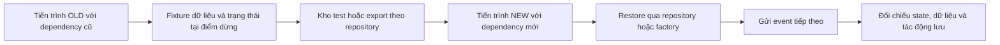

# Lập bộ kiểm thử hồi quy cho hành trình và dữ liệu đã lưu

## 1. Nâng cấp thành công phải giữ được điều gì?

Một ứng dụng Spring Web Flow có thể khởi động được sau khi nâng cấp nhưng vẫn làm mất dữ liệu khi người dùng bấm Back, không đọc được bản nháp cũ hoặc tạo thêm đơn khi gửi lại trang xác nhận. Kiểm tra dependency và trang đầu tiên chưa đủ để phát hiện những lỗi này.

Bài này thuộc chương **Nâng cấp ứng dụng cũ** của module **SPRING_WEB_FLOW**. Mục tiêu là lập một bộ kiểm thử bảo vệ cả điều hướng state/event và ý nghĩa dữ liệu trong các hành trình nhiều bước, đồng thời kiểm tra chính sách dành cho những phiên đang dở lúc triển khai phiên bản mới.

Cần tách ba hợp đồng:

| Hợp đồng | Câu hỏi cần trả lời |
| --- | --- |
| Hành vi của hành trình | Với cùng đầu vào và sự kiện, người dùng có đi đúng bước và nhận đúng kết quả nghiệp vụ không? |
| Dữ liệu nghiệp vụ đã lưu | Bản ghi hoặc bản nháp do phiên bản cũ tạo có được đọc, sửa và ghi lại đúng ý nghĩa không? |
| Trạng thái thực thi đang dở | Một flow execution được tạo trước nâng cấp có tiếp tục được, hoặc kết thúc theo chính sách chuyển đổi rõ ràng không? |

Không mặc định snapshot runtime là định dạng lưu trữ lâu dài của bản nháp. Hai loại dữ liệu có vòng đời và mức tương thích khác nhau. Bộ test phải phản ánh cách ứng dụng thực sự lưu chúng.

Các ví dụ về harness tham chiếu Spring Web Flow **3.0.1** và Java 17 để có mốc API cụ thể. `OLD` và `NEW` trong bài là hai bản build của ứng dụng đang được so sánh, không phải tên một cặp phiên bản Web Flow được bảo đảm tương thích.

## 2. Chốt đường cơ sở trước khi sửa dependency

### 2.1. Ghi lại cấu hình có ảnh hưởng tới hành vi

Trước khi thay đổi, cần xác định bản build cũ có thể tái tạo và các thành phần liên quan:

- JDK, Spring Framework, Spring Web Flow, servlet container và thư viện validation/EL.
- Flow registry, flow ID, XML model cha, subflow và các bean action/service được gọi.
- Conversion service, formatter, validation group, message bundle và locale/time zone.
- Repository/snapshot factory, nơi lưu session, timeout và chính sách lịch sử quay lại.
- Phiên bản schema dữ liệu nghiệp vụ, kiểu serialization và adapter đọc dữ liệu cũ.
- Cấu hình xác thực/phân quyền, transaction, cơ chế chống gửi trùng và tích hợp bên ngoài.

Không cần đưa mọi chi tiết vào một tài liệu khổng lồ. Điều quan trọng là đủ thông tin để giải thích khác biệt khi một test đổi kết quả giữa OLD và NEW.

### 2.2. Viết kỳ vọng bằng quan sát nghiệp vụ

Ví dụ một hành trình đặt phòng:

```text
Nhập lịch → chọn khách → xem lại → xác nhận → hoàn tất
                    ↘ sửa lại ↗
```

Hợp đồng có thể là:

1. Ngày nhập hợp lệ và danh sách khách được giữ khi quay lại sửa.
2. Lỗi nhập liệu giữ người dùng ở đúng bước và không gọi thao tác lưu đơn.
3. Xác nhận hợp lệ tạo đúng một đặt phòng với số tiền, tiền tệ và chủ sở hữu đúng.
4. Hủy trước xác nhận không tạo đặt phòng.
5. Nếu dữ liệu đã thay đổi ngoài hệ thống, người dùng nhận được nhánh xử lý xung đột theo thiết kế.

State ID, mã lỗi và output mapping cần assertion chính xác ở nơi chúng là hợp đồng kỹ thuật. Ngược lại, một refactor hợp lệ có thể đổi state trung gian mà vẫn giữ cùng hành vi người dùng; bộ kiểm thử không nên vô tình biến mọi chi tiết triển khai thành hợp đồng bất biến.

### 2.3. Không biến lỗi cũ thành yêu cầu phải giữ nguyên

Characterization test ghi nhận hành vi hiện tại. Nó không có nghĩa mọi hành vi hiện tại đều đúng. Nếu OLD đang tạo trùng đơn hoặc cho phép đọc bản nháp của người khác, đánh dấu đó là lỗi cần sửa và ghi rõ kỳ vọng mới; không lấy kết quả sai làm chuẩn để chặn nâng cấp.

Mọi khác biệt được chủ động chấp nhận nên có case ID, lý do, kỳ vọng trước/sau và bằng chứng nghiệp vụ. Không cập nhật hàng loạt expected result chỉ để NEW trở lại màu xanh.

## 3. Lập ma trận hành trình theo rủi ro

Không cần thử mọi tổ hợp của mọi field. Bắt đầu bằng các đường dẫn có khả năng làm mất dữ liệu, thay đổi tác động nghiệp vụ hoặc phụ thuộc cấu hình đã nâng cấp.

| Case | Thiết lập và thao tác | Điều cần khẳng định |
| --- | --- | --- |
| J01 | Bắt đầu hành trình mới | State đầu, model mặc định, principal và dữ liệu khởi tạo đúng |
| J02 | Nhập hợp lệ, Next tới review | Conversion đúng, field quan trọng còn nguyên, chưa lưu đơn |
| J03 | Nhập ngày/số sai kiểu | Ở lại bước nhập, có lỗi đúng trường, không dùng giá trị cũ để lưu |
| J04 | Dữ liệu đúng kiểu nhưng sai quy tắc | Đúng nhóm validation, không vượt bước |
| J05 | Review → Back → sửa → Next | Giữ lựa chọn không sửa và dùng giá trị mới ở lần xác nhận |
| J06 | Cancel ở từng điểm quan trọng | Đúng outcome, không có tác động ghi ngoài dự kiến |
| J07 | Subflow trả thành công hoặc hủy | Input/output mapping và dữ liệu flow cha đúng |
| J08 | Confirm hợp lệ | Payload lưu, tổng tiền, owner và số tác động thực tế đúng |
| J09 | Gửi lại xác nhận hoặc dùng trang cũ | Không tạo thêm tác động theo hợp đồng chống trùng |
| J10 | Xung đột phiên bản/không còn phòng | Nhánh phục hồi rõ, không báo thành công giả |
| J11 | Hai tab hoặc hai execution cùng phiên | Dữ liệu hành trình không lẫn nhau ngoài scope chia sẻ có chủ đích |
| J12 | Hết hạn session/execution | Đường bắt đầu lại hoặc phục hồi bản nháp đúng chính sách |
| J13 | Đổi tài khoản/tenant hoặc đoán draft ID | Không đọc/sửa/xác nhận dữ liệu của chủ thể khác |
| J14 | Dependency timeout trước hoặc sau tác động | Phân biệt thất bại với kết quả chưa biết; gửi lại không làm sai dữ liệu |

Với mỗi case, gắn dữ liệu đầu vào, state/outcome mong đợi, điều kiện DB và side effect cần quan sát. Chỉ ghi “trang trả HTTP 200” không đủ cho một hành trình có giao dịch.

Spring Web Flow hỗ trợ mô hình hóa state, event, subflow và scope; các khái niệm này là những ranh giới tự nhiên để xây dựng case. Tham khảo [Spring Web Flow Reference Guide](https://docs.spring.io/spring-webflow/docs/current/reference/).

## 4. Phân loại dữ liệu đã lưu trước khi tạo fixture

| Loại dữ liệu | Ví dụ | Cách kiểm chứng phù hợp |
| --- | --- | --- |
| Bản ghi nghiệp vụ trong DB | Đặt phòng, tổng tiền, trạng thái, version | Nạp schema cũ, chạy migration, đọc/ghi qua service mới |
| Bản nháp lưu bền vững | JSON/XML/row draft có schema version | Đọc fixture cũ bằng adapter hiện tại, đối chiếu giá trị và ghi lại |
| DTO serialized riêng | Blob Java serialization do ứng dụng quản lý | Dùng bytes do OLD tạo, đọc bằng NEW và kiểm tra ý nghĩa |
| Snapshot flow execution | State, scopes, session stack khi dừng ở view | Đi qua repository/factory restore của ứng dụng, rồi gửi event tiếp theo |
| HTTP session/conversation | Dữ liệu hội thoại, thông tin phiên phù hợp | Kiểm tra đường lưu/restore session nếu triển khai có yêu cầu |
| Artifact ngoài DB | File đính kèm, báo cáo, upload tạm | Kiểm tra tham chiếu, quyền đọc, retention và file còn tồn tại |

Một DTO đọc được bằng `ObjectInputStream` chưa chứng minh flow resume được. Ngược lại, một flow mới chạy được không chứng minh database migration giữ đúng các bản ghi đã có nhiều năm.

CSRF token, execution key và cookie có ngữ cảnh riêng. Không sao chép nguyên request của OLD rồi mặc định các token đó hợp lệ ở một phiên NEW. Với test hành trình mới, lấy token/key từ response của chính lượt chạy; với test tiếp tục phiên cũ, tái tạo đúng ngữ cảnh session/repository cần kiểm chứng.

## 5. Tạo fixture có nguồn gốc và giữ nguyên kỳ vọng

### 5.1. Bộ dữ liệu nhỏ nhưng có các ca biên

Nên có các fixture như:

- Bản nháp tối thiểu và bản nháp đầy đủ nhiều khách.
- Tên tiếng Việt có dấu, chuỗi rỗng và ký tự Unicode đặc biệt.
- Ngày nhuận, ngày qua ranh giới tháng/năm và thời điểm gần nửa đêm ở múi giờ nghiệp vụ.
- Số tiền bằng không nếu nghiệp vụ cho phép, số tiền có phần lẻ và giới hạn lớn hợp lệ.
- Field optional bị thiếu ở phiên bản cũ; giá trị enum cũ; bản ghi có version cũ.
- Bản nháp đã hết hạn, đã xác nhận hoặc bị sửa bởi một tác nhân khác.
- Tham chiếu tới file không còn tồn tại hoặc entity đã bị vô hiệu hóa.

Fixture tổng hợp thường dễ kiểm soát hơn dữ liệu thật. Nếu cần dữ liệu mô phỏng lỗi production, giảm thiểu và làm sạch nhưng vẫn giữ quan hệ khóa, cấu trúc lỗi và đặc tính cần tái hiện. Không đưa mật khẩu, token hoặc thông tin cá nhân thật vào repository test.

### 5.2. Lưu metadata cho artifact kiểm thử

Ví dụ một manifest do nhóm phát triển duy trì, không phải định dạng dựng sẵn của Web Flow:

```json
{
  "fixtureId": "booking-review-old-001",
  "producerBuild": "OLD-build-id-can-dien",
  "fixtureKind": "flow-repository-export",
  "flowId": "booking",
  "pausedState": "reviewBooking",
  "dataSchemaVersion": 1,
  "locale": "vi-VN",
  "businessZone": "Asia/Ho_Chi_Minh",
  "syntheticData": true,
  "expectedAfterConfirm": {
    "outcome": "completed",
    "successfulBookingWrites": 1,
    "currency": "USD",
    "total": "123.45"
  }
}
```

Giá trị producer build phải được điền từ bản tạo fixture thật. Với artifact binary, ghi thêm checksum để phát hiện thay đổi ngoài ý muốn. Kiểu export repository và công cụ đọc là phần của hạ tầng test ứng dụng; không có một file `.bin` chuẩn dùng được với mọi repository.

Các số tiền USD trong bài chỉ là dữ liệu giả để minh họa scale hai chữ số. Không áp dụng mặc định đó cho mọi loại tiền hoặc tự đổi tiền tệ của dữ liệu Việt Nam.

### 5.3. Fixture OLD phải thực sự do OLD tạo

Quy trình đáng tin cậy:

```text
Build OLD ở môi trường cô lập
→ seed dữ liệu đã biết
→ thực hiện chuỗi event tới điểm dừng
→ xuất dữ liệu/snapshot cùng metadata cần thiết
→ cố định artifact và kỳ vọng
→ dùng NEW để đọc, tiếp tục và đối chiếu
```

Không viết một đối tượng bằng NEW rồi đặt tên file là `old-review.bin`. Test đó chỉ kiểm tra NEW đọc dữ liệu của chính nó.

Giữ bộ fixture gốc ở chế độ không thay đổi trong lượt test. Mỗi lần chạy dùng một bản sao vào database/repository cô lập để quá trình migration hoặc confirm không làm bẩn fixture cho case kế tiếp.

## 6. Chia bộ test theo ranh giới cần bảo vệ

| Tầng | Trọng tâm | Điều chưa được chứng minh nếu chỉ test tầng này |
| --- | --- | --- |
| Unit/adapter | Chuyển đổi giá trị, đọc schema cũ, quy tắc mặc định | Wiring MVC, điều hướng hoặc transaction thật |
| Flow execution | State/event, action result, scope, subflow | Binding và template thật nếu harness đang dùng mock view |
| MVC integration | Request parameter, conversion, validation, security và flow adapter | Hành vi browser/container thật trong mọi cấu hình |
| Repository/session integration | Lưu, restore và tiếp tục execution | Tương thích schema DB nghiệp vụ nếu không đưa migration vào |
| Persistence/migration | Schema và ý nghĩa dữ liệu cũ qua service | Trải nghiệm và điều hướng đầy đủ |
| End-to-end có chọn lọc | Một số hành trình quan trọng trên ứng dụng chạy thật | Toàn bộ tổ hợp lỗi và dữ liệu biên |

Không đẩy mọi case vào browser test. Các tổ hợp giá trị và adapter dữ liệu nên có test nhanh; chỉ giữ số lượng vừa đủ hành trình xuyên tầng để phát hiện lỗi wiring và triển khai.

[MockMvc](https://docs.spring.io/spring-framework/reference/testing/mockmvc.html) chạy xử lý Spring MVC bằng mock request/response, không cần server đang chạy. Để dùng cho Web Flow, test phải có handler mapping/adapter, registry, repository, view factory và cấu hình bảo mật/validator thích hợp; cấu hình controller độc lập không tự bao phủ mọi thành phần đó.

## 7. Ví dụ kiểm tra điều hướng cùng dữ liệu được chuyển tiếp

### 7.1. Flow minh họa có tác động lưu rõ ràng

Giả định tài nguyên classpath `/flows/booking/booking-flow.xml` có nội dung:

```xml
<flow xmlns="http://www.springframework.org/schema/webflow"
      xmlns:xsi="http://www.w3.org/2001/XMLSchema-instance"
      xsi:schemaLocation="
        http://www.springframework.org/schema/webflow
        https://www.springframework.org/schema/webflow/spring-webflow.xsd">

    <on-start>
        <evaluate expression="bookingService.newDraft()"
                  result="flowScope.booking"/>
    </on-start>

    <view-state id="details" model="booking">
        <transition on="next" to="review"/>
        <transition on="cancel" to="cancelled"
                    bind="false" validate="false"/>
    </view-state>

    <view-state id="review" model="booking">
        <transition on="back" to="details" validate="false"/>
        <transition on="confirm" to="save"/>
    </view-state>

    <action-state id="save">
        <evaluate expression="bookingService.confirm(booking)"/>
        <transition on="saved" to="completed"/>
        <transition on="conflict" to="review"/>
    </action-state>

    <end-state id="completed"/>
    <end-state id="cancelled"/>
</flow>
```

Trong ứng dụng thật, action/service xác nhận còn phải thực hiện kiểm tra quyền, tính nhất quán và chống trùng. XML này chỉ tạo ranh giới quan sát cho ví dụ test.

### 7.2. Harness kiểm tra dữ liệu và số tác động

Ví dụ sau dùng `AbstractXmlFlowExecutionTests` của Web Flow 3.0.1. Các test đi theo quy ước `TestCase`; nếu chạy trên JUnit Platform, cần engine tương thích như Vintage thay vì chỉ có Jupiter. Xem [AbstractFlowExecutionTests](https://raw.githubusercontent.com/spring-projects/spring-webflow/v3.0.1/spring-webflow/src/main/java/org/springframework/webflow/test/execution/AbstractFlowExecutionTests.java) và [JUnit 5.10.3 User Guide](https://docs.junit.org/5.10.3/user-guide/index.html).

```java
package example.regression;

import java.io.Serializable;
import java.math.BigDecimal;
import org.springframework.webflow.config.FlowDefinitionResource;
import org.springframework.webflow.config.FlowDefinitionResourceFactory;
import org.springframework.webflow.test.MockExternalContext;
import org.springframework.webflow.test.MockFlowBuilderContext;
import org.springframework.webflow.test.execution.AbstractXmlFlowExecutionTests;

public class BookingJourneyTests extends AbstractXmlFlowExecutionTests {
    private BookingServiceStub service;

    @Override
    protected void setUp() throws Exception {
        super.setUp();
        service = new BookingServiceStub();
        setCacheFlowDefinition(false);
    }

    @Override
    protected FlowDefinitionResource getResource(
            FlowDefinitionResourceFactory factory) {
        return factory.createClassPathResource(
                "/flows/booking/booking-flow.xml", getClass());
    }

    @Override
    protected void configureFlowBuilderContext(MockFlowBuilderContext context) {
        context.registerBean("bookingService", service);
    }

    public void testBackPreservesDraftAndConfirmUsesEditedValue() {
        startFlow(new MockExternalContext());
        Draft draft = (Draft) getFlowScope().get("booking");
        draft.setGuestName("Nguyễn An");

        send("next");
        assertCurrentStateEquals("review");
        send("back");
        assertCurrentStateEquals("details");
        assertEquals("Nguyễn An", ((Draft) getFlowScope()
                .get("booking")).getGuestName());

        ((Draft) getFlowScope().get("booking")).setGuestName("Trần Bình");
        send("next");
        assertEquals(0, service.successfulWrites);
        send("confirm");

        assertFlowExecutionEnded();
        assertFlowExecutionOutcomeEquals("completed");
        assertEquals(1, service.successfulWrites);
        assertEquals("Trần Bình", service.savedGuestName);
        assertEquals(0, new BigDecimal("123.45")
                .compareTo(service.savedTotal));
        assertEquals("USD", service.savedCurrency);
    }

    public void testCancelDoesNotWriteBooking() {
        startFlow(new MockExternalContext());
        send("cancel");

        assertFlowExecutionEnded();
        assertFlowExecutionOutcomeEquals("cancelled");
        assertEquals(0, service.successfulWrites);
    }

    public void testConflictReturnsToReviewWithoutSuccessfulWrite() {
        service.conflict = true;
        startFlow(new MockExternalContext());
        send("next");
        send("confirm");

        assertCurrentStateEquals("review");
        assertEquals(0, service.successfulWrites);
        assertEquals("123.45", ((Draft) getFlowScope().get("booking"))
                .getTotal().toPlainString());
    }

    private void send(String eventId) {
        MockExternalContext context = new MockExternalContext();
        context.setEventId(eventId);
        resumeFlow(context);
    }

    public static class Draft implements Serializable {
        private static final long serialVersionUID = 1L;
        private String guestName = "";
        private BigDecimal total = new BigDecimal("123.45");
        private String currency = "USD";

        public String getGuestName() { return guestName; }
        public void setGuestName(String guestName) { this.guestName = guestName; }
        public BigDecimal getTotal() { return total; }
        public void setTotal(BigDecimal total) { this.total = total; }
        public String getCurrency() { return currency; }
        public void setCurrency(String currency) { this.currency = currency; }
    }

    public static class BookingServiceStub {
        private boolean conflict;
        private int successfulWrites;
        private String savedGuestName;
        private BigDecimal savedTotal;
        private String savedCurrency;

        public Draft newDraft() {
            return new Draft();
        }

        public String confirm(Draft draft) {
            if (conflict) {
                return "conflict";
            }
            successfulWrites++;
            savedGuestName = draft.getGuestName();
            savedTotal = draft.getTotal();
            savedCurrency = draft.getCurrency();
            return "saved";
        }
    }
}
```

Cơ chế chọn resource và đăng ký dependency của harness được thể hiện trong [AbstractXmlFlowExecutionTests](https://raw.githubusercontent.com/spring-projects/spring-webflow/v3.0.1/spring-webflow/src/main/java/org/springframework/webflow/test/execution/AbstractXmlFlowExecutionTests.java).

Ví dụ có ba test, ghi nhận các scalar đã lưu thay vì giữ nguyên một tham chiếu mutable rồi tự so sánh nó với chính nó. `successfulWrites` là bộ đếm trong stub, không phải bằng chứng về số row hoặc số giao dịch thật trong DB.

Test chủ động sửa model qua flow scope. Nó kiểm tra việc giữ và chuyển dữ liệu trong hành trình, không chứng minh request parameter đã được bind/validate. Để bảo vệ J03/J04, cần thêm test dùng MVC/view factory thực tế của ứng dụng và kiểm tra cả giá trị bị từ chối.

## 8. Kiểm thử dữ liệu nghiệp vụ cũ qua một vòng đọc, sửa và ghi lại

### 8.1. Định nghĩa ngữ nghĩa trước khi đổi schema

Giả sử bản nháp V1 có biểu diễn như sau:

```json
{
  "schemaVersion": 1,
  "draftId": "DRAFT-017",
  "ownerId": "test-user-01",
  "guestName": "Nguyễn An",
  "checkIn": "2027-04-10",
  "checkOut": "2027-04-12",
  "currency": "USD",
  "totalMinor": 12345,
  "status": "DRAFT",
  "version": 7
}
```

Đây là fixture dữ liệu giả theo một hợp đồng V1 được định nghĩa cho ví dụ. Nó không mô tả schema mặc định của Spring Web Flow.

NEW có thể dùng `total` là số thập phân và có thêm field về lựa chọn liên hệ. Kỳ vọng cần chốt:

- `12345` minor units của USD chuyển thành `123.45`, không thành `12345.00`.
- Tên khách giữ nguyên Unicode; ngày lưu dạng date không bị đổi ngày do áp múi giờ sai.
- Owner và draft ID không bị thay bằng người dùng mặc định của môi trường test.
- Thiếu field mới được xử lý theo quy tắc đã thống nhất; thiếu thông tin đồng ý không tự biến thành đã đồng ý.
- Status và version được chuyển đúng chính sách, không coi mọi bản ghi cũ đều là bản nháp chưa xác nhận.

Nếu có nhiều loại tiền, test cả chính sách số chữ số thập phân và đơn vị lưu của từng loại được hỗ trợ. Không suy từ tên field `amount` rằng dữ liệu cũ đang dùng đơn vị chính hay đơn vị nhỏ.

### 8.2. Vòng kiểm chứng nên đi qua adapter và persistence thật

Một case dữ liệu cũ đầy đủ có các bước:

```text
Nạp fixture V1 vào kho cô lập
→ migration schema nếu có
→ đọc bằng adapter/service của NEW
→ đối chiếu mọi field nghiệp vụ quan trọng
→ sửa một field được phép, ví dụ guestName
→ lưu bằng NEW
→ đọc lại qua một context/kết nối mới
→ kiểm tra field đã sửa và các field phải được giữ nguyên
```

Đọc lại qua context mới giúp tránh việc assertion chỉ nhìn thấy object vẫn còn trong persistence context hoặc cache. Trong test migration, rollback tự động của test transaction không thay thế việc kiểm tra trạng thái đã commit và được tiến trình khác nhìn thấy khi đó là hợp đồng cần bảo vệ.

Ví dụ bảng expected sau khi chỉ sửa tên:

| Field | Expected |
| --- | --- |
| `draftId` | `DRAFT-017` |
| `ownerId` | `test-user-01` |
| `guestName` | `Trần Bình` |
| `checkIn`, `checkOut` | `2027-04-10`, `2027-04-12` |
| `currency`, `total` | `USD`, `123.45` |
| `status` | Vẫn là trạng thái nháp tương ứng của NEW |
| `version` | Đổi theo đúng hợp đồng optimistic locking, không trở về giá trị mặc định |

Không chỉ kiểm tra row count trước/sau. Cùng số lượng row vẫn có thể mất owner, đổi đơn vị tiền, mất khách hoặc biến `null` thành giá trị sai nghĩa.

### 8.3. Đối chiếu số, ngày và collection có chủ đích

Với tiền, `BigDecimal.equals` xét cả scale, còn `compareTo` phục vụ so sánh giá trị số. Chọn assertion theo hợp đồng: nếu chỉ bảo vệ giá trị tiền thì dùng so sánh số; nếu định dạng hoặc scale là yêu cầu lưu trữ thì kiểm tra thêm scale. Tham khảo [BigDecimal API](https://docs.oracle.com/en/java/javase/17/docs/api/java.base/java/math/BigDecimal.html).

Ví dụ assertion bằng JUnit Jupiter cho hai khía cạnh riêng:

```java
assertEquals(0, new BigDecimal("123.45").compareTo(actualTotal));
assertEquals(2, actualTotal.scale()); // Chỉ khi hợp đồng yêu cầu scale = 2.
```

Đối với collection, chỉ sắp xếp khi thứ tự không mang ý nghĩa. Danh sách khách có vị trí “khách chính” không thể bị sort tùy tiện trong bước chuẩn hóa vì làm mất khác biệt cần phát hiện.

Đối với thời gian, tách `LocalDate` của lịch đặt phòng khỏi `Instant` của một sự kiện. Dùng `Clock` được inject để điều khiển thời điểm trong test thay vì trông chờ đồng hồ máy chạy CI. [Clock API](https://docs.oracle.com/en/java/javase/17/docs/api/java.base/java/time/Clock.html) hỗ trợ đồng hồ thay thế như `Clock.fixed` để kiểm tra ổn định.

```java
Clock fixedClock = Clock.fixed(
        Instant.parse("2027-04-01T16:59:00Z"),
        ZoneId.of("Asia/Ho_Chi_Minh"));
```

Chọn thêm mốc ngay trước/sau thời hạn nghiệp vụ. Đừng giữ một test “ngày mai hợp lệ” nhưng hard-code ngày đã trở thành quá khứ sau vài tháng.

### 8.4. Kiểm tra dữ liệu cũ không còn hợp lệ theo quy tắc mới

Một bản nháp cũ có thể thiếu trường mà NEW bắt buộc. Cần xác định rõ: cho phép mở để bổ sung, chỉ đọc, tự chuyển đổi được bằng dữ liệu đáng tin cậy hay buộc bắt đầu lại. Test phải kiểm tra đúng nhánh đó.

Một đặt phòng đã xác nhận không nhất thiết phải bị đưa lại qua mọi constraint của form tạo mới. Ngược lại, cho đọc dữ liệu lịch sử không có nghĩa cho phép xác nhận giao dịch mới bằng dữ liệu thiếu. Việc nâng cấp cần giữ ranh giới giữa đọc lịch sử, sửa bản nháp và tạo tác động mới.

## 9. Kiểm thử snapshot và phiên flow đang dở

### 9.1. Đọc bytes thành công mới là một phần

Snapshot chứa trạng thái runtime của flow. Ngoài lớp DTO, khả năng tiếp tục còn phụ thuộc flow ID, state ID, classloader, XML definition, scopes và cơ chế gắn lại tham chiếu transient.

Trong Web Flow 3.0.1, `SerializedFlowExecutionSnapshotFactory.restoreExecution` đọc snapshot bằng classloader của definition rồi gọi factory để phục hồi execution với definition, key, conversation scope và locator. Xem [SerializedFlowExecutionSnapshotFactory](https://raw.githubusercontent.com/spring-projects/spring-webflow/v3.0.1/spring-webflow/src/main/java/org/springframework/webflow/execution/repository/snapshot/SerializedFlowExecutionSnapshotFactory.java).

Vì vậy, `new ObjectInputStream(...).readObject()` không phải phép thử đủ để khẳng định người dùng có thể bấm Next trên phiên cũ.

### 9.2. Chọn các điểm dừng đại diện

Nên tạo fixture OLD tại:

1. View đầu sau khi model được khởi tạo.
2. Một view đã có lỗi validation hoặc dữ liệu bị từ chối.
3. Review sau khi danh sách khách và lựa chọn đã được điền.
4. View bên trong subflow, khi flow cha vẫn đang được giữ.
5. Sau khi subflow trả output về cha.
6. Điểm có dữ liệu transient cần gắn lại hoặc có tham chiếu artifact.

Không chỉ serialize model rỗng hoặc state đầu. Một đối tượng con không serializable có thể chỉ được đưa vào scope sau lần tìm kiếm hoặc chọn khách thứ hai.

### 9.3. Chạy bài kiểm tra producer–consumer bằng hai môi trường



Chạy hai classpath/process cô lập giúp tránh việc hai phiên bản cùng tên lớp hoặc cùng thư viện làm kết quả không phản ánh môi trường triển khai. Đừng gom toàn bộ jar của OLD và NEW vào một test runtime rồi coi lần đọc thành công là bằng chứng nâng cấp.

Với repository được lưu trong session, fixture có thể cần cả dữ liệu conversation/session và metadata key. Với kho bền vững dùng cơ chế riêng, phải tạo bản sao dữ liệu theo đúng định dạng của kho đó. Execution key tự nó không chứa đủ mọi trạng thái để khôi phục.

Sau restore, kiểm tra ít nhất:

- State và flow/subflow đang hoạt động đúng với case.
- Dữ liệu model còn đủ và đúng giá trị, bao gồm lựa chọn lồng nhau.
- Dependency transient cần thiết được gắn lại qua đường restore thật.
- Event tiếp theo đi đúng transition và lưu đúng payload.
- Không lặp lại tác động đã xảy ra trước điểm dừng, chẳng hạn giữ chỗ hoặc trừ tiền.
- Một snapshot mới do NEW ghi có thể được NEW đọc tiếp theo hợp đồng hiện tại.

### 9.4. Không suy ra tương thích chỉ từ serialVersionUID

Java serialization có quy tắc tương thích cho sự tiến hóa của lớp, nhưng không tự chuyển đổi mọi kiểu field hoặc bảo đảm ý nghĩa dữ liệu ứng dụng. `Externalizable` còn có trách nhiệm với biểu diễn do chính lớp kiểm soát. Tham khảo [Serialization Specification: Versioning](https://docs.oracle.com/en/java/javase/17/docs/specs/serialization/version.html).

Giữ nguyên UID không sửa được state đã đổi tên, definition bị bỏ hoặc field nghiệp vụ chuyển ý nghĩa. Đổi UID cũng không phải một migration dữ liệu: nó có thể làm việc đọc dữ liệu cũ bị từ chối.

Không có cam kết chung rằng mọi snapshot Web Flow đều dùng được xuyên mọi lần nâng phiên bản. Nếu bài kiểm chứng không hỗ trợ resume cũ, cần chọn chính sách triển khai có thể kiểm tra được, thay vì che exception hoặc ghi lại snapshot bằng NEW để fixture hết lỗi.

### 9.5. Chính sách không tiếp tục phiên cũ cũng cần test

Một số ứng dụng chủ động không giữ execution qua ranh giới release. Khi đó, case mong đợi có thể là:

```text
Người dùng gửi execution key cũ
→ hệ thống nhận diện phiên không thể tiếp tục
→ giải thích cần mở lại hành trình
→ nạp bản nháp bền vững nếu có và người dùng còn quyền
→ không gửi lại tác động đã hoàn tất
```

Điều này khác với “bỏ qua mọi test snapshot”. Cần kiểm tra đường thất bại có kiểm soát, dữ liệu có thể phục hồi và trạng thái giao dịch thực tế. Khi không có bản nháp bền vững, sản phẩm phải chốt phần dữ liệu nào người dùng sẽ phải nhập lại.

## 10. Kiểm tra các chiều tương thích cần cho triển khai

### 10.1. Ma trận producer và consumer

| Bên tạo/ghi | Bên đọc/tiếp tục | Khi nào cần kiểm tra |
| --- | --- | --- |
| OLD | OLD | Chứng minh fixture và đường cơ sở vốn hợp lệ |
| NEW | NEW | Hành trình và lưu/đọc hiện tại vẫn hoạt động |
| OLD | NEW | Nâng cấp dữ liệu và phiên cũ theo chính sách đã chọn |
| NEW | OLD | Rollback hoặc chạy xen kẽ nếu hệ thống có cam kết hỗ trợ chiều này |

Một case OLD → NEW thành công không bảo đảm NEW → OLD. Thêm field enum hoặc schema mới có thể không ảnh hưởng reader mới nhưng làm reader cũ thất bại.

Nếu rollback chỉ quay lại binary mà database đã đổi không tương thích, khả năng rollback trên lý thuyết không giúp bảo vệ người dùng. Cần kiểm tra bản OLD đọc dữ liệu thực sự được NEW ghi, hoặc xác định quy trình khôi phục riêng với giới hạn mất dữ liệu đã được chấp nhận.

### 10.2. Chạy xen kẽ hai phiên bản

Nếu triển khai rolling và hai phiên bản cùng đọc một kho session/DB, bổ sung các trường hợp request liên tiếp đi tới node khác phiên bản. Sticky session có thể giảm một số lượt chuyển nhưng không tự chứng minh dữ liệu phiên tương thích khi failover.

Các hướng xử lý có thể gồm giữ tương thích trong cửa sổ chuyển đổi, phân luồng theo phiên bản, cho phiên cũ kết thúc trên pool cũ hoặc hết hạn có kiểm soát. Bộ test cần kiểm chứng đúng phương án được chọn; không mặc định một phương án áp dụng cho mọi hệ thống.

Với schema DB, chiến lược mở rộng trước rồi thu hẹp sau có thể hỗ trợ giai đoạn cả hai phiên bản cùng tồn tại. Dù chọn cách nào, test phải có trạng thái dữ liệu trung gian của giai đoạn chuyển đổi, không chỉ schema trước và schema cuối.

## 11. Làm kết quả so sánh ổn định và có ý nghĩa

### 11.1. So sánh quan sát nghiệp vụ, không chỉ so byte

Một bản ghi quan sát chuẩn hóa có thể gồm:

```json
{
  "caseId": "J08-old-draft-confirm",
  "outcome": "completed",
  "draftId": "DRAFT-017",
  "ownerId": "test-user-01",
  "guestName": "Trần Bình",
  "currency": "USD",
  "total": "123.45",
  "bookingCountForIntent": 1,
  "paymentEffectCountForIntent": 0
}
```

Các trường effect phụ thuộc nghiệp vụ; ví dụ này không yêu cầu mọi đặt phòng phải có thanh toán. So sánh theo định danh ý định nghiệp vụ thay vì theo tổng số row của cả môi trường.

Có thể chuẩn hóa execution key, CSRF token, ID ngẫu nhiên không thuộc hợp đồng và timestamp kỹ thuật bằng cách ánh xạ nhất quán. Không loại owner, currency, thứ tự có ý nghĩa hoặc giá trị version cần kiểm tra chỉ để diff ngắn hơn.

So sánh byte snapshot thường quá chặt với chi tiết serialization, còn chỉ kiểm tra deserialize không ném lỗi lại quá yếu. Hãy dùng bytes cũ làm đầu vào và kiểm tra ý nghĩa/khả năng tiếp tục ở đầu ra.

### 11.2. Phân biệt số lần gọi với số tác động

Một retry có thể gọi service nhiều lần nhưng tạo đúng một đặt phòng nhờ idempotency. Vì vậy, tùy case cần quan sát cả số invocation, số bản ghi theo khóa nghiệp vụ và số tác động bên ngoài đã commit.

Không kiểm tra chống trùng chỉ bằng một mock luôn trả về cùng ID. Cần test tích hợp với unique constraint, transaction hoặc kho idempotency thật của ứng dụng, bao gồm trường hợp mất response sau khi đã commit.

Đối với tác vụ nền hoặc thanh toán, dùng môi trường giả lập có ghi nhận request và khóa chống trùng, đồng thời kiểm tra kết quả đã lưu. Không phát lại fixture vào dịch vụ production để xem tác động có giống nhau không.

### 11.3. Cô lập các case và kiểm soát dữ liệu test

Mỗi case nên có định danh dữ liệu riêng hoặc bản sao DB riêng phù hợp với tốc độ chạy. Không chia sẻ một draft mutable giữa nhiều test song song rồi dựa vào thứ tự thực thi.

Reset stub, cache, repository và các tác vụ nền theo vòng đời fixture. Cố định clock và kết quả dependency cần kiểm soát. Nếu test phải chờ một sự kiện bất đồng bộ, dùng điều kiện/latch có timeout hữu hạn thay vì sleep dài hoặc retry vô hạn.

Đối với fixture serialized, chỉ đọc artifact kiểm thử có nguồn gốc kiểm soát và áp dụng chính sách deserialization của ứng dụng. Không tắt bộ lọc để test đọc được một fixture lỗi; cơ chế filter cũng là một phần cần kiểm tra. Tham khảo [ObjectInputFilter](https://docs.oracle.com/en/java/javase/17/docs/api/java.base/java/io/ObjectInputFilter.html).

## 12. Đưa bộ hồi quy vào quy trình nâng cấp

### 12.1. Chạy cùng case trên đường cơ sở và bản ứng viên

Một trình tự thực tế:

1. Chạy bộ test trên OLD để xác nhận harness, fixture và expected result hợp lệ.
2. Tạo/freeze các artifact OLD cần dùng cho kiểm chứng dữ liệu cũ.
3. Chạy unit/adapter và flow test trên NEW sau mỗi thay đổi nhỏ.
4. Chạy migration, repository/session và MVC integration trên môi trường cô lập.
5. Chạy một số hành trình xuyên tầng, gồm dữ liệu cũ và đường gửi lại/hủy.
6. Chạy chiều NEW → OLD hoặc bài chuyển tiếp nhiều node nếu kế hoạch triển khai yêu cầu.
7. Phân loại từng khác biệt trước khi quyết định chấp nhận bản ứng viên.

Không cần mọi tầng chạy cùng tần suất, nhưng các case bắt buộc phải được hoàn tất trước mốc triển khai mà chúng bảo vệ.

### 12.2. Phát hiện test bị mất khi đổi công cụ chạy

Khi nâng JUnit/build plugin, đối chiếu số case và tên lớp/phương thức đã thực thi. Build xanh không đủ nếu test `TestCase` biến mất vì thiếu engine tương thích hoặc do bộ lọc tên/engine.

Nên có lượt chạy chọn riêng nhóm legacy quan trọng và kiểm tra báo cáo mới của chính lượt đó. Một lần thử có chủ đích với assertion sai trong nhánh thực hành có thể xác minh đường báo lỗi; sau đó phải khôi phục và chạy lại trước khi giữ thay đổi.

### 12.3. Báo cáo khác biệt theo nguyên nhân

| Nhóm khác biệt | Ví dụ | Cách xử lý |
| --- | --- | --- |
| Regression hành vi | Back làm mất khách đã nhập | Sửa hoặc chặn bản ứng viên theo mức rủi ro |
| Regression dữ liệu | Số tiền đổi đơn vị, owner bị mất | Dừng chuyển đổi dữ liệu liên quan và điều tra |
| Incompatibility runtime | Snapshot OLD không restore được | Thực hiện chính sách phiên cũ đã chọn và kiểm chứng đường phục hồi |
| Thay đổi được chấp nhận | Trường mới bắt buộc khi xác nhận draft cũ | Ghi rõ lý do, cập nhật case đúng phạm vi |
| Lỗi fixture/harness | Token cũ sai ngữ cảnh, mock view không bind | Sửa phép thử rồi chạy lại, không sửa expected nghiệp vụ tùy tiện |
| Test không ổn định | Phụ thuộc ngày hiện tại hoặc dữ liệu dùng chung | Kiểm soát clock/fixture và kiểm tra lại |

Với mỗi lỗi, giữ case ID, producer/consumer build, fixture ID/checksum, state/event, expected/actual và tác động dữ liệu liên quan. Không cần dump toàn bộ session hoặc dữ liệu khách hàng vào log để có báo cáo hữu ích.

## 13. Tiêu chí đủ bằng chứng và bài thực hành

Một bộ hồi quy đủ dùng cho quyết định nâng cấp nên chứng minh được:

- Các hành trình quan trọng và nhánh lỗi/hủy/quay lại đều có case cùng assertion dữ liệu.
- Dữ liệu OLD được đọc và ghi lại bởi NEW mà không mất ý nghĩa nghiệp vụ.
- Phiên đang dở được tiếp tục hoặc kết thúc/phục hồi đúng chính sách triển khai đã chọn.
- Tác động lưu, gọi dịch vụ và gửi lại được kiểm tra tại tầng có khả năng phát hiện sai lệch thật.
- Các chiều tương thích cần cho rolling/rollback đã được chạy; phần chưa hỗ trợ được nêu rõ.
- Báo cáo xác nhận các test dự kiến thực sự được phát hiện và thực thi.

Bài thực hành:

1. Chọn một flow có form nhiều bước, ít nhất một nhánh Back và một thao tác xác nhận có ghi dữ liệu.
2. Viết danh mục case J01–J14 phù hợp với nghiệp vụ, đánh dấu nhóm bắt buộc trước nâng cấp.
3. Tạo một fixture draft cũ và một fixture execution đang dừng ở review bằng build OLD thật.
4. Bổ sung test điều hướng, test đọc/sửa/ghi draft và test tiếp tục qua repository hoặc đường hết hạn có kiểm soát.
5. Cố ý đổi mapping một field, đổi state ID hoặc loại một test engine trong nhánh thực hành để kiểm tra bộ test có phát hiện đúng loại lỗi không.
6. Khôi phục thay đổi thử nghiệm, chạy OLD/NEW theo ma trận cần thiết và lập báo cáo khác biệt có nguyên nhân.

Các ví dụ trong bài là hướng dẫn xây dựng và kiểm chứng bộ hồi quy; không phải tuyên bố đã chạy chúng trên một ứng dụng nâng cấp sẵn. Thành quả cần có là bằng chứng về hành vi và dữ liệu, đủ để giải thích người dùng sẽ tiếp tục hành trình như thế nào khi phiên bản mới được đưa vào sử dụng.
